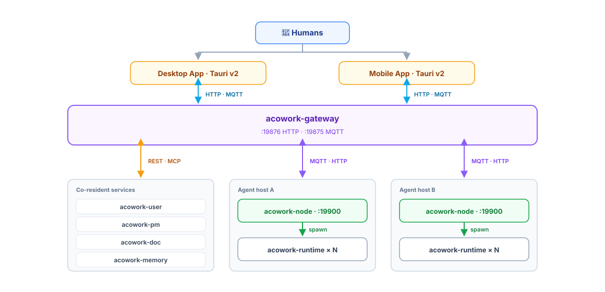

<h1 align="center">ACowork — AI Agents Collaboration Platform</h1>

<p align="center">
  
</p>

<p align="center">
  🏗️ <strong>Declarative Agent Platform · Decentralized · High-Security · Scalable</strong><br>
  ⚡️ <strong>Easy to build an agent.</strong><br>
  ⚡️ <strong>Easy to share an agent.</strong><br>
  ⚡️ <strong>Easy to deploy agent.</strong>
</p>

<p align="center">
  <a href="./LICENSE"></a>
  <a href="https://www.rust-lang.org"></a>
  <a href="./docs/design/zh/"></a>
  <a href="./apps/acowork-desktop/"></a>
</p>

<p align="center">
  <a href="README.zh.md">简体中文</a>
</p>

---

<p align="center">
  <table>
    <tr>
      <td width="50%" align="center" valign="top">
        
        <br />
        <em>Collaborate with multiple agents — each with private memory, real-time context awareness, and tool execution.</em>
      </td>
      <td width="50%" align="center" valign="top">
        
        <br />
        <em>Full-stack development framework with iterative debugging, token tracking, and context snapshots for deep insight into AI reasoning.</em>
      </td>
    </tr>
  </table>
</p>

---

## ✨ Highlights

ACowork is a **multi-user, distributed, AI-native collaboration platform**. People, AI agents, projects, and
documents share one runtime — so a team can plan work, write specs, review code, and ship features alongside
their agents the same way they would alongside a human teammate.

| | |
|---|---|
| 👥 **Multi-user, not single-actor** | Real accounts, roles, sessions, per-user audit. Humans and agents share the same chat / project / doc surface — no "AI side panel" silo. |
| 🌐 **Distributed agents, one control plane** | Gateway brokers MQTT + HTTP reverse proxy; Node Agents run on every host that hosts Runtimes (GPU box / workstation / cloud VM) — single-host and multi-host share one protocol path. |
| 🗂️ **AI-native project & document management** | `acowork-pm` and `acowork-doc` are first-class services; agents read, write, and collaborate on tasks and documents through REST + MCP — including real-time multi-user editing (Yjs CRDT). |
| 🚀 **Standalone or cluster — same binary** | Start a single host for personal use; flip a flag and the same binary becomes a cluster across your team. No local-vs-remote code branches in Gateway. |
| 🧩 **Declarative agents** | `.agent` packages contain manifest + prompts + skills — **no executable code**, signed and verified at install time. |
| ⚙️ **Universal runtime** | A single Rust binary loads any `.agent` package; Agents connect directly to LLM APIs — no Gateway proxy, no extra latency. |
| 🔒 **Process-level isolation** | Every Agent runs as an independent OS process with its own filesystem, memory database, and sandboxed tool execution. |
| 🧠 **Biomimetic memory** | Layered memory on a per-Agent SQLite store — episodic / knowledge / procedural / autobiographical, retrieved by vector + FTS5 hybrid search. |
| 🛡️ **Three-layer security** | Package signing + OS process sandbox + Wasmtime tool sandbox. |
| 💬 **Intent collaboration** | Agents advertise capabilities in a registry, route requests/observations, sync or async, with the Gateway as broker. |
| 🛠️ **Full-stack dev loop** | Desktop App (Tauri v2) supports DevMode: conversational debug, skill hot-reload, breakpoints, recording & replay, publishing wizard. |

Every Agent is still an independent **"digital being"**: its own runtime process, private memory, workspace, and
configuration. **Tune prompt, tools, and memory = build an agent.** Personal and sensitive data is
automatically stripped during packaging, so you can share an agent's capabilities freely without leaking your
private memories.

---

## 🏛️ Architecture

ACowork has a flat three-tier topology: **Gateway** (one control plane per cluster) → **Node Agent** (one per
machine that hosts Runtimes) → **Runtime** (one per `.agent` instance). Every actor — human, AI agent, project
service, document service — talks to the Gateway over the same protocol path.

- **Gateway** (`acowork-gateway`) — one keep-alive Rust process per cluster. HTTP API on `:19876`, embedded MQTT
  broker on `:19875`, reverse proxy to every Node / Runtime, package manager, intent router, global resources
  (LLM providers / MCP / budget / cron / rate-limit).
- **Node Agent** (`acowork-node`) — one per machine that hosts Runtimes. Process table (spawn / kill / reap),
  local package store, MQTT enrollment, local reverse proxy on `:19900`, LSP sidecar supervisor.
- **Runtime** (`acowork-runtime`) — one per running `.agent` instance. Universal Rust binary that loads the
  package, hosts the LLM loop, tool execution, and per-agent HTTP on loopback.

Alongside these, five co-resident services plug into the same Gateway protocol path — `acowork-user` (accounts,
roles, profiles), `acowork-pm` (project & task management), `acowork-doc` (online document library), and
`acowork-memory` (the standalone memory service) are reachable to both humans and agents through the same
REST + MCP surface.

**Standalone** — the Gateway auto-spawns one local Node on the same host: one process tree, one MQTT broker, one
HTTP entry. **Cluster** — install `acowork-node` on every host you want Runtimes to live on and enroll them; the
same protocol path lights up. The Gateway has **zero local-vs-remote code branches**.

<p align="center">
  
</p>

> Full topology, protocol paths, and the frozen design boundaries:
> [`docs/design/zh/01-overview.md`](./docs/design/zh/01-overview.md) ·
> [`docs/module-design/zh/`](./docs/module-design/zh/) ·
> [`docs/adr/zh/`](./docs/adr/zh/)

---

## 🚀 Quick Start

Cross-platform build scripts under [`dev/`](./dev/) handle ONNX Runtime discovery, profile switching, and resource
staging — prefer them over calling `cargo` directly.

```bash
git clone https://github.com/tranxon/ACowork.git
cd ACowork

# 1. Build the backend (Gateway + Runtime + Node Agent)
./dev/common/build_core.sh     # Windows: .\dev\common\build_core.ps1

# 2. Launch the Desktop App
cd apps/acowork-desktop
npm install && npm run tauri dev
```

`build_core.*` handles ONNX Runtime itself — it detects a local install under `.ort/`, and on a
missing one offers to fetch it (on macOS it downloads ORT via cargo with CoreML acceleration on Apple
Silicon). Add `--debug` / `-Debug` for a debug build with verbose logs.

The Desktop App is a Tauri v2 shell whose React/TS frontend talks to the Gateway over HTTP.
Agents are created through the **Create Agent wizard** in the app — it writes the manifest for you.

> Prerequisites, packaging, CI, and deployment:
> [`dev/README.md`](./dev/README.md) · [`AGENTS.md`](./AGENTS.md)

### ☁️ Remote access (optional)

By default Gateway binds HTTP/MQTT to localhost only. To reach a NAT'd Gateway from the public internet, deploy
`acowork-relay` — a **thin, protocol-agnostic relay**: Gateway dials out one WSS tunnel, the relay routes traffic
purely by TLS SNI / Host header and never parses HTTP or MQTT. The relay holds **zero accounts and zero secrets**;
all authentication is decided by your Gateway.

- Design: [`docs/design/zh/24-cloud-relay-remote-access.md`](./docs/design/zh/24-cloud-relay-remote-access.md)
- Deploy (Cloudflare DNS + Aliyun ECS): [`docs/runbooks/relay-ecs-cloudflare-deploy.md`](./docs/runbooks/relay-ecs-cloudflare-deploy.md)
- Self-host in mainland China (ICP filing): [`docs/runbooks/relay-selfhost-cn-deploy.md`](./docs/runbooks/relay-selfhost-cn-deploy.md)

> **Status**: ACowork is in **alpha**. The Gateway, Runtime, memory engine, and Desktop App are under active
> development. See [Roadmap](#-roadmap) for what is shipping today and what is next.

For more — packaging installers, signing, CI, remote-node onboarding — see [`docs/design/zh/`](./docs/design/zh/).

---

## 📈 Roadmap

| Phase | Scope                                                                                                                                            | Status         |
| ----- | ------------------------------------------------------------------------------------------------------------------------------------------------ | -------------- |
| 1     | Foundation + LLM interaction (MVP): package parsing, signing, Runtime main loop, Gateway basics                                                  | ✅ Done         |
| 2     | Memory layering + multi-user accounts: biomimetic memory layers, instant extraction; per-user sessions & audit | ✅ Done         |
| 3     | AI-native PM & Doc: `acowork-pm` and `acowork-doc` standalone services, REST + MCP, multi-user real-time editing (Tiptap + Yjs) | 🚧 In progress |
| 4     | Distributed runtime: Node Agent enrollment, cluster mode, shared protocol path | 🚧 In progress |
| 5     | Permissions & sandbox: filesystem isolation, WASM sandbox (Wasmtime), Approval Gate                                                             | 🚧 Partial     |
| 6     | Desktop App + dev framework: Debug Protocol, Skill hot-reload, recording/replay; MQTT-based IPC                                                | 🚧 In progress |
| 7     | Ecosystem: remote `.agent` registry, Agent store, Memory Sync across hosts                                                                     | 🔮 Planning    |

---

## 📚 Documentation

- Architecture design: [`docs/design/zh/`](./docs/design/zh/)
- Module-level design: [`docs/module-design/zh/`](./docs/module-design/zh/)
- Design notes & decision history: [`docs/adr/zh/`](./docs/adr/zh/)
- Developer conventions: [`AGENTS.md`](./AGENTS.md)

---

## 🧪 References & Acknowledgments

ACowork's design draws inspiration from:

- [ZeroClaw 🦀](https://github.com/zeroclaw-labs/zeroclaw) — trait-driven runtime, security decorators, streaming parser
- [Grafeo](https://github.com/GrafeoDB/grafeo) — hybrid (vector + lexical) retrieval over a local store; the storage engine has since moved to SQLite (ADR-082)
- [Mem0](https://github.com/mem0ai/mem0) — multi-level memory, user/session/Agent state
- [HippoRAG](https://github.com/OSU-NLP-Group/HippoRAG) — neurobiology-inspired long-term memory, associative diffusion
- [LightMem](https://github.com/zjunlp/LightMem) — lightweight memory compression
- [OpenCode](https://github.com/anomalyco/opencode) — multi-agent collaboration, provider-agnostic design

---

## 🤝 Contributing

The project is in **active implementation (Alpha)**. Code, design feedback, and reviews are all welcome:

- Open issues for bug reports, proposals, or design feedback
- Read [`AGENTS.md`](./AGENTS.md) for project conventions before opening a PR
- Read [`CONTRIBUTING.md`](./CONTRIBUTING.md) for the build, test, and review gates
- Report security issues privately, per [`SECURITY.md`](./SECURITY.md)
- Participation is governed by the [`CODE_OF_CONDUCT.md`](./CODE_OF_CONDUCT.md)

---

## 📄 License

Apache-2.0 — see [`LICENSE`](./LICENSE) for details.

---

<p align="center">
  <b>ACowork — AI Agents Collaboration Platform</b><br>
  <i>An all-in-one platform for humans and AI agents.</i>
</p>


