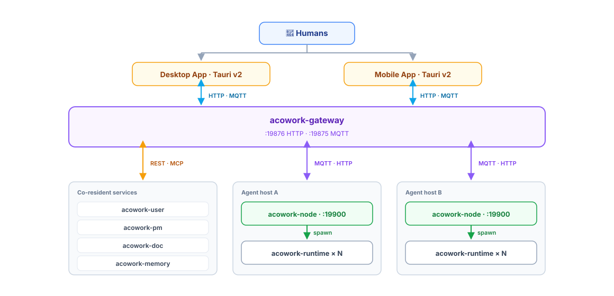

<h1 align="center">ACowork — AI agents协作平台</h1>

<p align="center">
  
</p>

<p align="center">
  🏗️ <strong>声明式 Agent 平台 · 去中心化 · 高安全 · 可扩展</strong><br>
  ⚡️ <strong>Easy to build an agent colleague.</strong><br>
  ⚡️ <strong>Easy to share an agent colleague.</strong><br>
  ⚡️ <strong>Easy to deploy agent colleagues.</strong>
</p>

<p align="center">
  <a href="./LICENSE"></a>
  <a href="https://www.rust-lang.org"></a>
  <a href="./docs/design/zh/"></a>
  <a href="./apps/acowork-desktop/"></a>
</p>

<p align="center">
  <a href="README.md">English</a>
</p>

---

<p align="center">
  <table>
    <tr>
      <td width="50%" align="center" valign="top">
        
        <br />
        <em>人与AI协作——每位 Agent 拥有独立运行环境、记忆存储、实时上下文感知和工具执行能力。</em>
      </td>
      <td width="50%" align="center" valign="top">
        
        <br />
        <em>全链路开发框架：迭代调试、Token 追踪、上下文快照，深入洞察 AI 推理过程。</em>
      </td>
    </tr>
  </table>
</p>

---

## ✨ 核心亮点

ACowork 是一个**多用户、分布式、AI 原生的协作平台**。团队成员、AI agent、项目与文档统一装进同一个
运行时——规划工作、撰写文档、评审代码、交付功能，都可以像和人类队友协作一样和 Agent 并肩完成。

| | |
|---|---|
| 👥 **多用户，而不是单 actor** | 真实账号、角色、会话、按用户审计。人和 AI agent 共享同一个聊天 / 项目 / 文档面板——没有「AI 侧边栏」这种孤岛。 |
| 🌐 **分布式 Agent，一个控制面** | Gateway 负责 MQTT + HTTP 反代；Node Agent 跑在每台需要承载 Runtime 的主机（GPU 机 / 工位 / 云 VM）上——单机与多机走同一条协议路径。 |
| 🗂️ **AI 原生的项目 & 文档管理** | `acowork-pm` 和 `acowork-doc` 是一等公民服务；Agent 通过 REST + MCP 读写任务与文档，并支持实时多人编辑（Yjs CRDT）。 |
| 🚀 **Standalone 或集群——同一份二进制** | 单机自用就开 standalone；翻一个开关，同一份二进制成为横跨团队的集群。Gateway 代码里没有「本地 / 远程」分支。 |
| 🧩 **声明式 Agent** | `.agent` 包只包含 manifest + prompts + skills——**无可执行代码**，签名后在安装时强制验证。 |
| ⚙️ **统一 Runtime** | 单一 Rust 二进制加载任意 `.agent` 包；Agent 直连 LLM API——不经 Gateway 代理，零额外延迟。 |
| 🔒 **进程级隔离** | 每个 Agent 作为独立 OS 进程运行，自带文件系统、记忆数据库与沙箱化的工具执行。 |
| 🧠 **仿生记忆** | 每个 Agent 拥有私有 SQLite 存储，经历 / 语义 / 程序 / 自传体分层记忆，向量 + FTS5 混合检索。 |
| 🛡️ **三层安全** | 包签名 + 操作系统进程沙箱 + Wasmtime 工具沙箱。 |
| 💬 **Intent 协作** | Agent 通过 Capability Registry 声明能力，Gateway 作为 broker 路由请求/订阅，支持同步/异步。 |
| 🛠️ **全链路开发** | Desktop App（Tauri v2）内置 DevMode：对话调试、Skill 热加载、断点、录制回放、发布向导。 |

每个 Agent 依然是独立的**"数字伙伴"**：拥有自己的运行时进程、私有记忆、工作区和配置——
完全独立的个性化认知。**调优 Prompt、Tools、Memory = 构建 AI agent**。Personal/Sensitive 数据在打包时
自动剥离，你可以自由分享 Agent 的能力，而不必担心泄露私有记忆。

---

## 🏛️ 架构

ACowork 采用扁平的三层拓扑：**Gateway**（每个集群唯一控制面）→ **Node Agent**（每台需要承载 Runtime
的主机一个）→ **Runtime**（每个运行中的 `.agent` 实例一个）。无论是人、AI Agent、项目服务还是文档服务，
都通过同一条协议路径与 Gateway 对话。

- **Gateway**（`acowork-gateway`）—— 每个集群一个常驻 Rust 进程。`:19876` 上的 HTTP API，`:19875` 上内嵌的
  MQTT broker；反代到所有 Node / Runtime；包管理；Intent 路由；全局资源（LLM providers / MCP / budget /
  cron / rate-limit）。
- **Node Agent**（`acowork-node`）—— 每台承载 Runtime 的主机一个。进程表（spawn / kill / reap）、本地包
  存储、向 Gateway 的 MQTT 接入、本地反代 `:19900`、LSP sidecar 监督。
- **Runtime**（`acowork-runtime`）—— 每个运行中的 `.agent` 实例一个。通用 Rust 二进制：加载 `.agent` 包、
  跑 LLM 主循环、工具执行，以及 loopback 上的 per-agent HTTP。

除了这三层之外，五个常驻服务挂在同一条 Gateway 协议路径上——`acowork-user`（账号、角色、档案）、
`acowork-pm`（项目与任务管理）、`acowork-doc`（在线文档库）、`acowork-memory`（独立记忆服务）对人和 Agent
暴露同一套 REST + MCP 接口。

**Standalone** —— Gateway 在本机自动 spawn 一个本地 Node：一个进程树、一个 MQTT broker、一个 HTTP 入口。
**集群** —— 在每台要承载 Runtime 的机器上安装 `acowork-node` 并完成接入，同一条协议路径即刻点亮。
**Gateway 代码里完全无「本地 / 远程」分支**。

<p align="center">
  
</p>

> 完整拓扑、协议路径与冻结的设计边界：
> [`docs/design/zh/01-overview.md`](./docs/design/zh/01-overview.md) ·
> [`docs/module-design/zh/`](./docs/module-design/zh/) ·
> [`docs/adr/zh/`](./docs/adr/zh/)

---

## 🚀 快速开始

跨平台编译脚本位于 [`dev/`](./dev/)，统一处理 ONNX Runtime 探测、profile 切换、资源 staging——优先使用脚本而非直接调用 `cargo`。

```bash
git clone https://github.com/tranxon/ACowork.git
cd ACowork

# 1. 安装 ONNX Runtime（一次性）并编译后端
./dev/common/setup_ort.sh      # Linux / macOS / WSL / Git Bash
./dev/common/build_core.sh     # Windows：.\dev\common\setup_ort.ps1 / build_core.ps1

# 2. 启动 Desktop App
cd apps/acowork-desktop
npm install && npm run tauri dev
```

`build_core.*` 负责编译 Gateway、Runtime 与 Node Agent；Desktop App 是 Tauri v2 壳，React/TS 前端通过 HTTP
与 Gateway 对话。加 `--debug` / `-Debug` 可切到调试构建并打开详细日志。

> 前置依赖、打包、CI 与部署：
> [`dev/README.md`](./dev/README.md) · [`AGENTS.md`](./AGENTS.md)

### ☁️ 云端中继远程访问（可选）

默认情况下 Gateway 的 HTTP/MQTT 只绑定 localhost。若要在公网访问位于 NAT 之后的 Gateway，可部署 `acowork-relay`
——一个**协议无关的瘦中继**：Gateway 主动拨出建立一条 WSS 隧道，中继仅按 TLS SNI / Host 头路由字节流，
不解析 HTTP/MQTT。中继**零账号、零秘密**，所有鉴权由你的 Gateway 裁决。

- 设计：[`docs/design/zh/24-cloud-relay-remote-access.md`](./docs/design/zh/24-cloud-relay-remote-access.md)
- 部署（Cloudflare DNS + 阿里云 ECS）：[`docs/runbooks/relay-ecs-cloudflare-deploy.md`](./docs/runbooks/relay-ecs-cloudflare-deploy.md)
- 境内自建（ICP 备案）：[`docs/runbooks/relay-selfhost-cn-deploy.md`](./docs/runbooks/relay-selfhost-cn-deploy.md)

### ✍️ 30 秒写出第一个 Agent

```toml
# examples/qa-agent/manifest.toml
[package]
id = "com.example.qa-agent"
name = "Quality Assurance"
display_name = "QA-Tom"
role = "QA"
version = "1.0.0"

[llm]
provider = "deepseek"
model = "deepseek-v4-flash"

[permissions]
tools = ["rag_query", "read_file", "write_file"]
```

```markdown
<!-- prompts/system.md -->
你是一个 QA Agent，擅长帮助用户做质量管理与代码审查。
```

构建并签名：

```bash
./dev/common/build-agent.sh examples/qa-agent   # 产出 com.example.qa-agent.agent
```

> **当前状态**：ACowork 处于 **Alpha 阶段**。Gateway、Runtime、记忆引擎与 Desktop App 都在积极开发中。
> 详见 [路线图](#-路线图) 了解当前已交付与下一步计划。

打包安装包、签名、CI、远程节点接入等更多内容请参见 [`docs/design/zh/`](./docs/design/zh/)。

---

## 🧪 Agent 开发流程

```
① 编写       manifest.toml + prompts/ + skills/SKILL.md + 可选 tools/*.wasm
② 签名       acowork-keygen → acowork-sign  （Developer 私钥 + 包签名）
③ 调试       Desktop App DevMode → 对话调试、SKILL.md 热加载、断点、录制回放
④ 发布       发布向导 → 远程仓库，或直接分享 .agent 文件
```

开发者通过**调优声明式配置**来构建 Agent——系统提示词、工具能力、记忆行为——而非编写命令式代码。
从编写到发布的完整链路，平台均提供工具支撑。

---

## 📈 路线图

| 阶段    | 内容                                                                                                                                                                                                                                          | 状态     |
| ------- | ----------------------------------------------------------------------------------------------------------------------------------------------------------------------------------------------------------------------------------------------- | -------- |
| Phase 1 | 基础框架 + LLM 交互（MVP）：包解析、签名验证、Runtime 主循环、Gateway 基础                                                                                                                                                                  | ✅ 已完成 |
| Phase 2 | Memory 分层 + 多用户账号：仿生记忆分层、即时提取；按用户的会话与审计                                                                                                       | ✅ 已完成 |
| Phase 3 | AI 原生的项目 & 文档管理：`acowork-pm` 与 `acowork-doc` 独立进程服务，REST + MCP，多人实时编辑（Tiptap + Yjs）                                                                                                                                                | 🚧 进行中 |
| Phase 4 | 分布式 Runtime：Node Agent 接入、多主机集群模式、共用同一条协议路径                                                                                                                                                                                  | 🚧 进行中 |
| Phase 5 | 权限与沙箱：文件系统隔离、WASM 沙箱（Wasmtime）、Approval Gate                                                                                                                                                                                 | 🚧 部分实现 |
| Phase 6 | Desktop App + 开发框架：Debug Protocol、Skill 热加载、录制回放；MQTT 协议栈重构                                                                                                                                                              | 🚧 进行中 |
| Phase 7 | 生态：远程 `.agent` 仓库、Agent 商店、跨主机 Memory Sync                                                                                                                                                                                       | 🔮 规划中 |

---

## 📚 文档

- 架构设计：[`docs/design/zh/`](./docs/design/zh/)
- 模块级设计：[`docs/module-design/zh/`](./docs/module-design/zh/)
- 设计与决策记录：[`docs/adr/zh/`](./docs/adr/zh/)
- 开发者约定：[`AGENTS.md`](./AGENTS.md)

---

## 🧪 参考与致谢

ACowork 的设计深受以下开源项目启发：

- [ZeroClaw 🦀](https://github.com/zeroclaw-labs/zeroclaw) — Trait 驱动运行时、安全装饰器、流式解析
- [Grafeo](https://github.com/GrafeoDB/grafeo) — 本地存储上的向量 + 词法混合检索；存储引擎此后已迁移至 SQLite（ADR-082）
- [Mem0](https://github.com/mem0ai/mem0) — 多层级记忆、用户/会话/Agent 状态
- [HippoRAG](https://github.com/OSU-NLP-Group/HippoRAG) — 神经生物学启发长时记忆、关联扩散
- [LightMem](https://github.com/zjunlp/LightMem) — 轻量级记忆压缩
- [OpenCode](https://github.com/anomalyco/opencode) — 多 Agent 协作、Provider 无关设计

---

## 🤝 贡献

项目处于 **Alpha 实现期**。欢迎提交代码、设计反馈与评审意见：

- 通过 issue 提交 bug 报告、提案或设计反馈
- 提 PR 前请先阅读 [`AGENTS.md`](./AGENTS.md) 了解项目约定
- 构建、测试与评审要求见 [`CONTRIBUTING.md`](./CONTRIBUTING.md)
- 安全问题请按 [`SECURITY.md`](./SECURITY.md) 私下报告
- 参与本项目须遵守 [`CODE_OF_CONDUCT.md`](./CODE_OF_CONDUCT.md)

---

## 📄 License

Apache-2.0 —— 详见 [`LICENSE`](./LICENSE)。

---

<p align="center">
  <b>ACowork — AI agents协作平台</b><br>
  <i>一个为人与AI智能体协作打造的一站式平台。</i>
</p>

