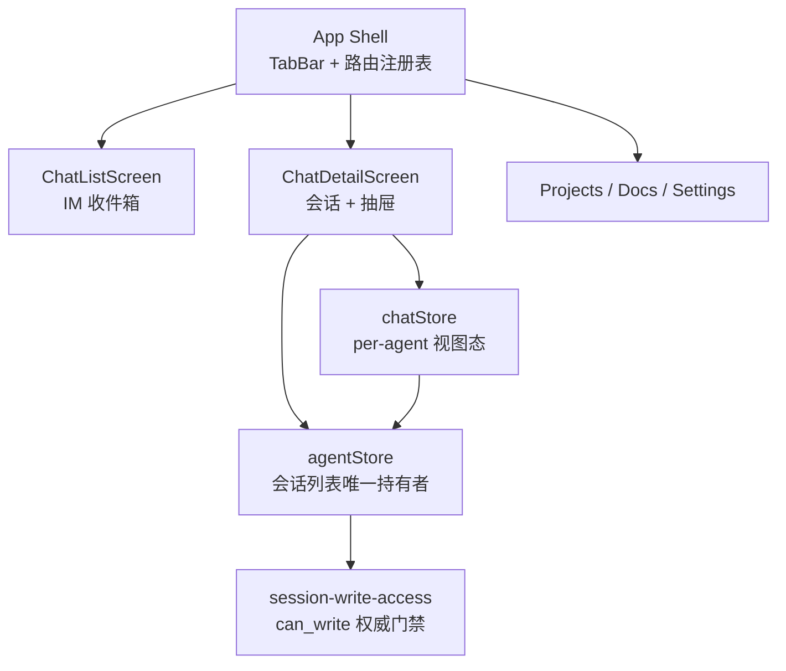

# acowork-mobile

ACowork 移动端。Desktop App 的**便携操作终端**——功能子集，IM 风格信息架构，
面向"碎片时间下的对话控制"，不是 Desktop 的移动版复刻。

设计依据：[docs/design/zh/25-mobile-app.md](../../docs/design/zh/25-mobile-app.md) ·
[ADR-086](../../docs/adr/zh/ADR-086-mobile-app-im-ia-and-multi-session.md)

## 定位与边界

| 做 | 不做（v1） |
|---|---|
| IM 风格会话流（Agents + 联系人合并收件箱） | DevMode、Git 状态条 |
| Agent **多会话**切换（导航栏标题 = 会话切换器） | Agent 创建/安装/克隆/发布 |
| 只读会话浏览（`can_write` 驱动） | Provider / API Key / MCP / Embedding 管理 |
| 项目、文档、设置（只读浏览 + 基础项） | Monaco 编辑器、文件预览 |
| 会话工作区（仅 Add to Chat） | 富文本编辑器 |
| 消息发送、审批、AskQuestion | Harness、Extensions |

移动端**不存在本地 Gateway 进程**，因此设置里的 Gateway 启停在 v1 禁用。

## 运行

```bash
npm install
npm run dev          # 浏览器 :19877（桌面端可用鼠标拖拽模拟触摸）
npm run tauri:dev    # 原生壳内运行
npm run tauri:build  # 打包
```

## Android 打包

壳是 Tauri v2（[设计 §11.2](../../docs/design/zh/25-mobile-app.md)）。前端产物被
`generate_context!` 编进 `libacowork_mobile_lib.so`，所以 APK 里没有 assets 目录，
只有 `lib/arm64-v8a/`。

**一条命令（推荐，从干净 clone 到 APK）**：

```powershell
.\dev\android\build_mobile.ps1              # debug APK
.\dev\android\build_mobile.ps1 -Install     # 顺带装到已连接的设备
.\dev\android\build_mobile.ps1 -ReleaseApk  # release APK
```

脚本自己会搞定工具链（自动找 JDK ≥ 17 与 Android SDK）、首次 `tauri android init`、
图标、权限和 release 构建配置，然后调用 `tauri android build`。**不需要手改 `gen/`。**

> **为什么必须有这个脚本**：`tauri android init` 每次都从零重建
> `src-tauri/gen/android/`，而该目录是 gitignore 的。三样东西活不过 init：
>
> 1. **自适应启动器图标**——init 会往 `gen/res/` 塞一整套**它自己的默认图标**
>    （机器人"两个圆圈套一起"）。这里有两个坑，缺一个都会显示成默认图标：
>
>    - init 生成两个**同名**的 Android 模板 drawable：
>      `drawable-v24/ic_launcher_foreground.xml`（系统默认机器人）和
>      `drawable/ic_launcher_background.xml`（绿底模板）。`@mipmap/ic_launcher_foreground`
>      在 API 24+ 会**优先命中 drawable 那份**，压过位图——脚本删掉这两个文件。
>    - 光有自适应图标壳（`mipmap-anydpi-v26/ic_launcher.xml`）不够，它只是**指向**
>      `mipmap-*dpi` 那 15 张位图。位图才是真正的画。**只同步外壳会留下 init 的旧位图**，
>      于是外壳指向机器人图，看起来还是默认图标（背景却被改黄了）。
>
>    源在 `src-tauri/icons/android/`（已提交）。脚本每次构建都把整个目录
>    （外壳 + `values/` + 全部 `mipmap-*dpi` 位图）覆盖进 `gen/res/`。
> 2. **CAMERA 权限**——配网二维码扫描（`src/screens/boot/ScanModal.tsx`，WebView
>    `getUserMedia`）需要。声明在
>    [`dev/android/manifest-permissions.xml`](../../dev/android/manifest-permissions.xml)
>    （已提交），由脚本写进 manifest。缺了它扫码会静默降级成手输地址。
> 3. **release 签名块 + `usesCleartextTraffic`**——见下节。
>
> 换品牌图标后跑 [`dev/common/gen_icons.ps1`](../../dev/common/gen_icons.ps1)（或
> `.sh`）重生成 desktop + mobile 全部图标；`build_mobile.ps1` 每次构建都会重新同步，
> 所以**别**为此重跑 `tauri android init`。

构建前脚本会跑 [`dev/android/check_android_icon.py`](../../dev/android/check_android_icon.py)，
校验三件事：模板 drawable 已删、自适应图标背景是 transparent、`gen/res` 的 15 张位图与
`src-tauri/icons/android/` **逐字节一致**。任何一条不符就直接中止构建——位图漂移正是
"同一份源码、有时编出对图标有时编出默认图标"的成因，宁可停下也不要静默出错包。

手动等价流程（仅在需要绕过脚本时）：

```bash
npx tauri android init
npx tauri android build --apk --debug --target aarch64
# 注意：这样出来的包没有图标壳、也没有 CAMERA 权限，
#       除非你手工补上上面 1、2 两项。
```

产物：`src-tauri/gen/android/app/build/outputs/apk/**/app-*-debug.apk`
（debug 包约 130 MB，未做 strip/LTO；release 需要先配签名，见下）。

### release 签名

Android 签名走标准 Gradle `signingConfigs`，**不写在 `tauri.conf.json` 里**。密钥
放在机器级 `~/.gradle/gradle.properties`，仓库里永不出现密码；`build.gradle.kts` 的
签名块是空值安全的——属性缺失时 release 也能打未签名包，debug 完全不受影响。

```powershell
# 1. 生成 keystore（放到仓库外，比如用户目录）
keytool -genkey -v -keystore $HOME/acowork-mobile.keystore `
  -alias acowork -keyalg RSA -keysize 2048 -validity 10000

# 2. 往 ~/.gradle/gradle.properties 追加（值替换成你自己的）
#    acowork.release.storeFile=C:/Users/<you>/acowork-mobile.keystore
#    acowork.release.storePassword=<库密码>
#    acowork.release.keyAlias=acowork
#    acowork.release.keyPassword=<键密码>

# 3. 打已签名的 release 包（tauri android build 默认即 release，不需额外参数）
npx tauri android build --apk --target aarch64
```

产物：`.../outputs/apk/arm64/release/app-arm64-release.apk`。

> 手动步骤之上，可用一键脚本 [`dev/android/sign_release.ps1`](../../dev/android/README.md)：
> 自动定位 `keytool`、创建/复用 keystore、写入 `gradle.properties`（默认地址即上面两个）
> 并直接打 release 包；全程交互，回车即用默认值。

> **`gen/android` 是 gitignore 的**：`build.gradle.kts` 里那段 `signingConfigs` +
> release 内的 `signingConfig = ...` 赋行，换机器 / 删 `gen/` 重跑 `tauri android init`
> 后要**重新贴一次**（这是项目对手改 gen 的既有约定，与下方符号链接绕法同源）。

### Windows 前置：开启开发者模式（符号链接权限）

Tauri CLI 打包时会把 `libacowork_mobile_lib.so` **符号链接**进 `jniLibs/`，而 Windows
默认不允许普通进程创建符号链接，会直接中断构建：

```
Creation symbolic link is not allowed for this system.
```

**一键脚本 `sign_release.ps1` 和手动 `npx tauri android build` 都会踩到，务必先开开发者模式**
（一次性、可逆，弹 UAC 点"是"即可，等价于 设置 → 隐私和安全 → 开发者选项 → 开启）：

```powershell
# 提权写入开发者模式开关（确认 UAC）
Start-Process pwsh -Verb RunAs -Wait -ArgumentList '-NoProfile','-Command',
  'reg add "HKLM\SOFTWARE\Microsoft\Windows\CurrentVersion\AppModelUnlock" /t REG_DWORD /f /v AllowDevelopmentWithoutDevLicense /d 1'

# 验证：输出 1 即已生效
(Get-ItemProperty "HKLM:\SOFTWARE\Microsoft\Windows\CurrentVersion\AppModelUnlock").AllowDevelopmentWithoutDevLicense
```

> 不想常驻开启开发者模式时的替代：以**管理员身份**运行终端再构建（管理员默认有
> `SeCreateSymbolicLinkPrivilege`），或按下方坑表用"复制 `.so` + 直接 `gradlew`"绕过 CLI。

本机踩过的三个坑，换机器时按同样顺序检查：

| 坑 | 现象 | 处置 |
|---|---|---|
| Windows 不允许创建符号链接 | `Creation symbolic link is not allowed for this system`（CLI 把 `.so` 软链进 jniLibs） | 首选：开启开发者模式（见上方「Windows 前置」，一次性彻底解决）。绕法：手动把 `.so` **复制**到 `app/src/main/jniLibs/arm64-v8a/`，再直接 `./gradlew :app:assembleArm64Debug -x :app:rustBuildArm64Debug -x :app:rustBuildUniversalDebug` 跳过 CLI |
| `@tauri-apps/api` 与 Rust `tauri` crate 主次版本不一致 | CLI 直接拒绝构建 | 两边对齐（当前 2.12.x） |
| 国内网络下 `services.gradle.org` / `repo.maven.apache.org` / `static.rust-lang.org` 被限速 | Gradle 发行包 0 B/s、crate 下载 20 KB/s | 换镜像：wrapper 用腾讯 Gradle 镜像、`~/.gradle/init.gradle` 改写 mavenCentral 到阿里云、`RUSTUP_DIST_SERVER` 与 `~/.cargo/config.toml` 指向 rsproxy.cn |

### 手机连不上网关时先查这几件事

1. **release 包必须放行明文 HTTP**：Android 自 API 28 起默认禁止 App 发明文
   `http://`。debug 构建已把 `usesCleartextTraffic=true` 写进 manifest，但
   `tauri android init` 生成的 `build.gradle.kts` 里 **release 默认是 `false`**，
   于是 release 包连 `http://<局域网IP>:19876` 会在系统网络安全策略层直接被拒
   （fetch 根本到不了 Gateway），UI 却只笼统显示"无法连接"。本机 curl 不受该
   策略约束能连通，别被"curl 通、App 不通"误导去查防火墙/AP 隔离。修法：在
   `src-tauri/gen/android/app/build.gradle.kts` 的 `getByName("release")` 块加
   `manifestPlaceholders["usesCleartextTraffic"] = "true"`（relay/远程路径本就显式
   走 `https://`，不受影响）。⚠️ `gen/` 被 gitignore，重跑 `tauri android init`
   会冲掉这行——与下方签名块同样，属每次 init 后需重打的手动补丁。
   WebView 的 origin 是 `http://tauri.localhost`（Tauri 在 Android 上默认 http），
   所以访问 `http://<局域网IP>:19876` 不属于混合内容。
2. **Windows 防火墙默认拦公网入站**：`Get-NetConnectionProfile` 显示 WLAN 是
   Public 时，手机访问会超时。要么以管理员放行
   `New-NetFirewallRule -Direction Inbound -Protocol TCP -LocalPort 19876 -Action Allow`，
   要么用 USB 免改配置：`adb reverse tcp:19876 tcp:19876`，然后在连接屏填
   `http://127.0.0.1:19876`。

## 质量门禁

```bash
npm run typecheck
npm test             # 104 项：导航栈、会话/权限不变量、实时通道、路由挂载冒烟
npm run build
```

## 架构要点



### 三条不可动摇的不变量

1. **`can_write` 是后端唯一权威**（ADR-076 §决策 4）。客户端绝不从 `visibility`
   反推写权限。会话列表由 `agentStore` **单独持有**——两处副本正是 `can_write`
   静默失效的成因（写门禁查 A 数组，权限 hook 查 B 数组）。只读态**不渲染**
   composer，可见性控件**禁用而非隐藏**。
2. **切换会话 = `chatStore.openSession` 原子三步**：UI 迁移 → `open_session`
   → HTTP 历史重载。不可只做本地页面切换，否则 Runtime 仍在往上一个会话流式
   写入。任一步失败回滚到上一个会话。
3. **只读会话不发送 `open_session`**。它会翻转 session 的全局 Active/Closed
   生命周期，观众无权替别人开启。

## 目录

```
src/
  lib/types.ts                  # 网关线格式的子集
  lib/session-write-access.ts   # ADR-076 门禁（Desktop 同名文件的孪生实现）
  stores/
    navStore.ts                 # 四 Tab × 独立栈，iOS push/pop
    agentStore.ts               # 目录 + 会话列表唯一持有者
    chatStore.ts                # per-agent 视图态 + 原子 openSession
  components/
    ui.tsx                      # ListSection/Row、Switch、Segmented、Stepper、Sheet
    EdgeSwipe.tsx               # 方向一次锁定的边缘手势
  screens/chat/                 # ChatListScreen、ChatDetailScreen
  routes.tsx                    # 路由注册表（单一可检视契约）
  __tests__/                    # 16 项测试
```

## 明确不做的事

- **不与 Desktop 共享前端代码库**。IA、组件、交互范式完全不同；共享会立刻
  长出 `isMobile ? A : B` 的条件分支。共享的只有 core 的 Rust crate。
- **不引入占位组件**。`NotImplemented` 显式渲染"v1 建设中"，让半成品在开发
  期可见，而不是伪装成崩溃。
