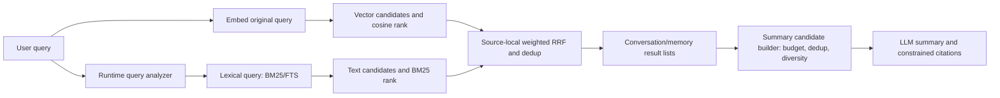

# ADR-095: Global Search Retrieval for Conversations and Memory, and Summary Candidate Selection

- **Number**: ADR-095
- **Status**: Draft (pending review)
- **Date**: 2026-10-16
- **Decision makers**: ACowork Architecture Group
- **Related**: ADR-081 (Global Search), ADR-082 (SQLite Vector and FTS Retrieval), ADR-093 (Global Search LLM Summary and Citations)

## Summary

The file, Git, document, and project sources in Global Search serve different tasks. Their current search strategies fit those use cases and are not changed by this ADR. The optimization scope is conversation history and memory: full natural-language queries may not produce effective lexical searches; Hybrid retrieval ranks two candidate sources, but its signals can be confused with actual semantic similarity; and weak candidates may reach the result list or summary input without an explicit quality policy.

This ADR separates the work into two responsibilities:

1. **Retrieval** optimizes only conversation and memory. It produces vector and lexical candidates separately, ranks them with source-local weighted RRF, and preserves explainability metadata such as match source. By default, the original query is used for embeddings and analyzed lexical terms are used for BM25/FTS. A 4:1 vector-to-text weight is the initial policy for Semantic memory queries; final weights and any weak-vector rejection policy must be calibrated with an evaluation set. RRF scores must not be treated as similarity scores.
2. **Summary candidate selection** chooses a bounded set from results already returned by the six sources. It does not compare incompatible raw scores across sources. Conversation and memory candidates may be selected using source-local rank, match source, and deduplication/diversity constraints. The candidate set may be smaller than its budget or empty, and the summary must state when evidence is insufficient.

This ADR does not change file, Git, document, or project retrieval algorithms; require a shared tokenizer across all tabs; or add an LLM reranker after retrieval.

## 1. Context and Facts

1. Global Search fans out from Desktop to six sources. File, Git, document, and project use their own APIs; conversation and memory search through Runtime `/search`.
2. Conversation and memory use SQLite vector search, FTS text search, and RRF. Global Memory search currently uses the same query text for vector and lexical retrieval, and its Hybrid path has no cosine floor. Conversation Hybrid retrieval applies the existing cosine floor to the vector source while retaining lexical hits independently.
3. `memory_recall` already separates the two query sources: the current full user message is embedded, while LLM-extracted keywords drive BM25. Semantic hint uses weighted RRF with vector/text weights 0.8/0.2. This is a ranking precedent, not evidence of a reliable weak-relevance threshold.
4. Global Memory search does not preserve raw vector or lexical signals. The order score received by the UI is synthetic and cannot be interpreted as cosine similarity. RRF itself is a fused-rank signal and is not suitable for direct comparison across queries or sources.
5. ADR-093's summary candidate builder currently selects up to five results per source in a fixed source order, with at most 30 candidates total. The server receives only candidate ID, scope, title, and snippet.

## 2. Goals, Non-Goals, and Constraints

### 2.1 Goals

- Improve lexical recall for natural-language sentence and keyword queries in conversation and memory while preserving semantic retrieval.
- Distinguish vector hits, lexical hits, and fused-rank signals so rank values are not mistaken for similarity.
- Make summary candidate selection more sensitive to relevance and source-local diversity, and allow weak candidates to be omitted.
- Keep retrieval and summary responsibilities separate so each can be tested and rolled back independently.

### 2.2 Non-Goals

- Do not change ripgrep behavior in the file tab or the search semantics of Git, document, or project services.
- Do not apply one tokenizer uniformly to all six sources.
- Do not numerically compare or claim equal-weight score fusion across BM25, RRF, and synthetic scores from different sources.
- Do not require every source to fill a fixed number of summary slots; do not add LLM query expansion or an LLM relevance-reranking call.
- Do not introduce an arbitrary fixed cosine threshold for memory vectors without data calibration.

## 3. Decisions

### D1 — Keep Search-Source Boundaries Unchanged

Only Runtime query construction, candidate retrieval, fusion, and result metadata for conversation and memory may change. File, Git, document, and project continue to use their existing APIs, ranking, and UI behavior. Summary candidate selection may consume all six sources' results, but must not change their search requests or result ordering.

### D2 — Use Separate Semantic and Lexical Query Forms for Conversation and Memory

The logical retrieval request distinguishes:

- `semantic_query`: the original full user query, used for embedding;
- `lexical_query`: terms produced by a deterministic query analyzer, used for BM25/FTS.

Both may originate from the same user input. Memory tool calls may continue to use the existing combination of the current user message and LLM-extracted keywords. If analysis produces no usable terms, lexical retrieval falls back to the original query; analysis failure must not silently remove existing recall.

The query analyzer is a shared Runtime middleware for conversation/memory retrieval. It is deterministic and does not own storage or HTTP state; it does not affect other search sources. The first implementation should prefer existing dependencies and index capabilities. English whitespace tokenization and handling of Chinese text without spaces must be validated against bilingual evaluation examples. The Chinese segmentation approach and tokenizer dependency are selected during implementation based on existing crates, maintenance cost, and measured results; arbitrary 3-gram OR queries must not be treated as validated without tests.

FTS terms must be safely encoded/escaped and bounded by term count. If analysis fails or exceeds limits, fall back to the original query. This avoids FTS operator injection, oversized-query amplification, and empty-term degradation.

### D3 — Rank Both Candidate Sources Independently, Then Fuse with Source-Local Weighted RRF

The vector source ranks by cosine and the text source ranks by BM25/FTS. Do not add raw cosine and BM25 scores directly. Fuse with weighted RRF and retain whether each hit came from `vector`, `text`, or `both`.

For Semantic memory queries, vector:text = **4:1** is the initial weight, following the existing `memory_recall` preference. Conversation may use the same 4:1 weight as an evaluation starting point, but only if offline evaluation shows no degradation to exact lexical hits or overall quality; otherwise choose weights based on its results. Weights describe ranking contribution, not probability or similarity.

Fetch bounded candidate pools from each source before fusion, then fuse, deduplicate, and truncate to final K. Lexical hits are independent evidence and must not be removed solely because their embeddings are weak. The current conversation cosine floor remains applied only to the vector candidate source. Memory gets no new hard threshold until the evaluation set validates a filtering policy. Absolute RRF scores are not weak-relevance thresholds.

### D4 — Expose Limited, Explainable Source-Local Retrieval Signals

Conversation and memory hits should provide bounded metadata for summary selection:

- `matched_by`: `vector`, `text`, or `both`;
- source-local rank for each retrieval source;
- optional cosine similarity, only when actually computed and preserved;
- fused rank/score, explicitly identified as a source-local rank signal.

RRF, BM25, and cosine must have distinct names and meanings. Do not expose the current synthetic Memory ordering score as similarity or confidence. Raw scores are not compared across sources; diagnostic-only fields need not be shown to users.

### D5 — Summary Candidate Selection Is Independent, Bounded Post-Processing

The summary builder consumes results already returned by all six sources. It does not search again and does not change any source's list ordering. Keep ADR-093's overall candidate and field-length safety ceilings; per-source budgets are ceilings, not quotas that must be filled.

- **File/Git/document/project**: retain their existing source-local order and truncate to the existing budget; introduce no new filtering or reranking.
- **Conversation/memory**: choose by calibrated source-local fused rank; use `matched_by`, source-local ranks, and appropriate session/node deduplication to avoid one conversation or repeated content consuming the candidate budget.
- If fewer candidates meet the budget/quality policy, submit fewer. If no candidate is eligible, do not call the summary LLM, or return an explicit no-result status under the ADR-093 contract.
- The summary DTO may carry bounded source metadata to help the model understand evidence type, but must not describe uncalibrated raw scores as confidence. Candidate bodies remain untrusted data; retain ADR-093 prompt-injection protections and citation allowlisting.
- The prompt must require the model to answer only from candidates and state when evidence is insufficient or contradictory; it must not fabricate a conclusion to make a complete summary.

### D6 — Quality Gates Must Be Data-Driven

Before adding a memory cosine floor, a dynamic rejection threshold, or a pre-summary LLM reranker, create an evaluation set with human relevance labels. At minimum cover English, Chinese, mixed-language queries, short keywords, full sentences, exact entity terms, semantic paraphrases, no-result queries, and duplicate candidates across conversations and memories.

Compare at least: current behavior, dual-query equal-weight RRF, and dual-query 4:1 weighted RRF. Report Recall@K, Precision@K, MRR/nDCG@K, false-retrieval rate for irrelevant queries, and exact lexical-hit retention separately. Enable weights or thresholds only if they meet pre-agreed quality goals without materially harming critical cases.

## 4. Data Flow

The result list is the boundary between retrieval and summary. The retrieval module returns hits ranked within each scope, with match metadata; the summary builder selects within its candidate budget and owns no retrieval logic.

## 5. Module Boundaries and Interface Direction

- **Runtime query analyzer**: pure, deterministic, independently testable logic; accepts the original query and returns bounded lexical terms/query. Called by conversation and memory retrieval; owns neither storage nor HTTP state.
- **SQLite retrieval**: continues to own vector/FTS execution and weighted RRF. Extend internal result types as needed to preserve each source's rank, `matched_by`, and cosine. The storage layer does not perform model-based query expansion.
- **Runtime global search**: calls the analyzer, embedding provider, and SQLite retrieval for conversation/memory; serializes similarity and fused ranking distinctly. Gateway remains a transparent reverse proxy.
- **Desktop summary candidate builder**: accepts each source's already-ranked results, applies per-source and total caps, deduplication, and source-local quality selection; makes no search calls.
- **Runtime summary endpoint**: validates any added candidate metadata alongside existing length/ID limits and calls the existing Provider. Failure does not affect search lists.

If API fields are added, make them optional for gradual consumer migration and update frontend/backend contracts and tests together. No persistent schema migration or index rebuild is required unless evaluation demonstrates that the tokenizer index itself must change; such a change requires separate review.

## 6. Reliability, Security, and Performance

- Bound analyzer input length, term count, and term length; safely escape FTS query syntax.
- Preserve the original-query embedding path. Do not copy full sensitive conversation text into additional persistent storage or logs.
- Bound candidate counts per retrieval source; fusion operates only over bounded pools. Summary remains subject to ADR-093 request-size, candidate-count, snippet-length, and provider-deadline limits.
- Preserve partial-result semantics when a source fails. On analyzer failure, fall back to the original query; on embedding failure, fall back to text search.
- Retrieval diagnostics must not log full conversation bodies; prefer counts, match sources, ranks, and necessary score distributions.

## 7. Delivery, Validation, and Rollback

| Phase | Deliverable | Validation | Rollback |
|---|---|---|---|
| 0 | Create a redacted, labeled conversation/memory query benchmark and current baseline | Save queries, relevant-hit labels, Recall@K / Precision@K / MRR / false-retrieval rate | No runtime behavior changes; remove or update the benchmark |
| 1 | Query analyzer, dual query forms, and explainable candidate-source metadata; initially compare in shadow/test mode | Bilingual analyzer tests, FTS escaping/bounds tests, retrieval regressions, benchmark comparison | Disable analyzer path and restore original-query-only lexical search |
| 2 | Enable source-local weighted RRF for conversation/memory; select weights from benchmark results | Fusion ordering, match-source attribution, exact lexical-hit retention, Recall/Precision metrics | Restore old weights and response mapping; optional response fields may remain |
| 3 | Summary candidate selection, deduplication, and bounded source metadata | Builder unit tests, prompt/citation tests, no/low-quality candidates and partial-source-failure tests | Restore ADR-093 fixed first-N-per-source builder; search behavior remains unchanged |
| 4 | Evaluate and decide whether to enable weak-vector rejection thresholds | Threshold sweep and false-reject/false-accept analysis; do not enable if goals are unmet | Disable threshold configuration; retain vector ranking and independent lexical candidates |

## 8. Alternatives Considered

| Alternative | Reason rejected/deferred |
|---|---|
| Apply one tokenizer across all six tabs and fuse raw scores | Source query semantics and score domains differ; it would alter file/Git/document/project search, explicitly outside this ADR. |
| Use only full-query vector search | Sentence semantics may still yield weak candidates; exact entity, product-name, and lexical evidence would be lost. |
| Use keyword OR only and drop full-sentence embeddings | May improve lexical hits but loses semantic recall; unsuitable for natural-language conversation and memory retrieval. |
| Apply a fixed higher cosine threshold | Cosine distributions may vary by model and corpus; without calibration it can reject valid candidates. |
| Send every candidate directly to the LLM and ask it to filter | Retrieval noise still consumes context and cost; the model can turn weak evidence into confident claims, and selection is not reliably testable. |
| Add a separate LLM query-expansion/reranking call | Adds model cost, latency, and failure modes; defer until deterministic analysis and benchmark results justify it. |

## 9. Open Questions for Review

1. What benchmark Precision@K/Recall@K goals must be met before enabling a Memory cosine rejection threshold?
2. Is an existing crate sufficient for Runtime query analysis, or is a new Chinese tokenizer dependency needed? Decide through offline comparison against the Phase 0 benchmark.
3. Should Conversation start with the same 4:1 vector:text weight as Semantic Memory, or be calibrated separately due to message/FTS distribution differences?
4. Should the API expose raw cosine to the UI, or only to the summary builder and diagnostics? Initial recommendation: keep it with controlled internal consumers so uncalibrated similarity is not presented as user confidence.

## 10. Decision Log

- 2026-10-16: Draft created. Scope confirmed as conversation and memory retrieval only; file, Git, document, and project search remain unchanged; retrieval improvements and summary candidate selection are handled in separate phases and modules.
