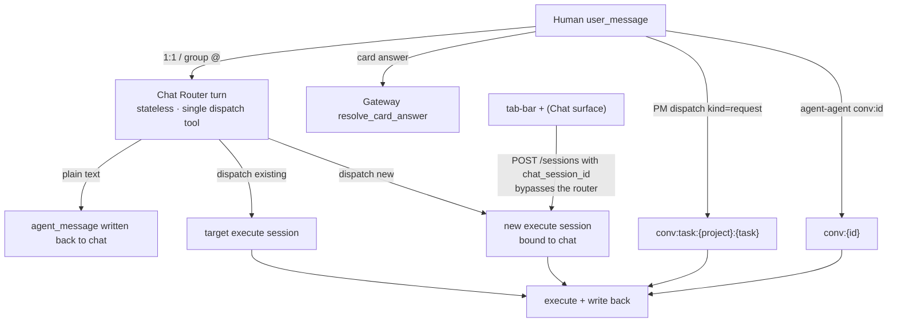

# ADR-099: LLM Semantic Routing for Chat Sessions (Chat Router)

- **Number**: ADR-099
- **Status**: Accepted (revised 2026-10-22: D3/D6 add read-only information tools to the router; D3 adds the routing-time delivery anchor and the execution-side pending queue, see below. Revised 2026-10-23: D8 fallback semantics — a degraded Chat-sourced human message now CREATES an execution session, see D8. Revised 2026-10-24: **D1's "the execution layer keeps physical rotation" is reversed — the T1/T2 rotation is deleted outright**; execution sessions are long-lived, compaction runs in place, and starting a new session is a semantic decision only, see the "Revision (2026-10-24)" section. Revised 2026-10-28: **acceptance criterion 1's "on a reuse the seed lands on the routed-to session" is reversed** — `session_config` is an initial value for creation only; nothing is applied when routing into an existing session, see "Revision (2026-10-28)")
- **Date**: 2026-10-21
- **Deciders**: ACowork Architecture Group
- **Related**: Design 27 (Intent Messaging and Group Chat), Design 29 (Chat Session Context Orchestration), ADR-060 (Prompt-Cache-Friendly Context Block Reorganization), ADR-063 (Package-Level Prompt Override), ADR-066 (Provider Cache Tokens), ADR-076 (Multi-User Account System), ADR-085 (Agent Lifecycle State Machine), ADR-092 (User Message Identity and Bounded Reads), ADR-096 (No Full Session Reads), ADR-098 (Unified Standard Group Model)

## Summary

**(The status quo when this ADR was written)** A chat session is not an LLM context: which execute session receives a user message is decided entirely by code rules (`routing_key` + T1 idle / T2 compaction / T3 config conflict). Those rules answer two different questions at once — "which task should semantically continue this work" and "should the physical context window be replaced" — and therefore produce three unreasonable behaviours:

1. Changing model/workspace in the chat forces a new execute session;
2. With no parameter change, the message always reuses the current working session regardless of semantic relevance;
3. A T2 rotation carries the old task's summary into the new task; the summary tokens far exceed the user input, and the new session keeps working on the old job.

This ADR decides on a layered approach: **the chat layer introduces one restricted-tool LLM turn (Chat Router) for the semantic decision** (at the time, the execution layer kept physical rotation as a context safety valve: T3 deleted, T1 demoted from a hard rule to a prompt signal, T2 only inside the same logical task chosen by the router). That safety valve was **deleted outright by the 2026-10-24 revision**: the only way a new execution session starts is a semantic decision (`dispatch(target="new")` / a PM task reaching a terminal state / the user creating one explicitly), and context growth is handled by compaction in place — see the "Revision (2026-10-24)" section.

The routing carrier is `ChatSessionManager` (isolated per `chat_session_id`; in a group chat each agent is naturally separate), the router's tool surface is `dispatch` plus two read-only information tools (D3), and the context is orchestrated as "stable prefix + append at the tail" (see Design 29).

## Background

### 1. Current state (retired): routing_key and three rotation triggers

The `routing_key` namespace priority is `task:` > `chat:` > `conv:` > `msg:` ([intent_routing.rs](../../../core/acowork-runtime/src/agent/session/intent_routing.rs)). 1:1 chats and group @Agent mentions have an empty `conversation_id`, so both fall into `chat:{chat_session_id}`; a PM dispatch is `conv:task:{project}:{task}`. `route_intent_session` checks, in order:

- whether the mapped session hits T1 (idle beyond `intent_idle_rotate_hours`) or T2 (a compaction happened);
- whether the `SessionSeed` (model/provider/workspace/reasoning from the chat draft) conflicts with the mapped session (T3);
- any hit creates a new session and writes a handoff pointer or summary into it.

> All three triggers are now retired (T3 by this ADR, T1/T2 by the 2026-10-24 revision). `route_intent_session` does one thing now: reuse the mapped session if the key has a mapping, create one if it does not — compaction alone owns context hygiene, and starting a new session is always an explicit decision.

### 2. Three unreasonable behaviours

| Behaviour | Root cause |
|---|---|
| Parameter change forces a new session | Parameter consistency is treated as task identity (T3) |
| Semantically unrelated input reuses the session | "Same chat" is treated as "same task" |
| Rotation summary pollutes a new task | T1/T2 are physical-window events carrying "task switch" semantics |

### 3. Group chat and PM amplify the problem

- In a group chat every @ of the same agent enters the same `chat:{group}` chain: multiple users and topics are forced into one sequence, and latecomers inherit the previous topic's context and summary.
- PM dispatch is deterministic by `task:{project}:{task}`, but the task session is not bound to the project group chat, so a user following up in the group cannot be routed to it; nothing prevents a terminal task from being "revived".
- Agent-agent conversations are bounded by `conversation_id`, naturally isolated, and need no semantic routing.

### 4. Why more code rules will not fix it

"Is this message semantically related to a task" requires understanding natural language and conversation history. It is a model judgement, not an enumerable rule. Adding more conditions (keywords, time windows, parameter fingerprints) only piles unmaintainable heuristics into the delivery chain.

## Decisions

### D1 — Layering: semantic routing in the chat layer, no rotation in the execution layer

- Chat layer: every human `user_message` (1:1 and group @) first goes through a router turn that produces "answer / hand off to an existing session / create a new session".
- Execution layer: when this ADR was written it kept T1/T2 as physical safety valves and deleted T3; **the 2026-10-24 revision deletes T1/T2** — execution sessions are long-lived, context hygiene belongs solely to the ADR-011 / ADR-061 compaction machinery, and there is no code-level rotation point any more.
- Card answers, PM dispatch, and agent-agent messages do not pass through the router.

### D2 — Stateless router turns, ChatSessionManager isolated per chat

Each turn rebuilds its context from chat history; no hidden resident session is created (avoiding dual-history forks and extra rotation). `ChatSessionManager` is keyed by `chat_session_id`; a 1:1 chat is naturally unique per (user, agent), and in a group chat each agent has its own Runtime, so isolation per agent is inherent. The manager only owns the per-chat serial queue, window anchor, candidate construction, and the decision log.

**A router turn never runs on the MQTT inbound loop.** The inbound loop does exactly one thing: push the message onto that chat's FIFO queue, and spawn a drain task only when `push_turn` reports that nobody was draining it. There is always at most one drainer per chat, and `finish_drain` keeps the claim while the queue is non-empty, which closes the "check empty → message enqueued → claim released → message stranded forever" race. Two invariants justify the shape: two turns of one chat must not read the same history anchor concurrently and then race on the write-back, and a slow model must not stall this agent's receive side — `Stop` included. Each turn is wrapped in one more `spawn` inside the drain task, so a panic surfaces as a `JoinErr` and the loop still reaches `finish_drain`; no chat can be left claimed with a queue nobody consumes. An outcome the router hands back (`PassThrough` / `Fallback`) is finished by that same drain task running the deterministic route, so a degradation costs latency, never the message, and never re-enters the queue.

### D3 — `dispatch`, read-only information tools, and the tool visibility matrix

`dispatch(target = "<candidate alias>" | "new", message?, session_config?)`; not calling `dispatch` means a plain-text answer. Candidates use short `S1/S2` aliases mapped to real session ids at runtime.

So that "the answer needs a bit of information" no longer degrades into "hand the message to an execution session", the router also exposes two **read-only information tools**:

- `memory_recall`: searches this agent's long-term memory (the same builtin as the execute side; the retrieval strategy is unchanged);
- `http_request`: **narrowed to GET-only** — the router-side schema carries no `method`/`body`/`content_type`, and at execution time the runtime additionally forces `method = "GET"`, a scheme allowlist (http/https), and an inner timeout below the turn timeout — belt and braces.

| Tool | chat router turn | execute turn |
|---|---|---|
| `dispatch` | the only routing tool | not exposed |
| `memory_recall` | available (on-demand recall) | available |
| `http_request` | available (GET-only) | available |
| `intent_send` | not exposed | available (hidden in the responder role) |
| `chat_history_read` | not exposed (history is injected) | available |
| `ask_user_question` | not exposed (clarify in text) | available (hidden in human-free sessions) |
| shell / file / other execution tools | not exposed | per manifest/config |

The executor boundary is unchanged: the router has no execution tool, so no package persona can turn it into an executor; information tools only read, they never change anything. Tool instances are resolved by name off `all_tools` (the enabled-builtin subset), so the agent-level toggle governs the router too.

**The round budget is a prompt-level soft limit, not a hard code cap**: information rounds have no fixed maximum (hard-cutting an in-flight lookup lands the failure in a *more* uncontrolled shape); the safety envelope is the per-call model timeout, the per-call tool timeout, and the read-only tool surface. One turn's `user → assistant → tool_call → tool_result → assistant` chain is kept whole inside a single request: the output ceiling `max_tokens` is relaxed to 2048 (think + tool arguments + final text are never cut mid-call), and each tool result is capped at 8KB (UTF-8-boundary truncation with a marker). Tool messages are never written back to chat history, so Block B does not inflate.

`dispatch` selects a session inside this agent only; `intent_send` is what crosses agents. The router must not @ another agent on the human's behalf — `@` is a user action.

**Delivery is anchored at routing time, and a busy target shows a real pending queue.** When a turn is dispatched (or legacy-routed) into an execution session, the `turn_started` pointer is written to the chat as soon as the intent is delivered — not when a possibly-busy session dequeues it minutes later — so the chat surface stops projecting "assigning" while the work is queued. On the execution side, an intent routed into a session that is *already active* is recorded in a small bounded pending list (sender + ≤120-char excerpt + `from_chat` flag, ADR-096) and projected through the existing retained `session_state` snapshot, so the composer's queue box shows the chat-forwarded message that was previously invisible in the inbound channel. It is cleared when the session dequeues the intent to start its turn; an idle session never enqueues. No new write entry point, no persistence.

**The cost asymmetry of dispatch is the core of the decision rules** (written into the non-overridable base prompt): a wrong dispatch is far more expensive than a missed one (a wrong handoff wakes a whole execution session and derails the conversation; not dispatching only costs the user a moment before asking again). Route only when the message clearly belongs to one candidate task or plainly starts new work; questions, greetings, small talk, and factual lookups you can do yourself are always answered directly; when it is unclear whether routing is needed, reply or ask one clarifying question instead of guessing.

### D4 — Candidate rules and multi-user isolation

- 1:1: the currently mapped session + historical sessions with `meta.chat_session_id == this chat` + hand-made sessions owned by the current user with an empty `chat_session_id`.
- Group chat: only sessions with `meta.chat_session_id == this group` (including bound PM task sessions); never any personal 1:1 session.
- Excluded: sessions bound to another chat, sessions owned by someone else (1:1), and terminal PM task sessions. At most 10, ordered by `last_active_at`; only title/status/last activity/source are exposed, never JSONL bodies (ADR-096).

### D5 — Context orchestration: stable prefix + append at the tail

Apply the ADR-060 block model to the chat layer:

- Block A: router system prompt (base + persona + scenario section), byte-stable;
- Block B: chat history projected deterministically by seq, append-only; the window anchor `anchor_seq` moves forward in batches only when `max_history + slack` is exceeded;
- Block C: candidate list, draft config, current time and other dynamic information after the history, so changes only invalidate themselves;
- Anthropic gets one `cache_control: ephemeral` breakpoint at the end of A and B; OpenAI/DeepSeek rely on automatic prefix caching.

See Design 29 for details.

### D6 — Chat prompt strictly separated from the execute prompt

The execute prompt (`prompts/system.md` + `constraints.md` + other `prompts/*.md` + skills) carries the execution identity, tool rules, and engineering conventions; it must not be copied to the router. The chat prompt has three layers, the **whole** of which a `chat.md` may override:

1. Runtime built-in base (role boundary, `dispatch` contract, decision and safety rules);
2. Persona section: manifest `name`/`role`/`description` fallback, capped at 4KB;
3. Scenario section: two stable variants for 1:1 and group chat.

When a `chat.md` is present and non-blank it **replaces all three layers** (only `{{agent_name}}` is substituted) — except the `# Safety` section, which the Runtime re-appends to the body as a non-trimmable tail every turn. Precedence: a group session's `chat-sessions/{id}/chat.md` (`acowork-user`, read by any participant and editable only by the group owner or an admin — ADR-098 — from the group's right-hand settings panel, seeded with the built-in default on first read) > package `prompts/chat.md` (seeded with the built-in default on agent start) > the built-in default. The package `chat.md` joins the ADR-063 package-level override list and is therefore also excluded from execute prompt assembly; `POST /agents/{id}/prompts/reload` refreshes it. The safety boundary is **structural**, not literal: the `# Safety` tail cannot be deleted by a `chat.md`, only the owner or an admin may rewrite a group's prompt so one member cannot steer another's agent, and the router only ever holds `dispatch` and the two read-only information tools, so rewriting the prompt text cannot grant it a new capability. The router loads no skills, no workspace prompt file, and does **not auto-inject** retrieved memory — memory is reachable only on demand through `memory_recall` (D3).

> Revision (`chat.md` now replaces the whole prompt): D6 originally said `prompts/chat.md` **replaces only the Persona section** and the base was not overridable. On request it now replaces the whole prompt, and a session-scoped (group) `chat.md` was added; the kernel and scenario literals moved to `acowork_core::chat_prompt`, shared by `acowork-user` (seeding a group file) and `acowork-runtime` (assembling the built-in default). The safety guarantee is carried by the tool set instead. Design 29 §3.1–3.3 is updated in step.

### D7 — Group chat and PM dispatch boundaries

- Group @Agent: `@` only picks the agent; the router picks the execution session. Different topics in the same group can run in parallel sessions.
- PM dispatch: keeps the deterministic `conversation_id = task:{project}:{task}` mapping and does not pass through the router. The task session is bound to the project group chat (`chat_session_id` + Members visibility) so it enters the group's candidates; `close_intent_context` records the session in the terminal list, which candidates exclude.
- Agent-agent: deterministic `conv:{conversation_id}` mapping, no chat binding, never a candidate.
- The per-target `message_id` and `in_reply_to` (the shared `user_message` row id) of a group @ fan-out are preserved verbatim when the router forwards.

### D8 — What became of the three rotation triggers (all retired), execution location, and failure fallback

- T3 is deleted (by this ADR);
- T1 is deleted (2026-10-24 revision, together with its `intent_idle_rotate_hours` setting and its hard trigger on the fallback path);
- T2 is deleted (2026-10-24 revision, together with the handoff summary distillation and the successor);
- router timeout/error/two consecutive invalid tool calls → degrade; the fallback runs on that chat's drain task, so the message is not lost. **Where the degradation lands depends on the source (revised 2026-10-23)**: a Chat-sourced human message no longer falls back to `route_intent_session`'s mapping reuse — it goes through `chat_dispatch(Target::New)`, **creating** a fresh execution session (bound to the same chat, intent_map re-pointed). A degradation means the router produced no semantic verdict, and the registry mapping is not a verdict either: guessing an unrelated old task with a possibly-new-topic message is worse than starting clean (the incident that surfaced this: a model timeout degraded a fresh "review this repo" message into an unrelated historical session's queue, invisibly to the chat). The deterministic reuse for `PassThrough` (PM task / agent-agent / response / kill-switch-off) is unchanged — on those paths the `conversation_id` / `msg:` key **is** the task identity, so reuse is evidence-based, not a guess. The routing reaction row (ADR-100 D11 `turn_routed`) is written through the same builder on both paths, so a degraded create still lands a visible "Starting a new task" bubble.
- every Gateway HTTP call on the router path is bounded: reading chat history uses `chat_router.timeout_ms` (default 8 s, clamped to 1–60 s), write-back 15 s, attachment pull 60 s. A stalled Gateway costs that one turn a degradation instead of parking the chat's drainer indefinitely;
- scanning the candidate list happens **outside** the `SessionManager` lock; the lock only covers mapping resolution (one global lock must never span disk IO);
- `chat_router.enabled=false` in `agent_config.json` is the kill switch: the inbound loop does **not** queue, and a Chat message takes the deterministic route inline (the same execution location as ADR-098). It is not byte-identical to that point in time — T3 is deleted per D1, so with the router off a `session_config` updates the session the message was routed into (effective next turn) instead of forcing a new one. The observable behaviour E2E relies on, immediate inline delivery, keeps its existing assertions.

### D9 — Explicit "new task" reuses the tab-bar `+`

The deterministic escape hatch adds no composer button; it reuses the `+` already present in the Agent page's session bar:

- When `+` is pressed, `POST /api/agents/{id}/sessions` carries the current `chat_session_id`, and the Runtime — after checking the caller's chat membership — stamps exactly the same binding pair as `dispatch(new)` (`chat_session_id` + `Members`);
- On success the UI switches to the exec view, where messages go straight to that session and never pass through the router: the binding plus the view switch *is* the escape hatch, so no new wire field such as `target_session_id` is needed;
- The Gateway needs no change (`POST /sessions` is forwarded transparently);
- Automatic creations (the session opened on first visit, the session auto-created when the last exec tab closes on the legacy exec-only surface) stay unbound — "the system needs a tab" is not "the user started a task in this conversation". A binding is a hard gate for group-chat candidates (D4: a group lists only sessions bound to it); in 1:1 the speaker's own unbound sessions still appear as candidates under D4's third clause, and the router judges their relevance by title and recent activity;
- A failed check skips only the binding, never the creation: chat membership is injected best-effort by the Gateway, so "new task" must still work when the user service is degraded (fail-soft on binding, fail-closed on access);
- once a binding exists the binding owns `visibility`: the (`chat_session_id`, `Members`) pair is the contract the group read check depends on, so a request body may not turn a bound session back to `public` (leaking it to other chats' readers) or `private` (hiding the group's own task from it). A dropped request value is logged at WARN, and the response echoes what actually took effect rather than what was asked.

Known trade-off: the composer draft does not follow into the new session.

## Routing flow

## Acceptance criteria

Mapped to the three behaviours in the background:

1. **Parameter changes no longer force a new session**: when the router judges "same task + config change", it reuses the session; only a new task creates a new one. On a reuse the draft's `session_config` does **not** reach the session that was routed to: a reused session keeps its own model / provider / reasoning_effort / workspace, and the draft is an initial value for a session being **created** (the 2026-10-28 revision reverses this criterion's earlier "effective from the next turn" — see "Revision (2026-10-28)"). To change a live session, use its own execution surface, through `apply_config` (ADR-047) and `route_workspace_switch` (ADR-034 §8).
2. **Unrelated input no longer reuses a session**: the router chooses `dispatch(new)`.
3. **Summaries no longer pollute a new task**: a new task starts from an empty session; context growth inside a chosen task is handled by compaction in place, so no successor is ever created.

Additional acceptance:

- Two users' different topics in a group chat land in different execution sessions;
- A bound PM task can be followed up in the project group, and terminal tasks no longer appear in candidates;
- With the router disabled, all existing E2E assertions hold.

## Compatibility and migration

- `chat_router.enabled` defaults to true; when disabled a Chat message goes back to ADR-098's inline deterministic route, the only difference being that all three rotation triggers are retired (T3 by this ADR, T1/T2 by the 2026-10-24 revision; see D8) — that path too now only reuses an existing mapping and creates a session when there is none.
- Moving a router turn onto a per-chat drain task changes no external contract: MQTT payloads, `routing_key`, `intent-sessions.json` and the write-back channels are all as before.
- Existing packages need no new file: on agent start a missing `prompts/chat.md` is seeded from the built-in default (and editable); until then the built-in default prompt is used.
- Existing `intent-sessions.json` mappings remain valid; candidates include the current mapping, so first run needs no migration.
- The terminal list is a sidecar `terminal-sessions.json`; no SQLite schema change.
- Existing JSONL rows tagged `rotation_handoff` are neither cleaned nor promoted to User; the render layer keeps filtering them. The mechanism is retired, so no new such rows appear.
- SQLite's `sessions.last_compaction_summary` is dropped by migration 7 (it was the write-time cache for the T2 summary distillation and no longer has a reader); `last_compaction_offset` stays.

## Non-goals

- Do not rewrite execution-side compaction (ADR-061).
- Do not let the router execute tasks or read execute-session bodies.
- Do not change the PM dispatch endpoint `POST /api/intents/task-dispatch`.
- Do not change the authorization or write-back paths of card answers or @ fan-out.

## Relationship to existing ADRs

| Existing ADR | Relationship |
|---|---|
| Design 27 / ADR-098 | Revises where chat-layer routing decisions come from; the two-layer session model and chat storage are unchanged |
| ADR-060 | Reuses the Block A/B caching principle, adds Block C and the window anchor |
| ADR-063 | `prompts/chat.md` is a new package-level override file |
| ADR-066 | Reuses cache token accounting and hit-rate semantics |
| ADR-076 / ADR-092 | Candidate and write-back identity filtering reuse envelope `from` and chat scope |
| ADR-096 | Candidates read metadata only, never JSONL bodies; its `last_compaction_summary` derived column was dropped together with the rotation (migration 7) |

## Revision (2026-10-24): the execution-session rotation is deleted

This revision reverses D1's second bullet (the execution layer keeping T1/T2 as physical safety valves) and removes the whole rotation mechanism: `RotateReason` / `needs_rotation` / `plan_rotation` / `rekey` / `pending_successor`, the `handoff_note` channel, `record_intent_handoff`, the `rotation_handoff` transcript tag, the `last_compaction_summary` derived column, and the `intent_idle_rotate_hours` / `intent_handoff_max_tokens` settings (including the desktop Session card and all 5 locales).

Rationale:

1. **An execute session can be appended to indefinitely.** Every turn re-reads the full JSONL (ADR-032), so a session that has already been compacted can keep receiving dispatches and keep iterating — "a compaction happened, therefore swap the window" has no basis.
2. **Rotation is an artefact of the era before an LLM made the routing decision.** T1 guessed "this task should be over" from idle time and T2 from compaction events; once D1 lifted the semantic decision into the chat layer, neither physical signal carries any routing meaning any more, and keeping them contradicts behaviour 3 in §2 — T2's handoff summary is exactly the pollution this ADR set out to eliminate.
3. **One single rule**: a new execution session has only three origins, all explicit decisions — the router's `dispatch(target="new")`, a PM task reaching a terminal state, and the user creating one (D9); context hygiene belongs solely to ADR-011 / ADR-061 compaction; file size is bounded solely by Design 15's 100,000-line / 50 MiB hard ceiling.

Unaffected by this revision: `turn_mode` still has only the new / continue states (ADR-100 D11); `dispatch(target="new")` is still a new task rather than a rotation (no predecessor, no handoff carried over); the transcript gains no new tag; a mapping may point at a compacted session and is not health-checked. Compaction's own resume skipping still uses `last_compaction_offset`.

## Revision (2026-10-28): `session_config` is an initial value for creation only, never applied on a reuse

This reverses the second half of acceptance criterion 1 ("on a reuse the draft's model / provider / reasoning_effort must land on the routed-to session") and generalizes the old workspace exception to every field: **a seed is applied only when the routing call creates a session; when it routes into an existing session, no field is applied.** `apply_seed_to_session` is deleted, together with its workspace-divergence log.

The motive is coherence from the user's point of view. A Chat is one conversation over several execution sessions, which may be running at the same time, each in its own working directory. The draft on the chat composer is that conversation's preference for work it has not started — not a command issued into a session that is running. Under the old rule, "the chat surface picks W, the router routes this turn into an old session already running in V" meant the turn actually worked in V while the chat surface displayed W: neither surface matched the other, and the premise of Add-to-Chat from the workspace panel (the composer's workspace is the tree this turn works in) became self-contradictory. Under the new rule each surface closes on itself: **the chat composer agrees with the chat's own workspace panel; an execution session's composer agrees with that session's panel; a chat and its execution sessions need not agree** — several may run in parallel.

The cost, accepted deliberately: changing model / reasoning from the chat surface does not take effect on a turn the router reuses; it applies to the next session the chat opens. To change a live session, use that session's own execution surface, where `apply_config` (ADR-047, the single config entry point) and `route_workspace_switch` (ADR-034 §8, the single workspace entry point) change state the user can see.

Unchanged: `dispatch(target="new")` remains the explicit channel through which a draft takes effect; the deterministic reuse of PM tasks and agent-to-agent intents stays (the routing key is the task identity), but its seed no longer overwrites an existing session either; `clamp_seed` still clamps model/provider against the responder's provider list and drops an unknown workspace, on the creation path only.

## Tests

- Unit: candidate filtering, dispatch parsing, prompt layering, tool visibility (including the router-side GET-only schema and its runtime enforcement), deterministic projection and prefix stability, fallback, information-tool rounds (a failed lookup comes back as a tool result, oversized results are cut on char boundaries); the queue invariants (one drainer per chat, FIFO, a turn arriving while the drainer finishes is not left behind, an idle queue is dropped and reclaimed); the kill switch neither queues nor fails to deliver inline; a turn the router hands back (`PassThrough` / `Fallback`) is still delivered while a `Handled` one is not delivered twice; `session_config` applies on both reuse branches (target is the mapped session / target is another live session); a chat binding outranks the requested `visibility`. The decision log records `info_rounds` (information-tool rounds this turn ran), the audit surface for "should have routed but answered / should have answered but routed".
- Integration: MockProvider drives the four paths (answer/hand off/create/fallback); a compaction inside the chosen session does not create a successor (the session continues in place); parallel topics in a group chat; PM tasks appear in group candidates and disappear when terminal; agent-agent mappings unaffected.
- E2E: router disabled keeps existing assertions; enabled verifies `agent_message` and `turn_started` for 1:1 and group @; PM task-dispatch still lands on `conv:task:`.
- Regression: `cargo clippy --all-targets -- -D warnings`, `cargo test`, desktop `npm test`.
