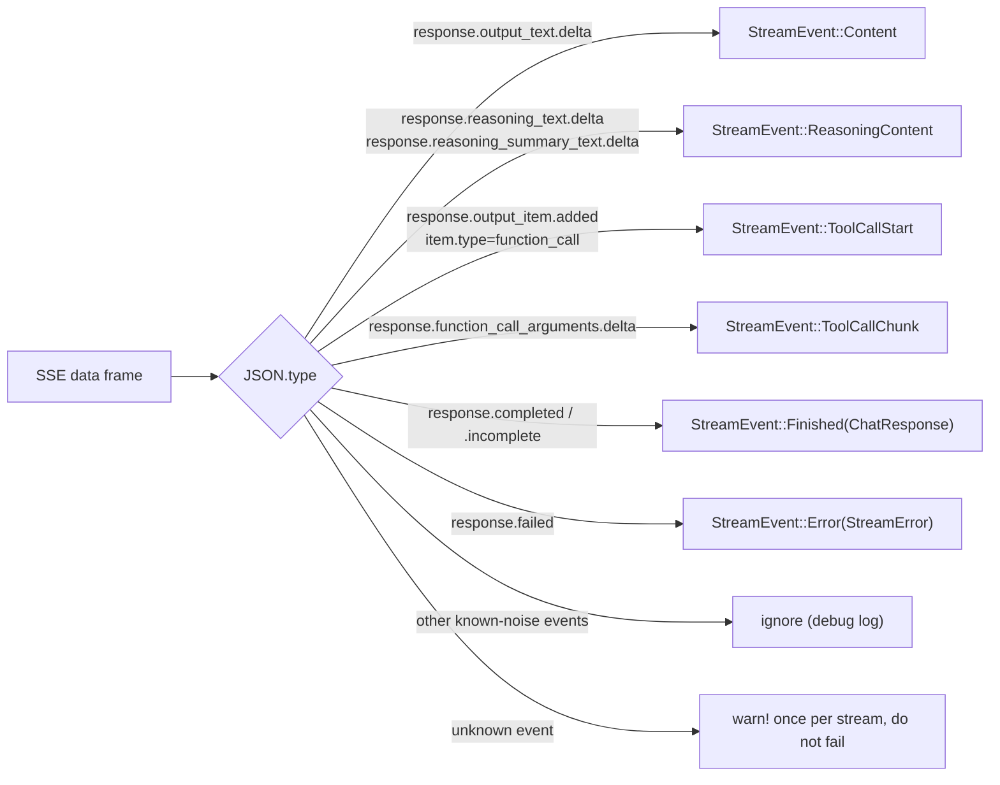
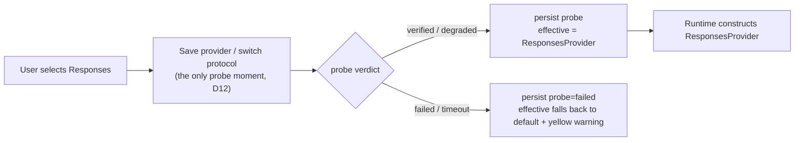
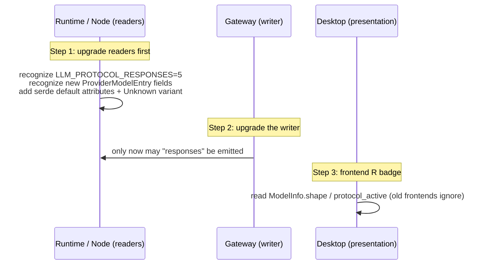

# ADR-103: Supporting the OpenAI Responses API as a Provider Shape

- **Number**: ADR-103
- **Status**: Accepted (v0.3 decided / v0.4-v0.6 corrected, 2026-11-XX; S1-S10 implemented on `feature/response_api`)
- **Date**: 2026-11-XX
- **Revisions**:
  - **v0.6 (2026-11-XX, corrected after implementation)** — **Reasoning effort closed end to end** (new D13; the D5 mapping table, §3, §5 and §7 updated). Three things: ① **`Off` now means "do not control reasoning" = omit the reasoning parameter** — neither wire path sends `none` any more, and neither sends `low` (the old completions `Off → "low"` was a defect: the user asked to switch reasoning *off* and still got low-depth reasoning; `none` is rejected by MiniMax M3.1-Flash with HTTP 400); ② `ReasoningEffort` gains `Minimal` / `XHigh`, and `from_str_loose` accepts the catalog spellings `minimal`/`xhigh`/`x_high`/`default`/`none` (a hand-edited config no longer falls back to `Auto` silently); ③ the level set is now **declared by the model itself**: `offline_providers.json`'s `reasoning_options[].values` → `ModelInfo.reasoning_efforts` → MQTT `ModelCapabilities.reasoning_efforts` → the frontend level menu and Runtime clamping. `None` = unknown (custom model), in which case the frontend offers the generic five `low/medium/high/xhigh/max` and the Runtime does not clamp. Also removed the dead `ReasoningEffort::to_openai_str` in core (zero call sites, and semantically the opposite of `openai_reasoning_str`: one omits on `Off`, the other sent `low` — exactly the kind of duplicate that drifts).
  - **v0.5 (2026-11-XX, corrected after implementation)** — **The probe baseline's `reasoning.effort` now uses a cross-vendor legal value (`low`)** (it used `none`). `none` is the only *value* MiniMax M3.1-Flash rejects (that model *does* support `reasoning`, with `effort` in `low`/`medium`/`high`/`xhigh`/`max`), and a 400 naming the `reasoning` field gets classified as "the field is not implemented" → trimmed → a false `degraded` plus "reasoning was omitted" on a fully reasoning-capable model. The D8 trim rule and the `degraded` semantics are unchanged; the baseline simply no longer uses "a value one vendor happens to reject". (As of v0.6, a user-initiated `Off` also omits the field — see v0.6 / D13.)
  - **v0.4 (2026-11-XX, corrected after implementation)** — **Removed the global `llm.responses_api_enabled` switch** (§4.4 and R6 updated). Why: defaulting to `false` with no UI entry point made the feature silently dead for almost every user (they hand-pick Responses, click save, probing is skipped wholesale, the dialog closes with no message, and reopening it still shows the selection as not enabled). Grayscale never needed it — the D1 gate already is the grayscale (no manual selection / no probe / a failed probe all fall back to the npm default). One implementation fact is kept as a rule: the save response's probe verdicts (`probes`) MUST reach the UI, otherwise "the probe failed" and "nothing happened" are indistinguishable to the user.
  - **v0.3 (2026-11-XX, decided)** — **Probing is upgraded from an "advisory confidence marker" to a "configuration-time enablement gate"**: Responses is enabled if and only if "the user explicitly selected it AND the probe passed"; in every other case the effective protocol falls back to the default (npm derivation). Consequential changes: D1 becomes two-level input + gate, `shape` is demoted to a pure UI hint (never adjudicates, never persisted), the manual re-resolve flow is removed (replaced by probing on save / protocol switch, see new D12), G2 "data-driven default" is cancelled, §4.2 is simplified, the v0.2 conclusion about `#[serde(default)]` cross-version compatibility is corrected, §3/§5/§7/§8/§9/§10 synchronized.
  - **v0.2 (2026-11-XX)** — Removed v0.1's D10 "local shape override table"; replaced with "user explicitly selects the protocol + Gateway-side probe verification", because a hand-maintained data file rots while probe + manual selection covers vendors that models.dev has not tagged with `shape` (DeepSeek / MiniMax) at zero maintenance cost.
  - **v0.1** — first draft.
- **Deciders**: ACowork Architecture Group
- **Predecessor document**: Design 23 (`docs/design/zh/23-openai-responses-api.md`, a research report) — this ADR **corrects and supersedes** its §5.2 derivation rule and §5.3 change list; the remaining conclusions carry over.
- **Related**: ADR-012 (per-session model/provider isolation), ADR-016 (error handling layering), ADR-027 (session token accumulation — probe usage must be excluded), ADR-034 (MQTT/HTTP boundary), ADR-060 (prompt-cache-friendly context block reordering), ADR-066 (provider cache tokens), ADR-055 (Node topology), ADR-085 (agent lifecycle state machine)
- **Chinese counterpart**: [docs/adr/zh/ADR-103-openai-responses-provider-shape.md](../zh/ADR-103-openai-responses-provider-shape.md) (maintained in the same commit)

> ✅ Decided (2026-11-XX): Q1–Q11 in §10 are all settled. Implementation slices (§7) may start; S1/S2 have no prerequisites.

---

## Summary

**In one sentence**: move "which wire protocol to use" from **provider-granularity static derivation** to **(provider, model) granularity, explicitly chosen by the user and validated by a probe** — **the user decides** (protocol dropdown in the model-selection dialog), and **the enablement threshold is one real probe that passes** (Gateway-side request, executed automatically when a provider is saved or a protocol is switched, D12). In every other case (no manual selection, never probed, probe failed, configuration changed without re-probing) the effective protocol falls back to the default (npm derivation, mostly Chat Completions). On top of that, an independent `ResponsesProvider` implements the OpenAI Responses API (`POST {base}/responses`); the protocol-agnostic layer (`Provider` trait / `StreamEvent` / `ReliableProvider` / agent loop) is unchanged. The frontend shows an `R` badge for verified-and-active models and a yellow warning for "selected but not enabled".

**Why the routing granularity must change now** (the core problem Design 23 did not solve): `shape` in the data hangs on **model**, not on provider. One provider contains both tagged and untagged models (azure: 27 of 95 tagged, amazon-bedrock: 16 of 199), and one provider may support both shapes (DeepSeek supports both; MiniMax supports both Anthropic Messages and Responses). The current `ProtocolType` hangs on `ProviderListItem` (provider level) and cannot express this.

**Recommended shape**: `ProviderModelEntry` gains optional `protocol_type` + `base_url` + `protocol_probe`; the Runtime constructs providers per (provider, model); the effective protocol is **user selection + probe gate**; anything else keeps today's behaviour (npm derivation → default OpenAI completions). The platform **never** moves a model onto Responses on its own — not because "Responses is new", and no longer because of a data tag either.

**Three trade-offs that frame the whole document**:

1. **Do not depend on offline configuration, and do not use it as an initial value either.** `shape` covers only 103 of 8848 provider-model pairs (1.2%), and DeepSeek / MiniMax are **not tagged at all**. v0.1 used a hand-maintained override table, v0.2 used the `shape` initial value, v0.3 uses neither: `shape` is only a UI hint (grey `R`), and **the effective protocol is decided solely by "user selection + probe pass"** — a data declaration is not availability.
2. **Probing is a configuration-time gate, not a runtime dynamic decision.** It runs at exactly two moments: saving a provider and switching a model's protocol (D12). The verdict is persisted; during a session it is never re-probed and never flips on network/upstream state changes — the same configuration always takes the same path (reproducibility). A failed probe falls back to the default **with a visible yellow warning explaining why**; the fallback is visible, therefore it is not a silent fallback. See D1 / D10.3 / D12.
3. **The frontend `R` badge means "verified and active"**; a `shape` declaration alone shows a grey `R` ("data declares support, unverified, not enabled"). The effective protocol is expressed separately in the protocol dropdown and the badge (D11 / Q3).

---

## 1. Context

### 1.1 Current protocol-selection chain (measured against the code)

| Step | Location | Fact |
|---|---|---|
| Protocol enum | [core/acowork-core/src/protocol.rs:929](../../../core/acowork-core/src/protocol.rs) | `ProtocolType { Anthropic, Google, Ollama, OpenAI }`, `#[default] OpenAI`, `#[serde(rename_all = "lowercase")]` |
| Protocol field attachment | `protocol.rs:229` (`ProviderListItem.protocol_type`) | **provider level**, and the field has **no** `#[serde(default)]` |
| Model entry | `protocol.rs:247` (`ProviderModelEntry`) | only `id` / `capabilities` / `max_output_tokens_limit`, **no protocol field** |
| Gateway derivation | [core/acowork-gateway/src/http/models_api.rs:1511](../../../core/acowork-gateway/src/http/models_api.rs) `derive_protocol_type(npm)` | pure npm substring match: `anthropic` / `google` / `ollama` → corresponding, otherwise OpenAI |
| model-level provider block | `models_api.rs:1571-1604` `lookup_protocol_info_from_data` | already reads `model.provider.npm` and `model.provider.api`; **`shape` sits in the same object, simply unread** |
| Derivation timing | [core/acowork-gateway/src/resource_cache.rs:400](../../../core/acowork-gateway/src/resource_cache.rs) | `build_provider_list_item` derives once on **add/update provider**, result **persisted** into `provider_list.json` (`resource_cache.rs:5`) |
| Custom providers | [core/acowork-gateway/src/http/provider_api.rs:128](../../../core/acowork-gateway/src/http/provider_api.rs) | the comment is the conclusion: "Custom providers always use OpenAI-compatible protocol" — **hardcoded** |
| MQTT contract | [core/acowork-core/proto/mqtt_payload.proto:339](../../../core/acowork-core/proto/mqtt_payload.proto) | `LlmProtocol` already uses 1–4, `UNSPECIFIED = 0` |
| Cross-version fallback | `protocol.rs:949` `llm_protocol_to_protocol_type` | `_ => ProtocolType::OpenAI` — **unknown values silently fall back to OpenAI** |
| Runtime construction | [core/acowork-runtime/src/providers/router.rs:103](../../../core/acowork-runtime/src/providers/router.rs) | `match protocol_type`; call sites `agent/agent_core.rs:1104`, `agent/session_core.rs:822`, `startup/agent_init.rs:739` all pass the provider-level `protocol_type` |
| OpenAI implementation | [core/acowork-runtime/src/providers/openai.rs:953](../../../core/acowork-runtime/src/providers/openai.rs) | `format!("{}/chat/completions", self.base_url)`; built-in CompatCache degradation chain (`send_with_compat`, `openai.rs:697`) |
| Protocol-agnostic layer | `acowork-core/src/providers/traits.rs:819` | `Provider { chat, chat_stream, chat_token_count }`; `StreamEvent` has 6 variants |
| Tool definition format | [core/acowork-runtime/src/agent/context.rs:1592](../../../core/acowork-runtime/src/agent/context.rs) | emits the **nested Chat Completions format** `{"type":"function","function":{...}}`; MCP tool names are already underscored (`mcp_github_list_issues`) |

> Design 23's conclusion still holds: **adding Responses is "a new Provider implementation + wiring up protocol selection"**, the same pattern as adding the Anthropic provider. This ADR does not overturn that judgment; it overturns the **routing granularity** and the **derivation rule**.

### 1.2 New fact: `provider.shape` in `offline_providers.json`

Source: [assets/offline_providers.json](../../../assets/offline_providers.json) (6.1 MB, 230 providers / 8848 provider-model pairs).

Field location: `providers.{pid}.models.{mid}.provider.shape`, values `"responses"` / `"completions"`. The same object may carry `api` (an alternative base URL for that shape) and `npm`.

**Coverage is tiny and heavily skewed (measured)**:

| provider | npm | provider-level `api` | models | tagged | shape distribution |
|---|---|---|---|---|---|
| azure | `@ai-sdk/azure` | — | 95 | 27 | `completions` ×27 |
| azure-cognitive-services | `@ai-sdk/azure` | — | 95 | 27 | `completions` ×27 |
| neon | `@ai-sdk/openai-compatible` | `${NEON_AI_GATEWAY_BASE_URL}/v1` | 57 | 20 | `responses` ×20 |
| amazon-bedrock | `@ai-sdk/amazon-bedrock` | — | 199 | 16 | `responses` ×16 |
| aixy | `@ai-sdk/openai-compatible` | `https://api.aixy-gateway.com/v1` | 13 | 7 | `responses` ×7 |
| sakana | `@ai-sdk/openai-compatible` | `https://api.sakana.ai/v1` | 4 | 3 | `responses` ×3 |
| infer | `@ai-sdk/openai` | `https://infer.flow7.org/v1` | 2 | 2 | `responses` ×2 |
| zenifra | `@ai-sdk/openai-compatible` | `https://ai.zenifra.com/v1` | 1 | 1 | `completions` ×1 |

Total **103 / 8848 pairs (1.2%), 8 / 230 providers**. Key combinations of the `shape` object: `{shape}` 58, `{api, npm, shape}` 43, `{npm, shape}` 2.

**Three hard facts read directly from the data** (more authoritative than any wording):

1. **the `openai` provider itself has no shape tag** (all 51 models untagged). Under "shape decides" the official OpenAI gpt-5.x users would keep their behaviours unchanged — a good thing (see D1).
2. **`shape` directly conflicts with npm derivation**: `aixy` / `neon` / `sakana` use npm `@ai-sdk/openai-compatible` (derivation → Chat Completions) but shape says `responses`. Conversely the azure family uses npm `@ai-sdk/azure` and shape explicitly says `completions`.
3. **missing shape ≠ no Responses support, present shape ≠ the only shape**. DeepSeek (npm `@ai-sdk/openai-compatible`, `api=https://api.deepseek.com`, 4 models) has **no tag** but actually supports both; MiniMax (npm `@ai-sdk/anthropic`, `api=https://api.minimax.io/anthropic/v1`, 8 models) is also untagged while its official docs list `/v1/responses` as the primary interface.

> Fact 3 is the biggest tension between this ADR and the user reference document: **with the `shape` field alone, neither DeepSeek nor MiniMax can be onboarded**. v0.1 solved it with a hand-maintained override table; v0.2 used "protocol dropdown always selectable + Gateway-side probe"; v0.3 tightens it into an "user selection + probe pass" enablement gate (D1 / D12) — trading a one-off interaction cost for a data file that would rot, without paying for the coverage gap in lost capability.

### 1.3 Corrections to Design 23

| # | Design 23 claim | Measured / documented evidence | Correction in this ADR |
|---|---|---|---|
| C1 | §5.2 whitelist: `openai` / `azure` / `azure-cognitive-services` → Responses | `openai` has no shape; `azure` / `azure-cognitive-services` are explicitly tagged **`completions`** | **Remove the hardcoded whitelist**; read `shape` only as a UI hint (v0.3); Design 23's whitelist direction is **reversed** |
| C2 | §5 all changes assume provider-level `ProtocolType` | shape hangs on model; tagged/untagged mix inside one provider; one provider may carry both shapes | **Push protocol resolution down to (provider, model)** (D2) |
| C3 | §5.3 note: "Responses is a first-class OpenAI protocol, degradation risk is low, suggest skipping the compat chain" | MiniMax: `reasoning.effort: none` → **HTTP 400** (M3.1-Flash); `tool_choice` only `auto`; `text.format` only `text`. DeepSeek: `truncation` unsupported, over-window → **400** | **Cannot generalize**: third-party Responses implementations trim far more than official OpenAI. Replaced by "explicit error classification + minimal trimming whitelist"; recorded as decision point D8 / Q4 (settled: trimming included) |
| C4 | §6.2 "structured outputs directly benefit memory extraction" | MiniMax Responses `text.format.type` enumerates **only `text`**; DeepSeek supports `json_schema`; OpenAI supports it | Structured outputs are a **per-vendor capability**, not an implicit premise of Responses (§8 R5) |
| C5 | §5.2 only mentions `derive_protocol_type` | the `provider.api` override exists but **does not expand `${VAR}` placeholders** (measured: `neon` = `${NEON_AI_GATEWAY_BASE_URL}/v1`, bedrock model-level api contains `${AWS_REGION}`) | `api` values containing placeholders **must be gated out**, otherwise the base_url is unusable (D7) |
| C6 | §5.5 "rollback: switch the provider back to Chat Completions, no code change needed" | `protocol_type` is **frozen into `provider_list.json`** at add/update; offline data refreshes never rewrite existing rows | Behaviour rollback = switch the protocol dropdown back to default (immediate); but **rolling back the Gateway binary** requires resetting model-level protocols first (§4.4 runbook) |

### 1.4 Vendor differences (measured from DeepSeek / MiniMax official docs)

Sources: DeepSeek `POST /responses` plus the "Using the Responses API" guide (with a full compatibility table); MiniMax `POST /v1/responses` OpenAPI (`openapi-responses.json`); MiniMax `POST /v1/responses/input_tokens`.

**What both vendors share (favourable to ACowork)**:

- **Stateless**: `previous_response_id` / `conversation` / `store` are all unsupported (DeepSeek states "stateless API" explicitly, and `store` is always `false` in responses) → consistent with ACowork owning its own history; Design 23 §1.3's non-goal holds.
- **Unsupported parameters are silently ignored** (DeepSeek states explicitly: "unsupported parameters are silently ignored and do not error"). → **You cannot detect capabilities by trial and error**, nor rely on 400s to drive degradation (affects D8).
- **SSE has no `data: [DONE]`**; termination events are `response.completed` / `response.incomplete` / `response.failed`. Both vendors agree.
- **The event `type` lives inside the JSON data** (MiniMax states explicitly: "each event's `data` is JSON, with a `type` field identifying the event type"); do not rely on the SSE `event:` line alone.
- **Reasoning delta event name is `response.reasoning_text.delta`** (both vendors), while official OpenAI uses `response.reasoning_summary_text.delta` → parsing must accept both.
- **Function tools are flat** `{"type":"function","name","description","parameters"}` (MiniMax schema `Tool.required = [type, name]`), different from the nested format ACowork emits → must convert.
- **Usage shape is consistent**: `input_tokens` / `output_tokens` / `total_tokens` + `input_tokens_details.cached_tokens` + `output_tokens_details.reasoning_tokens` → directly mappable to ADR-066's `UsageInfo`.

**Where the two differ (must be treated per vendor, never as "generic Responses behaviour")**:

| Dimension | Official OpenAI | DeepSeek | MiniMax |
|---|---|---|---|
| base / endpoint | `https://api.openai.com/v1/responses` | `https://api.deepseek.com/responses` (**no `/v1`**) | `https://api.minimax.cn(/.io)/v1/responses` |
| `input` required | `input` or `instructions` (at least one) | at least one | **`input` required** (schema level) |
| `instructions` semantics | system | "becomes the first system message"; the `developer` role is **treated as `user`** | system instructions |
| `reasoning.effort` | `minimal/low/medium/high` (+`xhigh`) | `none/low/high/max`; `minimal→low`, `medium/xhigh→high` | `minimal/low/medium/high/xhigh/max/none`, but **M3.1-Flash returns 400 for `none`**; M2.x accepts `none` without effect |
| `text.format` | `text` / `json_object` / `json_schema` | all three supported | **only `text`** |
| `tool_choice` | `none/auto/required/{name}` | all supported | **only `auto`** |
| `temperature` | supported | supported (no effect in thinking mode) | **accepted without effect** (fixed at 1) |
| `max_output_tokens` | supported | supported | supported, **includes chain-of-thought**; too small → `status=incomplete` and no `message` item in `output` |
| image input | `input_image` | `input_image`, only in `user`/`developer` messages and `*_output`; images in `system`/`assistant` → **400** | `input_image` + **`input_video`** (M3 multimodal) |
| token estimation | no native endpoint | none | **`POST /v1/responses/input_tokens`** |
| prompt cache | `prompt_cache_key` | **unsupported** (automatic KV caching) | supports `prompt_cache_key` |
| tool-name constraints | — | `^[a-zA-Z0-9_-]+$`, ≤128, unique; the `custom` tool only allows `apply_patch`, other names → 400 | only `function` |
| reasoning payload | `summary` (a digest) | `reasoning` item's `content[].reasoning_text` (**plaintext CoT**) | `content[].reasoning_text` (plaintext) + `summary` (may be an empty array) |

> Conclusion: **"the Responses API" is not one protocol, it is a protocol family.** ACowork's implementation must take official OpenAI semantics as the baseline and confine differences to "error classification + a few per-provider trims", not pretend all three are identical.

---

## 2. Decision

### D1 — Effective protocol = user selection AND probe pass; everything else falls back to the default

The protocol is resolved at **(provider, model)** granularity. `protocol_type` records only the **user's intention**; `protocol_probe` records the **verification verdict**; the effective protocol is derived from the two (read-time, single adjudication function `resolve_protocol`):

| User-selected `protocol_type` | `protocol_probe` | Effective protocol |
|---|---|---|
| `Responses` | `verified` or `degraded` | **`Responses`** |
| `Responses` | `failed` / `stale` / absent (never probed) | npm-derived default (mostly `OpenAI` completions) |
| No manual selection (`None`) | anything | npm-derived default |
| Other manual values (Anthropic / Google / Ollama / OpenAI) | anything | the selected value (probing does not apply; no gate) |

**Why the gate lives at configuration time, not at runtime** (v0.3's core guardrail):

1. **Reproducible**: the verdict is persisted (`protocol_probe` + timestamp); it is written at exactly two moments — saving a provider and switching a model's protocol (D12). During a session the system **MUST NOT** re-probe and **MUST NOT** change the effective protocol because of network jitter / upstream 5xx / key rotation. The same configuration always takes the same path.
2. **The fallback must be visible**: when a probe fails the effective protocol falls back to the default, and the UI **MUST** say so explicitly ("Responses selected but not verified, not enabled") plus the reason. The fallback is visible, therefore it is not a silent fallback (which the platform forbids).
3. **The probe must not mutate user intent**: a failed probe **MUST NOT** delete or rewrite `protocol_type` — the intent is retained, the next save re-probes, and one save after the environment is fixed restores it.

**The role of `shape` (demoted to a pure hint in v0.3)**: offline `provider.shape` is used only for a UI hint (grey `R`); it **never adjudicates, is never persisted, and never overrides npm derivation**. v0.2's "shape → protocol mapping table" and "cross-family conflict warning" are therefore dropped — a `shape` vs npm conflict no longer affects any behaviour and only shows up as a difference between `shape` and `protocol_active` in the UI payload.

**Default behaviour**: no manual selection, no probe = today's behaviour. This is the ADR's most important safety valve — for 8745 of 8848 (98.8%) provider-model pairs behaviour is byte-for-byte unchanged. **v0.3 is more conservative than v0.2**: under v0.2 the 48 shape-tagged models would have moved to Responses automatically based on data; under v0.3 they also stay on the default until the user explicitly selects and probes.

**MUST**:

- `resolve_protocol` is the single adjudication point (Gateway side); Runtime and the frontend only consume its result (§3 redline 1).
- When `protocol_type = Responses` but the probe does not pass, return the default protocol; **MUST NOT** error, **MUST NOT** panic, **MUST NOT** guess.
- Unknown `shape` values are ignored (hint layer only); unknown `protocol_probe` values are treated as "not passed".
- A failed probe **MUST NOT** block saving (user intent is saved) and **MUST NOT** swallow the failure reason.

**Rejected alternatives**:

- ❌ *`shape` as the initial value* (v0.2): data covers 1.2%, DeepSeek / MiniMax are untagged, and "the data declares support" is not "it works right now" — this gap is exactly why v0.3 switched to a gate.
- ❌ *Probe verdict as a runtime dynamic decision* (ping before every request): network jitter would silently flip the user's configuration back to completions, changing semantics without notice and irreproducibly.
- ❌ *Split a provider into two rows* (`openai` + `openai-responses`): users would see duplicate providers, duplicate key configuration, duplicate logos, and it conflicts with ADR-012's per-session model isolation.
- ❌ *A provider-level `supports_responses: bool` switch*: cannot express "some models in a provider use Responses, others do not" (azure 27/95 and bedrock 16/199 are data-side evidence; the granularity requirement stands on its own).

### D2 — Push protocol resolution down to (provider, model) granularity

Data-model changes ([core/acowork-core/src/protocol.rs:247](../../../core/acowork-core/src/protocol.rs)):

```rust
pub struct ProviderModelEntry {
    pub id: String,
    pub capabilities: ModelCapabilitiesInfo,
    #[serde(default = "default_max_output_tokens_limit")]
    pub max_output_tokens_limit: u64,
    /// User-selected protocol intention for this model. `None` = no explicit
    /// choice (effective protocol follows npm derivation). Written ONLY by an
    /// explicit user action (protocol dropdown / REST). Whether `Responses`
    /// actually takes effect additionally requires
    /// `protocol_probe ∈ {verified, degraded}` (D1 gate).
    #[serde(default, skip_serializing_if = "Option::is_none")]
    pub protocol_type: Option<ProtocolType>,
    /// Per-model base URL override, used when the model's Responses endpoint
    /// differs from the provider default (e.g. MiniMax: provider base is
    /// `/anthropic/v1`, Responses needs `/v1`). Written only by explicit user
    /// action, and offered as an auto-fill by a successful probe (D10).
    #[serde(default, skip_serializing_if = "Option::is_none")]
    pub base_url: Option<String>,
    /// Probe verdict for `protocol_type` (D10 / D12). Written only by the
    /// save/probe path in the Gateway. Gates whether `Responses` takes effect
    /// (D1); MUST NOT be re-evaluated during a session.
    #[serde(default, skip_serializing_if = "Option::is_none")]
    pub protocol_probe: Option<ProtocolProbe>,
}
```

**`protocol_type` has only two write sources**: ① the user picks in the protocol dropdown (D11); ② REST `PUT /api/providers/{id}` with a `protocol` field (for CLI / automation). v0.2's "persist the shape-derived initial value" is removed — `protocol_type` carries only user intent, `None` = no manual selection (follow npm derivation), so there is **no provenance ambiguity between "initial value" and "user selection"** (v0.2's re-resolve criterion contradiction disappears). `protocol_probe` may only be written by the Gateway probe path (D12); it is never delivered to or read by the Runtime.

**Cross-version compatibility (v0.3 corrects the wrong v0.2 conclusion)**: `#[serde(default)]` only tolerates a **missing field**; it does **not** tolerate an unknown enum value — an old binary reading `"protocol_type": "responses"` still hard-fails, and released old versions cannot be retrofitted. Therefore **MUST** use two phases:

1. **Phase one (ship the reader first)**: add a `#[serde(other)] Unknown` variant to `ProtocolType` (mapped to `OpenAI` + `warn!`), and add `#[serde(default)]` to `ProviderListItem.protocol_type` (tolerate a missing field). That release **MUST NOT** write `"responses"` to disk.
2. **Phase two (ship the writer later)**: the next release may persist `"responses"`. After that, "new Gateway writes, old Gateway reads" still hard-fails on the old Gateway, so **the Gateway downgrade runbook in §4.4 is mandatory** (reset model-level protocols before downgrading).

The unit-test property is corrected accordingly: it locks "unknown value → `Unknown` + `warn`", not "missing field is readable".

Runtime side: `build_provider_for(provider_id, model_id, account_id)` gains a `model_id` parameter and selects the construction branch by `model.protocol_type.or(provider.protocol_type)`; `agent/agent_core.rs:1104` / `agent/session_core.rs:822` / `startup/agent_init.rs:739` pass the model too. When no model entry is found it **MUST** fall back to provider level and `warn!`, **MUST NOT** guess.

**Rejected alternatives**:

- ❌ *Split the provider into two rows* (`openai` + `openai-responses`): duplicate providers, duplicate key configuration, duplicate logos, and it conflicts with ADR-012's per-session model isolation.
- ❌ *A provider-level `supports_responses: bool` switch*: cannot express "tagged/untagged mixed inside one provider" (27/95, 16/199).

### D3 — Add `ProtocolType::Responses` and `LlmProtocol::Responses = 5`

| Location | Change |
|---|---|
| `acowork-core/src/protocol.rs:929` | new variant `Responses`, `#[serde(alias = "openai-responses")]`; `FromStr` accepts `"responses"`; add `#[serde(other)] Unknown` (phase one, D2) |
| `acowork-core/proto/mqtt_payload.proto:339` | `LLM_PROTOCOL_RESPONSES = 5;` (semantics of 1–4 unchanged) |
| `protocol.rs:949` `llm_protocol_to_protocol_type` | add `Responses => ProtocolType::Responses`; **the silent `_ => OpenAI` fallback MUST log a `warn!`** (see §8 R1) |
| `global_resources_builders.rs:461` `map_protocol_type` | add a Responses branch |

**Cross-version interoperability conclusion**: adding an enum value is backward compatible by itself (1–4 unchanged), but the **fallback direction is unsafe** — an old Runtime receiving `5` silently treats it as OpenAI completions and hits `/chat/completions` with a Responses-only model, getting a 400 rather than "protocol unsupported". Therefore **MUST** follow the §4 release order (Runtime/Node first, Gateway last) and make the fallback visible instead of silent.

### D4 — An independent `ResponsesProvider`, not stuffed into `openai.rs`

New `core/acowork-runtime/src/providers/responses.rs`, implementing the three `Provider` trait methods; `router.rs:103` gains a `ProtocolType::Responses =>` branch.

**Reused**: `openai.rs`'s reqwest client construction, timeout injection, `from_http_parts` error parsing, SSE frame splitting.
**Not reused**: `NativeChatRequest` / `NativeChatResponse` / CompatCache wiring (`install_wiring` applies only to the completions provider).

**MUST NOT** modify: the `Provider` trait, `StreamEvent`, `ReliableProvider`, `loop_llm.rs`, memory/tool registration/budget/rate limiting. Zero changes to the protocol-agnostic layer is this ADR's core constraint and the basis for "same pattern as adding the Anthropic provider".

**Rationale**: `openai.rs` is already ~2000 lines with a CompatCache key and degradation chain hardcoded to `/chat/completions`; keeping two wire formats in one struct would blur cache keys, URLs and degradation ownership (Design 23 option B was rejected; this ADR maintains that).

### D5 — Request mapping (domain → Responses wire format)

| ACowork domain (`ChatRequest`) | Responses wire format | Rule |
|---|---|---|
| `messages[role=system]` | top-level `instructions: string` | **merge** all system messages joined by `\n\n`. This preserves ADR-060's "stable prefix" semantics: instructions is the stable part, history is the appended part |
| `messages[role=developer]` | append to `instructions` **or** a `role=developer` item in `input` | v1 merges into `instructions` (DeepSeek treats `developer` as `user`; merging into instructions is semantically safer) |
| `messages[role=user/assistant]` | `message` items in `input[]` | content is a parts array |
| text part | `input_text` / `output_text` | chosen by role |
| `image_url` (data URI) | `input_image{image_url, detail}` | **MUST** reuse `traits.rs`'s `parse_data_uri`; **MUST NOT** stuff a URL string into the base64 field. **Images in `assistant` messages MUST be dropped with a warning** (DeepSeek returns 400 for images in `system`/`assistant`) |
| `assistant.tool_calls[]` | standalone `function_call` items (`call_id` / `name` / `arguments`) | one assistant message may yield 1 `message` + N `function_call` items |
| `role=tool` + `tool_call_id` | `function_call_output{call_id, output}` | `output` as a string; when a tool emits an image, use a content-block array (both DeepSeek and MiniMax allow `input_image` inside `*_output`) |
| `tools` (nested function) | **flat** `{type:"function", name, description, parameters}` | must convert nested → flat (`context.rs:1592` emits the nested format) |
| `max_tokens` | `max_output_tokens` | **semantic difference**: this field **includes chain-of-thought tokens** (MiniMax states so explicitly). Too small → `status=incomplete` and no `message` in `output`; **MUST** be mapped to a visible truncation error, never an empty answer |
| `reasoning_effort` | `reasoning.effort` | `Auto` / `Off` → **omit the field** (`Off` = do not control reasoning; **MUST NOT** send `none` — MiniMax M3.1-Flash answers 400 — and **MUST NOT** send `low`, see v0.6 / D13); `Minimal/Low/Medium/High/XHigh/Max` → same name, clamped into the model's declared support set before it is sent (D13) |
| `temperature` | `temperature` | pass through; MiniMax accepts without effect — no client-side compensation |
| `thinking_mode` | **not sent** | Anthropic-specific; Responses has no such concept |
| — | `stream` | decided by `chat` / `chat_stream` |
| — | `store:false` / do not send `previous_response_id` / `conversation` / `background` / `include` / `truncation` | **YAGNI, explicitly not sent in v1** (consistent with §1.3 non-goals) |

**MUST**: `input` is never empty (MiniMax's schema requires it). If the upstream only provided instructions and no user message, **MUST** error rather than send an empty `input`.

### D6 — Response and streaming mapping (Responses → `StreamEvent`)

**Non-streaming `chat()`**: walk `output[]` → concatenate `message.content[].output_text` into `content`; concatenate `reasoning.content[].reasoning_text` into `reasoning_content`; `function_call` items → `tool_calls[]`. `status` → `finish_reason`:

| `status` / `incomplete_details.reason` | `finish_reason` | Handling |
|---|---|---|
| `completed` | `stop` (no tools) / `tool_calls` (has `function_call`) | normal |
| `incomplete` + `max_output_tokens` | `length` | **MUST** warn visibly: chain-of-thought consumed the budget leaving no body text |
| `incomplete` + `content_filter` | `content_filter` | pass through to the frontend |
| `failed` + `error{code,message}` | `error` | same error family classification via `from_http_parts` (ADR-016) |

**Streaming `chat_stream()`**:



Hard requirements:

1. **Termination is decided only by `response.completed` / `.incomplete` / `.failed`**; **MUST NOT** wait for `data: [DONE]` (neither vendor sends it). A stream that ends without a termination event → **MUST** emit `StreamEvent::Error` (truncated), **MUST NOT** emit `Finished` pretending success.
2. **Take the event type from the JSON `type` field**; the SSE `event:` line is an optional cross-check (MiniMax states the type is inside the data).
3. **Accept both reasoning event names**: `response.reasoning_text.delta/done` (DeepSeek/MiniMax) and `response.reasoning_summary_text.delta` (official OpenAI).
4. **`function_call`'s `call_id` / `name` come from the `response.output_item.added` item**, arguments arrive only via deltas → `ToolCallStart` must be emitted at `added` (with an empty arguments string); subsequent `ToolCallChunk{index}` are indexed by `output_index`, aligned with the existing agent loop's index semantics.
5. **usage is only present on the complete `response` object in the terminal event** → map `UsageInfo` from `response.usage` in `Finished(ChatResponse)`: `input_tokens→prompt_tokens`, `output_tokens→completion_tokens`, `input_tokens_details.cached_tokens→cache_read_tokens` (ADR-066), `output_tokens_details.reasoning_tokens→reasoning_tokens`. **MUST** reuse `openai.rs:277`'s existing dual-naming tolerance (`prompt_tokens.or(input_tokens)`).
6. **`sequence_number` has no guaranteed continuity semantics**; v1 **MUST NOT** use it for reordering or deduplication.
7. The event surface has ~40 kinds; v1 implements ~10 (the diagram above). `response.content_part.*` and `response.output_item.done`'s full items **MUST** be parsed but used only for validation, **MUST NOT** re-emit text (otherwise the frontend renders twice).

> D6 items 1 and 3 are settled decisions (Q7 / Q8); the rest are architectural constraints that do not change with review.

### D7 — URL resolution and base_url override

`ResponsesProvider` endpoint: `{base_url}/responses` (isomorphic to `{base_url}/chat/completions` at `openai.rs:953`).

**base_url resolution order**: explicit user `base_url` override > **model-level `provider.api`** > provider-level `api` > built-in default.

Three realities that must be handled:

1. **`/v1` inconsistency**: DeepSeek provider `api = https://api.deepseek.com` (→ `/responses` is correct); MiniMax Responses needs `https://api.minimax.cn/v1` (while its provider `api` is `.../anthropic/v1`). → **MUST** support a model-level `base_url` override (precisely why D2 adds the field); **MUST NOT** assume "provider base + /responses" always works.
2. **`${VAR}` placeholders**: `neon` = `${NEON_AI_GATEWAY_BASE_URL}/v1`, bedrock model-level api contains `${AWS_REGION}`. Current code **does not expand them** (measured: `models_api.rs` passes them through via `as_str()`). → **MUST** detect `${` at resolution time; when unexpanded, declare that override **unusable**, fall back to the next level, and `warn!`. v1 **MUST NOT** introduce env expansion (it would turn Gateway provider configuration into an implicit dependency on process environment — out of bounds; tracked as Q6).
3. **CompatCache key isolation**: the `provider_id` namespace **MUST** include the shape, so the completions and responses paths do not share a key (today `openai.rs:117` falls back to host, so two protocols on the same host collide).

### D8 — Error handling: explicit classification + minimal trimming whitelist, no silent cross-shape degradation

**Layering (ADR-016)**: classification in core, retry orchestration in `ReliableProvider`, presentation in the frontend. `ResponsesProvider` only turns HTTP/SSE errors into structured `StreamError`s.

**MUST NOT**: automatically resend a Responses request to `/chat/completions` inside the provider. Reasons: (a) the two protocols differ in `tools` / `reasoning` / history structure — auto-switching endpoints means "retry under different semantics", and a failure cannot be attributed; (b) DeepSeek explicitly "silently ignores unsupported parameters", so probing is unreliable; (c) it conflicts with the platform's "no silent fallback" principle (AGENTS.md: silent fallback is an anti-pattern).

**MUST** implement these classifications:

| Signal | Class | Handling |
|---|---|---|
| `404` with a body mentioning `responses` / unknown endpoint | `EndpointUnavailable` | **no retry**; the message states "this provider does not support the Responses API — switch the model's protocol back to Chat Completions"; `warn!` with provider/model |
| `400` naming a field (`reasoning`/`tool_choice`/`text.format`/`temperature`) | `UnsupportedField{field}` | enters the **D8 trimming whitelist** (below) |
| `400` for content-integrity problems (image placement, empty `input`, illegal tool names, over-window) | `ContentIntegrity` | **no trim, no retry**, propagate (aligned with the 2026-09-05 incident lesson in `openai.rs`: `ErrorClass::is_learnable()` gating) |
| `401/403` | `Auth` | no retry; existing key-invalid path |
| `429` | `RateLimited` | handed to `ReliableProvider` (429 UX included); protocol-agnostic |
| `5xx` | `Transient` | handed to `ReliableProvider` backoff |
| SSE `response.failed` | `InBandFailure{code,message}` | → `StreamEvent::Error`; **MUST NOT** become an empty answer |
| Stream closed with no terminal event | `TruncatedStream` | → `StreamEvent::Error`; no retry (side effects may already have happened) |

**Trimming whitelist (ResponsesCompat, narrowed to 1 field in v0.2)**: same discipline as `CompatCache` (**two confirmations before persisting**, TTL lease, plain-success reset, error-class gating, the level must be a visible warning), but v1 may trim **only the `reasoning` field**, and **MUST NOT reuse `openai.rs`'s `StripProfile` struct** (it is completions-shaped):

- The endpoint returning 400 for the `reasoning` **field itself** (the body names that field) → omit the whole `reasoning` block and retry once. The semantic loss is assessable — the user's chosen effort tier is downgraded, which must be a visible warning plus a probe state.

- **v0.5 correction (after implementation)**: this rule used to read "`reasoning.effort: none` triggering 400 → trim", i.e. it treated a rejected **value** as an unsupported **field**. That produced a **false verdict**: MiniMax M3.1-Flash *does* support `reasoning` (`effort` may be `low`/`medium`/`high`/`xhigh`/`max`, per MiniMax's own docs); it merely rejects the *value* `effort: none` with a 400. Because that 400 names the `reasoning` field, the error classifier judged it `UnsupportedField{reasoning}`, trimmed it, and the verdict landed on `degraded` + `stripped_fields: ["reasoning"]` — telling the user that a fully reasoning-capable model had its reasoning dropped. **The value was rejected; the field was not.**
  - **Constraint (new, v0.5)**: the probe baseline's `reasoning.effort` **MUST** be a value every major vendor accepts (v1 uses `low`), and **MUST NOT** use "a value one vendor happens to reject" as the baseline — otherwise the probe reads "illegal value" as "unsupported field" and reports a false `degraded`. An endpoint that genuinely does not implement the `reasoning` field still answers 400 naming it, and the trim path plus the `degraded` semantics are unchanged.
  - **A user-initiated `Off` no longer sends `none`** (v0.6 / D13): `Off` means "do not control reasoning", both wire paths omit the field, so nothing depends on the D8 trim to absorb "one vendor rejects `none`" any more.

**v1 explicitly does not trim** (classified and propagated instead, so users see it and adjust):

| Field | Why not |
|---|---|
| `tool_choice` / `text.format` / `temperature` / `top_p` | trimming **silently changes model behaviour** (forcing `auto`, dropping structured output, changing sampling); on MiniMax these are "accepted without effect" rather than errors — client compensation hides the difference instead of removing it (§1.4 is the right answer) |
| `tools` | tools are the agent's capability surface; stripping them silently disables function calling — exactly the 2026-09-05 incident recorded at the head of `compat.rs` |

**Explicitly not doing**: a 4-step blind chain; "retry until 200". On a trim hit, **MUST** `warn!`, surface it in the debug panel, and mark the provider-model `ProbeState::Degraded` (D10) so the R badge can express "works, but was trimmed".

> Whether to trim even `reasoning` in v1 (pure "classify + propagate") was decision point Q4; settled as (a) trim.

### D9 — Automatic cross-shape failover: not in v1

When a model supports both shapes (DeepSeek, MiniMax), should "Responses fails → automatically retry with completions"? **Not in v1.** Instead, provide an **explicit per-model protocol selection** (D1 level 1) and leave the choice and the responsibility to the human. Settled as Q2 (a); v0.2's G2 "data-driven default" is cancelled.

### D10 — Protocol probing: real Gateway-side requests, the verdict gates enablement

**Motivation (introduced in v0.2, promoted to a gate in v0.3)**: `shape` covers only 1.2% of the data and neither DeepSeek nor MiniMax is in it (§1.2 fact 3). v0.1 patched this with a hand-maintained override table; v0.2 switched to **letting the user pick a protocol in the dialog and verifying it with one real request**; v0.3 makes the probe verdict an **enablement precondition** (D1 gate) and moves the trigger into the save flow (D12). Direct benefits:

- **Zero maintenance**: no new data file that needs an owner, rots, and drifts against models.dev.
- **Facts come from upstream, not our guesses**: a probe hits the real endpoint; an override table records "what we think".
- **Fixes custom providers as a bonus**: `provider_api.rs:128` hardcodes "custom always OpenAI", while the protocol of a custom gateway can only be measured.

**Existing precedents (not a new mechanism)**:

| Capability | Location | Reusable aspect |
|---|---|---|
| `POST /api/models/discover` | [core/acowork-gateway/src/http/models_api.rs:150](../../../core/acowork-gateway/src/http/models_api.rs) | `base_url` + plaintext key, Gateway outbound request, 5s timeout, structured error strings |
| `POST /api/embedding-models/test` | [core/acowork-gateway/src/http/embedding_api.rs:563](../../../core/acowork-gateway/src/http/embedding_api.rs) | response shape `{success, model_id, latency_ms, error}` |
| In-dialog "probe then save" | [apps/acowork-desktop/src/components/harness/AddProviderFlow.tsx:334](../../../apps/acowork-desktop/src/components/harness/AddProviderFlow.tsx) (status area `:723`) | interaction position and status display reused as-is |

#### D10.1 Execution location: MUST be the Gateway, the frontend only initiates

Not a style question, a boundary question: after a provider is **saved**, the plaintext key exists only in the Vault and is delivered to the Runtime over MQTT; the frontend cannot obtain it. The probe endpoint therefore fetches the key from the Vault itself:

```
POST /api/providers/{id}/probe
  { "model": "deepseek-flash", "protocol": "responses", "tier": "standard" | "deep" }
→ { "success": bool, "tier_passed": ["L1","L3"], "latency_ms": 812,
    "observed_base_url": "https://api.deepseek.com",
    "usage": {"input_tokens": 9, "output_tokens": 1},
    "error": {"class": "EndpointUnavailable", "message": "..."} | null,
    "stripped_fields": ["reasoning"] }
```

**MUST NOT** let the frontend call upstream directly (CORS + key exposure + Desktop is a pure presentation layer, AGENTS.md redline). **MUST NOT** put probing in the Runtime (probing is configuration-time behaviour, not session-time; the Runtime only exists while dispatched).

**Trigger (v0.3)**: the **regular entry point is the save flow** (saving a provider / switching a model's protocol, see D12, executed synchronously); this endpoint remains the **manual re-check** entry (the user clicks "Re-verify", or re-tests after a configuration change makes the probe stale). Both paths share one implementation and one result cache.

#### D10.2 Probe tiers: L1+L3 is the minimum for lighting an R badge

DeepSeek states explicitly: "unsupported parameters are silently ignored and do not error." So a single ping verifies **endpoint-level** facts but not **capability-level** subsets (MiniMax accepts `/responses` yet `text.format` only has `text`, `tool_choice` only `auto`, `effort:none` → 400). An all-green ping still explodes when a real agent runs.

| Tier | Request | Assertion | Purpose |
|---|---|---|---|
| **L1** | `POST {base}/responses`, `input:"ping"`, `max_output_tokens:1`, `stream:false` | HTTP 2xx and body `object == "response"` | endpoint exists + auth passes + request accepted |
| **L2** | reuse the L1 response | `status`, `usage.input_tokens` / `output_tokens` present and mappable to `UsageInfo` | usage accounting will not be blind (ADR-066) |
| **L3** | one no-op tool + a `tool_choice` leaning to invoke | produces a `function_call` item, a round-trippable `call_id`, `arguments` is valid JSON | **the tool loop works** |
| L4 | `stream:true` rerun of L1 | receives one of `response.completed/.incomplete/.failed`; finishes without `[DONE]` | streaming works |

**Settled (this round)**: v1 implements **L1 + L2 + L3**; L4 is an optional follow-up. Rationale: the only purpose of an ACowork provider is to run the agent tool loop — a probe without a tool round-trip **has no decision value**: it gives a green light, the user trusts it, and the real task explodes. L4 heavily overlaps L1 (same request plus `stream:true`); if implemented, fold it into L1's execution path rather than adding a tier (avoid probe-matrix bloat).

**Honest labelling**: passing the probe = "these three things hold for this one model right now", **not** "this provider's Responses implementation is complete". The UI copy **MUST NOT** say "compatibility verified"; it must say "verified working (text + tool calls)".

#### D10.3 Verdict semantics: a configuration-time gate — evaluated only on save / protocol switch



| Probe verdict | Effective protocol | UI |
|---|---|---|
| `verified` | **the user-selected `Responses`** | solid R + "verified working (text + tool calls)" |
| `degraded` (hit D8 trimming) | **the user-selected `Responses`** | solid R + yellow dot "degraded: `reasoning` parameter omitted" |
| `failed` | **default (npm derivation)** | yellow warning "selected but not enabled: <reason>"; saving still succeeds |
| `stale` (configuration changed, not re-probed) | **default (npm derivation)** | yellow warning "configuration changed, save again to re-verify" |
| `unverified` (never probed) | default (npm derivation) | no badge; grey R ("data declares support, unverified, not enabled") only when `shape == "responses"` |

**MUST**:

- `failed` / `stale` / `unverified` fall back to the default, and the fallback **MUST** be visible in the UI (yellow warning + reason).
- `failed` still saves successfully and keeps `protocol_type` — the next save / re-check probes again.
- During a session, **MUST NOT** auto-re-probe; **MUST NOT** use the probe verdict as a "retry later" trigger.

**MUST**: when a successful probe suggests a different base_url (e.g. `{provider base}/responses` 404 while `{provider base}/v1/responses` 200), the suggestion **MUST** be presented for the user to confirm; **MUST NOT** be written directly. The write itself triggers a re-probe (D12), which avoids "the suggested value takes effect unverified".

#### D10.4 Cost and side-effect constraints

- **Real billing**: a probe issues 1–2 real generation requests (`max_output_tokens:1`). The UI **MUST** state "this will send 1 real request, consuming a small amount of quota".
- **Usage is excluded from session/agent accumulation**: probe usage **MUST NOT** enter ADR-027 (SessionTokens) or ADR-066 (cache-token accumulation), otherwise budgets and cost accounting are polluted by non-task traffic. A separate Gateway audit log is allowed.
- **Rate limiting**: cache the verdict per (provider, model, protocol) (suggested TTL 24h); repeated clicks hit the cache, `?force=true` re-probes. The global probe rate limit uses the existing rate limiter (`budget tracker / rate limiter` on the Gateway side).
- **Timeout**: same order as `discover_models` (5s), **MUST NOT** use the Runtime's 600s provider timeout (a loose session-time value; probing wants fast failure).
- **Vendor-specific free variant**: MiniMax has `POST /v1/responses/input_tokens` (estimate only, no generation). **MUST NOT** abstract a trait method for it (single vendor, violates rule of three); revisit when ≥2 vendors have it (§9.2).

### D11 — Frontend: protocol dropdown + `R` badge

**Data source (single source of truth)**: `GET /api/models` `ModelInfo` gains **three** fields with strictly separate semantics:

- `shape: Option<String>` — the offline **declaration** for this (provider, model) (`responses` / `completions` / `null` = untagged).
- `protocol_active: Option<String>` — the **currently effective** protocol (D1 result: `responses` when `selection == Responses && probe ∈ {verified, degraded}`, otherwise the npm-derived default).
- `protocol_probe: Option<ProbeState>` — the probe state (`verified` / `degraded` / `failed` / `unverified`, including `tier_passed` and the failure reason). D10's only consumer.

The three may all differ (e.g. MiniMax-M3: `shape=null`, user selected `protocol_active="responses"`, probe `verified`). The frontend **MUST NOT** parse offline JSON to derive protocols itself (`apps/acowork-desktop/src/components/harness/offlineJson.ts` does local parsing today; protocol fields **MUST** go through the Gateway).

**Presentation (4 places)**:

| # | Location | File | Today | v0.3 change |
|---|---|---|---|---|
| 1 | Harness → add/edit provider model list row | `components/harness/ModelMultiSelect.tsx:313-315` | `🧠 reasoning` / `🔧 tools` / `🖼️ image` text chips | add a `Ⓡ Responses` chip, same row and font size as the existing chips |
| 2 | Chat model switcher dropdown model row | `components/chat/ChatPanel.tsx:3251-3253` | `<Wrench size={10}/>` / `<Brain>` / `<Image>` icon cluster | add the letter badge `R` (`text-[9px]`, `text-text-tertiary`), keeping the icon-cluster rhythm |
| 3 | Model capability editor panel | `components/harness/ModelCapEditor.tsx:60-80` | `supports_tool_calling` / `supports_reasoning` checkboxes | **protocol dropdown** (`Follow data` / `Chat Completions` / `Responses`) + **base_url override input** (shown only when Responses is selected) |
| 4 | Probe button + status area in the same panel | new; interaction copied from `AddProviderFlow.tsx:723`'s discovery status area | — | "Re-verify" button → calls `POST /api/providers/{id}/probe` → shows `tier_passed` / failure reason / the "will send 1 real request" notice |

**Rules**:

- **The protocol dropdown MUST always be selectable, independent of data.** This is v0.2's key difference and still holds: if the dropdown hides the Responses option, DeepSeek / MiniMax users never discover the path. With `shape == null` the option is still listed, just not the initial value.
- **The `R` badge expresses "verified and active", not "the data declares support".** Display condition: `protocol_probe ∈ {verified, degraded}`. `shape == "responses"` alone renders a grey `R` ("data declares support, unverified, not enabled"). Rationale: the badge appears where models are *chosen*, so users need "what happens if I pick it"; the effective protocol is expressed by the dropdown at location 3.
- **Three visual strengths for the R badge** (avoid "hollow/solid" designs that need a legend): `verified` solid R + tooltip "verified working (text + tool calls)"; `degraded` solid R + yellow dot + tooltip describing the trimmed field; `shape == "responses"` and not probed → grey R + tooltip "data declares support, unverified, not enabled". **Shape settled by Q3: location 1 uses the chip `Ⓡ Responses`, location 2 uses the letter `R` + tooltip.**
- **`failed` / `stale` render no R** but a yellow warning "selected but not enabled: <reason>", and **do not disable or switch** the model's protocol selection (D10.3).

**v0.3's probe-entry change**: probing is no longer "only when the user clicks a button" — it runs automatically **when the provider is saved / the protocol is switched** (D12); the button at location 4 becomes "**Re-verify**" (manual re-check, and re-check after stale). The UI MUST show "saving will send N real requests for the changed models in this provider" next to the save button.

- **`completions` renders no `C` badge** (the default needs no marking, avoids noise — YAGNI).
- The R badge is a **read-only indicator**, **MUST NOT** be clickable to switch protocols (switching goes through the dropdown at location 3, avoiding a fake affordance).
- Copy and i18n: add `harness.shapeResponses` / `harness.probeButton` / `harness.probeVerified` / `harness.probeFailed` / `chatPanel.modelTagResponses`, zh/en bilingual (existing locales include ja — keep them in sync).
- Integration with the existing badge system: reuse `ModelMultiSelect`'s `text-xs text-text-tertiary` chip rhythm and `ChatPanel`'s `size={10}` icon cluster; **do not introduce a new badge component** (`components/common/list/Badge.tsx` is a list badge, style mismatch, not reused).
- Accessibility: the letter `R` is meaningless to screen readers; **MUST** carry `title` / `aria-label`.

**MUST NOT**: add a "protocol" filter chip to the model list (existing filter chips are tool_call / reasoning / image capability filters; protocol is not a model capability but an access method; mixing them rots the filter semantics).

**The UX cost we must acknowledge**: v0.3 hands the responsibility of "knowing this model can use Responses" entirely to **user initiative** — users who never open the protocol dropdown never discover DeepSeek / MiniMax / custom-gateway Responses support (accepted by Q5). Mitigation: make the dropdown and the "Re-verify" button prominent (in the model editor, not a submenu), and hint once on first successful provider configuration ("you can enable and verify Responses for supporting models").

### D12 — Probing on save: the regular probe entry, synchronous, changed rows only

**Motivation**: v0.3's gate requires "probe passes before enablement". If probing can only be triggered by a manual button click, we get a dead state: "Responses saved but never verified → never enabled". Probing is therefore **folded into the save flow**.

**Triggers (MUST)**:

| Action | Probe scope |
|---|---|
| Save provider (`POST/PUT /api/providers`) | only models with `protocol_type == Responses` **among the changed rows**; unchanged rows reuse the cache |
| Protocol dropdown switched to `Responses` (D11 location 3, submitted with the save) | that model |
| The user clicks "Re-verify" / `?force=true` | the specified model or all Responses models of that provider |

**Execution semantics**:

1. **Synchronous, returned with the save response**: the save request waits for probing (5s per model, 20s total budget; models exceeding the budget are marked `failed` and may be re-checked). From the user's point of view: "click confirm → wait a few seconds → see the verification result for each model".
2. **A failed probe does not block saving**: the save succeeds, `protocol_type` is retained, the probe records `failed`, and the effective protocol falls back to the default (D1).
3. **Tiered execution** (D10.2): L1 per changed model; L3 (tool round-trip) **deduplicated per `(provider, protocol)`** — the first changed model represents the rest, avoiding a tool round-trip per model; L2 follows L1's response.
4. **Cache**: `(provider, model, protocol)` hits the 24h TTL cache directly; only `?force=true` forces a resend.
5. **Visible cost**: the UI warns "will send N real requests" before saving; probe usage **MUST NOT** enter ADR-027 / ADR-066 accumulation (D10.4).
6. **Configuration change → stale**: when a provider's `base_url` / key / model list changes, all its `protocol_probe` MUST be marked `stale`; **the next save re-probes automatically**. This is why v0.2's manual re-resolve flow is removed — the save flow covers it.

**MUST NOT**: probe asynchronously and then **silently** enable the protocol (taking effect without the user seeing the result = irreproducible); probe during a session; treat a failed probe as a "retry later" trigger.

### D13 — Reasoning effort: one source of truth plus clamping (v0.6)

**The factual problem**: between the frontend menu and the wire encoding there were three independent assumptions — the frontend hard-coded five levels, the `ReasoningEffort` enum had six variants, and each provider folded them again (completions folds `max` into `high`). The set of levels a model actually accepts is declared in the catalog's `reasoning_options` (the `values` of the `type == "effort"` entry — e.g. MiniMax M3.1-Flash declares `low/medium/high/xhigh/max`, some DeepSeek models only `low/high`), and **the Gateway used to drop that data** (it read only `reasoning: bool`). What the user could pick was therefore unrelated to what the model accepts; a rejected level could only be absorbed afterwards by the D8 trim.

**Decisions**:

1. **`Off` = do not control reasoning = omit the parameter.** Send neither `none` (some vendors answer 400) nor `low` (the opposite of "off"). Both the completions and the Responses paths omit it; Anthropic is the exception — the protocol has a native "off" (`thinking: {type: "disabled"}`), so that is still sent. At the protocol layer `Auto` and `Off` are therefore equivalent; they differ only in UI meaning (`Auto` = let the model decide, `Off` = do not reason).
2. **The level set is declared by the provider that serves it, and the path is one-directional.** `offline_providers.json.reasoning_options` (only the `values` of the `effort` entry) → `ModelInfo.reasoning_efforts` → `ModelCapabilitiesInfo.reasoning_efforts` → MQTT `ModelCapabilities.reasoning_efforts` (`repeated string`, proto field 7). The frontend and the Runtime both consume that single list and **MUST NOT** hard-code a level table of their own.
3. **`None` = unknown (custom model / no catalog entry)**: the frontend offers the generic five `low/medium/high/xhigh/max` (`minimal` is excluded — it is a vendor-private level, and offering it in the generic set invites a bad pick), and the Runtime does not clamp.
4. **Both sides clamp the same way**: when the chosen level is outside the support set, the **deepest** supported level that is **not deeper** than the request wins; when the support set has nothing at or below the request, its shallowest level wins. `Auto`/`Off` are never clamped. The Runtime clamps before building the request (`ReasoningEffort::clamp_to_supported`); the frontend clamps only for display and write-back (`clampReasoningLevel`). **The user's persisted choice is never rewritten** — the catalog can be stale, and its staleness must not destroy the user's selection.
5. **The enum covers the catalog's spellings**: `Minimal` / `XHigh` join the enum, `from_str_loose` accepts `minimal` / `xhigh` / `x_high` / `default` / `none`; an unparsable value still falls back to `Auto` but **MUST** `warn!` (the silent fallback is what made hand-edited configs look like "the setting does not stick").

**Catalog lookup precedence (same provider → vendor → the rest)**: `enrich_model_from_offline` used to scan the 230 catalog providers by model id alone and take **the first one that declared the field**, in the catalog file's key order — so the same `qwen3.8-max` took its levels from `alibaba-token-plan-cn` (`low/medium/xhigh`), and a refresh could hand the same model `requesty`'s (`none/low/medium/high/max`) instead. That is not a data problem but a *missing precedence* problem. It is now three tiers:

| Tier | Definition | What it may supply |
|---|---|---|
| 1 `SameProvider` | The catalog lists this model under the configured provider id | The only tier allowed to declare `reasoning_efforts` |
| 2 `Vendor` | The vendor entry named by `canonical_model_id` (`"<vendor>/<canonical model id>"`, declared by 85% of the catalog's 8848 entries) | Model-intrinsic fields: ctx / tool_call / attachment / modalities |
| 3 `ThirdParty` | Any other provider that lists the model, **smallest provider id first** | Same fields, as a fallback; no longer dependent on file order |

**`reasoning_efforts` accepts tier 1 only**: a level set is "which levels does *this endpoint* expose", not an intrinsic property of the model. A custom provider (an id the catalog does not have) therefore always gets `None` → the frontend's generic five, no Runtime clamping. If the user declared levels in their own config (`provider_list.json`'s `capabilities.reasoning_efforts`), theirs wins — that is a direct statement about their own endpoint.

**Engineering constraints**:

- The wire encoding **MUST** live in each provider implementation (completions' `openai_reasoning_str`, Responses' `reasoning_effort_str`, Anthropic's `map_anthropic_thinking`). **MUST NOT** add another "generic mapping" to core — the `ReasoningEffort::to_openai_str` that v0.6 deleted was exactly that: zero call sites, and the opposite of `openai_reasoning_str` on `Off` (one omitted, the other sent `low`). Two implementations of one meaning drift, it is only a question of when.
- The depth order **MUST** be defined once (Rust `ReasoningEffort::rank()` / frontend `REASONING_DEPTH_LEVELS`); the clamping algorithm depends on it being strictly monotonic (locked by a unit test).
- `ModelCapEditor`'s `default_reasoning_effort` deliberately keeps **all** levels: it is the override surface, so a wrong catalog entry stays correctable. Only the in-chat level menu narrows itself to the model.

**Why not rewrite an unsupported level into a supported one in the Gateway**: the Gateway is the communication and resource boundary, not the owner of request semantics. The Runtime builds the actual request, so the user's choice, the model's support set and the final clamped value must be visible **in one place** (`build_chat_request`, next to the `default_reasoning_effort` resolution) for a single unit test to cover the whole rule.

---

## 3. Contract and data-model changes

| Layer | Location | Change | Compatibility |
|---|---|---|---|
| Domain enum | `acowork-core/src/protocol.rs:929` | `ProtocolType::Responses` (serde `"responses"`, alias `openai-responses`) + `#[serde(other)] Unknown` (mapped to OpenAI + warn, M1 fix) | new value; old readers **currently hard-fail** on unknown strings → follow D2's two phases (ship the `Unknown` reader first, do not persist `"responses"` yet) |
| Domain struct | `protocol.rs:229` | `ProviderListItem.protocol_type` gains `#[serde(default)]` | tolerates a **missing field**; **does not fix unknown enum values** (M1) |
| Domain struct | `protocol.rs:247` | `ProviderModelEntry` + `protocol_type: Option<ProtocolType>` + `base_url: Option<String>` + `protocol_probe: Option<ProtocolProbe>` | `#[serde(default, skip_serializing_if)]`, old data readable |
| MQTT | `proto/mqtt_payload.proto:339` | `LLM_PROTOCOL_RESPONSES = 5` | 1–4 unchanged; an old Runtime treats 5 as OpenAI (add a `warn!`) |
| MQTT | `global_resources_builders.rs:461` / `ProviderRef.protocol_type` | add the mapping branch | provider level still sends the **default protocol**; model-level new fields go via `ProviderModelRef` (extend the proto in the same change: `optional LlmProtocol protocol_type = 4; optional string base_url = 5;`). **MUST**: an absent model-level proto field **means inherit the provider level** (domain `None`) and **MUST NOT** go through `llm_protocol_to_protocol_type` — it maps `UNSPECIFIED(0)` / unknown to `OpenAI`, silently re-classifying every model of an Anthropic / Google / Ollama provider. **Probe state is not delivered** — configuration-time information the Runtime does not need |
| Gateway REST | `GET /api/models` → `ModelInfo` | + `shape` (data declaration) + `protocol_active` (effective protocol) + `protocol_probe` (probe state) | new optional fields; old frontends ignore them |
| Gateway REST | **new `POST /api/providers/{id}/probe`** | input `{model, protocol, tier?}`; output `{success, tier_passed, latency_ms, observed_base_url, usage, error{class,message}, stripped_fields}` (D10.1). Implement using the outbound skeleton at `models_api.rs:150` | new endpoint, no compatibility burden; MUST fetch the key from the Vault, MUST rate-limit + cache (D10.4); **the save flow reuses the same implementation** (D12) |
| Gateway REST | `POST/PUT /api/providers` (`provider_api.rs`) | `AddProviderRequest` + `protocol?: "openai"|"responses"|"anthropic"|...`; alongside `model_capabilities`, add `model_protocols: {model: protocol}` and `model_base_urls: {model: url}` | absent = D1 resolution, behaviour unchanged |
| Gateway persistence | `resource_cache.rs:5` `provider_list.json` | three optional fields per row (including probe state) | see §4.2; persisting `"responses"` is bound by D2's two phases |
| Gateway data | `models_api.rs:1511` `derive_protocol_type` | keep the signature; add `resolve_protocol(provider_id, model_id) -> (ProtocolType, Option<String> base_url)`, deciding `(selection == Responses && probe ∈ {verified, degraded}) ? Responses : derive_protocol_type(npm)` | new function, old one untouched (smaller blast radius) |
| Gateway data | `provider_api.rs:128` "custom always OpenAI" | allow custom providers to explicitly select `responses` + probe | still defaults to OpenAI |
| Runtime | `providers/responses.rs` (new) | `ResponsesProvider` | new file |
| Runtime | `providers/router.rs:103` | + Responses branch; `create_provider_with_wiring` gains `model_id` (or add a `..._for_model` variant) | keep the old signature as a compatibility wrapper, migrate call sites incrementally |
| Runtime | `token/counter.rs:34` `estimate_image_tokens` | Responses branch (same formula as OpenAI: `85 + 170*tiles`, `low`=85) | pure addition |
| Domain | `protocol.rs` `ModelCapabilitiesInfo` | + `reasoning_efforts: Option<Vec\<String\>>` (v0.6) | `#[serde(default, skip_serializing_if)]`; `None` = unknown and old Runtimes ignore it |
| MQTT | `proto/mqtt_payload.proto` `ModelCapabilities` | + `repeated string reasoning_efforts = 7` (v0.6) | purely additive; an old Runtime decodes nothing and therefore clamps nothing |
| Gateway | `models_api.rs` `ModelInfo` / `enrich_model_from_offline` | + `reasoning_efforts`, extracted from the catalog's `reasoning_options` (`type=="effort"`) (v0.6) | optional; stays `None` when the catalog does not declare it |
| Desktop | `lib/types.ts:1043` `ModelInfo` | + `shape?: string` + `protocol_active?: string` + `protocol_probe?: ProbeState` | optional fields | + `reasoning_efforts?: string[]` | optional fields |
| Desktop | `cacheHitRate.ts` | Responses joins the `"openai"` cache family | Design 23 §5.4 conclusion stands |

**Contract redlines**:

1. The protocol is **adjudicated exactly once, in the Gateway**; Runtime and the frontend consume the result. There **MUST NOT** be dual-source resolution ("Gateway decides A, Runtime decides B") — the exact risk latent in today's `derive_protocol_type` / `lookup_protocol_info` split (§1.1).
2. **Probe state is Gateway-side display metadata, not a Runtime input.** The Runtime **MUST NOT** read `protocol_probe` to decide which provider to construct (D1 / D10.3).
3. Probe usage **MUST NOT** enter ADR-027 / ADR-066 accumulation (D10.4); probe requests **MUST NOT** reuse the session-side usage reporting channel.

---

## 4. Compatibility, migration and write-back

### 4.1 Release order (hard constraint)



**Rationale**: a new enum value plus a `protocol_type` field without `#[serde(default)]` means "new Gateway writes, old reader reads" is a **hard failure**; the converse ("new reader reads old data") is safe. The order cannot be reversed. Note the first step must also deliver the `#[serde(other)] Unknown` tolerance before the first `"responses"` write (D2).

### 4.2 Migrating existing data

`protocol_type` is written at add/update provider (the §1.1 freeze pattern holds). v0.3 simplifies the rules:

1. **No automatic rewrite of existing rows.** First startup **MUST NOT** batch-recompute existing providers — unchanged configuration means unchanged behaviour (D1).
2. **`protocol_type` carries only user intent**, so there is no "initial value vs manual selection" ambiguity (v0.2's criterion contradiction disappears with "do not persist the initial value").
3. **Configuration change → `protocol_probe` marked `stale`** (whenever the provider's `base_url` / key / model list changes); the effective protocol stays on the default until a re-probe passes; **the next save re-probes automatically** (D12). v0.2's manual re-resolve entry is therefore removed — the save flow covers it.
4. **Users upgrading to v0.3**: configurations where Responses was manually selected during the v0.2 period show a missing probe after upgrade → the effective protocol falls back to the default with a yellow "save again to verify" hint. **No migration script needed.**
5. `provider_list.json` version increments keep using the existing `expected_version` optimistic-concurrency mechanism (`provider_api.rs:141`, ADR-059 §7.3); **MUST NOT** bypass it.

### 4.3 Rollout

| Phase | Scope | Gate |
|---|---|---|
| G0 | unit/integration tests + a fake SSE server only | no real traffic |
| G1 | **only models where the user clicked "Re-verify"/saved and the probe passed**. Covers both offline `shape`-declared (aixy / neon / sakana / infer / bedrock tagged) and manually selected (deepseek / minimax / any custom gateway) cases | every probe and every real call logs `info!`: protocol, `status`, usage triple, tool-loop rounds, `tier_passed` |
| G2 | **cancelled** (v0.3: `shape` does not adjudicate, so there is no "data-driven default"). Becomes an observation window: collect 400 rate, `TruncatedStream` rate, `incomplete` rate, cache_read attribution correctness on G1 traffic | observe 2 weeks; re-evaluating "data-driven default" requires a new ADR |
| G3 | whether the official `openai` provider defaults to Responses | **settled by Q1/Q2: no default switch** (openai carries no shape; without manual selection and a passing probe it stays as today); changing that requires a new ADR |

> v0.3's rollout is inherently safer than v0.2's: in G1 **there is no automatic path at all** — no manual selection plus no probe means no Responses traffic. That pushes G0→G1 risk close to zero at the cost of slower breadth.

### 4.4 Rollback

- **Per provider**: switch the model protocol dropdown back to `Chat Completions` → effective immediately, no release needed. **This is the primary rollback path**, and it is more real than Design 23 §5.5's "change config to roll back" — it requires the manual override entry (D11 location 3) to exist.
- **Global: there is no global switch** (removed in v0.4). v0.2 designed `llm.responses_api_enabled: bool` (default `false`, forcing the npm derivation and disabling the probe endpoints when off); after implementation it is judged a **design error**, on three facts. (1) Defaulting to `false` with **no UI entry point at all** makes the feature silently unavailable to almost every user — they hand-pick Responses, click save, probing is skipped wholesale, the dialog closes with no message, and reopening it still shows the selection as not enabled, with nothing anywhere explaining why. (2) Grayscale does not need it: the D1 gate *is* the grayscale (no manual selection / never probed / probe failed / configuration changed without re-probing all fall back to the default), and the note in §4.3 states that G1 has no automatic path whatsoever, so the switch is a second door stacked on the same gate whose only effect is turning a *visible* fallback into a *silent* non-effect. (3) It is boot-time configuration with no hot reload, so it is also a weaker tourniquet than the per-provider path above, which takes effect immediately. **Grayscale is carried by the D1 gate itself: hand-picked + probe passed.** Companion red line: the verdicts of a save or a manual probe (`probes`, `protocol_probe`) **MUST** reach the UI — "the probe failed" and "nothing happened" being indistinguishable is itself a silent failure.
- **Version level**: readers (Runtime / Node / the `ProtocolType` `Unknown` variant) ship before the writer (Gateway persisting `"responses"`), so rolling back the Gateway does not require rolling back the Runtime.

**Gateway downgrade runbook (mandatory)**: if `provider_list.json` already contains `"protocol_type": "responses"`, downgrading to an old Gateway that does not know the value **hard-fails on deserialization** (`#[serde(default)]` does not save unknown enum values). Before downgrading, **MUST** reset all model-level protocols to "follow default" (clear `protocol_type`) / delete the field on the newer version, or ship a compatibility migration for `provider_list.json` in the release process. This step **MUST** appear both in `docs/runbooks/` and in the release notes.

---

## 5. Test focus

**Unit — protocol resolution (highest value, pure function)**
- `resolve_protocol` full table: D1's 4-row table × {verified / degraded / failed / stale / absent} × {selected Responses / selected other / no selection}, asserting the gate and the default fallback; an unknown `shape` value affects only the hint layer, not the result.
- **Gate takes effect (v0.3 semantics reversed)**: with `protocol_type = Responses` and `protocol_probe ∈ {failed, stale, absent}` → `resolve_protocol` returns the default; with `protocol_probe ∈ {verified, degraded}` → returns `Responses`. **This is the lock on D1's gate, opposite to v0.2's direction.**
- **Unknown enum value tolerance**: `"protocol_type": "responses"` deserialized into a `ProtocolType` with `#[serde(other)] Unknown` → `Unknown` (mapped to OpenAI) + `warn!`; a missing field → `#[serde(default)]` applies.
- **Model-level proto absence = inherit**: a missing `ProviderModelRef.protocol_type` constructs from the provider level (never OpenAI); `UNSPECIFIED(0)` is not equivalent to "field absent".
- **Formal upgrade-order regression**: phase-one release (with the `Unknown` reader, no `"responses"` write) → only phase two may write.
- `${VAR}` placeholder overrides are declared unusable and fall back (D7.2).
- serde: `ProviderListItem` without `protocol_type` deserializes (regression on `#[serde(default)]`); `ProviderModelEntry` reads old data without the new fields.

**Unit — probing (D10)**
- L1 assertion: a 2xx whose body is not `object == "response"` (e.g. a gateway returning chat-completion shape) **MUST** be judged `failed` — not passing just because of a 200. This is the main source of **false green lights**.
- L3 assertion: no `function_call` item / missing `call_id` / invalid JSON `arguments` → `failed` with a distinguishable reason.
- Probe usage **does not enter** the usage reporting channel (assert `SessionTokens` / agent totals unchanged, ADR-027/066).
- Cache hit → no second real request; `?force=true` → resends.
- **Probing on save (D12)**: saving one Responses model → exactly 1 L1 request + 1 L3 request; saving three Responses models → L1 ×3, L3 ×1 (deduplicated); changing only `max_tokens` → zero probes; a failed probe still saves, `probe=failed`, `resolve_protocol` falls back.
- A configuration change marks `protocol_probe` `stale` → `resolve_protocol` falls back (§4.2.3).
- Rate limiting: concurrent clicks do not produce N upstream requests.
- `base_url` suggestion path: `{base}/responses` 404 while `{base}/v1/responses` 200 → a suggestion is returned but the configuration is **not** changed.

**Unit — ResponsesProvider serialization**
- Multiple system messages → `instructions` merged; empty `input` → **error** (D5 redline).
- Nested → flat tools conversion golden test (fixture from the real `context.rs:1592` output).
- An image in an `assistant` message → dropped + warn, **MUST NOT** enter the payload.
- `reasoning_effort: Auto` / `Off` → neither emits a `reasoning` field (v0.6).
- Full-range mapping: one case per level `minimal/low/medium/high/xhigh/max` (v0.6).

**Unit — error classification and trimming (D8)**
- `reasoning` triggering 400 → omit `reasoning`, retry once, succeed → record `degraded` + `warn!`; **two confirmations before persisting** (regression on CompatCache discipline).
- `tool_choice` / `text.format` / `temperature` triggering 400 → **no trimming**, propagate (asserting the narrowed whitelist).
- `ContentIntegrity` 400s → never enter the trimming chain (2026-09-05 incident regression).

**Unit — SSE parsing (fake streams)**
- A normal text stream, a multi-item stream with `function_call`, and one example each of the two reasoning event-name aliases.
- **Finishes without `[DONE]`** (terminal-event driven).
- A stream interrupted with no terminal event → `StreamEvent::Error`; **MUST NOT** produce `Finished`.
- `response.incomplete(max_output_tokens)` with no `message` in `output` → visible truncation, not an empty answer.
- `response.failed` → `StreamError` with `is_retryable == false`.
- `content_part.done` / `output_item.done` produce no duplicate text (D6.7).
- Usage mapping asserts `cache_read_tokens` / `reasoning_tokens` (ADR-066 accumulation not lost).

**Contract / integration**
- protobuf both ways: `5 ↔ Responses`; old values 1–4 unchanged (regression).
- Gateway→Runtime end to end: a fake `/responses` server running a **full tool loop** (function_call → local execution → function_call_output → resumed stream) — the minimum line of agent semantics.
- Cross-version: old Runtime + new Gateway (emitting 5) → assert the **warn log** exists (no longer a silent OpenAI fallback).
- Real-device smoke (not in CI): run L1+L2+L3 once each against aixy / neon (shape-declared) and deepseek / minimax (manual + probe), recording differences into the §1.4 table.

**Frontend**
- R badge three states: `verified` solid / `degraded` solid+yellow dot / `shape`-declared but unprobed → grey / `failed`, `stale` → no R but a yellow warning "selected but not enabled".
- Before-save prompt "will send N real requests"; the per-model probe results in the save response are visible; the save button stays enabled on `failed`.
- `shape` missing / `completions` and unprobed → no R, but the protocol dropdown **must still offer Responses** (D11 key difference, regression case).
- `shape="responses"` but the user selected `anthropic` → no solid R (gate not satisfied); the dropdown shows anthropic.
- Badge at locations 1/2 does not overflow the row (long model name + 4 chips truncation case).
- Protocol dropdown write-back → `expected_version` conflict path.

**Regression redlines (must prove "no impact")**
- The golden request bodies of the existing OpenAI / Anthropic / Google / Ollama chains are unchanged.
- `CompatCache` behaviour and key space are unchanged (D7.3).
- Non-opted-in providers (including official `openai`) still hit `{base}/chat/completions`.

---

## 6. Consequences

**Positive**
1. Protocol selection moves from "npm substring guessing in code" to a (provider, model)-level resolution of "the user decides, the probe gates", and any future wire protocol is an increment on the same pipeline.
2. When the user does not opt in, every provider-model pair behaves byte-for-byte unchanged; v0.3 has **no** automatic path onto Responses (v0.2's shape initial value is gone), so the risk surface is bounded by explicit user action.
3. **Responses works for DeepSeek / MiniMax / custom gateways without us maintaining any static facts** — the real gain from v0.1→v0.3: one less rotting, owner-requiring, upstream-drifting data file; the probe gate further rules out "data says supported, actually unusable".
4. Probing incidentally fixes the long-standing custom-provider gap (`provider_api.rs:128` hardcoding), because a custom gateway's protocol can only be measured.
5. The frontend R badge gives users an explainable signal, and "verified" is stronger than "the data says so" — the evidence source is visible.

**Negative / costs**
1. `ProviderModelEntry` grows three fields and provider-level vs model-level protocols coexist; readers must understand the two-layer "override + gate" semantics — real complexity, contained by D1's decision table and the three §3 redlines.
2. **The responsibility for "knowing it can be selected" shifts to user initiative** (D11 closing paragraph). Users who never open the protocol dropdown never discover DeepSeek / MiniMax Responses support. This is the maintenance-cost-for-discoverability trade, accepted by Q5.
3. **Probing issues real billed requests** and introduces a new cost and quota surface; it needs rate limiting, caching and usage exclusion (D10.4) to stay controllable.
4. **The probe proves "these three things hold right now", not "the implementation is complete".** If the UI copy drifts into "compatibility verified", that is a false promise (R4).
5. Responses' implementation surface (~10 event kinds + item structures) is larger than Chat Completions; `responses.rs` is estimated at 800–1200 lines for the first version, nearly half of `openai.rs` — not cheap; the probe endpoint and probe-on-save add another 200–300 lines.
6. Protocol differences go from "one bool" to a per-vendor capability matrix (§1.4); any future ADR adding Responses features must re-check that table.
7. **Saving gets slower**: synchronous probing makes saving a provider wait up to seconds (D12's 20s total budget), more noticeably with many changed models — the direct cost of "probe passes before enablement".

**Explicitly not doing (YAGNI, left for later)**
`previous_response_id` / server-side sessions, built-in tools (web_search / file_search / code_interpreter / computer_use / apply_patch), `background` mode, WebSocket streaming, `include` details, audio input, `prompt_cache_key` integration with ADR-060, automatic activation from probe results, automatic cross-shape failover.

---

## 7. Implementation slices (each independently testable and revertible)

| Slice | Contents | Deliverable criteria |
|---|---|---|
| S1 | D2 data model (including `protocol_probe`) + D1 gate (two-level input + `resolve_protocol`) + D3 enum/proto (including `#[serde(other)] Unknown` phase one) + unit tests; `ResponsesProvider` **empty implementation** (returns `EndpointUnavailable`) | routable, observable, revertible; zero real-traffic change; `"responses"` not yet persisted |
| S2 | D5 request mapping + non-streaming `chat()` + usage mapping | text + tool call + reasoning cases pass against the fake server |
| S3 | D6 streaming SSE | all 7 hard requirements pass unit tests |
| S4 | D7 URL resolution + D8 error classification (**excluding** `reasoning` trimming) | 404/400 classification and messages correct |
| S5 | **D10 probe endpoint (L1+L2+L3) + D12 probe-on-save + result cache and rate limiting + usage exclusion** | distinguishes `verified` / `failed(EndpointUnavailable)` / `failed(L3 no function_call)` against fakes; probing only changed rows, failures do not block; probe usage stays out of the usage channel |
| S6 | D11 frontend protocol dropdown (always selectable, switching triggers probing) + "Re-verify" button and status area + R badge three states + yellow "selected but not enabled" + before-save request-count notice | G1 rollout ready; regression cases "shape missing still allows selecting Responses" and "failed: save still works and is not enabled" pass |
| S7 (Q4 settled; in the main line, still independently revertible) | `reasoning` single-field trimming + `degraded` state | two-confirmation gate + visible warning + inspectable in the debug panel |
| S9 (v0.5 correction) | The probe baseline's `reasoning.effort` moves from `none` to the cross-vendor legal value `low`; the D8 trim rule itself is unchanged | MiniMax M3.1-Flash (which supports reasoning and rejects only `none`) probes as `verified` instead of a false `degraded`; an endpoint that genuinely lacks the field still trims → `degraded` |
| S10 (v0.6 correction) | D13: `Off` → omit + enum gains `Minimal`/`XHigh` + `reasoning_options` propagated end to end + clamping on both sides | an `Off` request body carries no `reasoning` field; MiniMax M3.1-Flash's menu is exactly `low/medium/high/xhigh/max`; a custom model gets the generic five; choosing `max` on a `deepseek` model that declares only `low/high` clamps to `high` with a log line |
| S8 (v0.4 correction) | Remove the global `llm.responses_api_enabled` switch (the config section, the resolution branch, the probe skip and the frontend `gate_off` reason all go with it) + deliver the save response's `probes` to the UI | no switch section anywhere; hand-picked + probe passed is what enables Responses; after a save the user always sees each model's verdict (verified / degraded / failed) |

> S5 and S6 are dependent (the dropdown needs probe state to render three states), but S5 can ship as "backend ready, frontend not wired" — stopping there leaves a self-consistent system.

**Implementation status (S1-S10 all complete)**: S1 `67bccd0c`, S2 `4c1c47b8`, S3 `6b8ffc6a`, S4 `4869559a`, S5 `d0bdaaab`, S6 `c7cb345e` + `3504055b` + `11ec6153`, S7 `caf6c3f7` + `e772f200` + `29fc28f1` + `fc9b8d1f`. S7's `degraded` is produced independently by `ProbeOutcome::stripped_fields` (Gateway probe) and `ResponsesCompatCache` (Runtime at request time); neither re-probes, and neither shares cache entries across shapes. End-to-end check: `dev/smoke/smoke_s7_degraded.py` (real Gateway + a fake provider that rejects `reasoning`).

---

## 8. Risks

| # | Risk | Impact | Mitigation | Residual |
|---|---|---|---|---|
| R1 | An old Runtime treats `LLM_PROTOCOL_RESPONSES=5` as OpenAI, hits `/chat/completions` → 400; the user sees "model unavailable" instead of "protocol unsupported" | medium (mixed-version window) | §4.1 order + `warn!` on the `_ =>` fallback | medium: logs are the only clue on old versions |
| R2 | An old Gateway reading `"protocol_type": "responses"` **hard-fails** (`#[serde(default)]` does not fix unknown enum values, M1) | **high** (may fail to start after downgrade) | D2 two phases (ship `Unknown` reader, then allow persisting) + §4.4 downgrade runbook (reset model-level protocols first) + S1 test locked on "unknown → Unknown + warn" | low |
| R3 | Third-party Responses implementations are "dialects of the Responses shape": event names, required fields and capability subsets all differ (§1.4) | high (each onboard needs a re-check) | §1.4 difference table in the doc + D8 explicit classification + trimming whitelist narrowed to 1 field + L3 tool-round-trip probe | **high**: a long-term cost, not solvable once |
| **R4** | **False green light**: L1 passes but capability subsets are incomplete (MiniMax `text.format` only `text`), or a gateway returns 200 but not a response object; the user trusts the R badge | **high** | D10.2 forces **L1+L2+L3**; L1 asserts `object=="response"` rather than mere 2xx; UI copy must not say "compatibility verified"; `degraded` is a separate state | medium: capabilities the probe cannot cover (e.g. `json_schema`) may still be missing; R5 follows |
| **R5** | Treating Responses as "having structured outputs", silently degrading on MiniMax | medium (memory extraction / distillation quality drops unnoticed) | §1.4 table; **MUST NOT** fake `json_schema` in the provider layer; missing capability errors explicitly; not promised by the probe | low |
| R6 | **Probe cost blow-up**: repeated clicks, batch providers, or probe usage polluting ADR-027/066 accumulation | medium | D10.4: result cache TTL + `?force` + reuse the rate limiter + **usage on a separate non-reporting path** (§3 redline 3); D12.2 limits probing to the `responses` rows this save changed (unchanged rows are never re-probed) with `MAX_PROBES_PER_SAVE` = 10 rows and a `PROBE_BATCH_BUDGET` of 20 s per save — rows past the cap stay unprobed, which keeps the gate off (the safe direction) | low |
| R7 | `max_output_tokens` includes chain-of-thought → budget eaten by CoT, `incomplete` with no body, the user sees an empty answer | medium | D6 `finish_reason=length` + visible truncation notice; `estimate` reuses `token/counter.rs` | medium |
| R8 | The frontend treats the R badge as a "capability" while the Gateway treats it as an "access method" (semantic drift); or a probe-failure fallback is **invisible** (which would be a silent fallback) | medium | D11 rules + §3 redline 2 + §5 gate lock test + **the fallback must be a visible yellow warning** (D1 / D10.3) | low |
| R9 | Changing `create_provider_with_wiring`'s signature touches 3 call sites + tests at once | low | S1 keeps the old signature as a wrapper; migrate incrementally | low |
| R10 | The probe endpoint needs the plaintext key from the Vault — a new sensitive surface (error messages may echo the key) | medium | Error copy **MUST** be redacted; probe requests are built only inside the Gateway process; **MUST NOT** log or return the key; reuse `discover_models`' key path | low |
| R11 | Gateway-side fs redline: reading offline data for protocol resolution is the Gateway's own asset, legitimate; manual selection and probing go through REST | low | no new fs access surface (v0.3 has one fewer write than v0.2) | low |
| R12 | Probe-on-save slows saving (20s budget) and multiplies requests when many models change | low | D12: changed rows only, L3 deduplicated per (provider, protocol), total budget, failures do not block saving | low |

---

## 9. Open questions (engineering-side, not decision items)

1. After extending `ProviderModelRef` (proto), should `ProviderRef`'s provider-level `protocol_type` be renamed to "default protocol" semantics and documented as such? Lean: **yes**, but `docs/protocols/zh` must be updated in the same change.
2. `chat_token_count`: MiniMax has a native `POST /v1/responses/input_tokens`. Is it worth a vendor-specific optional trait method (which would break the narrow-interface principle)? Lean: **not in v1**, use local estimation; extract a `TokenCounter` capability trait when ≥2 vendors have it (rule of three).
3. `detail` image tiers: DeepSeek has `original`, OpenAI has `low/high/auto`. Does the token estimation formula (`counter.rs`) need per-vendor branches? Lean: use the OpenAI formula first; route deviations into observation.
4. ADR-060's stable prefix maps to `instructions` (a single string) under Responses, losing the "segmented cache breakpoint" expressiveness. Is a follow-up ADR for `prompt.cache_breakpoints` needed? Lean: **yes, separately initiated**; this ADR does not bundle it.
5. Does multi-account (`account_id`) intersect with protocol overrides? I.e. can different accounts of the same provider use different protocols? Lean: **no** — protocol is a provider×model property, independent of accounts.
6. ~~When should probing trigger automatically?~~ **Settled (D12)**: synchronous probing of changed rows when saving a provider / switching a protocol; other moments only mark `stale` without sending requests.
7. Should probe results be exported with agent packages? `protocol_probe` in `provider_list.json` is a device-local fact (depends on key, network, upstream version). Lean: **MUST NOT** be synchronized across machines, otherwise one machine's verdict pollutes another's.
8. Are the probe concurrency and total budget on save (D12 assumes serial + 20s) appropriate? Lean: ship serially first, tune against measured save latency.

---

## 10. Decision record (settled 2026-11-XX)

v0.3 is decided: **Responses is enabled on "explicit user selection + a passing probe"; everything else falls back to the default.** The v0.2 decision points are settled as follows (this section turns "pending decisions" into a record):

| Q | Question | Decision |
|---|---|---|
| **Q1** | Default behaviour when `shape` is missing | **(a) neither missing nor present defaults to Responses**; `shape` is a UI hint only (grey R), never adjudicates (D1) |
| **Q2** | Who picks when a model supports both shapes | **(a) the user alone**, no automatic failover (D9 unchanged); v0.2's G2 "data-driven default" is cancelled |
| **Q3** | R badge copy and shape | chip `Ⓡ Responses` at location 1, letter `R` + tooltip at location 2; three strengths retained (verified solid / degraded solid+yellow dot / shape-only grey); semantics = "verified and active", the `shape` declaration is expressed separately with a grey R |
| **Q4** | Does v1 include the `reasoning` single-field trim | **(a) yes** (MiniMax M3.1-Flash returns 400 for `effort:none`), narrowed to 1 field + a visible `degraded` state (D8 / S7 in the main line) |
| **Q5** | Accept the discoverability cost | **(a) accepted**; mitigated by prominence of the dropdown / "Re-verify" button and a hint on first provider configuration |
| **Q6** | Handling of `${VAR}` placeholders | **(a) declare unusable and fall back in v1 + (c) guide the user to fill base_url in the UI**; no env expansion (D7) |
| **Q7** | Streaming termination strategy | **(a) terminal-event driven**: without `response.completed/.incomplete/.failed` emit `Error(TruncatedStream)`, no automatic retry (D6.1) |
| **Q8** | Plaintext CoT presentation and persistence | **(a) consistent with today**: unified into `StreamEvent::ReasoningContent` (ThinkBlock collapsed display); persistence behaves exactly like existing completions `reasoning_content`, no new vendor branches; plaintext-CoT privacy/compliance retention is evaluated as a separate topic |
| **Q9** | Does v1 cover Azure OpenAI | **No**; the azure family stays on completions (the data also says `completions`); a separate ADR |
| **Q10** | Disposition of Design 23 | **add a "corrected / superseded by ADR-103" banner at the top of Design 23 and keep the original text** |
| **Q11** | Probe interaction and cost on save | **synchronous, changed rows only, L1 per model + L3 deduplicated per (provider, protocol), 20s total budget** (D12) |

**Scope confirmation**: v1 excludes automatic cross-shape failover (D9) and excludes `previous_response_id` / server-side sessions / built-in tools / `background` / WebSocket (§6 YAGNI).

---

## Appendix A: Boundaries with existing ADRs

| ADR | Relation |
|---|---|
| ADR-012 (per-session model/provider isolation) | This ADR pushes the protocol down to model level, naturally aligning with "a session chooses (provider, model)"; no conflict |
| ADR-016 (error handling layering) | D8 classification strictly follows it: classification in core, retry in Reliable, presentation in the frontend. Probe errors use the same family but **do not go through Reliable** (configuration-time behaviour) |
| ADR-027 (session token accumulation) / ADR-066 (provider cache tokens) | D6.5's usage mapping is their direct downstream, with no new fields; **D10.4 requires probe usage to be excluded from both** (R6) |
| ADR-060 (prompt cache stable prefix) | `instructions` is the wire-format carrier of the stable prefix; the missing breakpoint expressiveness is tracked in §9.4 |
| ADR-034 (MQTT/HTTP boundary) | Protocol resolution results travel over the existing `ProviderRef` / `ProviderModelRef` MQTT contract, no new channel; probing goes over HTTP REST, not MQTT |
| ADR-055 (Node topology) | Offline data is a Gateway asset; manual selection and probing go through Gateway REST, introducing no new Gateway-side fs access (AGENTS.md redline). **Note**: probing is issued by the Gateway; if a provider actually lives on a remote Node, the probe's network position differs from the Runtime's invocation path — v1 accepts this difference (the probe verifies endpoint reachability, not network-path parity), see the R4 residual |
