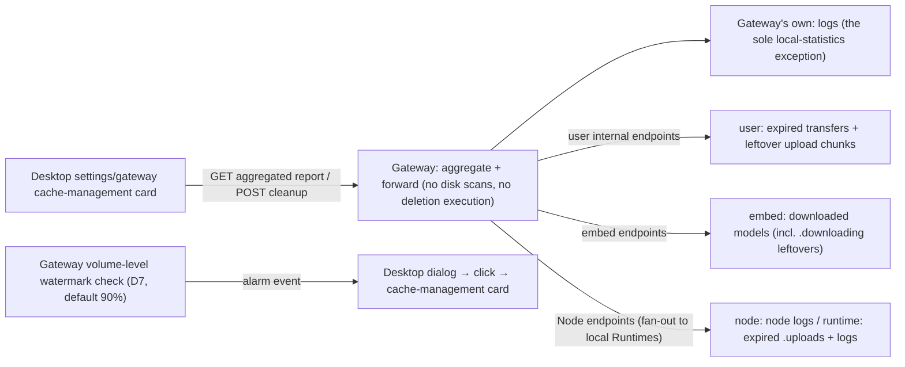

# ADR-123: Unified Gateway Cache Management — Service-Self-Reported Disk Usage, a Cache-Management Card, and a Global Watermark Alarm

**Status**: Accepted (2026-11-23; user ruled: "there should be one cache management for the whole Gateway — the frontend can see current cache disk usage, like WeChat's storage management, and the user can delete caches themselves"; "the global disk watermark must be added, like a server disk alarm, e.g. 90% — Desktop pops a dialog, the user clicks it to jump to the Gateway cache-management page and decides which services' caches to clean. The Gateway is only responsible for alarming the frontend"; "both data and cache usage are self-reported by services, deletion may only delete caches, how much to delete is decided by each service itself, the Gateway takes no part in business and only communicates/forwards. This is sound and must be held".)
**Date**: 2026-11-23
**Deciders**: User

**Related**:
- [ADR-122](./ADR-122-chunked-resumable-upload.md) (§7 Q2/Q2-bis: no per-store quota for the transfer store; this ADR takes over its disk governance)
- [ADR-009](./ADR-009-gateway-workspace-isolation.md) / the AGENTS.md Gateway boundary red line (Gateway = communication + resource management + reverse proxy; agent-private data only via Runtime HTTP, enforced by `run_gateway_fs_redline`)
- [ADR-101](./ADR-101-memory-standalone-mcp-service.md) (memory data only through `memory_proxy`; the Gateway MUST NOT open `instances/*/memory.db`)
- [ADR-055](./ADR-055-remote-runtime-node-topology.md) (Node topology: Runtime-side reports ride back through the Node reverse proxy)
- [ADR-084](./ADR-084-user-standalone-process.md) (the standalone user-service process)

> The Chinese document is the source of truth; this English counterpart is maintained in the same commit.

---

## 1. Decision summary

### 1.1 One line

**Disk usage is self-reported by each data-owning service; the Gateway only aggregates and forwards; Desktop settings/gateway provides a cache-management card whose delete actions target cache-class entries only; the global disk watermark only alarms — no automatic write gate.**

### 1.2 Decision table

| # | Decision | Conclusion |
|---|---|---|
| D1 | Governance model | **Unified cache management replaces per-feature quotas** (taking over ADR-122 Q2's ruling: "a dedicated limit here means little"). Many services deployed on the Gateway consume disk; one unified governance surface instead. A new service joins automatically by implementing the self-report protocol |
| D2 | Self-report protocol | Each data-owning service exposes a pair of admin endpoints: `storage-report` (bytes by category + cache/data classification + what is cleanable) and `cleanup` (executes per category). **What and how much to delete (retention policy) is decided by the service itself**; the Gateway never carries deletion-parameter semantics |
| D3 | Gateway role | **Aggregate + forward only**: one aggregation endpoint merges per-service reports for a single frontend read; cleanup requests are forwarded to the owning service. The Gateway MUST NOT scan disks for statistics and MUST NOT execute deletions itself (red lines, §3) |
| D4 | Cache/data split | **Cache class** (deleting loses no user asset: logs, leftover `.uploads` chunks, package download caches, …) gets a "clean" button; **data class** (memory.db, doc library, pm SQLite, chat `files/` attachments, in-flight transfer-store entries) shows usage + controlled entries only (e.g. "clean expired transfers") and **MUST NOT** offer bulk deletion |
| D5 | Global watermark alarm | Disk usage ≥ threshold (default **90%**, configurable) → the Gateway alarms the frontend → **Desktop pops a dialog** → clicking it **navigates to the settings/gateway cache-management card** → the user decides which services' caches to clean. **The Gateway is only responsible for alarming the frontend**: no automatic write rejection, no automatic cleanup |
| D6 | Card location | Desktop settings/gateway (`GatewayTab`, [SettingsPage.tsx](../../../apps/acowork-desktop/src/components/settings/SettingsPage.tsx)) gains a cache-management card: per-service usage list + cache-class clean buttons + data-class usage display, shaped after WeChat's "storage management" |
| D7 | Watermark detection | The Gateway periodically checks the free space of the **volume** holding `data_dir` (volume-level machine information, e.g. statfs), never traversing any service data directory — consistent with red line §3-1 |

### 1.3 Invariants (red lines)

The four the user ruled "must be held", all MUST-level:

1. **Both data and cache usage are self-reported by each service.** The Gateway MUST NOT directly scan any service's data directory (`run_gateway_fs_redline`; memory only via `memory_proxy`; agent-private data only via Runtime HTTP — the Runtime-side `.uploads` report rides back through the Node reverse proxy). Sole exceptions: the Gateway's own directories (its logs etc.) and D7's volume-level watermark check.
2. **Deletion may only delete cache class.** No bulk-delete entry for data class.
3. **How much to delete is decided by each service itself.** Retention policy (log retention days, cleanup batch size, …) stays cohesive inside the owning service; neither the Gateway nor the frontend carries deletion-quantity semantics.
4. **The Gateway takes no part in business — communication and forwarding only.** Aggregate reports, forward cleanup requests, alarm the frontend: these three things and nothing else.

### 1.4 Explicitly not doing

- No per-store / per-owner write quotas (ADR-122 Q2 ruling).
- No watermark-triggered automatic write rejection (a `disk_pressure`-style gate) — the alarm is the only action; if a real incident ever shows "disk filled between alarm and user response", the upgrade path is "reject cache-class writes at the watermark", not done in this ADR, kept on file as an upgrade.
- No platform-level automatic cleanup (LRU eviction etc.) — auto-delete risks wiping data class and violates red line 3.

## 2. Context

The ADR-122 review found the transfer store is a shared multi-agent write surface with a disk-exhaustion risk (M2) and originally suggested per-owner + global quotas. The user ruled against per-feature quotas: many services are deployed on the Gateway (gateway itself, user, memory, pm, doc, node, runtime, embed, lsp-relay), all consuming disk; per-feature limits are scattered patchwork. The right shape is one unified governance surface — "like WeChat's storage management": usage visible, classification clear, cleanup user-driven. One global safeguard remains: a disk-watermark alarm (e.g. 90%) pops a dialog, but all action after the alarm stays in the user's hands — the Gateway never auto-remediates beyond its authority.

## 3. Architecture

### 3.1 Service inventory and classification (v1 reporting surface)

| Service | Cache class (cleanable) | Data class (display / controlled cleanup only) | Report channel |
|---|---|---|---|
| Gateway itself | `data/logs` (files past the retention window) | `package-registry`, `data/apps` | local (the sole red-line-1 exception) |
| user service | expired transfer entries (`transfers-expired`, paired with ADR-122 D10 TTL), `uploads` chunk leftovers | chat `files/` attachments, in-flight transfers | user `GET /internal/storage-report` / `POST /internal/storage-cleanup` |
| embed service | downloaded models other than the loaded one, `.downloading` leftovers | — (the loaded model is not offered for cleanup) | embed `GET /storage/report` / `POST /storage/cleanup` |
| node service (per Node) | node logs | installed packages (`packages`) | node `GET /storage/report` / `POST /storage/cleanup` |
| Runtime (per Node, aggregated by the node) | expired `.uploads` chunks, logs | session data, agent workspace | node fan-out → Runtime `GET /internal/storage-report` / `POST /internal/storage-cleanup` |
| memory / pm / doc | — | no report endpoint (see below) | — |

One classification criterion: **does deletion lose a user/business asset?** Cache class = regenerable or due-for-recycling temporaries; everything else is data class.

**memory / pm / doc ship no self-report endpoint in v1** (user ruling, 2026-11-23: "nothing to clean up, so no cache-management interface"). All three hold data class only (memory.db + vector indexes, project/task SQLite, the document library), so the cleanup branch of such an endpoint would have no action behind it — a numbers-only interface puts a button on screen that can never be pressed. Their read-only data rows are omitted for the same reason: the card does not show usage nobody can act on. A new service that genuinely owns cleanable bytes joins the card by implementing the two endpoints.

**Implementation-time corrections (divergences found while writing the code, landed per the real semantics):**
- `package-registry` is **data class**. The ADR originally called it a "package-manager download cache", but it is the only distribution source for `.bot` packages — deleting it makes every Node install/upgrade a 404, i.e. deletion loses a business asset.
- The original inventory missed **embed**: the ONNX models under `{data_dir}/models` (a single fp16 model runs into hundreds of MB) are the largest reclaimable cache on the machine and must appear in the reporting surface.

### 3.2 Alarm flow

1. The Gateway periodically checks the volume watermark (D7); at ≥ threshold it emits an alarm event to the frontend (channel reuses Desktop's existing Gateway event stream).
2. Desktop dialog: "Disk space low (≥90% used), consider cleaning caches" + a "Clean now" button.
3. Clicking navigates to the settings/gateway cache-management card; the user reviews per-service usage and decides which cache-class entries to clean.
4. Cleanup requests are forwarded by the Gateway to the owning services (red lines 3/4); the frontend refreshes the report when done.
5. Usage falling back below the threshold clears the alarm; crossing it again re-alarms (debounce: §6 open questions).

## 4. Rejected alternatives

| Alternative | Why rejected |
|---|---|
| per-store / per-owner quotas (the ADR-122 review's original M2 suggestion) | User ruling: "a dedicated limit means little"; a scattered configuration surface, every new feature patching its own; superseded by unified cache management |
| Gateway scans service directories for statistics | Violates red line 1 (`run_gateway_fs_redline`, ADR-101); directory semantics belong to each service — the Gateway cannot correctly tell cache from data, so scanning is already an overreach into business |
| Watermark-triggered automatic write rejection (a `disk_pressure` gate) | User ruling: "the Gateway is only responsible for alarming the frontend"; auto-rejection translates infrastructure state into a business error every write path in every service must handle — high complexity, and the power to act should not leave the user |
| Platform-level automatic cleanup (LRU / periodic eviction) | Violates red line 3 (services decide how much to delete); auto-delete risks wiping data class |
| Frontend queries each service directly | Violates Desktop's Gateway-only connection model (ADR-115 single server address); aggregation is the Gateway's day job |

## 5. Consequences

- Upside: one entry point — cache management appears only on the Gateway tab; the "cache management" placeholder that General → Storage reserved for ADR-123 is removed by this ADR, leaving that card with the data directory and the single-file upload ceiling only. One governance surface; a new service joins by implementing two endpoints; users get full visibility and control over disk usage; the Gateway boundary stays clean (no scans, no deletion execution, no auto-remediation); ADR-122's transfer store needs no quota of its own.
- Downside / residual risk (explicitly accepted): the alarm is after-the-fact visibility + manual reclamation — **it produces no backpressure**. A runaway writer can keep filling the disk between alarm and user response, harming same-machine SQLite services (memory/pm/doc write failures). Mitigations: ADR-122 D10's 24 h TTL auto-recycling, the response headroom the 90% threshold leaves, and the dialog's immediacy. Accepted by user ruling (Q2-bis); if incidents materialize, the upgrade path is in §1.4.
- Rollback: the card, the aggregation endpoint and the alarm event are all additive — removing them returns to the "no governance surface" state; per-service self-report endpoints are read-only + explicit-cleanup, no destructive surface.

## 6. Open questions (engineering side, not ruling items)

1. Report shape: frontend pull (GET on card open) vs Gateway-pushed periodic refresh — v1 suggests pull, simplest.
2. Alarm debounce: one dialog per threshold crossing + a cooldown (e.g. no re-pop within 1 h) to avoid dialog storms at the boundary.
3. Where the configurable threshold lives (Gateway config file vs exposed in the settings UI).
4. Runtime-side report granularity: per-node aggregate vs per-agent breakdown — touches agent-private-data visibility; v1 suggests per-node aggregate.
5. Whether to offer a "clean all cache class" aggregate button (still per-service forwarding, just batch-initiated by the frontend).

## 7. Ruling record (2026-11-23)

| Item | User's words (excerpt) | Landing |
|---|---|---|
| Unified cache management replaces per-store quotas | "单独给这个设限意义不大，应该是整个 gateway 有个缓存管理……类似微信的缓存数据管理，可以自行删除缓存" | D1, D4, D6 |
| Global watermark = alarm shape | "全局磁盘水位要加，类似于服务器磁盘报警，比如说 90%，要 desktop 弹框提醒用户，用户点击弹框跳转到 gateway 缓存管理页面……gateway 只负责报警到前端" | D5, D7, §1.4 |
| Services with nothing to clean get no self-report endpoint | "没什么可清理的服务，就不用开发缓存管理接口了，比如你列出来的 memory、pm、doc" | §3.1 (the memory/pm/doc exclusion) |
| The four invariants | "数据和缓存都由服务自报，并且删除只能删除缓存，具体删多少由各个服务自己决定，gateway 不参与业务，只做通信转发。这个是合理的，要守住" | §1.3 red lines 1–4 |
