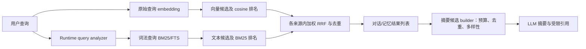

# ADR-095：全局搜索的对话与记忆检索优化及摘要候选筛选

- **编号**：ADR-095
- **状态**：草案（待评审）
- **日期**：2026-10-16
- **决策者**：ACowork 架构组
- **关联**：ADR-081（全局搜索）、ADR-082（SQLite 向量与 FTS 检索）、ADR-093（全局搜索 LLM 摘要与引用）

## 摘要

全局搜索的文件、Git、文档和项目来源分别服务于不同任务，现有搜索方式与其使用场景相符，不在本 ADR 中改变。当前需要改进的是对话历史与记忆：完整自然语言句子可能无法形成足够有效的词法查询；两路候选虽经 Hybrid 排名，但检索结果与真实语义相似度容易混淆；弱相关候选直接进入列表或摘要输入时缺少明确的质量控制。

本 ADR 将工作拆分为两个独立职责：

1. **检索阶段**只优化 conversation 与 memory，分别生成向量与词法候选，使用来源内的加权 RRF 排序，并保留命中来源等可解释信息。默认原始查询用于 embedding，词法分析结果用于 BM25/FTS。Semantic memory 的向量/词法权重以 4:1 作为初始策略；最终权重和拒绝弱向量候选的规则须通过评估集校准，不把 RRF 分数当作相似度。
2. **摘要候选阶段**仅从六个来源已经返回的可见结果中选择有界候选。各来源各自排序，不比较不兼容的原始分数；conversation 与 memory 可依据来源内排名、命中来源和去重/多样性约束选择更可信的候选。摘要允许少于预算或无候选，并要求证据不足时明确说明。

本 ADR 不改变 file、git、doc、project 的检索算法，不要求跨 Tab 统一分词，也不新增检索后 LLM reranker。

## 1. 背景与事实

1. 全局搜索由 Desktop 并发调用六个来源。文件、Git、文档、项目使用各自 API；conversation 与 memory 通过 Runtime `/search` 检索。
2. conversation 与 memory 底层使用 SQLite 向量搜索、FTS 文本搜索和 RRF。Memory 全局搜索目前以同一查询文本驱动向量与文本来源，且 hybrid memory 路径不设 cosine floor；conversation hybrid 路径对向量来源使用现有 cosine floor，词法命中独立保留。
3. `memory_recall` 已采用双查询源：当前轮完整用户消息用于 embedding，LLM 提取的关键词用于 BM25；Semantic hint 的加权 RRF 向量/文本权重为 0.8/0.2。该策略是排序参考，不代表已有可靠的弱相关过滤阈值。
4. 全局搜索 Memory API 当前不保留向量或文本原始信号；UI 接收到的顺序分数是合成值，不能解释为 cosine 相似度。RRF 分数本身仅表示融合排名，也不适合跨查询或跨来源直接比较。
5. ADR-093 的摘要候选 builder 当前按固定来源次序、每来源最多 5 条选择候选，最多 30 条；服务端只接收候选 ID、scope、title、snippet。

## 2. 目标、非目标与约束

### 2.1 目标

- 提高 conversation 与 memory 对自然语言句子和关键词查询的词法召回，同时保留整句语义检索能力。
- 明确区分向量命中、词法命中、融合排名等信号，避免把排名值误读为相似度。
- 让摘要候选选择更关注相关性和来源内多样性，并允许不提交弱相关候选。
- 保持检索与摘要职责分离，保证每项可独立测试、回滚。

### 2.2 非目标

- 不修改文件 Tab 的 ripgrep 匹配行为；不修改 Git、文档、项目搜索服务及其查询语义。
- 不对六个来源统一使用同一分词器。
- 不在不同来源的 BM25、RRF、合成分数之间直接进行数值比较或声称等权分数融合。
- 不要求所有来源必须填满固定摘要候选数；不新增 LLM 查询扩展或 LLM 相关性重排调用。
- 不在缺少数据校准时，为记忆向量检索新增任意固定 cosine 阈值。

## 3. 决策

### D1 — 搜索源边界保持不变

只调整 Runtime 中 conversation 与 memory 的查询构造、候选召回、融合及结果元数据。文件、Git、文档、项目仍使用现有 API、排序和 UI 行为。摘要候选策略可消费六个来源的结果，但不得改变这些来源的检索请求或结果排序。

### D2 — 对话与记忆使用双查询表达

检索请求在逻辑上区分：

- `semantic_query`：原始完整用户查询，用于 embedding；
- `lexical_query`：由确定性 query analyzer 生成，用于 BM25/FTS。

两者可以来自同一个用户输入，也允许 memory 的工具调用继续使用现有的“当前用户消息 + LLM 关键词”组合。没有可用分析结果时，词法检索回退到原始查询，不得因分析器无结果而丢失现有召回。

query analyzer 属 Runtime 对 conversation/memory 检索的共享中间层，不侵入 SQLite 存储层，也不改变其他搜索来源。首个实现应优先复用现有依赖/索引能力；英文空白分词、中文无空格输入的处理必须由中英文评估样本验证。中文分词方案与 tokenizer 依赖在实现阶段根据现有 crate、维护成本和实测效果确定；不得未经测试将任意 3-gram OR 查询当作已验证策略。

对 FTS 使用安全的 term 编码/转义并设置词项数上限，查询分析失败或超限时退回原始 query，避免 FTS 运算符注入、超长查询放大和空词项退化。

### D3 — 两路候选先独立排名，再按来源内加权 RRF 融合

向量源按 cosine 排名，文本源按 BM25/FTS 排名；不得直接将 cosine 与 BM25 原始分数相加。融合采用加权 RRF，并明确记录每条结果来自 `vector`、`text` 还是 `both`。

Memory 的 Semantic 查询将 vector:text = **4:1** 作为初始权重，复用 `memory_recall` 的既有倾向。Conversation 的最终权重也以 4:1 作为评估起点，但只有离线评估证明不降低词法精确命中与总体质量后才采用；否则按评估结果选择权重。权重配置属于检索策略，不解释成概率或相似度。

每一路先取有界候选池，再融合、去重并截取最终 K。词法候选是独立证据，不得仅因其 embedding 低而被向量阈值过滤。现有 conversation cosine floor 在候选来源层继续单独生效；memory 不新增硬阈值，直到评估集验证某一过滤策略确有收益。RRF 的绝对值不作为弱相关拒绝阈值。

### D4 — 检索响应暴露有限、可解释的来源内信号

conversation/memory hit 应提供摘要筛选所需的、受限的检索元数据：

- `matched_by`: `vector`、`text` 或 `both`；
- 各路来源内 rank；
- 可选的 cosine similarity（仅在实际计算并保留时）；
- fused rank/score（明确标记为来源内融合排名信号）。

RRF、BM25 与 cosine 必须分别命名、分别解释。不得再将 memory 的顺序合成值命名为相似度或可信度。原始分数不跨来源比较；不需要展示给用户的诊断数据可只供摘要 builder 与测试使用。

### D5 — 摘要候选选择是独立的、有界的后处理

摘要 builder 消费六个来源已经返回的结果，不执行新的检索，不更改任一来源的列表排序。继续保留 ADR-093 的总候选/字段长度安全上限，并允许每来源预算作为上限而非必须填满的目标。

- file/git/doc/project：保持其来源内既有顺序，按既有预算截取，不引入新的过滤或重排。
- conversation/memory：在各自来源内依照已校准的融合排名选取；使用 `matched_by`、来源内排名及适当的会话/节点去重，避免单一会话或重复内容占据候选预算。
- 摘要候选不足预算时直接提交不足数量；零个合格候选时不调用摘要 LLM，或按 ADR-093 的空候选契约明确返回无结果状态。
- Summary DTO 可携带上述受限来源元数据以帮助模型理解证据类别，但不得把未校准的 raw score 描述为 confidence。候选正文仍视为不可信数据，继续执行 ADR-093 的 prompt injection 防护和 citation allowlist。
- 摘要提示要求模型仅依据候选作答；证据不足或候选互相矛盾时应明确说明，不可为了形成完整摘要而编造结论。

### D6 — 质量门槛必须数据驱动

在引入 Memory 新 cosine floor、动态拒绝阈值或摘要前 LLM reranker 之前，先建立带人工相关性标签的评估集。最低覆盖：英文/中文/中英混合、短关键词、完整句子、精确实体词、仅语义表达、无相关结果、对话与记忆重复候选。

至少比较：当前实现、双查询源等权 RRF、双查询源 4:1 加权 RRF；报告 Recall@K、Precision@K、MRR/nDCG@K、无关查询误召回率，并单独统计文本精确命中保留率。权重或阈值只有达到预先约定的质量目标且没有明显损害关键用例时才启用。

## 4. 数据流

检索与摘要的边界是列表结果：检索模块产出每个 scope 自己排序且带有匹配元数据的 hit；摘要 builder 只在候选预算内选择，不拥有检索业务逻辑。

## 5. 模块边界与接口方向

- **Runtime query analyzer**：纯逻辑、确定性、可单测；输入原始查询，输出有界 lexical terms/query。由 conversation 与 memory 检索调用，不拥有存储或 HTTP 状态。
- **SQLite retrieval**：继续拥有向量/FTS 实际搜索和加权 RRF；必要时扩展内部结果类型以保留各源 rank / matched_by / cosine。存储层不负责语言模型 query expansion。
- **Runtime global search**：为 conversation/memory 调用 analyzer、embedding provider 和 SQLite retrieval；序列化清晰区分相似度和融合排名；Gateway 仍只透明反代。
- **Desktop summary candidate builder**：输入各来源现有排序结果，实施每来源上限、总量上限、去重和来源内质量筛选；无搜索调用。
- **Runtime summary endpoint**：验证新增的候选元数据和原有长度/ID 限制，调用现有 Provider；失败不影响各 Tab 检索列表。

若添加 API 字段，使用可选字段以便候选消费者渐进迁移；前后端同批更新契约与测试。无需持久化 schema 迁移或重建对话/记忆索引，除非评估证明 tokenizer 索引本身必须变化；此类变更另行审议。

## 6. 可靠性、安全与性能

- Query analyzer 必须限制输入长度、词项数量和单项长度；正确转义 FTS 查询语法。
- 保留原始查询的 embedding 路径，不把敏感的整句文本复制进额外持久化存储或日志。
- 每路召回候选数有上限，融合仅在有界候选池内执行；摘要仍受 ADR-093 请求字节数、候选数、snippet 长度和 provider deadline 约束。
- 任何一个来源失败仍按现有部分结果语义工作；词法分析失败回退到原始查询，embedding 失败回退到文本检索。
- 检索 diagnostic 不记录完整对话正文；以计数、匹配源、rank 和必要的分数分布为主。

## 7. 交付、验证与回滚

| 阶段 | 交付 | 验证 | 回滚 |
|---|---|---|---|
| 0 | 建立脱敏、标注的 conversation/memory 查询基准与当前基线 | 保存查询、相关 hit 标签及 Recall@K / Precision@K / MRR / 误召回率 | 无运行时行为变更，删除/更新基准即可 |
| 1 | Query analyzer + 双查询表达 + 可解释的候选来源元数据；先可在 shadow/test 模式比较，不改变 UI 策略 | 中英文 analyzer 单测、FTS 转义/上限测试、现有检索回归、基准对比 | 关闭 analyzer 路径，恢复原始 query 单路文本检索 |
| 2 | 对 conversation/memory 上线来源内加权 RRF；按基准选择权重 | 融合排名、命中来源、精确词命中保留、Recall/Precision 指标 | 恢复旧权重与旧响应 mapper；可保留可选响应字段 |
| 3 | 摘要候选筛选、去重和受限来源元数据 | builder 单测、prompt/citation 测试、无候选/低质量候选/部分来源失败测试 | 恢复 ADR-093 固定每源前 N 条 builder；搜索行为不变 |
| 4 | 依据基准评估是否启用弱向量拒绝阈值 | 阈值 sweep、误拒绝/误接纳分析；未达到目标则不启用 | 关闭阈值配置，维持向量排名 + 词法独立来源 |

## 8. 考虑过的替代方案

| 方案 | 拒绝/暂缓原因 |
|---|---|
| 六个 Tab 统一分词并融合原始分数 | 来源查询语义和分数域不同；会侵入本 ADR 明确不改的 file/git/doc/project 搜索。 |
| 只对完整查询做向量搜索 | 长句语义召回仍可能引入弱候选；精确实体、产品名及词法证据会丢失。 |
| 只对 query 做关键词 OR，不保留完整句 embedding | 改善词法命中但丢失语义召回；不适合对话和记忆的自然语言检索。 |
| 固定提高 cosine 阈值 | 不同模型/语料的 cosine 分布可能不兼容；未校准会误删有效候选。 |
| 所有候选直接交给 LLM，由摘要模型自行过滤 | 检索噪声仍占用上下文和成本；模型可能把弱证据写成结论，且候选选择不可稳定测试。 |
| 新增独立 LLM query expansion/rerank | 增加一次模型调用、成本、延迟与失败面；在确定性查询分析和基准验证前不引入。 |

## 9. 待评审事项

1. 评估基准达到何种 Precision@K/Recall@K 目标后，允许启用 Memory cosine 拒绝阈值？
2. 运行时 query analyzer 的中文词法方案，是否现有 crate 足够，或需要新增依赖？以 Phase 0 基准的离线比较决定。
3. Conversation 是否采用与 Semantic Memory 相同的 4:1 vector:text 初始权重，或因消息文本/FTS 分布不同而单独校准？
4. API 是否暴露 `cosine` 原值给 UI，还是仅向摘要 builder 与诊断接口提供？默认建议先只用于受控内部消费者，避免将未校准分数误呈现为用户置信度。

## 10. 决策记录

- 2026-10-16：创建草案。确认只优化全局搜索中的对话与记忆；文件、Git、文档、项目搜索方式保持不变；检索改进与摘要候选筛选分阶段、分模块处理。
