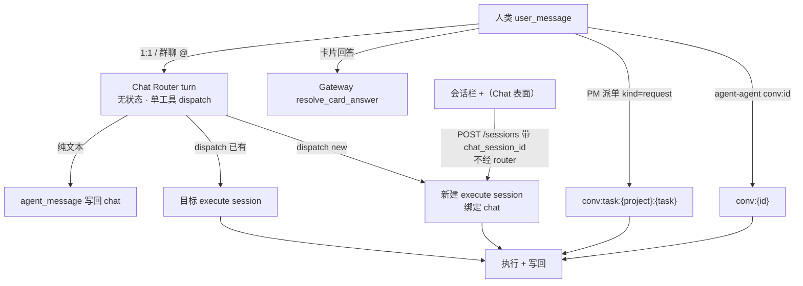

# ADR-099：Chat Session 的 LLM 语义路由（Chat Router）

- **编号**：ADR-099
- **状态**：已接受（2026-10-22 修订：D3/D6 为 router 增加只读信息工具；D3 补充投递时锚定 + 执行侧 pending 队列投影，见下。2026-10-23 修订：D8 降级语义——chat 来源的人类消息降级时**新建**执行会话，见 D8。2026-10-24 修订：**推翻 D1 的「执行层保留物理轮转」，T1/T2 轮转整体删除**——执行会话长命、压缩就地处理、开新会话只由语义决定，见「修订（2026-10-24）」。2026-10-28 修订：**推翻验收标准 1 的「复用时 seed 落到被路由到的会话」**——`session_config` 只是新建初值，路由到已存在的会话时一个字段都不应用，见「修订（2026-10-28）」。2026-10-29 修订：**D5 的 Block B 窗口改按 token 预算裁剪**（原条数上限降级为传输上限），并作为 `chat_router.history_max_tokens` 暴露到 Agent Setup，见「修订（2026-10-29）」）
- **日期**：2026-10-21
- **决策者**：ACowork 架构组
- **关联**：设计 27（Intent 消息与群聊）、设计 29（Chat Session 上下文编排）、ADR-060（Prompt Cache 友好的上下文块重排）、ADR-063（包级 Prompt 覆盖）、ADR-066（Provider Cache Tokens）、ADR-076（多用户账号体系）、ADR-085（Agent 生命周期状态机）、ADR-092（用户消息身份与有界读取）、ADR-096（请求路径禁止全量读会话）、ADR-098（统一标准群组模型）

## 摘要

**（本 ADR 立项时的现状）** Chat session 不是 LLM 的上下文：用户消息进哪个 execute session，完全由代码规则（`routing_key` + T1 空闲 / T2 压缩 / T3 配置冲突）决定。这套规则同时回答了两个不同的问题——「语义上该由哪个任务接着做」和「物理上该不该换一个上下文窗口」——因此产生三个不合理现象：

1. chat 里改了 model/workspace 就强制新建 execute session；
2. 没改参数就一律复用当前 working session，不管语义是否相关；
3. T2 轮转把旧任务摘要带进新任务，摘要 token 远大于用户输入，新 session 还在干旧活。

本 ADR 决定分层：**Chat 层引入一次受限工具集的 LLM turn（Chat Router）做语义决策**（立项时执行层保留物理轮转作为上下文安全阀：T3 删除，T1 降级为 prompt 信号，T2 只在 router 选定的同一逻辑任务内发生）。该安全阀已由 2026-10-24 修订**整体删除**：开新执行会话的唯一来源是语义决定（`dispatch(target="new")` / PM 任务终态 close / 用户手动新建），上下文膨胀由 compaction 就地处理，见「修订（2026-10-24）」。

路由的载体是 `ChatSessionManager`（按 `chat_session_id` 隔离，群聊中每个 agent 天然独立），router 的工具面是 `dispatch` 加两个只读信息工具（D3），上下文按「稳定前缀 + 末尾追加」三段式编排（详见设计 29）。

## 背景

### 1. 现状（已废止）：routing_key 与三态轮转

`routing_key` 的命名空间优先级为 `task:` > `chat:` > `conv:` > `msg:`（[intent_routing.rs](../../../core/acowork-runtime/src/agent/session/intent_routing.rs)）。1:1 chat 与群聊 @Agent 的 `conversation_id` 为空，因此都落到 `chat:{chat_session_id}`；PM 派单是 `conv:task:{project}:{task}`。`route_intent_session` 依次检查：

- mapped session 是否命中 T1（idle 超过 `intent_idle_rotate_hours`）或 T2（compaction 发生）；
- `SessionSeed`（chat 侧 draft 的 model/provider/workspace/reasoning）是否与映射 session 冲突（T3）；
- 命中任一条件就新建 session，并把 handoff 指针或摘要写进新 session。

> 三态轮转已全部废止（T3 由本 ADR 删除，T1/T2 由 2026-10-24 修订删除）。现在 `route_intent_session` 只做一件事：键有映射就复用，没有映射才新建——上下文卫生由 compaction 单独负责，开新会话永远是显式决定。

### 2. 三个不合理现象

| 现象 | 根因 |
|---|---|
| 改参数强制新建 | 参数一致性被当成任务身份判据（T3） |
| 语义无关也复用 | 「同一个 chat」被当成「同一个任务」 |
| 轮转摘要污染新任务 | T1/T2 是物理窗口事件，却承担了「任务切换」语义 |

### 3. 群聊与 PM 放大问题

- 群聊里同一个 agent 的所有 @ 都进同一条 `chat:{group}` 链：多用户、多话题被迫串行，后来者会继承前一个话题的上下文与摘要。
- PM 派单以 `task:{project}:{task}` 为边界，本身是确定性的，但任务会话不绑定项目群聊，用户在群里追问任务时无法被路由过去；任务终态后也没有机制阻止「复活」。
- agent-agent 以 `conversation_id` 为边界，天然隔离，不需要语义路由。

### 4. 为什么不能继续加代码规则

「这条消息和哪个任务语义相关」需要理解自然语言与对话历史，是模型判断，不是可枚举的规则。继续在代码里加条件（关键词、时间窗、参数指纹）只会把不可维护的启发式堆进投递链。

## 决策

### D1 — 分层：Chat 层语义路由，执行层不做轮转

- Chat 层：每条人类 `user_message`（1:1 与群聊 @）先经过一次 router turn，产出「回答 / 转交已有会话 / 新建会话」。
- 执行层：本 ADR 立项时保留 T1/T2 作为物理安全阀、删除 T3；**2026-10-24 修订删除 T1/T2**——执行会话长命，上下文卫生只由 ADR-011 / ADR-061 的压缩机制负责，不再有代码级的轮转点。
- 卡片回答、PM 派单、agent-agent 不经过 router。

### D2 — Router turn 无状态，ChatSessionManager 按 chat 隔离

每轮上下文都从 chat 历史重建，不建隐藏的常驻 session（避免双历史分叉与额外轮转）。`ChatSessionManager` 的键是 `chat_session_id`；1:1 chat 天然按 (user, agent) 唯一，群聊中每个 agent 有独立 Runtime，因此天然按 agent 隔离。manager 只负责 per-chat 串行队列、窗口锚点、候选构造与决策日志。

**router turn 不在 MQTT 入站循环上执行。**入站循环只做一件事：把消息压进该 chat 的 FIFO 队列，`push_turn` 返回「你是第一个」时才起一个 drain task（每条 chat 恰有一个，`finish_drain` 在队列非空时保留占位，消除「查空 → 新消息入队 → 释放占位 → 消息永久滞留」的竞态）。这样做的理由是两条不变量：同一 chat 的两轮不得并发读同一历史锚点再竞写回；一个慢模型不能把这个 agent 的接收面（含 `Stop`）卡住。drain task 内每轮再包一层 `spawn`，turn 里的 panic 表现为 `JoinErr` 后循环仍走到 `finish_drain`，不会留下永久占位却无人消费的队列。router 交还控制权的结果（`PassThrough` / `Fallback`）由同一个 drain task 就地执行确定性路由收尾——降级只花延迟，不丢消息，也绝不重新入队。

### D3 — `dispatch` 与只读信息工具、工具可见性矩阵

`dispatch(target = "<候选别名>" | "new", message?, session_config?)`；不调用 `dispatch` 即纯文本回答。候选使用 `S1/S2` 短别名，运行时映射真实 session id。

为了让「答案需要一点信息」不再退化为「转交给执行会话」，router 同时暴露两个**只读信息工具**：

- `memory_recall`：查本 agent 长期记忆（复用 execute 侧 builtin，检索策略不变）；
- `http_request`：**收窄为 GET-only**——router 侧 schema 不含 `method`/`body`/`content_type`，执行时运行时再强制 `method = "GET"`、scheme 白名单（http/https）、内层超时小于轮次超时，双保险。

| 工具 | chat router turn | execute turn |
|---|---|---|
| `dispatch` | 唯一路由工具 | 不暴露 |
| `memory_recall` | 可用（按需检索） | 可用 |
| `http_request` | 可用（GET-only） | 可用 |
| `intent_send` | 不暴露 | 可用（responder 角色隐藏） |
| `chat_history_read` | 不暴露（历史自动注入） | 可用 |
| `ask_user_question` | 不暴露（澄清用文本） | 可用（无人类会话隐藏） |
| shell / file / 其它执行工具 | 不暴露 | 按 manifest/配置 |

执行器边界不变：router 没有任何执行工具，包内 persona 无法把它变成执行者；信息工具只读，不改变任何东西。信息工具实例从 `all_tools`（已启用子集）按名解析，agent 级开关同样管住 router。

**轮数约束是提示词软约束，不是代码硬上限**：信息轮次不设硬性次数上限（硬切断正在进行的检索会让结果以更失控的形态落地）；安全边界由逐次模型调用超时、逐次工具超时与只读工具面承担。一个轮次内的 `user → assistant → tool_call → tool_result → assistant` 链完整保留在同一个 request 里：输出预算 `max_tokens` 放宽到 2048（think + 工具参数 + 终稿不被截断），单条工具结果上限 8KB（UTF-8 边界截断加标记）。工具消息不写回 chat 历史，Block B 不膨胀。

`dispatch` 只在本 agent 内选 session；`intent_send` 才跨 agent。router 不得代人类 @ 其他 agent——`@` 是用户行为。

**投递在路由时锁定，正忙的目标会话展示真实 pending 队列。**一个 turn 被 dispatch（或确定性路由）投递入 execution session 后，`turn_started` 指针在意图送达时就写入 chat，而不是等（可能正忙的）会话几分钟后排到它才写，于是排队期间 chat 界面不再投影「正在分配」。执行侧：路由进一个*已经活跃*会话的意图会被记入一份小的有界 pending 清单（发送者 + ≤120 字符摘要 + `from_chat` 标记，ADR-096），经既有的 retained `session_state` 快照推送，于是输入框上方的队列盒能显示之前在入站通道里隐形的 chat 转发消息。会话出队该意图开跑时即清除；idle 会话从不入队。不引入新写入口、不持久化。

**dispatch 的代价不对称是决策规则的核心**（写进不可覆盖的基座提示词）：错误转交的代价远大于漏转交（错发会唤醒整个执行会话、打断对话；不发用户随时可以补一句）。只有当消息与某个候选任务有清晰关联、或明显开启新工作时才 `dispatch`；闲聊、提问、可自查的事实查询一律自己回答；不确定是否需要转交时，回复或问一句澄清，而不是猜测转交。

### D4 — 候选规则与多用户隔离

- 1:1：当前映射 session + `meta.chat_session_id == 当前 chat` 的历史 session + 当前用户 owner 且 `chat_session_id` 为空的手工会话。
- 群聊：只列 `meta.chat_session_id == 当前群聊` 的 session（含已绑定的 PM 任务会话），绝不列个人私聊 session。
- 排除：绑定其他 chat、owner 为他人（1:1）、已终态的 PM task session。上限 10，按 `last_active_at` 倒序；只暴露 title/状态/最近活动/来源，不读 JSONL 正文（ADR-096）。

### D5 — 上下文编排：稳定前缀 + 末尾追加

按 ADR-060 的 Block 模型落地到 chat 层：

- Block A：router system prompt（基座 + persona + 场景段），逐字节稳定；
- Block B：chat 历史按 seq 确定性投影，append-only；窗口按 token 预算裁剪，锚点 `anchor_seq` 只在超过 `max_tokens + slack_tokens` 时批量前移（2026-10-29 修订，原为条数 `max_history + slack`）；
- Block C：候选清单、draft config、当前时间等动态信息放在历史之后，变化只影响自身；
- Anthropic 在 A/B 末尾各打一个 `cache_control: ephemeral` 断点；OpenAI/DeepSeek 依赖自动前缀缓存。

详见设计 29。

### D6 — Chat prompt 与 execute prompt 严格分离

execute prompt（`prompts/system.md` + `constraints.md` + 其他 `prompts/*.md` + skills）包含执行身份、工具规则与工程规范，不能照搬给 router。chat prompt 由三层组成，且**整段**可被 `chat.md` 覆盖：

1. Runtime 内置基座（角色边界、`dispatch` 契约、决策与安全规则）；
2. Persona 段：manifest 的 `name`/`role`/`description` 回退，上限 4KB；
3. 场景段：1:1 / 群聊两个稳定变体。

`chat.md` 存在且非空白时**整段替换**上述三层（只替换 `{{agent_name}}`）——唯独 `# Safety` 段除外，Runtime 每轮都会把它作为不可裁剪的尾块重新追加到正文末尾。来源优先级为：群聊会话级 `chat-sessions/{id}/chat.md`（`acowork-user`，人类面上仅群主或管理员可读可写——ADR-098——从群聊右侧设置面板编辑，普通成员不渲染该卡片；接口层的读仍对参与者开放，首读时用内置默认生成）> 包级 `prompts/chat.md`（agent 启动时若无则用内置默认生成）> 内置默认。包级 `chat.md` 纳入 ADR-063 的包级 override 清单，因此也从 execute prompt 拼接中排除；`POST /agents/{id}/prompts/reload` 同步刷新。安全边界由**结构而非字面量**保证：`# Safety` 尾块无法被 `chat.md` 删除，群聊提示词仅群主或管理员可改写（因此单个成员无法操控他人的 agent），且 router 只有 `dispatch` 与两个只读信息工具，改写提示词字面量不能给它新能力。router 不加载 skills、workspace prompt file，也不**自动注入** retrieved memory——只允许通过 `memory_recall` 按需检索（D3）。

> 修订（chat.md 整段可覆盖）：原 D6 规定 `prompts/chat.md` **只替换 Persona 段**、基座不可覆盖。现按需求改为整段可覆盖，并新增会话级（群聊）`chat.md`；基座与场景段的字面量迁到 `acowork_core::chat_prompt`，供 `acowork-user`（播种群聊文件）与 `acowork-runtime`（组装内置默认）共用。安全保证改由工具集结构承担。设计 29 §3.1–3.3 已同步。

### D7 — 群聊与 PM 派单边界

- 群聊 @Agent：@ 只决定「哪个 agent」，router 决定「哪个执行会话」；同一群里不同话题可并行到不同 session。
- PM 派单：保持 `conversation_id = task:{project}:{task}` 的确定性映射，不经过 router；创建任务会话时绑定项目群聊（`chat_session_id` + Members 可见），使其进入群聊候选；`close_intent_context` 将 session 记入终态清单，候选排除。
- agent-agent：`conv:{conversation_id}` 确定性映射，不绑定 chat、不进入候选。
- 群聊 @ fanout 的 per-target `message_id` 与 `in_reply_to`（共享 `user_message` row id）在 router 转发时原样保留。

### D8 — 三态轮转的处置（均已废止）、执行位置与失败降级

- T3 删除（本 ADR）；
- T1 删除（2026-10-24 修订，含其 `intent_idle_rotate_hours` 配置项与降级路径硬触发）；
- T2 删除（2026-10-24 修订，含 handoff 摘要蒸馏与 successor）；
- router 超时/报错/连续两次非法工具参数 → 降级；回退发生在该 chat 的 drain task 上，消息不丢。**降级的落点按来源分（2026-10-23 修订）**：chat 来源的人类消息不再回退到 `route_intent_session` 的映射复用，改走 `chat_dispatch(Target::New)` **新建**执行会话（绑定同一 chat、intent_map 重指向）——降级意味着 router 没有给出语义判断，而映射也不是语义判断：把一条可能开新话题的消息猜塞进不相关的历史会话，比新建更糟（实测事故：模型超时降级后新话题被塞进旧任务的执行会话，chat 界面无从察觉）。`PassThrough`（PM 任务 / agent-agent / response / kill switch 关闭态）的确定性复用不变——那些链路上 `conversation_id` / `msg:` 键**就是**任务身份，复用是有据的，不是猜测。反应行（ADR-100 D11 `turn_routed`）在两条路径下由同一 builder 写入，降级新建同样落一条"启动新任务"。
- router 链路上的每个 Gateway HTTP 都有界：chat 历史读用 `chat_router.timeout_ms`（默认 8 s，clamp 1–60 s），写回 15 s，附件拉取 60 s。挂起的 Gateway 的代价是这一轮降级，而不是该 chat 的 drainer 被永久 park；
- 候选清单的目录扫描在 `SessionManager` 锁外完成，锁内只做映射解析（一次全局锁不得覆盖磁盘 IO）；
- `agent_config.json` 的 `chat_router.enabled=false` 是 kill switch：入站循环**不排队**，Chat 消息直接内联走确定性路由（执行位置与 ADR-098 相同）。它与 ADR-098 时点不是逐字节等效——T3 已按 D1 删除，所以关闭态下 `session_config` 是更新映射到的会话（下一轮生效）而不是强制新建；E2E 依赖的「内联立即投递」这一可观测行为保持现有断言。

### D9 — 显式新建复用会话栏的 `+`

「新建任务」的确定性逃生舱不新增 composer 按钮，而是复用 Agent 页会话栏已有的 `+`：

- `+` 触发时 `POST /api/agents/{id}/sessions` 带上当前 `chat_session_id`，Runtime 校验调用者的 chat 归属后 stamp 与 `dispatch(new)` 完全相同的绑定对（`chat_session_id` + `Members`）；
- 创建成功后切到 exec 视图，消息直达该会话、不经过 router——绑定加切视图本身就构成逃生舱，不需要 `target_session_id` 之类的新 wire 字段；
- Gateway 零改动（`POST /sessions` 是透明转发）；
- 自动创建（首次打开的补建、无 Chat tab 的旧纯执行界面上关闭最后一个 exec tab 的补建）不绑定——「系统需要一个 tab」不等于「用户在这个对话里发起了一个任务」。绑定是群聊候选的硬门槛（D4：群聊只列绑定本群的会话）；在 1:1 里未绑定的本人会话仍会按 D4 第三条款列为候选，由 router 自己按标题与最近活动判断相关性；
- 校验失败只跳过绑定、不拒绝创建：chat 归属由 Gateway 尽力注入，用户服务抖动时「新建任务」仍须可用（绑定 fail-soft，访问 fail-closed）；
- 绑定一旦成立，`visibility` 就归绑定所有：（`chat_session_id`, `Members`）是群聊读检查依赖的成对契约，请求体不得把一个已绑定会话改回 `public`（泄给其他 chat 的读者）或 `private`（本群看不到自己的任务）；被丢弃的请求值记 WARN，响应回显实际生效值而不是请求值。

已知取舍：输入框草稿不跟随到新会话。

## 路由流程

## 验收标准

对应背景中的三个现象：

1. **改参数不再强制新建**：router 判断「同一任务 + 参数变更」时复用现有 session；只有新任务才新建。复用时 draft 的 `session_config` **不落到被路由到的会话**：被复用的会话保留它自己的 model / provider / reasoning_effort / workspace，draft 只作为**新建会话的初值**生效（2026-10-28 修订推翻本条原先的「配置下一轮生效」，见「修订（2026-10-28）」）。要改一条在跑的会话，走它自己执行面上的 `apply_config`（ADR-047）与 `route_workspace_switch`（ADR-034 §8）。
2. **语义无关不再复用**：router 对无关输入选择 `dispatch(new)`。
3. **摘要不污染新任务**：新任务从空白 session 开始；已选定任务内的上下文膨胀由压缩就地处理，不产生 successor。

附加验收：

- 群聊中两个用户的不同话题分别落到不同执行会话；
- 项目群聊里可以追问已绑定的 PM 任务，终态任务不再出现在候选；
- router 关闭时，现有 E2E 断言全部保持。

## 兼容与迁移

- `chat_router.enabled` 默认开启；关闭时 Chat 消息回到 ADR-098 的内联确定性路由，唯一差异是三态轮转已全部退役（T3 由本 ADR、T1/T2 由 2026-10-24 修订，见 D8）——该路径同样只做「键有映射就复用、没有才新建」。
- router turn 改到 per-chat drain task 执行，不改变任何对外协议：MQTT 载荷、`routing_key`、`intent-sessions.json`、写回频道全部原样。
- 存量 package 无需新增文件：agent 启动时若无 `prompts/chat.md` 就用内置默认生成一份（可编辑），在此之前一直使用内置默认提示词。
- 存量 `intent-sessions.json` 映射继续可用；router 的候选包含当前映射，首次运行无需迁移。
- 终态清单使用旁挂 `terminal-sessions.json`，不修改 SQLite schema。
- 存量 JSONL 里带 `rotation_handoff` 标记的行不清理、不提升为 User，渲染层继续过滤；该机制已废止，因此不再有新增。
- SQLite 的 `sessions.last_compaction_summary` 由 migration 7 删除（它是 T2 摘要蒸馏的写时缓存，已无读者）；`last_compaction_offset` 保留。

## 非目标

- 不重写执行层的压缩算法（ADR-061）。
- 不让 router 直接执行任务或读取 execute session 正文。
- 不改变 PM 派单接口 `POST /api/intents/task-dispatch` 的语义。
- 不改变卡片回答、@ fanout 的授权与写回通道。

## 与现有 ADR 的关系

| 现有 ADR | 关系 |
|---|---|
| 设计 27 / ADR-098 | 本 ADR 修订 chat 层的路由决策来源；两层会话模型与 chat 存储不变 |
| ADR-060 | 复用 Block A/B 的缓存原则，新增 Block C 动态尾部与窗口锚点 |
| ADR-063 | `prompts/chat.md` 作为新的包级 override 文件 |
| ADR-066 | 复用 cache token 统计与命中率口径 |
| ADR-076 / ADR-092 | 候选与写回的身份过滤沿用 envelope `from` 与 chat scope |
| ADR-096 | 候选只读元数据，不读 JSONL 正文；其 `last_compaction_summary` 派生列已随轮转删除（migration 7） |

## 修订（2026-10-24）：删除执行会话物理轮转

本修订推翻 D1 的第二条（执行层保留 T1/T2 物理安全阀），删除整个轮转机制：`RotateReason` / `needs_rotation` / `plan_rotation` / `rekey` / `pending_successor`、`handoff_note` 通道、`record_intent_handoff`、transcript 的 `rotation_handoff` 标记、`last_compaction_summary` 派生列、`intent_idle_rotate_hours` 与 `intent_handoff_max_tokens` 配置项（含桌面 Session 卡片与 5 份 locale）。

理由：

1. **execute session 本就可以一直追加、持续交互**。每一轮都重新读全量 JSONL（ADR-032），发生过压缩的历史 session 同样能继续接 dispatch、继续迭代——「压缩过就该换窗口」没有依据。
2. **轮转是「没有 LLM 做路由判断」时代的产物**。T1 用闲置时长、T2 用压缩事件猜测「任务该结束了」；D1 把语义决策上提到 Chat 层之后，这两个物理信号就不再承担任何路由含义，留着反而与背景 §2 的第三个现象自相矛盾——T2 的 handoff 摘要正是本 ADR 要消灭的污染。
3. **单一规则**：开新执行会话只有三个来源，全部是显式决定——router 的 `dispatch(target="new")`、PM 任务终态 close、用户手动新建（D9）；上下文卫生只有 ADR-011 / ADR-061 的压缩；文件规模只有设计 15 的 100,000 行 / 50 MiB 硬上限。

不受本修订影响的：`turn_mode` 仍只有 new / continue 两态（ADR-100 D11）；`dispatch(target="new")` 仍是新开一条任务而非轮转（无 predecessor、不携带 handoff）；transcript 不新增 tag；映射可指向已压缩的会话，不做健康检查。压缩自身的恢复跳过仍用 `last_compaction_offset`。

## 修订（2026-10-28）：`session_config` 只是新建初值，复用时一律不应用

推翻验收标准 1 的后半句（「复用时 draft 的 model / provider / reasoning_effort 必须落到被路由到的会话」），并把原 workspace 例外推广到全部字段：**seed 只在该次路由新建会话时作为初值应用；路由到已存在的会话时一个字段都不应用**。`apply_seed_to_session` 连同其 workspace 分歧日志一并删除。

动机是用户视角的自洽。一个 Chat 是一段对话压着多条执行会话，它们可能同时在跑、各自在不同工作目录。chat composer 上的 draft 是这段对话对「还没开始的活」的偏好，不是对某条在跑的会话下达的命令。旧规则下「chat 面选了 W、router 把这一轮路由进一条已在 V 里跑的旧会话」，那一轮实际在 V 干活而 chat 面显示 W——两个面都对不上，右侧工作区 Add-to-Chat 的前提（composer 显示的工作区就是这轮干活的工作区）自相矛盾。新规则下不变量各自闭合：**chat 的 composer 与 chat 的右侧面板一致，执行会话的 composer 与该会话的面板一致；chat 与执行会话之间不需要一致**（本就允许多条并行）。

明确接受的代价：从 chat 面改 model / reasoning，若 router 判定复用旧会话，这一轮不生效，只对 chat 之后新开的会话生效。要改一条在跑的会话，去它自己的执行面——那里有 `apply_config`（ADR-047 唯一配置入口）与 `route_workspace_switch`（ADR-034 §8 唯一工作区入口），改的是它自己看得见的状态。

不受影响的：`dispatch(target="new")` 仍是 draft 落地的显式通道；PM 任务 / agent↔agent 的确定性复用不变（键即任务身份），但其 seed 同样不再覆盖已存在的会话；`clamp_seed` 仍只在创建路径按应答方 provider 列表钳制 model/provider、按注册表丢弃未知 workspace。

## 修订（2026-10-29）：Block B 窗口改按 token 预算裁剪，并暴露到 Agent Setup

D5 的窗口尺寸从「条数」改为「上下文大小（tokens）」。原 `max_history + slack` / `retain` 三个条数常量退化为内部传输上限，主判据换成 `chat_router.history_max_tokens`（默认 8000，clamp 1000–64000），按 `crate::token::count_text` 统一口径估算。

理由：固定条数对不同消息的上下文代价视而不见——一条「好的」和一份 2KB 的故障报告被当成同等成本。条数上限对闲聊型对话过于宽松（32 条短消息 ≈ 1.4k tokens），对信息密集的对话又过于苛刻，而旧实现的字节兜底 `max_history × per_row_cap` 允许的**最坏**情况反而高达约 18k tokens。改成一个数就能同时收紧最坏情况、放松常见情况。

机制不变：仍是**锚点 + 批量裁剪**，超预算时一次性裁到 `retain_tokens`（默认预算的一半），不做逐条滑动——前缀缓存契约与 D5 一致。两处新增的边界：单条超长消息至少保留最新一条（宁可略超预算，也不能让 router 看不到用户刚说的话）；行数仍受网关单页 50 条约束，因此每轮按满页取历史、由 token 预算决定实际投影量；短消息碰不到预算时由行数上限兜底，且同样批量重建（48 → 24 条再逐轮追加），不做逐条滑动。

配套：`PUT /agents/{id}/config` 新增扁平字段 `chat_router_history_max_tokens`（`ConfigField::ChatRouterHistoryMaxTokens`），Agent Setup 的 Chat Router 卡片改为可编辑（含 5 份 locale）；`chat_router.history_window` 保留但降级为条数上限、不上 UI；决策日志新增 `history_tokens`，与 `history_len` 并列——只记条数无法区分「18 条短确认」和「18 份长报告」。

## 测试

- 单元：候选过滤、dispatch 解析、prompt 分层、工具可见性（含 router 侧 GET-only schema 与运行时强制）、上下文投影确定性与前缀稳定性、降级、信息工具轮次（工具失败作为 tool result 回馈、超长结果边界截断）；队列不变量（单 drainer、FIFO、drainer 收尾时到达的消息不滞留、空闲队列回收）；kill switch 下不排队且内联投递；router 交还控制权（`PassThrough`/`Fallback`）时消息仍被投递且 `Handled` 不重复投递；`session_config` 在两条复用分支（目标是当前映射会话 / 目标是另一活会话）都生效；chat 绑定优先于请求体里的 `visibility`。决策日志记录 `info_rounds`（本轮信息工具轮数），为「该转的没转 / 不该转的转了」提供审计面。
- 集成：MockProvider 驱动回答/转交/新建/降级四条路径；选定会话内发生压缩时不新建 successor（原地继续）；群聊多话题并行；PM 任务进入群聊候选且终态后消失；agent-agent 映射不受影响。
- E2E：router 关闭保持现有断言；开启后验证 1:1 与群聊 @ 的 `agent_message` 与 `turn_started`；PM task-dispatch 直达 `conv:task:`。
- 回归：`cargo clippy --all-targets -- -D warnings`、`cargo test`、桌面端 `npm test`。
