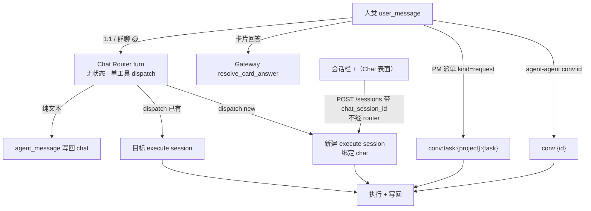

# ADR-099：Chat Session 的 LLM 语义路由（Chat Router）

- **编号**：ADR-099
- **状态**：已接受（2026-10-22 修订：D3/D6 为 router 增加只读信息工具；D3 补充投递时锚定 + 执行侧 pending 队列投影，见下）
- **日期**：2026-10-21
- **决策者**：ACowork 架构组
- **关联**：设计 27（Intent 消息与群聊）、设计 29（Chat Session 上下文编排）、ADR-060（Prompt Cache 友好的上下文块重排）、ADR-063（包级 Prompt 覆盖）、ADR-066（Provider Cache Tokens）、ADR-076（多用户账号体系）、ADR-085（Agent 生命周期状态机）、ADR-092（用户消息身份与有界读取）、ADR-096（请求路径禁止全量读会话）、ADR-098（统一标准群组模型）

## 摘要

Chat session 目前不是 LLM 的上下文：用户消息进哪个 execute session，完全由代码规则（`routing_key` + T1 空闲 / T2 压缩 / T3 配置冲突）决定。这套规则同时回答了两个不同的问题——「语义上该由哪个任务接着做」和「物理上该不该换一个上下文窗口」——因此产生三个不合理现象：

1. chat 里改了 model/workspace 就强制新建 execute session；
2. 没改参数就一律复用当前 working session，不管语义是否相关；
3. T2 轮转把旧任务摘要带进新任务，摘要 token 远大于用户输入，新 session 还在干旧活。

本 ADR 决定分层：**Chat 层引入一次受限工具集的 LLM turn（Chat Router）做语义决策；执行层保留物理轮转作为上下文安全阀**。T3 删除，T1 从硬规则降级为 prompt 信号，T2 只在 router 选定的同一逻辑任务内发生，从而让摘要不再污染无关任务。

路由的载体是 `ChatSessionManager`（按 `chat_session_id` 隔离，群聊中每个 agent 天然独立），router 的工具面是 `dispatch` 加两个只读信息工具（D3），上下文按「稳定前缀 + 末尾追加」三段式编排（详见设计 29）。

## 背景

### 1. 现状：routing_key 与三态轮转

`routing_key` 的命名空间优先级为 `task:` > `chat:` > `conv:` > `msg:`（[intent_routing.rs](../../../core/acowork-runtime/src/agent/session/intent_routing.rs)）。1:1 chat 与群聊 @Agent 的 `conversation_id` 为空，因此都落到 `chat:{chat_session_id}`；PM 派单是 `conv:task:{project}:{task}`。`route_intent_session` 依次检查：

- mapped session 是否命中 T1（idle 超过 `intent_idle_rotate_hours`）或 T2（compaction 发生）；
- `SessionSeed`（chat 侧 draft 的 model/provider/workspace/reasoning）是否与映射 session 冲突（T3）；
- 命中任一条件就新建 session，并把 handoff 指针或摘要写进新 session。

### 2. 三个不合理现象

| 现象 | 根因 |
|---|---|
| 改参数强制新建 | 参数一致性被当成任务身份判据（T3） |
| 语义无关也复用 | 「同一个 chat」被当成「同一个任务」 |
| 轮转摘要污染新任务 | T1/T2 是物理窗口事件，却承担了「任务切换」语义 |

### 3. 群聊与 PM 放大问题

- 群聊里同一个 agent 的所有 @ 都进同一条 `chat:{group}` 链：多用户、多话题被迫串行，后来者会继承前一个话题的上下文与摘要。
- PM 派单以 `task:{project}:{task}` 为边界，本身是确定性的，但任务会话不绑定项目群聊，用户在群里追问任务时无法被路由过去；任务终态后也没有机制阻止「复活」。
- agent-agent 以 `conversation_id` 为边界，天然隔离，不需要语义路由。

### 4. 为什么不能继续加代码规则

「这条消息和哪个任务语义相关」需要理解自然语言与对话历史，是模型判断，不是可枚举的规则。继续在代码里加条件（关键词、时间窗、参数指纹）只会把不可维护的启发式堆进投递链。

## 决策

### D1 — 分层：Chat 层语义路由，执行层物理轮转

- Chat 层：每条人类 `user_message`（1:1 与群聊 @）先经过一次 router turn，产出「回答 / 转交已有会话 / 新建会话」。
- 执行层：保留 T1/T2 作为物理安全阀，但只在 router 选定的同一逻辑任务内生效；T3 删除。
- 卡片回答、PM 派单、agent-agent 不经过 router。

### D2 — Router turn 无状态，ChatSessionManager 按 chat 隔离

每轮上下文都从 chat 历史重建，不建隐藏的常驻 session（避免双历史分叉与额外轮转）。`ChatSessionManager` 的键是 `chat_session_id`；1:1 chat 天然按 (user, agent) 唯一，群聊中每个 agent 有独立 Runtime，因此天然按 agent 隔离。manager 只负责 per-chat 串行队列、窗口锚点、候选构造与决策日志。

**router turn 不在 MQTT 入站循环上执行。**入站循环只做一件事：把消息压进该 chat 的 FIFO 队列，`push_turn` 返回「你是第一个」时才起一个 drain task（每条 chat 恰有一个，`finish_drain` 在队列非空时保留占位，消除「查空 → 新消息入队 → 释放占位 → 消息永久滞留」的竞态）。这样做的理由是两条不变量：同一 chat 的两轮不得并发读同一历史锚点再竞写回；一个慢模型不能把这个 agent 的接收面（含 `Stop`）卡住。drain task 内每轮再包一层 `spawn`，turn 里的 panic 表现为 `JoinErr` 后循环仍走到 `finish_drain`，不会留下永久占位却无人消费的队列。router 交还控制权的结果（`PassThrough` / `Fallback`）由同一个 drain task 就地执行确定性路由收尾——降级只花延迟，不丢消息，也绝不重新入队。

### D3 — `dispatch` 与只读信息工具、工具可见性矩阵

`dispatch(target = "<候选别名>" | "new", message?, session_config?)`；不调用 `dispatch` 即纯文本回答。候选使用 `S1/S2` 短别名，运行时映射真实 session id。

为了让「答案需要一点信息」不再退化为「转交给执行会话」，router 同时暴露两个**只读信息工具**：

- `memory_recall`：查本 agent 长期记忆（复用 execute 侧 builtin，检索策略不变）；
- `http_request`：**收窄为 GET-only**——router 侧 schema 不含 `method`/`body`/`content_type`，执行时运行时再强制 `method = "GET"`、scheme 白名单（http/https）、内层超时小于轮次超时，双保险。

| 工具 | chat router turn | execute turn |
|---|---|---|
| `dispatch` | 唯一路由工具 | 不暴露 |
| `memory_recall` | 可用（按需检索） | 可用 |
| `http_request` | 可用（GET-only） | 可用 |
| `intent_send` | 不暴露 | 可用（responder 角色隐藏） |
| `chat_history_read` | 不暴露（历史自动注入） | 可用 |
| `ask_user_question` | 不暴露（澄清用文本） | 可用（无人类会话隐藏） |
| shell / file / 其它执行工具 | 不暴露 | 按 manifest/配置 |

执行器边界不变：router 没有任何执行工具，包内 persona 无法把它变成执行者；信息工具只读，不改变任何东西。信息工具实例从 `all_tools`（已启用子集）按名解析，agent 级开关同样管住 router。

**轮数约束是提示词软约束，不是代码硬上限**：信息轮次不设硬性次数上限（硬切断正在进行的检索会让结果以更失控的形态落地）；安全边界由逐次模型调用超时、逐次工具超时与只读工具面承担。一个轮次内的 `user → assistant → tool_call → tool_result → assistant` 链完整保留在同一个 request 里：输出预算 `max_tokens` 放宽到 2048（think + 工具参数 + 终稿不被截断），单条工具结果上限 8KB（UTF-8 边界截断加标记）。工具消息不写回 chat 历史，Block B 不膨胀。

`dispatch` 只在本 agent 内选 session；`intent_send` 才跨 agent。router 不得代人类 @ 其他 agent——`@` 是用户行为。

**投递在路由时锁定，正忙的目标会话展示真实 pending 队列。**一个 turn 被 dispatch（或确定性路由）投递入 execution session 后，`turn_started` 指针在意图送达时就写入 chat，而不是等（可能正忙的）会话几分钟后排到它才写，于是排队期间 chat 界面不再投影「正在分配」。执行侧：路由进一个*已经活跃*会话的意图会被记入一份小的有界 pending 清单（发送者 + ≤120 字符摘要 + `from_chat` 标记，ADR-096），经既有的 retained `session_state` 快照推送，于是输入框上方的队列盒能显示之前在入站通道里隐形的 chat 转发消息。会话出队该意图开跑时即清除；idle 会话从不入队。不引入新写入口、不持久化。

**dispatch 的代价不对称是决策规则的核心**（写进不可覆盖的基座提示词）：错误转交的代价远大于漏转交（错发会唤醒整个执行会话、打断对话；不发用户随时可以补一句）。只有当消息与某个候选任务有清晰关联、或明显开启新工作时才 `dispatch`；闲聊、提问、可自查的事实查询一律自己回答；不确定是否需要转交时，回复或问一句澄清，而不是猜测转交。

### D4 — 候选规则与多用户隔离

- 1:1：当前映射 session + `meta.chat_session_id == 当前 chat` 的历史 session + 当前用户 owner 且 `chat_session_id` 为空的手工会话。
- 群聊：只列 `meta.chat_session_id == 当前群聊` 的 session（含已绑定的 PM 任务会话），绝不列个人私聊 session。
- 排除：绑定其他 chat、owner 为他人（1:1）、已终态的 PM task session。上限 10，按 `last_active_at` 倒序；只暴露 title/状态/最近活动/来源，不读 JSONL 正文（ADR-096）。

### D5 — 上下文编排：稳定前缀 + 末尾追加

按 ADR-060 的 Block 模型落地到 chat 层：

- Block A：router system prompt（基座 + persona + 场景段），逐字节稳定；
- Block B：chat 历史按 seq 确定性投影，append-only；窗口锚点 `anchor_seq` 只在超过 `max_history + slack` 时批量前移；
- Block C：候选清单、draft config、当前时间等动态信息放在历史之后，变化只影响自身；
- Anthropic 在 A/B 末尾各打一个 `cache_control: ephemeral` 断点；OpenAI/DeepSeek 依赖自动前缀缓存。

详见设计 29。

### D6 — Chat prompt 与 execute prompt 严格分离

execute prompt（`prompts/system.md` + `constraints.md` + 其他 `prompts/*.md` + skills）包含执行身份、工具规则与工程规范，不能照搬给 router。chat prompt 由三层组成：

1. Runtime 内置基座（角色边界、`dispatch` 契约、决策与安全规则，**不可覆盖**）；
2. Persona 段：可选 `prompts/chat.md`，缺失时回退 manifest 的 `name`/`role`/`description`，上限 4KB；
3. 场景段：1:1 / 群聊两个稳定变体。

`chat.md` 纳入 ADR-063 的包级 override 清单，因此也从 execute prompt 拼接中排除；`POST /agents/{id}/prompts/reload` 同步刷新。router 不加载 skills、workspace prompt file，也不**自动注入** retrieved memory——只允许通过 `memory_recall` 按需检索（D3）。

### D7 — 群聊与 PM 派单边界

- 群聊 @Agent：@ 只决定「哪个 agent」，router 决定「哪个执行会话」；同一群里不同话题可并行到不同 session。
- PM 派单：保持 `conversation_id = task:{project}:{task}` 的确定性映射，不经过 router；创建任务会话时绑定项目群聊（`chat_session_id` + Members 可见），使其进入群聊候选；`close_intent_context` 将 session 记入终态清单，候选排除。
- agent-agent：`conv:{conversation_id}` 确定性映射，不绑定 chat、不进入候选。
- 群聊 @ fanout 的 per-target `message_id` 与 `in_reply_to`（共享 `user_message` row id）在 router 转发时原样保留。

### D8 — T1/T2/T3 语义、执行位置与失败降级

- T3 删除；
- T1 仅用于降级路径，正常路径把「闲置时长」作为 prompt 信号；
- T2 保留为执行侧物理轮转；
- router 超时/报错/连续两次非法工具参数 → 回退 `route_intent_session`，写 `system_notice(router_fallback)`；回退发生在该 chat 的 drain task 上，消息不丢；
- router 链路上的每个 Gateway HTTP 都有界：chat 历史读用 `chat_router.timeout_ms`（默认 8 s，clamp 1–60 s），写回 15 s，附件拉取 60 s。挂起的 Gateway 的代价是这一轮降级，而不是该 chat 的 drainer 被永久 park；
- 候选清单的目录扫描在 `SessionManager` 锁外完成，锁内只做映射解析（一次全局锁不得覆盖磁盘 IO）；
- `agent_config.json` 的 `chat_router.enabled=false` 是 kill switch：入站循环**不排队**，Chat 消息直接内联走确定性路由（执行位置与 ADR-098 相同）。它与 ADR-098 时点不是逐字节等效——T3 已按 D1 删除，所以关闭态下 `session_config` 是更新映射到的会话（下一轮生效）而不是强制新建；E2E 依赖的「内联立即投递」这一可观测行为保持现有断言。

### D9 — 显式新建复用会话栏的 `+`

「新建任务」的确定性逃生舱不新增 composer 按钮，而是复用 Agent 页会话栏已有的 `+`：

- `+` 触发时 `POST /api/agents/{id}/sessions` 带上当前 `chat_session_id`，Runtime 校验调用者的 chat 归属后 stamp 与 `dispatch(new)` 完全相同的绑定对（`chat_session_id` + `Members`）；
- 创建成功后切到 exec 视图，消息直达该会话、不经过 router——绑定加切视图本身就构成逃生舱，不需要 `target_session_id` 之类的新 wire 字段；
- Gateway 零改动（`POST /sessions` 是透明转发）；
- 自动创建（首次打开的补建、关闭最后一个 exec tab 的补建）不绑定——「系统需要一个 tab」不等于「用户在这个对话里发起了一个任务」。绑定是群聊候选的硬门槛（D4：群聊只列绑定本群的会话）；在 1:1 里未绑定的本人会话仍会按 D4 第三条款列为候选，由 router 自己按标题与最近活动判断相关性；
- 校验失败只跳过绑定、不拒绝创建：chat 归属由 Gateway 尽力注入，用户服务抖动时「新建任务」仍须可用（绑定 fail-soft，访问 fail-closed）；
- 绑定一旦成立，`visibility` 就归绑定所有：（`chat_session_id`, `Members`）是群聊读检查依赖的成对契约，请求体不得把一个已绑定会话改回 `public`（泄给其他 chat 的读者）或 `private`（本群看不到自己的任务）；被丢弃的请求值记 WARN，响应回显实际生效值而不是请求值。

已知取舍：输入框草稿不跟随到新会话。

## 路由流程

## 验收标准

对应背景中的三个现象：

1. **改参数不再强制新建**：router 判断「同一任务 + 参数变更」时复用现有 session；只有新任务才新建。复用时 draft 的 model / provider / reasoning_effort 必须落到被路由到的会话——走 `ConversationSession::apply_config`（ADR-047 的唯一配置入口：立即持久化、`config_version` 递增、SessionTask 在下一个 turn boundary 应用），即「配置下一轮生效」。`workspace` 是唯一例外：把活任务换工作目录不是配置微调，必须走 `route_workspace_switch`（ADR-034 §8 的单入口，含改 per-agent 默认的副作用），因此 workspace 建议只在新建会话时生效，复用时记录分歧日志而不是静默丢弃。
2. **语义无关不再复用**：router 对无关输入选择 `dispatch(new)`。
3. **摘要不污染新任务**：新任务从空白 session 开始；T2 只发生在 router 选定的同一任务内。

附加验收：

- 群聊中两个用户的不同话题分别落到不同执行会话；
- 项目群聊里可以追问已绑定的 PM 任务，终态任务不再出现在候选；
- router 关闭时，现有 E2E 断言全部保持。

## 兼容与迁移

- `chat_router.enabled` 默认开启；关闭时 Chat 消息回到 ADR-098 的内联确定性路由，唯一差异是 T3 已退役（见 D8）。
- router turn 改到 per-chat drain task 执行，不改变任何对外协议：MQTT 载荷、`routing_key`、`intent-sessions.json`、写回频道全部原样。
- 存量 package 无需新增文件：`prompts/chat.md` 缺失时人格回退 manifest 元数据。
- 存量 `intent-sessions.json` 映射继续可用；router 的候选包含当前映射，首次运行无需迁移。
- 终态清单使用旁挂 `terminal-sessions.json`，不修改 SQLite schema。

## 非目标

- 不重写执行层的压缩算法（ADR-061）。
- 不让 router 直接执行任务或读取 execute session 正文。
- 不改变 PM 派单接口 `POST /api/intents/task-dispatch` 的语义。
- 不改变卡片回答、@ fanout 的授权与写回通道。

## 与现有 ADR 的关系

| 现有 ADR | 关系 |
|---|---|
| 设计 27 / ADR-098 | 本 ADR 修订 chat 层的路由决策来源；两层会话模型与 chat 存储不变 |
| ADR-060 | 复用 Block A/B 的缓存原则，新增 Block C 动态尾部与窗口锚点 |
| ADR-063 | `prompts/chat.md` 作为新的包级 override 文件 |
| ADR-066 | 复用 cache token 统计与命中率口径 |
| ADR-076 / ADR-092 | 候选与写回的身份过滤沿用 envelope `from` 与 chat scope |
| ADR-096 | 候选只读元数据，不读 JSONL 正文 |

## 测试

- 单元：候选过滤、dispatch 解析、prompt 分层、工具可见性（含 router 侧 GET-only schema 与运行时强制）、上下文投影确定性与前缀稳定性、降级、信息工具轮次（工具失败作为 tool result 回馈、超长结果边界截断）；队列不变量（单 drainer、FIFO、drainer 收尾时到达的消息不滞留、空闲队列回收）；kill switch 下不排队且内联投递；router 交还控制权（`PassThrough`/`Fallback`）时消息仍被投递且 `Handled` 不重复投递；`session_config` 在两条复用分支（目标是当前映射会话 / 目标是另一活会话）都生效；chat 绑定优先于请求体里的 `visibility`。决策日志记录 `info_rounds`（本轮信息工具轮数），为「该转的没转 / 不该转的转了」提供审计面。
- 集成：MockProvider 驱动回答/转交/新建/降级四条路径；T2 在选定会话内仍发生；群聊多话题并行；PM 任务进入群聊候选且终态后消失；agent-agent 映射不受影响。
- E2E：router 关闭保持现有断言；开启后验证 1:1 与群聊 @ 的 `agent_message` 与 `turn_started`；PM task-dispatch 直达 `conv:task:`。
- 回归：`cargo clippy --all-targets -- -D warnings`、`cargo test`、桌面端 `npm test`。
