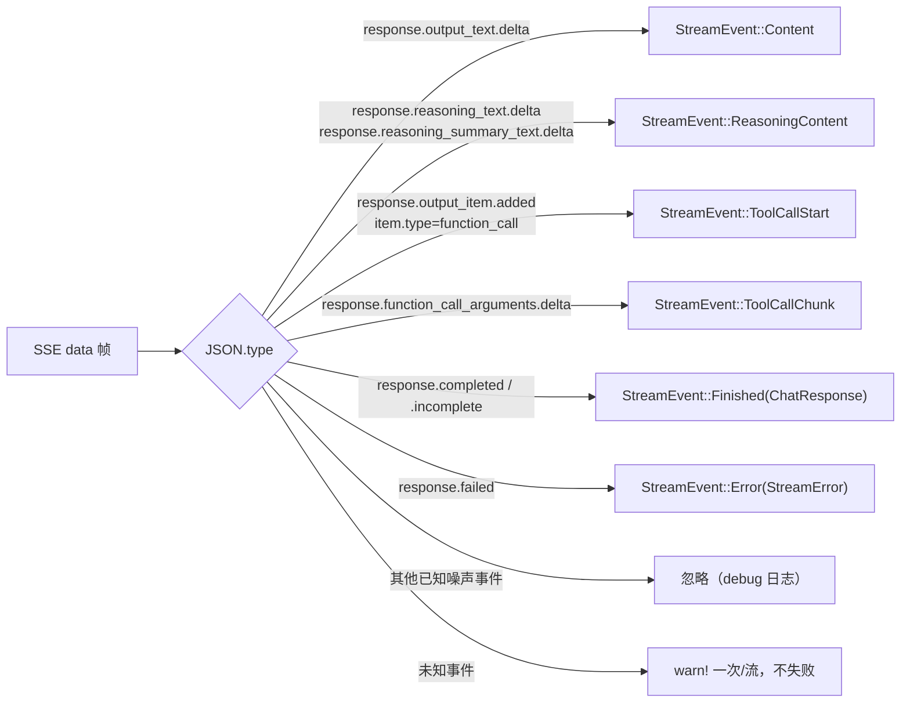
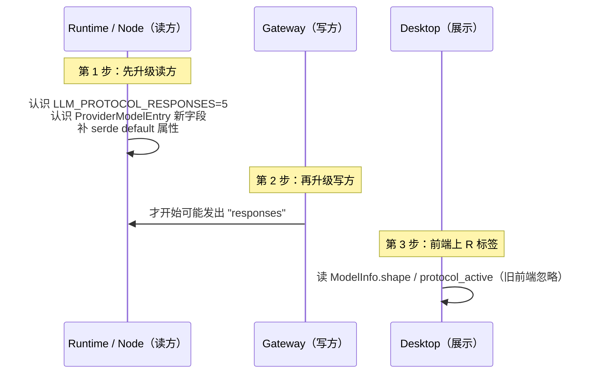

# ADR-103：支持 OpenAI Responses API 作为 provider shape

- **编号**：ADR-103
- **状态**：📝 草案 v0.1（待架构评审；本文档为讨论稿，未立项实施）
- **日期**：2026-11-XX
- **决策者**：ACowork 架构组
- **前置文档**：设计 23（`docs/design/zh/23-openai-responses-api.md`，调研报告）——本 ADR **修正并取代**其 §5.2 派生规则与 §5.3 改动清单，其余结论沿用
- **关联**：ADR-012（Per-Session Model/Provider 隔离）、ADR-016（异常处理分层）、ADR-034（MQTT/HTTP 边界）、ADR-060（Prompt Cache 友好的上下文块重排）、ADR-066（Provider Cache Tokens）、ADR-055（Node 拓扑）、ADR-085（Agent 生命周期状态机）
- **英文 counterpart**：待本稿定稿后随同一 commit 补 `docs/adr/en/ADR-103-*.md`（依 `docs/adr/en/README.md` 规则）

> ⚠️ 本文档是**讨论稿**。§10 列出必须由人拍板的决策点，未拍板前不进入实施切片。

---

## 摘要

**一句话**：把「用哪个线协议」从 **provider 粒度的静态推导**改成 **(provider, model) 粒度的显式解析**，数据来源是 offline_providers.json 新增的 `provider.shape` 字段；在此之上新增一个独立的 `ResponsesProvider` 实现 OpenAI Responses API（`POST {base}/responses`），协议无关层（`Provider` trait / `StreamEvent` / `ReliableProvider` / agent loop）零改动；前端对 `shape == "responses"` 的模型加一个 `R` 标签。

**为什么现在必须改路由粒度**（这是设计 23 没解决的核心问题）：`shape` 在数据里挂在 **model** 上，不是 provider 上。同一个 provider 内部既有 tagged 模型也有 untagged 模型（azure 95 个模型里 27 个 tagged、amazon-bedrock 199 个里 16 个），同一个 provider 甚至可以同时支持两种 shape（DeepSeek 两种都支持；MiniMax 同时支持 Anthropic Messages 和 Responses）。现有 `ProtocolType` 挂在 `ProviderListItem`（provider 级），无法表达这件事。

**推荐方案**：`ProviderModelEntry` 增加可选 `protocol_type` + `base_url` 覆盖，Runtime 按 (provider, model) 构造 provider；`shape` 优先级高于 npm 推导；`shape` 缺失时保持现状（npm 推导 → 默认 OpenAI completions），**绝不因为「Responses 是新协议」就默认切过去**。

**两个必须先看一眼的取舍**（否则整份文档会被读偏）：

1. `shape` 只覆盖 1.2% 的数据，而 DeepSeek / MiniMax **一个都没被标**。所以本 ADR 额外引入一份人工维护的能力覆盖表（D10），并且它**只声明能力、不改默认值**——即这两家的 Responses 链路在 v1 是**用户手选才生效**，不是开箱即用。要不要接受这个「能选但没默认」的中间态，是 Q1 / Q5 的联动问题。
2. 前端 `R` 标签表达的是「**该模型支持** Responses」（能力），不是「当前正在用 Responses」（生效），两个字段分开（D11 / Q3）。

---

## 1. 背景

### 1.1 现状：LLM 协议选择链路（实测代码）

| 环节 | 位置 | 事实 |
|---|---|---|
| 协议枚举 | [core/acowork-core/src/protocol.rs:929](../../../core/acowork-core/src/protocol.rs) | `ProtocolType { Anthropic, Google, Ollama, OpenAI }`，`#[default] OpenAI`，`#[serde(rename_all = "lowercase")]` |
| 协议字段挂载点 | `protocol.rs:229`（`ProviderListItem.protocol_type`） | **provider 级**，且字段**没有** `#[serde(default)]` |
| 模型条目 | `protocol.rs:247`（`ProviderModelEntry`） | 只有 `id` / `capabilities` / `max_output_tokens_limit`，**无协议字段** |
| Gateway 派生 | [core/acowork-gateway/src/http/models_api.rs:1511](../../../core/acowork-gateway/src/http/models_api.rs) `derive_protocol_type(npm)` | 纯 npm 子串匹配：`anthropic`/`google`/`ollama` → 对应，其余 → OpenAI |
| model 级 provider 块 | `models_api.rs:1571-1604` `lookup_protocol_info_from_data` | 已经在读 `model.provider.npm` 与 `model.provider.api`，**`shape` 就在同一个对象里，只是没读** |
| 派生时机 | [core/acowork-gateway/src/resource_cache.rs:400](../../../core/acowork-gateway/src/resource_cache.rs) | `build_provider_list_item` 在 **add/update provider 时**派生一次，结果**持久化**进 `provider_list.json`（`resource_cache.rs:5`） |
| 自定义 provider | [core/acowork-gateway/src/http/provider_api.rs:128](../../../core/acowork-gateway/src/http/provider_api.rs) | 注释即结论：「Custom providers always use OpenAI-compatible protocol」——**硬编码** |
| MQTT 契约 | [core/acowork-core/proto/mqtt_payload.proto:339](../../../core/acowork-core/proto/mqtt_payload.proto) | `LlmProtocol` 已用 1–4，`UNSPECIFIED = 0` |
| 跨版本回落 | `protocol.rs:949` `llm_protocol_to_protocol_type` | `_ => ProtocolType::OpenAI`——**未知值静默回落 OpenAI** |
| Runtime 构造 | [core/acowork-runtime/src/providers/router.rs:103](../../../core/acowork-runtime/src/providers/router.rs) | `match protocol_type`；调用点 `agent_core.rs:1104`、`session_core.rs:822` 都传 `provider_meta.protocol_type`（provider 级） |
| OpenAI 实现 | [core/acowork-runtime/src/providers/openai.rs:953](../../../core/acowork-runtime/src/providers/openai.rs) | `format!("{}/chat/completions", self.base_url)`；内置 CompatCache 降级链（`send_with_compat`，`openai.rs:697`） |
| 协议无关层 | `acowork-core/src/providers/traits.rs:819` | `Provider { chat, chat_stream, chat_token_count }`；`StreamEvent` 6 种事件 |
| 工具定义格式 | [core/acowork-runtime/src/agent/context.rs:1592](../../../core/acowork-runtime/src/agent/context.rs) | 产出 **Chat Completions 嵌套格式** `{"type":"function","function":{...}}`，MCP 工具名已下划线化（`mcp_github_list_issues`） |

> 设计 23 的结论仍然成立：**接入 Responses 是「新增一个 Provider 实现 + 打通协议选择链路」，与当初新增 Anthropic provider 同模式**。本 ADR 不推翻这个判断，只推翻它的**路由粒度**和**派生规则**。

### 1.2 新事实：`offline_providers.json` 的 `provider.shape`

数据源：[assets/offline_providers.json](../../../assets/offline_providers.json)（6.1 MB，230 providers / 8848 provider-model 对）。

字段位置：`providers.{pid}.models.{mid}.provider.shape`，取值 `"responses"` | `"completions"`。同对象还可能带 `api`（该 shape 的替代 base URL）与 `npm`。

**覆盖率极低且高度倾斜（实测）**：

| provider | npm | provider 级 `api` | 模型总数 | tagged | shape 分布 |
|---|---|---|---|---|---|
| azure | `@ai-sdk/azure` | — | 95 | 27 | `completions` ×27 |
| azure-cognitive-services | `@ai-sdk/azure` | — | 95 | 27 | `completions` ×27 |
| neon | `@ai-sdk/openai-compatible` | `${NEON_AI_GATEWAY_BASE_URL}/v1` | 57 | 20 | `responses` ×20 |
| amazon-bedrock | `@ai-sdk/amazon-bedrock` | — | 199 | 16 | `responses` ×16 |
| aixy | `@ai-sdk/openai-compatible` | `https://api.aixy-gateway.com/v1` | 13 | 7 | `responses` ×7 |
| sakana | `@ai-sdk/openai-compatible` | `https://api.sakana.ai/v1` | 4 | 3 | `responses` ×3 |
| infer | `@ai-sdk/openai` | `https://infer.flow7.org/v1` | 2 | 2 | `responses` ×2 |
| zenifra | `@ai-sdk/openai-compatible` | `https://ai.zenifra.com/v1` | 1 | 1 | `completions` ×1 |

合计 **103 / 8848 对（1.2%），8 / 230 个 provider**。`shape` 对象键组合：`{shape}` 58 例、`{api, npm, shape}` 43 例、`{npm, shape}` 2 例。

**三条从数据里直接读出来的硬事实**（比任何文档措辞都权威）：

1. **`openai` provider 自身没有任何 shape 标记**（51 个模型全部 untagged）。所以「有 shape 才走 Responses」的默认策略下，官方 OpenAI 的 gpt-5.x 用户**行为不变**——这是好事（见 D1）。
2. **`shape` 与 npm 推导会直接冲突**：`aixy` / `neon` / `sakana` 的 npm 是 `@ai-sdk/openai-compatible`（按现状推导 → Chat Completions），但 shape 标的是 `responses`。反过来 `azure` 系 npm 是 `@ai-sdk/azure`，shape 明确标 `completions`。
3. **shape 缺失 ≠ 不支持 Responses，shape 存在 ≠ 该 provider 只有这一种 shape**。DeepSeek（npm `@ai-sdk/openai-compatible`，`api=https://api.deepseek.com`，4 个模型）**无 shape 标记**，但它实际上两种都支持；MiniMax（npm `@ai-sdk/anthropic`，`api=https://api.minimax.io/anthropic/v1`，8 个模型）同样无标记，而它官方文档把 `/v1/responses` 列为**主接口**。

> 事实 3 是本 ADR 与用户参考文档之间最大的张力：**光靠 `shape` 字段，DeepSeek 和 MiniMax 一个都接不上**。这决定了 D10（本地覆盖表）的存在。

### 1.3 对设计 23 的修正清单

| # | 设计 23 的说法 | 实测/文档证据 | 本 ADR 的修正 |
|---|---|---|---|
| C1 | §5.2 白名单：`openai` / `azure` / `azure-cognitive-services` → Responses | 数据里 `openai` 无 shape；`azure` / `azure-cognitive-services` 明确标 **`completions`** | **删除硬编码白名单**，改为「读 `shape` 字段」；设计 23 的白名单方向是**反的** |
| C2 | §5 全套改动基于 provider 级 `ProtocolType` | shape 挂在 model 上；同 provider 内 tagged/untagged 混合；同 provider 可双 shape | **协议解析下沉到 (provider, model)**（D2） |
| C3 | §5.3 注：「Responses 是 OpenAI 一等协议，退化风险低，建议不为其做 compat 链」 | MiniMax：`reasoning.effort: none` → **HTTP 400**（M3.1-Flash）；`tool_choice` 只接受 `auto`；`text.format` 只有 `text`。DeepSeek：`truncation` 不支持、超窗 → **400** | **不能一概而论**：第三方 Responses 实现的裁剪面比 OpenAI 官方小得多。改为「显式错误分类 + 最小裁剪白名单」，并列为待决策点（D8 / Q4） |
| C4 | §6.2 「structured outputs 直接惠及记忆提取」 | MiniMax Responses 的 `text.format.type` 枚举**只有 `text`**；DeepSeek 支持 `json_schema`；OpenAI 支持 | structured outputs 是**逐厂商能力**，不得作为 Responses 的隐含前提（§8 R5） |
| C5 | §5.2 只提 `derive_protocol_type` | `provider.api` 覆盖已存在但**不展开 `${VAR}` 占位符**（实测 `neon` = `${NEON_AI_GATEWAY_BASE_URL}/v1`，bedrock 模型级 api 含 `${AWS_REGION}`） | 带占位符的 `api` **必须 gate 掉**，否则 base_url 直接不可用（D7） |
| C6 | §5.5 「回滚：把 provider 切回 Chat Completions 即回滚，无需改代码」 | `protocol_type` 在 add/update 时**冻结进 `provider_list.json`**；offline 数据刷新不会回写已有行 | 回滚需要一条**显式重解析路径**（D1 的 override + §5 迁移），不是「改配置即可」 |

### 1.4 供应商差异（DeepSeek / MiniMax 官方文档实测摘要）

来源：DeepSeek `POST /responses` + 「使用 Responses API」指南（含完整兼容性明细表）、MiniMax `POST /v1/responses` OpenAPI（`openapi-responses.json`）、MiniMax `POST /v1/responses/input_tokens`。

**两家共同点（对 ACowork 有利）**：

- **无状态**：`previous_response_id` / `conversation` / `store` 全部不支持（DeepSeek 明确「无状态 API」，响应里 `store` 恒 `false`）→ 与 ACowork 自管历史完全一致，设计 23 §1.3 的非目标成立。
- **不支持的参数被静默忽略**（DeepSeek 明文：「不支持的参数会被静默忽略、不会报错」）。→ **不能靠「试错」探测能力**，也不能指望 400 报错来驱动降级（影响 D8）。
- **SSE 无 `data: [DONE]`**，终止事件是 `response.completed` / `response.incomplete` / `response.failed`。两家一致。
- **事件 `type` 在 JSON data 里**（MiniMax 明文：「每个事件的 `data` 为 JSON，`type` 字段标识事件类型」），不能只依赖 SSE `event:` 行。
- **推理增量事件名是 `response.reasoning_text.delta`**（两家一致），而 OpenAI 官方是 `response.reasoning_summary_text.delta` → 解析必须同时接受两种。
- **function 工具是扁平结构** `{"type":"function","name","description","parameters"}`（MiniMax schema `Tool.required = [type, name]`），与 ACowork 现在产出的嵌套格式不同 → 必须转换。
- **usage 结构一致**：`input_tokens` / `output_tokens` / `total_tokens` + `input_tokens_details.cached_tokens` + `output_tokens_details.reasoning_tokens` → 可直接映射到 ADR-066 的 `UsageInfo`。

**两家差异（必须逐厂商对待，不能当成「Responses 通用行为」）**：

| 维度 | OpenAI 官方 | DeepSeek | MiniMax |
|---|---|---|---|
| base / 端点 | `https://api.openai.com/v1/responses` | `https://api.deepseek.com/responses`（**无 `/v1`**） | `https://api.minimax.cn(/.io)/v1/responses` |
| `input` 必填 | `input` 与 `instructions` 至少一个 | 至少一个 | **`input` required**（schema 层） |
| `instructions` 语义 | system | 「作为第一条 system 消息」；`developer` 角色**视同 `user`** | 系统指令 |
| `reasoning.effort` | `minimal/low/medium/high`（+`xhigh`） | `none/low/high/max`；`minimal→low`、`medium/xhigh→high` | `minimal/low/medium/high/xhigh/max/none`，但 **M3.1-Flash 传 `none` → 400**；M2.x 传 `none` 被接收但不生效 |
| `text.format` | `text` / `json_object` / `json_schema` | 三者完整支持 | **只有 `text`** |
| `tool_choice` | `none/auto/required/{name}` | 全支持 | **只有 `auto`** |
| `temperature` | 支持 | 支持（思考模式不生效） | **接受但不生效**（固定 1） |
| `max_output_tokens` | 支持 | 支持 | 支持，**含思维链**；过小 → `status=incomplete` 且 `output` 无 `message` 项 |
| 图片输入 | `input_image` | `input_image`，仅允许在 `user`/`developer` 消息与 `*_output` 里；`system`/`assistant` 带图 → **400** | `input_image` + **`input_video`**（M3 多模态） |
| token 估算 | 无原生端点 | 无 | **`POST /v1/responses/input_tokens`** |
| prompt cache | `prompt_cache_key` | **不支持**（自动 KV 缓存） | 支持 `prompt_cache_key` |
| 工具名约束 | — | `^[a-zA-Z0-9_-]+$`、≤128、唯一；`custom` 工具只允许 `apply_patch`，其他名 → 400 | 仅 `function` |
| 思维链载体 | `summary`（摘要） | `reasoning` item 的 `content[].reasoning_text`（**明文 CoT**） | `content[].reasoning_text`（明文）+ `summary`（可为空数组） |

> 结论：**「Responses API」不是一个协议，是一个协议族**。ACowork 的实现必须以 OpenAI 官方语义为基准、把差异收敛到「错误分类 + 少量 per-provider 裁剪」，而不是假装三家一致。

---

## 2. 决策

### D1 — `shape` 是协议选择的权威信号，解析优先级固定为三级（+ 一份能力旁路表）

协议在 **(provider, model)** 粒度解析，优先级从高到低：

```
1. 用户显式覆盖   ProviderModelEntry.protocol_type（UI / API 手选，含 custom provider）
2. offline shape  providers.{pid}.models.{mid}.provider.shape   ← 新增读取
3. npm 推导       derive_protocol_type(npm) → 默认 ProtocolType::OpenAI（现状行为，不变）

（旁路）本地覆盖表 offline_provider_shape_overrides.json —— 不进入默认值裁决，
         只声明「该 provider×model 还支持 responses，且 base_url 应取 X」（D10）
```

**关键区分**：覆盖表是**能力声明（capability）**，不是**默认值来源（default）**。它决定「UI 上 Responses 这个选项能不能选、选了之后 base_url 用什么」，**不决定**「用户没选时走什么」。这条区分是 D10 能被安全引入的前提——否则一份人工文件就会悄悄改掉 DeepSeek / MiniMax 用户的默认链路。

**MUST**：`shape` 只在与 npm 推导**同族**时才覆盖 npm（见下）；`shape` 值不在 `{responses, completions}` 枚举内时 **MUST 忽略并回落第 3 级**，MUST NOT panic、MUST NOT 把未知值当成 Responses。

**shape → 协议的映射表**（`completions` 的含义是「Chat Completions 线格式」，它**不改变** Anthropic/Google/Ollama 这些非 OpenAI 家族的判定）：

| npm 推导结果 | shape | 解析结果 | 说明 |
|---|---|---|---|
| OpenAI | `responses` | **`Responses`** | 唯一的升级路径（aixy / neon / sakana / infer） |
| OpenAI | `completions` | `OpenAI` | 显式确认现状（zenifra） |
| OpenAI | 缺失 | `OpenAI` | 现状不变（openai / deepseek / siliconflow…） |
| Anthropic | `responses` | `Anthropic` + **告警** | 跨家族冲突（minimax 就是这一类）。MUST NOT 静默改判；由 D10 覆盖表 + 用户显式选择解决 |
| Anthropic | `completions` | `Anthropic` + 告警 | 同上，数据脏 |
| Azure(`@ai-sdk/azure`→现状推导 OpenAI) | `completions` | `OpenAI` | azure 系现状即走 `{base}/chat/completions`，数据与实现一致 |
| Google / Ollama | 任意 | 不变 | Responses 不适用于这两个家族（v1 范围外） |

**理由**：`shape` 是数据、白名单是代码；把「哪家支持 Responses」写进 Rust 源码，等于每次 models.dev 更新都要发版。设计 23 C1 的白名单方向已被数据证伪。

**默认行为（回答「shape 缺失时怎么办」）**：**缺失 = 维持现状 = npm 推导 = 绝大多数情况 Chat Completions**。这是本 ADR 最重要的安全阀——它保证 8848 个 provider-model 对里 8745 个（98.8%）的行为**逐字节不变**，官方 `openai` provider 也在其中。

### D2 — 协议解析下沉到 (provider, model) 粒度

数据模型改动（[core/acowork-core/src/protocol.rs:247](../../../core/acowork-core/src/protocol.rs)）：

```rust
pub struct ProviderModelEntry {
    pub id: String,
    pub capabilities: ModelCapabilitiesInfo,
    #[serde(default = "default_max_output_tokens_limit")]
    pub max_output_tokens_limit: u64,
    /// Per-model protocol override. `None` = inherit `ProviderListItem.protocol_type`.
    #[serde(default, skip_serializing_if = "Option::is_none")]
    pub protocol_type: Option<ProtocolType>,
    /// Per-model base URL override, used when the model's shape needs a
    /// different endpoint family than the provider default (e.g. MiniMax:
    /// provider base is `/anthropic/v1`, Responses needs `/v1`).
    #[serde(default, skip_serializing_if = "Option::is_none")]
    pub base_url: Option<String>,
}
```

同时 **MUST** 给 `ProviderListItem.protocol_type` 补 `#[serde(default)]`（现状缺失，见 §1.1 表格）——否则新 Gateway 写出 `"responses"` 后，旧版本读 `provider_list.json` 会**反序列化硬失败**而不是回落。这是跨版本兼容的前提，不是可选项。

Runtime 侧：`build_provider_for(provider_id, model_id, account_id)` 增加 `model_id` 入参，按 `model.protocol_type.or(provider.protocol_type)` 选构造分支；`agent_core.rs:1104` / `session_core.rs:822` / `agent_init.rs:739` 三个调用点同步传模型。找不到 model 条目时**MUST** 回落 provider 级并 `warn!`，MUST NOT 猜测。

**被否决的替代方案**：
- ❌ *把 provider 拆成两行*（`openai` + `openai-responses`）：用户会看到重复 provider、重复 key 配置、重复 logo，且与 ADR-012 的 per-session 模型隔离语义冲突。
- ❌ *provider 级加 `supports_responses: bool` 开关*：无法表达 azure 系「同 provider 内 tagged/untagged 混合」的事实（27/95、16/199）。

### D3 — 新增 `ProtocolType::Responses` 与 `LlmProtocol::Responses = 5`

| 位置 | 改动 |
|---|---|
| `acowork-core/src/protocol.rs:929` | 新增变体 `Responses`，`#[serde(alias = "openai-responses")]`；`FromStr` 接受 `"responses"` |
| `acowork-core/proto/mqtt_payload.proto:339` | `LLM_PROTOCOL_RESPONSES = 5;`（1–4 语义不变） |
| `protocol.rs:949` `llm_protocol_to_protocol_type` | 增加 `Responses => ProtocolType::Responses`；**`_ => OpenAI` 的静默回落 MUST 加 `warn!`**（见 §8 R1） |
| `global_resources_builders.rs:461` `map_protocol_type` | 增加 Responses 分支 |

**跨版本互通结论**：新增枚举值本身向后兼容（不改 1–4），但**回落方向不安全**——旧 Runtime 收到 `5` 会静默当 OpenAI completions，把 Responses-only 模型打到 `/chat/completions` 上，得到 400 而不是「协议不支持」。因此 **MUST 按 §4 的升级顺序发布**（Runtime/Node 先、Gateway 后），并把该回落从静默改为可见。

### D4 — 独立的 `ResponsesProvider`，不塞进 `openai.rs`

新增 `core/acowork-runtime/src/providers/responses.rs`，实现 `Provider` trait 三方法；`router.rs:103` 增加 `ProtocolType::Responses =>` 分支。

**复用**：`openai.rs` 的 reqwest 客户端构造、超时注入、`from_http_parts` 错误解析、SSE 帧切分工具。
**不复用**：`NativeChatRequest` / `NativeChatResponse` / CompatCache 挂载（`install_wiring` 只对 completions provider 生效）。

**MUST NOT** 改动：`Provider` trait、`StreamEvent`、`ReliableProvider`、`loop_llm.rs`、记忆/工具注册/预算/限流。协议无关层零改动是本 ADR 的核心约束，也是「与新增 Anthropic provider 同模式」成立的依据。

**理由**：`openai.rs` 已 ~1900 行且内置写死在 `/chat/completions` 的 CompatCache 键与降级链；两套线格式同存一个 struct 会让 cache key、URL、降级归属全部变含糊（设计 23 方案 B 已否决，本 ADR 维持）。

### D5 — 请求映射（域 → Responses 线格式）

| ACowork 域（`ChatRequest`） | Responses 线格式 | 规则 |
|---|---|---|
| `messages[role=system]` | 顶层 `instructions: string` | **合并**所有 system 消息，`\n\n` 连接。ADR-060 的「稳定前缀」语义由此保持：instructions 是稳定段，历史是追加段 |
| `messages[role=developer]` | `instructions` 追加 **或** `input` 里 `role=developer` | v1 归并进 `instructions`（DeepSeek 把 `developer` 视同 `user`，归并到 instructions 语义更稳） |
| `messages[role=user/assistant]` | `input[]` 的 `message` item | content 为 parts 数组 |
| 文本 part | `input_text` / `output_text` | 按角色选类型 |
| `image_url`（data URI） | `input_image{image_url, detail}` | **MUST** 复用 `traits.rs` 的 `parse_data_uri`；MUST NOT 把 URL 字符串塞进 base64 字段。**`assistant` 消息里的图片 MUST 丢弃并 warn**（DeepSeek 对 `system`/`assistant` 带图返回 400） |
| `assistant.tool_calls[]` | 独立 `function_call` item（`call_id`/`name`/`arguments`） | 一条 assistant 消息可产出 1 个 `message` + N 个 `function_call` item |
| `role=tool` + `tool_call_id` | `function_call_output{call_id, output}` | `output` 用字符串；工具产图时用内容块数组（DeepSeek/MiniMax 均支持在 `*_output` 里放 `input_image`） |
| `tools`（嵌套 function） | **扁平** `{type:"function", name, description, parameters}` | 必须做嵌套→扁平转换（`context.rs:1592` 产出的是嵌套格式） |
| `max_tokens` | `max_output_tokens` | **语义差异**：Responses 的该字段**含思维链 token**（MiniMax 明文）。过小 → `status=incomplete` 且 `output` 无 `message`，MUST 映射为可见截断错误而非空回答 |
| `reasoning_effort` | `reasoning.effort` | `Auto` → **不发该字段**；`Off` → `none`（**注意 MiniMax M3.1-Flash 会 400**，见 D8）；`Low/Medium/High/Max` → 同名，由 provider 侧按各自枚举裁剪（DeepSeek 把 `medium`→`high`） |
| `temperature` | `temperature` | 透传；MiniMax 接受但不生效，不做客户端补偿 |
| `thinking_mode` | **不发** | Anthropic 专属，Responses 无对应概念 |
| — | `stream` | 由 `chat` / `chat_stream` 决定 |
| — | `store:false` / 不发 `previous_response_id` / `conversation` / `background` / `include` / `truncation` | **YAGNI，v1 明确不发**（与 §1.3 非目标一致） |

**MUST**：`input` 永不为空（MiniMax schema 层 required）。若上游只给了 instructions 而无任何用户消息，MUST 报错而不是发空 `input`。

### D6 — 响应与流式映射（Responses → `StreamEvent`）

**非流式 `chat()`**：遍历 `output[]` → `message.content[].output_text` 拼 `content`；`reasoning.content[].reasoning_text` 拼 `reasoning_content`；`function_call` item → `tool_calls[]`。`status` → `finish_reason`：

| `status` / `incomplete_details.reason` | `finish_reason` | 处理 |
|---|---|---|
| `completed` | `stop`（无工具）/ `tool_calls`（有 `function_call`） | 正常 |
| `incomplete` + `max_output_tokens` | `length` | **MUST 可见告警**：思维链吃满预算导致无正文 |
| `incomplete` + `content_filter` | `content_filter` | 透传给前端 |
| `failed` + `error{code,message}` | `error` | 走 `from_http_parts` 同族错误分类（ADR-016） |

**流式 `chat_stream()`**：



硬性要求：

1. **终止判定只看 `response.completed` / `.incomplete` / `.failed`**，MUST NOT 等 `data: [DONE]`（两家都不发）。流结束但未收到终止事件 → **MUST** 产出 `StreamEvent::Error`（截断），MUST NOT 发 `Finished` 假装成功。
2. **事件类型从 JSON `type` 字段取**，SSE `event:` 行仅作可选校验（MiniMax 明确 type 在 data 里）。
3. **reasoning 事件名接受两种别名**：`response.reasoning_text.delta/done`（DeepSeek/MiniMax）与 `response.reasoning_summary_text.delta`（OpenAI 官方）。
4. **`function_call` 的 `call_id` / `name` 来自 `response.output_item.added` 的 item**，arguments 才走 delta → `ToolCallStart` 必须在 `added` 时发出（此时 arguments 为空串），后续 `ToolCallChunk{index}` 按 `output_index` 分配下标，与现有 agent loop 的 index 语义对齐。
5. **usage 只在终止事件的完整 `response` 对象里** → `Finished(ChatResponse)` 的 `UsageInfo` 从 `response.usage` 映射：`input_tokens→prompt_tokens`、`output_tokens→completion_tokens`、`input_tokens_details.cached_tokens→cache_read_tokens`（ADR-066）、`output_tokens_details.reasoning_tokens→reasoning_tokens`。**MUST** 复用 `openai.rs:277` 已有的双命名容忍策略（`prompt_tokens.or(input_tokens)`）。
6. **`sequence_number` 不保证连续语义**，v1 MUST NOT 用它做乱序重排或去重。
7. 事件面约 40 种，v1 实现约 10 种（上图）。`response.content_part.*`、`response.output_item.done` 里的完整 item **MUST 解析但只用于校验**，MUST NOT 二次 emit 文本（否则前端重复渲染）。

> D6 的第 1 条（终止判定与不重试）与第 3 条（reasoning 明文 vs 摘要的呈现）是**待拍板项**，见 Q7 / Q8；其余条目为架构约束，不随评审改变。

### D7 — URL 解析与 base_url 覆盖

`ResponsesProvider` 端点：`{base_url}/responses`（与 `openai.rs:953` 的 `{base_url}/chat/completions` 同构）。

**base_url 解析顺序**：用户显式 `base_url` override > **model 级 `provider.api`** > provider 级 `api` > 内置默认。

三条必须处理的现实：

1. **`/v1` 不一致**：DeepSeek provider `api = https://api.deepseek.com`（→ `/responses` 正确），MiniMax Responses 需要 `https://api.minimax.cn/v1`（而它的 provider `api` 是 `.../anthropic/v1`）。→ **MUST** 支持 model 级 `base_url` 覆盖（D2 的字段正是为此存在），MUST NOT 假设「provider base + /responses」万能。
2. **`${VAR}` 占位符**：`neon` = `${NEON_AI_GATEWAY_BASE_URL}/v1`，bedrock 模型级 api 含 `${AWS_REGION}`。现状代码**不展开**（实测 `models_api.rs` 只做 `as_str()` 直传）。→ **MUST** 在解析处检测 `${`，未展开则**判定该 override 不可用**、回落上一级并 `warn!`。v1 **MUST NOT** 引入 env 展开（会把 Gateway 的 provider 配置变成隐式依赖进程环境，越界；列为 Q6）。
3. **CompatCache 键隔离**：`provider_id` 命名空间 MUST 含 shape，避免 completions 与 responses 两条链路共用一个 key（现状 `openai.rs:117` 用 host 兜底，同 host 两协议会撞键）。

### D8 — 错误处理：显式分类 + 最小裁剪白名单，不做静默跨 shape 降级

**分层归属（ADR-016）**：错误分类在 core、重试编排在 `ReliableProvider`、呈现由前端负责。`ResponsesProvider` 只负责把 HTTP/SSE 错误变成结构化 `StreamError`。

**MUST NOT**：在 provider 内部把 Responses 请求自动重发到 `/chat/completions`。理由：(a) 两协议的 `tools` / `reasoning` / 历史结构不同形，自动换端点等于「换个语义再试一次」，失败时无法归因；(b) DeepSeek 明文「不支持的参数静默忽略」，探测不可靠；(c) 与「无静默回落」的平台原则冲突（AGENTS.md：silent fallback 是反模式）。

**MUST** 实现的错误分类与处置：

| 信号 | 分类 | 处置 |
|---|---|---|
| `404` 且 body 提示 `responses` / unknown endpoint | `EndpointUnavailable` | **不重试**；错误文案明确「该 provider 不支持 Responses API，请在模型设置里把协议切回 Chat Completions」；打 `warn!` 含 provider/model |
| `400` 且 body 指名某字段（`reasoning`/`tool_choice`/`text.format`/`temperature`） | `UnsupportedField{field}` | 进入 **D8 裁剪白名单**（下） |
| `400` 且 body 是内容完整性问题（图片位置、`input` 为空、工具名非法、超窗） | `ContentIntegrity` | **不裁剪、不重试**，直接上抛（对齐 `openai.rs` 2026-09-05 事故教训：`ErrorClass::is_learnable()` 门控） |
| `401/403` | `Auth` | 不重试，走既有 key 失效路径 |
| `429` | `RateLimited` | 交给 `ReliableProvider`（含 429 UX），协议无关 |
| `5xx` | `Transient` | 交给 `ReliableProvider` 退避 |
| SSE `response.failed` | `InBandFailure{code,message}` | → `StreamEvent::Error`，MUST NOT 当空回答 |
| 流断开且无终止事件 | `TruncatedStream` | → `StreamEvent::Error`，不重试（可能已产生副作用） |

**裁剪白名单（ResponsesCompat，最小版）**：与 `CompatCache` 同纪律（**两次确认才固化**、TTL 租约、plain success 重置、错误分类门控、`strip_tools` 级别必须可见告警），但**只允许裁剪这 4 个字段**，且**不复用 `openai.rs` 的 `StripProfile` 结构**（它是 completions 形状）：

1. `reasoning.effort: none` → 省略 `reasoning` 整块（MiniMax M3.1-Flash 的 400 正是这一条）
2. `tool_choice` → 回落到只发 `auto`（MiniMax 只接受 `auto`）
3. `text.format` → 省略（MiniMax 只支持 `text`）
4. `temperature` / `top_p` → 省略

**明确不做**：不裁剪 `tools`（工具是 agent 的能力面，剥掉等于静默关闭 function calling——正是 `compat.rs` 头部记录的事故）；不做 4 步链式盲试。裁剪命中后 **MUST** `warn!` 并在 debug panel 可见。

> 裁剪白名单是否要进 v1，是**待决策点 Q4**：另一种更简单的立场是 v1 只做「分类 + 上抛」，把裁剪留给用户显式配置。

### D9 — 自动跨 shape failover：v1 不做

一个模型同时支持两种 shape（DeepSeek、MiniMax）时，是否「Responses 失败 → 自动用 completions 重试」？**v1 不做**。改为提供**显式可切换的 per-model 协议选择**（D1 第 1 级），把选择权和责任交给人。列为 Q2 讨论。

### D10 — 本地 shape 覆盖表（补 DeepSeek / MiniMax 的能力声明与正确 base_url）

`shape` 只覆盖 1.2% 的数据，而用户明确点名的两家**恰好都不在里面**（§1.2 事实 3）。因此新增一份**随包发布的只读覆盖表**：

`assets/offline_provider_shape_overrides.json`（与 `offline_providers.json` 同目录、同加载路径策略、同版本字段）：

```json
{
  "version": 1,
  "entries": [
    { "provider": "deepseek", "model": "*", "shape": "responses",
      "base_url": "https://api.deepseek.com", "source": "https://api-docs.deepseek.com/zh-cn/api/create-response" },
    { "provider": "minimax", "model": "MiniMax-M3*", "shape": "responses",
      "base_url": "https://api.minimax.io/v1", "source": "https://platform.minimax.cn/docs/api-reference/responses-create" },
    { "provider": "minimax-cn", "model": "MiniMax-M3*", "shape": "responses",
      "base_url": "https://api.minimax.cn/v1", "source": "..." }
  ]
}
```

约束：

- 覆盖表**不参与默认值裁决**（D1 旁路语义）：它只让 Responses 成为「可选 + 有正确 base_url」，用户没手选时默认链路仍由 offline shape / npm 推导决定。
- **MUST NOT** 用覆盖表把 provider 的**默认**协议改掉：`minimax` 默认仍是 Anthropic Messages（npm 与 provider `api` 都指向 `/anthropic/v1`），覆盖表只是让 Responses **成为可选**并给出正确 base。
- `model` 支持尾部 `*` 前缀匹配，v1 **MUST NOT** 引入正则（KISS）。
- 每条 entry **MUST 带 `source` URL**，可审计、可过期。这份文件是「人工维护的事实」，与 models.dev 的机器事实分开存放，将来 models.dev 补齐 `shape` 后**整条删除**。
- 加载失败（文件缺失/损坏）→ **降级为无覆盖表**，`warn!`，不影响主链路。

> 这是本 ADR 里唯一「新增数据文件」的决策，也是最有争议的一处（**Q5**）。替代方案是等 models.dev 更新，或把这两家写进 Rust 常量——后者正是 D1 要消灭的东西。

**副作用必须承认**：因为覆盖表不改默认值，DeepSeek / MiniMax 的 Responses 链路在 v1 是**纯 opt-in**——用户必须在模型协议下拉里手选一次。也就是说 D10 交付的是「能选」，不是「在用」。若评审希望这两家开箱即用，就必须把覆盖表升级为默认值来源，那会直接推翻 D1 的安全阀（见 Q1 / Q5 的联动）。

### D11 — 前端：`R` 标签

**数据来源（唯一真源）**：`GET /api/models` 的 `ModelInfo` 新增**两个**字段，语义严格分开：

- `shape: Option<String>` —— 该 (provider, model) 的**能力声明**（`responses` / `completions` / `null`=未知），来自 D1 解析 + D10 覆盖表的并集。**R 标签读这个字段。**
- `protocol_active: Option<String>` —— 该模型**当前实际生效**的协议（用户手选 > shape > npm 推导的结果）。协议下拉的初始值读这个字段。

两者可以不同（例：MiniMax-M3 有 `shape="responses"` 能力，但 `protocol_active="anthropic"`）。前端 MUST NOT 自己解析 offline JSON 推导协议（`apps/acowork-desktop/src/components/harness/offlineJson.ts` 现在就在做本地解析，协议字段 MUST 走 Gateway）。

**呈现位置（3 处，均为现有标签体系的追加，不新开体系）**：

| # | 位置 | 文件 | 现状标签 | R 标签形态 |
|---|---|---|---|---|
| 1 | Harness → 添加/编辑 provider 的模型列表行 | `components/harness/ModelMultiSelect.tsx:313-315` | `🧠 reasoning` / `🔧 tools` / `🖼️ image` 文本 chip | 追加 `Ⓡ Responses` chip，与现有 chip 同排同字号 |
| 2 | Chat 模型切换下拉的模型行 | `components/chat/ChatPanel.tsx:3251-3253` | `<Wrench size={10}/>` / `<Brain>` / `<Image>` 图标簇 | 追加字母徽标 `R`（`text-[9px]`，`text-text-tertiary`），保持图标簇节奏 |
| 3 | 模型能力编辑面板 | `components/harness/ModelCapEditor.tsx:60-80` | `supports_tool_calling` / `supports_reasoning` 复选框 | 新增**协议下拉**（`Chat Completions` / `Responses` / `跟随数据`），这是 D1 第 1 级覆盖的入口 |

**规则**：

- **R 标签表达「能力」而非「当前链路」**：只要该 (provider, model) **支持** Responses（D1 解析为 responses，**或**覆盖表声明了该能力）就显示。理由：标签出现在**选择**模型的界面上，用户需要的是「选了会怎样」，不是「现在是什么」。当前实际生效协议在位置 3 的协议下拉里体现，两处语义不混用。
- **`completions` 不显示** `C` 标签（默认态无需标注，避免噪音——YAGNI）。
- R 标签是**只读指示器**，MUST NOT 可点击切换（切换走位置 3 的下拉，避免「点了没反应」的假 affordance）。
- 文案与 i18n：新增 `harness.shapeResponses` / `chatPanel.modelTagResponses` 两个 key，zh/en 双语；tooltip 建议 `支持 OpenAI Responses API（/responses）`。**具体文案是 Q3**。
- 与现有标签体系整合：沿用 `ModelMultiSelect` 的 `text-xs text-text-tertiary` chip 与 `ChatPanel` 的 `size={10}` 图标簇两套既有节奏，**不引入新的 badge 组件**（`components/common/list/Badge.tsx` 是列表徽标，样式不匹配，不复用）。
- 无障碍：字母 `R` 对读屏无意义，MUST 带 `title`/`aria-label`。

**MUST NOT**：在模型列表加「协议」筛选 chip（现有 filter chips 是 tool_call/reasoning/image 三类能力，协议不是模型能力，是接入方式；混进去会让筛选语义腐化）。

---

## 3. 接口契约与数据模型变更汇总

| 层 | 位置 | 变更 | 兼容性 |
|---|---|---|---|
| 域枚举 | `acowork-core/src/protocol.rs:929` | `ProtocolType::Responses`（serde `"responses"`，alias `openai-responses`） | 新值；旧 reader 遇未知字符串**当前会硬失败** → 必须先补 `#[serde(default)]`（D2） |
| 域结构 | `protocol.rs:229` | `ProviderListItem.protocol_type` 补 `#[serde(default)]` | 纯加固，无行为变化 |
| 域结构 | `protocol.rs:247` | `ProviderModelEntry` + `protocol_type: Option<ProtocolType>` + `base_url: Option<String>` | `#[serde(default, skip_serializing_if)]`，旧数据可读 |
| MQTT | `proto/mqtt_payload.proto:339` | `LLM_PROTOCOL_RESPONSES = 5` | 1–4 不变；旧 Runtime 遇 5 → 回落 OpenAI（**需加 warn**） |
| MQTT | `global_resources_builders.rs:461` / `ProviderRef.protocol_type` | 增加映射分支 | provider 级仍发**默认协议**；model 级新增字段走 `ProviderModelRef`（需同步扩 proto：`optional LlmProtocol protocol_type = 4; optional string base_url = 5;`） |
| Gateway REST | `GET /api/models` → `ModelInfo` | + `shape: Option<String>`（能力声明）+ `protocol_active: Option<String>`（生效协议） | 新增可选字段，前端旧版本忽略即可 |
| Gateway REST | `POST/PUT /api/providers`（`provider_api.rs`） | `AddProviderRequest` + `protocol?: "openai"|"responses"|"anthropic"|...`；`model_capabilities` 旁新增 `model_protocols: {model: shape}` | 缺省 = 走 D1 解析，行为不变 |
| Gateway 持久化 | `resource_cache.rs:5` `provider_list.json` | 行内新增两个可选字段 | 需 §4 重解析迁移 |
| Gateway 数据 | `models_api.rs:1511` `derive_protocol_type` | 保持签名不变；新增 `resolve_protocol(provider_id, model_id) -> (ProtocolType, Option<String> base_url)` | 新函数，旧函数不动（降低 blast radius） |
| Gateway 数据 | `provider_api.rs:128`「custom 一律 OpenAI」 | 允许 custom provider 显式选 `responses` | 默认仍是 OpenAI |
| 新增资产 | `assets/offline_provider_shape_overrides.json` | D10 | 缺失即降级为无覆盖 |
| Runtime | `providers/responses.rs`（新） | `ResponsesProvider` | 新文件 |
| Runtime | `providers/router.rs:103` | + Responses 分支；`create_provider_with_wiring` 增 `model_id` 参数（或新增 `..._for_model`） | 保留旧签名做兼容 wrapper，避免一次性改所有调用点 |
| Runtime | `token/counter.rs:34` `estimate_image_tokens` | Responses 分支（公式同 OpenAI：`85 + 170*tiles`，`low`=85） | 纯新增 |
| Desktop | `lib/types.ts:1043` `ModelInfo` | + `shape?: string` + `protocol_active?: string` | 可选字段 |
| Desktop | `cacheHitRate.ts` | Responses 归入 `"openai"` 缓存族 | 设计 23 §5.4 结论沿用 |

**契约红线**：`shape` 的解析**只在 Gateway 发生一次**，Runtime 与前端都消费解析结果。MUST NOT 出现「Gateway 按 A 判、Runtime 按 B 判」的双源解析——这正是 §1.1 里 `derive_protocol_type` 与 `lookup_protocol_info` 已有的雏形风险。

---

## 4. 兼容性、迁移与数据回写

### 4.1 发布顺序（硬约束）



**理由**：新枚举值 + 无 `#[serde(default)]` 的 `protocol_type` 字段，意味着「新 Gateway 写、旧 Runtime 读」是**硬失败**；反过来「新 Runtime 写不了、旧 Gateway 不写」是安全的。顺序不可颠倒。

### 4.2 存量数据迁移

`protocol_type` 在 add/update provider 时**冻结进 `provider_list.json`**（§1.1）。因此：

1. **不自动回写存量行**。首次启动**MUST NOT** 批量重算已有 provider 的协议——否则 offline 数据一刷新，用户已验证可用的 provider 悄悄换协议，是典型的不可回滚变更。
2. 提供**显式重解析入口**：Gateway 新增 `POST /api/providers/{id}/re-resolve`（或 Harness 面板「重新检测协议」按钮），逐 provider 重跑 D1，产出 diff 预览（哪些模型协议将变化）→ 用户确认后才写盘。
3. 新增 provider 走新解析路径（自然生效）。
4. `provider_list.json` 的 `version` 递增沿用现有 `expected_version` 乐观并发机制（`provider_api.rs:141` ADR-059 §7.3），MUST NOT 绕过。

### 4.3 灰度

| 阶段 | 范围 | 门禁 |
|---|---|---|
| G0 | 仅 unit/integration 测试 + fake SSE 服务 | 无真实流量 |
| G1 | 白名单 provider（aixy / neon / sakana / infer / bedrock 的 tagged 模型）+ D10 覆盖表里的 deepseek / minimax，**默认不启用**，用户在模型协议下拉里手选 | 每个 provider 一条 `info!` 埋点：协议、`status`、usage 三元组、工具循环轮数 |
| G2 | 允许对 G1 provider 开「数据驱动默认」（shape → 自动 Responses） | 观测 2 周：400 率、`TruncatedStream` 率、`incomplete` 率、cache_read 归属正确性 |
| G3 | 官方 `openai` provider 是否默认切 Responses | **独立决策，本 ADR 不预授权**（Q1/Q2） |

### 4.4 回滚

- **单 provider 级**：模型协议下拉切回 `Chat Completions`（或删掉 override entry）→ 立即生效，无需发版。**这是主回滚路径**，比设计 23 §5.5 的「改配置即回滚」更真实——它需要 D1 第 1 级的手动覆盖入口存在才成立。
- **全局级**：Gateway 配置开关 `llm.responses_api_enabled: bool`（默认 `false`）。关闭时 D1 解析结果强制回落 npm 推导，`Responses` 分支不可达。比逐个改 provider 快，且能一键止血。
- **版本级**：读方（Runtime）先于写方（Gateway）发布，因此回滚 Gateway 不需要回滚 Runtime。

---

## 5. 测试要点

**单元 — 协议解析（最高价值，纯函数）**
- `resolve_protocol` 全表覆盖：D1 映射表 7 行 × {有/无 override} × {有/无用户手选}，断言优先级与「未知 shape 值忽略」。
- `${VAR}` 占位符 override 被判定不可用并回落（D7.2）。
- 覆盖表：文件缺失/JSON 损坏 → 降级为无覆盖且不报错；`MiniMax-M3*` 前缀匹配命中与不命中。
- serde：`ProviderListItem` 缺 `protocol_type` 字段可反序列化（回归 `#[serde(default)]`）；`ProviderModelEntry` 缺新字段可读旧数据。

**单元 — ResponsesProvider 序列化**
- system 多条 → `instructions` 合并；`input` 为空时**报错**（D5 红线）。
- tools 嵌套 → 扁平转换的字节级 golden test（`context.rs:1592` 的真实产物做 fixture）。
- `assistant` 消息带图 → 图片被丢弃 + warn，MUST NOT 进 payload。
- `reasoning_effort: Auto` → 不发 `reasoning` 字段；`Off` → 发 `none`。

**单元 — SSE 解析（fake 流）**
- 正常文本流、含 `function_call` 的多 item 流、reasoning 两种事件名别名各一例。
- **无 `[DONE]` 也能正常收尾**（终止事件驱动）。
- 流中断且无终止事件 → `StreamEvent::Error`，**MUST NOT** 出现 `Finished`。
- `response.incomplete(max_output_tokens)` 且 `output` 无 `message` → 可见截断，不是空回答。
- `response.failed` → `StreamError` 且 `is_retryable == false`。
- `content_part.done` / `output_item.done` 不产生重复文本（D6.7）。
- usage 映射断言 `cache_read_tokens` / `reasoning_tokens`（ADR-066 累计链路不丢）。

**契约/集成**
- protobuf 双向：`5 ↔ Responses`；旧值 1–4 不变（回归）。
- Gateway→Runtime 端到端：fake `/responses` 服务跑**完整工具循环**（function_call → 本地执行 → function_call_output → 续流），这是 agent 语义的最低验证线。
- 跨版本互通：旧 Runtime + 新 Gateway（发 5）→ 断言**有 warn 日志**（不再是静默 OpenAI）。

**前端**
- `ModelInfo.shape` 驱动 R 标签渲染；`shape` 缺失 / 为 `completions` 不渲染。
- 覆盖表声明的能力（`shape="responses"` 但 `protocol_active="anthropic"`）**仍渲染 R**，且协议下拉初始值为 anthropic。
- 位置 1/2 的标签不撑破行宽（长模型名 + 4 个 chip 的截断用例）。
- 协议下拉写回 → `expected_version` 冲突路径。

**回归红线（必须证明「没影响」）**
- 现有 OpenAI / Anthropic / Google / Ollama 四条链路的 golden 请求体不变。
- `CompatCache` 行为与键空间不变（D7.3）。
- 未 opt-in 的 provider（含官方 `openai`）请求 URL 仍是 `{base}/chat/completions`。

---

## 6. 后果

**正面**
1. 协议选择从「代码里的 npm 子串猜测」变成「数据驱动的 (provider, model) 解析」，后续接任何新线协议都是同一根管线的增量。
2. 98.8% 的 provider-model 对行为逐字节不变（shape 缺失 = 现状），风险面被数据覆盖率天然限制住了。
3. DeepSeek / MiniMax / Azure 系 / Bedrock 的 Responses 能力可用，且带正确的 base_url。
4. 前端 R 标签给用户可解释的信号：为什么这个模型能开思维链/结构化输出而那个不能。

**负面 / 代价**
1. `ProviderModelEntry` 长出两个字段，provider 级与 model 级协议**并存**，读代码的人必须理解「override 语义」——复杂度真实增加，但被 D1 的三级优先级表 + 能力/默认值分离和 §3 红线（单点解析）压住。
2. 新增一份**人工维护**的覆盖表（D10），会腐烂。已用 `source` URL + 「models.dev 补齐即删除」约束它，但仍需要 owner。
3. Responses 的实现面（约 10 种事件 + item 结构）比 Chat Completions 大，`responses.rs` 首版预计 800–1200 行，接近 `openai.rs` 的一半——不便宜。
4. 协议差异从「一个 bool」变成「逐厂商能力矩阵」（§1.4），任何想加 Responses 特性的后续 ADR 都必须重查这张表。

**明确不做（YAGNI，留给后续）**
`previous_response_id` / 服务端会话、内置工具（web_search / file_search / code_interpreter / computer_use / apply_patch）、`background` 模式、WebSocket 流、`include` 明细、音频输入、`prompt_cache_key` 与 ADR-060 的联动优化。

---

## 7. 实施切片（每片独立可测、可回滚）

| 片 | 内容 | 可交付判据 |
|---|---|---|
| S1 | D2 数据模型 + D1 解析函数 + D3 枚举/proto + `resolve_protocol` 单测；`ResponsesProvider` **空实现**（返回 `EndpointUnavailable`） | 链路可路由、可观测、可回滚；真实流量零变化 |
| S2 | D5 请求映射 + 非流式 `chat()` + usage 映射 | fake 服务下文本 + 工具调用 + 推理三例通过 |
| S3 | D6 流式 SSE | D6 全部 7 条硬性要求单测通过 |
| S4 | D7 URL 解析 + D8 错误分类（**不含**裁剪白名单） | 404/400 分类与文案正确 |
| S5 | D10 覆盖表 + D11 前端 R 标签与协议下拉 + `re-resolve` 入口 | G1 灰度就绪 |
| S6（可选，待 Q4） | ResponsesCompat 4 字段裁剪 | 两次确认门控 + 可见告警 |

---

## 8. 风险

| # | 风险 | 影响 | 缓解 | 残余 |
|---|---|---|---|---|
| R1 | 旧 Runtime 把 `LLM_PROTOCOL_RESPONSES=5` 静默当 OpenAI，打到 `/chat/completions` → 400，用户看到「模型不可用」而非「协议不支持」 | 中（跨版本混部窗口） | §4.1 顺序 + `_ =>` 回落加 `warn!` | 中：日志是唯一线索，前端文案在旧版本上无法改 |
| R2 | `protocol_type` 无 `#[serde(default)]`，新 Gateway 写、旧读方**硬失败**（provider_list.json 解析炸） | **高**（可能起不来） | D2 先补 default 再发新枚举；S1 单测锁死 | 低 |
| R3 | 第三方 Responses 实现是「Responses 形状的方言」：事件名、必填项、能力子集都不同（§1.4） | 高（每接一家都要重查） | §1.4 差异表进文档 + D8 显式分类 + 裁剪白名单极窄 | **高**：这是长期成本，不是能一次解决的 |
| R4 | 覆盖表与 models.dev 漂移（官方补齐后忘删） | 中 | `source` 字段 + 每次 offline 数据刷新时 diff 报告「已被上游覆盖的 entry」 | 中 |
| R5 | 把 Responses 当成「有 structured outputs」，在 MiniMax 上静默退化 | 中（记忆提取/蒸馏质量下降且无感） | §1.4 差异表；**MUST NOT** 在 provider 层伪造 `json_schema`；能力缺失显式报错 | 低 |
| R6 | `max_output_tokens` 含思维链 → 预算被 CoT 吃满，`incomplete` 且无正文，用户看到空回答 | 中 | D6 `finish_reason=length` + 前端可见截断提示；`estimate` 侧沿用 `token/counter.rs` | 中 |
| R7 | 前端把 R 标签当「能力」而 Gateway 当「接入方式」，语义漂移 | 低 | D11 规则 + tooltip 文案统一；协议下拉只出现在能力面板 | 低 |
| R8 | 一次性改 `create_provider_with_wiring` 签名牵动 3 个调用点 + 测试 | 低 | S1 保留旧签名做 wrapper，分片迁移 | 低 |
| R9 | 网关侧 fs 红线：协议解析读 offline 数据是 Gateway 自有资产，合法；但覆盖表写入 MUST NOT 走 Runtime fs | 低 | 覆盖表只读、随包发布；用户手选走 REST（`provider_api`） | 低 |

---

## 9. 开放问题（工程侧，非拍板项）

1. `ProviderModelRef`（proto）扩字段后，`ProviderRef` 的 provider 级 `protocol_type` 是否应改为「默认协议」语义并在文档里正名？倾向：**是**，但需同步 `docs/protocols/zh`。
2. `chat_token_count`：MiniMax 有原生 `POST /v1/responses/input_tokens`。是否值得为单厂商实现一个可选 trait 方法（会破坏 trait 的窄接口原则）？倾向：**v1 不做**，用本地估算；将来 ≥2 家再抽 `TokenCounter` capability trait（rule of three）。
3. `detail` 图片档位：DeepSeek 有 `original`、OpenAI 有 `low/high/auto`。token 估算公式（`counter.rs`）是否需要 per-vendor 分支？倾向：先按 OpenAI 公式，偏差进观测。
4. ADR-060 的稳定前缀在 Responses 下的对应物是 `instructions`（单字符串），丢失了「分段 cache breakpoint」表达力。是否需要 `prompt.cache_breakpoints` 的后续 ADR？倾向：**是，独立立项**，本 ADR 不夹带。
5. 多账号（`account_id`）与协议 override 是否交叉？即同一 provider 不同账号能否用不同协议？倾向：**不能**，协议是 provider×model 属性，与账号无关。

---

## 10. 需要与人拍板的关键决策点

以下 **8 项**必须在立项前定，本文档已给出推荐但**未擅自定案**：

| Q | 问题 | 选项 | 推荐 |
|---|---|---|---|
| **Q1** | **shape 缺失时的默认行为**（本 ADR 安全阀的核心） | (a) 缺失 = 维持现状（npm 推导 → 多为 Chat Completions），**永不默认 Responses**；(b) 缺失 + npm=`@ai-sdk/openai` = 默认 Responses；(c) 全局开关决定 | **(a)**。理由：官方 `openai` 自身无 shape 标记，(b) 会把 gpt-5 全量用户推进未验证路径，且违反「回滚优先」 |
| **Q2** | **一个模型同时支持两种 shape 时，谁选？** | (a) 只有用户手选（模型协议下拉）；(b) 手选 + Responses 失败自动回落 completions；(c) 手选 + 数据驱动默认（不自动回落） | **(a) 起步，(c) 作为 G2 目标**。反对 (b)：自动换端点等于换语义重试，失败无法归因，且 DeepSeek「静默忽略不支持参数」使探测不可靠 |
| **Q3** | **R 标签的文案、形态与语义** | 形态：(a) 字母 `R`；(b) chip `Ⓡ Responses`；(c) 换字母 `RS`/`Resp`（避免与 reasoning 混淆）。语义：(d) 表达「**支持** Responses（能力）」；(e) 表达「**当前走** Responses（生效）」 | 形态：**位置 1 用 (b)、位置 2 用 (a) + tooltip**；语义：**本文档 D11 暂取 (d) 能力语义**——但这是产品判断不是架构判断，若评审认为用户会误读成「当前生效」，就改 (e) 并在下拉里另设生效指示 |
| **Q4** | **Responses 的错误处理边界**：v1 是否包含 D8 的 4 字段裁剪白名单 | (a) 含（MiniMax `effort:none` 会 400，不含就不可用）；(b) 不含，只分类上抛，裁剪留给用户配置 | **(a) 但砍到 1 个字段**（只裁 `reasoning`），其余上抛。裁剪越少越可信 |
| **Q5** | **覆盖表（D10）是否接受** —— 引入一份人工维护、会腐烂的数据文件，换取 DeepSeek/MiniMax 的 Responses 可被选中 | (a) 接受（带 `source` + 删除条件）；(b) 不接受，等 models.dev 补 `shape`；(c) 不接受，改为 UI 里让用户手填 base_url + 协议 | **(a)**。但 (c) 是最低维护成本的诚实方案——若不愿养这份文件，就选 (c) 并接受「新用户要手动配一次」 |
| **Q6** | **`${VAR}` 占位符（neon / bedrock）怎么处理** | (a) v1 判定不可用并回落（本文档立场）；(b) 实现 env 展开；(c) 引导用户在 UI 手填 base_url | **(a) + (c)**。反对 (b)：把 provider 配置变成隐式依赖 Gateway 进程环境，跨 Node 部署时语义不清（ADR-055） |
| **Q7** | **流式响应处理策略**（D6 的三条待选项） | (a) 终止事件驱动：无 `response.completed/.incomplete/.failed` 即 `Error(TruncatedStream)`，**不自动重试**；(b) 同上但允许「未产出任何 delta 时」重试一次；(c) 兼容模式：额外接受 `data: [DONE]` 视为正常收尾 | **(a) 起步**。反对 (c)：`[DONE]` 收尾意味着「协议说结束了」，把它当成功会掩盖半截响应；若实测有厂商这么发，再单独加白名单。反对 (b)：工具调用可能已产生副作用 |
| **Q8** | **思维链（reasoning）在 Responses 下的呈现** | DeepSeek / MiniMax 返回**明文 CoT**（`reasoning_text`），OpenAI 官方返回**摘要**（`summary`）。(a) 统一进 `StreamEvent::ReasoningContent` → 现有 `ThinkBlock` 折叠展示；(b) 明文 CoT 默认**不展示**（隐私/合规与「用户看到模型内心独白」的产品风险）；(c) 按 provider 分档 | **(a)**，与现有 completions 的 `reasoning_content` 行为一致（不新增差异）。但需产品确认：**明文 CoT 是否要落进会话持久化**（ADR-024 / ADR-100 事件日志）——若担心留痕，(b) 只在流内展示、不落盘 |

**另外两项需要确认的范围问题**：

- **Q9**：本 ADR 是否覆盖 **Azure OpenAI**？数据里 azure 系明确标 `completions`，但 Azure 也有 Responses API（端点与版本参数不同）。倾向：**v1 不覆盖**，azure 系保持 completions，另立 ADR。
- **Q10**：`docs/design/zh/23-openai-responses-api.md` 的处置——本 ADR 修正了它的 C1–C6 六处。倾向：**在设计 23 顶部加「已被 ADR-103 取代/修正」横幅并保留原文**（调研报告是决策过程记录，不删）。

---

## 附录 A：与既有 ADR 的边界

| ADR | 关系 |
|---|---|
| ADR-012（Per-Session Model/Provider 隔离） | 本 ADR 把协议下沉到 model 级，与「session 选定 (provider, model)」天然对齐；不冲突 |
| ADR-016（异常处理分层） | D8 的分类归属严格遵循：分类在 core、重试在 Reliable、呈现在前端 |
| ADR-060（Prompt Cache 稳定前缀） | `instructions` 是稳定前缀的线格式载体；breakpoint 表达力缺失见 §9.4 |
| ADR-066（Provider Cache Tokens） | D6.5 的 usage 映射是其直接下游，字段不新增 |
| ADR-034（MQTT/HTTP 边界） | 协议解析结果经 `ProviderRef`/`ProviderModelRef` 走既有 MQTT 契约，不新增通道 |
| ADR-055（Node 拓扑） | 覆盖表与 offline 数据是 Gateway 资产；用户手选走 REST，不引入 Gateway 侧 fs 访问（AGENTS.md 红线） |
