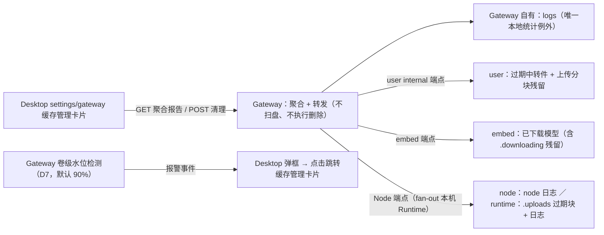

# ADR-123：Gateway 统一缓存管理 —— 服务自报磁盘占用、缓存管理卡片与全局水位报警

**状态**：已接受（2026-11-23；用户拍板「应该是整个 gateway 有个缓存管理，在前端可以看到当前缓存占用磁盘容量，类似微信的缓存数据管理，可以自行删除缓存」「全局磁盘水位要加，类似于服务器磁盘报警，比如说 90%，要 desktop 弹框提醒用户，用户点击弹框跳转到 gateway 缓存管理页面，用户自己决定清理哪些服务的缓存。gateway 只负责报警到前端」「数据和缓存都由服务自报，删除只能删除缓存，具体删多少由各个服务自己决定，gateway 不参与业务，只做通信转发。这个是合理的，要守住」。）
**日期**：2026-11-23
**决策者**：用户

**关联**：
- [ADR-122](./ADR-122-chunked-resumable-upload.md)（§7 Q2/Q2-bis：transfer store 不设 per-store 配额，磁盘治理由本 ADR 承接）
- [ADR-009](./ADR-009-gateway-workspace-isolation.md) / AGENTS.md Gateway 边界红线（Gateway = 通信 + 资源管理 + 反代；agent 私有数据只走 Runtime HTTP，`run_gateway_fs_redline` 强制）
- [ADR-101](./ADR-101-memory-standalone-mcp-service.md)（memory 数据只经 `memory_proxy`，Gateway MUST NOT 直开 `instances/*/memory.db`）
- [ADR-055](./ADR-055-remote-runtime-node-topology.md)（Node 拓扑：Runtime 侧报告经 Node 反代回传）
- [ADR-084](./ADR-084-user-standalone-process.md)（user 独立服务进程）

> 中文文档为 source of truth，英文 counterpart 按约定同 commit 维护。

---

## 1. 决策摘要

### 1.1 一句话

**磁盘占用由各数据所有者服务自报，Gateway 只聚合与转发；Desktop settings/gateway 提供缓存管理卡片，删除只针对缓存类；全局磁盘水位只报警弹框，不做自动写入闸门。**

### 1.2 关键决策表

| # | 决策 | 结论 |
|---|---|---|
| D1 | 治理模型 | **统一缓存管理取代 per-feature 配额**（承接 ADR-122 Q2 拍板：「单独给这个设限意义不大」）。Gateway 上部署的多个服务都有磁盘占用，统一一个治理面；新服务实现自报协议即自动纳入 |
| D2 | 自报协议 | 每个数据所有者服务暴露一对管理端点：`storage-report`（按类别报字节数 + 缓存/数据分类标记 + 可清理项说明）与 `cleanup`（按类别执行清理）。**删什么、删多少（保留策略）由服务自己决定**，Gateway 不下发删除参数语义 |
| D3 | Gateway 角色 | **只聚合 + 转发**：聚合端点合并各服务报告供前端一次读取；清理请求转发给所有者服务执行。Gateway MUST NOT 自己扫盘统计、MUST NOT 代执行删除（红线，§3） |
| D4 | 缓存/数据二分 | **缓存类**（删了不丢用户资产：日志、`.uploads` 残留块、包下载缓存等）提供「清理」按钮；**数据类**（memory.db、doc 库、pm SQLite、chat `files/` 附件、transfer store 在途件）只显示占用 + 受控入口（如「清理已过期中转件」），**MUST NOT 提供全量删除** |
| D5 | 全局水位报警 | 磁盘占用 ≥ 阈值（默认 **90%**，可配置）→ Gateway 报警到前端 → **Desktop 弹框**提醒 → 用户点击弹框**跳转 settings/gateway 缓存管理页面** → 用户自行决定清理哪些服务的缓存。**Gateway 只负责报警到前端**：不做自动写入拒绝、不做自动清理 |
| D6 | 卡片落点 | Desktop settings/gateway（`GatewayTab`，[SettingsPage.tsx](../../../apps/acowork-desktop/src/components/settings/SettingsPage.tsx)）新增缓存管理卡片：按服务分组的占用列表 + 缓存类清理按钮 + 数据类占用展示，形态参照微信「存储空间管理」 |
| D7 | 水位检测方式 | Gateway 周期检测 `data_dir` 所在**卷**的剩余空间（卷级机器信息，如 statfs），不遍历任何服务数据目录——与红线 §3-1 不冲突 |

### 1.3 不变量（红线）

用户拍板「要守住」的四条，全部为 MUST 级：

1. **数据和缓存占用都由各服务自报。** Gateway MUST NOT 直接扫描任何服务的数据目录（`run_gateway_fs_redline`；memory 只经 `memory_proxy`；agent 私有数据只经 Runtime HTTP——Runtime 侧 `.uploads` 报告经 Node 反代回传）。唯一例外：Gateway 自有目录（自身 logs 等）与 D7 的卷级水位检测。
2. **删除只能删缓存类。** 数据类不提供全量删除入口。
3. **具体删多少由各服务自己决定。** 保留策略（如日志保留天数、清理批次大小）内聚在所有者服务里；Gateway 与前端不携带删除量语义。
4. **Gateway 不参与业务，只做通信转发。** 聚合报告、转发清理请求、报警到前端，仅此三件事。

### 1.4 明确不做

- 不做 per-store / per-owner 写入配额（ADR-122 Q2 定案）。
- 不做水位触发的自动写入拒绝（`disk_pressure` 类闸门）——报警是唯一动作；若实测出现「报警到用户响应之间磁盘写满」的真实事故，升级路径是「水位达阈值时缓存类写入拒绝」，本 ADR 不做，留档为升级项。
- 不做平台级自动清理（LRU 驱逐等）——自动删有数据类误删风险，且违红线 3。

## 2. 背景

ADR-122 评审发现 transfer store 是共享多 agent 写面，存在磁盘耗尽风险（M2），原建议 per-owner + 全局双闸配额。用户拍板否决 per-feature 配额：Gateway 上部署了很多服务（gateway 自身、user、memory、pm、doc、node、runtime、embed、lsp-relay），都有磁盘缓存占用，逐个功能设限是分散打补丁；正确形状是一个统一治理面——「类似微信的缓存数据管理」：占用可见、分类清晰、用户自行清理。同时保留一道全局保险：磁盘水位报警（如 90%）弹框提醒用户，但报警之后的动作权完全在用户手里，Gateway 不越权自动处置。

## 3. 架构

### 3.1 服务盘点与分类（首版报告面）

| 服务 | 缓存类（可清理） | 数据类（仅展示 / 受控清理） | 报告通道 |
|---|---|---|---|
| Gateway 自身 | `data/logs`（超保留期的日志文件） | `package-registry`、`data/apps` | 本地（红线 1 唯一例外） |
| user 服务 | 已过期中转件（`transfers-expired`，配合 ADR-122 D10 TTL）、`uploads` 分块残留 | chat `files/` 附件、在途 transfer 件 | user `GET /internal/storage-report` / `POST /internal/storage-cleanup` |
| embed 服务 | 已下载模型（非当前加载）、`.downloading` 残留 | —（当前加载的模型不计入可清理） | embed `GET /storage/report` / `POST /storage/cleanup` |
| node 服务（每 Node） | Node 日志 | 已安装包（`packages`） | node `GET /storage/report` / `POST /storage/cleanup` |
| Runtime（每 Node，经 node 汇总） | `.uploads` 超期块、日志 | 会话数据、agent workspace | node fan-out → Runtime `GET /internal/storage-report` / `POST /internal/storage-cleanup` |
| memory / pm / doc | — | 不提供报告端点（见下） | — |

分类判据只有一条：**删除后是否丢失用户/业务资产**。缓存类 = 可由系统重新生成或本就该回收的临时物；其余一律数据类。

**memory / pm / doc 首版不实现自报端点**（2026-11-23 用户拍板：「没什么可清理的服务，就不用开发缓存管理接口了」）。三者持有的全是数据类（memory.db + 向量索引、项目/任务 SQLite、文档库），端点的清理分支背后没有任何可执行动作——只报数字的接口会摆出一个永远点不动的按钮。它们的数据类只读行也一并省略：卡片不展示无从处置的占用，避免「看得到、清不掉」。新服务只要真有可清理字节，接入两个端点即自动出现在卡片上。

**实现期修正（写码时发现的原文偏差，已按实际语义落地）**：
- `package-registry` 归**数据类**。原文写作「包管理器下载缓存」，但它是 `.bot` 包的唯一分发源——删掉会让所有 Node 的安装/升级 404，属于「删了丢业务资产」。
- 原文漏了 **embed**：`{data_dir}/models` 下的 ONNX 模型（单个 fp16 模型上百 MB）是这台机器上最大的一块可回收缓存，必须进报告面。

### 3.2 报警流

1. Gateway 周期检测卷水位（D7）；≥ 阈值产生报警事件推送前端（通道复用 Desktop 既有 Gateway 事件流）。
2. Desktop 弹框：「磁盘空间不足（已用 ≥90%），建议清理缓存」+「去清理」按钮。
3. 点击跳转 settings/gateway 缓存管理卡片；用户按服务查看占用，自行决定清理哪些缓存类条目。
4. 清理请求经 Gateway 转发到所有者服务执行（红线 3/4）；完成后前端刷新报告。
5. 水位回落到阈值以下，报警解除；再次跨越阈值再次弹框（防抖见 §6 开放问题）。

## 4. 拒绝的替代方案

| 替代 | 拒绝理由 |
|---|---|
| per-store / per-owner 配额（ADR-122 评审 M2 原建议） | 用户拍板「单独设限意义不大」；分散配置面，每个新功能各自打补丁；被统一缓存管理取代 |
| Gateway 扫盘统计各服务目录 | 违红线 1（`run_gateway_fs_redline`、ADR-101）；且目录语义归各服务所有，Gateway 无法正确区分缓存/数据，统计即越权解释业务 |
| 水位触发自动写入拒绝（`disk_pressure` 闸门） | 用户拍板「gateway 只负责报警到前端」；自动拒绝把基础设施状态转译成各服务的业务错误，每个写路径都要处理该错误形态，复杂度高且动作权不应离开用户 |
| 平台级自动清理（LRU / 定期驱逐） | 违红线 3（删多少由服务自定）；自动删有数据类误删风险 |
| 前端直连各服务查占用 | 违 Desktop 只经 Gateway 的连接模型（ADR-115 单服务器地址）；聚合是 Gateway 的本职 |

## 5. 后果

- **收益**：单一入口——缓存管理只出现在 Gateway 标签，`General → 存储` 中原先为 ADR-123 预留的「缓存管理」占位块随本 ADR 落地一起删除，那张卡片只保留数据目录与单文件上传上限；单一治理面，新服务实现两个端点即纳入；用户对磁盘占用有完整可见性与处置权；Gateway 边界保持干净（不扫盘、不执行删除、不自动处置）；ADR-122 transfer store 无需自建配额。
- **代价与残留风险（显式接受）**：报警是事后可见 + 人工回收，**不产生背压**——失控写入者可在报警与用户响应之间继续写满磁盘，殃及同机 SQLite 服务（memory/pm/doc 写失败）。缓解：ADR-122 D10 的 24 h TTL 自动回收、90% 阈值留出的响应余量、弹框的即时性。该风险由用户拍板接受（Q2-bis）；若实测出现事故，升级路径见 §1.4。
- **回滚**：卡片、聚合端点、报警事件均为新增面，删除即回退到「无治理面」状态；各服务自报端点为只读 + 显式清理，无破坏面。

## 6. 开放问题（工程侧，非拍板项）

1. 报告获取形态：前端拉取（打开卡片时 GET）vs Gateway 事件推送周期刷新——首版建议拉取，简单。
2. 报警防抖：跨越阈值弹一次 + 冷却期（如 1 h 内不重复弹），避免临界抖动弹框风暴。
3. 阈值可配置项落点（Gateway config 文件 vs settings UI 暴露）。
4. Runtime 侧报告粒度：per-node 汇总 vs per-agent 细分——涉及 agent 私有数据可见性，首版建议 per-node 汇总。
5. 是否提供「一键清理全部缓存类」聚合按钮（仍是逐服务转发，只是前端批量发起）。

## 7. 拍板记录（2026-11-23）

| 项 | 用户原话（节选） | 落点 |
|---|---|---|
| 统一缓存管理取代 per-store 配额 | 「单独给这个设限意义不大，应该是整个 gateway 有个缓存管理……类似微信的缓存数据管理，可以自行删除缓存」 | D1、D4、D6 |
| 全局水位 = 报警形态 | 「全局磁盘水位要加，类似于服务器磁盘报警，比如说 90%，要 desktop 弹框提醒用户，用户点击弹框跳转到 gateway 缓存管理页面……gateway 只负责报警到前端」 | D5、D7、§1.4 |
| 无缓存可清的服务不接自报端点 | 「没什么可清理的服务，就不用开发缓存管理接口了，比如你列出来的 memory、pm、doc」 | §3.1（memory/pm/doc 排除项） |
| 四条不变量 | 「数据和缓存都由服务自报，并且删除只能删除缓存，具体删多少由各个服务自己决定，gateway 不参与业务，只做通信转发。这个是合理的，要守住」 | §1.3 红线 1–4 |
