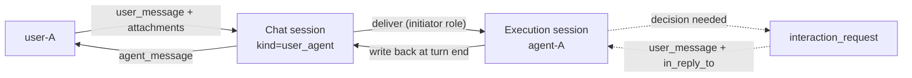
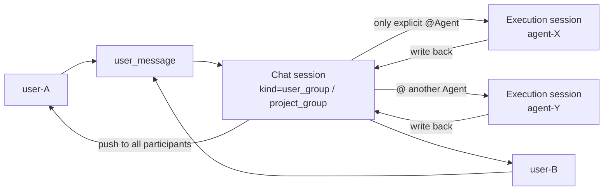
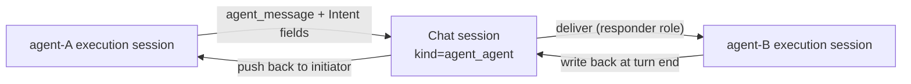
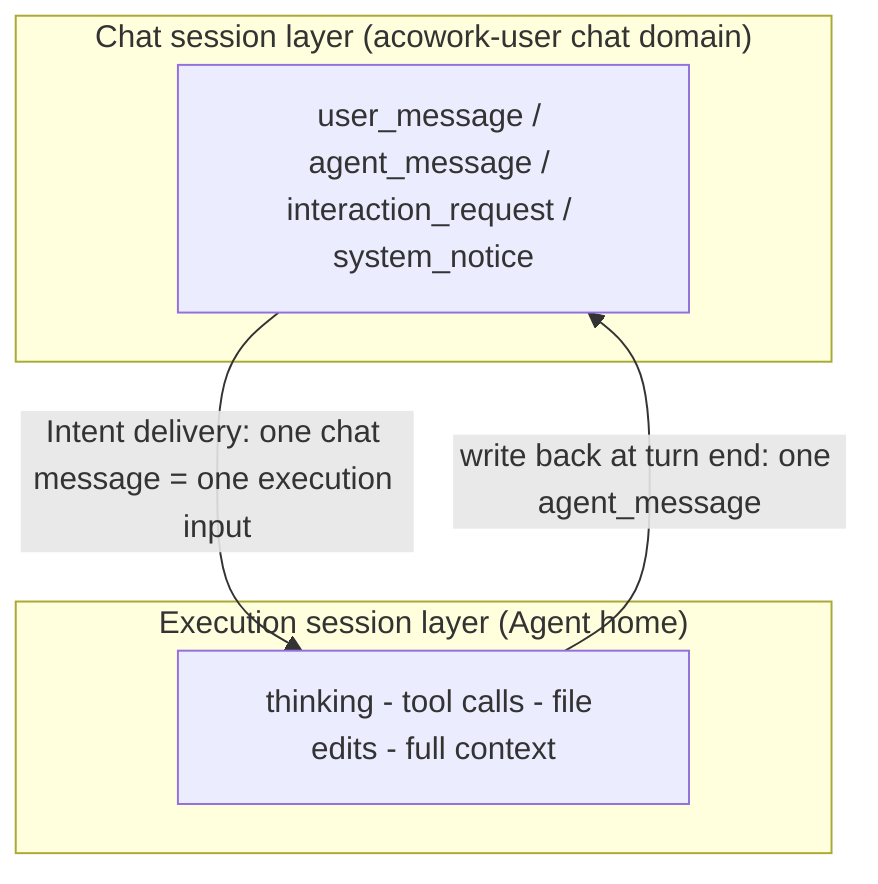
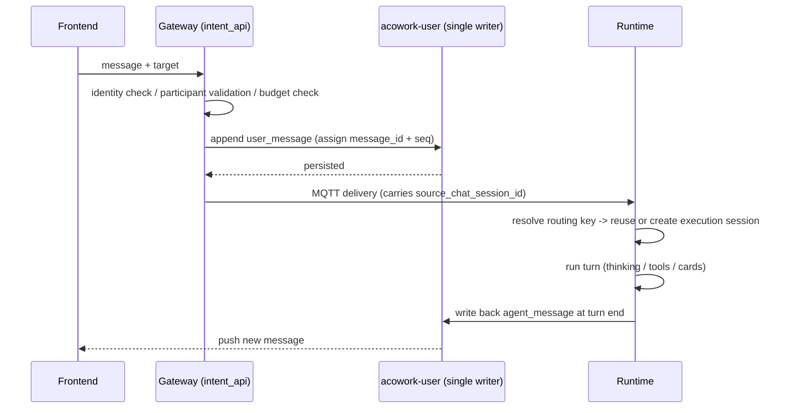
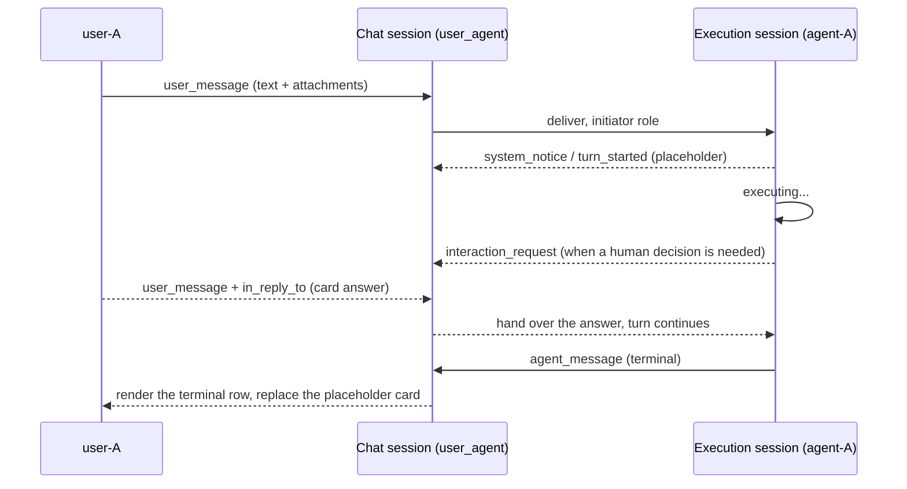
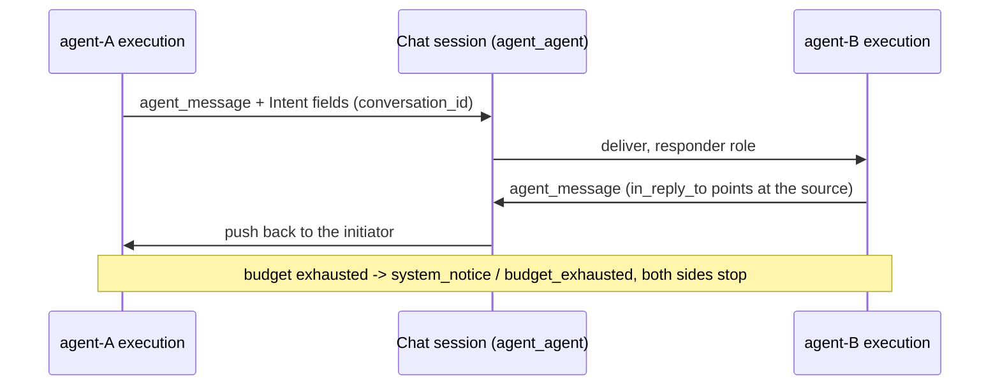
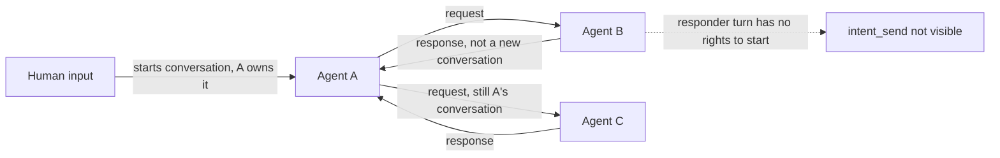
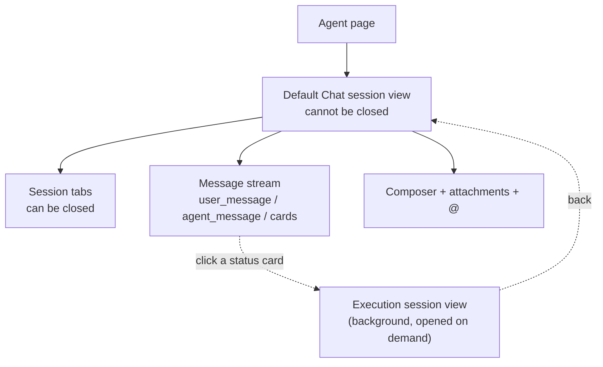

# Intent Messaging and Chat Session Design

> Status: design finalized (framework, requirements, data model, protocol, frontend, module boundaries confirmed; API and schema details deferred to implementation design)
> Version: v2.0 | Updated: 2026-10-14
>
> v2.0 is a **structural reorganization**: content is regrouped as Overall Framework -> Requirements -> Data Model -> Communication Protocol -> Frontend Interaction -> Module Decomposition -> Security & Permissions -> Delivery Plan. New material: framework diagrams, glossary, non-functional requirements, data structures and public interfaces, per-form sequence diagrams, frontend interaction design, permission model, and an ADR consistency check. All section numbers changed; see §12 for the old-to-new map and the list of already-broken citations.
>
> Related designs: [06-communication.md](./06-communication.md), [12-tool-system.md](./12-tool-system.md), [15-conversation-persistence.md](./15-conversation-persistence.md), [21-pm-project-management.md](../zh/21-pm-project-management.md) (zh only)
> Related protocols: [MQTT](../../protocols/en/mqtt.md), [HTTP](../../protocols/en/http.md)

## 1. Overview


This document defines ACowork's Intent communication and Chat session design. It covers message semantics and storage boundaries for users, Agents, groups, and PM, as well as receiving-Agent session selection, conversation ownership, reply delivery, and history reads.

**An Intent is a message sent to an Agent, not a task-orchestration protocol.** To the receiving Agent, an Intent is equivalent to a user message that triggers Agent execution. The sender may be a human user, another Agent, or PM acting on behalf of the project owner. The receiving Agent processes the message in its own Agent execution session; execution details and reasoning remain in that Agent session. The request and reply are recorded as Intent messages in the shared Chat session.

**Core principle: a Chat session records communication; an Agent execution session records execution.** These are distinct session models with their own data formats, writers, lifecycles, and UI entry points. Intent routes a message in a Chat session as input to the target Agent execution session; the Agent's reply is then written back as a message to the source Chat session.

A project group chat is a special type of Chat session in the `acowork-user` chat domain. Future ordinary user groups, user-Agent group chats, and one-to-one Agent-Agent chats use the same chat model; they do not each require a separate session storage format for every participant combination.

**This revision closes a structural gap: user-Agent one-to-one chat had no Chat session.** The type table listed User-Agent chat, but the implementation path excluded it from Chat sessions (ordinary user-Agent conversation went only through an execution session plus Session history). As a result, "opening an Agent" and "opening a chat contact" were two different things, and the Agent page could not share one conversation UI with group chat. This version defines user-Agent single chat as the Agent page's default Chat session (section 6.4): opening an Agent enters the default conversation with it, a message typed there triggers that Agent's execution session, and this is structurally identical to pressing `+` and creating a session. Group chat, single chat, and agent-agent chat are now three instances of one pattern.

## 2. Overall Framework

This chapter is the mental model for the whole design: three conversation forms, the two-layer session split, and the message flow between them. Later chapters expand the details; when you hit a specific rule, come back here to locate it in the whole.

### 2.1 The Three Forms

ACowork has exactly three conversation forms. All of them share one Chat session store, one message vocabulary, and one single-writer entry point. They differ only in **participant composition** and **trigger rules**.

#### 2.1.1 User-Agent (1:1)



Opening an Agent lands on that pair's default Chat session. Every human message triggers Agent processing; no @ is required.

#### 2.1.2 Group-Agent (group chat / project group chat)



Plain group messages are archived only and trigger nothing; @ performs directed delivery. When several Agents are @-ed they execute independently and write back independently.

#### 2.1.3 Agent-Agent



There is no human participant, so no decision cards are produced; A-B traffic is **never** written into A's 1:1 session with a user.

### 2.2 The Two-Layer Session Model



The boundary invariant is stated in §2.3: a Chat session records the conversation, an execution session records the work, Intent routes one chat message into the latter's input, and the reply is written back into the former.

### 2.4 Glossary

| Term | Definition | What it is not |
|---|---|---|
| **Chat session** | Persistent conversation record, owned by the `acowork-user` chat domain; all five kinds share one physical structure | Not an execution container; contains no thinking or tool calls |
| **Execution session** | An Agent's execution context: JSONL + meta inside the Agent home | Not a conversation record; never shared across Agents |
| **kind** | Participant-composition type of a Chat session: `user_user` / `user_group` / `project_group` / `user_agent` / `agent_agent` | Not a storage-layout difference |
| **Intent** | A set of addressing and reply **fields** on a message (`conversation_id`, `in_reply_to`, `agent_session_id`, `repo`, `status`) | Not a message kind; not a task orchestration protocol |
| **Initiator / Responder** | The role in one turn, decided by the **inbound message kind**, never declared by the model | Not a model-selectable attribute |
| **routing key** | Runtime-side logical execution mapping key: `task:` > `chat:` > `conv:` > `msg:` | Not a physical session id; it can rotate |
| **Rotation** | The logical mapping starts pointing at a successor physical execution session | Not a change of the Chat session |
| **Decision card** | `interaction_request`: a human decision is required; blocking | Not a progress display |
| **Status card** | `system_notice` / `turn_started`: the turn has begun; non-blocking | Not a persisted live state |
| **Single writer** | The per-Chat-session serial queue; `seq` is monotonic, `message_id` is idempotent | Not a global serialization |
| **Visibility** | Read-permission scope: owner / Chat session participants / platform-wide | Not "group chat means Public" |

### 2.3 Session Boundary Invariants

| Dimension | Agent execution session | Chat session |
|---|---|---|
| Responsibility | Agent execution context | Message history among users and/or Agents |
| Authoritative storage | Corresponding Agent home / Runtime, existing format | `acowork-user` chat domain |
| Content | Existing execution history: user inputs, model outputs, reasoning, tool calls, etc. | Fixed types: `user_message` / `agent_message` / `interaction_request` / `system_notice`, including attachments |
| Writer | Corresponding Agent Runtime / existing session API | Single chat write entry point in `acowork-user` |
| UI entry | Existing Agent-page Session history | Separate Chat history |

Never copy Chat-session messages into Agent reasoning or tool calls, and never write private Agent reasoning or tool calls into any Chat session. Chat history and Session history are separate entry points.

**Cards are the only exception, and they are a semantic exception rather than a hole.** An `interaction_request` does refer to an in-execution event (a pending tool call, a paused state), but what enters the Chat session is **the communication fact that someone must decide**, not that tool call itself: a card carries the summary needed to make the decision, not the tool payload, command line, internal error detail, or reasoning. The approval outcome lands back in the execution session and execution continues; the Chat session records only "who answered what, when" (section 7.4). The test is: **does this message's content matter to the other participants of the conversation?** If yes it belongs in the Chat session; if it is only the Agent's own progress it stays in the execution session.

Execution status cards obey the same test: what enters the Chat session is the communication fact "your message was accepted and the Agent is working on it" plus the `agent_session_id` pointing at that turn — **how far it has got, and which tool it is calling, does not** (section 7.5).

## 3. Requirements Analysis

### 3.1 Goals

1. Provide a unified source-conversation / reply-address model for user-user, user-Agent, Agent-Agent, PM dispatch, and @Agent in group chat.
2. Preserve the existing Agent session storage format and model; Intent only triggers the target Agent to process a user message in its execution session.
3. Store chat messages uniformly in the chat domain; chat history must never contain Agent reasoning, tool calls, or tool execution details.
4. Let the explicit business entry point determine whether a target Agent execution session is created or reused; do not require the sender or model to infer thread boundaries.
5. Treat `repo` (a code repository address) as an optional Intent field, injected by the system at dispatch time when the project has a repository. An authorized user may later modify session settings, including the working directory.
6. Write messages in each Chat session in order through a single authoritative backend write entry point, avoiding concurrent writes and ambiguous ordering.
7. Deliver results by push: the responder's reply is written back to the Chat session by the system and routed to the initiator, which never polls for a result.
8. A conversation has exactly one owner (the initiator), and the owner decides when it ends; a responder cannot start a new conversation.
9. `chat_history_read` progressively reads Chat-session messages that do not belong to the current conversation, using offset/count with a hard server-side read limit.
10. Agents do not speak in group chats by default; only an explicit @Agent sends an Intent and triggers processing.

### 3.2 Non-goals

- Introducing a complex task lifecycle, callback orchestration, or generic state machine for Intent.
- Turning Agent execution sessions into group-chat storage or injecting group messages into Agent execution-history files.
- Implicitly broadcasting ordinary chat messages to Agents in a group.
- Requiring an external ACP-compatible API; ACP is only a reference for capability descriptions, message structure, and related ideas.

### 3.3 Non-Functional Requirements

| Dimension | Requirement | Basis |
|---|---|---|
| **Cost** | Decision cards do not end the turn by default; only an absent human or a timeout yields `waiting` / `aborted`. The number of approvals in one task must not scale the number of turn replays | §5.5.4 |
| **Latency** | Immediate sender feedback comes from the frontend optimistic placeholder, not from persisting early; `turn_started` may lag one round trip behind send | §5.5.5 |
| **Reliability** | Every turn that owes a write-back must write back, including crash recovery; no state may exist where a message is sent and nothing ever answers | §5.5.1 |
| **Idempotency** | `message_id` is mandatory for all kinds; a duplicate delivery produces no second row; `seq` is monotonic | §4.6 |
| **Reversibility** | No history migration; while both entry points coexist on the Agent page the old behaviour can be restored | §9.1 |
| **Security** | A session with no human to answer must not create anything that needs one; unauthorized reads of execution records return a hidden 404; cards must not become enumeration probes | §8 |
| **Observability** | Conversation budget, rotation events and write-back failures must be queryable, and a Gateway restart must not lose budget counts | §5.7 |
| **Boundary discipline** | The Gateway carries no business logic and never touches Node-local Agent homes directly; business facts are written by the Runtime through the single writer | §7.1 |

### 3.4 Decisions Reached

The following are settled conclusions from the discussion and are normative for this design.

1. **A Chat session stores fixed-type messages only.** No Agent reasoning, tool calls, or tool execution details.
2. **Chat history and Session history are two separate frontend entry points.** The Agent page offers both and never merges them into one list.
3. **There is exactly one rotation point for an Intent execution session.** Rotation may be considered only after the Intent execution ends and its result has been written back to the source Chat session; after rotation the Chat session is unchanged and the new execution session's routing key points at the same Chat session.
4. **T1 idle interval plus T2 task concluded.** T1 defaults to 24 hours (configurable); T2 is a PM task reaching a terminal state or a compaction having occurred in that session. They are ANDed and evaluated only after write-back. T2 alone is never a rotation reason.
5. **The Agent page opens a user-Agent Chat session by default.** Opening an Agent enters the default conversation with it, created idempotently if absent; group chat, single chat, and agent-agent chat share one session model, message vocabulary, and write entry point. The Agent's execution sessions are not migrated and remain in Session history (§5.4.4).
6. **The Chat session is the durable conversation record; the in-flight execution turn is the transient view of the current turn.** Frontend = history rendered from the Chat session + the in-flight turn rendered from the execution-session event stream; when the turn ends and the `agent_message` is persisted, the durable row replaces the transient view.
7. **Conversation ownership follows a C/S model.** The initiator owns the conversation and is responsible for ending it; the responder has no right to open the next round; each conversation has a server-configurable request cap (default 6); when a third party's information is needed, the question goes back to the initiator rather than being relayed by the responder.
8. **Responder turns have a trimmed tool set.** `intent_send` and `ask_user_question` are absent from the responder turn's tool set, enforced by tool visibility rather than by a runtime error.
9. **`repo` is an optional field and is an address, not a path.** A normalized remote URL; injected server-side when the project has a repository, never filled in by the sender; the receiver reads and writes only inside its own registered / authorized working-directory set, with no automatic clone or worktree; malformed values and out-of-scope access are explicit rejection errors.
10. **Each chat session is written serially by one backend entry point.** Messages append in time order and `message_id` provides idempotent deduplication.
11. **The Intent vocabulary is unified into message kinds.** Four kinds: `user_message` / `agent_message` / `interaction_request` / `system_notice`; `conversation_id`, `in_reply_to`, `agent_session_id`, and `status` are demoted to fields and no longer exist as separate message kinds (§4.2).
12. **A human message is a `user_message`, not an Intent request.** If a user single-chat message were implemented with request semantics, the Runtime would treat that turn as a responder and strip `ask_user_question` / `intent_send`, which would break single chat outright. The transport may reuse the Intent delivery pipeline, but the inbound type must be human input and the role this turn must be initiator (§5.4.4 / §5.4.5).
13. **Write-back is independent of the turn's role.** Whenever the inbound message carries `source_chat_session_id`, the turn must write back an `agent_message` when it ends — earlier versions wrote back only at the end of responder turns, which would leave single-chat conversations permanently empty (§5.5.1).
14. **Cards are unified in type and branched in semantics.** `interaction_request` covers ask-question, permission approval, pause-resume, retry, and every other thing needing a human decision; persistence represents "open" as "no `in_reply_to` points at it". But whether the turn is held or ended is decided per card type and cost, and pure agent-agent sessions create nothing that requires a human (§5.5.4 / §5.4.5).
15. **No history migration.** Existing execution sessions stay in Session history; only new conversations create Chat sessions. The cost is that the Agent page carries two lists for a period; the benefit is that this step is fully rollbackable.

16. **The Chat session is the Agent page's only primary surface and cannot be implicitly closed; the execution session is demoted to background but keeps its entry points.** Opening an Agent always lands on a Chat session and `+` only adds sessions; execution sessions stay reachable through Session history and through card clicks. Background does not mean hidden (section 6.4).

17. **The execution status card persists a pointer; status is projected at read time.** What is stored is one immutable `system_notice` / `turn_started` row carrying `in_reply_to` + `agent_session_id`; live status comes from the execution session's existing state machine over events and is **never stored in the Chat session**. Storing state would mean dozens of rewrites inside one turn, which must either break section 8's append-only single writer or flood the conversation history with execution detail (section 7.5).

18. **Card completion is decided by the chat terminal row, not by `Idle`; status is subscribed, never polled.** `Idle` with no terminal row means "finishing up" (section 7.5).

19. **An execution session triggered by a group chat is readable by every participant of that group.** The test derives from routing key `chat:{chat_session_id}`, with no separate ACL; **`SessionVisibility::Public` must not be reused**, since it is platform-wide and would expose a group's execution history to non-members. agent-agent execution records stay closed to humans outside that conversation (section 7.5).

20. **`turn_started` is written by the Runtime, sharing section 7.1's write-back origin.** The Gateway is the communication and resource-management boundary and carries no business logic; immediate send-side feedback comes from an optimistic frontend placeholder rather than from writing earlier (section 7.5).

### 3.5 Defects in the Current Implementation

Ordered by severity; these feed the open questions in §10.

| Level | Defect | Location |
|---|---|---|
| **P0** | `SessionKind::UserAgent` is rejected by the participant check at the create entry point; 1:1 Chat sessions are unreachable | [chat_sessions_api.rs](../../../core/acowork-user/src/http/chat_sessions_api.rs) |
| **P0** | The Gateway client hard-codes the pair session kind to `agent_agent` (**the storage layer already takes a `kind` parameter; not blocking**) | [chat_client.rs:68](../../../core/acowork-gateway/src/intent/chat_client.rs#L68) |
| **P0** | The Agent page queries Chat history with the Agent id as participant; non-admins always get 403 (**the auth rule itself is correct; the bug is the frontend argument — do not fix it by loosening auth**) | [ChatHistoryDropdown.tsx:91](../../../apps/acowork-desktop/src/components/chat/ChatHistoryDropdown.tsx#L91) |
| **P1** | Write-back only happens at the end of a responder turn, so a 1:1 (initiator role) never writes back and the session stays empty | §5.5.1 |
| **P1** | `user_message` does not require `message_id`, yet `in_reply_to` must point at one, so a card answer has nothing to reference | §4.2 |
| **P1** | `participants` carries no identity type, so an Agent can impersonate a human and write `user_message` | §8.1 |
| **P1** | `pairs.json` holds one session per pair, which conflicts with "default session plus `+` creates a second one" | §4.4 |
| **P1** | Code still uses the old three-kind classification and the old status enum; `waiting` is missing | [chat_sessions.rs](../../../core/acowork-user/src/chat_sessions.rs) |
| **P2** | `list_for` scans the whole directory; a per-participant index is missing | §4.6 |
| **P2** | Reinstalling an Agent yields a new instance id and orphans its old sessions | §10.19 |

> Three rows of this table were corrected after re-checking against the code. Gap alignment, delivery slices and acceptance criteria: [`docs/plan/zh/intent-chat-session-unification-plan.md`](../../plan/zh/intent-chat-session-unification-plan.md) (Chinese only; `docs/plan/` has no en set).

## 4. Data Model

### 4.1 Agent Execution Session

This is the existing Agent session model, preserving the context and runtime history needed for one Agent's execution, including ordinary user inputs, model outputs, reasoning, tool calls, and other existing execution history. It continues to be managed by the corresponding Agent Runtime in that Agent's home using the current format.

An execution session may be triggered by a user message or an Intent. Regardless of the trigger, the receiving Agent works in its own execution session. The Intent sender, reply address, and chat history do not merge the sender Agent's execution context with the recipient's.

**Compatibility rule: preserve the existing Agent session storage format and model.** The new chat model refers to Agent execution sessions by association IDs; it does not turn a Chat session into a new format for Agent execution records.

#### Context Compaction and Physical Rotation for Intent Execution Sessions

Intent-driven execution sessions reuse the existing Agent-session context-compaction mechanism; Intent does not introduce a separate token-compaction design. The first release keeps the current thresholds: 70% context usage logs a warning only, 80% triggers LLM compaction, and 95% triggers the `emergency_trim` safety net. The denominator is the effective context window for that session, following the existing per-session override rules. Compaction limits context sent to the model but does not shrink the complete JSONL history file, so physical session rotation is also required.

Logical mappings (for example, a group chat to an Agent) remain stable, while the physical execution session they point to may rotate. This rotation policy applies only to execution sessions managed by Intent logical mappings; it does not change the lifecycle of ordinary sessions used directly from the Agent page. The complete old history remains in the Agent home for the existing Session history UI; do not copy the old JSONL wholesale into the successor or write execution details into the Chat session.

**Rotation-timing invariant: there is exactly one rotation point — after the Intent's execution has finished and its result has been written back to the source Chat session.** No matter how many compactions (including `emergency_trim`) occur during execution, the session must never be switched mid-execution. Multiple compactions inside a single Intent are normal for long tasks or small context windows.

Rotation is triggered by the following two scenarios; there is no execution-count limit:

| Trigger | Condition | Default |
|---|---|---|
| T1 topic discontinuity | When a new Intent arrives, the idle gap since that mapping's last completed execution exceeds the threshold, indicating the two Intents are unrelated | 24 hours; configurable 1–72 hours; `0` disables |
| T2 task concluded | Either: the PM task reached a terminal state (`Done` / `Rejected` / `Cancelled`); or at least one compaction happened during this execution, which marks the Intent as a long task whose historical session should not be reused after delivery | Enabled, not disableable (business boundary plus context-cost judgment) |

Why there is no execution-count limit: a count is not a measurable physical property, so no value is defensible. The problem a count would address—context polluted by unrelated Intents—is already covered directly by the compaction threshold: accumulated unrelated content eventually triggers compaction, which triggers T2. File and disk size are protected by the existing JSONL hard limit. Both boundaries therefore close, leaving no path of unbounded growth.

The two T2 cases are handled differently: a terminal PM task ends that logical execution context, so the session closes without a successor and a later new task uses a new mapping; a compaction-triggered rotation still creates a successor because the same topic may continue.

#### Handoff Context Tiers

A rotated successor carries only a concise handoff whose content depends on the trigger, so a stale summary cannot pollute a new topic:

| Trigger | Handoff content | Ceiling |
|---|---|---|
| T1 idle gap | Open items, key decisions, and reference IDs only; omit entirely when nothing is open; no conversation summary | 500 tokens (fixed by design, not configurable) |
| T2 compaction condition | Current goal, key decisions, open items, and reference IDs | Target 1,500 tokens, configurable 500–4,000 |

A handoff must never contain hidden reasoning, and the ceiling is only a target: it must also fit the successor's effective input budget. Ask the Compact Model to reduce oversized handoffs; if it still cannot fit, retain the most important actionable summary and log a warning.

#### Storage Boundary

Keep the existing JSONL hard limit of 100,000 lines or 50 MiB, whichever comes first, as the absolute safety limit; no separate proactive JSONL rotation threshold is introduced. Under T1 / T2, physical sessions stay small and normally never approach this limit. If an unusually large single execution approaches the hard limit before a safe checkpoint, Runtime must refuse further unbounded appends and pause at a recoverable checkpoint, persist state, and rotate; if it cannot pause safely, it must fail explicitly and preserve written history rather than silently discarding it or crossing the hard limit.

#### Frontend Configuration Boundaries (Session Settings Card on the Agent Settings Panel)

The first release exposes only two settings:

| Setting | Frontend | Initial behavior |
|---|---|---|
| Idle-gap rotation threshold (default 24 hours) | **Configurable**, range 1–72 hours; `0` disables T1 rotation | Applies only to Intent-managed logical mappings; Agent-level default; after an authorized user changes it, it governs subsequent Intent executions for that Agent |
| Handoff context target (default 1,500 tokens) | **Configurable**, range 500–4,000 tokens | Applies only to Intent-managed logical mappings; changes apply to handoffs generated by that Agent's subsequent rotations |

The following are **not exposed** to ordinary users: compaction thresholds 70% / 80% / 95% (keep existing Runtime behavior and configuration capabilities; do not create parallel Intent-specific controls), the T2 rotation condition (business boundary, not disableable), the T1 minimal-handoff ceiling, and the JSONL hard limit of 100,000 lines / 50 MiB (absolute safety limit; deployment-level advanced configuration may adjust it during implementation, but hard-limit semantics must remain).

Parameter changes require authorization and an audit record; they do not rewrite existing history. An in-flight execution uses the configuration snapshot resolved at its start. Missing values use the defaults above. Ordinary users may only adjust Agent-level parameters within their authorization and cannot modify session files in another Agent's home.

#### Concurrency and Failure Recovery

Once a rotation condition is met, the current execution must still complete first; Intents already queued bind to the successor in serialized order and must not continue appending to the old session. If several Intents arrive concurrently, Runtime processes them through the established per-session write / execution queue, and mapping update plus successor creation must commit at one serialized boundary.

Successor creation and logical-map switching must recover from crashes: idempotently create the successor and persist its handoff / predecessor association, atomically point the logical mapping to the successor, then mark the old session ended. A retry must not create multiple successors or lose the active mapping. If the Compact Model is unavailable, rotation must not silently discard context; use the most recent compaction summary and a bounded number of recent turns to construct a bounded handoff, and log a degradation warning. If even a bounded handoff cannot be created safely, pause further dispatch through that mapping and return an explicit error until recovery or authorized intervention.

### 4.2 Chat Session Message Vocabulary

A Chat session is a persistent conversation for user chat and Agent-to-Agent messages, uniformly owned and managed by the `acowork-user` chat domain. Its message types are a fixed communication set, not private Agent runtime traces. **The vocabulary is divided by "who is speaking and what this utterance asks for", not by transport mechanism:**

| kind | Writer | Semantics | Required constraints |
|---|---|---|---|
| `user_message` | Human participant | A human utterance; with `mentions` it is an @Agent; with `in_reply_to` it is **an answer to a card** | `body` or `attachments` non-empty; `message_id` required |
| `agent_message` | Agent participant | An Agent speaking to a human, to a group, or to another Agent. **Every message an Agent puts in a Chat session is this kind** | `message_id` required; `in_reply_to` required when replying |
| `interaction_request` | Agent or system | A card asking a participant to decide: a question, tool approval, pause-resume, retry | `message_id` required; must carry an `interaction` payload and target participants |
| `system_notice` | System | Receipts and records, split by `notice_type`: `turn_started` (this turn has begun, carries `agent_session_id`), `delivery_failed`, `budget_exhausted`, `truncated`, `unavailable` | `message_id` required; `turn_started` additionally requires `in_reply_to` + `agent_session_id` |

**Intent is no longer a message kind.** `intent_request` / `intent_response` are removed as kinds and demoted to **fields** on an `agent_message` (or a `user_message`): `conversation_id`, `in_reply_to`, `agent_session_id`, `repo`, `status`. Whether a message is an Intent reply is derived from the presence of `in_reply_to`; no new discriminator field is added.

The reason for collapsing this way: an Agent speaking to a human, to a group, or to another Agent is one thing in the chat domain — "an Agent sent a message". Typing by transport mechanism would make the same utterance land as different rows depending on where the turn started, force four rendering branches in the frontend, and let a `user_message` and an `intent_request` carrying the same text be written twice into one session.

Concrete wire/schema types will be determined during protocol implementation. Agent reasoning, hidden chain-of-thought, tool calls, tool results, and execution intermediate events must not be written as chat messages. Any necessary delivery or presentation status belongs in message metadata or a separate event; it must not expand into arbitrary Agent execution events.

#### 4.2.1 Attachments

`user_message` and `agent_message` support attachments: Add to Chat, images, documents, workspace references. Attachments follow the rules already established for user-user chat (ADR-076 decision 9, ADR-092):

- blob and metadata sidecar are separate files, and **the blob is written first**: a crash between the two writes leaves an orphan blob that nothing references, rather than metadata pointing at nothing;
- the on-disk name is an opaque server-generated id, **not** the uploaded filename - interpolating user strings into paths invites both traversal and collision;
- size limits are per mime class (image / document); filename length is a display constraint and never enters the path;
- attachments belong to the Chat session directory, not to an individual participant: a file is addressed jointly by that conversation's participants, and another namespace layer would add lookup cost without adding a boundary.

What the Agent side receives is still a resolved reference; the Runtime does not read Chat session directories. The attachment read path is the same as the message body: through the trusted service that owns the single write entry point.

#### 4.2.2 Cards

Two kinds of card live in the Chat session, both pointing at events inside an execution session:

- **Decision cards** (`interaction_request`): interrupts that need a human decision — `ask_user_question`, tool approval, iteration-cap / loop-detection pause, failure retry.
- **Execution status cards** (`turn_started`, a `system_notice` subtype): the record that a human message was accepted and the Agent has begun handling it, carrying `in_reply_to` and `agent_session_id`.

Both let single chat and group chat share one representation of "an Agent is asking / is working". Full rules in sections 7.4 and 7.5.

**A card persists a pointer and a fact, never a state.** What `turn_started` stores is "this turn began, handled by this execution session", written once and never modified; in-flight / thinking / awaiting-tool / paused **live status is never stored in the Chat session** — it is projected at read time from the execution session's event stream. Storing state would require dozens of rewrites inside a single turn, which either breaks section 8's append-only single writer or floods the conversation history with execution detail.

#### 4.2.3 One Model, Different Participants

All chats use the same Chat session and message-log model. The relationship is expressed through chat type and participants, covering at least:

| Chat session type | Participants / purpose | Message content |
|---|---|---|
| User-user | One-to-one chat created by users | User messages |
| User group | General group chat created by users | User messages; Intent messages only when an Agent is explicitly mentioned |
| Project group | Special group chat created with a project | User messages, Intent requests, Intent responses |
| User-Agent chat | Chat-style conversation between a user and an Agent | User messages, Intent requests / responses; not an Agent execution session |
| Agent-Agent chat | One-to-one chat between two Agents | `agent_message` (Intent fields) and `system_notice` only; no human participant, so no cards (§5.5.4) |
| **User-Agent chat** | **One-to-one chat between a user and a single Agent — the Agent page's default conversation surface** (§5.4.4) | `user_message`, `agent_message`, `interaction_request`, `system_notice` |

These are logical types. **The physical schema is identical for all of them**: the same directory layout, the same `session.json`, the same `messages.jsonl`, the same single write entry point; the `kind` field is the only difference. New participant types can extend the same chat model without changing the boundary that chats store messages and execution details remain in Agent sessions.

The difference between one-to-one and group conversations is in **behaviour, not structure**:

| Behaviour | One-to-one (user-Agent / Agent-Agent / user-user) | Group chat |
|---|---|---|
| Trigger | Every `user_message` is delivered to the Agent participant | Delivered only on an explicit @Agent (§5.3.1) |
| Target resolution | The single Agent participant in the session; no @ needed | The client resolves @ into an explicit list of instance ids |
| Who can answer a card | The human participants of the session | The author of the human message that triggered the turn (§5.5.4) |

The `session_id` of a `user_agent` session is a server-generated UUID and is **never derived by concatenating participant ids**. Participants carry agent instance ids (ADR-073), and reinstalling an Agent produces a new instance; if session identity were derived from membership, a reinstall would lose the history. Session identity must be independent of member identity.

### 4.3 Storage Ownership

`acowork-user` is the authoritative owner and writer for user chats and Chat sessions. Although PM creates and associates a project group chat, its conversation history is managed by the `acowork-user` chat domain rather than PM task files or any Agent home.

Remote or local Runtime processes, PM, and Desktop operate on chat history through trusted service interfaces. A Runtime must not directly access or modify another Agent home's session files. PM holds business associations such as `project_id` / `task_id`; the service validates them and maps them to the corresponding Chat session.

### 4.4 Project Group Chat Lifecycle

- Every project must create one associated project group chat at creation, and a project can have only one such group chat.
- The project group chat cannot be deleted independently. The association between project lifecycle and group-chat archive, deletion, and retention is **out of scope for this phase** and will be decided separately.
- `project_id` is stably associated with the project group chat; PM dispatches and Agent replies use it as the source / reply address.

### 4.5 The Intent Field Model

**An Intent is a set of fields on a message, not a message kind** (§4.2). It is the addressing, processing, and reply context carried by an `agent_message` (or by a `user_message` when a human starts the turn); what the receiver sees is still "a message sent to me". The table describes field semantics; it does not imply that a separate Intent record exists:

| Field semantics | Requirement | Description |
|---|---|---|
| `message_id` | **Required for all kinds** | Unique message identifier for correlation, deduplication, reply targeting, and diagnostics. Assigned by the single write entry point; a client may submit one and the server may override it (§4.6). A human `user_message` must have an id too, or the Agent's reply has nothing to point at. |
| `source` | Required | Sender and sender type; identity is confirmed by a trusted service, not just client self-assertion. |
| `source_chat_session_id` | Required | Source Chat session and reply address. |
| `source_agent_session_id` | Required for Agent senders | Execution session ID from which the Agent sent this Intent. Empty for user / PM senders. |
| `target_agent_instance_id` | Required | Exact target Agent Runtime instance, following the instance-ID addressing contract. |
| `body` / `attachments` | At least one non-empty | Message content for the receiving Agent; a text-only, attachment-only, or mixed message is one `user_message` row, never two |
| `repo` | Optional | Address of the code repository this work concerns (normalized remote URL). When the project has a repository, the system injects it at dispatch time; the sender does not name a concrete working directory on the target Agent. |
| `session_config` | Optional | Initial values such as model, reasoning, and skills; omitted fields use target Agent defaults. |
| `conversation_id` | Required for requests | Conversation identifier, generated by the initiator on its first request and reused by every later request / response in that conversation. The system uses it to count requests (§5.4.5). |
| `in_reply_to` | Required when answering | `message_id` of the message or card being answered. **Generated by the system, not a model-supplied parameter** — its presence is what marks a message as a reply (§5.4.5 R2). A human answering a card uses this same field (§5.5.4). |
| `target_agent_session_id` | Associated after routing | Target Agent execution session that actually processes the Intent. |

Field names and the wire schema will be determined during protocol implementation; this table defines semantics, not the final serialization contract.

#### 4.5.1 The `repo` Field and Receiver-Side Boundaries

`repo` is an optional field carrying the code repository this work concerns, expressed as a normalized remote URL (scheme and credentials stripped, host lowercased, no `.git` suffix). It means "which repository is this task about" — **not "which folder to use"**.

> Terminology: in this document `workspace` refers only to a directory registered on the Agent side (`WorkspaceDir`, `allowed_dirs()`, the workspace picker in the UI). The Intent protocol does not use that name: one repository can map to several workspaces (multiple clones / worktrees), and a workspace may not be a code repository at all.

Rules:

1. A project may have no code repository — it need not be a software project. Such an Intent carries no `repo`, and the Agent handles the message in one of its own working directories. That is a normal outcome, not a silent fallback.
2. When the project does have a repository, the system injects its address into Intents created both by PM dispatch and by @Agent mentions in that project's group chat. Neither the human sender nor the sending model needs to know the target Agent's directory layout, and neither fills in a concrete path.
3. What the receiving Agent does with a `repo` value is left to its own model — which authorized directory to work in, whether to switch branches. The protocol layer provides no workspace-selection algorithm and maintains no "repository → workspace" binding table: that judgment is too context-dependent to be covered by a single Intent parameter.

The model's discretion ends there. These are hard constraints:

- The Agent may only read and write inside its own registered / authorized set of working directories;
- A sender's local path must never be used as cross-Node addressing, and must not appear in an Intent;
- Receiving a repository address never authorizes an automatic clone or worktree creation — uncontrolled disk usage plus supply-chain risk, and no principal has ever granted that action;
- With no matching working directory, the Agent replies clearly ("I have no workspace for that repository") instead of writing into the Agent home or any unrelated path.

The first version supports 0 or 1 repository per project; multi-repository projects are out of scope.

#### 4.5.2 Session Configuration as Initial Values, Modifiable by Authorized Users

An Intent may carry initial target-Agent session settings such as model, reasoning, and skills. Omitted fields use the target Agent's defaults. These settings are not immutable snapshots: an authorized user may change them during the session lifecycle, including the session's working directory.

Once accepted, a configuration change applies to subsequent messages / subsequent execution. An operation already in progress uses the configuration snapshot resolved when that operation started, so changing the working directory cannot redirect an ongoing file operation midway. The service must verify that the user may modify the corresponding target Agent session setting; unauthorized changes fail clearly rather than being silently ignored. A working-directory change may only select from directories already registered on that Agent; arbitrary paths are not accepted.

### 4.6 Serialized Chat Session Writes

Chat messages are written serially in chronological order through one authoritative backend write entry point. Use a **single writer / serialized queue per Chat session**, not global serialization across the whole service: writes within one chat are strictly ordered while different chats can proceed concurrently.

The single write entry point is responsible for:

1. Validating the caller and participation relationship;
2. Idempotent deduplication by `message_id`;
3. Assigning a monotonically increasing per-session message sequence / ordering key in backend acceptance order;
4. Atomically appending and persisting messages in order;
5. Associating Intent delivery with the message record.

The canonical order for one chat is the order accepted and committed by the backend serialized write entry point, not each client's local timestamp. Timestamps are for display and must not be the sole ordering key. QoS 1 redelivery or request retry must not append a duplicate message.

This prevents Runtime processes, PM, and UI from concurrently modifying chat history directly. The queue implementation is up to `acowork-user`, but all writes must pass through the same logical write boundary.

### 4.7 Public Interface Inventory

Field-level schemas and error-code enums are deferred to implementation design. What is fixed here is **which interfaces exist, who calls them, and which module owns them**, so that business logic cannot migrate into the Gateway later.

| Interface | Owning module | Caller | Responsibility |
|---|---|---|---|
| `POST /chat-sessions` | acowork-user | Gateway forwards | Create a Chat session (including unblocking the `user_agent` kind) |
| `GET /chat-sessions?participant=` | acowork-user | Gateway forwards | List a participant's sessions; non-participants get 403 |
| `GET /chat-sessions/{id}/messages` | acowork-user | Gateway forwards | Paged history read (append-only snapshot) |
| `POST /chat-sessions/{id}/messages` | acowork-user | Runtime / Gateway | **The single writer**; assigns `message_id` + `seq` |
| `GET /chat-sessions/default?pair=` | acowork-user | Gateway forwards | Resolve a pair's default session (§5.4.4) |
| `POST /intent` | acowork-gateway | Frontend / Runtime / PM | Intent delivery entry point; communication and resource management only |
| `GET /sessions/{sid}` | acowork-runtime | Frontend | Merges meta + live_state for the status-card projection (§5.5.5) |
| `chat_history_read` | acowork-runtime (MCP) | Agent | Agent-side Chat history read (§5.5.3) |
| `intent_send` | acowork-runtime (MCP) | Agent | Agent-initiated Intent; requires the declared `intent:send` permission |

Invariant: Chat session reads and writes go **only through acowork-user**; the Gateway must not reach into the Node-local filesystem to bypass it (§7.1 red line).

## 5. Communication Protocol Framework

### 5.1 The Delivery Pipeline

All three forms share one pipeline; they differ only in entry validation and role determination.



Three hard constraints on this pipeline:

1. **Persist before deliver** — the row must exist in the Chat session before execution is allowed to start; otherwise a Runtime crash makes the message vanish.
2. **Deliver carries the source session** — the write-back trigger looks only at whether `source_chat_session_id` is present, independent of this turn's role (§5.5.1).
3. **Write back through the single writer** — the Runtime does not write files directly and the Gateway does not write business facts on its behalf (§7.1).

### 5.2 Per-Form Sequences

#### 5.2.1 User-Agent (1:1)



#### 5.2.2 Group Chat

```mermaid
sequenceDiagram
    participant UA as user-A
    participant UB as user-B
    participant CS as Chat session (project_group)
    participant EX as agent-X execution
    participant EY as agent-Y execution
    UA->>CS: user_message (no @)
    Note over CS: archived only; triggers no Agent
    UB->>CS: user_message (@X @Y)
    CS->>EX: directed delivery to X
    CS->>EY: directed delivery to Y
    EX->>CS: agent_message (X reply)
    EY->>CS: agent_message (Y reply)
    Note over CS: the two write-backs are independent, one terminal row each
```

#### 5.2.3 Agent-Agent



### 5.3 Project Group Chat and @Agent

#### 5.3.1 Group-Chat Message Behavior

An ordinary user message in a group chat is written only to the Chat session; it does not trigger Agent execution. Agents do not listen to and reply to every group message by default. When a user explicitly @mentions one or more Agents, the system creates an Intent message for each mentioned target and routes it specifically; only the mentioned Agents receive and process the message.

Mention parsing must produce an explicit list of target Agent instances, rather than requiring each Runtime to guess the target from message text. When multiple Agents are mentioned, each is routed independently and maintains its own execution session; the request and replies are recorded as associated Intent messages in the same Chat session.

In the group-chat case the conversation owner is that human message: an Agent's response is written back to the group Chat session and rendered to people, **and it @mentions nobody, so it wakes no Agent**. Hand-off between Agents is not performed by Intent — a human decides whether to @ the next one (the corollary of §5.4.5 R5).

#### 5.3.2 Group-Chat History

A project group chat records:

1. User messages from project members;
2. Intent requests sent to Agents;
3. Intent responses returned by Agents to the group chat;
4. Minimal metadata for sender, recipient, mentions, reply correlation, presentation, and ordering.

Group-chat history excludes Agent reasoning, tool calls, tool results, and execution intermediate content. A mentioned Agent receives the current Intent by default, not the whole group history. If it needs context, it uses `chat_history_read` to read within authorization and response limits.

#### 5.3.3 Visibility Principle

Users and Agents participating in the same group chat can see public messages in that chat. Public is scoped to the participants / project boundary of that Chat session, not globally public across the platform. Keep permissions simple: the service checks chat participation to authorize reads and writes; the session ID itself is not authorization.

### 5.4 Creating and Reusing the Receiving Agent Execution Session

The sender provides the source Chat session and business context; the system determines whether to create or reuse the target execution session based on the chat type.

#### 5.4.1 @Agent in a Group Chat: Fixed Session per Group

When Agent B is mentioned in a group chat, use `(chat_session_id, target_agent_instance_id)` to find B's logical execution conversation and its current physical execution session:

- On the first @B, create the mapping and Agent B execution session;
- Later messages that @B in the same group use the physical session currently pointed to by the mapping; after that Intent's execution finishes and its result is written back, subsequent queued / arriving messages use a successor session if the T1 or T2 condition in §4.1 is met;
- After rotation, the logical mapping remains stable and points to the new successor session;
- Each Agent in the same group has an independent execution-session chain;
- Append B's Intent response to the group Chat session.

“Fixed group-chat session” means a stable logical execution-conversation mapping, not one physical JSONL file that grows forever.

#### 5.4.2 PM Tasks: One Logical Execution Context per Task

When PM creates a task and dispatches it to an Agent, the task defines the execution-session boundary:

- Each `(project_id, task_id, target_agent_instance_id)` maps to one stable logical execution context whose physical execution session is created on first dispatch;
- Later Intents to the same Agent for the same task continue in that logical context, rotating its physical execution session under the T1 / T2 conditions of §4.1;
- When the task reaches a terminal state (`Done` / `Rejected` / `Cancelled`), that logical execution context ends: close the current execution session without creating a successor, and use a new mapping for a later new task;
- Different tasks create different logical execution contexts;
- The Intent's source Chat session / reply address is the project group chat; the Agent's reply returns to that group chat and is correlated with the dispatch message.

A task logical execution context maps to an Agent execution-session chain, not a Chat session. The group chat owns the visible project conversation; the PM task ID selects the target Agent execution context.

#### 5.4.3 Agent-Agent: Three Sessions

A one-to-one chat between Agent A and Agent B has three separate but associated sessions:

1. **One Agent-Agent Chat session**: owned by `acowork-user`, recording Intent requests / responses between A and B; it contains neither Agent's reasoning or tool calls.
2. **Agent A's execution session**: managed by A's Runtime in A's home, storing A's execution context for received messages or continued conversation.
3. **Agent B's execution session**: managed by B's Runtime in B's home, storing B's execution context for received messages or continued conversation.

When A sends a request to B through `intent_send`, the message is first appended to the Chat session and then routed to B's execution session. When B's turn ends, the system generates a response and appends it to the same Chat session (§5.5.1), **and routes it as an inbound message to A**: if A is still executing, it is injected into A's current turn at an iteration boundary; if A is idle, it wakes a new turn. A turn woken by its own response still plays the initiator role and reuses the same `conversation_id` (§5.4.5). The Chat session ID is not A's or B's execution session ID.

The first creation of an Agent-Agent Chat session is triggered by an explicit chat entry point / initial conversation action. Thereafter, the Chat session is reused for that chat relationship. The execution-session association on each side follows the same rule of stable logical mappings to rotatable physical sessions; Agents do not decide on every message whether to create or reuse one.

**Intents between A and B always land in their shared agent-agent Chat session, regardless of what triggered A's current turn.** When A was triggered by a user single-chat message and then asks B, `source_chat_session_id` is that shared Chat session, created idempotently on first send. This rule does not change because user-Agent single chat itself became a Chat session: **user-A is not a participant of the A↔B conversation**, and writing A-B traffic into A's conversation with the user would leak third-party messages to someone who is not part of them. A's user sees, on the Agent page, the stretch of A's execution session that handled B's response plus the `agent_message` A relayed to them in the single-chat session.

#### 5.4.4 User-Agent Single Chat: The Agent Page's Default Conversation Surface

A user's one-to-one conversation with an Agent on the Agent page **is a Chat session** (`kind = user_agent`), sharing the same storage, vocabulary, single write entry point, and frontend session model as group chat and agent-agent chat. It is not the Agent's execution session and it does not replace the execution session:

- Open the Agent → resolve the default Chat session for that (user, agent) pair, created idempotently if absent;
- The user types a message → append one `user_message` row → deliver it to that Agent → into its execution session;
- The Agent's turn ends → append one `agent_message` row back into the same Chat session;
- Press `+` → create another Chat session of the same kind (multiple parallel conversations is a business fact; ADR-086 decision 8 already rejected "one active session per Agent"). The default-opened one is the most recently active.

**A human message is a `user_message`, not an Intent request.** This must be nailed down: if user messages were implemented with request semantics, the Runtime would treat that turn as the responder role, which strips `ask_user_question` and `intent_send` from the tool set and auto-rejects approvals — single chat would be dead. The transport may reuse the Intent delivery pipeline; **the inbound type must be human input and the role this turn must be initiator** (§5.4.5).

**Execution does not enter the Chat session, but it must be visible.** Per §2.3 a Chat session stores messages only; if the frontend rendered only the Chat session, the user would be reduced to "send a message, wait several minutes empty, then get a final answer". The rule: **the Chat session is the persistent conversation record; the in-flight execution turn is the transient view of the current turn.** Frontend = history rendered from the Chat session + in-flight turn rendered from the execution-session event stream; when the turn ends and the `agent_message` is persisted, the durable row replaces the transient view. The invariant holds and the UX does not regress. The two views are aligned by `target_agent_session_id` + `message_id`.

**Rotation therefore applies to single chat too.** The T1 / T2 rotation in §4.1 originally governed only Intent-mapped sessions, while the user's direct-chat JSONL would grow without bound. Once unified, single chat goes through the same `chat:{chat_session_id}` logical mapping, so the established principle that "continuity is carried by the Chat session rather than by a physical execution session" holds for all conversations.

**The Chat session is the Agent page's only primary surface and cannot be implicitly closed.** Opening an Agent always lands on a Chat session; there is no blank "no conversation to show" state. `+` only adds sessions, and closing the current one returns to the most recently active. The execution side is demoted to a **background session**: it no longer holds the primary surface, but its entry points remain — Session history still reaches it, and a card click reaches it too. Background must not mean hidden, or pre-migration execution sessions become unreachable and debugging and cost auditing lose their footing.

**This makes `pairs.json` a P1 change.** It currently holds one session per pair. "Open the default chat" and "press `+` to create a second session for the same pair" cannot both hold against a single-entry index. The rule: `pairs.json` stores only that pair's **default** session; other same-pair sessions are enumerated via `list_for`. This was listed as P2 and is promoted because it collides directly with this section.

**No history migration.** Existing execution sessions stay in Session history; only new conversations create Chat sessions. The cost is that the Agent page carries two lists for a while; the benefit is that this step is fully rollbackable.

#### 5.4.5 Conversation Ownership and Termination

Intent follows a C/S-style ownership model: the initiator owns a conversation and is responsible for ending it; the responder only produces a result for each input and cannot open the next round.

| Rule | Content |
|---|---|
| **R1 Ownership** | Only a turn triggered by human input (user message / PM dispatch / cron) may start a conversation. A turn handling an incoming request as a responder may not start a new conversation |
| **R2 Two directions** | Intent fields have two direction semantics only: request and response. `intent_send` can only produce a request-direction `agent_message`; the response direction is produced only by the system when the responder's turn ends (§5.5.1) and is never the start of a new conversation |
| **R3 Termination** | The conversation ends when the initiator stops sending requests. Ending means "says nothing more", not entering an Ended state — no timeout and no cleanup action |
| **R4 Budget** | Each conversation has a cap on request count; when exceeded, the system refuses delivery and writes a receipt into the Chat session |
| **R5 Third parties** | A responder may not go ask someone else; it writes "I need X" into its response and leaves the decision to the initiator |

Role is decided by the type of inbound message, not declared by the model:

| Inbound | Role this turn | `intent_send` | `conversation_id` |
|---|---|---|---|
| Human message (user single chat / group @ / PM dispatch / cron) | Initiator | Available | New |
| `agent_message` (another Agent asks me) | Responder | **Not in this turn's tool set** | Reuse the inbound value |
| reply (someone answered me) | Initiator, continuing its own conversation | Available | Reuse |

R1 is enforced through tool visibility: the responder's turn has no `intent_send` in its tool set, and `ask_user_question` is removed too. The model cannot see these tools, so it never tries them and never spends tokens looking for a workaround. That is cheaper and stricter than failing at call time.

**The condition for removing `ask_user_question` is whether an answerer exists, not who the message came from.** The original wording — "nobody is behind that turn to answer" — is weaker than the rule needs: in a group chat, the person who just @-ed this Agent *is* an answerer. So the rule is now stated against the fact: **if the Chat session has a human participant, the card may be created; in a pure agent-agent session with no human, the tool is not created and §5.5.1's fallback receipt applies instead** (§5.4.4 / §5.5.4). The cost gate (R4 request counting) and loop prevention are unaffected, because a card creates no new conversation and adds no request to the count.



There is no path by which a loop forms: B cannot extend the conversation (R1); every request A makes is countable (R4); A's turn always terminates. Therefore no causal-chain depth, chain ID, or cross-Agent loop detection is needed.

| Parameter | Default | Range | Exposed in Session Settings card |
|---|---|---|---|
| Max requests per conversation | 6 | 2–16 (0 = Agent-to-Agent conversation disabled) | Yes (Agent level) |

A human is the only circuit breaker and the only restart point: to continue after the cap is reached, the user sends a new message = a new conversation. **A responder may not request a higher cap** — that would let the loop decide whether to continue.

Orchestration ownership: deciding "who works next, in what order" belongs to humans and the PM task dependency graph, not to Intent (§3.2 non-goal: no task orchestration in Intent). R5 is the concrete expression of that boundary.

### 5.5 Replies, History Entry Points, and History Reads

#### 5.5.1 Writing Replies Back

**An Agent's reply is not a model tool call; it is a product the system generates when the turn ends.** Answering an incoming message is the same act as "finishing speaking" in an ordinary user-Agent conversation. If replying were a tool, the common failure would be the model simply ending its turn after answering — and the initiator would wait forever.

**The write-back trigger is "this turn was started by a message from some Chat session", independent of the turn's role.** This must be stated explicitly: earlier revisions wrote back only when the *responder's* turn ended, but a user single-chat turn from §5.4.4 plays the **initiator** role — under the original implementation the Agent's reply in single chat would never land in the Chat session and the conversation would stay permanently empty. The rule now: an inbound message carrying `source_chat_session_id` → the turn must write back one `agent_message` row when it ends; no such id (cron start, no conversation context) → no write-back.

The reply body comes from **the final output of that turn**, not from scraping the tail of the context: after a turn ends, the context tail may hold several assistant texts (narration before tool calls, intermediate conclusions, the final summary), so "how much to take" could only be guessed. The Runtime already has a first-class final output for each turn (the stream-completion event carries the reply text, with reasoning blocks stripped before it is written). The reply body is that text — one message, not a window.

Any turn that will write back must **write back when it ends, regardless of outcome**:

| End condition | `status` | Body |
|---|---|---|
| Normal completion | `completed` | The turn's final output text |
| LLM / tool error | `failed` | Only the user-facing error summary — **never the internal detail**; internal errors are not exposed to another Agent |
| User pressed stop | `aborted` | Whatever text the turn produced; may be empty |
| Ended on an unresolved card | `waiting` | Card summary (§5.5.4); body may be empty |
| Runtime crash / no event at all | `failed` | Fixed system fallback text |

**A turn must not enter an unbounded wait for a human.** The two existing pause states (iteration-limit pause, loop-detection pause) depend on a human clicking Continue in the UI. The rule branches on whether an answerer exists (§5.4.5): if the session has an answerable human → write the card back, end the turn as `waiting`, **release that session's serial execution slot**, and continue in a new turn once the human answers (§5.5.4); if there is no human (pure agent-agent) → terminate with an `aborted` receipt describing where it got stuck.

Write path: the reply is appended to the source Chat session through the single chat write entry point; the Runtime never writes directly into another Runtime's home session file.

**The initiator learns the result by push, not by polling.** After the reply is stored, the system routes it as an inbound message to the initiator: injected into the current turn at an iteration boundary if still executing (the answer lands in the same turn), or waking a new turn if idle. An LLM cannot wait; if results were only obtainable by querying, the model would retry inside its turn — a busy-wait that burns iterations and tokens. The initiator has usually already ended its turn after sending a request, so there is no live turn to poll with.

Length limit: the reply body is truncated under a combined byte / token cap and marked `truncated`. If the initiator needs more, **it sends another request specifying which part it wants**; reading the other Agent's execution session is not offered (§2.3 boundary invariant).

Reply addresses: for PM, the project group chat, where the PM service reads the reply correlated with that task to advance task state (a service reading messages, not an LLM polling). For Agent-Agent, the shared one-to-one Chat session, pushed back to the initiator. For user single chat and group chat, the corresponding Chat session, rendered to people.

#### 5.5.2 Agent Page Chat History

Keep the existing **Session history** button on the Agent page for that Agent's execution-session history, and add a separate **Chat history** button for Chat session history involving that Agent. The Agent page's main body is the user-Agent Chat session (§5.4.4), so Chat history here means the *other* Chat sessions this Agent participates in.

Chat history lists conversations by counterpart or group: one-to-one chats with other Agents, groups, and project group chats. Selecting an entry displays Chat messages stored by `acowork-user`; it must not show or combine reasoning and tool calls from the Agent's private execution session.

Because `user_agent` is now a creatable kind, the Agent page's default view **is** a Chat session rather than a raw execution session — the earlier restriction that "Chat history excludes direct user-Agent conversation" is lifted (it contradicted §4.2.3, which listed User-Agent chat as a type). Existing execution sessions are not migrated; they stay in Session history.

#### 5.5.3 `chat_history_read`

`chat_history_read` reads message history from a Chat session. It is **not how the current conversation's result is obtained** — results arrive by push (§5.5.1). Its purpose is reading messages that do not belong to the current conversation:

1. earlier human discussion in a group chat (§5.3.2: a mentioned Agent does not automatically receive the whole history);
2. when one message @mentioned several Agents, A reading B's response;
3. messages addressed to other Agents in the group.

The tool cannot read arbitrary sessions; by default it only reads Chat sessions in which the caller has a participation relationship. Its inputs are `chat_session_id + offset + count`, and it **does not accept a message_id as a "wait for result" handle** — that would turn it into a polling interface.

Naming note: this tool was originally called `intent_send_result_query`, paired with `intent_send`. That name leads a model to treat "query right after sending" as the required way to get a result, actively inducing the failure mode described above, so it is renamed. The tool description must state that responses arrive automatically and this tool only reads other messages in the conversation.

The tool provides `offset` and `count` to page through Chat session messages in append order. The LLM can decide from messages already read whether to continue; the prompt may recommend a per-call amount but cannot replace server-side enforcement. The backend must set a hard per-call `count`, response-byte, or equivalent payload limit, and verify participation in the queried Chat session.

Suggested request semantics:

```json
{
  "chat_session_id": "...",
  "offset": 0,
  "count": 20
}
```

The response includes at least the messages, stable order / offset information, and whether more messages are available. For append-only Chat sessions, offset/count is sufficient for the first version; backend ordering must remain stable when messages are appended concurrently. Consider a cursor only if future requirements include middle deletion or complex synchronization; do not introduce one in the first version.

#### 5.5.4 Interaction Cards: One Type, Branched by Whether an Answerer Exists

Everything in an execution session that needs a human decision — `ask_user_question` options, tool permission approval, iteration-limit / loop-detection resume, failure retry — appears in the Chat session as `interaction_request` (§4.2). This is **unification at the type level**: one set of card types, one write entry point, one durable record, and the user answers the same kind of thing whether they are on the Agent page, in a group, or in single chat.

**Persistence uses an append-only representation rather than mutating a row.** A card is appended as one row; its state is derived from what follows — **no row with `in_reply_to` pointing at it means it is still open**. Expiry is evaluated at read time and never written back. This keeps cards compatible with §4.6's append-only single-writer rule and avoids introducing mutable state into the storage model.

**Non-unification at the semantic level, two places, stated explicitly:**

1. **Hold the turn vs. end the turn.** If every card ended the turn, a coding Agent's several dozen file-write approvals in one task would become several dozen "end turn → human answers → replay context and start a new turn", which is unacceptable in both token cost and latency. So: a card is **always** written into the Chat session (as record and answer channel), while the execution side decides per card type whether to hold the current turn (the existing long-poll semantics of `ask_user_question`, with a timeout ceiling) or end the turn and release the execution slot (§5.5.1 `waiting`). The first is an execution-side waiting strategy; the second is the conversation-layer record. They do not conflict.

2. **Answerer determination.** If the session has a human participant → the card may be created and answered; in a pure agent-agent session → nothing requiring a human is created, and §5.4.5 / §5.5.1's auto-reject or `aborted` receipt applies. The test is the fact "is there anyone who can answer", not "who the message came from".

Cards create no new conversation and do not count against §5.4.5 R4's request budget — they are one interaction inside an existing conversation, not a new delegation. Answering a card wakes no Agent other than the one waiting on it.

#### 5.5.5 Execution Status Card

Between sending a message and the Agent's reply being stored there can be several minutes. If the conversation shows nothing during that window, the UX degrades into "send, wait blank, get an answer". Section 6.4 already established that the in-flight turn renders from the execution-session event stream; this section makes that concrete.

**Persistence: one `turn_started` row, written by the Runtime.** After the Runtime accepts a `user_message` and resolves an execution session, it appends a `system_notice` with `notice_type = turn_started` through the single chat write entry point, carrying `in_reply_to` (the id of the message that triggered the turn) and `agent_session_id`.

**The writer must be the Runtime, not the Gateway.** The Gateway's established boundary is communication, resource management, and reverse proxying, and it carries no business logic (AGENTS.md "Gateway boundary", enforced by the redline check in `dev/ci.sh`). "A turn has begun" is a business fact; letting only the Gateway write it pushes business logic into the transport layer. Section 7.1's reply write-back is **already** performed by the Runtime over the same path, so `turn_started` shares that origin and there is still exactly one writer rather than a second entry point.

The cost is that the card appears one round trip after the user presses send. Absorb it with an **optimistic frontend placeholder**: render a transient card locally, then replace it with the durable row once `turn_started` is stored — this is the existing "in-flight turn is a transient view" rule from section 6.4 and adds no mechanism. The placeholder is not persisted, so if the durable row never landed, the card disappearing after a refresh is the correct behaviour (that turn really was not accepted).

**This row is written once and never modified** — it is a record, not a dashboard. With it, a page refresh, a reconnect, or a login from another device can recover "a message is being worked on" without depending on the event stream happening to be live.

**Status: projected at read time.** The in-flight / thinking / awaiting-tool / paused shown on the card comes from the execution session's existing state machine (`Idle` / `LlmAwaitingFirstChunk` / `Thinking` / `LlmStreaming` / `ToolExecuting` / `WaitingApproval` / `Paused`), delivered over events. **The status side requires no new backend**: that state machine and the merged meta + live_state read endpoint already exist.

**Completion is decided by the chat row, not by `Idle`.** Write-back happens **after** the final event, so there is a window where the execution session is already `Idle` but the `agent_message` is not yet stored. If the card followed `Idle`, the user would think the answer was lost. Rule: `Idle` with no terminal row under that `in_reply_to` = **finishing up**; the card disappears only when an `agent_message` (or a failure receipt) appears.

**Subscribe, do not poll.** Status arrives via event push; REST reads of execution-session status are used only to paint an already-open card on first render. Polling per open card would move the busy-wait that section 7.1 explicitly rejects into the browser, amplified by the number of concurrent cards against the Gateway-to-Runtime boundary.

**Clickability is decided by participation in the Chat session, not by ownership.** A group chat exists so that its members share one working context, therefore **an execution session triggered by a group chat is readable by every participant of that group.** Otherwise a member sees "the Agent is working" and can never find out where it is stuck, and the group chat degrades into filing tickets at an Agent. In single chat the user is already the owner, so nothing changes there.

The test is **derived, not a new table**: a group's execution session is created under routing key `chat:{chat_session_id}` (section 6.1), and that key is already persisted in the Runtime's `intent-sessions.json`, so "which Chat session does this execution session belong to" is a known fact and read access equals that Chat session's participant set. No separate ACL store is introduced. Where to record the binding is left to implementation design (section 14.20).

**Do not reuse the existing `SessionVisibility::Public`.** Its documented meaning is "readable by any authenticated user" ([session_meta.rs](../../../core/acowork-memory/src/session_meta.rs)) — it is **platform-wide** visibility, not in-group visibility. Implementing "public in group chat" with it would let non-members read that group's execution history, which is worse than the problem it was meant to solve. What is needed is a third scope bound to a Chat session's participants, not `Public`.

**agent-agent cards are not clickable by humans outside the conversation.** A and B's shared session has no human participant. User A may open A's own card (A owns A's session) but must **not** reach B's execution session through it — that is B's private execution record.

**Cards remain visible to every participant** ("the Agent is working on this message" is a communication fact). Grey-out applies only when the viewer is neither a participant of the Chat session nor the owner of the execution session, and shows a reason rather than an error; after this change that case is left only in agent-agent sessions and genuine unauthorized access.

**Still clickable after rotation.** `turn_started` points at the physical session that actually ran the turn; after the section 2.1 rotation the old JSONL remains in the Agent home, so clicking a historical card opens **that turn**, not the successor. That is the intended behaviour: the card is a record of "which execution this message produced", not a pointer to "current session state".

**One card per (message, Agent) pair.** A group message mentioning several Agents produces several `turn_started` rows, each completing independently; the serial execution slot (section 8) guarantees cards for the same (chat session, agent) complete in order.

**Division of labour with section 7.4.** `interaction_request` means "someone must decide" — it blocks and requires an answer; `turn_started` means "work is in progress" — it does not block and requires nothing of anyone. Both share the same pointer + projection rules, and both can exist within one turn (an approval raised mid-execution).

### 5.6 PM Integration and Identity

A PM task dispatch is a project owner sending a message to an Agent through the project group chat:

1. The PM project has an explicit owner;
2. `acowork-user` / a trusted service confirms the owner from authenticated project data; PM must not arbitrarily self-assert an owner;
3. The project group Chat session is the Intent source conversation and Agent reply address;
4. A project may optionally be linked to one code repository. When it is, the server injects that repository address as `repo` into Intents created by task dispatch and by @Agent mentions in the project group chat; injection happens server-side, does not depend on the sender filling it in, and cannot be forged by the sender;
5. The task ID and target Agent instance select the Agent execution session;
6. Later PM dispatch messages for the same task reuse that task execution session; a new task uses a new session;
7. Agent replies are appended to the project group chat and correlated with the corresponding Intent;
8. In the PM case the conversation owner is the dispatching human input: after an Agent's response is written back to the project group chat it **wakes no Agent**. The PM service reads the response correlated with that task to advance task state (a service reading messages, not an LLM polling);
9. If an Agent needs information held by another Agent, it writes it into the response and leaves the decision to the initiator; it does not go ask someone else (§5.4.5 R5). Sequencing and hand-off between tasks belong to the PM task dependency graph and the owner, not to Intent.

Storing the group chat in `acowork-user` does not remove PM's ownership of project / task domain data: PM still owns project and task business data, while the chat service owns conversations and message records. They are associated by stable IDs.

### 5.7 Delivery, Errors, and Reliability

Intent retains message semantics and does not introduce a generic task state machine. Minimum reliability semantics include:

- `message_id` remains stable across chat records, Intent routing, and reply correlation;
- Successful MQTT QoS 1 publication does not mean the Agent processed or completed the message;
- The receiver deduplicates by `message_id` to prevent the same message entering an execution session more than once;
- The initiator learns results by push; it must not wait by querying (§5.5.1);
- When a conversation exceeds its request cap, delivery is refused with a receipt written to the Chat session — never silently dropped (§5.4.5 R4);
- Invalid target Agent, source Chat session, session configuration, or `repo` address format fails clearly;
- An Agent attempting to read or write outside its authorized directories, or attempting an automatic clone / worktree creation because of a `repo` value, is rejected with a receipt — never silently downgraded;
- Tool feedback reports only that a message was recorded / accepted or clearly failed; it must not claim “completed” when it only means “published.”

At minimum, distinguish `invalid_repo`, `unauthorized_directory`, `target_not_found`, `source_chat_session_not_found`, `session_config_invalid`, `not_authorized`, `delivery_unavailable`, `conversation_request_limit_reached`, `response_unavailable` (carried by the fallback response when a responder turn terminates abnormally), and duplicate message IDs. Unify final error codes when revising HTTP / MQTT protocols.

## 6. Frontend Interaction Design

- **The Agent page's main body is the user-Agent Chat session**: opening an Agent enters the default conversation (created idempotently if absent); `+` creates another session of the same kind; the default-opened one is the most recently active. Existing Session history keeps its behaviour, and the Chat history button lists the other Chat sessions this Agent participates in.
- The single-chat composer has the same attachment, @, and card-answering capability as group chat — one component, one message vocabulary, with only inapplicable controls hidden per kind (an @ is not needed in single chat).
- Chat history lists conversations involving the Agent by counterpart / group; selecting one displays Chat session messages.
- The PM project view opens the fixed project group chat; PM task dispatches and replies are visible there in order.
- Ordinary group messages do not trigger an Agent; @Agent creates a targeted Intent. When multiple Agents are mentioned, show each request and reply independently.
- Chat history displays messages and necessary delivery notices, not private Agent reasoning, tool calls, or execution details.
- Chat history must show conversation ownership: the owner (initiator) of each conversation, its request count, and each response status (`completed` / `aborted` / `failed`).
- When the request cap is reached, show an explicit limit receipt with a "continue" entry — clicking it makes the **user** send a new message, starting a new conversation. The user must never see only "two Agents suddenly stopped talking".

### 6.1 The Main View Model

Once everything is unified into Chat session + Execution session, the frontend has exactly one main view:



Three precise rules, so that "cannot be closed" is not over-read:

| Object | Rule | Reason |
|---|---|---|
| **Agent page main view** | Always lands on that pair's default Chat session; **no close affordance** | Opening an Agent must give you somewhere to talk |
| **Session tabs** | **Closable**; closing falls back to the default session | Matches the existing `sessionTabBar.closeChat` behaviour |
| **The default session itself** | **Not deletable** | Deleting it reintroduces the "nowhere to type" problem |
| **Non-default sessions** | Creatable and deletable | `+` creating a second session for the same pair uses this path (§4.4) |

The Execution session is demoted to a **background session**: it is no longer a conversation entry point and is reached only through a status card.

### 6.2 Component-to-State Mapping

A status card's visual state is a **read-time projection** of the execution session's `live_state` and is never persisted (§5.5.5).

| Runtime `SessionStatus` | Card state | Tone |
|---|---|---|
| `LlmAwaitingFirstChunk` | Queued | Sent, waiting for a response |
| `Thinking` | Running | The Agent is thinking |
| `LlmStreaming` | Streaming | The Agent is producing output |
| `ToolExecuting` | Working | Shows the current tool name, never its arguments |
| `WaitingApproval` | Needs confirmation | Points at the decision card |
| `Paused` | Paused | Offers a resume affordance |
| `Idle` **with no terminal row** | Finalizing | Do not show "done" — the write-back window is still open |
| A terminal `agent_message` row exists | **Card disappears, replaced by the terminal message** | The chat terminal row is the completion criterion |

Completion is decided by the **chat-side terminal row**, not by the Runtime's `Idle` event: write-back happens after the final event, so `Idle` only means "execution ended", not "the result is stored". State is **subscribed, never polled**.

### 6.3 Card Specification

| | Decision card `interaction_request` | Status card `system_notice` |
|---|---|---|
| Blocking | Yes; the Agent holds the turn open | No, display only |
| Persistence | One append-only row | One `turn_started` pointer row |
| Pending test | No later row has `in_reply_to` pointing at it | Not applicable |
| Expiry | Evaluated at read time (no status rewrite) | Not applicable |
| Affordances | Buttons / options / input | Click opens the execution session (permission-gated) |
| When no human participant | **Not created** (§5.4.5) | Still created |

When it cannot be clicked, grey it out rather than hiding it — cards are visible to all participants, and clickability is decided by read permission (§8.2).

### 6.4 Group-Chat Specifics

- **@ picker**: only @-ing an Agent triggers execution; @-ing a person creates a mention and triggers nothing (§5.3.1).
- **Concurrent Agents**: one message @-ing several Agents produces one independent status card per Agent; they are never merged.
- **Membership change**: a removed member keeps the group's chat history in view but immediately loses access to the group's execution sessions (§8.3).

### 6.5 Mobile

Mobile (ADR-086) shares the same view model as desktop. Differences are presentational only: status cards collapse to a one-line summary and expand on tap; decision cards appear as a bottom sheet to avoid mis-taps.

### 6.6 i18n

Existing keys are reused directly: `sessionTabBar.closeChat` / `closeOtherChats` / `deleteSession` / `openNewSession`, and the two history entry points `sessionHistory` / `chatHistory`. New keys are limited to card and status copy; no new entry-point keys are introduced.

## 7. Architecture Boundaries and Existing Implementation

### 7.1 Responsibility Boundaries

- **`acowork-user`**: owns Chat sessions of all four kinds (including user-Agent single chat), participant relationships, fixed-type chat messages, and the single serialized write entry point; provides paged chat-history queries. Conversation records belong to the chat domain for every kind and are never split by path per kind — storing single chat under a `userId/chats/{peerId}` layout, one directory per initiator, would coexist with the Chat-session UUID-per-session + IntentMeta layout as two systems with two authorities over the same semantics, which is exactly what this design removes.
- **PM service**: owns project and task data (a project may optionally be linked to one code repository); requests project-chat creation at project creation; provides validated owner / project / task associations and the project repository address at dispatch.
- **Gateway / trusted routing boundary**: validates Runtime / PM identity, resolves targets, injects and validates the `repo` address, routes Intents, counts requests per `conversation_id` and refuses those over the cap, routes each response back to the initiator's execution session by push, and coordinates user chat with Node / Runtime; it does not directly access Node-local Agent home files.
- **Agent Runtime**: determines the role of the current turn from the inbound message type (initiator / responder) and trims the tool set accordingly (§5.4.5); treats an incoming request as user input in the designated Agent execution session; preserves the existing session format in the Agent home; reads and writes only inside its own registered / authorized working directories and never clones or creates a worktree because of a `repo` value; on turn end, generates the response through the system (including aborted and failed fallbacks) and submits it to the trusted message write entry point, without relying on the model calling a reply tool.
- **Desktop**: opens the user-Agent Chat session as the Agent page's main view; presents Agent execution Session history and Chat history separately; it does not assemble or persist business history itself.

### 7.2 Transport and ACP

Intent message semantics are transport-independent. MQTT may continue to carry Runtime control messages; Chat session reads and writes use trusted HTTP / service interfaces exposed by `acowork-user`. Concrete interfaces must align with Gateway reverse proxy, remote Node topology, and authentication boundaries.

ACP may inform Agent capability descriptions, discovery, and structured messages. This design does not require internal messages to use ACP REST APIs and does not adopt the ACP run lifecycle.

### 7.3 Changes Needed to Existing Implementation

The current [intent_send.rs](../../../core/acowork-runtime/src/tools/builtin/intent_send.rs) publishes Intents through an MQTT control topic, and its `async` parameter does not mean request waiting / result retrieval is implemented. Implementation of the new model must follow this design's message and Chat session semantics. Review or retire the Gateway's old Intent Router path that depends on removed gRPC, and update [06-communication.md](./06-communication.md), [12-tool-system.md](./12-tool-system.md), and MQTT / HTTP protocols to establish one authoritative contract.

## 8. Security and Permissions

### 8.1 Impersonation Defence

`participants` must carry an **identity type** (human / agent), validated per kind at write time:

- `user_message` may only be written by an authenticated human identity; an Agent may never write this kind.
- `agent_message` / `interaction_request` may only be written by an Agent participant of that Chat session.
- `system_notice` may only be written by the system.

The check lives in the single writer (§4.6), not in the caller — otherwise any Agent holding Runtime privileges could forge human speech. The current implementation lacks it (§3.5 P1).

### 8.2 Visibility Model

Three scopes, narrowest to widest:

| Layer | Test | Applies to |
|---|---|---|
| **owner** | Session creator / account owner | User-private data |
| **participant-derived** | Whether the reader is a participant of that Chat session | Execution sessions triggered from a group chat |
| **platform-wide `Public`** | Any authenticated user may read | Explicitly public content |

Key distinction: **group visibility is not `Public`**. `Public` in `session_meta` is a platform-wide scope; applying it literally to group chats would let any logged-in user read the group's execution history. The correct test for a group-triggered execution session is derived from the routing key `chat:{chat_session_id}` — read permission equals the participant set of that chat session, and **no new ACL table is introduced** (§5.4.2).

### 8.3 Permission Revocation

A member removed from a group loses access to that group's **past** execution sessions as well. Execution records contain thinking, tool calls and file contents, which are more sensitive than chat messages; keeping the messages while revoking the records is a deliberate asymmetry, not an oversight.

### 8.4 Exposure Surface

| Surface | Control |
|---|---|
| Execution records (thinking / tools / files) | Participant-derived read permission + hidden 404 (no distinction between "absent" and "forbidden") |
| Cards | Must not act as enumeration probes: greyed out rather than hidden when unreadable, and no 403 detail is returned |
| Attachments | Travel with the message; not independently addressable |
| Agent home internal state | Read and written only over Runtime HTTP; the Gateway never touches the filesystem directly (§7.1) |
| Budget counters | Must survive a Gateway restart (§5.7) |

## 9. Delivery Plan

### 9.1 Suggested Phased Delivery

### Phase 1: Chat Session Storage and Message Writes

- Implement a generic Chat session / participant / message model in `acowork-user` for project group, user group, user-Agent, and Agent-Agent types;
- Unify message kinds into `user_message` / `agent_message` / `interaction_request` / `system_notice`, with Intent information demoted to fields (§4.2); all four kinds require a server-assigned `message_id`;
- Unblock `SessionKind::UserAgent`: relax the participant validation at the creation entry point and parameterize the `ensure_pair` kind, together with participant identity-type validation (§10.14);
- Change the write-back trigger to "the inbound message carries `source_chat_session_id`", independent of the turn's role (§5.5.1);
- Ensure chat message types contain only the four kinds above;
- Change `pairs.json` semantics to "the default session per pair", enumerating other same-pair sessions via `list_for` (section 6.4);
- Implement the `system_notice` `notice_type` split and the `turn_started` record row (section 2.2 / 7.5);
- Establish one backend write entry point, serialization per Chat session, ordering keys, and `message_id` idempotency;
- Fix the boundary between Chat sessions and existing Agent execution sessions and store association references.

### Phase 2: Project Group Chat and Targeted Intent

- Idempotently create one project group chat when PM creates a project; defer project lifecycle policy;
- Store ordinary group messages only; create and route Intent only for @Agent;
- Reuse a stable logical execution mapping by `(chat_session_id, target_agent_instance_id)`; rotate its physical execution session under the T1 / T2 conditions in §4.1;
- Treat `repo` as optional and inject it server-side when the project has a repository; receivers may only operate inside authorized working directories and reply clearly when none matches, without automatic cloning;
- Decide the current turn's role from the inbound message type and trim the responder's tool set (`intent_send` / `ask_user_question` not visible), implementing §5.4.5 R1;
- Count requests per `conversation_id` and enforce the cap (default 6), refusing delivery with a receipt when exceeded;
- Use target defaults or Intent initial configuration for session settings; allow authorized users to change the working directory later.

### Phase 3: PM Tasks and Agent-Agent Chat

- Map PM tasks to a dedicated Agent execution session by `(project_id, task_id, target_agent_instance_id)` and route replies to the project group chat; rotate the physical execution session behind that logical mapping using §4.1;
- Generate the response through the system when the responder's turn ends (body = the turn's final output), with a receipt for all four end conditions, and push-route it back to the initiator;
- Implement Agent-Agent Chat sessions and associations to each side's execution session; Intents between A and B always land in the shared Chat session (§5.4.3);
- Provide `chat_history_read(offset, count)` with hard server-side limits;
- Add Chat history to the Agent page while preserving existing Session history.

---

**Summary of core decisions:**

- Chat sessions and Agent execution sessions are different models. `acowork-user` manages chat messages; each Agent home manages execution context in the existing format.
- Chat message types are fixed to user messages and Intent messages; reasoning, tool calls, and tool results exist only in Agent execution sessions.
- Agent-Agent communication has three sessions: one shared Chat session and separate Agent execution sessions for A and B.
- Ordinary group messages do not trigger Agents; @Agent sends an Intent. Group @Agent uses a stable logical mapping per Agent and group, switching physical execution sessions on rotation; PM tasks use a dedicated logical execution context per task and Agent and follow the same rotation rules.
- Intent execution sessions reuse 70% warning, 80% LLM compaction, and 95% emergency trim; the number of compactions during execution is never a rotation condition. There is exactly one rotation point — after the Intent's execution finishes and its result is written back to the Chat session. Rotation triggers are T1 idle gap (default 24 hours) and T2 task concluded (PM task terminal state, or at least one compaction during the execution marking it a long task). No execution-count limit exists: context pollution is covered directly by the compaction threshold, and file size is protected by the existing 100,000-line / 50 MiB hard limit.
- Handoff content is tiered by trigger: T1 carries only open items and key decisions (500-token ceiling, possibly empty); a T2 compaction-triggered rotation targets 1,500 tokens. The Session Settings card exposes only the idle-gap threshold and the handoff target to authorized users; compaction thresholds, the T2 condition, and the JSONL hard limit are not exposed.
- `acowork-user` stores project group chats; project / group-chat lifecycle linkage is deferred.
- Each Chat session is serialized through one backend write entry point; Intent configuration is an initial value and may later be changed by authorized users.
- Intents express the work object through `repo` (optional, injected by the server from the project link), not `workspace`; in this document `workspace` means only a directory registered on the Agent side. Choosing the working directory is left to the receiving Agent's model — the protocol layer defines no binding table and no selection algorithm. Hard constraints: read and write only inside authorized directories, never clone or create a worktree because of a `repo` value, and reply explicitly when no matching directory exists.
- `chat_history_read` reads authorized chat history with offset/count and a server-enforced hard limit; it is not how the current conversation's result is obtained.

**Conversation ownership and result delivery:**

- A conversation is owned and ended by its initiator (C/S style). Only turns triggered by human input may start a conversation; a responder turn has no `intent_send` in its tool set, and no `ask_user_question` either. A responder cannot extend a conversation, so no infinite loop can form — no causal-chain depth, chain ID, or cross-Agent loop detection is required.
- An Intent is either a request or a response: `intent_send` produces only requests, while a response is generated by the system when the responder's turn ends, with body = that turn's final output (not a slice scraped from the context tail), plus fallback receipts for abnormal, aborted, and crashed terminations.
- The initiator receives results by push: after the response is stored it is routed as an inbound message to the initiator (injected into the live turn, or waking a new turn when idle). Waiting by querying is forbidden — an LLM cannot wait, and polling is a busy-wait inside a turn.
- The only cost gate is the per-conversation request cap (default 6, configurable per Agent). A human is the only circuit breaker and restart point; a responder may not request a higher cap.
- Orchestration (who works next, in what order) belongs to humans and the PM task dependency graph, not to Intent: a responder needing third-party information writes it into its response, and in group-chat / PM scenarios the response only returns to the group chat and wakes no Agent.

## 10. Open Implementation Questions

Core semantics are confirmed. The following are implementation details rather than undecided product principles:

1. Concrete storage schema in `acowork-user` for Chat session, participant, message, and Agent execution-session mappings. Use one extensible model whose participant and chat types can grow.
2. Process-local / durable queue implementation, crash recovery, and transaction boundary for the `acowork-user` single write entry point and per-Chat-session serialization.
3. Idempotent creation and failure recovery between PM project creation and user-service project-chat creation. Project archive / deletion policy is deferred for this phase.
4. API, audit event, and in-flight-operation configuration-snapshot implementation when an authorized user changes an Agent session during execution.
5. Initial session-rotation parameters are specified in §4.1; implementation must connect Agent-level configurable values to the Session Settings card and define persistence, range validation, and audit APIs.
6. Transaction boundaries and recovery for successor / handoff, including how to switch safely at an execution checkpoint when a physical session reaches the JSONL hard limit, must prevent message loss and duplicate successors.
7. Hard count / byte limits for `chat_history_read`, output schema, and the soft limit recommended in the prompt.
8. Initial Agent-Agent Chat session creation entry point and persistence location for the Chat-session ↔ logical execution mappings / physical execution-session chains on both sides.
9. Mention ID representation, message presentation, and UI ordering for replies to multiple targets.
10. Normalization rules for `repo` (remote URL canonicalization, host lowercasing, credential stripping, `.git` suffix handling) and the storage / API for the repository link on a PM project; multi-repository projects are deferred.
11. The concrete byte / token caps for the response body and how the `truncated` marker is represented in the Chat session schema.
12. Where the abnormal-termination fallback is implemented: when a Runtime crashes or produces no end-of-turn event, who writes the `status=failed` response, when, and on what evidence — this fallback must exist because the initiator does not poll.
13. Storage location and durability of the per-`conversation_id` request counter: a Gateway restart must not lose the conversation budget, otherwise the cap can be bypassed.
14. **Making user-Agent single chat reachable**: `SessionKind::UserAgent` is currently rejected at the creation entry point by participant validation (multi-participant sessions allow only user_group / user_user), and `ensure_pair` hard-codes the pair-session kind to `agent_agent`. Two line-level changes unblock it, but participant identity-type validation must land at the same time, otherwise an Agent could impersonate a human and write `user_message`.
15. **Authorization path for the Agent page's Chat history**: the existing `list_sessions` requires `participant == caller` or admin, and the frontend queries with the Agent id as the participant, so a non-admin user always gets 403. The minimum privilege model for "a user reads sessions they participate in" must be defined.
16. **`message_id` and idempotency for `user_message`**: only Intent-class messages currently require a `message_id`; human messages do not. Under the unified vocabulary all four kinds need a server-assigned id, or a card answer's `in_reply_to` has nothing to point at.
17. **Attachments and unread counts**: the chat-session store has neither attachment storage with sidecar nor per-participant unread counts, both of which single-chat UX needs. Decide whether to reuse the legacy `chat.rs` `files/` + sidecar and `BTreeMap<uid,u32>` approach or build new.
18. **Concrete card timeout values** and the execution-side behaviour on timeout (auto-reject vs. stay paused); plus the table mapping each card type to hold-the-turn vs. end-the-turn.
19. **Orphaned Chat sessions after an Agent reinstall changes its instance id**: `session_id` is a server UUID rather than participant-derived, so history survives, but the stale instance id in `participants` needs rebinding or marking.
20. **Modeling participant-level visibility for group execution sessions**: the test derives from routing key `chat:{chat_session_id}` (already in `intent-sessions.json`), but `SessionMeta` today only carries an owner plus the two-state `Public` / `Private`, and `Public` is platform-wide and not reusable. Decide between storing the owning `chat_session_id` on the execution session and resolving its participant set at read time, versus having the Gateway inject a session-scope token; and define how access to past execution records is revoked when a member leaves the group.
21. **Subscription topology for card status**: the frontend subscribes to the execution session's `SessionStateChanged` channel; under the remote Gateway / Node / Runtime topology this must be confirmed reachable for group participants who are not the session owner, together with the cost of many concurrent card subscriptions.
22. **The pairing window between `turn_started` and `agent_message`**: a crash can leave a `turn_started` that never completes. Define staleness at read time (beyond the execution session's liveness ceiling, render as interrupted) and confirm it does not double-record alongside section 10's `response_unavailable` fallback.
23. **Copy for a greyed-out card**: what an unauthorized viewer sees must neither leak whether the session exists (the hidden-404 semantics) nor leave the user thinking the UI is broken.

## 11. Relationship to Existing ADRs

| ADR | Relation to this design |
|---|---|
| **ADR-009** Gateway workspace isolation | The basis for the red line: the Gateway does not read or write Agent-private data directly; Chat session access goes only through acowork-user (§7.1) |
| **ADR-055** Remote Runtime / Node Agent | `install_path` is a node-local path, which makes Gateway-side filesystem reads fail as soon as Gateway and Node are on different hosts; this is the deployment-level reason write-back must belong to the Runtime |
| **ADR-073** Layered agent identity | `agent_instance_id` addressing is why reinstalling an Agent orphans its old sessions (§10.19); Agent participants in a kind are stored as instance ids, not `agent_id` |
| **ADR-082** Memory backend moved to SQLite | Chat sessions stay file-based (JSONL) and are not covered by SQLite; the boundary between the two must be settled in implementation design |
| **ADR-084** Accounts and user chat split into acowork-user | This design converges the chat domain onto the `chat_sessions.rs` layout; the old `users/{min}/chats/{max}` layout in `chat.rs` is an outstanding convergence item (§4.3) |
| **ADR-086** Mobile app | Source of the mobile interaction constraints in §6.5 |
| **ADR-091** LSP registry moved down to Node | No direct coupling; it shares the same direction of travel of pushing business state down to Node/Runtime |

## 12. Old-to-New Section Map

v2.0 renumbered everything. `§` references to this design in code comments must be updated using this table.

| Old | New | Old | New |
|---|---|---|---|
| §1.1 | §3.1 | §6 | §5.4 |
| §1.2 | §3.2 | §6.1 | §5.4.1 |
| §2 | §4 | §6.2 | §5.4.2 |
| §2.1 | §4.1 | §6.3 | §5.4.3 |
| §2.2 | §4.2 | §6.4 | §5.4.4 |
| §2.3 | §2.3 | §6.5 | §5.4.5 |
| §3 | §4 | §7 | §5.5 |
| §3.1 | §4.3 | §7.1 | §5.5.1 |
| §3.2 | §4.2.3 | §7.2 | §5.5.2 |
| §3.3 | §4.4 | §7.3 | §5.5.3 |
| §4 | §4.5 | §7.4 | §5.5.4 |
| §4.1 | §4.5.1 | §7.5 | §5.5.5 |
| §4.2 | §4.5.2 | §8 | §4.6 |
| §5 | §5.3 | §9 | §5.6 |
| §5.1 | §5.3.1 | §10 | §5.7 |
| §5.2 | §5.3.2 | §11 | §3.4 |
| §5.3 | §5.3.3 | §12 | §7 |
| §13 | §6 | §14 | §10 |
| §15 | §9.1 | | |

**Important correction and a blocking issue: design document number 27 is occupied by two documents.**

`docs/design/en/27-global-search-llm-summary.md` (global-search LLM summary, ADR-093) and this file `27-intent-messaging-and-group-chat.md` both use number 27. Of the 109 `design 27 §X` citations in code, **21 refer to the global-search document**, and 18 of them (`§4.4`×8, `§4.6`×4, `§4.1`, `§5`, `§5.1`, `§5.4`, `§4.2`, `§7`) use numbers that **also exist in this file at v2.0**, so they silently resolve to the wrong section (e.g. `design 27 §4.4` means "summary API" there but is "Project Group Chat Lifecycle" here).

This version rewrote the 81 citations that point at this file to v2.0 numbering. The 21 pointing at the global-search document were **left unchanged**; they can only be fixed once the numbering collision is resolved.

**Recommendation**: (1) eliminate the document-number collision first (rename the global-search document and update its citations and cross-links), then (2) cite by section **title** (e.g. `design 27 "reply write-back"`) rather than by number — number coupling is the root cause of this ambiguity.

## 13. Change Log

> v1.8 revision: an execution session triggered by a group chat is readable by every participant of that group, with the test derived from routing key `chat:{chat_session_id}` rather than a separate ACL, and an explicit prohibition on reusing `SessionVisibility::Public` (its meaning is platform-wide readable, which would leak a group's execution history); `turn_started` is written by the Runtime, sharing section 7.1's write-back origin, since the Gateway carries no business logic, with immediate send-side feedback handled by an optimistic frontend placeholder (section 7.5).
> v1.7 revision: the Chat session becomes the Agent page's only primary surface and cannot be implicitly closed, with the execution session demoted to background while keeping its entry points (section 6.4); new section 7.5 Execution Status Card — an immutable `turn_started` pointer row is persisted, live status is always projected at read time and never stored in the Chat session, completion is decided by the chat terminal row rather than `Idle`, status is subscribed not polled, and clickability follows the execution session's read permission; `pairs.json` is promoted from P2 to P1.
> v1.6 revision: user-Agent single chat is now defined as the Agent page's default Chat session (§6.4), sharing one storage, message vocabulary, and write entry point with group and agent-agent chat; Intent is demoted from a message kind to fields, with the vocabulary collapsed into `user_message` / `agent_message` / `interaction_request` / `system_notice` (§2.2); interaction cards enter the Chat session and branch on whether an answerer exists (§7.4, §6.5); the reply write-back trigger no longer depends on the turn's role (§7.1).
