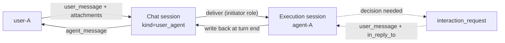
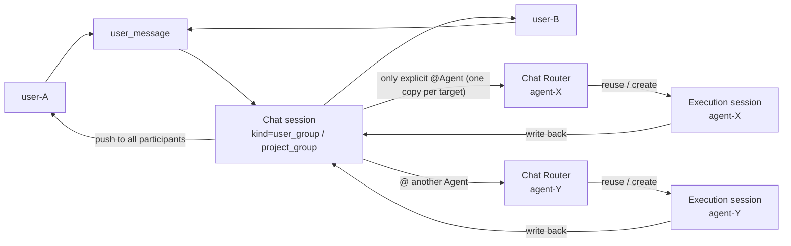
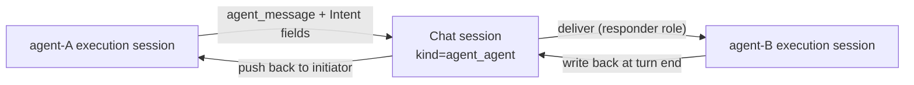
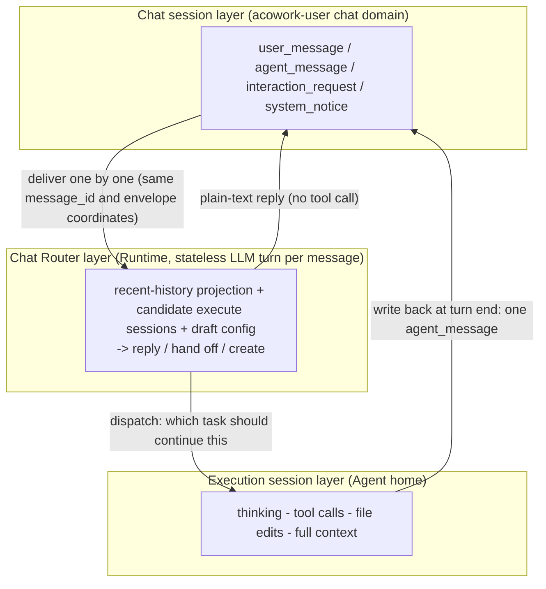
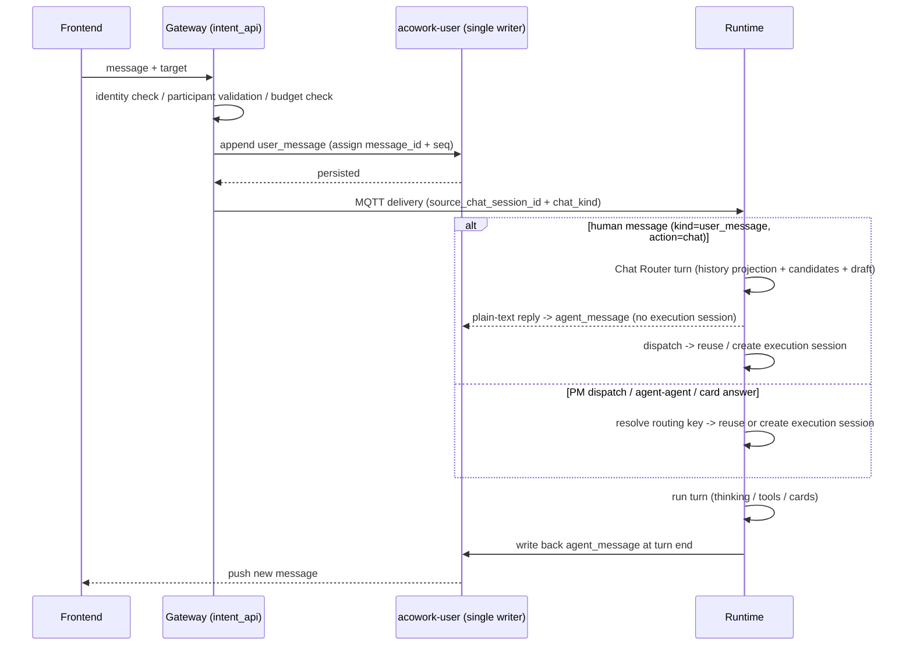
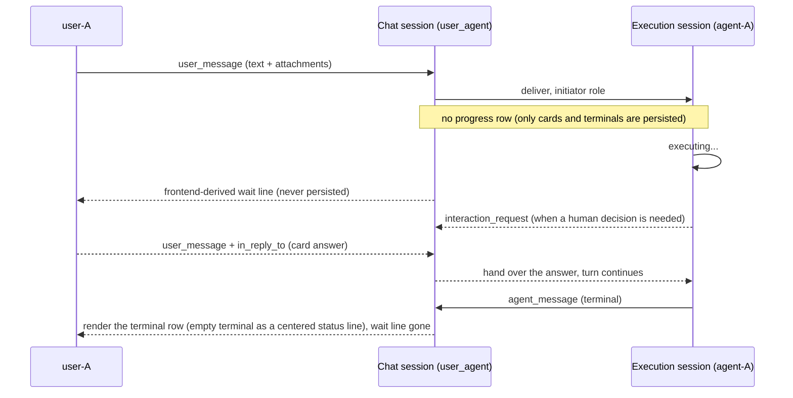
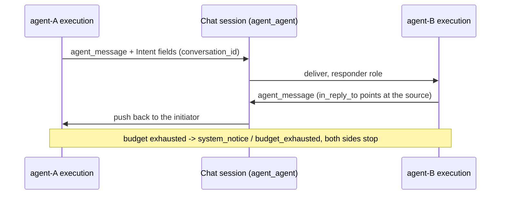
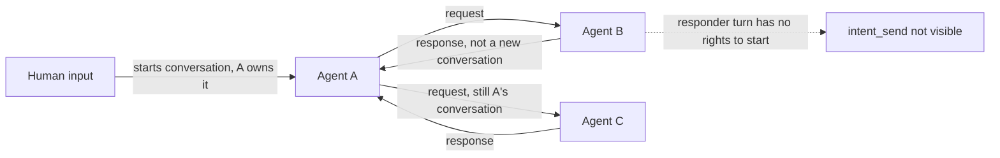
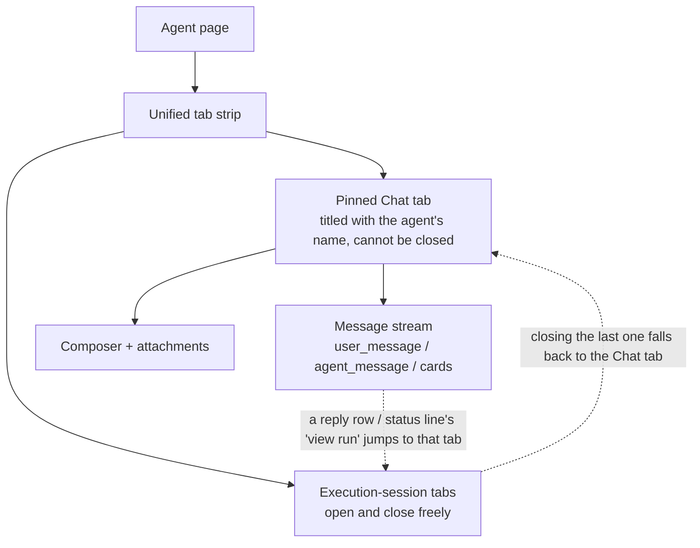

# Intent Messaging and Chat Session Design

> Status: design finalized (framework, requirements, data model, protocol, frontend, module boundaries confirmed; API and schema details deferred to implementation design)
> Version: v2.8 | Updated: 2026-10-25
>
> v2.8 is the **turn-origin vocabulary and PM dispatch chain revision** (ADR-102): (1) the Intent envelope's `kind` is fixed as a four-value vocabulary (`user_message` / `pm_task` / `request` / `response`, unknown and empty values falling back conservatively to `request`); the routing, rendering, role, and write-back decision points all consult the `TurnOrigin` policy table, abolishing the convention of guessing the scenario from `conversation_id` prefix matching; (2) the PM dispatch's wake-up playbook is split out of the user message body into the envelope field `assignment_brief`, injected by the Runtime into the execution session's system block — it appears on no chat surface and is never persisted with session history; the dispatch chat row carries only the human text plus `meta.task_id` (rendered as a task chip; `project_id` removed — the row already lives inside that project's group); (3) dispatch triggering converges on the PM-side scanner (`start_at` due + approval gate + dependency gate), the event hooks are withdrawn; delivery retries are idempotent via the persisted `dispatch_message_id` as generation identity (the chat row and the mailbox budget each charged once per generation), with backoff 60s→5m→15m→30m and abandonment after five failures. Item-by-item: §4.5 field table, §5.4.2, §5.4.5, §13.
>
> v2.7 removes the **execution-session rotation mechanism** (ADR-099 revision of 2026-10-24): T1 (idle gap) / T2 (task terminal state or a compaction having occurred) and the already-cancelled T3 (config conflict) are deleted from the design, together with successor / predecessor / handoff and the two configuration items. Rationale: an execute session is a conversation that can keep appending and keep interacting, and a session whose history was compacted can equally keep receiving dispatches; T1/T2 were artifacts of an era with no LLM doing the routing judgement, approximating "this task should end" from physical signals — once the semantic decision moved up to the Chat layer they carry no routing meaning at all, and the T2 handoff summary is precisely the pollution this design set out to eliminate. The converged rule: an execution session is **long-lived**, compaction thresholds are the only context hygiene, the JSONL hard limit is the only file-size bound, and opening a new session has exactly three explicit sources (router `dispatch(new)` / PM task terminal close / the user creating one by hand). Item-by-item: §2.4 glossary, §3.3 non-functional requirements, §3.4 decisions 3 / 4 / 23, §4.1, §4.5.2, §6.2.
>
> v2.6 is the **execution-view entry revision** (ADR-100 D12): in an execution session bound to a chat, the composer's send goes through `POST /api/intents/chat-message` carrying `for_execution_session` to name its own session — the Gateway appends one `user_message` under the **caller's own identity** (supplying the head that v2.5's write-back never stored), and the Runtime, on receiving a message with that pin, **skips the Chat Router** and delivers straight into the named session as a `SessionMessage::ChatMessage` (never an `Intent`), joining the same handling the execution surface always had, so slash skills, attachments and the native JSONL user row all survive with **zero capability regression**. The pin is a hint, not a gate (an unloaded target clears it and routes normally); the `message_id` is minted by the client and shared by the chat row, the execution session's JSONL row and the optimistic bubble. See decision 29, the §4.2 kind table and §5.5.5.
>
> v2.5 is the **routing reaction row and degradation landing revision** (ADR-100 D11 / ADR-099 D8 revision): (1) exactly one durable reaction row returns — `turn_routed`, written when the routing verdict resolves and rendered as an agent avatar + name + bubble ("Starting a new task: X" / "Continuing the earlier task: X"), restoring the immediate conversational feedback that v2.4 cancelled along with the progress rows (the interaction-feel invariant: a user message is always followed by an agent message); (2) a Chat-sourced human message the router degrades now **creates** a fresh execution session instead of reusing the intent_map mapping; (3) the avatar invariant is established: a centered terminal row does not fold the avatar off the agent bubble after it. Item-by-item: §2.2 decisions 20 / 28, the §4.2 kind table, §5.5.5.
>
> v2.1 revises the **user-Agent 1:1 chat form (the WeChat model)**: each (user, agent) pair has exactly one Chat session, shown as the **pinned tab** of the Agent page's tab strip (titled with the agent's name), never closable and never listed; execution sessions are ordinary tabs in the same strip that open and close freely and **coexist** with the Chat tab instead of being mutually exclusive. This revokes v2.0 §5.4.4 "press `+` to create a second session of the same pair" and §5.5.2 "Chat history button". Item-by-item details: §13 v2.1.
>
> v2.0 is a **structural reorganization**: content is regrouped as Overall Framework -> Requirements -> Data Model -> Communication Protocol -> Frontend Interaction -> Module Decomposition -> Security & Permissions -> Delivery Plan. New material: framework diagrams, glossary, non-functional requirements, data structures and public interfaces, per-form sequence diagrams, frontend interaction design, permission model, and an ADR consistency check. All section numbers changed; see §12 for the old-to-new map and the list of already-broken citations.
>
> Related designs: [06-communication.md](./06-communication.md), [12-tool-system.md](./12-tool-system.md), [15-conversation-persistence.md](./15-conversation-persistence.md), [21-pm-project-management.md](../zh/21-pm-project-management.md) (zh only)
> Related protocols: [MQTT](../../protocols/en/mqtt.md), [HTTP](../../protocols/en/http.md)

## 1. Overview


This document defines ACowork's Intent communication and Chat session design. It covers message semantics and storage boundaries for users, Agents, groups, and PM, as well as receiving-Agent session selection, conversation ownership, reply delivery, and history reads.

**An Intent is a message sent to an Agent, not a task-orchestration protocol.** To the receiving Agent, an Intent is equivalent to a user message that triggers Agent execution. The sender may be a human user, another Agent, or PM acting on behalf of the project owner. The receiving Agent processes the message in its own Agent execution session; execution details and reasoning remain in that Agent session. The request and reply are recorded as Intent messages in the shared Chat session.

**Core principle: a Chat session records communication; an Agent execution session records execution.** These are distinct session models with their own data formats, writers, lifecycles, and UI entry points. Intent routes a message in a Chat session as input to the target Agent execution session; the Agent's reply is then written back as a message to the source Chat session.

A project group chat is a special type of Chat session in the `acowork-user` chat domain. Future ordinary user groups, user-Agent group chats, and one-to-one Agent-Agent chats use the same chat model; they do not each require a separate session storage format for every participant combination.

**This revision closes a structural gap: user-Agent one-to-one chat had no Chat session.** The type table listed User-Agent chat, but the implementation path excluded it from Chat sessions (ordinary user-Agent conversation went only through an execution session plus Session history). As a result, "opening an Agent" and "opening a chat contact" were two different things, and the Agent page could not share one conversation UI with group chat. This version defines user-Agent single chat as the Agent page's default Chat session (§5.4.4): opening an Agent enters its **one and only** default conversation (exactly one per (user, agent) pair — like a WeChat chat whose title is the contact's name, v2.1), and a message typed there triggers that Agent's execution session. Group chat, single chat, and agent-agent chat are now three instances of one pattern.

## 2. Overall Framework

This chapter is the mental model for the whole design: three conversation forms, the two-layer session split, and the message flow between them. Later chapters expand the details; when you hit a specific rule, come back here to locate it in the whole.

### 2.1 The Three Forms

ACowork has exactly three conversation forms. All of them share one Chat session store, one message vocabulary, and one single-writer entry point. They differ only in **participant composition** and **trigger rules**.

#### 2.1.1 User-Agent (1:1)



Opening an Agent lands on that pair's one and only Chat session — the pinned tab titled with the agent's name (v2.1). Every human message triggers Agent processing; no @ is required.

#### 2.1.2 Group-Agent (group chat / project group chat)



Plain group messages are archived only and trigger nothing; @ performs directed delivery, and @ decides **which Agent to wake**, not which execution session receives the message. Each @-ed Agent runs its own Chat Router turn (ADR-099) and reuses or creates a session inside the candidates bound to this group (including this group's PM task sessions); different topics in the same group can therefore run in parallel across different execution sessions instead of all queuing into one `chat:{group}` chain. When several Agents are @-ed they execute independently and write back independently.

#### 2.1.3 Agent-Agent



There is no human participant, so no decision cards are produced; A-B traffic is **never** written into A's 1:1 session with a user.

### 2.2 The Two-Layer Session Model



The boundary invariant is stated in §2.3: a Chat session records the conversation, an execution session records the work, and the Chat Router decides which execution session a given message belongs to. The router is a **stateless turn** — it reads a projection of the Chat session, owns no persistent session, and writes no execution trace; its only outputs are a user-facing reply or a targeted dispatch decision.

### 2.4 Glossary

| Term | Definition | What it is not |
|---|---|---|
| **Chat session** | Persistent conversation record, owned by the `acowork-user` chat domain; all five kinds share one physical structure | Not an execution container; contains no thinking or tool calls |
| **Execution session** | An Agent's execution context: JSONL + meta inside the Agent home | Not a conversation record; never shared across Agents |
| **kind** | Participant-composition type of a Chat session: `user_user` / `user_group` / `project_group` / `user_agent` / `agent_agent` | Not a storage-layout difference |
| **Intent** | A set of addressing and reply **fields** on a message (`conversation_id`, `in_reply_to`, `agent_session_id`, `repo`, `status`) | Not a message kind; not a task orchestration protocol |
| **Initiator / Responder** | The role in one turn, decided by the **inbound message kind**, never declared by the model | Not a model-selectable attribute |
| **routing key** | Runtime-side logical execution mapping key: `task:` > `chat:` > `conv:` > `msg:` | Not a physical session id; it points at a long-lived execution session |
| **Chat Router** | Semantic routing of human messages: a stateless LLM turn per message that only replies or emits a `dispatch` decision (v2.2) | Not a resident session, not an executor, owns no context |
| **Candidate set** | The execution sessions a router may target, hard-filtered by chat binding and owner (≤ 10) | Not the full session list, not a permission grant |
| **Decision card** | `interaction_request`: a human decision is required; blocking | Not a progress display |
| **In-flight wait line** | A centered status line derived at runtime by the frontend, never persisted ("{{agent}} is working on it…"); non-blocking | Not a persisted event row, not a live mirror card |
| **Single writer** | The per-Chat-session serial queue; `seq` is monotonic, `message_id` is idempotent | Not a global serialization |
| **Visibility** | Read-permission scope: owner / Chat session participants / platform-wide | Not "group chat means Public" |

### 2.3 Session Boundary Invariants

| Dimension | Agent execution session | Chat session |
|---|---|---|
| Responsibility | Agent execution context | Message history among users and/or Agents |
| Authoritative storage | Corresponding Agent home / Runtime, existing format | `acowork-user` chat domain |
| Content | Existing execution history: user inputs, model outputs, reasoning, tool calls, etc. | Fixed types: `user_message` / `agent_message` / `interaction_request` / `system_notice`, including attachments |
| Writer | Corresponding Agent Runtime / existing session API | Single chat write entry point in `acowork-user` |
| Has an LLM | Yes (execution turn, full tool set) | Yes (Chat Router: stateless per message, read-only projection, tool set is `dispatch` only) |
| UI entry | Execution-session tabs in the Agent page's unified tab strip + Session history | Pinned Chat tab on the Agent page (one session per pair, v2.1) |

Never copy Chat-session messages into Agent reasoning or tool calls, and never write private Agent reasoning or tool calls into any Chat session. Chat messages and execution history are two distinct view domains (v2.1: the Chat view of a user-Agent 1:1 chat is the pinned tab; execution history is reached via Session history and execution tabs).

**v2.2: a Chat session becomes an LLM input, but never an LLM store.** With the Chat Router there really is an LLM reading this history, but it is a **projection rebuilt every turn**: no router session is persisted, no reasoning is written, no router-side context accumulates — the chat history stays the single source of truth (ADR-099). The division of labour above is therefore unchanged; what is new is only *who decides which execution session receives a message*: a semantic judgement instead of `routing_key` key arithmetic.

**Cards are the only exception, and they are a semantic exception rather than a hole.** An `interaction_request` does refer to an in-execution event (a pending tool call, a paused state), but what enters the Chat session is **the communication fact that someone must decide**, not that tool call itself: a card carries the summary needed to make the decision, not the tool payload, command line, internal error detail, or reasoning. The approval outcome lands back in the execution session and execution continues; the Chat session records only "who answered what, when" (section 7.4). The test is: **does this message's content matter to the other participants of the conversation?** If yes it belongs in the Chat session; if it is only the Agent's own progress it stays in the execution session.

Turn progress obeys the same test: intermediate state such as "dispatched" / "round open" **never enters the Chat session** — it exists only as one frontend-derived wait line in the current window; what enters the Chat session is the conversation itself, the terminal fact (why there was no reply), the one routing-reaction row `turn_routed` that answers "which task did this message go to" (v2.5), and the `agent_session_id` pointing at that turn — **how far it has got, and which tool it is calling, does not**; that is reached via a "view run" drill into the execution view (§5.5.5).

## 3. Requirements Analysis

### 3.1 Goals

1. Provide a unified source-conversation / reply-address model for user-user, user-Agent, Agent-Agent, PM dispatch, and @Agent in group chat.
2. Preserve the existing Agent session storage format and model; Intent only triggers the target Agent to process a user message in its execution session.
3. Store chat messages uniformly in the chat domain; chat history must never contain Agent reasoning, tool calls, or tool execution details.
4. Let the explicit business entry point determine whether a target Agent execution session is created or reused; do not require the sender or model to infer thread boundaries.
5. Treat `repo` (a code repository address) as an optional Intent field, injected by the system at dispatch time when the project has a repository. An authorized user may later modify session settings, including the working directory.
6. Write messages in each Chat session in order through a single authoritative backend write entry point, avoiding concurrent writes and ambiguous ordering.
7. Deliver results by push: the responder's reply is written back to the Chat session by the system and routed to the initiator, which never polls for a result.
8. A conversation has exactly one owner (the initiator), and the owner decides when it ends; a responder cannot start a new conversation.
9. `chat_history_read` progressively reads Chat-session messages that do not belong to the current conversation, using offset/count with a hard server-side read limit.
10. Agents do not speak in group chats by default; only an explicit @Agent sends an Intent and triggers processing.

### 3.2 Non-goals

- Introducing a complex task lifecycle, callback orchestration, or generic state machine for Intent.
- Turning Agent execution sessions into group-chat storage or injecting group messages into Agent execution-history files.
- Implicitly broadcasting ordinary chat messages to Agents in a group.
- Requiring an external ACP-compatible API; ACP is only a reference for capability descriptions, message structure, and related ideas.

### 3.3 Non-Functional Requirements

| Dimension | Requirement | Basis |
|---|---|---|
| **Cost** | Decision cards do not end the turn by default; only an absent human or a timeout yields `waiting` / `aborted`. The number of approvals in one task must not scale the number of turn replays | §5.5.4 |
| **Latency** | Immediate sender feedback comes from the frontend-derived wait line (it shows while `sending` is in flight, but only in a chat that has an Agent participant — a DM shows nothing), not from persisting anything | §5.5.5 |
| **Reliability** | Every turn that owes a write-back must write back, including crash recovery; no state may exist where a message is sent and nothing ever answers | §5.5.1 |
| **Idempotency** | `message_id` is mandatory for all kinds; a duplicate delivery produces no second row; `seq` is monotonic | §4.6 |
| **Reversibility** | No history migration; when the Chat surface is unreachable (no account / user-service failure) the Agent page falls back to the legacy exec-only form | §9.1 |
| **Security** | A session with no human to answer must not create anything that needs one; unauthorized reads of execution records return a hidden 404; cards must not become enumeration probes | §8 |
| **Observability** | Conversation budget, routing verdicts and write-back failures must be queryable, and a Gateway restart must not lose budget counts | §5.7 |
| **Boundary discipline** | The Gateway carries no business logic and never touches Node-local Agent homes directly; business facts are written by the Runtime through the single writer | §7.1 |

### 3.4 Decisions Reached

The following are settled conclusions from the discussion and are normative for this design.

1. **A Chat session stores fixed-type messages only.** No Agent reasoning, tool calls, or tool execution details.
2. **Chat messages and execution records are two independent view domains.** The Chat view of a user-Agent 1:1 chat is the Agent page's pinned tab (not entered through a list); execution records are reachable via Session history and execution tabs. Group Chat sessions are entered from business views such as the project (v2.1 revision; the former "two entry points" wording is obsolete).
3. **An Intent execution session does not rotate.** After the Intent execution ends and its result has been written back to the source Chat session, the mapping still points at the *same* execution session, and later messages keep iterating inside that same context; the Chat session is unchanged throughout. Opening a new execution session is a **semantic decision**, not a physical event: the router's `dispatch(new)` starts a new execution chain (no predecessor, no carry-over of an old topic summary) and a PM task reaching a terminal state closes the mapping (§2.1 / §4.1 / §6.2).
4. **An execution session has no code-level rotation point (v2.7 revision).** v2.2 kept T1 (idle gap) and T2 (a PM task reaching a terminal state, or a compaction having occurred) and removed T3 (create a successor whenever the mapped session's own config conflicts with `session_config`); all three are now deleted — neither configuration differences nor physical signals carry routing meaning any more. Opening a new execution session has exactly three explicit sources: the router's `dispatch(new)`, a PM task terminal close, and the user creating one by hand; context hygiene is left solely to the compaction thresholds (§4.1 / §4.5.2 / ADR-099 revision of 2026-10-24).
5. **Frontend interaction = semantic auto-assignment + explicit creation (v2.2).** Reuse-or-create is decided by the Chat Router by default; the user can still press the tab-bar `+` to create an execution session directly — the create request carries the current `chat_session_id` and the Runtime stamps the same binding pair as `dispatch(new)`. This deterministic escape hatch bypasses the router: after creation the UI switches to the exec view and messages go straight to that session. Automatically created sessions stay unbound (ADR-099 D9).
6. **The Agent page opens a user-Agent Chat session by default.** Opening an Agent enters its **one and only** Chat session (exactly one per (user, agent) pair, created idempotently on first open, v2.1); group chat, single chat, and agent-agent chat share one session model, message vocabulary, and write entry point. The Agent's execution sessions are not migrated and remain in Session history and execution tabs (§5.4.4).
7. **The Chat session is the durable conversation record; the in-flight turn is only a runtime state of the current window.** Frontend = history rendered from the Chat session + in-flight state derived from "the newest message has no terminal answer yet"; when the turn ends and the `agent_message` is persisted, the wait line gives way to the durable row.
8. **Conversation ownership follows a C/S model.** The initiator owns the conversation and is responsible for ending it; the responder has no right to open the next round; each conversation has a server-configurable request cap (default 6); when a third party's information is needed, the question goes back to the initiator rather than being relayed by the responder.
9. **Responder turns have a trimmed tool set.** `intent_send` and `ask_user_question` are absent from the responder turn's tool set, enforced by tool visibility rather than by a runtime error.
10. **`repo` is an optional field and is an address, not a path.** A normalized remote URL; injected server-side when the project has a repository, never filled in by the sender; the receiver reads and writes only inside its own registered / authorized working-directory set, with no automatic clone or worktree; malformed values and out-of-scope access are explicit rejection errors.
11. **Each chat session is written serially by one backend entry point.** Messages append in time order and `message_id` provides idempotent deduplication.
12. **The Intent vocabulary is unified into message kinds.** Four kinds: `user_message` / `agent_message` / `interaction_request` / `system_notice`; `conversation_id`, `in_reply_to`, `agent_session_id`, and `status` are demoted to fields and no longer exist as separate message kinds (§4.2).
13. **A human message is a `user_message`, not an Intent request.** If a user single-chat message were implemented with request semantics, the Runtime would treat that turn as a responder and strip `ask_user_question` / `intent_send`, which would break single chat outright. The transport may reuse the Intent delivery pipeline, but the inbound type must be human input and the role this turn must be initiator (§5.4.4 / §5.4.5).
14. **Write-back is independent of the turn's role.** Whenever the inbound message carries `source_chat_session_id`, the turn must write back an `agent_message` when it ends — earlier versions wrote back only at the end of responder turns, which would leave single-chat conversations permanently empty (§5.5.1).
15. **Cards are unified in type and branched in semantics.** `interaction_request` covers ask-question, permission approval, pause-resume, retry, and every other thing needing a human decision; persistence represents "open" as "no `in_reply_to` points at it". But whether the turn is held or ended is decided per card type and cost, and pure agent-agent sessions create nothing that requires a human (§5.5.4 / §5.4.5).
16. **The Chat session is the Agent page's pinned tab and coexists with execution-session tabs.** Opening an Agent always lands on the Chat tab, which is never closable or deletable; execution sessions are ordinary tabs in the same strip that open and close freely — closing the last one simply falls back to the Chat tab, and switching surfaces destroys neither side. `+` and Session history are execution-tab entry points — background does not mean hidden (§5.4.4 / §6.1, v2.1 revision).

17. **chat is conversation history; turn progress does not enter history (v2.4 revision, superseding both v2.1's "execution status card" and v2.3's "progress event rows").** What is stored is the conversation and the terminal facts (`agent_message` / `interaction_request` / channel receipts); intermediate state such as "dispatched" / "round open" is **neither stored in the Chat session nor projected at read time on the chat side** — it exists only as one frontend-derived wait line in the current window. v2.1's live mirror card was a second truth layered on the durable event log, and the two could never stay aligned (the visibility gap between dispatch and reply; the card fighting a still-running pending that already started a new round on stop); v2.3's progress rows instead wrote runtime facts into history, which are worth nothing to whoever reads the transcript months later and only drown the conversation. Both are deleted (§5.5.5). Storing state would also mean dozens of rewrites inside one turn, breaking §4.6's append-only single writer.

18. **Turn completion is decided by the chat terminal row, not by `Idle`.** The chat side does not read `Idle` at all; the wait line disappears once an answering terminal `agent_message` (or an unclosed decision card) appears — "has it been answered" has exactly one durable test (§5.5.5).

19. **An execution session triggered by a group chat is readable by every participant of that group.** The test derives from routing key `chat:{chat_session_id}`, with no separate ACL; **`SessionVisibility::Public` must not be reused**, since it is platform-wide and would expose a group's execution history to non-members. agent-agent execution records stay closed to humans outside that conversation (§5.5.5).

20. **Nobody writes intermediate state — but one durable reaction row answers the user (v2.5 revision).** v2.3's `turn_dispatched` / `turn_started` pointer rows are retired: the Runtime writes the conversation and the terminals (§5.5.1), and the running wait feedback comes from the frontend-derived wait line. But v2.4 also cancelled the immediate conversational feedback, and that left a more basic hole: between the user's message and the reply (possibly hours) no agent message appeared at all. A chat's feel of exchange is **call and response** — a user message must be followed by an agent avatar + name + bubble. So v2.5 restores exactly one durable reaction row, `turn_routed` ("Starting a new task: X" / "Continuing the earlier task: X"), written when the routing verdict resolves (ADR-100 D11): it answers "where did this message go" — a fact of the conversation, not progress. Single chat (1:1), a human group-chat @, and a PM task dispatch all take the same routing and share one frontend renderer (§5.5.5).

21. **No history migration.** Existing execution sessions stay in Session history; only new conversations create Chat sessions. The benefit is that the step is fully rollbackable: when the Chat surface is unreachable (no account, user-service failure), the Agent page falls back wholesale to the pre-migration exec form (§6.1).

22. **The chat layer gains an LLM semantic router (v2.2, ADR-099).** Every human message (1:1, group-chat @Agent) first passes through the target Agent's Chat Router: one stateless LLM turn whose only tool is `dispatch`, producing "reply / hand off to an existing execution session / create an execution session". PM dispatch, agent-agent traffic and card answers never pass through the router.

23. **The router owns no session.** No hidden resident session is created; the context is rebuilt every turn from chat history + candidate list + draft config. Chat history stays the single source of truth, avoiding forked histories and extra session-lifecycle maintenance.

24. **Candidate sets are hard-filtered by chat binding and owner.** 1:1 lists only the current chat mapping, that chat's historical predecessors, and sessions owned by the same user with no chat binding; a group chat lists only sessions whose `meta.chat_session_id` points at that group (PM task sessions included). At most 10 candidates, ordered by last activity, exposing only title / status / activity time / model / workspace / origin — never execution bodies (ADR-096).

25. **In a group chat, @ selects the agent, not the execution session (v2.2).** Different topics in the same group can run in parallel across sessions; the group router creates no decision cards, clarifies in plain text only, and must not restate private chats or other chats' session titles (§5.3.1).

26. **PM dispatch keeps a deterministic mapping.** `conversation_id = task:{project}:{task}` is the task identity and lifecycle boundary, so it bypasses the router; a task session is bound to the project group chat at creation (`chat_session_id` + Members visibility) so it becomes a candidate there, and `close_intent_context` records it in the terminal list to be excluded from candidates — a terminal task is never "revived" (§5.4.2).

27. **The chat prompt is separate from the execute system prompt (v2.2).** Chat prompt = built-in base (not overridable) + optional `prompts/chat.md` persona (falling back to manifest metadata) + a 1:1 / group scenario section; it loads neither `system.md`, `constraints.md`, other prompts, skills, the workspace prompt file, nor retrieved memory. `chat.md` joins the ADR-063 override list and is therefore excluded from execute-prompt assembly; 4 KB cap, persona section only (design 29).

28. **Router failure degrades; availability never regresses (v2.5 revises where the degradation lands).** On timeout (default 8 s), provider error, or two consecutive invalid tool arguments, the turn degrades; **a Chat-sourced human message now CREATES a fresh execution session** (`chat_dispatch(Target::New)`, bound to the same chat, mapping re-pointed) instead of reusing the `routing_key` mapping — a degradation means no semantic verdict, and the mapping is not a verdict either; guessing an unrelated old task with a possibly-new-topic message is worse than starting clean. The deterministic reuse for `PassThrough` (PM / agent-agent / response / kill-switch-off) is unchanged — there the `conversation_id` / `msg:` key IS the task identity (ADR-099 D8 revision). **No `system_notice` is written for the fallback** (legacy `router_fallback` rows are hidden at render time), but a degraded create lands the same `turn_routed` reaction row as a normal dispatch (decision 20); the message is already persisted, so a routing failure never loses it (§5.7). Degradation is not the only failure surface that needs bounding: every Gateway HTTP call on the router path is bounded (history read `chat_router.timeout_ms`, write-back 15 s, attachment pull 60 s), and a router turn runs on that chat's drain task rather than on the MQTT inbound loop, so a stalled Gateway or a slow model can only slow down the assignment of that one chat — it cannot stop the Agent's receive side, `Stop` included. With `chat_router.enabled=false` nothing is queued and a Chat message takes the deterministic route inline (ADR-099 D8).

29. **The execution view's composer sends through the chat entry, with a direct pin naming its session (v2.6).** In an execution session bound to a chat, the composer posts to `POST /api/intents/chat-message` carrying `for_execution_session`: the Gateway appends one `user_message` under the **caller's own identity** (supplying the head that v2.5's write-back never stored — rather than having the Runtime append a row on the user's behalf, which is rejected because the identity at a write entry must be the initiator's), and the Runtime, receiving that pin, **skips the Chat Router** and delivers straight into the named session as a `SessionMessage::ChatMessage` (never an `Intent` — it has neither the `active_skill` nor the `content_parts` arm; `attached_items` exists on both, see below), joining the execution surface's own handling **item for item**: a slash skill is still resolved by the Runtime against the `SkillRegistry` (a command is never trusted from the client), attachments still land in that session's `files/` per ADR-046, and the JSONL still records a native user row — **zero capability regression**. The pin is a hint, not a gate: an unloaded target clears the hint and routes normally (the price is one routing call, never the message), and a targeted send with no content at all is settled before the session is even looked up, so it neither wakes a session nor burns a routing call. The `message_id` is minted by the client and shared by the chat row, the execution session's JSONL row and the optimistic bubble, so the optimistic insert and the reconciliation stay untouched. Attachments are **not carried across systems**: the chat row holds display names in `meta.exec_attachments` only (the ADR-009 §5 red line — a node-local path 5xxes once Gateway and Node sit on different hosts, and an unopenable reference is worse than none); that field must be declared on the chat store's `IntentMeta` (an undeclared meta key is silently dropped by serde — the symptom being a projection that succeeds while the disk has no such entry), and the store's "a `user_message` needs content" rule counts the labels as content; both clients paint them as muted, non-interactive pills, so a turn that was a file and no words never renders as a blank bubble. `command` is honored only alongside a pin (without one it is emptied, not rejected, since a routed turn is consumed as an Intent where there is no `active_skill` arm), while `attached_items` is honored on both paths — the Intent gained that arm, so a workspace reference picked with "Add to Chat" on the Chat surface reaches whichever execution session takes the turn through the same ADR-046 path one picked on the execution surface does (a reference is a node-local path read live by the agent, not a copy of the file). Both are bounded alongside a pin: `command` ≤ 128 characters (a skill *name*, not instructions), `attached_items` ≤ 32 entries and ≤ 32 KB serialized. With no binding, or in local mode (no account — chat is an identity channel), the composer keeps `POST /sessions/{sid}/messages`, and a pinned turn writes no `turn_routed` (it was never routed, so there is no destination to announce). When the bound chat is a **project group** (which is exactly what a PM task's session is bound to — decision 26), the group holds more than one agent and "who answers this" cannot be derived from the chat, so the request additionally carries `pinned_agent`, naming the instance that owns the execution session; it is honored only as a **claim to be checked** — the instance must be an Agent participant of this very chat, or the send is a 403 and no row is written, because this turn's answer has to be filed in this chat — and an unpinned group send still goes to §5.3's archive entry. The other half of ownership is checked by the **receiving Runtime**: the chat the pinned session is bound to must equal the chat this send came from, and a mismatch clears the hint the same way — one agent instance serves many chats, and session ids travel on rows every group member can read, so without that check anyone could inject text, a per-turn skill and node-local attachment paths into somebody else's running task. Now that the head row is written every time, the tail must be written on **every way a turn can end** (finished answer / stopped / an attachment that could not be read / an agent loop that returned an error → `completed` / `aborted` / `failed`, and a `failed` body is the human-readable line alone), otherwise the round reads "in progress" in chat forever. The terminal row also closes the mailbox: a pinned turn has no Intent write-back to close it, so `chat-append` calls `mark_answered` when `kind=agent_message` carries a non-empty `meta.in_reply_to`, and only **after the row is durable** (the same timing as §7.1's close); without that step a round that was answered perfectly still gets a `fallback-` `failed` receipt appended to the same chat once the deadline passes. Both the content gate and the ADR-046 union check on `attached_items` run **after** pin normalization and before delivery: judging the raw request would disguise a request-shape error as a 503 — and this turn would not even get its head row. The binding is read only from the session row the Runtime exposes: the frontend never invents, caches, or rewrites it (§5.5.5).

### 3.5 Defects in the Current Implementation

Ordered by severity; these feed the open questions in §10.

| Level | Defect | Location |
|---|---|---|
| **P0** | `SessionKind::UserAgent` is rejected by the participant check at the create entry point; 1:1 Chat sessions are unreachable | [chat_sessions_api.rs](../../../core/acowork-user/src/http/chat_sessions_api.rs) |
| **P0** | The Gateway client hard-codes the pair session kind to `agent_agent` (**the storage layer already takes a `kind` parameter; not blocking**) | [chat_client.rs:68](../../../core/acowork-gateway/src/intent/chat_client.rs#L68) |
| **P0** | The Agent page queries Chat history with the Agent id as participant; non-admins always get 403 (**the auth rule itself is correct; the bug is the frontend argument — do not fix it by loosening auth**. v2.1: the Chat history button is revoked; the defect disappears with the entry point) | ChatHistoryDropdown (deleted) |
| **P1** | Write-back only happens at the end of a responder turn, so a 1:1 (initiator role) never writes back and the session stays empty | §5.5.1 |
| **P1** | `user_message` does not require `message_id`, yet `in_reply_to` must point at one, so a card answer has nothing to reference | §4.2 |
| **P1** | `participants` carries no identity type, so an Agent can impersonate a human and write `user_message` | §8.1 |
| **P1** | Code still uses the old three-kind classification and the old status enum; `waiting` is missing | [chat_sessions.rs](../../../core/acowork-user/src/chat_sessions.rs) |
| **P2** | `list_for` scans the whole directory; a per-participant index is missing | §4.6 |
| **P2** | Reinstalling an Agent yields a new instance id and orphans its old sessions | §10.19 |

> Three rows of this table were corrected after re-checking against the code. Gap alignment, delivery slices and acceptance criteria: [`docs/plan/zh/intent-chat-session-unification-plan.md`](../../plan/zh/intent-chat-session-unification-plan.md) (Chinese only; `docs/plan/` has no en set).

## 4. Data Model

### 4.1 Agent Execution Session

This is the existing Agent session model, preserving the context and runtime history needed for one Agent's execution, including ordinary user inputs, model outputs, reasoning, tool calls, and other existing execution history. It continues to be managed by the corresponding Agent Runtime in that Agent's home using the current format.

An execution session may be triggered by a user message or an Intent. Regardless of the trigger, the receiving Agent works in its own execution session. The Intent sender, reply address, and chat history do not merge the sender Agent's execution context with the recipient's.

**Compatibility rule: preserve the existing Agent session storage format and model.** The new chat model refers to Agent execution sessions by association IDs; it does not turn a Chat session into a new format for Agent execution records.

#### Context Compaction for Intent Execution Sessions

Intent-driven execution sessions reuse the existing Agent-session context-compaction mechanism; Intent does not introduce a separate token-compaction design. The first release keeps the current thresholds: 70% context usage logs a warning only, 80% triggers LLM compaction, and 95% triggers the `emergency_trim` safety net. The denominator is the effective context window for that session, following the existing per-session override rules. Compaction only controls the context sent to the model; it does not shrink the complete JSONL history file, and an execution session is never switched because of compaction — it is a long-lived conversation (see below).

**An execution session does not rotate (v2.7 revision).** A logical mapping (for example, a group chat to an Agent) points at one **long-lived** physical execution session: after the Intent execution ends and its result has been written back to the source Chat session, the mapping still points at the same session, and later messages keep appending and iterating inside the same context. Since v2.1 a user's 1:1 chat on the Agent page also goes through the `chat:{chat_session_id}` mapping, so it falls under the same policy; sessions with no Chat binding (automatic creates and legacy rows) keep the ordinary lifecycle. The complete history of earlier sessions stays in the Agent home for the existing Session history UI; never write execution details into the Chat session.

The three-state physical rotation of v2.2 and earlier (T1 idle gap / T2 task terminal state or a compaction having occurred / T3 config conflict), together with successor, predecessor, handoff, and the `intent_idle_rotate_hours` / `intent_handoff_max_tokens` configuration surface, has been deleted in full (ADR-099 revision of 2026-10-24):

- T1/T2 were mechanisms from the era before an LLM did the routing, approximating "this task should end" from physical signals. Once the semantic decision moved up to the Chat Router, an idle gap and a compaction event carry no routing meaning at all;
- the T2 handoff summary (injecting a distilled summary of the old topic into a successor) directly contradicts the goal that a new task must not be polluted by an old summary;
- every turn re-reads the complete JSONL (ADR-032), so **a session that has been compacted can keep receiving dispatches and keep iterating** — compaction is one of its ordinary lifecycle events, not a reason to switch windows. Multiple compactions inside a single execution (a small context window or a long-running task) are normal, and the session is not switched mid-run either.

The converged rule has exactly one clause: **opening a new execution session must be an explicit decision**, from only three sources —

| Source | Test | Defined in |
|---|---|---|
| router `dispatch(target="new")` | the model judges that this message starts new work | §3.4 decisions 22–23 / ADR-099 D3 |
| A PM task reaches a terminal state | `Done` / `Rejected` / `Cancelled` → close that task's execution context: close the session, drop the mapping, record it in the terminal list (candidate exclusion) | §6.2 |
| The user creates one with the tab-bar `+` | an explicit click, bypassing the router; stamps the same binding pair as `dispatch(new)` | ADR-099 D9 |

Context hygiene is left solely to the compaction thresholds of this section, and file size to the existing JSONL hard limit. **Retired**: the T1/T2/T3 trigger table, successor/handoff generation and injection, and any new writes of the `rotation_handoff` marker.

**`dispatch(new)` starts a new execution chain; it is not a context switch.** It has no predecessor and carries no old topic summary: the new session's only context is the owning Chat session's conversation record. That distinction is precisely what guarantees a new task is free of old summaries — with rotation deleted, the path that used to carry them no longer exists.

Why there is still no execution-count limit: a count is not a measurable physical property, so no value is defensible; and the problem a count would address — context polluted by unrelated Intents — is already covered directly by the compaction threshold, since unrelated content accumulating far enough necessarily triggers compaction. File and disk size are protected by the existing JSONL hard limit. Both boundaries therefore close, leaving no path of unbounded growth.

A PM task reaching a terminal state is a **business boundary**, not a context-switching trick: it closes that task's execution context (close the session, drop the `conv:task:` mapping, record it in the terminal list) and a later new task uses a new mapping. A 1:1 or group `chat:` mapping describes a conversation, not a completed task, so it is never closed because of elapsed time or a compaction — a new chain is created only when the router decides a message "starts new work".

#### Context of a Newly Created Execution Session

The execution chains created by `dispatch(target="new")` and by the user pressing `+` carry no old topic summary: a new session's context is the owning Chat session's conversation record (injected through the three-block orchestration of design 29) plus the Agent's own system prompt / skills.

v2.2's "Handoff context tiers" table (T1 idle gap carrying only open items and key decisions with a 500-token ceiling; the T2 compaction test carrying current goal / key decisions / open items and reference IDs, targeting 1,500 tokens, configurable 500–4,000) is retired together with rotation: the `intent_handoff_max_tokens` configuration item, the "Intent session rotation" card on the Agent settings page, and the `handoff_note` channel are all deleted. Historical JSONL rows tagged `rotation_handoff` are neither migrated nor cleaned; they are still filtered out of the chat rendering as "context for the model rather than a user-visible message".

#### Storage Boundary

Keep the existing JSONL hard limit of 100,000 lines or 50 MiB, whichever comes first, as the absolute safety limit; no separate proactive-rotation JSONL threshold is introduced. An execution session is long-lived: compaction controls the part sent to the model while this hard limit backstops the file size, so a normal session never approaches it. If an unusually large single execution nears the hard limit before a safe checkpoint, Runtime must refuse further unbounded appends and pause at a recoverable checkpoint with state saved; when it cannot pause safely it must fail explicitly and preserve the written history rather than silently discarding it or crossing the hard limit. (v2.7: the former "…and rotate" clause is deleted — the successor-session mechanism no longer exists, so exceeding the limit means stopping appends, not switching windows.)

#### Frontend Configuration Boundaries (Session Settings Card on the Agent Settings Panel)

**This card exposes no Intent rotation settings (v2.7 revision).** v2.2 exposed two — the idle-gap rotation threshold (default 24 hours, allowed 1–72 hours, `0` disabling T1) and the handoff context target ceiling (default 1,500 tokens, allowed 500–4,000) — and both are deleted with the rotation mechanism: `AgentConfig.intent_idle_rotate_hours` / `intent_handoff_max_tokens`, their `ConfigField` variants and `PUT /config` request-body fields, the deployment-level override `ACOWORK_INTENT_IDLE_ROTATE_HOURS`, the frontend fields, and the five locale files no longer exist. The rest of the card is unchanged.

The following remain **not exposed** to ordinary users: compaction thresholds 70% / 80% / 95% (keep existing Runtime behavior and configuration capabilities; do not create parallel Intent-specific controls) and the JSONL hard limit of 100,000 lines / 50 MiB (absolute safety limit; deployment-level advanced configuration may adjust it during implementation, but hard-limit semantics must remain).

Per-session model / provider / reasoning / workspace suggestions are carried by the `session_config` draft produced at routing time (§4.5.2): applied as a seed only at the moment a session is created, and **not applied at all** when an already-mapped session is reused — the initial value serves the session being created (same as ADR-099's "Revision (2026-10-28)"); a configuration difference is no longer a trigger for creating anything or switching any window.

Parameter changes require authorization and an audit record; they do not rewrite existing history. An in-flight execution uses the configuration snapshot resolved at its start. Missing values use the defaults. Ordinary users may only adjust Agent-level parameters within their authorization and cannot modify session files in another Agent's home.

#### Concurrency and Failure Recovery

Mapping writes are serialized at a single point: `route_intent_session` / `chat_dispatch` resolve and update the mapping inside the `SessionManager` lock (the candidate list's directory scan is done outside it), and concurrent Intents under one key are handled serially in inbound order, so no path lets two executors rewrite one mapping at once. The formerly specified successor crash recovery (pre-allocated id + `pending_successor` + `rekey`) is deleted along with rotation: there is no longer a mid-run "switch the window" intermediate state that would need replaying.

The queue invariant (ADR-099 D2) still holds: exactly one drain task per chat, FIFO, with messages arriving while the drainer is finishing never left stranded; degradation (`PassThrough` / `Fallback`) is finalised in place on that drain task, with no re-queueing and no message loss.

### 4.2 Chat Session Message Vocabulary

A Chat session is a persistent conversation for user chat and Agent-to-Agent messages, uniformly owned and managed by the `acowork-user` chat domain. Its message types are a fixed communication set, not private Agent runtime traces. **The vocabulary is divided by "who is speaking and what this utterance asks for", not by transport mechanism:**

| kind | Writer | Semantics | Required constraints |
|---|---|---|---|
| `user_message` | Human participant | A human utterance; with `mentions` it is an @Agent; with `in_reply_to` it is **an answer to a card**; a send composed in the execution view lands here too (v2.6, ADR-100 D12), its `meta.exec_attachments` carrying attachment **display names** only — never a path or a documentId, painted as a muted non-clickable pill | `body`, `attachments` or `meta.exec_attachments` non-empty; `message_id` required |
| `agent_message` | Agent participant | An Agent speaking to a human, to a group, or to another Agent. **Every message an Agent puts in a Chat session is this kind** | `message_id` required; `in_reply_to` required when replying |
| `interaction_request` | Agent or system | A card asking a participant to decide: a question, tool approval, pause-resume, retry | `message_id` required; must carry an `interaction` payload and target participants |
| `system_notice` | System | Channel receipts, split by `notice_type`: `delivery_failed`, `budget_exhausted`, `truncated`, `unavailable` (legacy `turn_dispatched` / `turn_started` / `router_fallback` remain readable for compatibility only, and are hidden at render time); `turn_routed` is the routing reaction row (v2.5, ADR-100 D11) — the kind is system, but it **renders as an attributed agent bubble** (avatar + name + "Starting a new task / Continuing the earlier task"), its meta carries `in_reply_to` / `agent_session_id` / `turn_mode`, and the body stays empty | `message_id` required |

**Intent is no longer a message kind.** `intent_request` / `intent_response` are removed as kinds and demoted to **fields** on an `agent_message` (or a `user_message`): `conversation_id`, `in_reply_to`, `agent_session_id`, `repo`, `status`. Whether a message is an Intent reply is derived from the presence of `in_reply_to`; no new discriminator field is added.

The reason for collapsing this way: an Agent speaking to a human, to a group, or to another Agent is one thing in the chat domain — "an Agent sent a message". Typing by transport mechanism would make the same utterance land as different rows depending on where the turn started, force four rendering branches in the frontend, and let a `user_message` and an `intent_request` carrying the same text be written twice into one session.

Concrete wire/schema types will be determined during protocol implementation. Agent reasoning, hidden chain-of-thought, tool calls, tool results, and execution intermediate events must not be written as chat messages. Any necessary delivery or presentation status belongs in message metadata or a separate event; it must not expand into arbitrary Agent execution events.

#### 4.2.1 Attachments

`user_message` and `agent_message` support attachments: Add to Chat, images, documents, workspace references. Attachments follow the rules already established for user-user chat (ADR-076 decision 9, ADR-092):

- blob and metadata sidecar are separate files, and **the blob is written first**: a crash between the two writes leaves an orphan blob that nothing references, rather than metadata pointing at nothing;
- the on-disk name is an opaque server-generated id, **not** the uploaded filename - interpolating user strings into paths invites both traversal and collision;
- size limits are per mime class (image / document); filename length is a display constraint and never enters the path;
- attachments belong to the Chat session directory, not to an individual participant: a file is addressed jointly by that conversation's participants, and another namespace layer would add lookup cost without adding a boundary.

What the Agent side receives is still a resolved reference; the Runtime does not read Chat session directories. The attachment read path is the same as the message body: through the trusted service that owns the single write entry point. Delivery carrier: **the MQTT Intent envelope carries attachment ids only - file bytes never ride MQTT messages**. At turn start the Runtime pulls each blob over node-authenticated HTTP (Gateway forwarding the user service's internal streaming endpoint) and materializes it into the agent-home `files/` dir; the user service verifies the durable `user_message` row is addressed to that target and pins that id - the row is the authorization. A failed pull degrades to "this attachment is invisible this turn"; the turn still runs.

#### 4.2.2 Cards and runtime status lines

Only one durable row in the Chat session points at an event inside an execution session:

- **Decision cards** (`interaction_request`): interrupts that need a human decision — `ask_user_question`, tool approval, iteration-cap / loop-detection pause, failure retry — answered in place in the stream.

Turn progress is **not** a durable row: it is painted in the current window as one frontend-derived wait line, never persisted and never entering history (§5.5.5). These two rules let single chat, group chat, and PM task dispatch share one representation of "an Agent is asking / is working" and one renderer. Full rules in §5.5.4 and §5.5.5.

**These rows persist a pointer and a fact, never a state.** A decision card stores the communication fact "a human must decide"; in-flight / thinking / awaiting-tool / paused **live status is never stored in the Chat session and never mirrored on the chat side** — it is seen only in the execution view, reached from the reply row's / status line's "view run" drill (§5.5.5). Storing state would require dozens of rewrites inside a single turn, which either breaks §4.6's append-only single writer or floods the conversation history with execution detail.

#### 4.2.3 One Model, Different Participants

All chats use the same Chat session and message-log model. The relationship is expressed through chat type and participants, covering at least:

| Chat session type | Participants / purpose | Message content |
|---|---|---|
| User-user | One-to-one chat created by users | User messages |
| User group | General group chat created by users | User messages; Intent messages only when an Agent is explicitly mentioned |
| Project group | Special group chat created with a project | User messages, Intent requests, Intent responses |
| User-Agent chat | Chat-style conversation between a user and an Agent | User messages, Intent requests / responses; not an Agent execution session |
| Agent-Agent chat | One-to-one chat between two Agents | `agent_message` (Intent fields) and `system_notice` only; no human participant, so no cards (§5.5.4) |
| **User-Agent chat** | **One-to-one chat between a user and a single Agent — the Agent page's default conversation surface** (§5.4.4) | `user_message`, `agent_message`, `interaction_request`, `system_notice` |

These are logical types. **The physical schema is identical for all of them**: the same directory layout, the same `session.json`, the same `messages.jsonl`, the same single write entry point; the `kind` field is the only difference. New participant types can extend the same chat model without changing the boundary that chats store messages and execution details remain in Agent sessions.

The difference between one-to-one and group conversations is in **behaviour, not structure**:

| Behaviour | One-to-one (user-Agent / Agent-Agent / user-user) | Group chat |
|---|---|---|
| Trigger | Every `user_message` is delivered to the Agent participant | Delivered only on an explicit @Agent (§5.3.1) |
| Target resolution | The single Agent participant in the session; no @ needed | The client resolves @ into an explicit list of instance ids |
| Who can answer a card | The human participants of the session | The author of the human message that triggered the turn (§5.5.4) |

The `session_id` of a `user_agent` session is a server-generated UUID and is **never derived by concatenating participant ids**. Participants carry agent instance ids (ADR-073), and reinstalling an Agent produces a new instance; if session identity were derived from membership, a reinstall would lose the history. Session identity must be independent of member identity.

### 4.3 Storage Ownership

`acowork-user` is the authoritative owner and writer for user chats and Chat sessions. Although PM creates and associates a project group chat, its conversation history is managed by the `acowork-user` chat domain rather than PM task files or any Agent home.

Remote or local Runtime processes, PM, and Desktop operate on chat history through trusted service interfaces. A Runtime must not directly access or modify another Agent home's session files. PM holds business associations such as `project_id` / `task_id`; the service validates them and maps them to the corresponding Chat session.

### 4.4 Project Group Chat Lifecycle

- Every project must create one associated project group chat at creation, and a project can have only one such group chat.
- The project group chat cannot be deleted independently. The association between project lifecycle and group-chat archive, deletion, and retention is **out of scope for this phase** and will be decided separately.
- `project_id` is stably associated with the project group chat; PM dispatches and Agent replies use it as the source / reply address.

### 4.5 The Intent Field Model

**An Intent is a set of fields on a message, not a message kind** (§4.2). It is the addressing, processing, and reply context carried by an `agent_message` (or by a `user_message` when a human starts the turn); what the receiver sees is still "a message sent to me". The table describes field semantics; it does not imply that a separate Intent record exists:

| Field semantics | Requirement | Description |
|---|---|---|
| `message_id` | **Required for all kinds** | Unique message identifier for correlation, deduplication, reply targeting, and diagnostics. Assigned by the single write entry point; a client may submit one and the server may override it (§4.6). A human `user_message` must have an id too, or the Agent's reply has nothing to point at. |
| `source` | Required | Sender and sender type; identity is confirmed by a trusted service, not just client self-assertion. |
| `source_chat_session_id` | Required | Source Chat session and reply address. |
| `source_agent_session_id` | Required for Agent senders | Execution session ID from which the Agent sent this Intent. Empty for user / PM senders. |
| `target_agent_instance_id` | Required | Exact target Agent Runtime instance, following the instance-ID addressing contract. |
| `body` / `attachments` | At least one non-empty | Message content for the receiving Agent; a text-only, attachment-only, or mixed message is one `user_message` row, never two |
| `repo` | Optional | Address of the code repository this work concerns (normalized remote URL). When the project has a repository, the system injects it at dispatch time; the sender does not name a concrete working directory on the target Agent. |
| `assignment_brief` | `pm_task` only | The PM dispatch wake-up playbook (the claim → work → submit contract). A **high-trust envelope field**: only the system producer (the task-dispatch pipeline) may fill it. The Runtime adopts it only when the turn origin is `pm_task`, injecting it into the execution session's system block (Block A) — never into the rendered user message, never onto any Chat surface, never persisted with session history. When agent-sourced params (peer `intent_send` / card answers) carry the key, the Gateway strips it at the edge and the Runtime gates it twice more (extraction and consumption) — the ADR-102 trust boundary: high-trust envelope fields recognize only the system producer. |
| `session_config` | Optional | **Suggested initial values** for model / provider / reasoning-effort / working directory; applied as a seed at the moment an execution session is created (when an already-mapped session is reused they are not applied at all, per §4.5.2 and ADR-099's Revision of 2026-10-28); omitted fields use target Agent defaults. **Excludes skills** — skills are loaded automatically by the model, are not a session-level initial value, and the chat-message channel has no per-message skill field. |
| `conversation_id` | Required for requests | Conversation identifier, generated by the initiator on its first request and reused by every later request / response in that conversation. The system uses it to count requests (§5.4.5). |
| `in_reply_to` | Required when answering | `message_id` of the message or card being answered. **Generated by the system, not a model-supplied parameter** — its presence is what marks a message as a reply (§5.4.5 R2). A human answering a card uses this same field (§5.5.4). |
| `target_agent_session_id` | Associated after routing | Target Agent execution session that actually processes the Intent. |

Field names and the wire schema will be determined during protocol implementation; this table defines semantics, not the final serialization contract.

**The delivery envelope additionally carries `chat_kind` (`user_agent` / `user_group` / `project_group`), filled in by the Gateway from the source Chat session's `kind`.** It is not part of the message body and is never persisted in the Chat session; it exists only so the Runtime can tell 1:1 from group routing: when a card has expired and the message falls through as an ordinary message, `in_reply_to` is non-empty, and only `chat_kind` identifies it as a group chat rather than a 1:1 chat (§5.1, ADR-099).

#### 4.5.1 The `repo` Field and Receiver-Side Boundaries

`repo` is an optional field carrying the code repository this work concerns, expressed as a normalized remote URL (scheme and credentials stripped, host lowercased, no `.git` suffix). It means "which repository is this task about" — **not "which folder to use"**.

> Terminology: in this document `workspace` refers only to a directory registered on the Agent side (`WorkspaceDir`, `allowed_dirs()`, the workspace picker in the UI). The Intent protocol does not use that name: one repository can map to several workspaces (multiple clones / worktrees), and a workspace may not be a code repository at all.

Rules:

1. A project may have no code repository — it need not be a software project. Such an Intent carries no `repo`, and the Agent handles the message in one of its own working directories. That is a normal outcome, not a silent fallback.
2. When the project does have a repository, the system injects its address into Intents created both by PM dispatch and by @Agent mentions in that project's group chat. Neither the human sender nor the sending model needs to know the target Agent's directory layout, and neither fills in a concrete path.
3. What the receiving Agent does with a `repo` value is left to its own model — which authorized directory to work in, whether to switch branches. The protocol layer provides no workspace-selection algorithm and maintains no "repository → workspace" binding table: that judgment is too context-dependent to be covered by a single Intent parameter.

The model's discretion ends there. These are hard constraints:

- The Agent may only read and write inside its own registered / authorized set of working directories;
- A sender's local path must never be used as cross-Node addressing, and must not appear in an Intent;
- Receiving a repository address never authorizes an automatic clone or worktree creation — uncontrolled disk usage plus supply-chain risk, and no principal has ever granted that action;
- With no matching working directory, the Agent replies clearly ("I have no workspace for that repository") instead of writing into the Agent home or any unrelated path.

The first version supports 0 or 1 repository per project; multi-repository projects are out of scope.

#### 4.5.2 Session Configuration as Initial Values, Modifiable by Authorized Users

An Intent may carry initial target-Agent session settings — model / provider / reasoning-effort / working directory. Omitted fields use the target Agent's defaults. These settings are not immutable snapshots: an authorized user may change them during the session lifecycle, including the session's working directory.

**The initial values are a suggestion, not a command — and they only apply to the session being created.** `session_config` is applied as a seed at the moment an execution session is **created** — a router `dispatch(new)`, a PM task establishing its first `conv:task:` mapping, or the user creating one with `+`. When the routing lands on an **existing** session, no field is applied at all: that session keeps its own model / provider / reasoning-effort / workspace (2026-10-28 revision; before it, this section and ADR-099's acceptance criteria required "effective from the next turn" on a reuse, with workspace as the sole exception). The reason is projection coherence: a Chat is one conversation over several execution sessions that may be running at the same time, and the draft on the composer is that conversation's preference for work it has not started. Treating it as a command into a running session lets one message silently move the task to another model or another directory, and the next fact the user sees is a file written into the wrong tree. To change a live session, use its own execution surface: model / provider / reasoning-effort through `ConversationSession::apply_config` (ADR-047's single config entry point, persisted immediately, effective from the next turn), the working directory through `route_workspace_switch` (§8 red line, the single entry point, with its per-agent-default side effect).

Before applying, the suggestion is clamped to the **receiving Agent's own allowed set**: model / provider must fall within that Agent's provider list, the working directory within its registered directories; an out-of-range field is dropped and falls back to the Agent default, so a single invalid suggestion never fails the whole delivery. reasoning-effort is not part of the provider allowed set and is parsed against the existing enum — an unparseable value is dropped at parse time so it can never persist and resolve to `None` on every later read.

**The Chat surface sets these initial values before sending.** The user picks model / reasoning-effort / working directory directly on the Chat tab and sends them with the `user_message` — because once the task is sent the Agent immediately begins executing the execution session, and by the time the user switches to the running exec tab to change it the model may already have run several turns, too late for the configuration to take effect. The chosen values persist on the **Chat session row's `session_config`** (which is why they survive tab switches, reloads and other devices) and ride the envelope as this message's draft; they change no execution session. Skills are **not shown** on the Chat surface: they are loaded automatically by the model, are not a session-level initial value, and the chat-message channel has no matching field — there is nothing this surface could write, so the skill chip is hidden rather than shown disabled with a "can't use this" tooltip.

**The working directory is the Chat surface's own property.** It decides which workspace the Chat surface's right-hand panel projects — the file tree, the search, and the source of "Add to Chat" references have to be that one workspace, or "pick a file out of X while the composer shows Y" is self-contradictory. Changing it on the Chat surface writes only the Chat session's `session_config` and is **completely imperceptible to any execution session**: it never re-points an existing session's working directory (that is the execution panel's explicit `PUT /sessions/{sid}/workspace`), and it never triggers a session to be created; it lands as an initial value only when the router decides `dispatch(new)`. Each surface projects its own fact: the execution view sees and switches "which directory this session is running in", the Chat view sees and switches "which directory this conversation works in".

**The draft is stored on the server-side Chat session row, not as frontend-local state.** Under "the backend is the single source of truth", the model / provider / workspace / reasoning-effort pick is persisted on the session record (`ChatSession.session_config`, written via `PATCH /api/chat-sessions/{id}/session-config` as a whole-record replace; participation is the permission, outsiders get the §5.3 hidden 404), so the last pick survives tab switches, reloads and device changes. The frontend's draft is only a **cache and optimistic display** of that row: a pick fires the PATCH immediately, the PATCH response carries the server-normalized value back into the cache, and a failed write rolls back — it never holds a draft the backend does not have (v2.1 revision).

**An explicit choice is never silently dropped on the path it governs, but it is no longer implemented as "conflict means create" (v2.2, narrowed by the 2026-10-28 revision).** `session_config` is only an initial value at execution-session creation; for an existing session, a config difference is no longer a routing signal — it goes to the router's semantic judgement: changed settings plus an explicit "continue" → `dispatch` to that session, which keeps its own configuration (the draft does not overwrite a running session, see above); changed settings describing a new task → `dispatch(new)` with the values used for the new session. To reconfigure a live session, use that session's own execution surface, where an explicit authorized change applies. A field left absent in `session_config` expresses no opinion and never constitutes a conflict. Once accepted, a configuration change applies to subsequent messages / subsequent execution. An operation already in progress uses the configuration snapshot resolved when that operation started, so changing the working directory cannot redirect an ongoing file operation midway. The service must verify that the user may modify the corresponding target Agent session setting; unauthorized changes fail clearly rather than being silently ignored. A working-directory change may only select from directories already registered on that Agent; arbitrary paths are not accepted.

### 4.6 Serialized Chat Session Writes

Chat messages are written serially in chronological order through one authoritative backend write entry point. Use a **single writer / serialized queue per Chat session**, not global serialization across the whole service: writes within one chat are strictly ordered while different chats can proceed concurrently.

The single write entry point is responsible for:

1. Validating the caller and participation relationship;
2. Idempotent deduplication by `message_id`;
3. Assigning a monotonically increasing per-session message sequence / ordering key in backend acceptance order;
4. Atomically appending and persisting messages in order;
5. Associating Intent delivery with the message record.

The canonical order for one chat is the order accepted and committed by the backend serialized write entry point, not each client's local timestamp. Timestamps are for display and must not be the sole ordering key. QoS 1 redelivery or request retry must not append a duplicate message.

This prevents Runtime processes, PM, and UI from concurrently modifying chat history directly. The queue implementation is up to `acowork-user`, but all writes must pass through the same logical write boundary.

Because the single writer sees every message the moment it is accepted, the write boundary also maintains the derived state that lets reads stay bounded (ADR-096). `append_message` persists `message_count` and `last_message_preview` into `session.json`, and updates the idempotency id index, so that no request path re-opens `messages.jsonl` to count rows, resolve a duplicate `message_id`, or project the list preview. The preview field is therefore **write-time derived state, not a read-path projection**: a session list returns the stored value without touching the log. The only full pass over the log is a once-per-process first-touch reconcile (which also migrates data written before these fields existed).

### 4.7 Public Interface Inventory

Field-level schemas and error-code enums are deferred to implementation design. What is fixed here is **which interfaces exist, who calls them, and which module owns them**, so that business logic cannot migrate into the Gateway later.

| Interface | Owning module | Caller | Responsibility |
|---|---|---|---|
| `POST /chat-sessions` | acowork-user | Gateway forwards | Create a Chat session (including unblocking the `user_agent` kind) |
| `GET /chat-sessions?participant=` | acowork-user | Gateway forwards | List a participant's sessions; non-participants get 403 |
| `GET /chat-sessions/{id}/messages` | acowork-user | Gateway forwards | Paged history read (append-only snapshot) |
| `GET /chat-sessions/{id}/search` | acowork-user | Gateway forwards | In-conversation categorized history search (text / image / file, cursor paging; ADR-097) |
| `POST /chat-sessions/{id}/messages` | acowork-user | Runtime / Gateway | **The single writer**; assigns `message_id` + `seq` |
| `GET /chat-sessions/default?pair=` | acowork-user | Gateway forwards | Resolve a pair's default session (§5.4.4) |
| `POST /intent` | acowork-gateway | Frontend / Runtime / PM | Intent delivery entry point; communication and resource management only |
| `GET /sessions/{sid}` | acowork-runtime | Frontend | Merges meta + live_state for the execution view's status display (§5.5.5) |
| `chat_history_read` | acowork-runtime (MCP) | Agent | Agent-side Chat history read (§5.5.3) |
| `intent_send` | acowork-runtime (MCP) | Agent | Agent-initiated Intent; requires the declared `intent:send` permission |

Invariant: Chat session reads and writes go **only through acowork-user**; the Gateway must not reach into the Node-local filesystem to bypass it (§7.1 red line).

## 5. Communication Protocol Framework

### 5.1 The Delivery Pipeline

All three forms share one pipeline; they differ only in entry validation and role determination.



Four hard constraints on this pipeline:

1. **Persist before deliver** — the row must exist in the Chat session before execution is allowed to start; otherwise a Runtime crash makes the message vanish.
2. **Deliver carries the source session** — the write-back trigger looks only at whether `source_chat_session_id` is present, independent of this turn's role (§5.5.1).
3. **Write back through the single writer** — the Runtime does not write files directly and the Gateway does not write business facts on its behalf (§7.1).
4. **Routing a human message is a semantic decision (v2.2)** — `routing_key` no longer doubles as the answer to "which task should continue this"; the router picks a target inside the candidate set and hands off the same `message_id` and envelope coordinates, rewriting neither the body nor the persisted row (ADR-099).

### 5.2 Per-Form Sequences

#### 5.2.1 User-Agent (1:1)



#### 5.2.2 Group Chat

```mermaid
sequenceDiagram
    participant UA as user-A
    participant UB as user-B
    participant CS as Chat session (project_group)
    participant EX as agent-X execution
    participant EY as agent-Y execution
    UA->>CS: user_message (no @)
    Note over CS: archived only; triggers no Agent
    UB->>CS: user_message (@X @Y)
    CS->>EX: directed delivery to X
    CS->>EY: directed delivery to Y
    EX->>CS: agent_message (X reply)
    EY->>CS: agent_message (Y reply)
    Note over CS: the two write-backs are independent, one terminal row each
```

#### 5.2.3 Agent-Agent



### 5.3 Project Group Chat and @Agent

#### 5.3.1 Group-Chat Message Behavior

An ordinary user message in a group chat is written only to the Chat session; it does not trigger Agent execution. Agents do not listen to and reply to every group message by default. When a user explicitly @mentions one or more Agents, the system creates an Intent message for each mentioned target and routes it specifically; only the mentioned Agents receive and process the message.

Mention parsing must produce an explicit list of target Agent instances, rather than requiring each Runtime to guess the target from message text. When multiple Agents are mentioned, each is routed independently and maintains its own execution session; the request and replies are recorded as associated Intent messages in the same Chat session.

**@ picks the agent; the router picks the session (v2.2).** Each mentioned Agent runs one Chat Router turn in its own Runtime: the candidate set contains only execution sessions whose `meta.chat_session_id` points at this group (including that group's PM task sessions) plus the "create" option, never a private 1:1 session or another group's session. When different users raise different topics in one group, the router prefers creating over chaining them into one session, so topics can run in parallel; follow-ups on the same topic reuse the same session. The group router has no `ask_user_question`; when clarification is needed it simply speaks (§5.4.5).

In the group-chat case the conversation owner is that human message: an Agent's response is written back to the group Chat session and rendered to people, **and it @mentions nobody, so it wakes no Agent**. Hand-off between Agents is not performed by Intent — a human decides whether to @ the next one (the corollary of §5.4.5 R5).

#### 5.3.2 Group-Chat History

A project group chat records:

1. User messages from project members;
2. Intent requests sent to Agents;
3. Intent responses returned by Agents to the group chat;
4. Minimal metadata for sender, recipient, mentions, reply correlation, presentation, and ordering.

Group-chat history excludes Agent reasoning, tool calls, tool results, and execution intermediate content. A mentioned Agent receives the current Intent by default, not the whole group history. If it needs context, it uses `chat_history_read` to read within authorization and response limits.

#### 5.3.3 Visibility Principle

Users and Agents participating in the same group chat can see public messages in that chat. Public is scoped to the participants / project boundary of that Chat session, not globally public across the platform. Keep permissions simple: the service checks chat participation to authorize reads and writes; the session ID itself is not authorization.

### 5.4 Creating and Reusing the Receiving Agent Execution Session

The sender provides the source Chat session and business context; the system determines whether to create or reuse the target execution session based on the chat type: human messages are resolved semantically by the Chat Router inside the candidate set, while PM dispatch and agent-agent use a deterministic mapping (ADR-099).

#### 5.4.1 @Agent in a Group Chat: Group-Local Candidates + Router Choice

When Agent B is mentioned in a group chat, @ only wakes B's Runtime; which execution session receives the message is decided by B's Chat Router, over the candidates **bound to that group chat**:

- First @B (no candidates) → `dispatch(new)`, creating B's execution session with `chat_session_id = group chat id`;
- Later @B → candidates include the sessions bound to that group (earlier ones bound to it included, marked current) and PM task sessions; the router reuses semantically, or creates for an unrelated topic;
- Different topics in one group can therefore run in parallel across sessions instead of being forced into one `chat:{group}` chain;
- B's Intent reply is appended to the group Chat session with `in_reply_to` pointing at the triggering `user_message`.

Group candidates are derived from the `chat_session_id` binding only, **never inferred from `conversation_id`**: one group may host several parallel execution chains. An empty candidate set is a normal initial state, not an error.

#### 5.4.2 PM Tasks: One Logical Execution Context per Task

When PM creates a task and dispatches it to an Agent, the task defines the execution-session boundary:

- Each `(project_id, task_id, target_agent_instance_id)` maps to one stable logical execution context whose physical execution session is created on first dispatch;
- Later Intents to the same Agent for the same task continue in that logical context; its physical execution session is long-lived and appends in place — it is never switched because of elapsed time or a compaction (§4.1);
- When the task reaches a terminal state (`Done` / `Rejected` / `Cancelled`), that logical execution context ends: close the current execution session, drop the `conv:task:` mapping and record it in the terminal list (candidate exclusion), so a later new task uses a new mapping;
- Different tasks create different logical execution contexts;
- The Intent's source Chat session / reply address is the project group chat; the Agent's reply returns to that group chat and is correlated with the dispatch message;
- A task session is bound to the project group chat at creation (`chat_session_id` + `SessionVisibility::Members`), so it appears in that group's router candidates and users can follow up on the task there (§8.2);
- When the task reaches a terminal state, `close_intent_context` records it in the terminal list, which candidate construction excludes — a terminal task is never "revived" by the router; creating under the same task identity means a new task, not reopening the old one;
- **PM dispatch itself bypasses the router**: `conversation_id = task:{project}:{task}` is both the idempotency key and the lifecycle boundary, and semantic routing would break both.

A task logical execution context maps to an Agent execution-session chain, not a Chat session. The group chat owns the visible project conversation; the PM task ID selects the target Agent execution context.

**Dispatch triggering and idempotency (v2.8, ADR-102).** The sole dispatch trigger is the PM-side scanner: each tick it pulls the candidate set — "pending + past the approval gate + `start_at` due (absent = immediate) + not yet dispatched + has an agent assignee + dependencies satisfied" — and pushes them by priority to `POST /api/intents/task-dispatch` (envelope `kind=pm_task`). Event hooks (dispatch-on-create / dispatch-on-approval) are withdrawn — the trigger moment has exactly one source of truth (`start_at` and `dispatched_at`), with no reliance on in-process event chains. Delivery is **idempotent per generation**: the scanner persists `dispatch_message_id` to the task record **before the first attempt** (a `Task` field, crash-safe and reused across restarts), and retries replay under that same identity — the chat row dedupes on `meta.message_id` (the existing contract of the single write entry point) and the mailbox budget dedupes on `message_id` (one slot per generation; delivery failures can no longer burn through the §6.5 R4 cap and starve a task forever). Backoff is 60s → 5m → 15m → 30m, abandoning after the 5th failure with an `error` log (abandonment counts per generation: a state transition / reassignment clears `dispatch_message_id` and `dispatched_at`, and the new generation recounts). The chat row posted to the project group carries only the human text (title + description) plus `meta.task_id` (rendered by the frontend as a task chip; clicking copies the bare id); `project_id` stays out of the meta — the row already lives inside that project's group; the wake-up playbook travels as the envelope's `assignment_brief` (§4.5 field table), never in the message body and never in history.

#### 5.4.3 Agent-Agent: Three Sessions

A one-to-one chat between Agent A and Agent B has three separate but associated sessions:

1. **One Agent-Agent Chat session**: owned by `acowork-user`, recording Intent requests / responses between A and B; it contains neither Agent's reasoning or tool calls.
2. **Agent A's execution session**: managed by A's Runtime in A's home, storing A's execution context for received messages or continued conversation.
3. **Agent B's execution session**: managed by B's Runtime in B's home, storing B's execution context for received messages or continued conversation.

When A sends a request to B through `intent_send`, the message is first appended to the Chat session and then routed to B's execution session. When B's turn ends, the system generates a response and appends it to the same Chat session (§5.5.1), **and routes it as an inbound message to A**: if A is still executing, it is injected into A's current turn at an iteration boundary; if A is idle, it wakes a new turn. A turn woken by its own response still plays the initiator role and reuses the same `conversation_id` (§5.4.5). The Chat session ID is not A's or B's execution session ID.

The first creation of an Agent-Agent Chat session is triggered by an explicit chat entry point / initial conversation action. Thereafter, the Chat session is reused for that chat relationship. The execution-session association on each side follows the same rule of stable logical mappings onto long-lived physical sessions (§4.1); Agents do not decide on every message whether to create or reuse one.

**Intents between A and B always land in their shared agent-agent Chat session, regardless of what triggered A's current turn.** When A was triggered by a user single-chat message and then asks B, `source_chat_session_id` is that shared Chat session, created idempotently on first send. This rule does not change because user-Agent single chat itself became a Chat session: **user-A is not a participant of the A↔B conversation**, and writing A-B traffic into A's conversation with the user would leak third-party messages to someone who is not part of them. A's user sees, on the Agent page, the stretch of A's execution session that handled B's response plus the `agent_message` A relayed to them in the single-chat session.

#### 5.4.4 User-Agent Single Chat: The Agent Page's Default Conversation Surface

A user's one-to-one conversation with an Agent on the Agent page **is a Chat session** (`kind = user_agent`), sharing the same storage, vocabulary, single write entry point, and frontend session model as group chat and agent-agent chat. It is not the Agent's execution session and it does not replace the execution session:

- Open the Agent → resolve the default Chat session for that (user, agent) pair, created idempotently if absent;
- The user types a message → append one `user_message` row → deliver it to that Agent → the Chat Router chooses within this chat's candidates (reply / reuse / create) → into the corresponding execution session;
- The Agent's turn ends → append one `agent_message` row back into the same Chat session;
- Exactly one Chat session per (user, agent) pair (v2.1): no entry point creates a second session of the same pair, and there is no session list. Parallel multi-session work remains a business fact (ADR-086 decision 8 already rejected "one active session per Agent"), but it is carried by the **execution-session layer** — the tab strip's `+` opens a new execution-session tab, not a second Chat session.

**A human message is a `user_message`, not an Intent request.** This must be nailed down: if user messages were implemented with request semantics, the Runtime would treat that turn as the responder role, which strips `ask_user_question` and `intent_send` from the tool set and auto-rejects approvals — single chat would be dead. The transport may reuse the Intent delivery pipeline; **the inbound type must be human input and the role this turn must be initiator** (§5.4.5).

**Execution does not enter the Chat session, but it must be visible.** Per §2.3 a Chat session stores messages only; if the frontend rendered only the Chat session, the user would be reduced to "send a message, wait several minutes empty, then get a final answer". The rule: **the Chat session is the persistent conversation record; the in-flight turn is only a runtime state of the current window.** Frontend = history rendered from the Chat session + in-flight state derived from "the newest message has no terminal answer yet"; when the turn ends and the `agent_message` is persisted, the wait line gives way to the durable row. The invariant holds and the UX does not regress.

**Long-lived execution sessions therefore apply to single chat too (v2.7 revision).** v2.2 and earlier bounded the user's direct-chat JSONL with the T1 / T2 rotation of §4.1; with rotation deleted, single chat still goes through the same `chat:{chat_session_id}` logical mapping and its physical session appends in place, with the existing JSONL hard limit backstopping file size and the compaction thresholds bounding what reaches the model. The established principle that "continuity is carried by the Chat session rather than by a physical execution session" is not weakened by removing rotation — it is cleaner: what the user sees is one conversation that keeps growing, not an execution window that gets replaced.

**The Chat session is the Agent page's pinned tab and coexists with execution-session tabs (v2.1).** Opening an Agent always lands on the Chat tab; it is never closable or deletable, and there is no blank "no conversation to show" state. Execution sessions are ordinary tabs in the same strip that open and close freely — closing the last one simply falls back to the Chat tab, and switching surfaces destroys neither side's tabs. Execution entry points remain — Session history still reaches it, and a card click reaches it too. Background must not mean hidden, or pre-migration execution sessions become unreachable and debugging and cost auditing lose their footing.

**The single-entry `pairs.json` semantics are therefore correct (v2.1).** In v2.0 both "open the default chat" and "press `+` to create a second session of the same pair" had to hold, so a single-entry index could not fit and the defect was promoted from P2 to P1; under the WeChat model each pair has exactly one session, so `pairs.json` storing that pair's sole session is the right shape and the promotion is void. Sessions of other kinds (group chats, agent-agent) remain enumerated via `list_for`.

**No history migration.** Existing execution sessions stay in Session history; only new conversations create Chat sessions. The benefit is that this step is fully rollbackable: when the Chat surface is unreachable (no account, user-service failure), the Agent page falls back wholesale to the pre-migration exec form (§6.1).

#### 5.4.5 Conversation Ownership and Termination

Intent follows a C/S-style ownership model: the initiator owns a conversation and is responsible for ending it; the responder only produces a result for each input and cannot open the next round.

| Rule | Content |
|---|---|
| **R1 Ownership** | Only a turn triggered by human input (user message / PM dispatch / cron) may start a conversation. A turn handling an incoming request as a responder may not start a new conversation |
| **R2 Two directions** | Intent fields have two direction semantics only: request and response. `intent_send` can only produce a request-direction `agent_message`; the response direction is produced only by the system when the responder's turn ends (§5.5.1) and is never the start of a new conversation |
| **R3 Termination** | The conversation ends when the initiator stops sending requests. Ending means "says nothing more", not entering an Ended state — no timeout and no cleanup action |
| **R4 Budget** | Each conversation has a cap on request count; when exceeded, the system refuses delivery and writes a receipt into the Chat session |
| **R5 Third parties** | A responder may not go ask someone else; it writes "I need X" into its response and leaves the decision to the initiator |

Role is decided by the type of inbound message, not declared by the model:

| Inbound | Role this turn | `intent_send` | `conversation_id` |
|---|---|---|---|
| Human message (user single chat / group @ / PM dispatch / cron) | Initiator | Available | New |
| `agent_message` (another Agent asks me) | Responder | **Not in this turn's tool set** | Reuse the inbound value |
| reply (someone answered me) | Initiator, continuing its own conversation | Available | Reuse |

**The inbound type is a four-value vocabulary on the envelope's `kind` field (v2.8, ADR-102), not a convention inferred from string clues.** `user_message` (a human chat turn: 1:1 / group @ / pinned relay), `pm_task` (a PM task dispatch — human input, but the routing key is the task identity and the router is bypassed), `request` (an agent-initiated conversation request; empty and unknown values fall back to this one conservatively, covering cron and mixed-version legacy producers), `response` (the answer relay). Each value maps to a row `{router_eligible, render_envelope, responder, write_back}` of the `acowork-core::intent::TurnOrigin` policy table: routing eligibility, rendering form (human text or the full envelope), this turn's role (the basis for R1 tool trimming), and the write-back obligation — all four decision points **consult the same table**; producers (the Gateway's construction points) stamp it explicitly, and consumers no longer reconstruct the scenario from `conversation_id` prefixes or kind literals. `pm_task` differs from `user_message` in routing eligibility only — it is human input and shares a chat turn's role and rendering (what v2.8 fixes is precisely the misalignment of it riding the `request` value, being trimmed of `ask_user_question` as a responder, and rendering as envelope JSON). The task coordinates (`task:{project}:{task}` and `conv:task:{project}:{task}`) likewise have their format constants and predicate/constructor functions in `acowork-core::intent`; feature code must not write bare `starts_with`.

R1 is enforced through tool visibility: the responder's turn has no `intent_send` in its tool set, and `ask_user_question` is removed too. The model cannot see these tools, so it never tries them and never spends tokens looking for a workaround. That is cheaper and stricter than failing at call time.

**A Chat Router turn is neither of the roles above (v2.2).** Its tool set holds exactly one tool, `dispatch`: no `intent_send` (it must not @ another Agent on a human's behalf — @ is a user action, and doing it for them would bypass "who may wake whom"), no `ask_user_question` (cards carry ownership, timeout and answer state machines; the router clarifies in plain text), and no file or execution tools (it does not do the task, it only decides who does). The execution turn is the mirror image: it never sees `dispatch`, while `intent_send` / `chat_history_read` / `ask_user_question` are trimmed by the existing responder / answerability rules. The three visibility layers never overlap, and all of them are enforced by visibility rather than runtime errors (design 29).

**The condition for removing `ask_user_question` is whether an answerer exists, not who the message came from.** The original wording — "nobody is behind that turn to answer" — is weaker than the rule needs: in a group chat, the person who just @-ed this Agent *is* an answerer. So the rule is now stated against the fact: **if the Chat session has a human participant, the card may be created; in a pure agent-agent session with no human, the tool is not created and §5.5.1's fallback receipt applies instead** (§5.4.4 / §5.5.4). The cost gate (R4 request counting) and loop prevention are unaffected, because a card creates no new conversation and adds no request to the count.



There is no path by which a loop forms: B cannot extend the conversation (R1); every request A makes is countable (R4); A's turn always terminates. Therefore no causal-chain depth, chain ID, or cross-Agent loop detection is needed.

| Parameter | Default | Range | Exposed in Session Settings card |
|---|---|---|---|
| Max requests per conversation | 6 | 2–16 (0 = Agent-to-Agent conversation disabled) | Yes (Agent level) |

A human is the only circuit breaker and the only restart point: to continue after the cap is reached, the user sends a new message = a new conversation. **A responder may not request a higher cap** — that would let the loop decide whether to continue.

Orchestration ownership: deciding "who works next, in what order" belongs to humans and the PM task dependency graph, not to Intent (§3.2 non-goal: no task orchestration in Intent). R5 is the concrete expression of that boundary.

### 5.5 Replies, History Entry Points, and History Reads

#### 5.5.1 Writing Replies Back

**An Agent's reply is not a model tool call; it is a product the system generates when the turn ends.** Answering an incoming message is the same act as "finishing speaking" in an ordinary user-Agent conversation. If replying were a tool, the common failure would be the model simply ending its turn after answering — and the initiator would wait forever.

**The write-back trigger is "this turn was started by a message from some Chat session", independent of the turn's role.** This must be stated explicitly: earlier revisions wrote back only when the *responder's* turn ended, but a user single-chat turn from §5.4.4 plays the **initiator** role — under the original implementation the Agent's reply in single chat would never land in the Chat session and the conversation would stay permanently empty. The rule now: an inbound message carrying `source_chat_session_id` → the turn must write back one `agent_message` row when it ends; no such id (cron start, no conversation context) → no write-back.

The reply body comes from **the final output of that turn**, not from scraping the tail of the context: after a turn ends, the context tail may hold several assistant texts (narration before tool calls, intermediate conclusions, the final summary), so "how much to take" could only be guessed. The Runtime already has a first-class final output for each turn (the stream-completion event carries the reply text, with reasoning blocks stripped before it is written). The reply body is that text — one message, not a window.

Any turn that will write back must **write back when it ends, regardless of outcome**:

| End condition | `status` | Body |
|---|---|---|
| Normal completion | `completed` | The turn's final output text |
| LLM / tool error | `failed` | Only the user-facing error summary — **never the internal detail**; internal errors are not exposed to another Agent |
| User pressed stop | `aborted` | Whatever text the turn produced; may be empty |
| Ended on an unresolved card | `waiting` | Card summary (§5.5.4); body may be empty |
| Runtime crash / no event at all | `failed` | Fixed system fallback text |

**A turn must not enter an unbounded wait for a human.** The two existing pause states (iteration-limit pause, loop-detection pause) depend on a human clicking Continue in the UI. The rule branches on whether an answerer exists (§5.4.5): if the session has an answerable human → write the card back, end the turn as `waiting`, **release that session's serial execution slot**, and continue in a new turn once the human answers (§5.5.4); if there is no human (pure agent-agent) → terminate with an `aborted` receipt describing where it got stuck.

Write path: the reply is appended to the source Chat session through the single chat write entry point; the Runtime never writes directly into another Runtime's home session file.

**The initiator learns the result by push, not by polling.** After the reply is stored, the system routes it as an inbound message to the initiator: injected into the current turn at an iteration boundary if still executing (the answer lands in the same turn), or waking a new turn if idle. An LLM cannot wait; if results were only obtainable by querying, the model would retry inside its turn — a busy-wait that burns iterations and tokens. The initiator has usually already ended its turn after sending a request, so there is no live turn to poll with.

Length limit: the reply body is truncated under a combined byte / token cap and marked `truncated`. If the initiator needs more, **it sends another request specifying which part it wants**; reading the other Agent's execution session is not offered (§2.3 boundary invariant).

Reply addresses: for PM, the project group chat, where the PM service reads the reply correlated with that task to advance task state (a service reading messages, not an LLM polling). For Agent-Agent, the shared one-to-one Chat session, pushed back to the initiator. For user single chat and group chat, the corresponding Chat session, rendered to people.

#### 5.5.2 Agent Page Session-History Entry Points

The Agent page keeps its existing **Session history** entry point for that Agent's execution-session history. The separate **Chat history** button introduced by v2.0 is revoked (v2.1): the user-Agent 1:1 chat *is* the pinned Chat tab, reached without any list entry, and the Agent page has no Chat-session list UI.

Chat sessions of other kinds (one-to-one chats with other Agents, groups, project group chats) are still entered from their own business views (project, contact list, etc.); selecting one displays the Chat messages stored by `acowork-user` and must not show or combine reasoning and tool calls from the Agent's private execution session. Because `user_agent` is now a creatable kind, the Agent page's default view **is** a Chat session rather than a raw execution session; existing execution sessions are not migrated and stay in Session history.

#### 5.5.3 `chat_history_read`

`chat_history_read` reads message history from a Chat session. It is **not how the current conversation's result is obtained** — results arrive by push (§5.5.1). Its purpose is reading messages that do not belong to the current conversation:

1. earlier human discussion in a group chat (§5.3.2: a mentioned Agent does not automatically receive the whole history);
2. when one message @mentioned several Agents, A reading B's response;
3. messages addressed to other Agents in the group.

The tool cannot read arbitrary sessions; by default it only reads Chat sessions in which the caller has a participation relationship. Its inputs are `chat_session_id + offset + count`, and it **does not accept a message_id as a "wait for result" handle** — that would turn it into a polling interface.

Naming note: this tool was originally called `intent_send_result_query`, paired with `intent_send`. That name leads a model to treat "query right after sending" as the required way to get a result, actively inducing the failure mode described above, so it is renamed. The tool description must state that responses arrive automatically and this tool only reads other messages in the conversation.

The tool provides `offset` and `count` to page through Chat session messages in append order. The LLM can decide from messages already read whether to continue; the prompt may recommend a per-call amount but cannot replace server-side enforcement. The backend must set a hard per-call `count`, response-byte, or equivalent payload limit, and verify participation in the queried Chat session.

Suggested request semantics:

```json
{
  "chat_session_id": "...",
  "offset": 0,
  "count": 20
}
```

The response includes at least the messages, stable order / offset information, and whether more messages are available. For append-only Chat sessions, offset/count is sufficient for the first version; backend ordering must remain stable when messages are appended concurrently. Consider a cursor only if future requirements include middle deletion or complex synchronization; do not introduce one in the first version.

#### 5.5.4 Interaction Cards: One Type, Branched by Whether an Answerer Exists

Everything in an execution session that needs a human decision — `ask_user_question` options, tool permission approval, iteration-limit / loop-detection resume, failure retry — appears in the Chat session as `interaction_request` (§4.2). This is **unification at the type level**: one set of card types, one write entry point, one durable record, and the user answers the same kind of thing whether they are on the Agent page, in a group, or in single chat.

**Persistence uses an append-only representation rather than mutating a row.** A card is appended as one row; its state is derived from what follows — **no row with `in_reply_to` pointing at it means it is still open**. Expiry is evaluated at read time and never written back. This keeps cards compatible with §4.6's append-only single-writer rule and avoids introducing mutable state into the storage model.

**Non-unification at the semantic level, two places, stated explicitly:**

1. **Hold the turn vs. end the turn.** If every card ended the turn, a coding Agent's several dozen file-write approvals in one task would become several dozen "end turn → human answers → replay context and start a new turn", which is unacceptable in both token cost and latency. So: a card is **always** written into the Chat session (as record and answer channel), while the execution side decides per card type whether to hold the current turn (the existing long-poll semantics of `ask_user_question`, with a timeout ceiling) or end the turn and release the execution slot (§5.5.1 `waiting`). The first is an execution-side waiting strategy; the second is the conversation-layer record. They do not conflict.

2. **Answerer determination.** If the session has a human participant → the card may be created and answered; in a pure agent-agent session → nothing requiring a human is created, and §5.4.5 / §5.5.1's auto-reject or `aborted` receipt applies. The test is the fact "is there anyone who can answer", not "who the message came from".

Cards create no new conversation and do not count against §5.4.5 R4's request budget — they are one interaction inside an existing conversation, not a new delegation. Answering a card wakes no Agent other than the one waiting on it.

#### 5.5.5 Presenting the In-flight Turn: the Derived Wait Line (never persisted), the Routing Reaction Row and the Execution-View Entry (durable, v2.5 / v2.6 revision)

Between sending a message and the Agent's reply being stored there can be several minutes. If the conversation shows nothing during that window, the UX degrades into "send, wait blank, get an answer". This section specifies that during that window the turn is expressed in chat as **one frontend-derived centered status line** — it is never persisted, and no read-time-projected "execution status card" is overlaid on top (introduced in v2.1, reverted in v2.3).

**Why the live card was reverted.** chat is an append-only durable event log; the live card was a **second mirror of truth** layered on top of it (fed from the execution session's `session_state` event stream). The two truths can never be reconciled: once a message is routed into a busy execution session and starts a new round, the card mirrors "not idle" while the chat side shows nothing at all, so a visibility gap opens between dispatch and reply; stopping the current round makes the card vanish instantly while a force-queued pending has already started a new round and the execution is not idle — the card fights the truth.

**Why not even event rows (v2.4).** v2.3 made "dispatched / round open" durable pointer rows, but they turned out to be worthless for **historical conversations**: "your message reached the agent" and "this round started" are runtime facts of the execution surface, carrying zero information for whoever reads the transcript months later; persisting them only mixes a progress log into the conversation log and leaves every history floating with status lines. What genuinely deserves to be kept — "why was there no reply" — is expressed by terminal rows. So v2.4 moves intermediate state out of chat entirely: **history records the conversation and the fact of an unanswered message; progress exists only in the current window while it is running.**

**While running: one derived wait line (never persisted).**

1. **The test** is the only durable evidence there is: **the newest `user_message` that actually asked an agent something has no terminal answer yet**. "Did this row wake an agent" is itself a fact on the row: a row written by `/api/intents/chat-message` carries in `to` the agent it was delivered to (1:1, a card answer and a pinned execution turn all ride it), and the §5.3.1 group fan-out writes ONE broadcast row (`to` empty) naming the mentioned agents in `meta.mentions`; everything else — a `user_user` DM, an un-@'d group remark — goes through the archive-only write entry, whose `to` is empty and which carries no mentions and wakes nobody. So the line can only open on a row that opened an agent turn, and **a chat with no Agent participant at all (a DM, a humans-only group) never shows it**, not even inside `sending` — nobody is coming back with an answer (the live defect this closes: a DM shimmering at the bottom forever from the moment it was opened). The frontend reads no live execution state, adds no MQTT channel, and changes no session-list API.
2. **It ends** when an answering terminal `agent_message` (`in_reply_to` match), an OPEN `interaction_request` (the ball is with the human), or a newer human message that opens an agent turn of its own appears after it. An un-@'d aside neither ends nor opens the wait — it is no turn's answer, and it does not cancel a task still running. It also shows while the send itself is still in flight over HTTP (the row has not landed yet) — provided the chat has an agent — otherwise there would still be a blank between "press send" and "row lands".
3. **One wording, no states.** There is only "working on it" — queued / round-open / tool-running are not distinguishable from the frontend, and distinguishing them would be guessing. Single chat shows "{{name}} is working on it…"; group chat does not name an Agent (naming would mislead with several of them) and shows "Working on it…". It carries the same scrolling text shimmer as "running tool", so the user feels someone is working.
4. **Only at the tail**: when a locate has parked the window mid-history (newer pages exist) there is no "newest message" to speak of, so nothing renders.

**What history keeps.** Terminal `agent_message` rows (`aborted` / `failed` / `timeout` / `waiting`) are still written and still stored — they answer "why was there no reply", which is exactly what history needs. An **empty-body terminal renders as a centered status line** rather than an agent bubble (a status word is not something the agent said) and keeps the "view run" drill; a terminal with a body remains an ordinary bubble. Legacy `turn_dispatched` / `turn_started` / `router_fallback` rows are neither migrated nor deleted but are hidden at render time (both Desktop surfaces and Mobile share one hidden set).

**The routing reaction row `turn_routed` (v2.5, ADR-100 D11).** History stores no progress, but it owes the user one immediate answer: "where did this message go". Once the routing target resolves and the intent is delivered, the Runtime appends a `system_notice` (`tr:{request_id}`, idempotent per trigger row; meta carries `in_reply_to` / `agent_session_id` / `turn_mode`; the body stays empty), and all three surfaces render it as an **agent avatar + name + bubble** — "Starting a new task: X" (a physical create) or "Continuing the earlier task: X" (an existing session was reused, in-place appends included). The task is named by its execution-session title, falling back to the (truncated) trigger body while no title exists. It is not a wait-line-style runtime state: it answers a fact of the conversation that a reader months later also needs. Both write paths (the router drain's dispatch-success arm, and `route_intent_legacy` for turns that owe their chat a write-back) share one builder. **The avatar invariant**: every row that renders as an agent bubble wears the avatar + name attribution, and the "fold the header because the row above was already a bubble" test counts neither a centered terminal nor the `turn_routed` row as that previous bubble — the reaction and the turn's real reply each wear their own header (they may be hours apart: one catches the message, the other answers it). The wait line does not disappear when the reaction lands: the run is still in flight, and the wait line keeps covering it until the terminal.

**The execution view's input is the head of the same turn (v2.6, ADR-100 D12).** The write-back above echoes a chat-bound execution session's local turn **output** into chat, while that turn's **human message** exists only in the execution session's JSONL — so the chat reads as half a turn, "an answer with no question", and someone scrolling months later cannot see which words started the task. The fix is not the Runtime appending a row as the user (the identity at a write entry must be the initiator's) but **replacing the entry**: the execution composer posts to `POST /api/intents/chat-message` carrying `for_execution_session` naming its own session, the Gateway appends the `user_message` as that caller, and the Runtime skips the Chat Router and delivers directly (item by item in decision 29). Three rules in this section are affected: (1) the derived wait line's test is unchanged, but a pinned turn's terminal `agent_message` carries an `in_reply_to` pointing at that chat trigger row, so the wait line ends through the ordinary "answered" path; a non-pinned execution-surface turn (an unbound session included) still writes a standalone `exec:` row with no `in_reply_to` — it owes no visible row an answer. (2) The `turn_routed` reaction **does not apply** to a pinned turn: it was never routed, so there is no destination to announce, and the human is watching it run. (3) The chat row's attachments are display names only (`meta.exec_attachments`), painted as muted non-clickable pills — the execution view remains the only place an attachment can actually be opened; the label itself counts as message content (the store must declare the field and accept it as content), otherwise a turn that handed over a file and said nothing would leave a blank bubble in chat. Where the execution session has no chat binding, or the client is in local mode (no account), the composer still posts to `POST /sessions/{sid}/messages` and chat gains no row.

**A "view run" drill, not a status mirror.** Terminal rows and any `agent_message` that resolves an execution session carry an `agent_session_id`, and are given a discrete drill-down affordance (brain glyph + "view run") that best-effort opens the physical execution session that actually ran the turn. It only jumps, never mirrors — the chat surface does not read or hold the execution session's live state, so there is no second truth to fight, and no frontend projection to maintain for a status mirror.

**The execution UI's pending queue is still a projection, unrelated to this change.** The "message queue" box above the composer reflects the real backend queue: when a chat-forwarded `user_message` is routed into a busy execution session, the Runtime keeps a **bounded** pending list — an intent is recorded on the enqueue side only when the target session is active and cleared when the session dequeues it to start its turn; each entry carries just `message_id`, the sender, a bounded excerpt (≤ 120 chars, an ADR-096 bounded read) and a `from_chat` flag, pushed through the existing retained `session_state` snapshot (the same projection surface as design 29 §6.4). It is a capability **inside the execution view**, kept untouched; this change only alters the **chat-side** presentation. An idle session never enqueues (the message starts immediately and lands in history), so this list introduces no second write entry point and is never persisted.

**Tool approvals / ask_question land in chat unchanged.** `ask_user_question`, permission approvals, and the like remain the §5.5.4 `interaction_request` decision cards, answerable in place in the chat stream (single chat, group chat, and PM task turns share one `InlineInteractionCard` renderer). They are not a live mirror — they are the durable communication fact "a human must decide". Which step the run is on and which tool it awaits stay in the execution view, reached from the chat status line's / reply row's "view run" drill.

**Clickability is decided by participation in the Chat session, not by ownership.** A group chat exists so that its members share one working context, therefore **an execution session triggered by a group chat is readable by every participant of that group.** Otherwise a member sees "the Agent is working" and can never find out where it is stuck, and the group chat degrades into filing tickets at an Agent. In single chat the user is already the owner, so nothing changes. The test is **derived, not a new table**: a group's execution session is created under routing key `chat:{chat_session_id}` (§5.4.1), already persisted in the Runtime's `intent-sessions.json`, so read access equals that Chat session's participant set; no separate ACL store. **Do not reuse the existing `SessionVisibility::Public`** — it means "readable by any authenticated user" ([session_meta.rs](../../../core/acowork-memory/src/session_meta.rs)), platform-wide visibility that would let non-members read a group's execution history. Where to model the binding is left to implementation design (§10.20).

**agent-agent execution records are not open to humans outside the conversation.** A and B's shared session has no human participant; user A may open A's own execution but must **not** reach B's execution session through it — that is B's private execution record.

**Historical rows stay clickable.** A drillable row points at the physical session that actually ran the turn; an execution session is long-lived and its JSONL stays in the Agent home, so clicking a historical row opens **that turn**, not "current session state". That is intended: it is a record of "which execution this message produced". A session closed by a PM task reaching its terminal state stays readable too.

**Division of labour with §5.5.4.** `interaction_request` means "someone must decide" — it blocks and requires an answer; the running wait line means "received, being worked on" — it does not block and requires nothing of anyone, but it is **not conversation content**: it lives only in the current window and is never persisted. Both can exist within one turn (an approval raised mid-execution). Single chat (1:1), a human group-chat @, and a PM task dispatch all take the same routing, share one row-type contract, and share one renderer (`ChatNoticeEventRow` + `InlineInteractionCard` + the centered status line), so all three read as one grammar.

### 5.6 PM Integration and Identity

A PM task dispatch is a project owner sending a message to an Agent through the project group chat:

1. The PM project has an explicit owner;
2. `acowork-user` / a trusted service confirms the owner from authenticated project data; PM must not arbitrarily self-assert an owner;
3. The project group Chat session is the Intent source conversation and Agent reply address;
4. A project may optionally be linked to one code repository. When it is, the server injects that repository address as `repo` into Intents created by task dispatch and by @Agent mentions in the project group chat; injection happens server-side, does not depend on the sender filling it in, and cannot be forged by the sender;
5. The task ID and target Agent instance select the Agent execution session;
6. Later PM dispatch messages for the same task reuse that task execution session; a new task uses a new session;
7. Agent replies are appended to the project group chat and correlated with the corresponding Intent;
8. In the PM case the conversation owner is the dispatching human input: after an Agent's response is written back to the project group chat it **wakes no Agent**. The PM service reads the response correlated with that task to advance task state (a service reading messages, not an LLM polling);
9. If an Agent needs information held by another Agent, it writes it into the response and leaves the decision to the initiator; it does not go ask someone else (§5.4.5 R5). Sequencing and hand-off between tasks belong to the PM task dependency graph and the owner, not to Intent.

Storing the group chat in `acowork-user` does not remove PM's ownership of project / task domain data: PM still owns project and task business data, while the chat service owns conversations and message records. They are associated by stable IDs.

### 5.7 Delivery, Errors, and Reliability

Intent retains message semantics and does not introduce a generic task state machine. Minimum reliability semantics include:

- `message_id` remains stable across chat records, Intent routing, and reply correlation;
- Successful MQTT QoS 1 publication does not mean the Agent processed or completed the message;
- The receiver deduplicates by `message_id` to prevent the same message entering an execution session more than once;
- The initiator learns results by push; it must not wait by querying (§5.5.1);
- When a conversation exceeds its request cap, delivery is refused with a receipt written to the Chat session — never silently dropped (§5.4.5 R4);
- Invalid target Agent, source Chat session, session configuration, or `repo` address format fails clearly;
- An Agent attempting to read or write outside its authorized directories, or attempting an automatic clone / worktree creation because of a `repo` value, is rejected with a receipt — never silently downgraded;
- Tool feedback reports only that a message was recorded / accepted or clearly failed; it must not claim “completed” when it only means “published.”

At minimum, distinguish `invalid_repo`, `unauthorized_directory`, `target_not_found`, `source_chat_session_not_found`, `session_config_invalid`, `not_authorized`, `delivery_unavailable`, `conversation_request_limit_reached`, `response_unavailable` (carried by the fallback response when a responder turn terminates abnormally), and duplicate message IDs. Unify final error codes when revising HTTP / MQTT protocols.

## 6. Frontend Interaction Design

- **The Agent page's tab strip = pinned Chat tab + execution-session tabs**: opening an Agent always lands on that pair's one and only Chat session (created idempotently on first open); the tab is titled with the agent's name and cannot be closed (v2.1 WeChat model). Execution sessions are ordinary tabs in the same strip that open and close freely; `+` opens a new execution-session tab. Existing Session history keeps its behaviour.
- The single-chat composer has the same attachment, @, and card-answering capability as group chat — one component, one message vocabulary, with only inapplicable controls hidden per kind (an @ is not needed in single chat).
- Chat sessions of other kinds (agent-agent, groups) are entered from their own business views; selecting one displays Chat session messages. The Agent page no longer carries a Chat history dropdown (revoked in v2.1).
- The PM project view opens the fixed project group chat; PM task dispatches and replies are visible there in order.
- Ordinary group messages do not trigger an Agent; @Agent creates a targeted Intent. When multiple Agents are mentioned, show each request and reply independently.
- Chat history displays messages and necessary delivery notices, not private Agent reasoning, tool calls, or execution details.
- Chat session views must show conversation ownership: the owner (initiator) of each conversation, its request count, and each response status (`completed` / `aborted` / `failed`).
- When the request cap is reached, show an explicit limit receipt with a "continue" entry — clicking it makes the **user** send a new message, starting a new conversation. The user must never see only "two Agents suddenly stopped talking".

### 6.1 The Main View Model

Once everything is unified into Chat session + Execution session, the Agent page has exactly one unified tab strip (v2.1):



Precise rules (v2.1 WeChat model), so that "cannot be closed" is not over-read:

| Object | Rule | Reason |
|---|---|---|
| **Chat tab** | Pinned leftmost in the strip, titled with the agent's name, **never closable, never deletable** | Opening an Agent must give you somewhere to talk; deleting it reintroduces the "nowhere to type" problem |
| **Execution-session tabs** | Ordinary tabs, **open and close freely**; closing the last one falls back to the Chat tab | Parallel sessions are carried by the execution layer (ADR-086 decision 8) |
| **The two surfaces coexist** | Switching surfaces only changes the active tab; **neither side's tabs are destroyed** | The old mutually exclusive model — "opening chat closes all execution tabs" — is revoked in v2.1 |
| **Single focus** | At any moment exactly **one** tab in the strip is highlighted: whichever surface is in front owns the focus. While the chat surface is in front, the execution layer's recorded active session is unchanged (it restores on flip-back), but its tab is **not highlighted** | Two layers each driving their own highlight produced double focus — fixed in v2.1 |
| **Icon distinction** | Chat tab (and the NavBar) = the chat bubble with **two states only** (filled accent when selected, outline when not) and **no breathing**; execution-session tabs (history dropdown rows included) = a **brain icon**, whose four-state matrix (outline/filled/breathing/accent) keeps its shape, only the glyph changes | A shared bubble gave the two surfaces no visual distinction; the bubble is now exclusive to the Chat surface, and the brain reads as "the agent is thinking/executing"; a chat turn always runs inside an execution session whose brain icon already breathes, so a breathing Chat tab next to it is just noise |
| **Agent not started** | The Agent page keeps the legacy start-screen interaction (big Play button over the empty chat shell); the unified tab strip and the Chat session are **not shown** — the strip appears once the agent runs | Chat messages cannot be answered without a live Runtime, so showing the session while stopped is pointless |
| **A second Chat session of the same pair** | **Does not exist** | Exactly one per (user, agent) pair; no create or list entry point |

The Execution session is no longer the default conversation entry point, but it is not demoted to a "background reached only through a drill" either: it is an equal first-class tab in the same strip, and Session history remains a parallel entry point.

### 6.2 Wait-Line-to-Terminal Mapping

The chat surface does not read the execution session's `live_state` at all: it neither projects it into a persistent-state card (v2.1, reverted) nor stores intermediate state as event rows (v2.3, reverted). The in-flight turn is one runtime wait line; terminals are still durable rows (§5.5.5).

| Event | Chat rendering | Meaning |
|---|---|---|
| The message has not landed yet (`sending` in flight) | Centered wait line (generic) | Send pressed, row being written |
| The newest `user_message` has no terminal answer | Centered wait line (named in single chat, generic in group chat) + shimmer | This turn is in flight |
| An OPEN `interaction_request` exists | Decision card | The ball is with the human; the wait line yields |
| An answering terminal `agent_message` exists | Terminal row (a bubble with a body, a centered status line when empty) + "view run" | The completion criterion, not `Idle` |
| Legacy `turn_dispatched` / `turn_started` / `router_fallback` rows | Not rendered | Intermediate state in history is always hidden (§5.5.5) |

Completion is decided by the **chat-side terminal row**, not by the Runtime's `Idle` event: write-back happens after the final event, so `Idle` only means "execution ended", not "the result is stored". Tool approvals, iteration-cap / loop-pause Continue, and other execution-phase actions are **not shown in chat** — they are done in the execution view, reached from the status line's / reply row's "view run" drill.

### 6.3 Card and Status-Line Specification

| | Decision card `interaction_request` | In-flight wait line (derived) |
|---|---|---|
| Blocking | Yes; the Agent holds the turn open | No, display only |
| Persistence | One append-only row | **Never persisted**; it exists only in the current window |
| Pending test | No later row has `in_reply_to` pointing at it | The newest `user_message` has no terminal answer yet |
| Expiry | Evaluated at read time (no status rewrite) | Disappears once a terminal answer lands, a card opens, or a newer message appears |
| Affordances | Buttons / options / input (answered in place) | None; only terminal rows carry a "view run" drill (permission-gated) |
| When no human participant | **Not created** (§5.4.5) | Still shown (agent-agent sessions use the same derived test) |

When the drill is unavailable, grey it out rather than hiding it — rows carrying an `agent_session_id` are visible to all participants, and clickability is decided by read permission (§8.2).

### 6.4 Group-Chat Specifics

- **@ picker**: only @-ing an Agent triggers execution; @-ing a person creates a mention and triggers nothing (§5.3.1).
- **Concurrent Agents**: one message @-ing several Agents runs one independent turn per Agent; chat shows a single group-level wait line and names none of them.
- **Membership change**: a removed member keeps the group's chat history in view but immediately loses access to the group's execution sessions (§8.3).
- **Task chip (v2.8)**: a PM dispatch `user_message` row renders a chip above the bubble (shown whenever `meta.task_id` exists; label "Task {id}", click copies the bare id). The row body carries only the human text — the wake-up playbook never appears on any chat surface (§5.4.2). The chip is the dispatch row's only machine coordinate on screen: `project_id` is neither in the meta nor rendered.

### 6.5 Mobile

Mobile (ADR-086) shares the same view model and the same derived test as desktop. Differences are presentational only: the wait line is the same centered status line with its own shimmer, terminals keep the "view run" drill, and decision cards appear as a bottom sheet to avoid mis-taps.

### 6.6 In-Conversation History Search and Message Locate (ADR-097)

**Entry point and shape.** The agent single chat and the group panel each expose a “Chat history” entry point opening the same `ChatHistoryDialog`: the three tabs `Text / Image / File` all use `GET /chat-sessions/{id}/search`. Text goes through FTS trigram (short words fall back to `LIKE`); image / file rows are filtered by the `cat` bit mask, and the file tab additionally matches a filename substring.

**Queries read the sidecar only.** The dialog reads `search.sqlite` only (ADR-097 D4/D5). `before_line` is the cursor toward older rows and a full page returns `next_before_line`; `total_lines` is the authoritative physical line count the frontend uses to convert a hit's `line_pos` into a `read_messages` offset. Opening and paging therefore never scan `messages.jsonl`.

**Locate is a window re-anchor, not a whole-history load.** On a hit, the frontend fetches one page anchored above `line_pos` (`PAGE/2` rows of lead), switches the window model from a tail page to the two-way `firstPos/lastPos` cursor, scrolls to the row's `data-seq` anchor, and briefly highlights it. While a reader is parked mid-history, a doorbell `refresh` only folds in `total` and the in-flight projection — it never yanks them back to the tail; sending a message or reopening the session uses a forced refresh, which does return to the tail. Scrolling to either edge triggers `loadOlder` / `loadNewer`, whose loading copy is “Loading earlier…” / “Loading newer…” respectively.

**Boundaries.** Desktop comes first in this iteration: mobile still loads toward the tail only and follows up under ADR-086's mobile interaction rules. Search shares the read path's participation check, so a non-participant and an unknown session both answer a hidden 404.

### 6.7 i18n

Existing keys are reused directly: `sessionTabBar.closeChat` / `closeOtherChats` / `deleteSession` / `openNewSession`, and the `sessionHistory` entry point. The `chatHistory` namespace is reinstated together with the §6.6 history dialog (`title` / `close` / `tabText` / `tabImage` / `tabFile` / `loading` / `loadingEarlier` / `loadingNewer` / `empty` / `error`, etc.); new entry-point keys stay inside that namespace, and the Chinese and English locale files must be updated in the same batch.

## 7. Architecture Boundaries and Existing Implementation

### 7.1 Responsibility Boundaries

- **`acowork-user`**: owns Chat sessions of all four kinds (including user-Agent single chat), participant relationships, fixed-type chat messages, and the single serialized write entry point; provides paged chat-history queries. Conversation records belong to the chat domain for every kind and are never split by path per kind — storing single chat under a `userId/chats/{peerId}` layout, one directory per initiator, would coexist with the Chat-session UUID-per-session + IntentMeta layout as two systems with two authorities over the same semantics, which is exactly what this design removes.
- **PM service**: owns project and task data (a project may optionally be linked to one code repository); requests project-chat creation at project creation; provides validated owner / project / task associations and the project repository address at dispatch.
- **Gateway / trusted routing boundary**: validates Runtime / PM identity, resolves targets, injects and validates the `repo` address plus `chat_kind`, routes Intents, counts requests per `conversation_id` and refuses those over the cap, routes each response back to the initiator's execution session by push, and coordinates user chat with Node / Runtime; it does not directly access Node-local Agent home files, nor does it carry the semantic judgement of "which execution session should answer" (v2.2, ADR-099).
- **Agent Runtime**: determines the role of the current turn from the inbound message type (initiator / responder) and trims the tool set accordingly (§5.4.5); for human messages it first runs the Chat Router (stateless, `dispatch` only, falling back to the legacy routing on failure) to choose reply / reuse / create inside the candidate set; treats the chosen message as user input in the designated Agent execution session; preserves the existing session format in the Agent home; reads and writes only inside its own registered / authorized working directories and never clones or creates a worktree because of a `repo` value; on turn end, generates the response through the system (including aborted and failed fallbacks) and submits it to the trusted message write entry point, without relying on the model calling a reply tool.
- **Desktop**: the Agent page's pinned Chat tab presents the pair's one and only user-Agent Chat session, with execution-session tabs coexisting in the same strip; execution history is shown via Session history; it does not assemble or persist business history itself.

### 7.2 Transport and ACP

Intent message semantics are transport-independent. MQTT may continue to carry Runtime control messages; Chat session reads and writes use trusted HTTP / service interfaces exposed by `acowork-user`. Concrete interfaces must align with Gateway reverse proxy, remote Node topology, and authentication boundaries.

ACP may inform Agent capability descriptions, discovery, and structured messages. This design does not require internal messages to use ACP REST APIs and does not adopt the ACP run lifecycle.

### 7.3 Changes Needed to Existing Implementation

The current [intent_send.rs](../../../core/acowork-runtime/src/tools/builtin/intent_send.rs) publishes Intents through an MQTT control topic, and its `async` parameter does not mean request waiting / result retrieval is implemented. Implementation of the new model must follow this design's message and Chat session semantics. Review or retire the Gateway's old Intent Router path that depends on removed gRPC, and update [06-communication.md](./06-communication.md), [12-tool-system.md](./12-tool-system.md), and MQTT / HTTP protocols to establish one authoritative contract.

## 8. Security and Permissions

### 8.1 Impersonation Defence

`participants` must carry an **identity type** (human / agent), validated per kind at write time:

- `user_message` may only be written by an authenticated human identity; an Agent may never write this kind.
- `agent_message` / `interaction_request` may only be written by an Agent participant of that Chat session.
- `system_notice` may only be written by the system.

The check lives in the single writer (§4.6), not in the caller — otherwise any Agent holding Runtime privileges could forge human speech. The current implementation lacks it (§3.5 P1).

### 8.2 Visibility Model

Three scopes, narrowest to widest:

| Layer | Test | Applies to |
|---|---|---|
| **owner** | Session creator / account owner | User-private data |
| **participant-derived** | Whether the reader is a participant of that Chat session | Execution sessions triggered from a group chat |
| **platform-wide `Public`** | Any authenticated user may read | Explicitly public content |

Key distinction: **group visibility is not `Public`**. `Public` in `session_meta` is a platform-wide scope; applying it literally to group chats would let any logged-in user read the group's execution history. The correct test for a group-triggered execution session is derived from the routing key `chat:{chat_session_id}` — read permission equals the participant set of that chat session, and **no new ACL table is introduced** (§5.4.2).

**v2.2: the candidate set is part of the permission boundary.** A router can only see and choose execution sessions inside the candidate set, and that set is hard-filtered by `chat_session_id` binding and owner: 1:1 contains only that user's own sessions, a group chat only sessions bound to that group. Visibility and routability therefore share one source — there is no path by which the router delivers a group message into a member's private 1:1 session, and no path by which a candidate title probes someone else's session (ADR-099). A PM task session bound to the project group chat is Members-visible, consistent with the revocation rule in §8.3: a member removed from the group simultaneously loses read access to it.

### 8.3 Permission Revocation

A member removed from a group loses access to that group's **past** execution sessions as well. Execution records contain thinking, tool calls and file contents, which are more sensitive than chat messages; keeping the messages while revoking the records is a deliberate asymmetry, not an oversight.

### 8.4 Exposure Surface

| Surface | Control |
|---|---|
| Execution records (thinking / tools / files) | Participant-derived read permission + hidden 404 (no distinction between "absent" and "forbidden") |
| Cards | Must not act as enumeration probes: greyed out rather than hidden when unreadable, and no 403 detail is returned |
| Attachments | Travel with the message; not independently addressable |
| Agent home internal state | Read and written only over Runtime HTTP; the Gateway never touches the filesystem directly (§7.1) |
| Budget counters | Must survive a Gateway restart (§5.7) |

## 9. Delivery Plan

### 9.1 Suggested Phased Delivery

### Phase 1: Chat Session Storage and Message Writes

- Implement a generic Chat session / participant / message model in `acowork-user` for project group, user group, user-Agent, and Agent-Agent types;
- Unify message kinds into `user_message` / `agent_message` / `interaction_request` / `system_notice`, with Intent information demoted to fields (§4.2); all four kinds require a server-assigned `message_id`;
- Unblock `SessionKind::UserAgent`: relax the participant validation at the creation entry point and parameterize the `ensure_pair` kind, together with participant identity-type validation (§10.14);
- Change the write-back trigger to "the inbound message carries `source_chat_session_id`", independent of the turn's role (§5.5.1);
- Ensure chat message types contain only the four kinds above;
- Keep `pairs.json` at its "one session per pair" semantics — the correct shape under v2.1 (each (user, agent) pair has exactly one session); sessions of other kinds are enumerated via `list_for` (§5.4.4);
- Implement the `system_notice` `notice_type` split for channel receipts (§4.2.1);
- Establish one backend write entry point, serialization per Chat session, ordering keys, and `message_id` idempotency;
- Fix the boundary between Chat sessions and existing Agent execution sessions and store association references.

### Phase 2: Project Group Chat and Targeted Intent

- Idempotently create one project group chat when PM creates a project; defer project lifecycle policy;
- Store ordinary group messages only; create and route Intent only for @Agent;
- Reuse a stable logical execution mapping by `(chat_session_id, target_agent_instance_id)`; its physical execution session is long-lived and appends in place (§4.1);
- Treat `repo` as optional and inject it server-side when the project has a repository; receivers may only operate inside authorized working directories and reply clearly when none matches, without automatic cloning;
- Decide the current turn's role from the inbound message type and trim the responder's tool set (`intent_send` / `ask_user_question` not visible), implementing §5.4.5 R1;
- Count requests per `conversation_id` and enforce the cap (default 6), refusing delivery with a receipt when exceeded;
- Use target defaults or Intent initial configuration for session settings; allow authorized users to change the working directory later.

### Phase 3: PM Tasks and Agent-Agent Chat

- Map PM tasks to a dedicated Agent execution session by `(project_id, task_id, target_agent_instance_id)` and route replies to the project group chat; the physical execution session behind that logical mapping is long-lived, closed when the task reaches a terminal state, and recorded in the terminal list (§4.1 / §5.4.2);
- Generate the response through the system when the responder's turn ends (body = the turn's final output), with a receipt for all four end conditions, and push-route it back to the initiator;
- Implement Agent-Agent Chat sessions and associations to each side's execution session; Intents between A and B always land in the shared Chat session (§5.4.3);
- Provide `chat_history_read(offset, count)` with hard server-side limits;
- Do not add a Chat history entry point to the Agent page (v2.1 revokes the v2.0 item); keep the existing Session history. Chat sessions of other kinds are entered from their own business views.

### Phase 4: Chat Router and Semantic Routing (v2.2)

- Add a `chat_router` module and a `ChatSessionManager` (serial queue per chat) to the Runtime; human messages run a stateless router turn whose only tool is `dispatch`;
- Build candidates with two filter rules (1:1 / group), based on chat binding + owner + terminal exclusion; cap at 10 and read session meta only, never JSONL (ADR-096);
- Implement the three-part context layout (Block A / B / C), the window anchor, and cache breakpoints per design 29;
- Delete all three rotation states (v2.7; v2.2 had only deleted T3, downgraded T1 to a prompt signal and moved T2 after target selection): no physical rotation point remains on the execution side;
- Route group-chat @Agent through that agent's router so multiple topics can run in parallel; bind PM task sessions to the project group chat so they become candidates, excluding terminal ones;
- On failure, a Chat-sourced human message **creates** a fresh execution session (`chat_dispatch(Target::New)`, v2.5 / ADR-099 D8 revision) while `PassThrough` keeps the deterministic reuse; as of v2.4 no `router_fallback` receipt is written, but a degraded create lands the same `turn_routed` reaction row as a normal dispatch (ADR-100 D11); keep `chat-router-decisions.jsonl` auditable;
- Frontend: origin marker and the in-flight wait line (§5.5.5); explicit new-task creation reuses the tab-bar `+` (created bound to the chat, ADR-099 D9) rather than adding a composer button.

---

**Summary of core decisions:**

- Chat sessions and Agent execution sessions are different models. `acowork-user` manages chat messages; each Agent home manages execution context in the existing format.
- Chat message types are fixed to user messages and Intent messages; reasoning, tool calls, and tool results exist only in Agent execution sessions.
- Agent-Agent communication has three sessions: one shared Chat session and separate Agent execution sessions for A and B.
- Ordinary group messages do not trigger Agents; @Agent sends an Intent. Group @Agent uses a stable logical mapping per Agent and group whose physical execution session is long-lived and appends in place; PM tasks use a dedicated logical execution context per task and Agent, closed only when the task reaches a terminal state. Opening a new execution chain is always an explicit decision (§4.1).
- Intent execution sessions reuse 70% warning, 80% LLM compaction, and 95% emergency trim; execution sessions are not physically rotated (v2.7 — T1 / T2 / T3 all deleted): context hygiene is left solely to the compaction thresholds and file size to the existing JSONL hard limit. No execution-count limit exists: context pollution is already covered directly by the compaction threshold, so no path of unbounded growth remains. Opening a new execution session has exactly three explicit sources: router `dispatch(new)`, a PM task terminal close, and the user creating one with `+`.
- **Routing of human messages is an LLM semantic decision (v2.2, ADR-099)**: every 1:1 / group @ message first goes through the target Agent's Chat Router (stateless, `dispatch` only), producing reply / hand off to an existing session / create a session; router turns run sequentially on a per-chat drain task and never occupy the MQTT inbound loop; there is no code-level rotation point in an execution session (v2.7) and a configuration difference never triggers a create either; a reused session also receives the draft configuration (§4.5). PM dispatch and agent-agent stay on deterministic mappings and bypass the router.
- **Retired (v2.7)**: the handoff tiers (T1 / T2) and the two rotation settings on the Session Settings card are deleted with the rotation mechanism; the rest of the card is unchanged. A newly created execution session carries no old topic summary — its only context is the owning Chat session's conversation record; compaction thresholds and the JSONL hard limit stay unexposed to ordinary users.
- `acowork-user` stores project group chats; project / group-chat lifecycle linkage is deferred.
- Each Chat session is serialized through one backend write entry point; Intent configuration is an initial value and may later be changed by authorized users.
- Intents express the work object through `repo` (optional, injected by the server from the project link), not `workspace`; in this document `workspace` means only a directory registered on the Agent side. Choosing the working directory is left to the receiving Agent's model — the protocol layer defines no binding table and no selection algorithm. Hard constraints: read and write only inside authorized directories, never clone or create a worktree because of a `repo` value, and reply explicitly when no matching directory exists.
- `chat_history_read` reads authorized chat history with offset/count and a server-enforced hard limit; it is not how the current conversation's result is obtained.

**Conversation ownership and result delivery:**

- A conversation is owned and ended by its initiator (C/S style). Only turns triggered by human input may start a conversation; a responder turn has no `intent_send` in its tool set, and no `ask_user_question` either. A responder cannot extend a conversation, so no infinite loop can form — no causal-chain depth, chain ID, or cross-Agent loop detection is required.
- An Intent is either a request or a response: `intent_send` produces only requests, while a response is generated by the system when the responder's turn ends, with body = that turn's final output (not a slice scraped from the context tail), plus fallback receipts for abnormal, aborted, and crashed terminations.
- The initiator receives results by push: after the response is stored it is routed as an inbound message to the initiator (injected into the live turn, or waking a new turn when idle). Waiting by querying is forbidden — an LLM cannot wait, and polling is a busy-wait inside a turn.
- The only cost gate is the per-conversation request cap (default 6, configurable per Agent). A human is the only circuit breaker and restart point; a responder may not request a higher cap.
- Orchestration (who works next, in what order) belongs to humans and the PM task dependency graph, not to Intent: a responder needing third-party information writes it into its response, and in group-chat / PM scenarios the response only returns to the group chat and wakes no Agent.

## 10. Open Implementation Questions

Core semantics are confirmed. The following are implementation details rather than undecided product principles:

1. Concrete storage schema in `acowork-user` for Chat session, participant, message, and Agent execution-session mappings. Use one extensible model whose participant and chat types can grow.
2. Process-local / durable queue implementation, crash recovery, and transaction boundary for the `acowork-user` single write entry point and per-Chat-session serialization.
3. Idempotent creation and failure recovery between PM project creation and user-service project-chat creation. Project archive / deletion policy is deferred for this phase.
4. API, audit event, and in-flight-operation configuration-snapshot implementation when an authorized user changes an Agent session during execution.
5. (Voided in v2.7) The former "initial session-rotation parameters" are no longer an implementation question: the rotation mechanism and the `intent_idle_rotate_hours` / `intent_handoff_max_tokens` configuration items are deleted, and the Session Settings card gains no Intent rotation setting.
6. How a physical session nearing the JSONL hard limit stops appending at a safe in-execution checkpoint, or fails explicitly while preserving written history, still needs implementation detail (v2.7: the transaction boundaries of successor / handoff and the "no duplicate successor" guard are deleted with rotation and are no longer implementation questions).
7. Hard count / byte limits for `chat_history_read`, output schema, and the soft limit recommended in the prompt.
8. Initial Agent-Agent Chat session creation entry point and persistence location for the Chat-session ↔ logical execution mappings / physical execution-session chains on both sides.
9. Mention ID representation, message presentation, and UI ordering for replies to multiple targets.
10. Normalization rules for `repo` (remote URL canonicalization, host lowercasing, credential stripping, `.git` suffix handling) and the storage / API for the repository link on a PM project; multi-repository projects are deferred.
11. The concrete byte / token caps for the response body and how the `truncated` marker is represented in the Chat session schema.
12. Where the abnormal-termination fallback is implemented: when a Runtime crashes or produces no end-of-turn event, who writes the `status=failed` response, when, and on what evidence — this fallback must exist because the initiator does not poll.
13. Storage location and durability of the per-`conversation_id` request counter: a Gateway restart must not lose the conversation budget, otherwise the cap can be bypassed.
14. **Making user-Agent single chat reachable**: `SessionKind::UserAgent` is currently rejected at the creation entry point by participant validation (multi-participant sessions allow only user_group / user_user), and `ensure_pair` hard-codes the pair-session kind to `agent_agent`. Two line-level changes unblock it, but participant identity-type validation must land at the same time, otherwise an Agent could impersonate a human and write `user_message`.
15. **Authorization path for the Agent page's Chat history** (closed in v2.1 together with the revoked entry point: the Agent page no longer lists Chat sessions, and user-Agent single chat reads go through the pair-addressed default-session API; sessions of other kinds remain governed by §8.2's participant-scope rule, and the authorization model itself is unchanged).
16. **`message_id` and idempotency for `user_message`**: only Intent-class messages currently require a `message_id`; human messages do not. Under the unified vocabulary all four kinds need a server-assigned id, or a card answer's `in_reply_to` has nothing to point at.
17. **Attachments and unread counts**: the chat-session store has neither attachment storage with sidecar nor per-participant unread counts, both of which single-chat UX needs. Decide whether to reuse the legacy `chat.rs` `files/` + sidecar and `BTreeMap<uid,u32>` approach or build new.
18. **Concrete card timeout values** and the execution-side behaviour on timeout (auto-reject vs. stay paused); plus the table mapping each card type to hold-the-turn vs. end-the-turn.
19. **Orphaned Chat sessions after an Agent reinstall changes its instance id**: `session_id` is a server UUID rather than participant-derived, so history survives, but the stale instance id in `participants` needs rebinding or marking.
20. **Modeling participant-level visibility for group execution sessions**: the test derives from routing key `chat:{chat_session_id}` (already in `intent-sessions.json`). v2.2 settles the mechanism: store `chat_session_id` on the execution session and have `set_chat_binding` set `SessionVisibility::Members` (the implementation already exists); both group chats and PM task sessions take this path. What remains is resolving the participant set at read time (or having the Gateway inject a session-scope token), and revoking access to past execution records when a member leaves the group.
21. **Subscription topology for card status**: the frontend subscribes to the execution session's `SessionStateChanged` channel; under the remote Gateway / Node / Runtime topology this must be confirmed reachable for group participants who are not the session owner, together with the cost of many concurrent card subscriptions.
22. **The pairing window between `turn_started` and `agent_message`**: a crash can leave a `turn_started` that never completes. Define staleness at read time (beyond the execution session's liveness ceiling, render as interrupted) and confirm it does not double-record alongside section 10's `response_unavailable` fallback.
23. **Copy for a greyed-out card**: what an unauthorized viewer sees must neither leak whether the session exists (the hidden-404 semantics) nor leave the user thinking the UI is broken.
24. **Router model and cost accounting (v2.2)**: precedence of `AgentConfig.chat_router.model` → compact model → Agent default; whether a router turn counts against the Agent budget; and the degradation choice for offline deployments with no compact model (disable the router and use the legacy path, or use the main model).
25. **Cost and consistency of candidate enumeration (v2.2)**: candidates merge `SessionMetadataService::list_sessions` with `intent-sessions.json`, while `list_for` is currently a directory scan (§3.5 P2); the router enumerates once per message, so a per-chat index or short-lived cache is needed or that P2 defect becomes a P1.
26. **Retention and privacy of the decision log (v2.2)**: `chat-router-decisions.jsonl` records candidate titles and decision reasons, which is Agent-private data reachable only through Runtime HTTP; define the retention window, rotation and export boundaries (never log another chat's titles).
27. **Semantics of the fallback receipt (v2.2)**: `router_fallback` tells the user only "assigned automatically", but triage needs the reason (timeout / provider error / invalid arguments); define the WARN log fields and whether DevMode surfaces them.

## 11. Relationship to Existing ADRs

| ADR | Relation to this design |
|---|---|
| **ADR-009** Gateway workspace isolation | The basis for the red line: the Gateway does not read or write Agent-private data directly; Chat session access goes only through acowork-user (§7.1) |
| **ADR-055** Remote Runtime / Node Agent | `install_path` is a node-local path, which makes Gateway-side filesystem reads fail as soon as Gateway and Node are on different hosts; this is the deployment-level reason write-back must belong to the Runtime |
| **ADR-073** Layered agent identity | `agent_instance_id` addressing is why reinstalling an Agent orphans its old sessions (§10.19); Agent participants in a kind are stored as instance ids, not `agent_id` |
| **ADR-082** Memory backend moved to SQLite | Chat sessions stay file-based (JSONL) and are not covered by SQLite; the boundary between the two must be settled in implementation design |
| **ADR-084** Accounts and user chat split into acowork-user | This design converges the chat domain onto the `chat_sessions.rs` layout; the old `users/{min}/chats/{max}` layout in `chat.rs` is an outstanding convergence item (§4.3) |
| **ADR-060** Prompt-cache-friendly context block reorganization | The direct basis for chat-layer context orchestration: Block A static kernel + Block B append-only history + Block C dynamic tail, with cache breakpoints only at the end of A/B (design 29) |
| **ADR-063** Package-level prompt override | Adding `prompts/chat.md` to the override list excludes it from execute-prompt assembly; a new override needs the three coordinated changes (§3.4 decision 27) |
| **ADR-066** Provider cache tokens | The accounting and observation points for cache hit rate (cache_read / cache_write), used to verify the orchestration's effect |
| **ADR-099** LLM semantic routing for chat sessions | The source of this design's v2.2 decisions: router layering, T3 removal, group / PM boundaries, and separating the chat prompt from the execute prompt; its 2026-10-24 revision deletes execution-session rotation as well (this design's v2.7) |
| **ADR-086** Mobile app | Source of the mobile interaction constraints in §6.5 |
| **ADR-091** LSP registry moved down to Node | No direct coupling; it shares the same direction of travel of pushing business state down to Node/Runtime |

## 12. Old-to-New Section Map

v2.0 renumbered everything. `§` references to this design in code comments must be updated using this table.

| Old | New | Old | New |
|---|---|---|---|
| §1.1 | §3.1 | §6 | §5.4 |
| §1.2 | §3.2 | §6.1 | §5.4.1 |
| §2 | §4 | §6.2 | §5.4.2 |
| §2.1 | §4.1 | §6.3 | §5.4.3 |
| §2.2 | §4.2 | §6.4 | §5.4.4 |
| §2.3 | §2.3 | §6.5 | §5.4.5 |
| §3 | §4 | §7 | §5.5 |
| §3.1 | §4.3 | §7.1 | §5.5.1 |
| §3.2 | §4.2.3 | §7.2 | §5.5.2 |
| §3.3 | §4.4 | §7.3 | §5.5.3 |
| §4 | §4.5 | §7.4 | §5.5.4 |
| §4.1 | §4.5.1 | §7.5 | §5.5.5 |
| §4.2 | §4.5.2 | §8 | §4.6 |
| §5 | §5.3 | §9 | §5.6 |
| §5.1 | §5.3.1 | §10 | §5.7 |
| §5.2 | §5.3.2 | §11 | §3.4 |
| §5.3 | §5.3.3 | §12 | §7 |
| §13 | §6 | §14 | §10 |
| §15 | §9.1 | | |

**Important correction and a blocking issue: design document number 27 is occupied by two documents.**

`docs/design/en/27-global-search-llm-summary.md` (global-search LLM summary, ADR-093) and this file `27-intent-messaging-and-group-chat.md` both use number 27. Of the 109 `design 27 §X` citations in code, **21 refer to the global-search document**, and 18 of them (`§4.4`×8, `§4.6`×4, `§4.1`, `§5`, `§5.1`, `§5.4`, `§4.2`, `§7`) use numbers that **also exist in this file at v2.0**, so they silently resolve to the wrong section (e.g. `design 27 §4.4` means "summary API" there but is "Project Group Chat Lifecycle" here).

This version rewrote the 81 citations that point at this file to v2.0 numbering. The 21 pointing at the global-search document were **left unchanged**; they can only be fixed once the numbering collision is resolved.

**Recommendation**: (1) eliminate the document-number collision first (rename the global-search document and update its citations and cross-links), then (2) cite by section **title** (e.g. `design 27 "reply write-back"`) rather than by number — number coupling is the root cause of this ambiguity.

## 13. Change Log

Historical revision notes are kept verbatim (their `§` references use the numbering of the time; see §12 for the old-to-new map. The T1/T2/T3 rotation and handoff mechanism described in the v2.2 / v2.0 entries **was deleted in full by v2.7** and survives here only as history).

> v2.8 revision (turn-origin vocabulary and PM dispatch chain, ADR-102): (1) the Intent envelope's `kind` collapses to a four-value vocabulary `user_message` / `pm_task` / `request` / `response` (empty and unknown values fall back to `request`, landing cron and mixed-version legacy producers on the conservative side); producers stamp it explicitly at each Gateway construction point, and the consumer's four decision points (routing eligibility / rendering form / responder role / write-back obligation) all consult the `acowork-core::intent::TurnOrigin` policy table; the task-coordinate format constants and predicate/constructor helpers live in the same module and feature code must not write bare `starts_with("task:")`. Misalignments fixed: PM dispatch previously rode `kind="request"`, was trimmed of `ask_user_question` / `intent_send` as a responder (a human task turn losing the ability to ask the human), and rendered as the full envelope JSON in the execution transcript, leaking back into the group chat a second time via session-title derivation. (2) The PM dispatch message splits: the human text (title + description) goes to the group-chat row; the wake-up playbook becomes the envelope field `assignment_brief`, injected by the Runtime into the execution session's system block (ADR-060 byte stability: a per-generation constant) — not in rendered text, not persisted with session history, absent from every chat surface; the group chat renders a task chip from `meta.task_id` (this key must be declared on the chat storage `IntentMeta` — the silent-drop trap of decision 29 fired on exactly this key once, and both ends now have pinning tests), and `project_id` is removed from the dispatch row's meta. Trust boundary: `assignment_brief` is high-trust — the Runtime gates by origin (twice: extraction and consumption) and the Gateway strips it from agent-sourced params at the edge (also protecting mixed-version old Runtimes). (3) Dispatch triggering converges on the PM scanner (`start_at` due + approval + dependency gates), event hooks withdrawn; retry idempotency: `Task.dispatch_message_id` persisted before the first attempt and reused per generation, the chat row and the mailbox budget each charged once per generation, backoff 60s→5m→15m→30m with abandonment and an error log after five failures (abandonment counts per generation; a state transition restarts the count). Item-by-item: §4.5 field table (the `assignment_brief` row), §5.4.2 (trigger & idempotency), §5.4.5 (vocabulary), §6.4 (task chip). Protocol surface: task-dispatch is an internal Gateway service-to-service endpoint; its contract (`assignment_brief` / optional `message_id` / kind=`pm_task`) is defined by this document's §4.5 field table and is not duplicated into protocols/http; the version-skew note (new Gateway → old Runtime falls `pm_task` back to responder semantics; multi-node deployments upgrade Runtime first or same-batch) is in the runbooks.
>
> v2.7 revision (execution-session rotation deleted, superseding v2.2's three-state rotation model): T1 (idle gap) / T2 (a PM task reaching a terminal state, or a compaction having occurred during the execution) and the already-cancelled T3 (config conflict) are deleted, together with the successor / predecessor session pair, the `handoff_note` channel, the `rotation_handoff` transcript marker, the `last_compaction_summary` derived column, and the two configuration items `intent_idle_rotate_hours` / `intent_handoff_max_tokens` (including the Agent settings card and the five locale files). Rationale: an execute session is a conversation that keeps appending and keeps interacting, and every turn re-reads the complete JSONL (ADR-032), so a compacted session can keep receiving dispatches — "it was compacted, so switch windows" has no basis; T1/T2 were artifacts of an era with no LLM doing the routing, approximating "this task should end" from physical signals, and once the semantic decision moved up to the Chat Router they carry no routing meaning; the T2 handoff summary directly contradicts "a new task must not be polluted by an old summary". The single converged rule: an execution session is **long-lived**, compaction thresholds are the only context hygiene, the existing JSONL hard limit is the only file-size bound, and opening a new execution session has exactly three explicit sources (router `dispatch(new)` / PM task terminal close / the user pressing `+`). Unaffected: `turn_mode` keeps exactly two states, new / continue (ADR-100 D11) and `chat_dispatch`'s return shrinks from a triple to a pair accordingly; the transcript gains no new tag; a mapping may point at a compacted session and no health check is performed; compaction's own recovery skip still uses `last_compaction_offset`; historical `rotation_handoff` JSONL rows are neither migrated nor cleaned and stay filtered out of the chat rendering. See ADR-099's "revision (2026-10-24)"; item by item in §2.4 / §3.3 / §3.4 decisions 3, 4, 23 / §4.1 / §4.5.2 / §5.4.1 / §5.4.2 / §6.2.
>
> v2.4 revision (runtime-only turn state, superseding v2.3's pointer rows): intermediate state is no longer persisted at all. `turn_dispatched` / `turn_started` / `router_fallback` are no longer written, and legacy rows are hidden at render time on both Desktop surfaces and Mobile. The gap between send and reply is covered by **one frontend-derived centered wait line** ("{{name}} is working on it…", one wording for all in-flight states, with a scrolling shimmer), whose only test is "the newest `user_message` has no terminal answer yet" — no new MQTT channel, no session-list API change. Terminals stay durable; an **empty-body terminal renders as a centered status line** (aborted neutral, failed / timeout red) with its "view run" drill instead of an agent bubble, and stopping a chat-bound local turn lands one idempotent `aborted` row. Supersedes v2.3's ADR decision set and ADR-100 D9's last bullet. See ADR-100 Rev. 2 (D10) and §2.3 / §3.4 decisions 7, 17, 18, 20 / §4.2.2 / §5.5.5 / §6.2 / §6.3 / §6.5.
>
> v2.3 revision (chat event log, reverting v2.1's execution status card): the live status-mirror card (`ExecSessionStatusCard`) layered on the durable event log is removed — its two truths could never stay aligned (the visibility gap between dispatch and reply; the card fighting a still-running pending that already started a new round on stop). Chat reverts to a pure point-in-time event log: the early pointer is renamed `turn_dispatched` (routing moment, idempotency id `td:{message_id}`) and coexists with `turn_started` (round-start moment, id `ts:{message_id}`); the terminal outcome stays `agent_message`; "still running" is expressed by the next round's own started row, and execution-phase detail is reached via a "view run" drill into the execution view. `interaction_request` stays an in-place decision card (`InlineInteractionCard`). Single chat (1:1), a human group-chat @, and a PM task dispatch are already isomorphic (the same pointer write) and share one renderer (`ChatNoticeEventRow` + `InlineInteractionCard`), so the data side adds nothing new. Both clients remove the read-time projection that drove the live card. **Superseded in v2.4**: the pointer rows are no longer written at all. See the new ADR (chat event log) and §3.4 decisions 16–20 / §4.2 / §4.2.2 / §5.5.5 / §6.2 / §6.3 / §6.5.
>
> v2.2 revision (Chat Router): every human message (1:1, group-chat @Agent) first runs the target Agent's **stateless Chat Router turn**, whose only tool is `dispatch`, producing reply / hand off to an existing execution session / create; the T3 config-conflict rotation is removed, T1 becomes a prompt signal (hard trigger only on the fallback path), and T2 is evaluated after the router selects a target; group-chat @ picks the agent and not the execution session, so topics can run in parallel; PM dispatch keeps the deterministic `task:` mapping, but task sessions bind to the project group chat, enter candidates, and are excluded once terminal; the chat prompt is separated from the execute system prompt (built-in base + optional `prompts/chat.md` + scenario section); the new `dispatch` does not replace `intent_send` / `chat_history_read` / `ask_user_question` — visibility is trimmed per turn type. See ADR-099 and design 29; details in §2.2 / §3.4 decisions 22–28 / §4.1 / §5.1 / §5.4.1 / §5.4.5 / §6.2 / §8.2.
>
> v2.1 revision (user-Agent 1:1 WeChat model): each (user, agent) pair has exactly one Chat session, shown as the pinned leftmost tab of the Agent page's unified tab strip (titled with the agent's name, never closable or deletable); execution sessions are ordinary tabs in the same strip that open and close freely, the two surfaces coexist and destroy neither side's tabs, and closing the last execution tab falls back to the Chat tab. Revokes v2.0 §5.4.4 "press `+` creates a second session of the same pair" and §5.5.2 "Chat history button"; the single-entry `pairs.json` semantics become correct and the P1 promotion is void; §10.15 closes with the revoked entry point. ADR-086 decision 8's parallel sessions are now carried by the execution-session layer. Details: §5.4.4 / §6 / §6.1.
>
> v1.8 revision: an execution session triggered by a group chat is readable by every participant of that group, with the test derived from routing key `chat:{chat_session_id}` rather than a separate ACL, and an explicit prohibition on reusing `SessionVisibility::Public` (its meaning is platform-wide readable, which would leak a group's execution history); `turn_started` is written by the Runtime, sharing section 7.1's write-back origin, since the Gateway carries no business logic, with immediate send-side feedback handled by an optimistic frontend placeholder (section 7.5).
> v1.7 revision: the Chat session becomes the Agent page's only primary surface and cannot be implicitly closed, with the execution session demoted to background while keeping its entry points (section 6.4); new section 7.5 Execution Status Card — an immutable `turn_started` pointer row is persisted, live status is always projected at read time and never stored in the Chat session, completion is decided by the chat terminal row rather than `Idle`, status is subscribed not polled, and clickability follows the execution session's read permission; `pairs.json` is promoted from P2 to P1.
> v1.6 revision: user-Agent single chat is now defined as the Agent page's default Chat session (§6.4), sharing one storage, message vocabulary, and write entry point with group and agent-agent chat; Intent is demoted from a message kind to fields, with the vocabulary collapsed into `user_message` / `agent_message` / `interaction_request` / `system_notice` (§2.2); interaction cards enter the Chat session and branch on whether an answerer exists (§7.4, §6.5); the reply write-back trigger no longer depends on the turn's role (§7.1).
