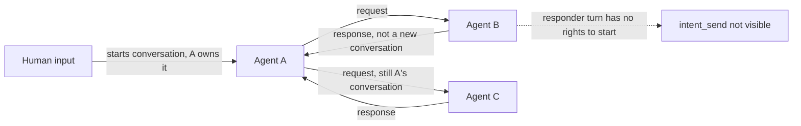

# Intent Messaging and Chat Session Design

> Status: Design draft (core semantics and boundaries confirmed; APIs, storage schema, and UI details remain for implementation design)
> Version: v1.5 | Last updated: 2026-10-14
>
> Related designs: [06-communication.md](./06-communication.md), [12-tool-system.md](./12-tool-system.md), [15-conversation-persistence.md](./15-conversation-persistence.md), [21-pm-project-management.md](../zh/21-pm-project-management.md)
> Related protocols: [MQTT protocol](../../protocols/en/mqtt.md), [HTTP protocol](../../protocols/en/http.md)

---

## 1. Overview

This document defines ACowork's Intent communication and Chat session design. It covers message semantics and storage boundaries for users, Agents, groups, and PM, as well as receiving-Agent session selection, conversation ownership, reply delivery, and history reads.

**An Intent is a message sent to an Agent, not a task-orchestration protocol.** To the receiving Agent, an Intent is equivalent to a user message that triggers Agent execution. The sender may be a human user, another Agent, or PM acting on behalf of the project owner. The receiving Agent processes the message in its own Agent execution session; execution details and reasoning remain in that Agent session. The request and reply are recorded as Intent messages in the shared Chat session.

**Core principle: a Chat session records communication; an Agent execution session records execution.** These are distinct session models with their own data formats, writers, lifecycles, and UI entry points. Intent routes a message in a Chat session as input to the target Agent execution session; the Agent's reply is then written back as a message to the source Chat session.

A project group chat is a special type of Chat session in the `acowork-user` chat domain. Future ordinary user groups, user-Agent group chats, and one-to-one Agent-Agent chats use the same chat model; they do not each require a separate session storage format for every participant combination.

### 1.1 Goals

1. Provide a unified source-conversation / reply-address model for user-user, user-Agent, Agent-Agent, PM dispatch, and @Agent in group chat.
2. Preserve the existing Agent session storage format and model; Intent only triggers the target Agent to process a user message in its execution session.
3. Store chat messages uniformly in the chat domain; chat history must never contain Agent reasoning, tool calls, or tool execution details.
4. Let the explicit business entry point determine whether a target Agent execution session is created or reused; do not require the sender or model to infer thread boundaries.
5. Treat `repo` (a code repository address) as an optional Intent field, injected by the system at dispatch time when the project has a repository. An authorized user may later modify session settings, including the working directory.
6. Write messages in each Chat session in order through a single authoritative backend write entry point, avoiding concurrent writes and ambiguous ordering.
7. Deliver results by push: the responder's reply is written back to the Chat session by the system and routed to the initiator, which never polls for a result.
8. A conversation has exactly one owner (the initiator), and the owner decides when it ends; a responder cannot start a new conversation.
9. `chat_history_read` progressively reads Chat-session messages that do not belong to the current conversation, using offset/count with a hard server-side read limit.
10. Agents do not speak in group chats by default; only an explicit @Agent sends an Intent and triggers processing.

### 1.2 Non-goals

- Introducing a complex task lifecycle, callback orchestration, or generic state machine for Intent.
- Turning Agent execution sessions into group-chat storage or injecting group messages into Agent execution-history files.
- Implicitly broadcasting ordinary chat messages to Agents in a group.
- Requiring an external ACP-compatible API; ACP is only a reference for capability descriptions, message structure, and related ideas.

## 2. Two Session Models

### 2.1 Agent Execution Session

This is the existing Agent session model, preserving the context and runtime history needed for one Agent's execution, including ordinary user inputs, model outputs, reasoning, tool calls, and other existing execution history. It continues to be managed by the corresponding Agent Runtime in that Agent's home using the current format.

An execution session may be triggered by a user message or an Intent. Regardless of the trigger, the receiving Agent works in its own execution session. The Intent sender, reply address, and chat history do not merge the sender Agent's execution context with the recipient's.

**Compatibility rule: preserve the existing Agent session storage format and model.** The new chat model refers to Agent execution sessions by association IDs; it does not turn a Chat session into a new format for Agent execution records.

#### Context Compaction and Physical Rotation for Intent Execution Sessions

Intent-driven execution sessions reuse the existing Agent-session context-compaction mechanism; Intent does not introduce a separate token-compaction design. The first release keeps the current thresholds: 70% context usage logs a warning only, 80% triggers LLM compaction, and 95% triggers the `emergency_trim` safety net. The denominator is the effective context window for that session, following the existing per-session override rules. Compaction limits context sent to the model but does not shrink the complete JSONL history file, so physical session rotation is also required.

Logical mappings (for example, a group chat to an Agent) remain stable, while the physical execution session they point to may rotate. This rotation policy applies only to execution sessions managed by Intent logical mappings; it does not change the lifecycle of ordinary sessions used directly from the Agent page. The complete old history remains in the Agent home for the existing Session history UI; do not copy the old JSONL wholesale into the successor or write execution details into the Chat session.

**Rotation-timing invariant: there is exactly one rotation point — after the Intent's execution has finished and its result has been written back to the source Chat session.** No matter how many compactions (including `emergency_trim`) occur during execution, the session must never be switched mid-execution. Multiple compactions inside a single Intent are normal for long tasks or small context windows.

Rotation is triggered by the following two scenarios; there is no execution-count limit:

| Trigger | Condition | Default |
|---|---|---|
| T1 topic discontinuity | When a new Intent arrives, the idle gap since that mapping's last completed execution exceeds the threshold, indicating the two Intents are unrelated | 24 hours; configurable 1–72 hours; `0` disables |
| T2 task concluded | Either: the PM task reached a terminal state (`Done` / `Rejected` / `Cancelled`); or at least one compaction happened during this execution, which marks the Intent as a long task whose historical session should not be reused after delivery | Enabled, not disableable (business boundary plus context-cost judgment) |

Why there is no execution-count limit: a count is not a measurable physical property, so no value is defensible. The problem a count would address—context polluted by unrelated Intents—is already covered directly by the compaction threshold: accumulated unrelated content eventually triggers compaction, which triggers T2. File and disk size are protected by the existing JSONL hard limit. Both boundaries therefore close, leaving no path of unbounded growth.

The two T2 cases are handled differently: a terminal PM task ends that logical execution context, so the session closes without a successor and a later new task uses a new mapping; a compaction-triggered rotation still creates a successor because the same topic may continue.

#### Handoff Context Tiers

A rotated successor carries only a concise handoff whose content depends on the trigger, so a stale summary cannot pollute a new topic:

| Trigger | Handoff content | Ceiling |
|---|---|---|
| T1 idle gap | Open items, key decisions, and reference IDs only; omit entirely when nothing is open; no conversation summary | 500 tokens (fixed by design, not configurable) |
| T2 compaction condition | Current goal, key decisions, open items, and reference IDs | Target 1,500 tokens, configurable 500–4,000 |

A handoff must never contain hidden reasoning, and the ceiling is only a target: it must also fit the successor's effective input budget. Ask the Compact Model to reduce oversized handoffs; if it still cannot fit, retain the most important actionable summary and log a warning.

#### Storage Boundary

Keep the existing JSONL hard limit of 100,000 lines or 50 MiB, whichever comes first, as the absolute safety limit; no separate proactive JSONL rotation threshold is introduced. Under T1 / T2, physical sessions stay small and normally never approach this limit. If an unusually large single execution approaches the hard limit before a safe checkpoint, Runtime must refuse further unbounded appends and pause at a recoverable checkpoint, persist state, and rotate; if it cannot pause safely, it must fail explicitly and preserve written history rather than silently discarding it or crossing the hard limit.

#### Frontend Configuration Boundaries (Session Settings Card on the Agent Settings Panel)

The first release exposes only two settings:

| Setting | Frontend | Initial behavior |
|---|---|---|
| Idle-gap rotation threshold (default 24 hours) | **Configurable**, range 1–72 hours; `0` disables T1 rotation | Applies only to Intent-managed logical mappings; Agent-level default; after an authorized user changes it, it governs subsequent Intent executions for that Agent |
| Handoff context target (default 1,500 tokens) | **Configurable**, range 500–4,000 tokens | Applies only to Intent-managed logical mappings; changes apply to handoffs generated by that Agent's subsequent rotations |

The following are **not exposed** to ordinary users: compaction thresholds 70% / 80% / 95% (keep existing Runtime behavior and configuration capabilities; do not create parallel Intent-specific controls), the T2 rotation condition (business boundary, not disableable), the T1 minimal-handoff ceiling, and the JSONL hard limit of 100,000 lines / 50 MiB (absolute safety limit; deployment-level advanced configuration may adjust it during implementation, but hard-limit semantics must remain).

Parameter changes require authorization and an audit record; they do not rewrite existing history. An in-flight execution uses the configuration snapshot resolved at its start. Missing values use the defaults above. Ordinary users may only adjust Agent-level parameters within their authorization and cannot modify session files in another Agent's home.

#### Concurrency and Failure Recovery

Once a rotation condition is met, the current execution must still complete first; Intents already queued bind to the successor in serialized order and must not continue appending to the old session. If several Intents arrive concurrently, Runtime processes them through the established per-session write / execution queue, and mapping update plus successor creation must commit at one serialized boundary.

Successor creation and logical-map switching must recover from crashes: idempotently create the successor and persist its handoff / predecessor association, atomically point the logical mapping to the successor, then mark the old session ended. A retry must not create multiple successors or lose the active mapping. If the Compact Model is unavailable, rotation must not silently discard context; use the most recent compaction summary and a bounded number of recent turns to construct a bounded handoff, and log a degradation warning. If even a bounded handoff cannot be created safely, pause further dispatch through that mapping and return an explicit error until recovery or authorized intervention.

### 2.2 Chat Session

A Chat session is a persistent conversation for user chat and Agent-to-Agent messages, uniformly owned and managed by the `acowork-user` chat domain. Its message types are a fixed communication set, not private Agent runtime traces:

- `user_message`: a chat message sent by a user;
- `intent_message`: a message sent or returned through Intent, with metadata such as direction, sender, recipient, and reply correlation.

Concrete wire/schema types will be determined during protocol implementation. Agent reasoning, hidden chain-of-thought, tool calls, tool results, and execution intermediate events must not be written as chat messages. Any necessary delivery or presentation status belongs in message metadata or a separate event; it must not expand into arbitrary Agent execution events.

### 2.3 Session Boundary Invariants

| Dimension | Agent execution session | Chat session |
|---|---|---|
| Responsibility | Agent execution context | Message history among users and/or Agents |
| Authoritative storage | Corresponding Agent home / Runtime, existing format | `acowork-user` chat domain |
| Content | Existing execution history: user inputs, model outputs, reasoning, tool calls, etc. | Fixed types: user messages and Intent requests / responses |
| Writer | Corresponding Agent Runtime / existing session API | Single chat write entry point in `acowork-user` |
| UI entry | Existing Agent-page Session history | Separate Chat history |

Never copy Chat-session messages into Agent reasoning or tool calls, and never write private Agent reasoning or tool calls into any Chat session. Chat history and Session history are separate entry points.

## 3. Chat Session Types and Ownership

### 3.1 Storage Ownership

`acowork-user` is the authoritative owner and writer for user chats and Chat sessions. Although PM creates and associates a project group chat, its conversation history is managed by the `acowork-user` chat domain rather than PM task files or any Agent home.

Remote or local Runtime processes, PM, and Desktop operate on chat history through trusted service interfaces. A Runtime must not directly access or modify another Agent home's session files. PM holds business associations such as `project_id` / `task_id`; the service validates them and maps them to the corresponding Chat session.

### 3.2 One Model, Different Participants

All chats use the same Chat session and message-log model. The relationship is expressed through chat type and participants, covering at least:

| Chat session type | Participants / purpose | Message content |
|---|---|---|
| User-user | One-to-one chat created by users | User messages |
| User group | General group chat created by users | User messages; Intent messages only when an Agent is explicitly mentioned |
| Project group | Special group chat created with a project | User messages, Intent requests, Intent responses |
| User-Agent chat | Chat-style conversation between a user and an Agent | User messages, Intent requests / responses; not an Agent execution session |
| Agent-Agent chat | One-to-one chat between two Agents | Intent requests / responses only |

These are logical types; they do not require a separate physical schema per type. New participant types can extend the same chat model without changing the boundary that chats store messages and execution details remain in Agent sessions.

### 3.3 Project Group Chat Lifecycle

- Every project must create one associated project group chat at creation, and a project can have only one such group chat.
- The project group chat cannot be deleted independently. The association between project lifecycle and group-chat archive, deletion, and retention is **out of scope for this phase** and will be decided separately.
- `project_id` is stably associated with the project group chat; PM dispatches and Agent replies use it as the source / reply address.

## 4. Intent Message Model

An Intent is a message, not an execution result object. It carries enough context for addressing, processing, and replying:

| Field semantics | Requirement | Description |
|---|---|---|
| `message_id` | Required | Unique message identifier for correlation, deduplication, and diagnostics. |
| `source` | Required | Sender and sender type; identity is confirmed by a trusted service, not just client self-assertion. |
| `source_chat_session_id` | Required | Source Chat session and reply address. |
| `source_agent_session_id` | Required for Agent senders | Execution session ID from which the Agent sent this Intent. Empty for user / PM senders. |
| `target_agent_instance_id` | Required | Exact target Agent Runtime instance, following the instance-ID addressing contract. |
| `message` | Required | User message content for the receiving Agent. |
| `repo` | Optional | Address of the code repository this work concerns (normalized remote URL). When the project has a repository, the system injects it at dispatch time; the sender does not name a concrete working directory on the target Agent. |
| `session_config` | Optional | Initial values such as model, reasoning, and skills; omitted fields use target Agent defaults. |
| `conversation_id` | Required for requests | Conversation identifier, generated by the initiator on its first request and reused by every later request / response in that conversation. The system uses it to count requests (§6.5). |
| `in_reply_to` | Required for responses | `message_id` of the request being answered. **Generated by the system, not a model-supplied parameter** — its presence is what marks a message as a response (§6.5 R2). |
| `target_agent_session_id` | Associated after routing | Target Agent execution session that actually processes the Intent. |

Field names and the wire schema will be determined during protocol implementation; this table defines semantics, not the final serialization contract.

### 4.1 The `repo` Field and Receiver-Side Boundaries

`repo` is an optional field carrying the code repository this work concerns, expressed as a normalized remote URL (scheme and credentials stripped, host lowercased, no `.git` suffix). It means "which repository is this task about" — **not "which folder to use"**.

> Terminology: in this document `workspace` refers only to a directory registered on the Agent side (`WorkspaceDir`, `allowed_dirs()`, the workspace picker in the UI). The Intent protocol does not use that name: one repository can map to several workspaces (multiple clones / worktrees), and a workspace may not be a code repository at all.

Rules:

1. A project may have no code repository — it need not be a software project. Such an Intent carries no `repo`, and the Agent handles the message in one of its own working directories. That is a normal outcome, not a silent fallback.
2. When the project does have a repository, the system injects its address into Intents created both by PM dispatch and by @Agent mentions in that project's group chat. Neither the human sender nor the sending model needs to know the target Agent's directory layout, and neither fills in a concrete path.
3. What the receiving Agent does with a `repo` value is left to its own model — which authorized directory to work in, whether to switch branches. The protocol layer provides no workspace-selection algorithm and maintains no "repository → workspace" binding table: that judgment is too context-dependent to be covered by a single Intent parameter.

The model's discretion ends there. These are hard constraints:

- The Agent may only read and write inside its own registered / authorized set of working directories;
- A sender's local path must never be used as cross-Node addressing, and must not appear in an Intent;
- Receiving a repository address never authorizes an automatic clone or worktree creation — uncontrolled disk usage plus supply-chain risk, and no principal has ever granted that action;
- With no matching working directory, the Agent replies clearly ("I have no workspace for that repository") instead of writing into the Agent home or any unrelated path.

The first version supports 0 or 1 repository per project; multi-repository projects are out of scope.

### 4.2 Session Configuration as Initial Values, Modifiable by Authorized Users

An Intent may carry initial target-Agent session settings such as model, reasoning, and skills. Omitted fields use the target Agent's defaults. These settings are not immutable snapshots: an authorized user may change them during the session lifecycle, including the session's working directory.

Once accepted, a configuration change applies to subsequent messages / subsequent execution. An operation already in progress uses the configuration snapshot resolved when that operation started, so changing the working directory cannot redirect an ongoing file operation midway. The service must verify that the user may modify the corresponding target Agent session setting; unauthorized changes fail clearly rather than being silently ignored. A working-directory change may only select from directories already registered on that Agent; arbitrary paths are not accepted.

## 5. Project Group Chat and @Agent

### 5.1 Group-Chat Message Behavior

An ordinary user message in a group chat is written only to the Chat session; it does not trigger Agent execution. Agents do not listen to and reply to every group message by default. When a user explicitly @mentions one or more Agents, the system creates an Intent message for each mentioned target and routes it specifically; only the mentioned Agents receive and process the message.

Mention parsing must produce an explicit list of target Agent instances, rather than requiring each Runtime to guess the target from message text. When multiple Agents are mentioned, each is routed independently and maintains its own execution session; the request and replies are recorded as associated Intent messages in the same Chat session.

In the group-chat case the conversation owner is that human message: an Agent's response is written back to the group Chat session and rendered to people, **and it @mentions nobody, so it wakes no Agent**. Hand-off between Agents is not performed by Intent — a human decides whether to @ the next one (the corollary of §6.5 R5).

### 5.2 Group-Chat History

A project group chat records:

1. User messages from project members;
2. Intent requests sent to Agents;
3. Intent responses returned by Agents to the group chat;
4. Minimal metadata for sender, recipient, mentions, reply correlation, presentation, and ordering.

Group-chat history excludes Agent reasoning, tool calls, tool results, and execution intermediate content. A mentioned Agent receives the current Intent by default, not the whole group history. If it needs context, it uses `chat_history_read` to read within authorization and response limits.

### 5.3 Visibility Principle

Users and Agents participating in the same group chat can see public messages in that chat. Public is scoped to the participants / project boundary of that Chat session, not globally public across the platform. Keep permissions simple: the service checks chat participation to authorize reads and writes; the session ID itself is not authorization.

## 6. Creating and Reusing the Receiving Agent Execution Session

The sender provides the source Chat session and business context; the system determines whether to create or reuse the target execution session based on the chat type.

### 6.1 @Agent in a Group Chat: Fixed Session per Group

When Agent B is mentioned in a group chat, use `(chat_session_id, target_agent_instance_id)` to find B's logical execution conversation and its current physical execution session:

- On the first @B, create the mapping and Agent B execution session;
- Later messages that @B in the same group use the physical session currently pointed to by the mapping; after that Intent's execution finishes and its result is written back, subsequent queued / arriving messages use a successor session if the T1 or T2 condition in §2.1 is met;
- After rotation, the logical mapping remains stable and points to the new successor session;
- Each Agent in the same group has an independent execution-session chain;
- Append B's Intent response to the group Chat session.

“Fixed group-chat session” means a stable logical execution-conversation mapping, not one physical JSONL file that grows forever.

### 6.2 PM Tasks: One Logical Execution Context per Task

When PM creates a task and dispatches it to an Agent, the task defines the execution-session boundary:

- Each `(project_id, task_id, target_agent_instance_id)` maps to one stable logical execution context whose physical execution session is created on first dispatch;
- Later Intents to the same Agent for the same task continue in that logical context, rotating its physical execution session under the T1 / T2 conditions of §2.1;
- When the task reaches a terminal state (`Done` / `Rejected` / `Cancelled`), that logical execution context ends: close the current execution session without creating a successor, and use a new mapping for a later new task;
- Different tasks create different logical execution contexts;
- The Intent's source Chat session / reply address is the project group chat; the Agent's reply returns to that group chat and is correlated with the dispatch message.

A task logical execution context maps to an Agent execution-session chain, not a Chat session. The group chat owns the visible project conversation; the PM task ID selects the target Agent execution context.

### 6.3 Agent-Agent: Three Sessions

A one-to-one chat between Agent A and Agent B has three separate but associated sessions:

1. **One Agent-Agent Chat session**: owned by `acowork-user`, recording Intent requests / responses between A and B; it contains neither Agent's reasoning or tool calls.
2. **Agent A's execution session**: managed by A's Runtime in A's home, storing A's execution context for received messages or continued conversation.
3. **Agent B's execution session**: managed by B's Runtime in B's home, storing B's execution context for received messages or continued conversation.

When A sends a request to B through `intent_send`, the message is first appended to the Chat session and then routed to B's execution session. When B's turn ends, the system generates a response and appends it to the same Chat session (§7.1), **and routes it as an inbound message to A**: if A is still executing, it is injected into A's current turn at an iteration boundary; if A is idle, it wakes a new turn. A turn woken by its own response still plays the initiator role and reuses the same `conversation_id` (§6.5). The Chat session ID is not A's or B's execution session ID.

The first creation of an Agent-Agent Chat session is triggered by an explicit chat entry point / initial conversation action. Thereafter, the Chat session is reused for that chat relationship. The execution-session association on each side follows the same rule of stable logical mappings to rotatable physical sessions; Agents do not decide on every message whether to create or reuse one.

**Intents between A and B always land in their shared agent-agent Chat session, regardless of what triggered A's current turn.** When A was triggered by a direct user message (not a group chat) and then asks B, `source_chat_session_id` is that shared Chat session, created idempotently on first send. A's user sees A's execution session on the Agent page, including how A handled B's response; no additional Chat session record is created between the user and A (§6.4).

### 6.4 Two User-Agent Scenarios

Distinguish clearly between:

- Ordinary conversation from the Agent page: continue using the Agent's existing execution session and existing Session history; this design does not migrate it.
- @Agent in a user-Agent group chat: write the message to the group Chat session, then route it through Intent to the Agent execution session; the Agent's reply is written back to the group.

Both can coexist. They must not be collapsed into one session type merely because both involve a user and an Agent.

### 6.5 Conversation Ownership and Termination

Intent follows a C/S-style ownership model: the initiator owns a conversation and is responsible for ending it; the responder only produces a result for each input and cannot open the next round.

| Rule | Content |
|---|---|
| **R1 Ownership** | Only a turn triggered by human input (user message / PM dispatch / cron) may start a conversation. A turn handling an incoming request as a responder may not start a new conversation |
| **R2 Two message kinds** | An Intent is either a request or a response. `intent_send` can only produce requests; a response is produced only by the system when the responder's turn ends (§7.1) and is never the start of a new conversation |
| **R3 Termination** | The conversation ends when the initiator stops sending requests. Ending means "says nothing more", not entering an Ended state — no timeout and no cleanup action |
| **R4 Budget** | Each conversation has a cap on request count; when exceeded, the system refuses delivery and writes a receipt into the Chat session |
| **R5 Third parties** | A responder may not go ask someone else; it writes "I need X" into its response and leaves the decision to the initiator |

Role is decided by the type of inbound message, not declared by the model:

| Inbound | Role this turn | `intent_send` | `conversation_id` |
|---|---|---|---|
| Human message (user / PM dispatch / cron) | Initiator | Available | New |
| request (someone asks me) | Responder | **Not in this turn's tool set** | Reuse the inbound value |
| response (someone answered me) | Initiator, continuing its own conversation | Available | Reuse |

R1 is enforced through tool visibility: the responder's turn has no `intent_send` in its tool set, and `ask_user_question` is removed too (nobody is behind that turn to answer — if something must be asked, it goes into the response). The model cannot see these tools, so it never tries them and never spends tokens looking for a workaround. That is cheaper and stricter than failing at call time.



There is no path by which a loop forms: B cannot extend the conversation (R1); every request A makes is countable (R4); A's turn always terminates. Therefore no causal-chain depth, chain ID, or cross-Agent loop detection is needed.

| Parameter | Default | Range | Exposed in Session Settings card |
|---|---|---|---|
| Max requests per conversation | 6 | 2–16 (0 = Agent-to-Agent conversation disabled) | Yes (Agent level) |

A human is the only circuit breaker and the only restart point: to continue after the cap is reached, the user sends a new message = a new conversation. **A responder may not request a higher cap** — that would let the loop decide whether to continue.

Orchestration ownership: deciding "who works next, in what order" belongs to humans and the PM task dependency graph, not to Intent (§1.2 non-goal: no task orchestration in Intent). R5 is the concrete expression of that boundary.

## 7. Replies, History Entry Points, and History Reads

### 7.1 Writing Replies Back

**A response is not a model tool call; it is a product of the system when the responder's turn ends.** Answering an incoming message is the same act as "finishing speaking" in an ordinary user-Agent conversation. If replying were a tool, the common failure would be the model simply ending its turn after answering — and the initiator would wait forever.

The response body comes from **the final output of that turn**, not from scraping the tail of the context: after a turn ends, the context tail may hold several assistant texts (narration before tool calls, intermediate conclusions, the final summary), so "how much to take" could only be guessed. The Runtime already has a first-class final output for each turn (the stream-completion event carries the reply text, with reasoning blocks stripped before it is written). The response body is that text — one message, not a window.

**Every turn that entered the responder role must write back a response when it ends, regardless of outcome:**

| End condition | Response `status` | Body |
|---|---|---|
| Normal completion | `completed` | The turn's final output text |
| LLM / tool error | `failed` | Only the user-facing error summary — **never the internal detail**; internal errors are not exposed to another Agent |
| User pressed stop | `aborted` | Whatever text the turn produced; may be empty |
| Runtime crash / no event at all | `failed` | Fixed system fallback text |

**A responder turn must not enter a wait-for-human state.** The two existing pause states (iteration-limit pause, loop-detection pause) depend on a human clicking Continue in the UI, and nobody is behind an Intent-triggered turn. When a responder turn reaches either, it terminates with an `aborted` receipt describing where it got stuck. For the same reason, `ask_user_question` is removed from responder turns (§6.5).

Write path: the response is appended to the source Chat session through the single chat write entry point; the Runtime never writes directly into another Runtime's home session file.

**The initiator learns the result by push, not by polling.** After the response is stored, the system routes it as an inbound message to the initiator: injected into the current turn at an iteration boundary if still executing (the answer lands in the same turn), or waking a new turn if idle. An LLM cannot wait; if results were only obtainable by querying, the model would retry inside its turn — a busy-wait that burns iterations and tokens. The initiator has usually already ended its turn after sending a request, so there is no live turn to poll with.

Length limit: the response body is truncated under a combined byte / token cap and marked `truncated`. If the initiator needs more, **it sends another request specifying which part it wants**; reading the other Agent's execution session is not offered (§2.3 boundary invariant).

Reply addresses: for PM, the project group chat, where the PM service reads the response correlated with that task to advance task state (a service reading messages, not an LLM polling). For Agent-Agent, the shared one-to-one Chat session, pushed back to the initiator. For a user group, the corresponding user-Agent / group Chat session, rendered to people only.

### 7.2 Agent Page Chat History

Keep the existing **Session history** button on the Agent page for that Agent's execution-session history, and add a separate **Chat history** button for Chat session history involving that Agent.

Chat history can list conversations by counterpart or group, including one-to-one chats with other Agents, groups, and project group chats. Selecting an entry displays Chat messages stored by `acowork-user`; it must not show or combine reasoning and tool calls from the Agent's private execution session. Ordinary direct user-Agent conversations remain in the existing Session history and do not migrate to Chat history.

### 7.3 `chat_history_read`

`chat_history_read` reads message history from a Chat session. It is **not how the current conversation's result is obtained** — results arrive by push (§7.1). Its purpose is reading messages that do not belong to the current conversation:

1. earlier human discussion in a group chat (§5.2: a mentioned Agent does not automatically receive the whole history);
2. when one message @mentioned several Agents, A reading B's response;
3. messages addressed to other Agents in the group.

The tool cannot read arbitrary sessions; by default it only reads Chat sessions in which the caller has a participation relationship. Its inputs are `chat_session_id + offset + count`, and it **does not accept a message_id as a "wait for result" handle** — that would turn it into a polling interface.

Naming note: this tool was originally called `intent_send_result_query`, paired with `intent_send`. That name leads a model to treat "query right after sending" as the required way to get a result, actively inducing the failure mode described above, so it is renamed. The tool description must state that responses arrive automatically and this tool only reads other messages in the conversation.

The tool provides `offset` and `count` to page through Chat session messages in append order. The LLM can decide from messages already read whether to continue; the prompt may recommend a per-call amount but cannot replace server-side enforcement. The backend must set a hard per-call `count`, response-byte, or equivalent payload limit, and verify participation in the queried Chat session.

Suggested request semantics:

```json
{
  "chat_session_id": "...",
  "offset": 0,
  "count": 20
}
```

The response includes at least the messages, stable order / offset information, and whether more messages are available. For append-only Chat sessions, offset/count is sufficient for the first version; backend ordering must remain stable when messages are appended concurrently. Consider a cursor only if future requirements include middle deletion or complex synchronization; do not introduce one in the first version.

## 8. Serialized Chat Session Writes

Chat messages are written serially in chronological order through one authoritative backend write entry point. Use a **single writer / serialized queue per Chat session**, not global serialization across the whole service: writes within one chat are strictly ordered while different chats can proceed concurrently.

The single write entry point is responsible for:

1. Validating the caller and participation relationship;
2. Idempotent deduplication by `message_id`;
3. Assigning a monotonically increasing per-session message sequence / ordering key in backend acceptance order;
4. Atomically appending and persisting messages in order;
5. Associating Intent delivery with the message record.

The canonical order for one chat is the order accepted and committed by the backend serialized write entry point, not each client's local timestamp. Timestamps are for display and must not be the sole ordering key. QoS 1 redelivery or request retry must not append a duplicate message.

This prevents Runtime processes, PM, and UI from concurrently modifying chat history directly. The queue implementation is up to `acowork-user`, but all writes must pass through the same logical write boundary.

## 9. PM Integration and Identity

A PM task dispatch is a project owner sending a message to an Agent through the project group chat:

1. The PM project has an explicit owner;
2. `acowork-user` / a trusted service confirms the owner from authenticated project data; PM must not arbitrarily self-assert an owner;
3. The project group Chat session is the Intent source conversation and Agent reply address;
4. A project may optionally be linked to one code repository. When it is, the server injects that repository address as `repo` into Intents created by task dispatch and by @Agent mentions in the project group chat; injection happens server-side, does not depend on the sender filling it in, and cannot be forged by the sender;
5. The task ID and target Agent instance select the Agent execution session;
6. Later PM dispatch messages for the same task reuse that task execution session; a new task uses a new session;
7. Agent replies are appended to the project group chat and correlated with the corresponding Intent;
8. In the PM case the conversation owner is the dispatching human input: after an Agent's response is written back to the project group chat it **wakes no Agent**. The PM service reads the response correlated with that task to advance task state (a service reading messages, not an LLM polling);
9. If an Agent needs information held by another Agent, it writes it into the response and leaves the decision to the initiator; it does not go ask someone else (§6.5 R5). Sequencing and hand-off between tasks belong to the PM task dependency graph and the owner, not to Intent.

Storing the group chat in `acowork-user` does not remove PM's ownership of project / task domain data: PM still owns project and task business data, while the chat service owns conversations and message records. They are associated by stable IDs.

## 10. Delivery, Errors, and Reliability

Intent retains message semantics and does not introduce a generic task state machine. Minimum reliability semantics include:

- `message_id` remains stable across chat records, Intent routing, and reply correlation;
- Successful MQTT QoS 1 publication does not mean the Agent processed or completed the message;
- The receiver deduplicates by `message_id` to prevent the same message entering an execution session more than once;
- The initiator learns results by push; it must not wait by querying (§7.1);
- When a conversation exceeds its request cap, delivery is refused with a receipt written to the Chat session — never silently dropped (§6.5 R4);
- Invalid target Agent, source Chat session, session configuration, or `repo` address format fails clearly;
- An Agent attempting to read or write outside its authorized directories, or attempting an automatic clone / worktree creation because of a `repo` value, is rejected with a receipt — never silently downgraded;
- Tool feedback reports only that a message was recorded / accepted or clearly failed; it must not claim “completed” when it only means “published.”

At minimum, distinguish `invalid_repo`, `unauthorized_directory`, `target_not_found`, `source_chat_session_not_found`, `session_config_invalid`, `not_authorized`, `delivery_unavailable`, `conversation_request_limit_reached`, `response_unavailable` (carried by the fallback response when a responder turn terminates abnormally), and duplicate message IDs. Unify final error codes when revising HTTP / MQTT protocols.

## 11. Architecture Boundaries and Existing Implementation

### 11.1 Responsibility Boundaries

- **`acowork-user`**: owns Chat sessions, participant relationships, fixed-type chat messages, and the single serialized write entry point; provides paged chat-history queries.
- **PM service**: owns project and task data (a project may optionally be linked to one code repository); requests project-chat creation at project creation; provides validated owner / project / task associations and the project repository address at dispatch.
- **Gateway / trusted routing boundary**: validates Runtime / PM identity, resolves targets, injects and validates the `repo` address, routes Intents, counts requests per `conversation_id` and refuses those over the cap, routes each response back to the initiator's execution session by push, and coordinates user chat with Node / Runtime; it does not directly access Node-local Agent home files.
- **Agent Runtime**: determines the role of the current turn from the inbound message type (initiator / responder) and trims the tool set accordingly (§6.5); treats an incoming request as user input in the designated Agent execution session; preserves the existing session format in the Agent home; reads and writes only inside its own registered / authorized working directories and never clones or creates a worktree because of a `repo` value; on turn end, generates the response through the system (including aborted and failed fallbacks) and submits it to the trusted message write entry point, without relying on the model calling a reply tool.
- **Desktop**: presents Agent execution Session history and Chat history separately; it does not assemble or persist business history itself.

### 11.2 Transport and ACP

Intent message semantics are transport-independent. MQTT may continue to carry Runtime control messages; Chat session reads and writes use trusted HTTP / service interfaces exposed by `acowork-user`. Concrete interfaces must align with Gateway reverse proxy, remote Node topology, and authentication boundaries.

ACP may inform Agent capability descriptions, discovery, and structured messages. This design does not require internal messages to use ACP REST APIs and does not adopt the ACP run lifecycle.

### 11.3 Changes Needed to Existing Implementation

The current [intent_send.rs](../../../core/acowork-runtime/src/tools/builtin/intent_send.rs) publishes Intents through an MQTT control topic, and its `async` parameter does not mean request waiting / result retrieval is implemented. Implementation of the new model must follow this design's message and Chat session semantics. Review or retire the Gateway's old Intent Router path that depends on removed gRPC, and update [06-communication.md](./06-communication.md), [12-tool-system.md](./12-tool-system.md), and MQTT / HTTP protocols to establish one authoritative contract.

## 12. Frontend Interaction Principles

- Keep the existing Agent-page Session history behavior and add a separate Chat history button.
- Chat history lists conversations involving the Agent by counterpart / group; selecting one displays Chat session messages.
- The PM project view opens the fixed project group chat; PM task dispatches and replies are visible there in order.
- Ordinary group messages do not trigger an Agent; @Agent creates a targeted Intent. When multiple Agents are mentioned, show each request and reply independently.
- Chat history displays messages and necessary delivery notices, not private Agent reasoning, tool calls, or execution details.
- Chat history must show conversation ownership: the owner (initiator) of each conversation, its request count, and each response status (`completed` / `aborted` / `failed`).
- When the request cap is reached, show an explicit limit receipt with a "continue" entry — clicking it makes the **user** send a new message, starting a new conversation. The user must never see only "two Agents suddenly stopped talking".

## 13. Open Implementation Questions

Core semantics are confirmed. The following are implementation details rather than undecided product principles:

1. Concrete storage schema in `acowork-user` for Chat session, participant, message, and Agent execution-session mappings. Use one extensible model whose participant and chat types can grow.
2. Process-local / durable queue implementation, crash recovery, and transaction boundary for the `acowork-user` single write entry point and per-Chat-session serialization.
3. Idempotent creation and failure recovery between PM project creation and user-service project-chat creation. Project archive / deletion policy is deferred for this phase.
4. API, audit event, and in-flight-operation configuration-snapshot implementation when an authorized user changes an Agent session during execution.
5. Initial session-rotation parameters are specified in §2.1; implementation must connect Agent-level configurable values to the Session Settings card and define persistence, range validation, and audit APIs.
6. Transaction boundaries and recovery for successor / handoff, including how to switch safely at an execution checkpoint when a physical session reaches the JSONL hard limit, must prevent message loss and duplicate successors.
7. Hard count / byte limits for `chat_history_read`, output schema, and the soft limit recommended in the prompt.
8. Initial Agent-Agent Chat session creation entry point and persistence location for the Chat-session ↔ logical execution mappings / physical execution-session chains on both sides.
9. Mention ID representation, message presentation, and UI ordering for replies to multiple targets.
10. Normalization rules for `repo` (remote URL canonicalization, host lowercasing, credential stripping, `.git` suffix handling) and the storage / API for the repository link on a PM project; multi-repository projects are deferred.
11. The concrete byte / token caps for the response body and how the `truncated` marker is represented in the Chat session schema.
12. Where the abnormal-termination fallback is implemented: when a Runtime crashes or produces no end-of-turn event, who writes the `status=failed` response, when, and on what evidence — this fallback must exist because the initiator does not poll.
13. Storage location and durability of the per-`conversation_id` request counter: a Gateway restart must not lose the conversation budget, otherwise the cap can be bypassed.

## 14. Suggested Phased Delivery

### Phase 1: Chat Session Storage and Message Writes

- Implement a generic Chat session / participant / message model in `acowork-user` for project group, user group, user-Agent, and Agent-Agent types;
- Ensure chat message types contain only user messages and Intent messages;
- Establish one backend write entry point, serialization per Chat session, ordering keys, and `message_id` idempotency;
- Fix the boundary between Chat sessions and existing Agent execution sessions and store association references.

### Phase 2: Project Group Chat and Targeted Intent

- Idempotently create one project group chat when PM creates a project; defer project lifecycle policy;
- Store ordinary group messages only; create and route Intent only for @Agent;
- Reuse a stable logical execution mapping by `(chat_session_id, target_agent_instance_id)`; rotate its physical execution session under the T1 / T2 conditions in §2.1;
- Treat `repo` as optional and inject it server-side when the project has a repository; receivers may only operate inside authorized working directories and reply clearly when none matches, without automatic cloning;
- Decide the current turn's role from the inbound message type and trim the responder's tool set (`intent_send` / `ask_user_question` not visible), implementing §6.5 R1;
- Count requests per `conversation_id` and enforce the cap (default 6), refusing delivery with a receipt when exceeded;
- Use target defaults or Intent initial configuration for session settings; allow authorized users to change the working directory later.

### Phase 3: PM Tasks and Agent-Agent Chat

- Map PM tasks to a dedicated Agent execution session by `(project_id, task_id, target_agent_instance_id)` and route replies to the project group chat; rotate the physical execution session behind that logical mapping using §2.1;
- Generate the response through the system when the responder's turn ends (body = the turn's final output), with a receipt for all four end conditions, and push-route it back to the initiator;
- Implement Agent-Agent Chat sessions and associations to each side's execution session; Intents between A and B always land in the shared Chat session (§6.3);
- Provide `chat_history_read(offset, count)` with hard server-side limits;
- Add Chat history to the Agent page while preserving existing Session history.

---

**Summary of core decisions:**

- Chat sessions and Agent execution sessions are different models. `acowork-user` manages chat messages; each Agent home manages execution context in the existing format.
- Chat message types are fixed to user messages and Intent messages; reasoning, tool calls, and tool results exist only in Agent execution sessions.
- Agent-Agent communication has three sessions: one shared Chat session and separate Agent execution sessions for A and B.
- Ordinary group messages do not trigger Agents; @Agent sends an Intent. Group @Agent uses a stable logical mapping per Agent and group, switching physical execution sessions on rotation; PM tasks use a dedicated logical execution context per task and Agent and follow the same rotation rules.
- Intent execution sessions reuse 70% warning, 80% LLM compaction, and 95% emergency trim; the number of compactions during execution is never a rotation condition. There is exactly one rotation point — after the Intent's execution finishes and its result is written back to the Chat session. Rotation triggers are T1 idle gap (default 24 hours) and T2 task concluded (PM task terminal state, or at least one compaction during the execution marking it a long task). No execution-count limit exists: context pollution is covered directly by the compaction threshold, and file size is protected by the existing 100,000-line / 50 MiB hard limit.
- Handoff content is tiered by trigger: T1 carries only open items and key decisions (500-token ceiling, possibly empty); a T2 compaction-triggered rotation targets 1,500 tokens. The Session Settings card exposes only the idle-gap threshold and the handoff target to authorized users; compaction thresholds, the T2 condition, and the JSONL hard limit are not exposed.
- `acowork-user` stores project group chats; project / group-chat lifecycle linkage is deferred.
- Each Chat session is serialized through one backend write entry point; Intent configuration is an initial value and may later be changed by authorized users.
- Intents express the work object through `repo` (optional, injected by the server from the project link), not `workspace`; in this document `workspace` means only a directory registered on the Agent side. Choosing the working directory is left to the receiving Agent's model — the protocol layer defines no binding table and no selection algorithm. Hard constraints: read and write only inside authorized directories, never clone or create a worktree because of a `repo` value, and reply explicitly when no matching directory exists.
- `chat_history_read` reads authorized chat history with offset/count and a server-enforced hard limit; it is not how the current conversation's result is obtained.

**Conversation ownership and result delivery:**

- A conversation is owned and ended by its initiator (C/S style). Only turns triggered by human input may start a conversation; a responder turn has no `intent_send` in its tool set, and no `ask_user_question` either. A responder cannot extend a conversation, so no infinite loop can form — no causal-chain depth, chain ID, or cross-Agent loop detection is required.
- An Intent is either a request or a response: `intent_send` produces only requests, while a response is generated by the system when the responder's turn ends, with body = that turn's final output (not a slice scraped from the context tail), plus fallback receipts for abnormal, aborted, and crashed terminations.
- The initiator receives results by push: after the response is stored it is routed as an inbound message to the initiator (injected into the live turn, or waking a new turn when idle). Waiting by querying is forbidden — an LLM cannot wait, and polling is a busy-wait inside a turn.
- The only cost gate is the per-conversation request cap (default 6, configurable per Agent). A human is the only circuit breaker and restart point; a responder may not request a higher cap.
- Orchestration (who works next, in what order) belongs to humans and the PM task dependency graph, not to Intent: a responder needing third-party information writes it into its response, and in group-chat / PM scenarios the response only returns to the group chat and wakes no Agent.
