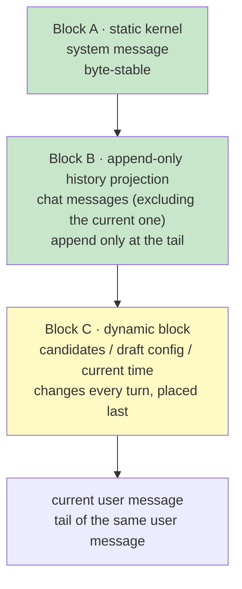

# Chat Session Context Orchestration Design (Chat Router)

> Version: v1.0 | Updated: 2026-10-21
>
> Related: [ADR-099](../../adr/en/ADR-099-chat-session-llm-router.md) (Chat Router decision), [ADR-060](../../adr/en/ADR-060-prompt-cache-friendly-context-block-reorg.md) (stable prefix + append at the tail), [ADR-063](../../adr/en/ADR-063-package-level-prompt-override.md) (package-level prompt overrides), [ADR-066](../../adr/en/ADR-066-llm-provider-cache-tokens.md) (cache token accounting), Design 27 (Intent Messaging and Group Chat)

## 1. Goals and Constraints

Every Chat Router turn is a **stateless** LLM call (a turn may call the model more than once when it runs information rounds — see ADR-099 D3): no resident session is created, and the context is rebuilt from chat history and runtime state. The orchestration must therefore satisfy three properties at once:

1. **Semantic completeness**: the model sees recent conversation, the current draft config, and the routable execute sessions;
2. **Prefix stability**: between adjacent turns nothing changes except the tail, maximising provider prompt-cache hits;
3. **Bounded cost**: both the history window and each message have hard caps, so group chats and long attachments cannot inflate the prompt.

The only design principle is **stable prefix + append at the tail** (ADR-060). Anything that changes every turn must live in Block C and must never enter Block A or B.

### 1.1 Non-goals

- Do not change the execute session's Block A/B layout (defined by ADR-060);
- Do not let the router read execute-session JSONL bodies (ADR-096);
- Do not summarise chat history — window trimming is a drop, because the router only needs recent context.

## 2. Three-block Layout



The final `messages` array:

| Index | Role | Content | Change frequency | Cache |
|---|---|---|---|---|
| `[0]` | system | Block A (base + persona + scenario) | process/package upgrade | `ephemeral` breakpoint |
| `[1..N]` | user/assistant | Block B (history projection, excluding the current message) | tail append only (batch rebuild on trim) | `ephemeral` breakpoint at the end |
| `[N+1]` | user | Block C + current user message (same message, Block C first) | every turn | not cached |

Block C and the current message are merged into one user message to avoid two consecutive user messages; see §5.3 for the format.

## 3. Block A: Static Kernel

### 3.1 Composition order

```
[chat.md override]               // present and non-blank: replaces all three layers below
                                 // a session-scoped (group) chat.md wins over the package prompts/chat.md
                                 // only {{agent_name}} is substituted
— otherwise the built-in default —
[CHAT_ROUTER_BASE_PROMPT]        // Runtime constant (acowork_core::chat_prompt)
                                 // role boundary / dispatch contract / decision rules / safety rules
## Persona                       // manifest fallback
<persona text>
## Scenario                      // 1:1 or group, two stable variants
<scenario text>
— appended in both cases —
## Identity                      // user language / timezone (identity_context)
<identity text>
```

The order is fixed and the separator is fixed (`\n\n`); no content-based sorting and no conditional omission beyond the documented fallbacks. The kernel, persona and scenario literals live in `acowork_core::chat_prompt`: `acowork-user` seeds a group session's `chat.md` from them and `acowork-runtime` assembles the built-in default from them, so the two can never drift.

### 3.2 Base

The base is maintained by the Runtime and contains:

1. Role boundary: you are the conversation front desk of `<agent display_name>`; you may answer, look a fact up, route, or create an execution session;
2. Tool contract: `dispatch` is the only routing tool, with its parameter semantics and alias rules; two read-only information tools are also exposed (`memory_recall`, `http_request` GET-only); the number of lookup rounds is a prompt-level soft limit ("usually zero, rarely one or two"), never a hard code cap;
3. Decision rules: answer / hand off / create / clarify (aligned with ADR-099's routing guidelines, whose core is the cost asymmetry of dispatch: a wrong handoff is far more expensive than a missed one — when unsure, ask);
4. Safety rules: use only information in the candidate list; never restate other chats; never promise execution details; never @ another agent on the human's behalf.

When a `chat.md` is present and non-blank it **replaces the whole built-in chat prompt body** (kernel + persona + scenario), with only `{{agent_name}}` substituted; absent, the built-in default is used. Two parts are never the file's to drop. First, the `# Safety` invariants are a non-trimmable tail the Runtime re-appends to the body on every turn (`chat_prompt::with_chat_prompt_tail`), so removing them from a `chat.md` has no effect on what the model sees. Second, the safety boundary is structural, not literal: the router only ever holds `dispatch` and the two read-only tools, so rewriting the prompt cannot grant it a new capability (ADR-099 D6). A group's `chat.md` is also **writable only by its owner or an admin** (ADR-098 governance) and read by any participant, so one member cannot inject a prompt that steers another member's agent. The right-hand panel edits the body only — the `# Safety` tail is not shown there (the `chat-md` API returns the body with the tail stripped) and is re-applied by the store and the Runtime on save, so a member is never handed editable text that saving would silently revert.

### 3.3 Persona and the `chat.md` precedence

Any non-blank `chat.md` replaces the whole built-in prompt, **not just the persona section**. Lookup order:

1. session-scoped `chat.md`: `acowork-user`'s `chat-sessions/{id}/chat.md`, `user_group` / `project_group` only, read by any participant and editable only by the group owner or an admin (ADR-098) from the group's right-hand settings panel; seeded with the built-in default (group variant, including the non-trimmable `# Safety` tail) on first read;
2. package `prompts/chat.md` (≤ 16KB, whitespace-only counts as absent; seeded with the built-in default on agent start, the layer a 1:1 chat uses);
3. the built-in default = kernel + manifest persona (`display_name` / `name` + `role` + `description` assembled into one sentence) + scenario.

`chat.md` joins the ADR-063 `OVERRIDABLE_PROMPTS` list:

- excluded from execute system-prompt assembly (the same exclusion rule as `summary.md`);
- refreshed by `POST /agents/{id}/prompts/reload`;
- viewable and editable in the Debug panel.

### 3.4 Scenario section

| Scenario | Detection | Additional rules |
|---|---|---|
| 1:1 (`user_agent`) | `chat_kind == "user_agent"` | draft-config semantics (the user edits config in chat), direct conversational tone |
| Group (`user_group` / `project_group`) | otherwise | multi-user speaker labels, @ target note, privacy rules, task follow-up rules |

The scenario text is **two independent stable strings**, so 1:1 and group each form their own cached prefix.

### 3.5 Stability rules

Block A must not contain:

- current time/date, "today"/"yesterday";
- candidate lists, session status, last-activity times;
- random values, request ids, message ids;
- any structure serialised in HashMap order.

`identity_context` changes only when the user's language/timezone changes (low frequency) and is acceptable.

### 3.6 Isolation from the execute prompt

The router loads none of:

| Source | Reason |
|---|---|
| `prompts/system.md` | execution identity and engineering conventions; induces task execution |
| `prompts/constraints.md` | execution behaviour constraints; conflicts with the router role |
| other `prompts/*.md` | task/output-format directives unrelated to routing |
| skills summary | execution skills; the router has no matching tools |
| workspace prompt file (AGENTS.md) | project execution conventions; belongs to the execution session |
| retrieved memory | changes every turn (breaks Block A) and belongs to execution context |

## 4. Block B: Append-Only History Projection

### 4.1 Message projection

Each chat message becomes one `ChatMessage`:

| chat kind | role | content format |
|---|---|---|
| `user_message` | user | `[user:<from>] <body>` |
| `agent_message` | assistant | `[agent:<from>] <body>` |
| `interaction_request` | user | `[card] <title>` + options (fixed format) |
| `system_notice` | user | `[system] <fixed text>` (see §4.3) |

Attachments are never inlined; only fixed-format metadata is appended:

```
[attachments] report.pdf (application/pdf, 12KB), screenshot.png (image/png, 340KB)
```

### 4.2 Determinism

The projection of a given chat message must be **byte-identical** across turns and process restarts:

- no relative time ("3 minutes ago") or absolute time;
- no message ids, offsets, or sequence numbers;
- truncation on UTF-8 character boundaries with the fixed suffix `…[truncated]`;
- per-message body cap `max_message_bytes` (default 2KB), attachment metadata cap 512B;
- fixed field order, no HashMap iteration.

The guard test is "two projections of the same input are equal".

### 4.3 Fixed text for cards and system notices

| notice_type | Projected text |
|---|---|
| `turn_started` | `[system] A round started in session <sid8>` (`sid8` = first 8 chars of meta.agent_session_id) |
| `interaction_request` | `[card] <title>` + one line per option |
| `delivery_failed` | `[system] Delivery failed` |
| `budget_exhausted` | `[system] Conversation budget exhausted` |
| `truncated` | `[system] Response truncated` |
| `unavailable` | `[system] Agent unavailable` |
| `router_fallback` | `[system] Routed automatically` |

`<sid8>` comes from the message meta and never changes after write, so the projection is stable.

### 4.4 Window anchor and batch trimming

The naive "last N messages" implementation drops the oldest message on every new one, shifting the whole array and changing the prefix hash — cache hits collapse to near zero. This design uses an **anchor + batch trim** to amortise rebuilds:

- `anchor_seq`: the front boundary of the window — the `seq` of the newest row already excluded; every returned row satisfies `seq > anchor_seq`;
- `max_history`: default 32 (widened from 24 once the router gained information tools — the think/tool rounds a lookup spends inside one turn eat context, so a few more conversation rows must stay in view to judge relevance well);
- `slack`: default 8;
- `retain`: default 16.

Per turn:

```
history = rows with seq > anchor_seq      // excluding the current message
if len(history) > max_history + slack:
    keep the newest retain rows             // trim the excess in one go
    anchor_seq = seq of the newest dropped row
if total_bytes(history) > max_bytes:        // backstop for extremely long messages
    drop from the front until max_bytes fits
    anchor_seq = seq of the newest dropped row
```

In steady state `anchor_seq` is unchanged and Block B only grows at the tail; a batch rebuild happens roughly once every `slack + retain` turns. `anchor_seq` lives in ChatSessionManager memory; after a Runtime restart there is no persisted anchor, so the window is re-anchored to the newest page (one acceptable miss). `max_history` is capped below the Gateway's 50-row page so the whole window always fits in one page.

### 4.5 Excluding the current message

The Gateway persists before delivery, so the current user message is already at the end of chat history. Block B must exclude it to avoid duplication after merging with Block C (the same lesson as ADR-060 §5.5):

- group @: match by `in_reply_to` (the shared `user_message` row id);
- 1:1: match by the envelope `message_id`.

If matching fails (e.g. a pagination boundary), keep the history as-is — prefer one duplicate over a dropped message.

## 5. Block C: Dynamic Block at the Tail

### 5.1 Contents

| Field | Example | Notes |
|---|---|---|
| `now` | `2026-10-21T14:03:00+08:00` | current time (appears only here) |
| `speaker` | `alice` | sender of the current message (required in groups) |
| `surface` | `group` / `dm` | scenario |
| `draft` | `model=claude-sonnet, workspace=ws-1` | envelope `session_config_json`, empty if absent |
| `candidates` | see §5.2 | at most 10 |
| `task` | `project=proj, task=T-12` | only for PM task follow-ups |
| `attachments` | `report.pdf (application/pdf, 12KB), shot.png (image/png, 340KB)` | this turn's attachment metadata; the line is **identical** to the history projection in §4.1, produced by the same render function |

The attachment line appears only when the turn actually carried files, and always sits right after `[user message]`. It is **byte-for-byte** the line Block B paints for the same message once it becomes history — the turn being routed and the same turn viewed as history must look alike, otherwise the router quotes an old screenshot while being blind to the one just attached.

### 5.2 Candidate list format

```
[candidates]
S1  current  working  2m   chat   Fix login redirect
S2           idle     3h   task   Review ADR-098
S3           closed   2d   chat   Refactor auth middleware
```

Columns: alias, `current` marker, status, last activity (relative time allowed only here), source (chat/task), title. No session ids, owners, or models — fewer tokens and less leakage; the router acts through the alias only.

Ordering: `current` first, the rest by `last_active_at` descending. The order is stable (ties broken by title) so the same candidate set renders identically every turn.

### 5.3 Merge with the current message

Block C and the current message are merged into the final user message:

```
[runtime context]
surface: group
speaker: alice
now: 2026-10-21T14:03:00+08:00
draft: (none)
[candidates]
S1  current  working  2m  chat  Fix login redirect
S2           idle     3h  task  Review ADR-098

[user message]
Continuing the login redirect issue, and please check the review comments on ADR-098
[attachments] login-error.png (image/png, 182KB)
```

An attachment-only turn (empty or whitespace-only `text`, at least one attachment) is **not** an empty message: the `[user message]` slot carries the fixed placeholder `(no text — the message is its attachments)` followed by the attachment line. An empty body reads as "the human said nothing" and biases the model away from routing; the fixed placeholder says they sent something and simply did not type. The placeholder is byte-fixed (decision reproducibility) and shares one predicate with the decision log's `attachment_only`, so "the log says attachment-only while the prompt rendered text" cannot happen.

The benefit: the final message carries the whole "this turn" view, while the system and history before it stay byte-stable.

## 6. Request Parameters and Caching

### 6.1 cache_control breakpoints

| Provider | Mechanism | Breakpoint |
|---|---|---|
| Anthropic | explicit `cache_control: {type: "ephemeral"}` | the Block A system message, and the last Block B message |
| OpenAI / Azure | automatic prefix cache | no marker; relies on byte stability |
| DeepSeek / other OpenAI-compatible | automatic prefix cache (if supported) | same |
| Ollama | none | ignored |

The `ChatMessage.cache_control` field already exists (ADR-060); only the flagging is new. Block C and the current message are not breakpoints.

### 6.2 Fixed request parameters

Byte-identical across turns:

- `model` / `provider` (from the `chat_router` config, independent of messages);
- `temperature` (default 0), `max_tokens` (default 2048 — enough that one `assistant → tool_call → tool_result → assistant` round of think + tool arguments + final text is never cut mid-call);
- `tools`: `dispatch` plus the read-only information tools the agent has enabled (`memory_recall`, GET-only `http_request`), serialised from fixed literals in fixed field order — byte-stable for a given (binary version, enablement set);
- `tool_choice`: `auto`, never varying;
- the `assistant(tool_calls)` / `tool` messages an information round produces live only inside that turn's request — never written back to chat history, never entering Block B.

### 6.3 Minimum cacheable length

Some providers require a minimum prefix length to cache (typically 1024 tokens). Block A is usually 1–2KB; A+B passes the threshold after a few turns. Do not pad content for this; report hit rate against the cacheable prefix.

### 6.4 prefix_hash

Hash `Block A bytes + tools schema bytes + Block B bytes` (e.g. first 8 bytes of SHA-256) and record it in the decision log. Uses:

- verify the prefix is unchanged in steady state;
- identify which change (prompt, trim, projection format) invalidated the cache.

## 7. Observability

Each `chat-router-decisions.jsonl` line adds:

```json
{
  "prefix_hash": "9f2c1a7b",
  "anchor_seq": 42,
  "history_len": 18,
  "attachments": 1,
  "attachment_only": false,
  "prompt_tokens": 3120,
  "cache_read_tokens": 2816,
  "cache_write_tokens": 0,
  "hit_rate": 0.90
}
```

`attachments` is a **count** of this turn's files; `attachment_only` marks the placeholder branch of §5.3. Neither records filenames, mime or size — the decision log is routing metadata, not message content (ADR-096). They exist for observability: before them, a turn carrying a file and the same text carrying nothing produced identical log lines, which is why the router's blindness to attachments stayed invisible. Older lines read as `attachments: 0` / `attachment_only: false`, so the format stays backward compatible.

Acceptance targets (v1):

| Metric | Target |
|---|---|
| Share of steady-state turns with an unchanged `prefix_hash` | ≥ 90% (100% for turns without a trim) |
| OpenAI steady-state `cache_read / prompt_tokens` | ≥ 70% |
| Anthropic steady-state `cache_read / (input + cache_read + cache_write)` | ≥ 60% |
| Batch rebuild frequency | at most once per `slack + retain` turns |

Metrics are observational only and never change routing behaviour.

## 8. Failure and Fallback

| Scenario | Handling |
|---|---|
| chat history read fails | this turn uses Block A + Block C only; the prompt notes history is unavailable; fall back to the legacy router |
| current message matching fails | do not delete history; allow one duplicate |
| provider has no cache | behaviour unchanged, only extra token cost |
| `chat.md` too long/unreadable | truncate on a UTF-8 boundary when too long; log a WARN and fall back to the built-in default prompt when unreadable |
| Block A assembly fails | use the built-in base + display_name so the turn stays available |

## 9. Test Plan

- **Projection determinism**: two projections are byte-equal; card text is fixed; truncation preserves UTF-8; attachment metadata format is fixed.
- **Prefix stability**: with the window not exceeded, `prefix_hash` is unchanged for N consecutive turns; trims happen only at the threshold; `anchor_seq` moves in batches.
- **Block isolation**: Block A has no dynamic content; Block C has no history; the current message appears exactly once.
- **Cache markers**: after Anthropic serialisation, `cache_control` appears only at the intended positions; OpenAI requests do not carry it.
- **Prompt layering**: any non-blank `chat.md` replaces the whole built-in chat prompt; absent, the built-in default (kernel + manifest persona + scenario) is used; `chat.md` never enters the execute prompt.
- **Regression**: routing results after a trim equal those without a trim (fixed MockProvider output).

## 10. Relationship to Other Documents

| Document | Relationship |
|---|---|
| ADR-060 | Extends the Block A/B principle to the chat layer and adds Block C |
| ADR-063 | `chat.md` is a new package-level override, excluded from the execute prompt symmetrically |
| ADR-066 | Reuses cache-token accounting and hit-rate semantics |
| ADR-096 | Candidates and history are read through bounded reads, never JSONL bodies |
| Design 27 | Message vocabulary and write-back channels are unchanged; this design only decides what enters the model |
