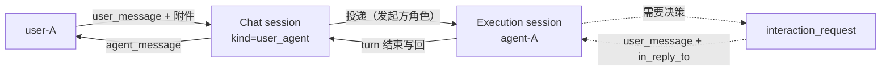
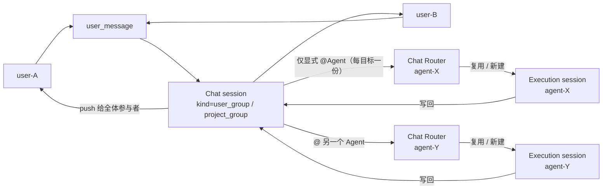
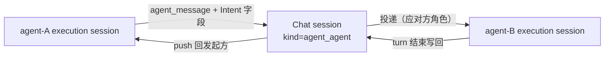
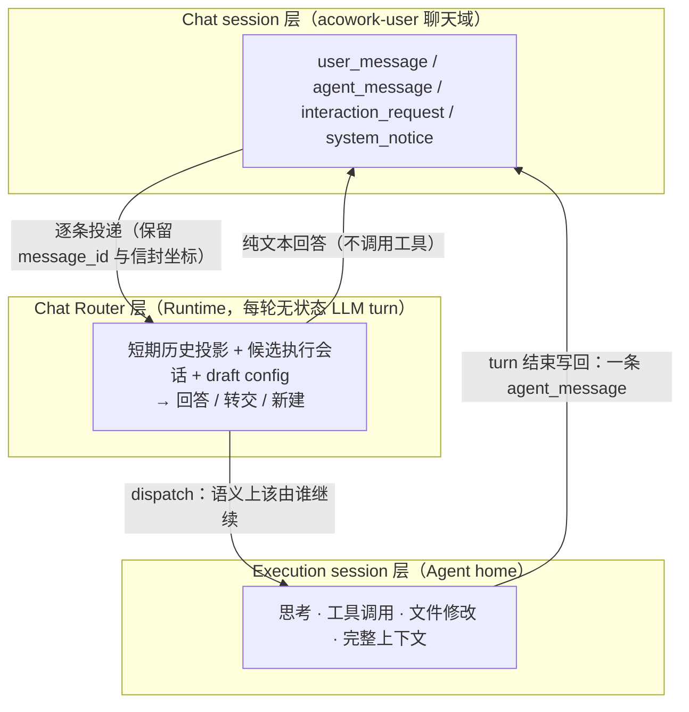
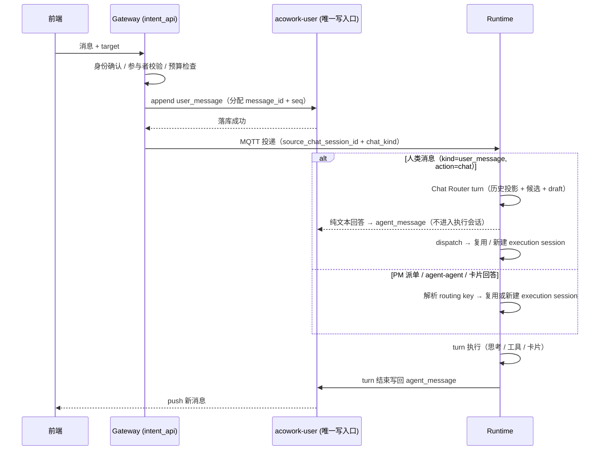
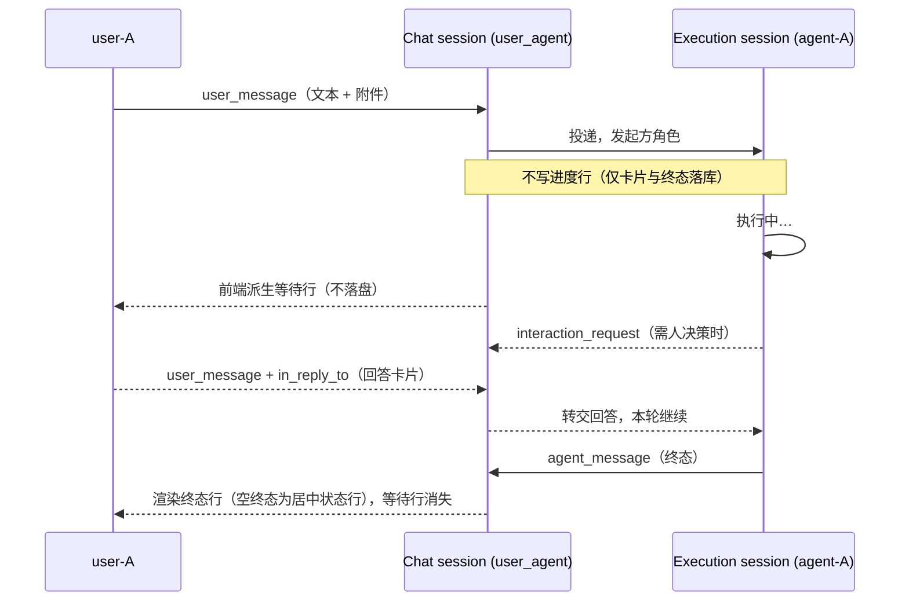
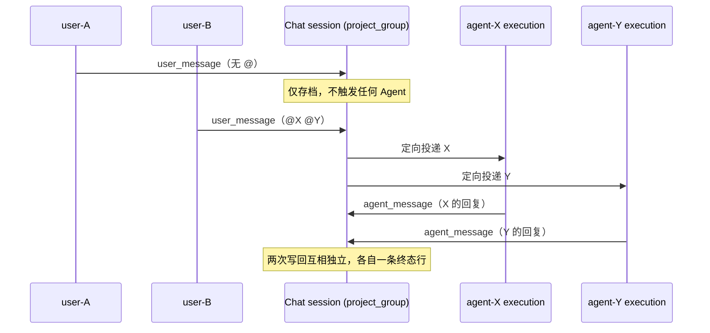
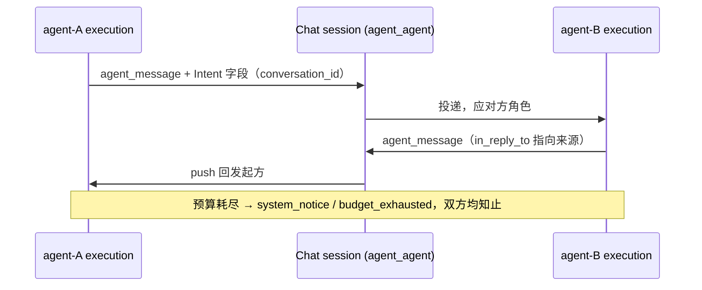
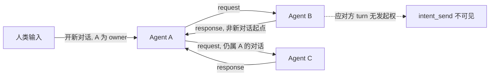
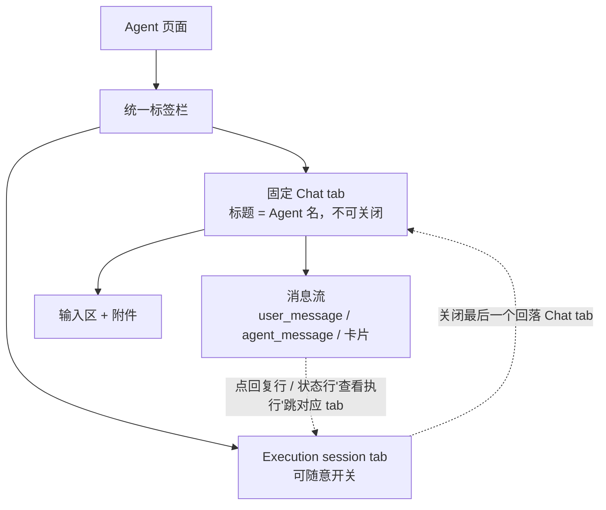

# Intent 通信与聊天 Session 设计

> 状态：设计定稿（框架、需求、数据模型、协议、前端、模块边界已确认；API 与 schema 细节待实现设计）
> 版本：v2.8 | 更新日期：2026-10-25
>
> v2.8 为**轮次来源词汇表与 PM 派发链路修订**（ADR-102）：① Intent 信封 `kind` 定型为四值词汇表（`user_message` / `pm_task` / `request` / `response`，未知与空值按 `request` 保守兜底），接收侧的路由、渲染、角色、写回四个决策点一律由 `TurnOrigin` 策略表决定，废除以 `conversation_id` 前缀字符串匹配猜场景的潜规则；② PM 派发的唤醒 playbook 从用户消息正文拆为信封字段 `assignment_brief`，由 Runtime 注入执行会话的系统块，不进任何聊天表面、不随会话历史持久化；派发 chat 行只带人读文本与 `meta.task_id`（渲染为任务胶囊；`project_id` 移除——行本就活在该项目的群里）；③ 派发触发源收敛为 PM 侧扫描器（`start_at` 到期 + 审批闸门 + 依赖闸门），撤销事件钩子；投递重试以持久化的 `dispatch_message_id` 为代次身份幂等（chat 行与信箱预算每代次各只占一份），退避 60s→5m→15m→30m、五次失败放弃。逐项见 §4.5 字段表、§5.4.2、§5.4.5、§13。
>
> v2.7 为**执行会话轮转机制删除**（ADR-099 2026-10-24 修订）：T1（空闲间隔）/ T2（任务终态或发生过 compaction）与已取消的 T3（配置冲突）一并从设计中删除，连 successor / predecessor / handoff 与两个配置项。理由：execute session 本就是可一直追加的会话，压缩过的历史会话同样能继续接 dispatch与迭代；T1/T2 是「没有 LLM 做路由判断」时代用物理信号近似「任务该结束了」的产物，语义决策上提到 Chat 层后它们不再承担任何路由含义，而 T2 的 handoff 摘要正是本设计要消灭的污染。收敛后的规则：执行会话**长命**，上下文卫生只有 compaction 阈值，文件规模只有 JSONL 硬上限，开新会话只有三个显式来源（router `dispatch(new)` / PM task 终态 close / 用户手动新建）。逐项见 §2.4 术语表、§3.3 非功能需求、§3.4 决策 3 / 4 / 23、§4.1、§4.5.2、§6.2。
>
> v2.6 为**执行视图输入入口修订**（ADR-100 D12）：绑定 chat 的 execution session，其 composer 的发送改走 `POST /api/intents/chat-message` 并携带 `for_execution_session` 指名自己——Gateway 以**调用者身份**落一条 `user_message`（补上 v2.5 只回写尾、不落头的半轮对话），Runtime 收到带指名的消息后**跳过 Chat Router** 直投该会话，以 `SessionMessage::ChatMessage`（不是 `Intent`）进入与执行面原路径逐项等价的流程，因此 slash 技能、附件、JSONL 用户行**零能力回退**。pin 是提示不是闸门（目标未加载 → 清空 hint 落回正常路由）；`message_id` 由客户端 mint，在 chat 行 / 执行会话 JSONL 行 / 乐观气泡三处对齐。逐项见 §2.2 决策 29、§4.2 kind 表、§5.5.5。
>
> v2.5 为**路由反应行与降级落点修订**（ADR-100 D11 / ADR-099 D8 修订）：① 恢复且仅恢复一条 durable 反应行 `turn_routed`——路由结论得出时写入，渲染为 agent 头像 + 名字 + 气泡（"启动新任务：X" / "继续之前的任务：X"），补上 v2.4 连带取消的即时对话反馈（用户消息之后必须紧跟 agent 消息的交互感不变量）；② chat 来源的人类消息在 router 降级时**新建**执行会话而非复用 intent_map 映射；③ 确立头像不变量：居中终态行不折叠其后 agent 气泡的头像。逐项见 §2.2 决策 20 / 28、§4.2 kind 表、§5.5.5。
>
> v2.1 为 **user-agent 单聊形态修订（微信模型）**：每个 (user, agent) 恰好一条 Chat session，作为 Agent 页标签栏的**固定 tab**（标题 = Agent 名），不可关闭、不建列表；execution session 是同一标签栏里可随意开关的普通 tab，与 Chat tab **共存**而非互斥。撤销 v2.0 §5.4.4「点 `+` 新建第二条同 pair 会话」与 §5.5.2「Chat history 列表按钮」。逐项见 §13 v2.1 修订。
>
> v2.0 为**结构重排**：内容按「整体框架 → 需求分析 → 数据模型 → 通信协议 → 前端交互 → 模块分解 → 安全权限 → 落地计划」重组，新增框架图、术语表、非功能需求、数据结构与对外接口、三形态时序图、前端交互设计、权限模型与 ADR 一致性核对。章节编号全部变更，新旧对照与已失效引用清单见 §12。
>
> 关联设计：[06-communication.md](./06-communication.md)、[12-tool-system.md](./12-tool-system.md)、[15-conversation-persistence.md](./15-conversation-persistence.md)、[21-pm-project-management.md](./21-pm-project-management.md)
> 关联协议：[MQTT 协议](../../protocols/zh/mqtt.md)、[HTTP 协议](../../protocols/zh/http.md)

## 1. 概述


本文定义 ACowork 的 Intent 通信与聊天 Session 设计，覆盖用户、Agent、群聊及 PM 之间的消息语义、存储边界、接收 Agent session 选择、对话所有权、回复送达与历史读取。

**Intent 是一条发给 Agent 的消息，不是任务编排协议。**对接收 Agent 而言，Intent 等价于一条触发 Agent 执行的用户消息。发起方可以是真实用户、另一个 Agent，或代表项目 owner 行事的 PM。接收 Agent 在自己的 Agent execution session 中处理消息，处理过程和思考留在该 Agent session；请求和回复作为 Intent 消息记录在双方共享的 chat session 中。

**核心原则：Chat session 记录交流；Agent execution session 记录执行。**二者是不同的会话模型，有各自的数据格式、写入方、生命周期和前端入口。Intent 将 chat session 中的一条消息路由为目标 Agent execution session 的输入；Agent 回复再作为消息写回来源 chat session。

项目群聊是 `acowork-user` 聊天域中的一种特殊 chat session。未来的普通用户群聊、user-agent 群聊和 Agent-Agent 一对一聊天使用同一聊天模型，不为每种参与者组合另建一套会话存储格式。

**本设计关闭的一个结构性缺口：user-agent 单聊此前没有 Chat session。**类型表里列了 User-Agent chat，但落地路径把它排除在 Chat session 之外（用户与 Agent 的普通对话只走 execution session + Session history），于是"打开一个 Agent"和"打开一个聊天对象"是两件不同的事，Agent 页面无法与群聊共用同一套会话 UI。本版把 user-agent 单聊定义为 Agent 页面的默认 Chat session（§5.4.4）：用户打开 Agent 即进入与它的**唯一**默认会话（每 pair 恰好一条，像微信里与联系人的对话），在其中发消息触发该 Agent 的 execution session 执行任务。群聊、单聊、agent-agent 从此是同一个模式的三种实例。

## 2. 整体框架

本章是全篇的心智模型：三种会话形态、两层 session 职责、以及它们之间的消息流。后续各章展开细节；遇到具体规则时，回到本章定位它在整体中的位置。

### 2.1 三形态框图

ACowork 的会话只有三种形态，全部共用同一套 Chat session 存储、同一消息词汇表、同一唯一写入口。区别只在**参与者构成**与**触发规则**。

#### 2.1.1 User-Agent（单聊）



打开 Agent 即进入该 pair 唯一的默认 Chat session（固定 tab，标题 = Agent 名，v2.1）；每条人类消息都触发 Agent 处理，不需要 @。

#### 2.1.2 Group-Agent（群聊 / 项目群聊）



普通群消息只存档不触发；@ 才定向投递，且 @ 只决定"唤醒哪个 Agent"，不决定"进入哪个执行会话"。每个被 @ 的 Agent 各自跑一次 Chat Router（ADR-099），在本群候选集（仅 `meta.chat_session_id` 指向本群聊的执行会话，含该群的 PM 任务会话）内按语义复用或新建；因此同一群里的多个话题可以并行到不同执行会话，而不是全部串进一条 `chat:{group}` 链。多 Agent 被 @ 时各自独立执行、独立写回。

#### 2.1.3 Agent-Agent



无人类参与者，因此不产生决策卡片；A-B 交流**永不**写入 A 与用户的单聊会话。

### 2.2 两层会话模型



边界不变量见 §2.3：Chat session 记录交流，Execution session 记录执行，Chat Router 决定"这条交流该落到哪个执行会话"。Router 是**无状态 turn**——它读 Chat session 的投影，不拥有持久会话、不写执行轨迹；产出只有两种：一条面向用户的回答，或一条带目标的投递决定。


### 2.3 Session 边界不变量

| 维度 | Agent execution session | Chat session |
|---|---|---|
| 职责 | Agent 执行上下文 | 用户与 Agent / Agent 之间的消息历史 |
| 权威存储 | 对应 Agent home / Runtime，沿用现有格式 | `acowork-user` 聊天域 |
| 内容 | 用户输入、模型输出、思考、工具调用等现有运行历史 | 固定类型的消息：`user_message` / `agent_message` / `interaction_request` / `system_notice`，含附件 |
| 写入者 | 对应 Agent Runtime / 现有 session API | `acowork-user` 的唯一聊天写入口 |
| 是否有 LLM | 是（执行 turn，工具集完整） | 是（Chat Router：每轮无状态、只读投影，工具集仅 `dispatch`） |
| 前端入口 | Agent 页统一标签栏里的 execution session tab + Session history | Agent 页固定 Chat tab（每 pair 唯一会话，v2.1） |

禁止把 Chat session 的消息复制成 Agent 思考或工具调用；也禁止把 Agent 内部思考、工具调用写进任何 chat session。Chat 消息与执行历史是两个不同的视图域（v2.1：user-agent 单聊的 Chat 视图是固定 tab，execution 历史经 Session history 与 exec tab）。

**v2.2：Chat session 成为 LLM 的输入，但不是 LLM 的存储。**引入 Chat Router 后，chat 层确实有一个 LLM 在读这段历史，但它是**每轮重建的无状态投影**：不落 router 会话、不写思考、不累积自己的上下文，chat 历史仍是唯一权威（ADR-099）。因此上表的分工不变，新增的只是"谁来决定消息落到哪个执行会话"——由语义判断承担，而不是由 `routing_key` 的键运算承担。

**卡片是唯一的例外，且是语义上的例外而非漏洞。**`interaction_request` 引用的确实是执行内事件（一次待审批的工具调用、一次暂停态），但进入 Chat session 的是**"需要有人做决定"这一交流事实**，不是那个工具调用本身：卡片携带决策所需的摘要，不携带 tool payload、命令行、内部错误 detail 或思考过程。审批结果落回 execution session 继续执行，Chat session 只记录"谁在什么时候答了什么"（§5.5.4）。区分标准是：**这条消息的内容是否对会话的其它参与者有意义**。有 → 进 Chat session；只是 Agent 自己的进度 → 留在 execution session。

轮次进度同样遵守这条：**"已派发 / 已开轮"这类运行时状态不进 Chat session**，它只在当前窗口以一条前端派生的等待行呈现；进 Chat session 的是对话本身与终态事实（为何没有回复）、路由结论这一条对话反馈（`turn_routed` 反应行，"这条消息去了哪个任务"，v2.5），以及指向该轮的 `agent_session_id`；**处理到哪一步、正在调哪个工具，不进 Chat session**，靠"查看执行"跳转进 execution 视图（§5.5.5）。

### 2.4 术语表

| 术语 | 定义 | 不是什么 |
|---|---|---|
| **Chat session** | 持久对话记录，`acowork-user` 聊天域拥有，五种 kind 共用同一物理结构 | 不是执行容器，不含思考与工具调用 |
| **Execution session** | Agent 的执行上下文，Agent home 内的 JSONL + meta | 不是对话记录，不跨 Agent 共享 |
| **kind** | Chat session 的参与者构成类型：`user_user` / `user_group` / `project_group` / `user_agent` / `agent_agent` | 不是物理存储差异 |
| **Intent** | 消息上的一组寻址与回复**字段**（`conversation_id`、`in_reply_to`、`agent_session_id`、`repo`、`status`） | 不是一种消息类型，不是任务编排协议 |
| **发起方 / 应对方** | 一轮 turn 的角色，由**入站消息类型**决定，不由模型声明 | 不是模型可自选的属性 |
| **routing key** | Runtime 侧逻辑执行映射的键：`task:` > `chat:` > `conv:` > `msg:` | 不是物理 session id；它指向一个长命的 execution session |
| **Chat Router** | 人类消息的语义路由：每轮无状态 LLM turn，只产出回答或 `dispatch` 决定（v2.2） | 不是常驻会话，不是执行者，不拥有上下文 |
| **候选集** | router 可选的目标执行会话清单，按 chat 绑定与 owner 硬过滤（≤ 10） | 不是全量 session 列表，不是权限授予 |
| **决策卡片** | `interaction_request`：需要人做决定，阻塞 | 不是执行进度展示 |
| **在途等待行** | 运行期由前端派生、不落盘的居中状态行（"{{agent}}正在处理…"），不阻塞 | 不是持久化事件行，不是 live 镜像卡 |
| **唯一写入口** | 每个 Chat session 的单写者串行队列，`seq` 单调、`message_id` 幂等 | 不是全局串行 |
| **可见性** | 读权限作用域：owner / Chat session 参与者 / 平台级 | 不是「群聊 = Public」 |

## 3. 需求分析

### 3.1 设计目标

1. 提供统一的来源会话 / 回复地址模型，支持 user-user、user-agent、Agent-Agent、PM 派单和群聊中 @Agent。
2. 让 Agent 保留现有 Agent session 存储格式和模型；Intent 只触发目标 Agent 在其 execution session 中处理用户消息。
3. 在聊天域中统一保存聊天消息；聊天记录绝不包含 Agent 的思考过程、工具调用或工具执行细节。
4. 由明确的业务入口决定目标 Agent execution session 的创建或复用，不要求发送方或模型推断 thread 边界。
5. `repo`（代码仓库地址）是 Intent 的可选字段，项目有仓库时由系统在派发时自动注入；授权用户之后可以修改 session 配置，包括工作目录。
6. 单个 chat session 的消息由唯一后端写入口按序串行写入，避免并发写入和顺序不确定。
7. 结果通过 push 送达：应答方的回复由系统写回 Chat session 并路由回发起方，发起方不轮询取结果。
8. 一次对话有唯一 owner（发起方），由 owner 决定何时结束；应对方没有发起新对话的能力。
9. `chat_history_read` 按 offset/count 渐进读取 Chat session 中"不属于本次对话"的消息，并由服务端实施硬性读取上限。
10. Agent 在群聊中默认不发言；明确 @Agent 才向其发送 Intent 并触发处理。

### 3.2 非目标

- 不为 Intent 引入复杂任务生命周期、回调编排或通用状态机。
- 不把 Agent execution session 改造成群聊存储，也不将群聊消息注入 Agent 的执行历史文件。
- 不允许普通聊天消息隐式广播给群内 Agent。
- 本文不要求实现外部 ACP 兼容 API；ACP 仅作为能力描述、消息结构等方面的参考。

### 3.3 非功能需求

| 维度 | 要求 | 依据 |
|---|---|---|
| **成本** | 决策卡片默认不结束本轮；只有无人类可答或超时才以 `waiting` / `aborted` 收尾。一次任务的审批次数不得与 turn 重放次数线性相关 | §5.5.4 |
| **延迟** | 发送侧即时反馈由前端派生的等待行承担（`sending` 在途即显示，但仅当该 chat 有 agent 参与者；私聊不显示），不靠落库 | §5.5.5 |
| **可靠性** | 任何会写回的 turn 无论成败都必须写回，含崩溃兜底；不允许存在「发完消息永久无响应」的状态 | §5.5.1 |
| **幂等** | `message_id` 全 kind 必填，重复投递不产生第二行；`seq` 单调 | §4.6 |
| **可回滚** | 不迁移历史；Chat surface 不可达（无账号 / 用户服务异常）时 Agent 页退回旧 exec 形态 | §9.1 |
| **安全** | 无人类可答的会话不得创建需要人的东西；越权读执行记录返回 hidden 404；卡片不得成为枚举探针 | §8 |
| **可观测** | 对话预算、路由决策、写回失败均须可查，且 Gateway 重启不得丢失预算计数 | §5.7 |
| **边界纪律** | Gateway 不承载业务逻辑，不直接访问 Node-local Agent home；业务事实由 Runtime 经唯一写入口落库 | §7.1 |

### 3.4 决策结论

以下为讨论中已确认的决策，作为本设计的结论性内容。

1. **Chat session 只存固定类型消息。**不包含 Agent 思考过程、工具调用或工具执行细节。卡片是语义上的例外：进会话的是"需要有人决定"或"这一轮已开始"这一交流事实，不是执行事件本身。

2. **Chat 消息与执行记录是两个独立视图域。**user-agent 单聊的 Chat 视图是 Agent 页的固定 tab（不靠列表入口进入）；execution 记录经 Session history 与 exec tab 可达。群聊 Chat session 从项目等业务视图进入（v2.1 修订，原「两个入口」表述已失效）。

3. **Intent execution session 不轮转。**Intent 执行结束且结果写回 Chat session 之后，映射仍指向同一个 execution session，后续消息在同一上下文里继续迭代；Chat session 在此过程中始终不变。开新执行会话是**语义决定**而非物理事件：router 的 `dispatch(new)` 新建一条执行链（无 predecessor、不携带旧话题摘要），PM task 终态则 close 映射（§2.1 / §4.1 / §6.2）。

4. **执行会话没有代码级轮转点（v2.7 修订）。**v2.2 曾保留 T1（空闲间隔）与 T2（PM task 终态或发生过 compaction）并取消 T3（`session_config` 与映射 session 自身配置冲突即新建 successor）；现在三态全部删除——配置差异与物理信号都不再具有路由含义。开新执行会话只有三个显式来源：router 的 `dispatch(new)`、PM task 终态 close、用户手动新建；上下文卫生由 compaction 阈值单独负责（§4.1 / §4.5.2 / ADR-099 2026-10-24 修订）。

5. **前端交互 = 语义自动分配 + 显式新建（v2.2）。**默认由 Chat Router 判断复用或新建；用户仍可点会话栏的 `+` 直接创建 execution session——创建请求带上当前 `chat_session_id`，由 Runtime 建立与 `dispatch(new)` 相同的绑定对。这条确定性逃生舱不经过 router：创建后切到 exec 视图，消息直达该会话。自动创建的会话不绑定（ADR-099 D9）。

6. **Agent 页面默认打开 user-agent Chat session。**用户打开某个 Agent 时进入其与它的**唯一** Chat session（每个 (user, agent) 恰好一条，首次打开时幂等创建，v2.1）；群聊、单聊、agent-agent 使用同一套会话模型、消息词汇表与写入口。Agent 的 execution session 不迁移，仍由 Session history 与 exec tab 承载（§5.4.4）。

7. **Chat session 是持久对话记录，在途轮次只是当前窗口的运行期状态。**前端 = 历史渲染自 Chat session + 在途渲染自"最新消息尚未被终态回答"这条派生判据；轮次结束、`agent_message` 落库后，等待行让位给持久行。

8. **对话所有权采用 C / S 式模型。**发起方拥有并负责结束对话；应对方只有应答权，无发起权；单个对话的 request 次数设服务端可配置上限（默认 6）；需要第三方信息时把问题写回发起方，不由应对方转问。

9. **应对方 turn 的工具集合裁剪。**应对方 turn 的工具集合中移除 `intent_send` 与 `ask_user_question`，靠工具可见性强制而非运行时报错。

10. **repo 是可选字段，且是地址不是路径。**规范化 remote URL；项目有仓库时由服务端注入，发送方不填路径；接收侧只在自身已注册 / 已授权的工作目录集合内读写，不自动 clone、不建 worktree；格式非法与越权访问均为明确拒绝型错误。

11. **每个 chat session 由后端唯一写入口串行写入。**消息按时间顺序追加，`message_id` 幂等去重。

12. **Intent 词汇表统一为消息类型。**`user_message` / `agent_message` / `interaction_request` / `system_notice` 四类；`conversation_id`、`in_reply_to`、`agent_session_id`、`status` 等 Intent 信息降为字段，不再作为独立消息类型存在（§4.2）。

13. **人类消息是 `user_message`，不是 Intent request。**用户单聊消息若被实现成 request 语义，Runtime 会把该轮判成应对方并摘掉 `ask_user_question` / `intent_send`，单聊即失效。传输可复用 Intent 投递管线，入站类型必须是人类输入、本轮角色是发起方（§5.4.4 / §5.4.5）。

14. **回复写回与本轮角色无关。**只要入站消息携带 `source_chat_session_id`，本轮结束必须写回 `agent_message`——早期版本只在应对方 turn 结束时写回，会使单聊会话永远为空（§5.5.1）。

15. **卡片类型统一、语义按可答者分流。**`interaction_request` 覆盖 ask question、权限审批、暂停续跑、重试等所有需要人决策的东西，持久化用"无 `in_reply_to` 指向它 = 未决"表示；但"本轮持有等待"还是"结束本轮"按卡片类型与成本决定，且纯 agent-agent 会话不创建需要人的东西（§5.5.4 / §5.4.5）。

16. **Chat session 是 Agent 页固定 tab，与 execution session tab 共存。**打开 Agent 必然落在 Chat tab 上，它不可关闭、不可删除；execution session 是同一标签栏里的普通 tab，可随意开关，关掉最后一个也只是回到 Chat tab。`+`、Session history 都是 exec tab 的入口——后台不等于隐藏（§5.4.4 / §6.1，v2.1 修订）。

17. **chat 是对话历史，轮次进度不进历史（v2.4 修订，依次撤销 v2.1 的"执行状态卡片"与 v2.3 的"进度事件行"）。**落库的是对话与终态事实（`agent_message` / `interaction_request` / 通道回执）；"已派发 / 已开轮"这类中间状态**既不落 Chat session、也不在 chat 侧读时投影**，只在当前窗口由前端派生一条等待行。v2.1 的 live 镜像卡是在 durable 事件日志上叠加的第二块真相，两块永远对不齐（派发后到回复前的可见性空窗、stop 时卡片与仍在跑的 pending 新一轮打架）；v2.3 的进度行则是把运行时事实写进了历史——对三个月后翻记录的人零信息量，反而淹没对话。两者都删（§5.5.5）。任何状态落库都会在一轮内产生几十次改写，破坏 §4.6 的 append-only 单写入口。

18. **轮次是否结束由聊天终态行决定，不由 `Idle` 决定。**chat 侧不读 `Idle`；等待行在出现 answering 的终态 `agent_message`（或一张未关闭的决策卡片）后消失——"已被回答"这件事有唯一的 durable 判据（§5.5.5）。

19. **群聊触发的 execution session 对该群聊全体参与者可读。**判据由 routing key `chat:{chat_session_id}` 派生，不建独立 ACL；**不得复用 `SessionVisibility::Public`**，它是平台级可见，会让非群成员读到群执行历史。agent-agent 会话的执行记录不对界面外的人类开放（§5.5.5）。

20. **中间状态无人写，但对话反馈有一条 durable 反应行（v2.5 修订）。**v2.3 的 `turn_dispatched` / `turn_started` 指针行已下线：Runtime 只写对话与终态（§5.5.1），运行中的等待反馈由前端派生等待行承担。但 v2.4 连带取消了即时对话反馈，实测留下更基本的缺口：人类消息之后到回复之前（可能数小时）chat 里没有任何 agent 的话。聊天的交互感来自有来有回——**用户消息之后必须紧跟 agent 头像 + 名字 + 气泡**。因此 v2.5 恢复且仅恢复一条 durable 反应行 `turn_routed`（"启动新任务：X" / "继续之前的任务：X"，路由结论得出时写入，ADR-100 D11）：它回答"这条消息去了哪个任务"，是对话事实而非进度。1:1、人类群聊 @、PM 任务派发三条链路走同一路由，前端共用同一渲染器（§5.5.5）。

21. **不迁移历史。**既有 execution session 留在 Session history，新会话才建 Chat session；好处是该步完全可回滚。（v2.1：两个列表并存的代价表述已失效——Agent 页不再有 chat 列表，并存的是固定 Chat tab 与 exec tab。）

22. **Chat 层引入 LLM 语义路由（v2.2，ADR-099）。**每条人类消息（1:1、群聊 @Agent）先经过目标 Agent 的 Chat Router：一次无状态 LLM turn，工具集只有 `dispatch`，产出"回答 / 转交已有执行会话 / 新建执行会话"三种决策。PM 派单、agent-agent 与卡片回答不经过 router。

23. **Router 不拥有会话。**不建隐藏常驻 session，上下文每轮从 chat 历史 + 候选清单 + draft config 重建；chat 历史是唯一权威，避免双历史分叉与额外的会话生命周期维护。

24. **候选集按 chat 绑定与 owner 硬过滤。**1:1 只列当前 chat 映射、该 chat 的历史 predecessor、以及该用户 owner 且未绑定 chat 的会话；群聊只列 `meta.chat_session_id` 指向本群的会话（含 PM 任务会话）。候选上限 10，按最近活动倒序，只暴露 title / 状态 / 活动时间 / model / workspace / 来源，不读执行正文（ADR-096）。

25. **群聊 @ 只决定 agent，不决定执行会话（v2.2）。**同一群里不同话题可并行到不同执行会话；群聊 router 不创建决策卡片，澄清只用文本，且不得复述私聊内容或其他 chat 的会话标题（§5.3.1）。

26. **PM 派单保持确定性映射。**`conversation_id = task:{project}:{task}` 是任务身份与生命周期边界，不经 router；task 会话创建时绑定项目群聊（`chat_session_id` + Members 可见）从而进入该群候选，`close_intent_context` 记入终态清单并在候选中排除，避免终态任务被"复活"（§5.4.2）。

27. **Chat prompt 与 execute system prompt 分离（v2.2）。**chat prompt = 内置基座 + manifest 人格回退 + 1:1 / 群聊场景段；三者可被 `chat.md` **整段替换**（群聊会话级 `chat-sessions/{id}/chat.md` 优先于包级 `prompts/chat.md`，缺省时用内置默认）。`# Safety` 段是一段不可裁剪的尾块，Runtime 无论如何都会重新追加；群聊的 `chat.md` 仅群主或管理员可写（ADR-098；设计 29 §3.2、ADR-099 D6）。不加载 `system.md` / `constraints.md` / 其他 prompts / skills / workspace prompt file / retrieved memory。包级 `chat.md` 纳入 ADR-063 override 清单，因而从 execute prompt 拼接中排除；长度上限 16KB（设计 29、ADR-099 D6）。

28. **Router 失败降级，可用性不退步（v2.5 修订降级落点）。**超时（默认 8 s）、provider 报错或连续两次非法工具参数时降级；**chat 来源的人类消息降级时新建执行会话**（`chat_dispatch(Target::New)`，绑定同一 chat、映射重指向），不再复用 `routing_key` 映射——降级意味着没有语义判断，映射也不是语义判断，把可能开新话题的消息猜塞进不相关的历史会话比新建更糟；`PassThrough`（PM / agent-agent / response / kill switch 关闭态）的确定性复用不变，那些链路上 `conversation_id` / `msg:` 键就是任务身份（ADR-099 D8 修订）。**不再为降级写 `system_notice(router_fallback)`**（旧行渲染期隐藏），但降级新建与正常派发同样落一条 `turn_routed` 反应行（决策 20）；消息已落库，不因路由失败丢失（§5.7）。降级不是唯一需要约束的失败面：router 链路上的每个 Gateway HTTP 都有界（历史读 `chat_router.timeout_ms`，写回 15 s，附件拉取 60 s），且 router turn 跑在该 chat 的 drain task 上而不是 MQTT 入站循环上，一个挂起的 Gateway 或慢模型只能放慢这一条 chat 的分配，不能停住该 Agent 的接收面（含 `Stop`）。`chat_router.enabled=false` 时不排队，Chat 消息内联走确定性路由（ADR-099 D8）。

29. **执行视图的输入走 chat 入口，并定向直投指名会话（v2.6）。**绑定 chat 的 execution session，其 composer 的发送走 `POST /api/intents/chat-message` 并携带 `for_execution_session`：Gateway 以**调用者身份**落一条 `user_message`（补上 v2.5 只回写尾、不落头的半轮对话，而不是让 Runtime 以用户身份代写——写入口的身份必须是发起人），Runtime 收到带指名的消息后**跳过 Chat Router** 直投该会话，以 `SessionMessage::ChatMessage`（不是 `Intent`——它没有 `active_skill` / `attached_items` / `content_parts` 三臂）进入与执行面原路径**逐项等价**的流程：slash 技能仍由 Runtime 按 `SkillRegistry` 解析（指令永不信任客户端）、附件仍按 ADR-046 落进本会话 `files/`、JSONL 仍原生记录用户行——**零能力回退**。pin 是提示不是闸门：目标未加载 → 清空 hint 落回正常路由（一次路由调用的代价，不是丢消息）；空内容（无文本、无附件、无 content_parts）的定向发送在查会话之前就判为已完成，不唤醒会话也不烧路由调用。`message_id` 由客户端 mint 并在 chat 行 / 执行会话 JSONL 行 / 乐观气泡三处对齐，所以乐观插入与 reconcile 机制不动。附件**不跨系统搬运**：chat 行只在 `meta.exec_attachments` 带显示投影 `acowork_core::protocol::AttachmentLabel`（显示名 + ADR-046 臂名 + 芯片要画的 format/size/行区间；ADR-009 §5 红线：node-local 路径在 Gateway / Node 分机时必 5xx，而打不开的引用比不写更糟）。这枚类型住在 core 而不是某个服务，因为它同时被四处消费——Gateway 从 ADR-046 union 投影它、chat 存储持久化它、Chat Router 把它渲染进 `[attached refs]`、桌面把它画成芯片——命名一次才是"三处不再各说各话"的前提；投影也只有唯一生产者 `AttachmentLabel::from_item`，"没有可显示的名字就不产这一项"的规则住在它里面，于是本轮的提示词与它成为历史后的那一行不可能数到不同的附件集合。该字段必须在 chat 存储的 `IntentMeta` 上声明（未声明的 meta 键会被 serde 静默丢弃，症状是投影写成功而盘上没那一项），且存储的"`user_message` 必须有内容"判据认这枚标签为内容；两端将其渲染为不可点的芯片（桌面端与执行面共用同一枚 `AttachmentCapsule` 与同一张 glyph 表，臂名只驱动图标而不作为文字示人），因此"只交文件不发消息"的回合头行不会是空白气泡。`command` 只在带 pin 时被采纳（无 pin 则置空而非 400，因为 routed 回合被消费成 Intent、那里没有 `active_skill` 臂），`attached_items` 两条路径都采纳（Intent 已补上这一臂：chat 面 "Add to Chat" 选中的工作区引用与执行面走同一条 ADR-046 落盘路径，由本轮实际接手的执行会话实时读取——引用是 node-local 路径，不是文件副本）；带 pin 时受上限护栏：`command` ≤128 字符（是技能名不是指令）、`attached_items` ≤32 条且序列化后 ≤32KB。无绑定、或本地模式（无账号，chat 通道是身份通道）保持原 `POST /sessions/{sid}/messages`；pinned 回合不写 `turn_routed`（未经路由，无去向可宣布）。绑定的 chat 是**项目群**时（PM 任务会话绑的正是派发它的群，决策 26），群里不止一个 agent，"谁来回话"不能由 chat 推出，因此请求另带 `pinned_agent` 指名拥有该执行会话的 instance；它只当**待校验的声明**：必须是本 chat 的 agent 参与者，否则 403 且不落行（本轮的回答要落进这个 chat），未带 pin 的群发仍走 §5.3 归档入口。归属另一半由**接收侧 Runtime** 校验：被指名会话绑的 chat 必须等于本次发送的来源 chat，不符同样清空 hint 落回正常路由——一个 agent 实例服务多个 chat，而 session id 会出现在群成员都读得到的行上，没这道校验任何人都能把文本、slash 技能与 node-local 附件路径注入别人正在跑的任务。头行既然每次都写，尾行就必须在**每一条出口**都写（完成 / 被 stop / 附件读不出来 / agent loop 报错 → `completed` / `aborted` / `failed`，`failed` 只写人可读单行），否则一轮在 chat 里永久显示"处理中"。尾行还兼任关闭 mailbox：pinned 回合没有 Intent 写回可关，所以 `chat-append` 在 `kind=agent_message` 且 `meta.in_reply_to` 非空时、**落库成功之后** `mark_answered`（与 §7.1 的关闭时机一致）；缺这一步，一轮即使答得完好，也会在超时后由 sweeper 在同一 chat 补一条 `fallback-` 的 `failed` 回执。内容门与 `attached_items` 的 ADR-046 union 校验都在 pin 归一化**之后**、投递之前跑：拿原始请求判内容就会把请求形状错伪装成 503（本轮连头都不落）。绑定值只读自 Runtime 暴露的会话行，前端不发明、不缓存、不改写（§5.5.5）。

### 3.5 现有实现缺陷

按严重度排列，是 §10 开放问题的输入。

| 级别 | 缺陷 | 位置 |
|---|---|---|
| **P0** | `SessionKind::UserAgent` 被创建入口的参与者校验拒绝，单聊 Chat session 完全不可达 | [chat_sessions_api.rs](../../../core/acowork-user/src/http/chat_sessions_api.rs) |
| **P0** | Gateway 客户端把 pair 会话 kind 写死为 `agent_agent`（**存储层已支持 `kind` 参数，非阻塞**） | [chat_client.rs:68](../../../core/acowork-gateway/src/intent/chat_client.rs#L68) |
| **P0** | Agent 页面 Chat history 以 Agent id 作 participant 查询，非管理员必 403（**鉴权规则本身正确，病根在前端传参；不得靠放宽鉴权修**。v2.1：Chat history 按钮撤销，缺陷随入口一并消失） | ChatHistoryDropdown（已删除） |
| **P1** | 回复写回只在应对方 turn 结束时发生，单聊（发起方角色）永不写回，会话恒空 | §5.5.1 |
| **P1** | `user_message` 不要求 `message_id`，而 `in_reply_to` 必须指向它，卡片回答无处可指 | §4.2 |
| **P1** | participants 无身份类型校验，Agent 可冒充人类写 `user_message` | §8.1 |
| **P1** | 代码仍是旧三分类 kind 与旧 status 枚举，未含 `waiting` | [chat_sessions.rs](../../../core/acowork-user/src/chat_sessions.rs) |
| **P2** | `list_for` 全目录扫描，缺 per-participant index | §4.6 |
| **P2** | Agent 重装换 instance id 后旧会话成孤儿 | §10.19 |

> 本表已按代码复核修正三处。逐项 gap 对齐、可交付切片与验收标准见 [`docs/plan/zh/intent-chat-session-unification-plan.md`](../../plan/zh/intent-chat-session-unification-plan.md)。

## 4. 数据模型

### 4.1 Agent execution session

这是现有 Agent session 模型，保存单个 Agent 执行任务所需的上下文和运行历史，包括其普通用户输入、模型输出、思考过程和工具调用等。它继续由对应 Agent Runtime 在 Agent home 中按现有格式管理。

执行 session 可以由用户消息或 Intent 触发。无论触发源是什么，接收 Agent 都在自己的 execution session 中工作。Intent 的发起方、回复地址及聊天消息历史不会使发送方 Agent 的执行上下文与接收方共享。

**兼容原则：保留现有 Agent session 的存储格式和模型。**新聊天模型通过关联 ID 引用 Agent session，不把 chat session 变成新的 Agent 执行记录格式。

#### Intent execution session 的上下文压缩

Intent 驱动的 execution session 沿用现有 Agent session 上下文压缩机制，不为 Intent 单独发明 token compaction 方案。首版沿用当前阈值：上下文使用率 70% 仅记录告警，80% 触发 LLM compaction，95% 触发 `emergency_trim` 安全网；计算分母使用该 session 的有效 context window（遵循现有 per-session 覆盖规则）。压缩只控制送入模型的上下文，不会缩小 JSONL 完整历史文件；执行会话不因压缩而更换——它是长命的对话对象（见下）。

**执行会话不轮转（v2.7 修订）。**逻辑映射（例如群聊与 Agent 的对应关系）指向一个**长命**的物理 execution session：Intent 执行结束、结果写回来源 Chat session 之后，映射仍指向同一个 session，后续消息继续在同一上下文里追加与迭代。自 v2.1 起，用户在 Agent 页面的单聊也走 `chat:{chat_session_id}` 映射，同样适用本策略；未绑定 Chat session 的会话（自动补建与历史遗留）保持常规生命周期。历史 session 的完整记录一直留在 Agent home，供现有 Session history 查阅；不得把执行细节写进 Chat session。

v2.2 及之前的三态物理轮转（T1 空闲间隔 / T2 任务终态或本次执行发生过 compaction / T3 配置冲突）连同 successor、predecessor、handoff 与 `intent_idle_rotate_hours` / `intent_handoff_max_tokens` 配置面已全部删除（ADR-099 2026-10-24 修订）：

- T1/T2 是"没有 LLM 做路由判断"时代用物理信号近似"任务该结束了"的机制。语义决策上提到 Chat Router 之后，闲置时长与压缩事件不再承担任何路由含义；
- T2 的 handoff 摘要（向 successor 注入旧话题的蒸馏摘要）与"新任务不被旧摘要污染"的目标直接冲突；
- 每一轮都重新读全量 JSONL（ADR-032），**发生过压缩的会话同样可以继续接 dispatch、继续迭代**——压缩是它的常规生命周期事件，不是更换窗口的理由。一次执行内多次压缩（小 context window 或长程任务）是正常行为，中途也不切换 session。

收敛后的规则只有一条：**开新执行会话必须是显式决定**，来源只有三个——

| 来源 | 判据 | 定义处 |
|---|---|---|
| router `dispatch(target="new")` | 模型判定这条消息开启新工作 | §3.4 决策 22–23 / ADR-099 D3 |
| PM task 进入终态 | `Done` / `Rejected` / `Cancelled` → close 该任务的执行上下文：关闭 session、删除映射、记入终态清单（候选排除） | §6.2 |
| 用户经会话栏 `+` 新建 | 显式点击，不经 router；绑定与 `dispatch(new)` 相同的会话对 | ADR-099 D9 |

上下文卫生由本节的 compaction 阈值单独负责，文件规模由既有 JSONL 硬上限负责。**已废止**：T1/T2/T3 触发器表、successor/handoff 生成与注入、`rotation_handoff` 标记的新增写入。

**`dispatch(new)` 是新建一条执行链，不是更换上下文。**它没有 predecessor、不携带任何旧话题摘要：新会话只有所属 Chat session 的对话记录作上下文。这条区分正是"新任务不被旧摘要污染"的保证——轮转删除后，携带旧摘要的路径已不存在。

不设执行次数上限的理由：次数不是可度量的物理指标，无法判断多大合理；而"上下文被不相干 Intent 污染"这一问题已由 compaction 阈值直接覆盖——不相干内容积累到一定程度必然触发压缩。文件与磁盘规模由既有 JSONL 硬上限保护。两个边界因此闭合，不存在无限膨胀路径。

PM task 终态是一个**业务边界**而非上下文切换技巧：它关闭该任务的执行上下文（关闭 session、删除 `conv:task:` 映射、记入终态清单），后续新任务使用新映射。1:1 与群聊的 `chat:` 映射描述的是对话、不是已完成的任务，因此永不因时长或压缩而关闭——只有 router 判定"开启新工作"时才另建一条链。

#### 新建执行会话的上下文

`dispatch(target="new")` 与用户手动新建的执行链不携带任何旧话题摘要：新会话的上下文只有所属 Chat session 的对话记录（按设计 29 的三段式编排注入）与 Agent 自身的 system prompt / skills。

v2.2 及之前的「Handoff context 分级」表（T1 空闲间隔只带未决事项与关键决定、上限 500 tokens；T2 compaction 判据带当前目标 / 关键决定 / 未决事项与引用 ID、目标 1,500 tokens、可配置 500–4,000）随轮转一并废止：`intent_handoff_max_tokens` 配置项、Agent 设置页的「Intent 会话轮转」卡片与 `handoff_note` 通道均已删除。历史 JSONL 里带 `rotation_handoff` 标记的行不迁移、不清理，仍按"模型的上下文而非用户可见消息"从聊天渲染中过滤。

#### 存储边界

保留既有 JSONL 硬上限 100,000 行或 50 MiB（先到者）作为绝对安全上限，不另设主动轮转的 JSONL 阈值：执行会话是长命的，上下文体积由 compaction 控制送入模型的部分，文件规模由该硬上限兜底，正常情况下不会接近。若异常大的单次执行在安全检查点前逼近硬上限，Runtime 必须拒绝继续无界追加，在可恢复检查点暂停并保存状态；无法安全暂停时明确失败并保留已写入历史，不得静默丢弃或越过硬上限。（v2.7：删除"保存状态后轮转"这一句——后继会话机制已不存在，超限的处理是停止追加而不是更换窗口。）

#### 前端可配置边界（Agent 设置面板的 Session 设置卡片）

**本卡片不含 Intent 轮转配置项（v2.7 修订）。**v2.2 曾开放两项——空闲间隔轮转阈值（默认 24 小时，允许 1–72 小时，`0` 表示关闭 T1）与 Handoff context 目标上限（默认 1,500 tokens，允许 500–4,000）——它们随轮转机制一并删除：`AgentConfig.intent_idle_rotate_hours` / `intent_handoff_max_tokens`、对应的 `ConfigField` 变体与 `PUT /config` 请求体字段、部署级覆盖环境变量 `ACOWORK_INTENT_IDLE_ROTATE_HOURS`、前端字段与五份 locale 文案均不再存在。卡片其余项不变。

以下项**不开放**给普通用户：Compaction 70% / 80% / 95% 阈值（沿用现有 Runtime 行为与配置能力，不因 Intent 重复造配置）、JSONL 硬上限 100,000 行 / 50 MiB（绝对安全上限；实现期可由部署级高级配置调整，但必须保留硬上限语义）。

per-session 的 model / provider / reasoning / workspace 建议由路由时的 `session_config` draft 携带（§4.5.2）：只在新建会话时作为 seed 应用，路由到已映射会话时**不应用**——初值只服务于被创建的那条会话（同 ADR-099「修订（2026-10-28）」）；配置差异不再是任何新建或更换窗口的触发条件。

参数变更需要鉴权并记录审计；更改不重写已有历史。运行中的一次执行使用开始时解析出的配置快照。未提供配置时使用默认值。普通用户只能调整授权范围内的 Agent 级参数，不能修改他人 Agent home 中的 session 文件。

#### 并发与失败恢复

映射的写入是单点串行：`route_intent_session` / `chat_dispatch` 在 `SessionManager` 锁内解析与更新映射（候选清单的目录扫描在锁外完成），同一键的并发 Intent 按入站队列串行处理，不存在两个执行者同时改写一个映射的路径。已废止的 successor 崩溃恢复（预分配 id + `pending_successor` + `rekey`）与轮转一同删除：不再有需要重放的"中途换窗口"中间态。

队列不变量（ADR-099 D2）仍成立：一条 chat 恰有一个 drain task，FIFO，drainer 收尾时到达的消息不滞留；降级（`PassThrough` / `Fallback`）在该 drain task 上就地收尾，不重新入队、不丢消息。

### 4.2 Chat session 消息词汇表

Chat session 是用户聊天与 Agent 间消息的持久化会话，由 `acowork-user` 聊天域统一拥有和管理。其消息类型是固定的通信类型，不存 Agent 私有运行轨迹。**词汇表按"谁在说话、这句话要什么"划分，不按传输机制划分**：

| kind | 写入方 | 语义 | 必需约束 |
|---|---|---|---|
| `user_message` | 人类参与者 | 人类发言；带 `mentions` 即 @Agent；带 `in_reply_to` 即**回答一张卡片**；执行视图 composer 发出的也走本 kind（v2.6，ADR-100 D12），其 `meta.exec_attachments` 只带附件**显示投影**（`acowork_core::protocol::AttachmentLabel`：显示名 + ADR-046 臂名 + 芯片装饰）、不带路径或 documentId，并以不可点芯片呈现（与执行面同一枚 `AttachmentCapsule`、同一张 glyph 表，臂名只驱动图标） | `body` / `attachments` / `meta.exec_attachments` 至少一个非空；`message_id` 必需 |
| `agent_message` | Agent 参与者 | Agent 对人类、对群、或对另一个 Agent 的发言。**Agent 在 Chat session 里的所有消息都是这一种** | `message_id` 必需；应答时 `in_reply_to` 必需 |
| `interaction_request` | Agent 或系统 | 要求参与者做出决策的卡片：提问、工具审批、暂停续跑、重试 | `message_id` 必需；须有 `interaction` 载荷与目标参与者 |
| `system_notice` | 系统 | 通道回执，按 `notice_type` 分流：`delivery_failed`、`budget_exhausted`、`truncated`、`unavailable`（旧的 `turn_dispatched` / `turn_started` / `router_fallback` 仅作兼容读取，渲染期隐藏）；`turn_routed` 为路由反应行（v2.5，ADR-100 D11），kind 是系统、**渲染是 agent 归属气泡**（头像 + 名字 + "启动新任务 / 继续之前的任务"），meta 携 `in_reply_to` / `agent_session_id` / `turn_mode`，body 恒空 | `message_id` 必需 |

**Intent 不再是消息类型。**`intent_request` / `intent_response` 作为 kind 取消，其语义降级为 `agent_message`（或 `user_message`）上的**字段**：`conversation_id`、`in_reply_to`、`agent_session_id`、`repo`、`status`。一条消息是否为 Intent 应答，由 `in_reply_to` 是否存在推导，不新增判别字段。

这样收口的理由：Agent 对人类说话、对群说话、对另一个 Agent 说话，在聊天域里是同一件事——"Agent 发了一条消息"。若按传输机制分类型，同一句话会因为发起场景不同而落成不同的行，前端必须写四套渲染分支，且 `user_message` 与承载相同正文的 `intent_request` 会在同一 session 里重复落两行。

具体 wire/schema 类型在协议实现阶段定义。Agent 的思考、隐藏推理、工具调用、工具结果和执行中间事件不得作为 chat message 写入。必要的投递或展示状态是消息元数据 / 独立事件，不扩充为任意 Agent 执行事件。

#### 4.2.1 附件

`user_message` 和 `agent_message` 支持附件，用于 Add to Chat、图片、文档和 workspace 引用。附件沿用 user-user 聊天已确立的规则（ADR-076 §决策 9、ADR-092）：

- blob 与元数据 sidecar 分文件存储，**blob 先写**：两次写之间崩溃留下无人引用的孤儿 blob，而不是指向空的元数据；
- 磁盘上的名字是服务端生成的不透明 id，**不是**用户上传的文件名——拼接用户字符串进路径会同时招来穿越和碰撞；
- 上限按 mime 分档（图片 / 文档），文件名长度只是展示约束，永不进路径；
- 附件归属 Chat session 目录，不归属单个参与者：一个文件由该会话的参与者共同寻址，再建一层命名空间只增加查找、不增加边界。

Agent 侧收到的仍是解析后的引用，Runtime 不读 Chat session 目录；附件的读取路径与消息正文一致，经唯一写入口所在的受信任服务。投递载体：**MQTT Intent 信封只携带附件 id，文件字节永不进 MQTT 消息**——Runtime 在回合开始时经 node 鉴权的 HTTP（Gateway 转发 user service 的内部流式端点）逐个拉取字节并物化进 agent home 的 `files/` 目录；user service 校验 durable `user_message` 行确实 addressed 给该 target 且 pin 了该 id，行即授权。单个拉取失败降级为"该附件本轮不可见"，回合照常运行。

**元数据与字节分道。** 附件元数据（filename / mime / size，由 user service 在落库时从会话 `files/` 目录重读，不采信客户端）随投递 params 的 `chat_attachments` 键送达，供 Chat Router 看清本轮带的是哪些文件（design 29 §5.1）；信封字段 `chat_attachment_ids` 仍然只承载 id，字节仍然一次都不上 MQTT。两者是不同通道：id 走信封给执行侧拉字节，元数据走 params 给路由判断。params 里缺这个键（旧 Gateway）或形状不符时，Runtime 一律降级为"本轮没有附件"——代价是一轮判断质量，不是整条消息。

本轮还可以携带**工作区引用**，走 params 的第三个键 `attached_items`（ADR-046 union）：它不是上传件，Gateway 读不到 node-local 路径，所以路由侧只取 `AttachmentLabel` 的显示名与行区间，渲染成 `[attached refs]` 一行。引用与上传件是两份列表，而 Chat Router 一度只读其中一份——"只发引用不发消息"的回合因此被判成空轮、在 chat 里回答"你没附任何东西"，而人的屏幕上芯片就在那儿。根因不是某个分支写错，是**同一件事没有唯一的判据**：现在 `turn_attachments` 与 `turn_refs` 是仅有的两个读者，"这一轮到底有没有内容"由 `context::turn_has_content` 一处回答，路由闸门与 Block C 渲染同问一处。

#### 4.2.2 卡片与运行期状态行

Chat session 里只有一类指向 execution session 内事件的 durable 行：

- **决策卡片** `interaction_request`：需要人类决策的中断（`ask_user_question`、工具审批、迭代上限 / 环路检测暂停、失败重试）——在流里就地可答。

轮次进度**不是** durable 行：它在当前窗口由前端派生一条等待行呈现，不落盘、不进历史（§5.5.5）。两条规则让单聊、群聊、PM 任务派发共用同一套"Agent 在问话 / 在干活"的表示与同一渲染器。完整规则见 §5.5.4 与 §5.5.5。

**这些行持久化的是指针与事实，不是状态。**决策卡片落库的是"需要有人做决定"这一交流事实；轮次的运行中 / 思考中 / 等工具 / 已暂停这些**实时状态一律不落 Chat session、也不在 chat 侧镜像**，只在 execution 视图里看，从回复行 / 状态行"查看执行"跳转过去（§5.5.5）。状态落库会在一次 turn 内产生几十次改写，要么破坏 §4.6 的 append-only 单写入口，要么让聊天历史被执行细节淹没。

#### 4.2.3 统一类型、不同参与者

所有聊天采用同一 Chat session 和消息日志模型，通过会话类型及参与者表达关系，至少覆盖：

| Chat session 类型 | 参与者 / 用途 | 消息内容 |
|---|---|---|
| User-user | 用户创建的一对一聊天 | `user_message`（含附件） |
| User group | 用户创建的通用群聊 | `user_message`；仅当显式 @Agent 时另有 `agent_message` 与卡片 |
| Project group | 项目创建时生成的特殊群聊 | `user_message`、`agent_message`、`interaction_request`、`system_notice` |
| **User-Agent chat** | **用户与单个 Agent 的一对一聊天——Agent 页面的默认对话面**（§5.4.4） | `user_message`、`agent_message`、`interaction_request`、`system_notice` |
| Agent-Agent chat | 两个 Agent 的一对一聊天 | 仅 `agent_message`（Intent 字段）与 `system_notice`；无人类参与者，故不产生卡片（§5.5.4） |

上表是逻辑类型，**物理 schema 完全相同**：同一目录布局、同一 `session.json`、同一 `messages.jsonl`、同一唯一写入口，`kind` 字段是唯一区分。新参与者类型可以扩展同一聊天模型，但不得改变"聊天只记录消息，执行细节留在 Agent session"的边界。

两类会话的差别只在**行为**，不在结构：

| 行为 | 一对一（user-agent / agent-agent / user-user） | 群聊 |
|---|---|---|
| 触发 | 每条 `user_message` 都投递给 Agent 参与者 | 仅显式 @Agent 才投递（§5.3.1） |
| 目标解析 | 会话内唯一的 Agent 参与者，无需 @ | 客户端把 @ 解析成明确的 instance id 列表 |
| 卡片可答者 | 会话内的人类参与者 | 触发该轮的那条人类消息的作者（§5.5.4） |

`user_agent` 会话的 `session_id` 是服务端生成的 UUID，**不从参与者 id 拼接**。理由：participant 携带 agent instance id（ADR-073），重装 Agent 会产生新 instance；若会话身份由参与者推导，重装即丢历史。会话身份必须独立于成员身份。

### 4.3 存储所有权

`acowork-user` 是用户聊天和 Chat session 的权威存储与写入方。项目群聊虽然由 PM 项目创建和关联，但聊天记录归 `acowork-user` 聊天域维护，而不是存放在 PM task 文件或任一 Agent home 中。

远程或本地 Runtime、PM 和 Desktop 都通过受信任的服务接口操作聊天记录；Runtime 不直接访问或改写其它 Agent home 中的 session 文件。PM 持有 `project_id` / `task_id` 等业务关联，由服务端校验后映射到对应 chat session。

### 4.4 项目群聊生命周期

- 每个项目创建时必须创建一个关联项目群聊，且一个项目只能有一个此类群聊。
- 项目群聊不能独立删除；项目与群聊的归档、删除和数据保留关联策略**本阶段不处理**，后续另行决定。
- `project_id` 与项目群聊稳定关联；PM 派发和 Agent 回复使用该群聊作为来源 / 回复地址。

### 4.5 Intent 字段模型

**Intent 是消息上的一组字段，不是一种消息类型**（§4.2）。它是一条 `agent_message`（或人类发起时的 `user_message`）所携带的寻址、处理和回复上下文；接收方看到的仍然是"一条发给我的消息"。下表描述字段语义，不代表存在独立的 Intent 记录：

| 字段语义 | 必需性 | 说明 |
|---|---|---|
| `message_id` | **所有 kind 必需** | 唯一消息标识；用于关联、重复去重、回复指向和诊断。由唯一写入口分配，客户端可提交但服务端可覆写（§4.6）。人类 `user_message` 也必须有 id，否则 Agent 的回复无处可指 |
| `source` | 必需 | 发起主体及类型；身份由可信服务确认，不能仅信任客户端自报 |
| `source_chat_session_id` | 必需 | 来源 Chat session，也是回复地址 |
| `source_agent_session_id` | Agent 发起时必需 | Agent 发起本次 Intent 的 execution session ID。用户 / PM 发起时为空 |
| `target_agent_instance_id` | 必需 | 精确目标 Agent Runtime 实例，遵守 instance ID 寻址约定 |
| `body` / `attachments` | 至少一个非空 | 给接收 Agent 的消息内容与附件（§4.2.1） |
| `mentions` | 群聊 @ 时 | 被 @ 的目标 instance id 列表。一条 `user_message` 只落一行，多个目标写在同一行的 `mentions` 里（§5.3.1） |
| `repo` | 可选 | 本次工作涉及的代码仓库地址（规范化 remote URL）。项目有仓库时由系统在派发时自动注入；发送方不指定目标 Agent 的具体工作目录 |
| `assignment_brief` | 仅 `pm_task` | PM 派发的唤醒 playbook（claim → 工作 → submit 契约）。**高信任信封字段**：只有系统生产者（task-dispatch 管线）可以填，Runtime 仅当轮次来源为 `pm_task` 时采纳并注入执行会话的系统块（Block A），不进渲染后的用户消息、不落 Chat 表面、不随会话历史持久化；对等 `intent_send` / 卡片应答等 agent 来源的 params 携带该键时，Gateway 在出口剥离、Runtime 在提取与消费两处各设一道来源门控（ADR-102 信任边界：高信任信封字段只认系统生产者） |
| `session_config` | 可选 | model / provider / reasoning-effort / 工作目录的**初值建议**；新建 execution session 时作为 seed 应用（路由到已映射会话时一律不应用，见 §4.5.2 与 ADR-099「修订（2026-10-28）」），未提供的字段用目标 Agent 默认值。**不含 skills**——技能由模型自动加载，非 session 级初值，chat-message 通道也没有逐条指定技能的入口 |
| `conversation_id` | Agent 发起时必需 | 一次对话的标识，由发起方在首次 request 时生成，本次对话的后续 request / response 复用。系统据此统计 request 次数（§5.4.5）。**人类发起的轮次留空**，因此人类消息天然不计入对话预算 |
| `in_reply_to` | 应答时必需 | 被应答消息的 `message_id`；**由系统生成，不是模型可填参数**——它的存在即表示本条是应答（§5.4.5 R2）。人类回答卡片时同样使用此字段（§5.5.4） |
| `target_agent_session_id` | 路由后关联 | 实际处理本条消息的目标 Agent execution session ID。前端"查看执行过程"的下钻句柄 |
| `status` | 应答 / 回执 | `completed` / `failed` / `aborted`（§5.5.1） |

字段名和 wire schema 在协议实现阶段确定；本表约定语义，不构成最终序列化合同。

**投递信封另带 `chat_kind`（`user_agent` / `user_group` / `project_group`），由 Gateway 依来源 Chat session 的 `kind` 填充。**它不进消息体、不落 Chat session，只用于让 Runtime 区分 1:1 与群聊路由：卡片失效后按普通消息 fall through 时 `in_reply_to` 非空，靠它才能判断这其实是群聊而不是单聊（§5.1、ADR-099）。

#### 4.5.1 Repo 字段与接收方边界

`repo` 是可选字段，值为本次工作涉及的代码仓库地址，采用规范化 remote URL（去协议与凭证、host 小写、去 `.git` 尾）。它的语义是"这个任务关于哪个仓库"，**不是"去哪个文件夹"**。

> 术语约定：本文中 `workspace` 一词只指 Agent 侧已注册的工作目录（`WorkspaceDir`、`allowed_dirs()`、前端 workspace 选择器）。Intent 协议不使用该名称：一个仓库可对应多个 workspace（多 clone / 多 worktree），一个 workspace 也可能不是代码仓库。

规则：

1. 项目可以没有代码仓库（非软件项目）。此时 Intent 不带 `repo`，Agent 在自己的默认工作目录处理消息——这是正常目标，不算静默回退。
2. 项目有仓库时，PM 派发的 Intent 与该项目群聊 @Agent 生成的 Intent **由系统自动注入仓库地址**。发送方（人或模型）不需要知道目标 Agent 的目录结构，也不填写具体路径。
3. 收到 `repo` 后如何使用，由接收 Agent 的模型自行理解与决策（在哪些已授权目录里工作、要不要切分支）。协议层不提供工作区选择算法，也不维护"仓库 → workspace"绑定表：这类判断的复杂度无法由单个 Intent 参数覆盖。

模型的自由度到此为止，以下是硬约束：

- Agent 只能在自己已注册 / 已授权的工作目录集合内读写；
- 发送方的本地路径不得作为跨 Node 的寻址依据，也不得出现在 Intent 中；
- 不得因为收到一个仓库地址就自动 clone 或创建 worktree——磁盘失控与供应链风险，且没有任何主体授权过该动作；
- 没有对应工作目录时，明确回复"我没有该仓库的工作区"，不得退到 Agent home 等无关路径写文件。

首版一个项目按 0 或 1 个仓库处理，多仓库场景不设计。

#### 4.5.2 Session 配置为初值、可授权修改

Intent 可携带 model / provider / reasoning-effort / 工作目录的目标 Agent session 配置初值；未提供时使用目标 Agent 默认值。该配置不是不可变快照，授权用户可以在 session 生命周期内修改，包括该 session 的工作目录。

**初值是建议，不是命令，并且只作用于被创建的那条会话。**`session_config` 在 execution session **创建的那一刻**被应用为 seed（router `dispatch(new)`、PM 任务首次建立 `conv:task:` 映射，或用户经 `+` 手动新建）。路由到**已存在**的会话时一个字段都不应用：model / provider / reasoning-effort / workspace 全部保留那条会话自己的值（2026-10-28 修订；此前本节与 ADR-099 验收标准要求复用时"下一轮生效"，workspace 单独例外）。理由是投影的自洽：一个 Chat 是一段对话压着多条可能同时在跑的执行会话，composer 上的 draft 是这段对话对"还没开始的活"的偏好；把它当命令打进一条在跑的会话，等于让一条消息悄悄把任务换到另一个模型或另一个目录，而用户看到的下一个事实是文件写进了错的树。要改一条在跑的会话，去它自己的执行面：model / provider / reasoning-effort 走 `ConversationSession::apply_config`（ADR-047 唯一配置入口，立即持久化、下一轮生效），工作目录走 `route_workspace_switch`（§8 红线单入口，带改 per-agent 默认的副作用）。

应用前必须先钳制到**接收 Agent 自己的允许集**：model / provider 必须落在该 Agent 的 provider list 内，工作目录必须落在其已注册目录集内；越界的字段被丢弃并回退到 Agent 默认，绝不因一个非法建议而失败整条投递。reasoning-effort 不属 provider 允许集，按现有枚举解析——不可解析的值在解析阶段即丢弃，避免落盘后每次读取都解析为 `None`。

**Chat 表面在发送前就能定这些初值。**用户在 Chat tab 直接选 model / reasoning-effort / 工作目录，随本条 `user_message` 一起发出——因为任务一旦发出，Agent 立即开始 execution session 的执行，等切到执行中的 exec tab 再改，模型可能已经跑了好几轮，配置来不及生效。所选值持久在 **Chat session 行的 `session_config`** 上（因此跨 tab 切换、重载、换设备都保留），并作为本条消息的 draft 初值随信封发出；它不改变任何 execution session。

**其中工作目录是 Chat 面自己的属性。**它决定 Chat 面右侧工作区面板投影哪个工作区——文件树、搜索、以及"Add to Chat"引用的来源，三处必须是同一个工作区，否则"从 X 目录里选一个文件加进对话、输入框显示的是 Y 目录"自相矛盾。在 Chat 面切换它只写 Chat session 的 `session_config`，**对 execution session 完全无感**：既不重指向任何已有会话的工作目录（那是执行面面板经 `PUT /sessions/{sid}/workspace` 的显式操作，与本处无关），也不因它而新建会话；只有 router 决定 `dispatch(new)` 时它才作为新会话的初值落地。两个面各自投影自己那份事实：执行面看到并切换"这条会话正在哪个目录里跑"，Chat 面看到并切换"这段对话在哪个目录里工作"。技能（skills）在 Chat 表面**不展示**：它由模型自动加载，非 session 级初值，chat-message 通道也无对应字段，无可写入口，故直接隐藏该 chip，而不是显出来再提示不可用。

**这份 draft 落在服务端的 Chat session 记录上，不是前端局部状态。**按"后端是唯一数据源"，model / provider / workspace / reasoning-effort 的选择持久化在 session 行（`ChatSession.session_config`，经 `PATCH /api/chat-sessions/{id}/session-config` 整体覆盖写回，参与者身份即权限，局外人按 §5.3 隐藏 404），因此上一次的选择能扛过切 tab、刷新与换设备；前端的 draft 只是这行的**缓存与乐观显示**，选定即发 PATCH、PATCH 响应回读规范化值、失败即回滚，绝不独立持有一份后端没有的草稿状态（v2.1 修订）。

**显式选择在它作用的那条路径上不得被静默丢弃，但不再用"冲突即新建"实现（v2.2，2026-10-28 修订收窄其作用面）。**`session_config` 只在 execution session 创建的那一刻作为初值；对已存在的会话，配置差异不再是路由信号，而是交给 router 的语义判断：改参数且说明"继续" → `dispatch` 到该会话，该会话保留它自己的配置（draft 不覆盖在跑的会话，见上）；改参数且描述的是新任务 → `dispatch(new)`，初值用于新会话。要改一条在跑的会话的配置，走那条会话自己执行面上的显式修改（受授权校验）。`session_config` 缺省的字段表达「无意见」，永不构成冲突。配置修改从被接受后影响后续消息 / 后续执行。正在执行的单次操作使用启动该操作时解析出的配置快照，避免用户更改工作目录后正在进行的文件操作中途切换目录。服务端必须校验用户有权修改目标 Agent 的对应 session 配置；不授权的修改失败，不静默忽略。工作目录的修改只能在目标 Agent 已注册的目录集合内选择，不接受任意路径。

### 4.6 Chat session 的串行写入

聊天消息按时间顺序串行写入，后端只有一个权威写入口。采用**每个 Chat session 单写者 / 串行队列**，不采用整个服务全局串行：同一聊天中的写操作严格排序，不同聊天仍可并行处理。

唯一写入口负责：

1. 校验调用者及参与关系；
2. 按 `message_id` 做幂等去重；
3. 按后端接纳顺序分配该 chat session 内单调递增的消息序号 / 顺序键；
4. 按顺序原子追加消息并持久化；
5. 将 Intent 投递与消息记录关联。

同一聊天的规范顺序是后端串行写入口接受并提交的顺序，而不是不同客户端各自的本地时间戳。时间戳用于展示，不作为唯一排序依据。QoS 1 重投或请求重试不得追加重复消息。

此原则从根上避免多个 Runtime、PM 和 UI 直接并发修改聊天记录。具体队列实现可由 `acowork-user` 选择，但所有写入都必须经过同一逻辑写入边界。

由于唯一写入方在消息被接受的当下就能看到它，这个写入边界同时维护着让读取保持有界的派生状态（ADR-096）。`append_message` 把 `message_count` 与 `last_message_preview` 持久化进 `session.json`，并更新幂等 id 索引，使任何请求路径都无需重开 `messages.jsonl` 去数行、判定重复 `message_id`、或投影列表预览。因此预览字段是**写时派生状态，而非读路径投影**：会话列表直接返回存储值，不触碰日志。对日志的唯一一次全量扫描，是每进程一次的首触协调（它同时完成这些字段存在之前所写数据的迁移）。

### 4.7 对外接口清单

接口细节（字段级 schema、错误码枚举）留待实现设计；此处固定**有哪些接口、谁调用、归属哪个模块**，避免后续把业务逻辑塞进 Gateway。

| 接口 | 归属模块 | 调用方 | 职责 |
|---|---|---|---|
| `POST /chat-sessions` | acowork-user | Gateway 转发 | 创建 Chat session（含 `user_agent` kind 的解封） |
| `GET /chat-sessions?participant=` | acowork-user | Gateway 转发 | 列出某参与者的会话；非参与者 403 |
| `GET /chat-sessions/{id}/messages` | acowork-user | Gateway 转发 | 分页读取历史（append-only 快照） |
| `GET /chat-sessions/{id}/search` | acowork-user | Gateway 转发 | 会话内分类历史查询（文本 / 图片 / 文件，游标分页；ADR-097） |
| `POST /chat-sessions/{id}/messages` | acowork-user | Runtime / Gateway | **唯一写入口**；分配 `message_id` + `seq` |
| `GET /chat-sessions/{id}/chat-md` | acowork-user | Gateway 转发 | 读会话级 chat prompt（缺省时按需播种默认；非参与者 404；返回体为剥掉 `# Safety` 尾块后的正文，仅供面板编辑） |
| `PUT /chat-sessions/{id}/chat-md` | acowork-user | Gateway 转发 | 覆盖会话级 chat prompt（群主 / 管理员；16KB 上限；`# Safety` 尾块由 Runtime 重新追加） |
| `GET /chat-sessions/default?pair=` | acowork-user | Gateway 转发 | 取某 pair 的默认会话（§5.4.4） |
| `POST /intent` | acowork-gateway | 前端 / Runtime / PM | Intent 投递入口，仅做通信与资源管理 |
| `GET /sessions/{sid}` | acowork-runtime | 前端 | 合并 meta + live_state，供 execution 视图的状态展示（§5.5.5） |
| `chat_history_read` | acowork-runtime（MCP） | Agent | Agent 侧读取 Chat 历史（§5.5.3） |
| `intent_send` | acowork-runtime（MCP） | Agent | Agent 发起 Intent；声明 `intent:send` 权限 |

不变约束：Chat session 的读写**只经 acowork-user**；Gateway 不得为绕过它而直接访问 Node-local 文件系统（§7.1 红线）。

## 5. 通信协议框架

### 5.1 投递管线

三种形态共用同一条管线，差异只在入口校验与角色判定。



管线上的四个强约束：

1. **落库先于投递**——Chat session 有该行，才允许执行发生；否则 Runtime 崩溃后消息凭空消失。
2. **投递携带来源会话**——写回触发条件只看 `source_chat_session_id` 是否存在，与本轮角色无关（§5.5.1）。
3. **写回经唯一写入口**——Runtime 不直接写文件，Gateway 不代写业务事实（§7.1）。
4. **人类消息的路由是语义决策（v2.2）**——`routing_key` 不再兼任"该由哪个任务接着做"的判断；router 只在候选集内选目标，并使用同一个 `message_id` 与信封坐标转交，不重写正文、不重新落库（ADR-099）。

### 5.2 三形态时序

#### 5.2.1 User-Agent 单聊



#### 5.2.2 群聊



#### 5.2.3 Agent-Agent



### 5.3 项目群聊与 @Agent

#### 5.3.1 群聊消息行为

群聊中的普通 user message 只写入 Chat session，不触发 Agent 执行。Agent 默认不监听并回复群聊中的所有消息。用户明确 @ 一个或多个 Agent 时，系统为每个被提及的目标生成一条定向消息并派发；只有被提及的 Agent 收到并处理。

@Agent 解析必须转成明确的目标 Agent 实例列表，而不是让每个 Runtime 自行从正文猜目标。**一条人类发言只落一行 `user_message`**，多个被 @ 的目标记在该行的 `mentions` 字段里；不得为每个目标另写一条正文相同的行——那会让同一段文字在同一个 session 里出现多次，前端必须去重才能正确渲染，且 `seq` 与计数全部虚增。各目标分别路由、各自维护 execution session；Agent 的回复作为各自的 `agent_message` 写入同一个 Chat session，用 `in_reply_to` 指回那条人类消息。

**@ 只选 agent，router 选会话（v2.2）。**被 @ 的每个 Agent 在自己的 Runtime 内跑一次 Chat Router：候选集只含 `meta.chat_session_id` 指向本群聊的执行会话（含该群的 PM 任务会话）及"新建"选项，绝不列个人私聊会话或其他群的会话。多用户在同一群里发起不同话题时，router 倾向新建而非串进同一条链，多话题因此可并行；同一话题的追问则复用同一会话。群聊 router 没有 `ask_user_question`，需要澄清时只用文本发言（§5.4.5）。

群聊场景下对话的 owner 是那条人类消息：Agent 的回复只写回群聊 Chat session 并渲染给人，**不 @ 任何人，因此不唤醒任何 Agent**。多个 Agent 之间的接力不由 Intent 完成，而由人决定是否 @ 下一个（§5.4.5 R5 的推论）。

#### 5.3.2 群聊历史

项目群聊记录：

1. 项目成员的 user message；
2. 发给 Agent 的 Intent request；
3. Agent 回复群聊的 Intent response；
4. 支撑发送方、接收方、mention、回复关联、展示及排序的最小元数据。

群聊历史不包含 Agent 内部思考、工具调用、工具结果或执行中间内容。被 @ 的 Agent 默认收到当前 Intent 消息，不自动获得整段群聊历史；若需查看上下文，通过 `chat_history_read` 在权限和返回上限范围内读取。

#### 5.3.3 可见性原则

参与同一群聊的用户和 Agent 可以看到该群聊中的公开消息；public 的范围限定在此 Chat session 的参与者 / 项目边界，不是平台全局公开。权限规则保持简单：服务端依据聊天参与关系判断能否读取和写入，不把 session ID 本身视为权限。

### 5.4 接收 Agent execution session 的创建与复用

发送方提供来源 chat session 和业务上下文；目标 execution session 的创建 / 复用由系统根据会话类型决定：人类消息由 Chat Router 按语义在候选集内选择；PM 派单与 agent-agent 由确定性映射决定（ADR-099）。

#### 5.4.1 群聊中的 @Agent：群聊内候选 + Router 选择

群聊中 @Agent B 时，@ 只唤醒 B 的 Runtime；具体进入哪个执行会话由 B 的 Chat Router 决定，候选集是**绑定该群聊的 B 的执行会话**：

- 首次 @B（无候选）→ `dispatch(new)`，创建 B 的 execution session 并写入 `chat_session_id = 群聊 id`；
- 后续 @B → 候选含该群绑定的会话（历史 predecessor 也在其中，标记 current）与 PM 任务会话；router 按语义复用，或对无关话题新建；
- 同一群里多个话题因此可以并行到不同执行会话，不再被迫串进一条 `chat:{group}` 链；
- B 的 Intent 回复追加到该群聊 Chat session，`in_reply_to` 指回触发它的那条 `user_message`。

群聊候选只看 `chat_session_id` 绑定，**不按 `conversation_id` 推断**：同一群里可以有多个并行的执行链。候选为空是正常首态，不是错误。

#### 5.4.2 PM 任务：每任务独立逻辑执行上下文

PM 创建任务并向 Agent 派发时，以任务作为执行 session 边界：

- 每个 `(project_id, task_id, target_agent_instance_id)` 对应一个稳定的逻辑执行上下文，首次派发时创建其物理 execution session；
- 同一任务后续发给同一 Agent 的 Intent 继续使用该逻辑上下文；其物理 execution session 长命、原地追加，不因时长或压缩而更换（§4.1）；
- task 进入终态（`Done` / `Rejected` / `Cancelled`）即视为该逻辑执行上下文结束：关闭当前 execution session、删除 `conv:task:` 映射并记入终态清单（候选排除），后续新任务使用新映射；
- 不同任务创建不同的逻辑执行上下文；
- Intent 的来源 chat session / 回复地址是项目群聊；Agent 回复回到项目群聊，并关联派发消息；
- 任务会话在创建时绑定项目群聊（`chat_session_id` + `SessionVisibility::Members`），因此会出现在该群聊的 router 候选里，用户可在群里追问该任务（§8.2）；
- task 终态时 `close_intent_context` 将其记入终态清单，候选构造时排除——终态任务不会被 router"复活"；按同一任务身份新建的是新任务，不是旧任务的重开；
- **PM 派单本身不经 router**：`conversation_id = task:{project}:{task}` 同时是幂等键与生命周期边界，语义路由会破坏这两者。

任务逻辑执行上下文对应 Agent execution session 链，不是 Chat session。群聊负责可见的项目交流历史，PM task ID 负责选择目标 Agent 的执行上下文。

**派发触发与幂等（v2.8，ADR-102）。**派发的唯一触发源是 PM 侧扫描器：每 tick 从索引取「pending + 已过审批闸门 + `start_at` 到期（缺省=立即）+ 未派发 + 有 agent 责任人 + 依赖已满足」的候选集，按优先级推送 `POST /api/intents/task-dispatch`（信封 `kind=pm_task`）。事件钩子（创建即派发 / 审批即派发）撤销——触发时机只有一个事实来源（`start_at` 与 `dispatched_at`），不依赖进程内事件链。投递是**代次幂等**的：扫描器在首次尝试**之前**把 `dispatch_message_id` 落盘（`Task` 字段，crash-safe、重启复用），重试以同一身份重放——chat 行按 `meta.message_id` 去重（存储层唯一写入口的既有合同）、信箱预算按 `message_id` 去重（每代次占 1 个名额，投递失败不再能烧穿 §6.5 R4 上限把任务永久饿死）。失败退避 60s→5m→15m→30m，第 5 次失败后放弃并 `error` 日志（放弃按代次计：状态跃迁/换人清除 `dispatch_message_id` 与 `dispatched_at`，新代次重新计数）。派发到项目群的 chat 行只带人读文本（标题+描述）与 `meta.task_id`（前端渲染为任务胶囊，点击复制裸 id）；`project_id` 不进 meta——行本就活在该项目的群里；唤醒 playbook 走信封 `assignment_brief`（§4.5 字段表），不进消息正文、不落历史。

#### 5.4.3 Agent-Agent：三个 session

Agent A 与 Agent B 建立一对一聊天时存在三个互相独立但可关联的 session：

1. **一个 Agent-Agent Chat session**：由 `acowork-user` 维护，记录 A 与 B 互相发送的 Intent request / response；不含任一 Agent 的思考和工具调用。
2. **Agent A 的 execution session**：由 A 的 Runtime 在 A 的 home 管理，保存 A 处理收到消息或继续对话的执行上下文。
3. **Agent B 的 execution session**：由 B 的 Runtime 在 B 的 home 管理，保存 B 处理收到消息或继续对话的执行上下文。

Agent A 通过 `intent_send` 向 B 发送 request 时，消息先追加到 Chat session，再路由到 B 的 execution session。B 的 turn 结束时由系统生成 response 写回同一个 Chat session（§5.5.1），并**路由为 A 的入站消息**：A 若仍在执行，注入其当前 turn；A 若已空闲，唤醒其开新 turn。被自己的 response 唤醒的 turn 仍属发起方角色，复用同一 `conversation_id`（§5.4.5）。Chat session ID 不等于 A 或 B 的 execution session ID。

Agent-Agent Chat session 的首次创建由明确的聊天入口 / 首次建立对话触发；创建后，按同一聊天关系继续复用该 Chat session。双方各自的 execution session 关联由系统维护，并采用稳定逻辑映射、物理 execution session 长命的规则（§4.1）；Agent 无需在每次消息里判断新建还是复用。

**A-B 之间的消息总是落在双方共享的 agent-agent Chat session，与 A 本轮由什么触发无关。**A 被用户单聊消息触发后去问 B 时，`source_chat_session_id` 填该共享 Chat session，首次发送时幂等创建。这条规则不因 user-agent 单聊本身成为 Chat session 而改变：**user-A 不是 A↔B 这段对话的参与者**，把 A-B 交流写进 A 与用户的会话会把第三方消息泄露给不属于它的人。A 的用户在 Agent 页面看到的是 A 的 execution session 中处理 response 的那一段，以及单聊 Chat session 里 A 转述给他的那条 `agent_message`。

#### 5.4.4 User-Agent 单聊：Agent 页面的默认对话面

用户在 Agent 页面与某个 Agent 的一对一对话**就是一种 Chat session**（`kind = user_agent`），与群聊、agent-agent 共用同一套存储、词汇表、唯一写入口和前端会话模型。它不是 Agent 的 execution session，也不替代 execution session：

- 打开 Agent → 解析该 (user, agent) 的默认 Chat session（不存在则幂等创建）；
- 用户在 Chat session 输入消息 → 落一行 `user_message` → 投递给该 Agent → Chat Router 在本 chat 候选内选择（直接回答 / 复用 / 新建）→ 进入对应 execution session；
- Agent 轮次结束 → 落一行 `agent_message` 回同一 Chat session；
- 每个 (user, agent) 恰好一条 Chat session（v2.1）：没有"新建第二条同 pair 会话"或会话列表的入口。多会话并行仍是业务事实（ADR-086 决策 8 已否决"一个 Agent 一个活动会话"），但它由 **execution session 层**承载——标签栏的 `+` 新建的是 execution session tab，不是第二条 Chat session。

**人类消息是 `user_message`，不是 Intent request。**这条必须钉死：若把用户消息实现成 request 语义，Runtime 会把该轮判成 responder，于是 `ask_user_question` 和 `intent_send` 被从工具集里摘掉、审批被自动拒绝——单聊直接废掉。传输可以复用 Intent 投递管线，**入站类型必须是人类输入，本轮角色是发起方**（§5.4.5）。

**执行过程不进 Chat session，但必须可见。**Chat session 按 §2.3 只存消息；若前端只渲染 Chat session，用户就变成"发完消息空等几分钟，然后蹦出最终答案"。规则：**Chat session 是持久对话记录，在途轮次只是当前窗口的运行期状态**。前端 = 历史渲染自 Chat session + 在途渲染自"最新消息尚未被终态回答"这条派生判据；轮次结束、`agent_message` 落库后，等待行让位给持久行。不变量不破，UX 不退化。

**长命执行会话因此对单聊同样成立（v2.7 修订）。**v2.2 及之前用 §4.1 的 T1/T2 轮转来控制用户直聊那条 JSONL 的无限增长；轮转删除后，单聊走同一条 `chat:{chat_session_id}` 逻辑映射且其物理会话原地追加，文件规模由既有 JSONL 硬上限兜底、送入模型的上下文由 compaction 阈值控制。"连续性由 Chat session 承载而非物理 execution session"这条已确认原则不因删除轮转而改变，反而更干净：用户看到的是一条不断变长的对话，而不是一个会被更换的执行窗口。

**Chat session 是 Agent 页的固定 tab，与 execution session tab 共存（v2.1）。**打开 Agent 必然落在 Chat tab 上，它不可关闭、不可删除，不存在"没有会话可看"的空白态；execution session 是同一标签栏里的普通 tab，可随意开关，关掉最后一个也只是回到 Chat tab，两个表面互不销毁。执行侧入口保留——Session history 仍可达，卡片点击也可达。后台不等于隐藏，否则迁移前的既有 execution session 无从触达，调试与成本审计也失去落点。

**因此 `pairs.json` 的单条语义是对的（v2.1）。**v2.0 里"默认打开 default chat"与"点 `+` 建第二条同 pair 会话"要同时成立，单条索引装不下，该缺陷因此从 P2 升为 P1；微信模型定稿后每个 pair 恰好一条会话，`pairs.json` 存该 pair 的唯一会话正是正确形态，升级项作废。其余 kind 的会话（群聊、agent-agent）仍经 `list_for` 枚举。

**不迁移历史。**既有 execution session 留在 Session history，新会话才建 Chat session。好处是这一步完全可回滚：Chat surface 不可达（无账号、用户服务异常）时 Agent 页整体退回迁移前的 exec 形态（§6.1）。

#### 5.4.5 对话所有权与停止条件

Intent 采用 C/S 式的所有权模型：一次对话由发起方拥有并负责结束，应对方只对每次输入给出结果，不具备开启下一轮的能力。

| 规则 | 内容 |
|---|---|
| **R1 所有权** | 只有被人类输入（用户消息 / PM 派单 / cron）触发的 turn 才能发起对话；作为应对方处理的 turn 不得发起新对话 |
| **R2 两种方向** | Intent 字段只有 request 与 response 两种方向语义。`intent_send` 只能产生 request 方向的 `agent_message`；response 方向只能由系统在应对方 turn 结束时产生（§5.5.1），不构成新对话的起点 |
| **R3 结束** | 发起方不再发 request，对话即结束。结束是"不再说话"，不是进入某个 Ended 状态，无需超时或清理动作 |
| **R4 上限** | 单对话 request 次数有上限；超限时系统拒绝投递并在 Chat session 写回执 |
| **R5 需要第三方** | 应对方不得转问别人，把"我需要什么"写进 response 交回发起方决定 |

角色由入站消息类型决定，不由模型自行声明：

| 入站 | 本轮角色 | `intent_send` | `conversation_id` |
|---|---|---|---|
| 人类消息（用户单聊 / 群聊 @ / PM 派单 / cron） | 发起方 | 可用 | 新建 |
| `agent_message`（别的 Agent 问我） | 应对方 | **不在本轮 tool set 中** | 复用入站值 |
| 应答（别的 Agent 答我） | 发起方，延续自己的对话 | 可用 | 复用 |

**入站类型是信封 `kind` 字段上的四值词汇表（v2.8，ADR-102），不是靠字符串线索推断的潜规则。**`user_message`（人类聊天轮：单聊 / 群聊 @ / pinned 转投）、`pm_task`（PM 任务派发——人类输入，但路由键是任务身份、不经 router）、`request`（agent 发起的对话请求；空值与未知值保守兜底为本项，覆盖 cron 与混版的旧生产者）、`response`（应答回传）。每个值在 `acowork-core::intent::TurnOrigin` 的策略表上对应一行 `{router_eligible, render_envelope, responder, write_back}`：路由资格、渲染形态（人读文本还是完整信封）、本轮角色（R1 的工具裁剪依据）、写回义务四个决策点**查同一张表**，生产端（Gateway 各构造点）显式盖章，消费端不再各自从 `conversation_id` 前缀或 kind 字面量反推场景。`pm_task` 与 `user_message` 的差别只在路由资格一项——它是人类输入，角色与渲染与聊天轮相同（v2.8 修复的正是它此前骑 `request` 值、被按应对方裁剪 `ask_user_question` 并被渲染成信封 JSON 的错位）。task 坐标（`task:{project}:{task}` 与 `conv:task:{project}:{task}`）的格式常量与判定/构造函数同样收在 `acowork-core::intent`，feature 代码不得裸写 `starts_with`。

R1 的强制点在工具可见性：应对方 turn 的工具集合里没有 `intent_send`，同时移除 `ask_user_question`（靠工具可见性强制，不是运行时报错）。模型看不到这两个工具，因此既不会尝试，也不会消耗 token 想别的路子绕过去——比运行时报错更省，也更硬。

**Chat Router turn 不属于上表两角色（v2.2）。**它的工具集只有 `dispatch` 一个：没有 `intent_send`（不得代人类 @ 其他 Agent——@ 是用户行为，router 代为发起会绕过"谁有权唤醒谁"）、没有 `ask_user_question`（卡片有归属 / 超时 / 答复状态机，router 澄清只用文本）、没有文件与执行工具（它不做任务，只决定谁来做）。执行 turn 则相反：不暴露 `dispatch`，`intent_send` / `chat_history_read` / `ask_user_question` 按既有 responder / 可答者规则裁剪。三层工具可见性互不重叠，同样靠可见性硬约束（设计 29）。

**`ask_user_question` 的移除条件是可答者是否存在，不是消息来自谁。**原文把它写成"应对方背后无人可答"，这个理由比措辞弱：群聊里 @ 这个 Agent 的那个人就是可答者。因此规则改为按事实判定——**该 Chat session 内存在人类参与者 → 卡片可以创建；纯 agent-agent 会话无人类 → 不创建工具、按 §5.5.1 兜底回执**。成本闸门（R4 的 request 计数）与防环路不受影响，因为卡片不产生新对话、也不增加 request 计数。



循环没有生成路径：B 无法延长对话（R1）；A 的每次 request 可计数（R4）；A 的 turn 必然结束。因此不需要因果链深度、链路 ID 或跨 agent 环路检测。

| 参数 | 默认 | 范围 | 开放给 Session 设置卡片 |
|---|---|---|---|
| 单对话 request 次数上限 | 6 | 2–16（0 = 禁止 Agent 间对话） | 是（Agent 级） |

人是唯一切断点，也是唯一重启点：对话触顶后要继续，由用户发一条新消息 = 新对话。**不提供"应对方申请提高上限"的能力**——那等于让循环自行决定是否继续。

编排归属：决定"谁接着做、按什么顺序做"属于人 / PM 的任务依赖图，不属于 Intent（§3.2 非目标"不为 Intent 引入任务编排"）。R5 是这条边界的具体体现。

### 5.5 回复、历史入口与历史读取

#### 5.5.1 回复写回

**Agent 的回复不是模型的工具调用，而是系统在 turn 结束时生成的产物。**Agent 回答一条消息，与用户和 agent 正常对话中"说完话结束"是同一件事；若把回复做成工具，模型说完话就直接结束 turn 是常态，发起方将永远等不到结果。

**写回的触发条件是"本轮由某个 Chat session 的消息触发"，与本轮角色无关。**这一点必须写明：早期版本只在应对方 turn 结束时写回，而 §5.4.4 的用户单聊轮次是**发起方**角色——照原实现，Agent 在单聊里的回复不会落进 Chat session，单聊会话永远是空的。现在的规则：入站消息携带 `source_chat_session_id` → 本轮结束必须写回一行 `agent_message`；不携带（cron 自启、无会话上下文）→ 不写回。

回复正文的来源是**本轮 turn 的最终输出**，不是"从上下文末尾取一段"：一轮 turn 结束后上下文末尾可能有多条 assistant 文本（工具调用前的叙述、中间结论、最终总结），取多少只能靠猜。Runtime 已有一等公民的最终输出（流式结束事件携带本轮回复正文，写入前已剥离思考块），回复正文即该文本——一条消息，不是一个窗口。

任何会写回的 turn，结束时**无论成败都必须写回**：

| 结束形态 | `status` | 正文 |
|---|---|---|
| 正常完成 | `completed` | 本轮最终输出文本 |
| LLM / 工具错误 | `failed` | 仅取面向用户的错误摘要，**不含内部 detail**——内部错误不外发给另一个 agent |
| 用户手动 stop | `aborted` | 本轮已产出的文本，可为空 |
| 以未决卡片结束 | `waiting` | 卡片摘要（§5.5.4），正文可为空 |
| Runtime 崩溃 / 无任何事件 | `failed` | 系统兜底固定文案 |

**应对方 turn 不得进入无限期等待人类的状态。**现有两个暂停态（迭代上限暂停、环路检测暂停）依赖人在前端点"继续"。规则按可答者分流（§5.4.5）：会话内有可答的人类 → 卡片写回、本轮以 `waiting` 结束、**释放该 session 的串行执行槽**，人类回答后开新 turn 继续（§5.5.4）；无可答者（纯 agent-agent）→ 一律按 `aborted` 回执结束，把"卡在哪"写进正文。

写回路径：回复由唯一聊天写入口追加到来源 Chat session；Runtime 不直接写入另一个 Runtime home 下的 session 文件。

**发起方通过 push 获知结果，不轮询。**回复落库后由系统路由为发起方的入站消息：其 execution session 仍在执行则在迭代边界注入当前 turn（同一轮拿到答案），已空闲则唤醒开新 turn。LLM 不具备等待能力，若结果只能靠查询获取，模型会在 turn 内反复重试 = busy-wait，白烧 iteration 与 token；而发起方发完 request 通常已结束 turn，没有"活着的轮次"可轮询。

长度上限：回复正文按字节 / token 双限截断并带 `truncated` 标记。发起方需要更多内容，**再发一条 request 说清要哪部分**，不提供读取对方 execution session 的能力（§2.3 边界不变量）。

回复地址：PM 场景为项目群聊，由 PM 服务读取关联该 task 的回复以推进 task 状态（服务读消息，不是 LLM 轮询）；Agent-Agent 场景为双方共享的一对一 Chat session 并 push 回发起方；用户单聊与群聊场景为对应 Chat session，只渲染给人。

#### 5.5.2 Agent 页面会话历史入口

Agent 页保留现有 **Session history** 入口，用于查看该 Agent 的 execution session 历史。v2.0 另设的 **Chat history** 按钮撤销（v2.1）：user-agent 单聊就是固定 Chat tab，不再经列表入口进入，Agent 页不再有 Chat session 列表 UI。

其它 kind 的 Chat session（与其他 Agent 的一对一聊天、参与的群聊、项目群聊等）仍从各自业务视图（项目、联系人列表等）进入，选择某条会话展示 `acowork-user` 中的聊天消息；它不展示、也不拼接 Agent 私有 execution session 中的思考和工具调用。用户和 Agent 的普通直接会话历史仍留在现有 Session history。

#### 5.5.3 `chat_history_read`

`chat_history_read` 读取 Chat session 的历史消息。它**不用于获取本次对话的结果**——结果由系统 push 送达（§5.5.1）。它的用途是读取"不属于本次对话"的消息：

1. 群聊里更早的人类讨论（§5.3.2：被 @ 的 Agent 不自动获得整段历史）；
2. 同一次 @ 了多个 Agent 时，A 查看 B 的回复；
3. 群里发给其他 Agent 的消息。

工具不能读取任意 session；默认只允许查询调用者有参与关系的 Chat session。入参是 `chat_session_id + offset + count`，**不接受 message_id 作为"等结果"的句柄**——那会把它变成轮询接口。

命名说明：本工具原名 `intent_send_result_query`，与 `intent_send` 成对。该名称会让模型把"发完 request 立刻查询"当成取结果的必经步骤，主动诱导上段的失效模式，因此改名；工具描述必须写明"response 会自动送达，本工具仅用于读取会话中的其他消息"。

工具提供 `offset` 和 `count`，以消息追加顺序分页读取 Chat session 消息。LLM 可以根据已读内容决定是否继续读取，prompt 可以建议单次读取量，但不能代替服务端限制。后端必须对单次 `count`、返回字节数或等效负载设置硬上限，并对查询的 Chat session 做参与关系校验。

建议请求语义：

```json
{
  "chat_session_id": "...",
  "offset": 0,
  "count": 20
}
```

返回至少包含消息、稳定顺序 / offset 信息及是否还有后续消息。若 chat session 为追加写入，offset/count 可作为首期分页方式；并发追加时后端返回的顺序必须稳定。未来若支持中间删除或复杂同步，再评估 cursor，而不在首期引入。

**验收**：Agent 页固定 Chat tab 展示该 pair 唯一会话，无列表入口；其它 kind 的 Chat session 按业务视图列出，点入只读，显示参与者、消息、每条消息的 `agent_session_id`；不提供输入框。

#### 5.5.4 交互卡片：统一类型，按可答者分流

execution session 中需要人决策的东西——`ask_user_question` 的选项、工具权限审批、迭代上限 / 环路的暂停续跑、失败重试——在 Chat session 里以 `interaction_request` 出现（§4.2）。这是**类型层的统一**：同一套卡片类型、同一个写入口、同一份持久记录，用户在 Agent 页面、群聊、单聊里回答的是同一种东西。

**持久化用 append-only 表示，不靠改行。**卡片落一行；它的状态由后续推导——**不存在 `in_reply_to` 指向它的行 = 未决**。过期在读时求值，不写回存储。这样卡片天然满足 §4.6 的"只追加、单写入口"，也无需引入可变状态字段。

**语义层的非统一，两处，必须写明：**

1. **本轮持有 vs 结束本轮。**若所有卡片一律结束本轮，编码 Agent 一次任务里几十次文件写审批就变成几十次"结束 turn → 人回答 → 重放上下文开新 turn"，token 与延迟成本都不可接受。因此：卡片**总是**落进 Chat session（记录 + 回答通道），而执行侧按卡片类型决定是持有本轮等待（沿用现有 `ask_user_question` 的长轮询语义，带超时上限）还是结束本轮、释放执行槽（§5.5.1 的 `waiting`）。前者是执行侧的等待策略，后者是对话层的记录，两者不冲突。

2. **可答者判定。**会话内存在人类参与者 → 卡片可创建、可回答；纯 agent-agent 会话 → 不创建需要人的东西，按 §5.4.5 / §5.5.1 走自动拒绝或 `aborted` 回执。判据是"有没有人能答"这一事实，不是"消息来自谁"。

卡片不产生新对话、不计入 §5.4.5 R4 的 request 上限——它是对话内的一次交互，不是新的委派。回答卡片不唤醒应对方以外的任何 Agent。

#### 5.5.5 在途轮次的呈现：派生等待行（不落盘）、路由反应行与执行视图入口（durable，v2.5 / v2.6 修订）

用户发完消息到 Agent 回复落库之间可能间隔几分钟。若这段时间聊天界面什么都不显示，UX 就退化成"发完消息空等，然后蹦出答案"。本节规定这段时间在 chat 里以**一条前端派生的居中状态行**表达在途轮次——它不落盘，也不叠加任何读时投影的"执行状态卡片"（v2.1 曾引入，v2.3 撤销）。

**为什么撤销 live 卡片。** chat 是 append-only 的持久事件日志；live 卡片是在这套真相之上叠加的**第二块镜像真相**（数据源为 execution session 的 `session_state` 事件流）。两块真相永远对不齐：消息被路由进一个正忙的 execution session 后开新一轮，卡片按镜像显示"未 idle"，而 chat 侧当时毫无反馈，于是"派发后到回复前"出现可见性空窗；stop 当前轮时卡片即时消失，被加塞的 pending 却已开新一轮、执行并未 idle，卡片与真相打架。

**为什么连事件行也不要（v2.4）。** v2.3 把"已派发 / 已开轮"落成 durable 指针行，但实测中它们对**历史会话**毫无意义："你的消息送达了 agent""这一轮开跑了"是执行面的运行时事实，对三个月后翻记录的人零信息量；落下去只是把进度日志混进对话日志，让每段历史都飘满状态行。真正值得留存的"为什么没有回复"由终态行表达。因此 v2.4 把中间状态彻底移出 chat：**历史只记对话与"未获回答的事实"，进度只在运行时的当前窗口里存在。**

**运行中：一条派生的等待行（不落盘）。**

1. **判据**只有一条 durable 证据：**最新一条已向 agent 发出请求的 `user_message` 尚无终态回答**。"这条人类行是否真的惊动了 agent"本身就是行上的事实：`/api/intents/chat-message` 落的行 `to` 就是它投递的 agent（1:1、答卡、pinned 执行回合都走这里），§5.3.1 的群 @ 群发只落一条广播行（`to` 空）而把被点名的 agent 放在 `meta.mentions`；除此之外（`user_user` 私聊、群里未 @ 的普通发言）走仅归档的写入口，`to` 为空、无 mentions，它谁也没唤醒。因此等待行只可能开在开启了 agent 回合的行上；**没有任何 agent 参与者的 chat（私聊、纯人类群）永不显示等待行**，连 `sending` 窗口也不——那里没有任何人会来回话（实测缺陷：私聊打开即在底部永久 shimmer）。前端不读 execution session 实时状态、不新增 MQTT 通道、不改会话列表 API。
2. **结束条件**：其后出现 answering 的终态 `agent_message`（`in_reply_to` 匹配）、一张未关闭的 `interaction_request`（球在人类手上）、或一条同样开启了 agent 回合的更新人类消息 → 立即消失。未 @ 的插话既不结束也不开启等待（它不是一回合的应答，也不取消另一条正在跑的任务）。发送本身还在 HTTP 在途（消息尚未落行）时同样显示（前提仍是该 chat 有 agent），否则"按下发送"到"消息落行"之间仍是空白。
3. **文案一条，不分态**：只有"在处理"一种说法，不区分排队 / 开轮 / 工具执行——前端无法可靠区分它们，分了就是猜测。1:1 展示"{{agent 名}}正在处理…"，群聊不指名（多 agent 时点名会误导），展示"正在处理…"。带文字滚动闪烁动画（复用"正在执行工具"的 shimmer），给用户"有人在干活"的实感。
4. **只在末尾显示**：窗口被 locate 定位到中段（后面还有未加载的新页）时没有"最新消息"可言，不显示。

**历史里留什么。** `aborted` / `failed` / `timeout` / `waiting` 的终态 `agent_message` 继续写、继续存——它们回答"为什么没有回复"，正是历史需要的。**空正文的终态渲染成居中状态行**而不是 agent 气泡（状态词不是 agent 说的话），并保留"查看执行"；有正文的终态仍是普通气泡。旧的 `turn_dispatched` / `turn_started` / `router_fallback` 行不迁移、不删除，但在渲染期一律隐藏（Desktop 两视图 + Mobile 同一套隐藏集合）。

**路由反应行 `turn_routed`（v2.5，ADR-100 D11）。** 历史不落进度，但欠用户一句即时回答："这条消息去了哪里"。路由目标解析、intent 投递成功后，Runtime 写一条 `system_notice`（`tr:{request_id}` 按触发行幂等，meta 携 `in_reply_to` / `agent_session_id` / `turn_mode`，body 恒空），三端把它渲染成 **agent 头像 + 名字 + 气泡**——"启动新任务：X"（物理新建）或"继续之前的任务：X"（复用已有会话，包括映射未变时的原地追加），任务名取执行会话标题、未生成时回退触发正文。它不是等待行那种运行时状态：它回答的是对话事实，几个月后翻记录的人同样需要。两条写入路径（router drain 的 dispatch 成功分支、`route_intent_legacy` 中欠 chat 回写的回合）共用同一 builder。**头像不变量**：凡渲染成 agent 气泡的行必须带头像 + 名字归属；判定"上一条已是气泡、本条折叠头像"时，居中终态行与 `turn_routed` 都不算前一条气泡——反应行与真实回复各自独立带头像（两者可能相隔数小时，一个是"接住"，一个是"回答"）。等待行不因反应行消失：运行仍在进行，等待行继续覆盖到终态。

**执行视图的输入也是这一轮的头（v2.6，ADR-100 D12）。**上一段的回写让绑定 chat 的执行会话把本地回合的**输出**送回 chat，但那条回合的**人类消息**只在执行会话的 JSONL 里，chat 于是读出"只有回答、没有提问"的半轮对话——几个月后翻记录的人看不到任务是被哪句话开起来的。补法不是让 Runtime 以用户身份代写一行（写入口的身份必须是发起人），而是**把入口换掉**：执行视图的 composer 走 `POST /api/intents/chat-message` 并携 `for_execution_session` 指名自己，Gateway 以调用者身份落 `user_message`，Runtime 跳过 Chat Router 直投该会话（逐项见决策 29）。它改动本节的三处现有规则：① 派生等待行的判据不变，但 pinned 回合的终态 `agent_message` 携 `in_reply_to` 指向那条 chat 触发行，于是等待行按正常的"已被回答"路径消失；非 pinned 的执行面回合（含未绑定会话）仍写不带 `in_reply_to` 的 standalone `exec:` 行——它不欠任何可见行一个回答。② `turn_routed` 反应行**不适用于** pinned 回合：它没经过路由，没有"去了哪个任务"可宣布，而且人就看着它跑。③ chat 行的附件只有显示投影（`meta.exec_attachments`，类型 `acowork_core::protocol::AttachmentLabel`：显示名 + ADR-046 臂名 + 芯片要画的 format/size/行区间；类型住在 core、由唯一生产者 `AttachmentLabel::from_item` 投影，因为 Gateway 落行、存储持久、Router 进 `[attached refs]`、桌面画芯片四处都在消费它）、以不可点的芯片呈现（与执行面共用同一枚 `AttachmentCapsule` 与同一张 glyph 表，臂名只驱动图标而不作为文字示人），附件唯一能真正被打开的地方仍是执行视图；这枚标签自身也算消息内容（存储必须声明该字段并把它计入"有内容"），否则"只交文件不发消息"的回合会在 chat 里留下一条空白气泡。执行会话未绑定 chat、或客户端处于本地模式（无账号）时，composer 仍走 `POST /sessions/{sid}/messages`，chat 不增行。

**"查看执行"跳转，不是状态镜像。**带 `agent_session_id` 的终态行与任何解析出执行会话的 `agent_message` 附一个离散跳转 affordance（脑图标 + "查看执行"），点击 best-effort 打开当轮实际的 execution session。它只跳转、不镜像——chat 界面不读、不持有 execution session 的实时状态，因此没有会打架的第二块真相，也无需为该状态镜像维护前端投影。

**执行界面的 pending 队列仍是投影，与本次改动无关。**输入框上方的「消息队列」盒反映后端真实排队消息：一条 chat 转发的 `user_message` 被路由进一个正忙的 execution session 时，Runtime 维护一份**有界**的 pending 清单——意图在目标 session 正忙时于入队侧记录、在该轮出队开跑时清除；条目只携带 `message_id`、发送者、受限摘要（≤ 120 字符，ADR-096 受限读）与 `from_chat` 标记，随既有的 retained `session_state` 快照（design 29 §6.4 的同一投影面）推送。它是 **execution 视图内**的能力，保留不动；本次只改 **chat 侧**的呈现。idle session 不入队（消息直接开跑、落进历史即可），因此这份清单不引入第二个写入口、也不落库。

**工具授权 / ask_question 落在 chat 的方式不变。**`ask_user_question`、权限审批这类需要人决策的东西仍是 §5.5.4 的 `interaction_request` 决策卡片，在 chat 流里就地可答（单聊、群聊、PM 任务共用同一 `InlineInteractionCard` 渲染器）。它不是 live 镜像——它是"要有人做决定"这一持久交流事实。本轮执行到哪一步、正在等哪个工具，仍只在 execution 视图里看，从 chat 的状态行 / 回复行"查看执行"跳转过去。

**点击权限按"是否该 Chat session 的参与者"判定，不按 owner。**群聊的存在理由就是成员共享同一份工作上下文，因此**群聊触发的 execution session 对该群聊全体参与者可读**——否则成员看到的是"Agent 在干活"却永远无法知道它卡在哪，群聊退化成给 Agent 发工单。单聊里用户本就是 owner，行为不变。判定依据是**派生，不是新表**：群聊 execution session 由 routing key `chat:{chat_session_id}` 创建（§5.4.1），该 key 已持久化在 Runtime 的 `intent-sessions.json`，因此"这个 execution session 属于哪个 Chat session"是已知事实，读权限 = 该 Chat session 的参与者集合。不引入独立 ACL 存储。**不得使用现有 `SessionVisibility::Public`**——它语义是"任何已认证用户可读"（[session_meta.rs](../../../core/acowork-memory/src/session_meta.rs)），是平台级可见，会让非群成员读到群执行历史，比原问题更糟。具体建模留实现设计（§10.20）。

**agent-agent 会话的执行记录不对界面外的人类开放。**A 与 B 的共享会话没有人类参与者，用户 A 可点开 A 侧的执行，但**不得**借此打开 B 的 execution session——那是 B 的私有执行记录。

**历史行始终可点。**带跳转的行指向当轮实际执行的物理 session；执行会话长命，其 JSONL 一直留在 Agent home，因此点击历史行打开的是**当时那一轮**，不是"当前会话状态"。这是期望行为：它是"这条消息产生了哪一次执行"的凭证。会话被 close（PM task 终态）后其历史同样可读。

**与 §5.5.4 的分工。**`interaction_request` 是"要人做决定"，阻塞，必须有人答；运行中的等待行是"已经收到、正在处理"，不阻塞，不需要任何人做任何事——但它**不是对话内容**，只活在当前窗口，不落盘、不进历史。一轮之内两者可同时存在（执行中触发审批）。1:1、人类群聊 @、PM 任务派发三条链路共用同一套行类型契约与同一渲染器（`ChatNoticeEventRow` + `InlineInteractionCard` + 居中状态行），读起来是同一种语法。

**「事件文本」的落点语法：按事实的归属选一条轴，只有两档（v2.6 固化）。**chat 流里那类灰色小字——既不是哪位参与者说的话（气泡）、也不是控件——统称**事件文本**。它落在哪里不由渲染器决定，由**这条事实属于谁**决定：

| 档 | 事实归属 | 落点 | 现有个例 |
|---|---|---|---|
| **轮次级** `turn` | 不属于任何一行：整轮的结果、在途等待、通道回执 | **居中、不带图标**——它替整段转录说话，没有可依附的行 | 终态行（`aborted` / `failed` / `timeout`）、派生等待行、`delivery_failed` / `budget_exhausted` / `router_fallback` 通道回执 |
| **行级** `row` | 属于**某一行**，占那一行原本的槽位 | 该行的**内容列**（`ml-12`，与气泡正文同一缩进）**并带 kind 图标** | 决策卡片在无人应答时留下的"未获应答：…"注记（§5.5.4） |

**两档必须一眼可分辨，判据只有一条：有没有图标。**有图标 = "这是关于某一行的事实"；无图标 = "轮次 / 通道在说话"。这条区分不是装饰——同一句"未获应答"会逐张卡片出现在交错的卡片流里，没有这枚图标，读者无法判断它是在说紧邻的这张卡，还是在说整轮；上一版两档的字号颜色完全相同，位置差异于是读不出含义，只读成"放歪了"。

**落点只有一个实现入口。**共享渲染原语 `ChatEventText`（`anchor: "turn" | "row"`）承载这两档；既有三个渲染器（`ChatTurnStatusLine`、`ChatNoticeEventRow`、`InlineInteractionCard` 的闭卡分支）全部委托给它。新增一条事件文本时**必须**声明它陈述的事实属于哪一档，不能再各自手写 class 串——那正是两档漂移回原状的路径。

**不属于本语法**：翻页带（"载入更早" / "跳到最新"）是列表级 chrome，恒居中；执行面的 iteration-limit / 错误提示是带边框的 banner，另有一套外观。

**同一族但另一条轴：气泡自身的元信息**（引用行、时间戳、"查看执行"）不与事件文本争位——它**贴气泡自身的外缘**（agent 气泡贴左缘、人类气泡贴右缘），落在气泡宽度之内，因此窄气泡与宽气泡下的位置一致。判据的唯一定义在 `bubbleMetaAnchor(side: "own" | "peer")`，由 1:1、群聊、执行面四处气泡列共同读取。

### 5.6 PM 集成与身份

PM 派发任务是项目 owner 通过项目群聊向 Agent 发消息：

1. PM 项目有明确 owner；
2. `acowork-user` / 受信任服务从已认证项目数据确认 owner 身份，PM 不得任意自报 owner；
3. 项目群聊 Chat session 是 Intent 的来源会话和 Agent 回复地址；
4. 项目可选挂一个代码仓库。有仓库时，PM 派发和项目群聊 @Agent 生成的 Intent 都由服务端注入该仓库地址作为 `repo`；注入发生在服务端，不依赖发送方填写，发送方也无法伪造项目仓库；
5. task ID 与目标 Agent instance ID 决定 Agent execution session；
6. PM task 后续派发消息复用该 task execution session，新的 task 使用新 session；
7. Agent 回复追加为项目群聊消息并关联相应 Intent；
8. PM 场景的对话 owner 是派单这条人类输入：Agent 的 response 写回项目群聊后**不唤醒任何 Agent**，由 PM 服务读取关联该 task 的 response 推进 task 状态（服务读消息，不是 LLM 轮询）；
9. Agent 若需要其他 Agent 掌握的信息，写进 response 交回发起方判断，不由应对方转问（§5.4.5 R5）；任务间的先后与接力由 PM 的任务依赖图和 owner 决定，不由 Intent 承担编排。

群聊存储在 `acowork-user`，不代表 PM 服务失去项目 / 任务领域所有权：PM 仍拥有 task 与项目业务数据，聊天服务拥有会话与消息记录，二者通过稳定 ID 关联。

### 5.7 投递、错误与可靠性

Intent 保持消息语义，不引入通用任务状态机；最低限度的可靠性语义包括：

- `message_id` 跨聊天记录、Intent 路由和回复关联保持稳定；
- MQTT QoS 1 发布成功不等于 Agent 已处理或完成；
- 接收侧按 `message_id` 去重，防止同一消息重复进入 execution session；
- response 由系统 push 回发起方，发起方不以查询方式等待结果（§5.5.1）；
- 单对话 request 次数超限时，系统拒绝投递并写回执，不静默丢弃（§5.4.5 R4）；
- 目标 Agent、来源 chat session、session 配置无效或 `repo` 地址格式非法时明确失败；
- Agent 试图在授权目录集合之外读写，或因 `repo` 触发自动 clone / 建 worktree 时，操作被拒绝并回执，不静默降级；
- 工具反馈只说明消息被记录 / 接受或明确失败，不把“已发布”伪称“已完成”。

建议至少区分 `invalid_repo`、`unauthorized_directory`、`target_not_found`、`source_chat_session_not_found`、`session_config_invalid`、`not_authorized`、`delivery_unavailable`、`conversation_request_limit_reached`、`response_unavailable`（应对方 turn 异常终止时随兜底 response 携带）和重复 message ID。正式错误码在 HTTP / MQTT 协议修订时统一。

## 6. 前端交互设计

- **Agent 页标签栏 = 固定 Chat tab + execution session tab**：打开 Agent 必然落在该 pair 唯一的 Chat session（首次打开时幂等创建），tab 标题 = Agent 名，不可关闭（v2.1 微信模型）。execution session 是同一标签栏里可随意开关的普通 tab，`+` 新建的是 execution session tab。现有 Session history 保持原行为。
- 单聊输入框的附件、@、卡片回答能力与群聊完全一致——同一组件、同一套消息类型，仅按 kind 隐藏不适用的控件（如单聊无需 @）。
- 其它 kind 的 Chat session（agent-agent、群聊）从各自业务视图进入，点击后展示 Chat session 消息；Agent 页不再设 Chat history 下拉列表（v2.1 撤销）。
- PM 项目视图进入项目固定群聊；PM task 派发的 Intent 与回复在群聊中按序可见。
- 群聊普通消息不触发 Agent；@Agent 生成定向 Intent。多个 Agent 被 @ 时分别显示独立请求和回复。
- 聊天历史展示消息和必要的投递提示，不展示 Agent 私有思考、工具调用或执行过程。
- Chat session 视图需展示对话归属：每条对话的 owner（发起方）、request 计数与 response 状态（`completed` / `aborted` / `failed`）。
- request 次数触顶时必须显示明确的限制回执与"继续"入口——点击后由**用户**发一条新消息开新对话。不能让用户只看到"两个 Agent 突然不说话了"。

### 6.1 主视图模型

统一为 Chat session + Execution session 两层后，Agent 页只有一个统一标签栏（v2.1）：



精确规则（v2.1 微信模型，避免「不可关闭」被过度解读）：

| 对象 | 规则 | 理由 |
|---|---|---|
| **Chat tab** | 固定在标签栏最左，标题 = Agent 名，**不可关闭、不可删除** | 打开 Agent 必须有个可说话的地方；删掉就回到「无会话可输入」的老问题 |
| **Execution session tab** | 普通 tab，**可随意开关**；关掉最后一个回落到 Chat tab | 多会话并行由执行层承载（ADR-086 决策 8） |
| **两个表面共存** | 切换表面只切换活动 tab，**不销毁对方 tab** | 「打开 chat 关掉所有 exec tab」的互斥旧模型已于 v2.1 撤销 |
| **单一焦点** | 任意时刻标签栏恰好 **一个** tab 高亮：谁在前台谁是焦点。chat 表面在前台时，执行层记录的 active session 保持不变（翻回 exec 时即恢复），但其 tab **不高亮** | 两层状态各自驱动高亮会出现双焦点，v2.1 修正 |
| **图标区分** | Chat tab（及 NavBar）= 聊天气泡，**仅两态**（选中实心 accent / 未选中描边），**不参与呼吸**；Execution session tab（含历史下拉行）= **brain 图标**，四态矩阵（描边/实心/呼吸/accent）形态不变，只换形状 | 两个表面共用气泡没有区分度；气泡专属 Chat 表面，brain 表达「agent 正在思考/执行」；chat 回合必然跑在某个 execution session 里，其 brain 图标已在呼吸，Chat tab 再跟着呼吸只是噪声 |
| **Agent 未启动** | Agent 页维持旧启动屏交互（大 Play 按钮 + 空白聊天背景），**不显示统一标签栏与 Chat session**；启动后才进入标签栏形态 | Chat session 消息没有 Runtime 无法得到回应，未启动时显示它没有意义 |
| **同 pair 第二条 Chat session** | **不存在** | 每个 (user, agent) 恰好一条，无新建/列表入口 |

Execution session 不再是对话的默认入口，但也不降级为"只能通过跳转进入的后台会话"：它是同一标签栏里平权的一等 tab，Session history 仍是并列入口。

### 6.2 等待行与终态映射

chat 侧不读 execution session 的 `live_state`：既不读时投影为持续态卡片（v2.1 已撤销），也不再把中间状态落成事件行（v2.3 已撤销）。在途轮次只有一条运行期等待行，终态仍是持久行（§5.5.5）。

| 事件 | chat 呈现 | 语义 |
|---|---|---|
| 消息尚未落库（`sending` 在途） | 居中等待行（generic） | 已按下发送，正在写入 |
| 最新 `user_message` 尚无终态回答 | 居中等待行（1:1 带 agent 名、群聊 generic）+ shimmer | 这一轮在飞 |
| 存在未关闭的 `interaction_request` | 决策卡片 | 球在人类手上，等待行让位 |
| 存在 answering 的终态 `agent_message` | 终态行（有正文为气泡、空正文为居中状态行）+ "查看执行" | 收尾判据，不依赖 `Idle` |
| 旧的 `turn_dispatched` / `turn_started` / `router_fallback` 行 | 不渲染 | 历史里的中间状态一律隐藏（§5.5.5） |

收尾判据是**聊天侧的终态行**，不是 Runtime 的 `Idle` 事件：写回发生在最终事件之后，`Idle` 只说明"执行结束"，不说明"结果已落库"。工具授权、迭代上限 / 环路暂停的 Continue 等 execution 阶段动作**不在 chat 展示**，从状态行 / 回复行"查看执行"进入 execution 视图完成。

### 6.3 卡片与状态行规范

| | 决策卡片 `interaction_request` | 在途等待行（运行期派生） |
|---|---|---|
| 是否阻塞 | 是，Agent 本轮持有等待 | 否，纯展示 |
| 持久化 | 一行 append-only 记录 | **不落盘**，仅存在于当前窗口 |
| 未决判定 | 不存在 `in_reply_to` 指向它的后续行 | 最新 `user_message` 尚无终态回答 |
| 过期 | 读时求值（不落库改状态） | 终态回答落地 / 卡片打开 / 出现更新的消息即消失 |
| 可操作性 | 按钮 / 选项 / 输入（就地可答） | 无；终态行才带"查看执行"跳转（受权限约束） |
| 无人类参与者时 | **不创建**（§5.4.5） | 同样显示（agent-agent 会话走同一条派生判据） |

跳转不可用时置灰而非隐藏——带 `agent_session_id` 的行对全体参与者可见，可点性由读权限决定（§8.2）。

### 6.4 群聊特有交互

- **@ 选择器**：只有 @ 到 Agent 才触发执行；@ 到人仅产生提及，不触发（§5.3.1）。
- **多 Agent 并发**：同一消息 @ 多个 Agent 时，各自独立地跑一轮（chat 侧只有一条群级等待行，不逐个点名）。
- **成员变更**：被移出群的成员，其视图中的历史群消息保留，但群 execution session 立即不可达（§8.3）。
- **任务胶囊（v2.8）**：PM 派发的 `user_message` 行在气泡上方渲染一枚胶囊（`meta.task_id` 存在即渲染，文案「任务 {id}」，点击复制裸 id）；行正文只有人读文本，唤醒 playbook 不上任何聊天表面（§5.4.2）。胶囊是派发行唯一的机器坐标展示——`project_id` 不进 meta，也不渲染。

### 6.5 移动端

移动端（ADR-086）与桌面共用同一视图模型与同一条派生判据，差异仅在：等待行与 Desktop 同构（同一条居中状态行 + 自己的 shimmer），终态仍带"查看执行"跳转；决策卡片以底部弹层呈现，避免误触。

### 6.6 会话内历史查询与消息定位（ADR-097）

**入口与形态。** Agent 单聊与群聊面板顶部各有一个「聊天记录」入口，打开同一个 `ChatHistoryDialog`：`文本 / 图片 / 文件` 三个类目共用 `GET /chat-sessions/{id}/search`。文本类目走 FTS trigram（短词回退 `LIKE`），图片 / 文件按 `cat` 位掩码列出，文件类目再按 filename 子串过滤。

**查询只读侧表。** 对话框只读 `search.sqlite`（ADR-097 D4/D5），`before_line` 是向更旧翻的游标，满页时返回 `next_before_line`；`total_lines` 是权威物理行数，前端据此把命中的 `line_pos` 换算成 `read_messages` 的 offset。因此打开与翻页都不扫 `messages.jsonl`。

**定位是窗口重锚，不是整段加载。** 点击命中后，前端以 `line_pos` 为基准取「命中行上方半页」（`PAGE/2` 行 lead）的一页，把窗口模型从队尾页改成双向游标 `firstPos/lastPos`，滚动到对应 `data-seq` 锚点并短暂高亮。读者停车在中段时，门铃 `refresh` 只更新 `total` 与 in-flight 投影，不把人拽回队尾；发送消息或重新打开会话走 force refresh，才回到队尾。滚动到两端分别触发 `loadOlder` / `loadNewer`，加载文案分别是「加载更早消息…」与「加载更新消息…」。

**边界。** 本期定位为桌面端先行：移动端仍是队尾单向加载，后续按 ADR-086 的移动交互补齐；查询权限与读消息共用同一条参与校验，非参与者与未知会话一律隐藏 404。

### 6.7 i18n

既有键位可直接复用：`sessionTabBar.closeChat` / `closeOtherChats` / `deleteSession` / `openNewSession`、`sessionHistory` 历史入口。`chatHistory` 命名空间随 §6.6 的历史查询对话框重新启用（`title` / `close` / `tabText` / `tabImage` / `tabFile` / `loading` / `loadingEarlier` / `loadingNewer` / `empty` / `error` 等），新增入口级键位限定在该命名空间内；中英语言文件必须同批同步。

## 7. 架构边界与现有实现

### 7.1 职责边界

- **`acowork-user`**：拥有全部四种 kind 的 Chat session（含 user-agent 单聊）、参与者关系、固定类型聊天消息及唯一串行写入口；提供聊天历史分页查询。会话记录一律由聊天域拥有，不按 kind 分裂存储路径——按 `userId/chats/{peerId}` 一类"每个发起者一个目录"的布局存单聊，会与 Chat session 的 UUID 会话 + IntentMeta 布局并存成两套系统，同一语义两处权威，正是本设计要消除的。
- **PM 服务**：拥有项目与任务数据（项目可选关联一个代码仓库）；项目创建时请求创建项目群聊；派单时提供经验证的 owner / project / task 关联及项目仓库地址。
- **Gateway / 可信路由边界**：验证 Runtime / PM 身份、解析目标、注入并校验 `repo` 地址与 `chat_kind`、路由 Intent、按 `conversation_id` 统计 request 次数并拒绝超限、把 response push 路由回发起方的 execution session，并协调 user chat 与 Node / Runtime；不直接访问 Node-local Agent home 文件，也不承载“该由哪个执行会话接话”的语义判断（v2.2，ADR-099）。
- **Agent Runtime**：按入站消息类型判定本轮角色（发起方 / 应对方）并据此裁剪 tool set（§5.4.5）；对人类消息先跑 Chat Router（无状态、工具集仅 `dispatch`、失败降级回旧路由），在候选集内选择回答 / 复用 / 新建；将选中的消息作为指定 Agent execution session 的用户输入；在 Agent home 保持现有 session 格式；只在自身已注册 / 已授权的工作目录集合内读写，不因 `repo` 自动 clone 或建 worktree；turn 结束时由系统生成 response（含异常与中止的兜底形态）交回可信消息写入口，不依赖模型调用回复工具。
- **Desktop**：Agent 页固定 Chat tab 呈现该 pair 唯一的 user-agent Chat session，execution session tab 在同一标签栏共存；经 Session history 呈现执行历史；不自行拼接或持久化业务历史。

### 7.2 传输与 ACP

Intent 的消息语义不绑定 MQTT。MQTT 可继续承担 Runtime 控制消息传输；Chat session 读写经 `acowork-user` 提供的受信任 HTTP / 服务接口，实际接口需与 Gateway 反向代理、Node 远程拓扑和认证边界一致。

ACP 可参考其 Agent 能力描述、发现和结构化消息；本设计不要求内部消息采用 ACP REST API，也不采用 ACP run lifecycle。

### 7.3 现有实现需调整

当前 [intent_send.rs](../../../core/acowork-runtime/src/tools/builtin/intent_send.rs) 通过 MQTT control topic 发 Intent，且 `async` 参数不代表已实现请求等待 / 结果返回。实现新模型时应以本设计的消息和 Chat session 语义为准，复核或退役 Gateway 中依赖已移除 gRPC 的旧 Intent Router 路径，并更新 [06-communication.md](./06-communication.md)、[12-tool-system.md](./12-tool-system.md) 及 MQTT / HTTP 协议，形成唯一权威合同。

## 8. 安全与权限

### 8.1 身份冒充防护

`participants` 必须携带**身份类型**（human / agent），写入时按类型校验：

- `user_message` 只能由已认证的人类身份写入；Agent 不得写入该 kind。
- `agent_message` / `interaction_request` 只能由该 Chat session 的 Agent 参与者写入。
- `system_notice` 只能由系统写入。

校验放在唯一写入口（§4.6），不放调用方——否则任何持有 Runtime 权限的 Agent 都能伪造人类发言。当前实现缺此校验（§3.5 P1）。

### 8.2 可见性模型

三层作用域，从窄到宽：

| 层级 | 判据 | 适用 |
|---|---|---|
| **owner** | 会话创建者 / 账号所有者 | 用户私有数据 |
| **参与者派生** | 是否为该 Chat session 的参与者 | 群聊触发的 execution session |
| **平台级 `Public`** | 任何已认证用户可读 | 明确公开的内容 |

关键区分：**群聊可见 ≠ `Public`**。`session_meta` 的 `Public` 是平台级作用域，按字面用于群聊会让任何登录用户读到群执行历史。群聊 execution session 的正确判据是从 routing key `chat:{chat_session_id}` 派生——读权限等于该聊天会话的参与者集合，**不新建 ACL 表**（§5.4.2）。

**v2.2：候选集是权限边界的一部分。**router 只能看到并选择候选集内的执行会话，而候选集已按 `chat_session_id` 绑定与 owner 硬过滤：1:1 只含该用户自己的会话，群聊只含本群绑定的会话。因此"可见性"与"可路由性"同源——不存在 router 把群消息投递到某成员私聊会话的路径，也不存在通过候选标题探测他人会话的路径（ADR-099）。PM task session 绑定项目群聊后为 Members 可见，与 §8.3 的回收规则一致：被移出群聊者同时失去对它的读权限。

### 8.3 权限回收

被移出群聊的成员，对该群既往 execution session **同时不可达**。执行记录含思考过程、工具调用与文件内容，敏感度高于聊天消息；聊天消息保留而执行记录失权，是有意设计的不对称，不是遗漏。

### 8.4 数据暴露面

| 暴露面 | 控制 |
|---|---|
| 执行记录（思考 / 工具 / 文件） | 参与者派生读权限 + hidden 404（不区分"不存在"与"无权"） |
| 卡片 | 不得作为枚举探针：无权时置灰而非隐藏，且不返回 403 细节 |
| 附件 | 随消息体，不单独可寻址 |
| Agent home 内部状态 | 仅经 Runtime HTTP 读写，Gateway 不直连文件系统（§7.1） |
| 预算计数 | Gateway 重启不得丢失（§5.7） |

## 9. 落地计划

### 9.1 分阶段落地建议

### Phase 1：Chat session 存储与消息写入

- 在 `acowork-user` 实现通用 Chat session / participant / message 模型，支持 project group、user group、user-agent 和 agent-agent 类型；
- 消息类型统一为 `user_message` / `agent_message` / `interaction_request` / `system_notice` 四类，Intent 信息降为字段（§4.2）；四类都要求服务端分配的 `message_id`；
- 解封 `SessionKind::UserAgent`：放开创建入口的参与者校验 + `ensure_pair` 的 kind 参数化，并补参与者身份类型校验（§10.14）；
- 写回触发点改为"入站消息携带 `source_chat_session_id`"，与本轮角色无关（§5.5.1）；
- `pairs.json` 保持"每 pair 单条会话"语义即为正确形态（v2.1：每个 (user, agent) 恰好一条），无需改造；其余 kind 会话经 `list_for` 枚举（§5.4.4）；
- 落 `system_notice` 的 `notice_type` 分流（仅通道回执，§4.2.1）；
- 建立单一后端写入口、每 Chat session 串行化、顺序键及 `message_id` 幂等；
- 固化 Chat session 与现有 Agent execution session 的边界及关联引用。

### Phase 2：项目群聊与定向 Intent

- PM 创建项目时幂等创建唯一项目群聊；项目生命周期处理策略暂缓；
- 群聊 user message 只存档；@Agent 才写 Intent 并定向投递；
- 群聊按 `(chat_session_id, target_agent_instance_id)` 维护稳定逻辑执行映射，映射到的物理 execution session 长命、原地追加（§4.1）；
- `repo` 为可选字段，项目有仓库时由服务端注入；接收方只能在已授权工作目录内操作，缺失对应目录时明确回执，不自动 clone；
- 按入站消息类型判定本轮角色并裁剪应对方 tool set（`intent_send` / `ask_user_question` 不可见），实现 §5.4.5 R1；
- 按 `conversation_id` 统计 request 次数并实施上限（默认 6），超限拒绝投递并写回执；
- session 配置使用目标默认值或 Intent 初值；有权用户可以后续修改工作目录。

### Phase 3：PM task 与 Agent-Agent Chat

- PM task 按 `(project_id, task_id, target_agent_instance_id)` 映射专属 Agent execution session，回复回项目群聊；该逻辑映射指向的物理 execution session 长命，task 终态时 close 并记入终态清单（§4.1 / §5.4.2）；
- response 由系统在应对方 turn 结束时生成（正文 = 本轮最终输出），四类结束形态均有回执，并 push 路由回发起方；
- 实现 Agent-Agent Chat session 及双方各自 execution session 的关联，A-B 之间的 Intent 一律落在共享 Chat session（§5.4.3）；
- 提供 `chat_history_read(offset, count)`，实施服务端硬上限；
- Agent 页不新增 Chat history 入口（v2.1 撤销 v2.0 该项），保留原 Session history；其它 kind 的 Chat session 从各自业务视图进入。

### Phase 4：Chat Router 与语义路由（v2.2）

- Runtime 新增 `chat_router` 模块与 `ChatSessionManager`（每 chat 串行队列），人类消息走无状态 router turn，工具集仅 `dispatch`；
- 候选构造按 1:1 / 群聊两套过滤规则（chat 绑定 + owner + 终态排除），上限 10，只读 session meta 不读 JSONL（ADR-096）；
- 三段式上下文编排（Block A / B / C）、窗口锚点与 cache 断点按设计 29 实施；
- 三态轮转全部删除（v2.7；v2.2 曾只删 T3、把 T1 降级为 prompt 信号、T2 保留到 router 选定目标之后）：执行侧不再有物理轮转点；
- 群聊 @Agent 经过该 agent 的 router，多话题可并行；PM task 会话绑定项目群聊并进入候选，终态清单排除；
- 失败降级：chat 来源的人类消息**新建**执行会话（`chat_dispatch(Target::New)`，v2.5 / ADR-099 D8 修订），`PassThrough` 保持确定性复用；v2.4 起不再写 `router_fallback` 回执，但降级与正常派发同样落 `turn_routed` 反应行（ADR-100 D11）；决策日志 `chat-router-decisions.jsonl` 可审计；
- 前端补 origin 标识与在途等待行（§5.5.5）；显式新建不新增 composer 按钮，而是复用会话栏的 `+`（创建即绑定 chat，ADR-099 D9）。

---

**核心决策总结：**

- Chat session 与 Agent execution session 是两种不同模型；前者由 `acowork-user` 管理聊天消息，后者保留现有格式并由各 Agent home 管理执行上下文。
- Chat session 消息类型固定为 user message 与 Intent message；思考、工具调用和工具结果只存在于 Agent execution session。
- Agent-Agent 对话有三个 session：一个共享 Chat session，加 A、B 各自的 Agent execution session。
- 群聊普通消息不触发 Agent；@Agent 才发送 Intent。群聊 @Agent 使用每 Agent 每群聊稳定逻辑映射，其物理 execution session 长命、原地追加；PM task 使用每 task、每 Agent 专属逻辑执行上下文，只在 task 终态时 close。新开一条执行链一律是显式决定（§4.1）。
- Intent execution session 沿用 70% 告警、80% LLM compaction、95% emergency trim；执行会话不做物理轮转（v2.7，T1 / T2 / T3 全部删除）——上下文卫生由 compaction 阈值单独负责，文件规模由既有 JSONL 硬上限兜底。不设执行次数上限：上下文污染已由 compaction 阈值直接覆盖，不存在无限膨胀路径。开新执行会话只有三个显式来源：router `dispatch(new)`、PM task 终态 close、用户经 `+` 手动新建。
- **人类消息的路由是 LLM 语义决策（v2.2，ADR-099）**：每条 1:1 / 群聊 @ 消息先经过目标 Agent 的 Chat Router（无状态、工具集仅 `dispatch`），产出回答 / 转交已有会话 / 新建会话；router turn 在 per-chat drain task 上顺序执行，不占用 MQTT 入站循环；执行会话没有代码级轮转点（v2.7），配置差异也不触发新建；复用到的会话也会拿到 draft 配置（§4.5）。PM 派单与 agent-agent 保持确定性映射，不经 router。
- **已废止（v2.7）**：Handoff 分级（T1 / T2 两档）与 Session 设置卡片的两个轮转配置项随轮转机制一并删除，卡片其余项不变。新建执行会话不携带任何旧话题摘要，其上下文只有所属 Chat session 的对话记录；compaction 阈值与 JSONL 硬上限仍不开放给普通用户。
- PM 项目群聊由 `acowork-user` 保存，项目与群聊生命周期联动暂不处理。
- 每 Chat session 由后端唯一写入口串行写入；Intent 配置作为初值，授权用户可在之后修改。
- Intent 用 `repo`（可选、服务端按项目注入的仓库地址）而不是 `workspace` 表达工作对象；`workspace` 一词在本文只指 Agent 侧已注册工作目录。工作区如何选择交给接收 Agent 的模型，协议层不做绑定表或选择算法；硬约束是只能在已授权目录内读写、不得因 `repo` 自动 clone 或建 worktree、无对应目录时明确回执。
- `chat_history_read` 用 offset/count 分页读取有权访问的聊天历史，服务端设硬上限；它不用于获取本次对话的结果。

**对话所有权与结果送达：**

- 一次对话由发起方拥有并结束（C/S 式）。只有被人类输入触发的 turn 能发起对话；应对方 turn 的工具集合里没有 `intent_send`，也没有 `ask_user_question`。应对方无法延长对话，因此不存在无限循环，不需要因果链深度或跨 agent 环路检测。
- Intent 只有 request 与 response 两种语义：`intent_send` 只产生 request；response 由系统在应对方 turn 结束时生成，正文 = 本轮最终输出（不是"从上下文末尾取一段"），异常、中止、崩溃均有兜底回执。
- 发起方通过 push 获知结果：response 落库后路由为发起方的入站消息（执行中则注入当前 turn，空闲则唤醒新 turn）。禁止以查询方式等待结果——LLM 不具备等待能力，轮询等于 turn 内 busy-wait。
- 唯一的成本闸门是单对话 request 次数上限（默认 6，Agent 级可配）；人是唯一切断点和重启点，不提供应对方申请提高上限的能力。
- 编排（谁接着做、按什么顺序）归人 / PM 任务依赖图，不归 Intent：应对方需要第三方信息时写进 response 交回发起方；群聊与 PM 场景的 response 只写回群聊，不唤醒任何 Agent。

## 10. 开放的实现问题

核心语义已确定，以下是实现细节而非待定产品原则：

1. `acowork-user` 内 Chat session、participant、message、Agent execution session 映射的具体存储 schema；应使用一个可扩展的统一模型，参与者类型和 chat 类型可扩展。
2. `acowork-user` 唯一写入口和每 Chat session 串行队列的进程内 / 持久队列实现、崩溃恢复和事务边界。
3. PM 创建项目与 user 服务创建项目群聊之间的幂等创建、失败恢复和删除 / 保留策略。项目归档或删除策略本阶段不展开。
4. 有权用户修改执行中的 Agent session 配置时的 API、审计事件及在途操作配置快照实现。
5. （v2.7 作废）原「首版 session 轮转参数」不再是实现问题：轮转机制与 `intent_idle_rotate_hours` / `intent_handoff_max_tokens` 两配置项已删除，Session 设置卡片不新增 Intent 轮转项。
6. 物理 session 逼近 JSONL 硬上限时，在执行中的安全检查点停止追加 / 明确失败并保留已写历史的具体处理仍需实现细节（v2.7：successor / handoff 的事务边界与"双 successor"防护随轮转删除，不再是实现问题）。
7. `chat_history_read` 的硬性 count / bytes 上限、输出 schema 和 prompt 中建议的软上限。
8. Agent-Agent Chat session 首次创建入口，以及 Chat session 与双方逻辑执行映射 / 物理 execution session 链的持久化位置。
9. 群聊 mention 的 ID 表示、消息展示与多个目标的回复排序 UI。
10. `repo` 的规范化规则（remote URL 归一、host 小写、凭证剥离、`.git` 尾处理）与 PM 项目关联仓库字段的存储 / API；项目多仓库场景延后。
11. response 正文的字节 / token 双限具体数值，以及 `truncated` 标记在 Chat session schema 中的表示。
12. 应对方 turn 异常终止的兜底实现点：Runtime 崩溃或未产出任何结束事件时，由谁、在何时、依据什么判据写出 `status=failed` 的 response（发起方不轮询，因此该兜底必须存在）。
13. `conversation_id` 的 request 计数存储位置与持久性：Gateway 重启后不得丢失对话预算，否则上限可被绕过。
14. **user-agent 单聊的可达性解封**：`SessionKind::UserAgent` 当前在创建入口被参与者校验拒绝（多参与者仅允许 user_group / user_user），且 `ensure_pair` 将 pair 会话 kind 硬编码为 `agent_agent`——两处改动即可解封，但需同时补参与者身份类型校验，否则 Agent 可冒充人类写 `user_message`。
15. **Agent 页面 Chat history 的鉴权路径**（v2.1 随入口撤销关闭：Agent 页不再有 Chat history 列表，user-agent 单聊经 pair 寻址的 default 会话 API 读取；其它 kind 会话的读取仍受 §8.2 参与者作用域约束，鉴权模型本身不变）。
16. **`user_message` 的 `message_id` 与幂等**：当前仅 Intent 类消息强制 `message_id`，人类消息没有；统一词汇表后四类消息都需服务端分配稳定 `message_id`，否则卡片回答的 `in_reply_to` 无处可指。
17. **附件与未读计数**：`chat_sessions.rs` 目前无附件存储与 sidecar、无 per-participant unread 计数，而单聊 UX 两者都需要；复用 `chat.rs` 的 `files/` + sidecar 与 `BTreeMap<uid,u32>` 方案还是新做，需定。
18. **卡片超时的具体数值**与超时后执行侧行为（自动拒绝 / 保持暂停）；以及"本轮持有等待"与"结束本轮"按卡片类型的分流表。
19. **Agent 重装换 instance id 后旧 Chat session 的孤儿处理**：`session_id` 是服务端 UUID 而非参与者推导，历史不会丢，但 participants 里的旧 id 需要重绑或标记。
20. **群聊 execution session 的参与者级可见性如何建模**：判定依据是 routing key `chat:{chat_session_id}`（已存在于 `intent-sessions.json`）。v2.2 已选定落地方式：execution session 侧存 `chat_session_id`，`set_chat_binding` 同时置 `SessionVisibility::Members`（实现已存在），群聊与 PM task session 均走此路径；剩下的是读时如何反查参与者集合（或由 Gateway 注入会话作用域令牌），以及群成员被移出后对既往执行记录的访问如何回收。
21. **卡片状态事件的订阅拓扑**：前端订阅的是 execution session 的 `SessionStateChanged` 频道，需确认远程拓扑（Gateway ↔ Node ↔ Runtime）下该频道对非 owner 用户是否可达、以及多卡片并发时的订阅成本。
22. ~~**`turn_started` 与 `agent_message` 的配对窗口**~~：**v2.4 已关闭**——中间状态不再落盘，不存在永不收尾的进度行；崩溃后聊天侧只会看到一条缺失的终态，由 §5.5.1 的兜底写回补上。
23. **卡片置灰的展示文案**：不可点时向无权限参与者显示什么，既不能泄露 session 是否存在（hidden 404 的语义），又要让用户明白"这里有个执行过程但你不能看"。
24. **Router 的模型与成本口径（v2.2）**：`AgentConfig.chat_router.model` → compact model → Agent 默认模型的解析优先级；router turn 是否计入 Agent 预算；离线部署无 compact model 时的降级选择（关闭 router 回旧路径 vs 用主模型）。
25. **候选枚举的成本与一致性（v2.2）**：候选需合并 `SessionMetadataService::list_sessions` 与 `intent-sessions.json`，而当前 `list_for` 是目录扫描（§3.5 P2）；router 每条消息都要枚举一次，需补 per-chat 索引或短期缓存，否则会把 P2 缺陷放大成 P1。
26. **决策日志的保留与隐私（v2.2）**：`chat-router-decisions.jsonl` 记录候选标题与决策理由，属 Agent-private 数据，只经 Runtime HTTP 读取；需定保留窗口、轮转与导出边界（不得把其他 chat 的标题写进日志）。
27. ~~**降级回执的语义**~~：**v2.4 已关闭**——降级不再落 `router_fallback` 行，排障改看 `chat-router-decisions.jsonl` 与 WARN 日志（见开放问题 26）。

## 11. 与既有 ADR 的关系

| ADR | 与本设计的关系 |
|---|---|
| **ADR-009** Gateway Workspace 隔离 | 本设计的红线依据：Gateway 不直接读写 Agent-private 数据，Chat session 读写只经 acowork-user（§7.1） |
| **ADR-055** Runtime 远程化 / Node Agent | `install_path` 为 node-local 路径，使"Gateway 侧 fs 直读"在跨机部署时必然失败；这是写回必须由 Runtime 承担的部署学理由 |
| **ADR-073** 身份模型分层 | `agent_instance_id` 寻址使 Agent 重装后旧会话成孤儿（§10.19）；kind 中的 Agent 参与者存 instance id 而非 `agent_id` |
| **ADR-082** 记忆存储迁移 SQLite | Chat session 仍为文件存储（JSONL），未纳入 SQLite；两者边界需在实现设计中确认 |
| **ADR-084** 账号/用户聊天剥离为 acowork-user | 本设计把聊天域统一到 `chat_sessions.rs` 新布局；`chat.rs` 的旧 `users/{min}/chats/{max}` 布局是待收敛项（§4.3） |
| **ADR-060** Prompt Cache 友好的上下文块重排 | chat 层上下文编排的直接依据：Block A 静态内核 + Block B append-only 历史 + Block C 末尾动态块，cache 断点只在 A/B 末尾（设计 29） |
| **ADR-063** 包级 Prompt 覆盖 | `prompts/chat.md` 纳入 override 清单后从 execute prompt 拼接中排除；新增 override 需三处协同改动（§3.4 决策 27） |
| **ADR-066** Provider Cache Tokens | 缓存命中率的口径与观测点（cache_read / cache_write），用于验证编排效果 |
| **ADR-099** Chat Session 的 LLM 语义路由 | 本设计 v2.2 的决策来源：Chat Router 分层、T3 删除、群聊 / PM 边界、chat prompt 与 execute prompt 分离；其 2026-10-24 修订进一步删除执行会话的物理轮转（本设计 v2.7） |
| **ADR-086** 移动端 | §6.5 的移动端交互约束 |
| **ADR-091** LSP 注册表下沉 Node | 无直接耦合；仅共享"业务状态下沉到 Node/Runtime"的同一取向 |

## 12. 新旧编号对照

v2.0 重排了章节。代码注释中对本设计的 `§` 引用需按此表更新。

| 旧 | 新 | 旧 | 新 |
|---|---|---|---|
| §1.1 | §3.1 | §6 | §5.4 |
| §1.2 | §3.2 | §6.1 | §5.4.1 |
| §2 | §4 | §6.2 | §5.4.2 |
| §2.1 | §4.1 | §6.3 | §5.4.3 |
| §2.2 | §4.2 | §6.4 | §5.4.4 |
| §2.3 | §2.3 | §6.5 | §5.4.5 |
| §3 | §4 | §7 | §5.5 |
| §3.1 | §4.3 | §7.1 | §5.5.1 |
| §3.2 | §2.3 | §7.2 | §5.5.2 |
| §3.3 | §4.4 | §7.3 | §5.5.3 |
| §4 | §4.5 | §7.4 | §5.5.4 |
| §4.1 | §4.5.1 | §7.5 | §5.5.5 |
| §4.2 | §4.5.2 | §8 | §4.6 |
| §5 | §5.3 | §9 | §5.6 |
| §5.1 | §5.3.1 | §10 | §5.7 |
| §5.2 | §5.3.2 | §11 | §3.4 |
| §5.3 | §5.3.3 | §12 | §7 |
| | | §13 | §6 |
| §14 | §10 | §15 | §9.1 |

**重要更正与前置问题：设计文档编号 27 被两份文档同时占用。**

`docs/design/zh/27-global-search-llm-summary.md`（全局搜索 LLM 摘要，ADR-093）与本文件 `27-intent-messaging-and-group-chat.md` 共用编号 27。代码中 109 处 `design 27 §X` 引用里，**21 处指向全局搜索文档**，其中 18 处（`§4.4`×8、`§4.6`×4、`§4.1`、`§5`、`§5.1`、`§5.4`、`§4.2`、`§7`）的编号在本文件 v2.0 里**也存在**，因此会被静默解析成完全错误的章节（例如 `design 27 §4.4` 实义为"摘要 API"，本文件里却是"项目群聊生命周期"）。

本版本已把 81 处指向本文件的引用改写到 v2.0 编号；指向全局搜索文档的 21 处**未改动**，需先解决编号冲突才能修正。

**建议**：(1) 先消除文档编号冲突（重命名全局搜索文档并更新其引用与互链），(2) 代码注释改用章节标题引用（如 `design 27 "回复写回"`）而非纯编号——编号耦合是本次歧义的根因。

## 13. 变更记录

保留历史修订要点（原文照录；其中 § 引用为当时的旧编号，新旧对照见 §12。v2.2 / v2.0 等条目中描述的 T1/T2/T3 轮转与 handoff 机制**已在 v2.7 整体删除**，仅作历史记录保留）

> v2.8 修订（轮次来源词汇表与 PM 派发链路，ADR-102）：① Intent 信封 `kind` 收为四值词汇表 `user_message` / `pm_task` / `request` / `response`（空值与未知值兜底 `request`，cron 与混版旧生产者落保守侧），生产端在 Gateway 各构造点显式盖章，消费端（路由资格 / 渲染形态 / responder 角色 / 写回义务四个决策点）统一查 `acowork-core::intent::TurnOrigin` 策略表；task 坐标格式常量与判定/构造函数收进同一模块，feature 代码禁止裸 `starts_with("task:")`。修复的错位：PM 派发此前骑 `kind="request"`，被按应对方裁剪 `ask_user_question` / `intent_send`（人类任务轮失去向人提问的能力），并在执行 transcript 里渲染成整个信封 JSON、经会话标题派生二次泄漏到群聊回执。② PM 派发消息拆分：人读文本（标题+描述）进群聊 chat 行，唤醒 playbook 拆为信封字段 `assignment_brief`，Runtime 注入执行会话系统块（ADR-060 字节稳定：每代次常量），不进渲染文本、不落会话历史、不进任何聊天表面；群聊按 `meta.task_id` 渲染任务胶囊（该键必须在 chat 存储 `IntentMeta` 上声明——决策 29 的静默丢弃陷阱在本键上真实发生过一次，两端各有测试钉住），`project_id` 从派发行 meta 移除。信任边界：`assignment_brief` 是高信任字段，Runtime 按来源门控（提取与消费两道），Gateway 对 agent 来源 params 在出口剥离（保护混部旧 Runtime）。③ 派发触发源收敛为 PM 扫描器（`start_at` 到期 + 审批 + 依赖三闸门），撤销事件钩子；重试幂等：`Task.dispatch_message_id` 首试前落盘、按代次复用，chat 行与信箱预算每代次各占一份，退避 60s→5m→15m→30m、五次失败放弃并 error 日志（放弃按代次计，跃迁即重计）。逐项见 §4.5 字段表（`assignment_brief` 行）、§5.4.2（触发与幂等段）、§5.4.5（词汇表段）、§6（任务胶囊）。协议面：task-dispatch 是 Gateway 内部服务间端点，契约（`assignment_brief` / 可选 `message_id` / kind=`pm_task`）以本文 §4.5 字段表为准，不重复收录进 protocols/http；版本偏差注记（新 Gateway→旧 Runtime 会把 `pm_task` 兜底成 responder 语义，多节点部署 Runtime 先行或同批）见 runbooks。

> v2.7 修订（执行会话轮转机制删除，取代 v2.2 的三态轮转模型）：T1（空闲间隔）/ T2（PM task 终态或本次执行发生过 compaction）与已在 v2.2 取消的 T3（配置冲突）一并删除，连 successor / predecessor 会话对、`handoff_note` 通道、`rotation_handoff` transcript 标记、`last_compaction_summary` 派生列、以及 `intent_idle_rotate_hours` / `intent_handoff_max_tokens` 两个配置项（含 Agent 设置卡片与五份 locale）。理由：execute session 本就是可一直追加、持续交互的会话，每一轮都重新读全量 JSONL（ADR-032），压缩过的会话同样能继续接 dispatch——「压缩过就该换窗口」没有依据；T1/T2 是「没有 LLM 做路由判断」时代用物理信号近似「任务该结束了」的产物，语义决策上提到 Chat Router 后不再承担任何路由含义；T2 的 handoff 摘要与「新任务不被旧摘要污染」的目标直接冲突。收敛后的唯一规则：执行会话**长命**，上下文卫生只有 compaction 阈值，文件规模只有既有 JSONL 硬上限，开新执行会话只有三个显式来源（router `dispatch(new)` / PM task 终态 close / 用户经 `+` 手动新建）。不变面：`turn_mode` 仍只有 new / continue 两态（ADR-100 D11），`chat_dispatch` 返回值随之从三元收回二元，transcript 不新增 tag，映射可指向已压缩的会话且不做健康检查，压缩自身的恢复跳过仍用 `last_compaction_offset`；历史 JSONL 里的 `rotation_handoff` 行不迁移、不清理，仍从聊天渲染中过滤。详见 ADR-099「修订（2026-10-24）」，逐项见 §2.4 / §3.3 / §3.4 决策 3、4、23 / §4.1 / §4.5.2 / §5.4.1 / §5.4.2 / §6.2。

> v2.4 修订（轮次状态只在运行期，中间状态不再落盘，取代 v2.3 的指针行）：中间状态彻底不落盘。`turn_dispatched` / `turn_started` / `router_fallback` 均不再写入，旧行在 Desktop 两个表面与 Mobile 渲染期一律隐藏。发送到回复之间的空窗由**一条前端派生的居中等待行**覆盖（“{{agent}}正在处理…”，所有在途态共用一种文案 + 文字滚动闪烁），它的唯一判据是“最新一条 `user_message` 尚无终态回答”——不新增 MQTT 通道、不改会话列表 API。终态仍然落盘；**空正文的终态渲染为居中状态行**（aborted 中性，failed / timeout 红）并保留“查看执行”，不再画成 agent 气泡；绑定 chat 的执行会话其本地回合被 stop 时落一条幂等的 `aborted` 空行。取代 v2.3 的 ADR 决策集与 ADR-100 D9 末条。详见 ADR-100 Rev.2（D10）与 §2.3 / §3.4 决策 7、17、18、20 / §4.2.2 / §5.5.5 / §6.2 / §6.3 / §6.5。

> v2.3 修订（chat 事件日志化，撤销 v2.1 的执行状态卡片）：删除叠在 durable 事件日志上的 live 状态镜像卡片（`ExecSessionStatusCard`）——它与事件日志两块真相永远对不齐（派发后到回复前的可见性空窗、stop 时卡片与仍在跑的 pending 新一轮打架）。chat 回归纯时间点事件日志：早期 pointer 改名 `turn_dispatched`（路由时点，幂等 id `td:{message_id}`）+ `turn_started`（开轮时点，id `ts:{message_id}`）两类并存，终态沿用 `agent_message`；“仍在执行”由新一轮自己的开始行表达，执行过程细节靠“查看执行”跳转进 execution 视图。`interaction_request` 仍为行内决策卡（`InlineInteractionCard`）。1:1、人类群聊 @、PM 任务派发三条链路本就同构（同一 pointer 写入），共用同一渲染器（`ChatNoticeEventRow` + `InlineInteractionCard`），数据侧零新增。两端删除驱动 live 卡片的读时投影。**已在 v2.4 被取代：两类 pointer 行不再写入。**详见新增 ADR（chat 事件日志化）与 §3.4 决策 16–20 / §4.2 / §4.2.2 / §5.5.5 / §6.2 / §6.3 / §6.5。

> v2.2 修订（Chat Router）：每条人类消息（1:1、群聊 @Agent）先经过目标 Agent 的**无状态 Chat Router turn**，工具集只有 `dispatch`，产出回答 / 转交已有执行会话 / 新建；T3 配置冲突轮转删除，T1 降级为 prompt 信号（仅降级路径硬触发），T2 保留且在 router 选定目标后求值；群聊 @ 只决定 agent、不决定执行会话，多话题可并行；PM 派单保持确定性 `task:` 映射，但 task 会话绑定项目群聊并进入候选、终态排除；chat prompt 与 execute system prompt 分离（内置基座 + 可整段覆盖的 `chat.md`，会话级优先于包级 + 场景段）；新增 `dispatch` 不替代 `intent_send` / `chat_history_read` / `ask_user_question`，只按 turn 类型裁剪可见性。详见 ADR-099 与设计 29，逐项见 §2.2 / §3.4 决策 22–28 / §4.1 / §5.1 / §5.4.1 / §5.4.5 / §6.2 / §8.2。

> v2.1 修订（user-agent 单聊微信模型）：每个 (user, agent) 恰好一条 Chat session，作为 Agent 页统一标签栏最左的固定 tab（标题 = Agent 名，不可关闭/删除）；execution session 是同一标签栏里可随意开关的普通 tab，两个表面共存互不销毁，关掉最后一个 exec tab 回落 Chat tab。撤销 v2.0 §5.4.4「点 `+` 新建第二条同 pair 会话」与 §5.5.2「Chat history 按钮」；`pairs.json` 单条语义即正确，原 P1 升级作废；§10.15 鉴权开放问题随入口撤销关闭。ADR-086 决策 8 的多会话并行改由 execution session 层承载。逐项见 §5.4.4 / §6 / §6.1。

> v1.8 修订：群聊触发的 execution session 对该群聊全体参与者可读，判据由 routing key `chat:{chat_session_id}` 派生、不建独立 ACL，并明确**不得复用 `SessionVisibility::Public`**（其语义为平台级可读，会泄露群执行历史）；`turn_started` 写入方定为 Runtime，与 §7.1 写回同源，Gateway 不承载业务逻辑，发送侧即时反馈改用前端乐观占位（§7.5）。
> v1.6 修订：user-agent 单聊正式定义为 Agent 页面的默认 Chat session（§6.4），与群聊、agent-agent 共用同一套存储、消息词汇表与唯一写入口；Intent 从消息类型降为字段，词汇表收口为 `user_message` / `agent_message` / `interaction_request` / `system_notice` 四类（§2.2）；交互卡片纳入 Chat session 并按可答者分流（§7.4、§6.5）；回复写回触发条件改为与本轮角色无关（§7.1）。
> v1.7 修订：Chat session 正式成为 Agent 页面唯一主视图且不可隐式关闭，execution session 降为后台但入口保留（§6.4）；新增§7.5 执行状态卡片——持久化不可变的 `turn_started` 指针行，实时状态一律读时投影不落 Chat session，收尾由聊天终态行而非 `Idle` 决定，状态只订阅不轮询，可点性由 execution session 读权限决定；`pairs.json` 由 P2 升为 P1。
