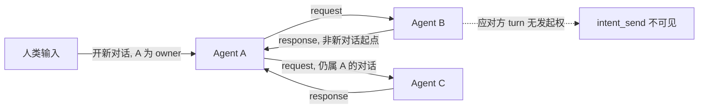

# Intent 通信与聊天 Session 设计

> 状态：设计草案（核心语义与边界已确认；API、存储 schema 和 UI 细节待实现设计）
> 版本：v1.5 | 更新日期：2026-10-14
>
> 关联设计：[06-communication.md](./06-communication.md)、[12-tool-system.md](./12-tool-system.md)、[15-conversation-persistence.md](./15-conversation-persistence.md)、[21-pm-project-management.md](./21-pm-project-management.md)
> 关联协议：[MQTT 协议](../../protocols/zh/mqtt.md)、[HTTP 协议](../../protocols/zh/http.md)

---

## 1. 概述

本文定义 ACowork 的 Intent 通信与聊天 Session 设计，覆盖用户、Agent、群聊及 PM 之间的消息语义、存储边界、接收 Agent session 选择、对话所有权、回复送达与历史读取。

**Intent 是一条发给 Agent 的消息，不是任务编排协议。**对接收 Agent 而言，Intent 等价于一条触发 Agent 执行的用户消息。发起方可以是真实用户、另一个 Agent，或代表项目 owner 行事的 PM。接收 Agent 在自己的 Agent execution session 中处理消息，处理过程和思考留在该 Agent session；请求和回复作为 Intent 消息记录在双方共享的 chat session 中。

**核心原则：Chat session 记录交流；Agent execution session 记录执行。**二者是不同的会话模型，有各自的数据格式、写入方、生命周期和前端入口。Intent 将 chat session 中的一条消息路由为目标 Agent execution session 的输入；Agent 回复再作为消息写回来源 chat session。

项目群聊是 `acowork-user` 聊天域中的一种特殊 chat session。未来的普通用户群聊、user-agent 群聊和 Agent-Agent 一对一聊天使用同一聊天模型，不为每种参与者组合另建一套会话存储格式。

### 1.1 设计目标

1. 提供统一的来源会话 / 回复地址模型，支持 user-user、user-agent、Agent-Agent、PM 派单和群聊中 @Agent。
2. 让 Agent 保留现有 Agent session 存储格式和模型；Intent 只触发目标 Agent 在其 execution session 中处理用户消息。
3. 在聊天域中统一保存聊天消息；聊天记录绝不包含 Agent 的思考过程、工具调用或工具执行细节。
4. 由明确的业务入口决定目标 Agent execution session 的创建或复用，不要求发送方或模型推断 thread 边界。
5. `repo`（代码仓库地址）是 Intent 的可选字段，项目有仓库时由系统在派发时自动注入；授权用户之后可以修改 session 配置，包括工作目录。
6. 单个 chat session 的消息由唯一后端写入口按序串行写入，避免并发写入和顺序不确定。
7. 结果通过 push 送达：应答方的回复由系统写回 Chat session 并路由回发起方，发起方不轮询取结果。
8. 一次对话有唯一 owner（发起方），由 owner 决定何时结束；应对方没有发起新对话的能力。
9. `chat_history_read` 按 offset/count 渐进读取 Chat session 中"不属于本次对话"的消息，并由服务端实施硬性读取上限。
10. Agent 在群聊中默认不发言；明确 @Agent 才向其发送 Intent 并触发处理。

### 1.2 非目标

- 不为 Intent 引入复杂任务生命周期、回调编排或通用状态机。
- 不把 Agent execution session 改造成群聊存储，也不将群聊消息注入 Agent 的执行历史文件。
- 不允许普通聊天消息隐式广播给群内 Agent。
- 本文不要求实现外部 ACP 兼容 API；ACP 仅作为能力描述、消息结构等方面的参考。

## 2. 两种 Session 模型

### 2.1 Agent execution session

这是现有 Agent session 模型，保存单个 Agent 执行任务所需的上下文和运行历史，包括其普通用户输入、模型输出、思考过程和工具调用等。它继续由对应 Agent Runtime 在 Agent home 中按现有格式管理。

执行 session 可以由用户消息或 Intent 触发。无论触发源是什么，接收 Agent 都在自己的 execution session 中工作。Intent 的发起方、回复地址及聊天消息历史不会使发送方 Agent 的执行上下文与接收方共享。

**兼容原则：保留现有 Agent session 的存储格式和模型。**新聊天模型通过关联 ID 引用 Agent session，不把 chat session 变成新的 Agent 执行记录格式。

#### Intent execution session 的上下文压缩与物理轮转

Intent 驱动的 execution session 沿用现有 Agent session 上下文压缩机制，不为 Intent 单独发明 token compaction 方案。首版沿用当前阈值：上下文使用率 70% 仅记录告警，80% 触发 LLM compaction，95% 触发 `emergency_trim` 安全网；计算分母使用该 session 的有效 context window（遵循现有 per-session 覆盖规则）。压缩只控制送入模型的上下文，不会缩小 JSONL 完整历史文件，因此另需物理 session 轮转。

逻辑映射（例如群聊与 Agent 的对应关系）保持稳定，映射指向的物理 execution session 可轮转。此轮转策略仅适用于由 Intent 逻辑映射管理的 execution session；不改变用户在 Agent 页面直接使用的常规 session 生命周期。旧 session 完整历史仍留在 Agent home，供现有 Session history 查阅；不得把旧 JSONL 全量复制到 successor，也不得把执行细节写进 Chat session。

**轮转时机不变量：轮转点只有一个——该 Intent 执行结束、结果已写回来源 Chat session 之后。**执行过程中无论发生多少次 compaction（含 `emergency_trim`），都不得中途切换 session。小 context window 或长程任务在一次 Intent 内多次压缩是正常行为。

轮转由以下两个场景触发，不设基于执行次数的上限：

| 触发 | 判据 | 默认值 |
|---|---|---|
| T1 话题不连续 | 新 Intent 到达时，距该映射上一次执行结束的空闲间隔超过阈值，判定两个 Intent 无延续性 | 24 小时；可配置 1–72 小时，`0` 表示关闭 |
| T2 任务已收尾 | 其一：PM task 进入终态（`Done` / `Rejected` / `Cancelled`）；其二：本次执行期间发生过至少一次 compaction，即判定该 Intent 属于长程任务，交付后不再在其历史 session 上继续 work | 开启，不可关闭（属业务边界与上下文成本判断） |

不设执行次数上限的理由：次数不是可度量的物理指标，无法判断多大合理；而"上下文被不相干 Intent 污染"这一问题已由 compaction 阈值直接覆盖——不相干内容积累到一定程度必然触发压缩，从而触发 T2。文件与磁盘规模由既有 JSONL 硬上限保护。两个边界因此闭合，不存在无限膨胀路径。

T2 的两种情形处理不同：PM task 终态意味着该逻辑执行上下文结束，关闭 session 且不创建 successor，后续新任务使用新映射；compaction 判据触发的轮转仍创建 successor，因为同一话题可能继续追问。

#### Handoff context 分级

轮转后的 successor 只带入精简 handoff，其内容由触发原因决定，避免把旧话题摘要变成新话题的污染源：

| 触发原因 | Handoff 内容 | 上限 |
|---|---|---|
| T1 空闲间隔 | 只带未决事项、关键决定与引用 ID；若无未决事项可完全省略，不带对话摘要 | 500 tokens（设计固定，不开放配置） |
| T2 compaction 判据 | 当前目标、关键决定、未决事项与引用 ID | 目标 1,500 tokens，可配置 500–4,000 |

handoff 不得包含隐藏推理，且该上限只是目标值，仍必须受 successor 有效输入预算约束；超限时由 Compact Model 再压缩，仍无法满足则保留最重要的可执行摘要并记录告警。

#### 存储边界

保留既有 JSONL 硬上限 100,000 行或 50 MiB（先到者）作为绝对安全上限，不再另设主动轮转的 JSONL 阈值：在 T1 / T2 下物理 session 天然较小，正常情况下不会接近该上限。若异常大的单次执行在安全检查点前逼近硬上限，Runtime 必须拒绝继续无界追加，在可恢复检查点暂停、保存状态后轮转；无法安全暂停时明确失败并保留已写入历史，不得静默丢弃或越过硬上限。

#### 前端可配置边界（Agent 设置面板的 Session 设置卡片）

首版只开放两个配置项：

| 配置 | 前端 | 初始行为 |
|---|---|---|
| 空闲间隔轮转阈值（默认 24 小时） | **可配置**，允许范围 1–72 小时；`0` 表示关闭 T1 轮转 | 仅用于 Intent 管理的逻辑映射；Agent 级默认值，有权限用户修改后用于该 Agent 后续 Intent 执行 |
| Handoff context 目标上限（默认 1,500 tokens） | **可配置**，允许范围 500–4,000 tokens | 仅用于 Intent 管理的逻辑映射；修改对该 Agent 后续轮转生成的 handoff 生效 |

以下项**不开放**给普通用户：Compaction 70% / 80% / 95% 阈值（沿用现有 Runtime 行为与配置能力，不因 Intent 重复造配置）、T2 轮转判据（业务边界，不可关闭）、T1 的最小 handoff 上限、JSONL 硬上限 100,000 行 / 50 MiB（绝对安全上限；实现期可由部署级高级配置调整，但必须保留硬上限语义）。

参数变更需要鉴权并记录审计；更改不重写已有历史。运行中的一次执行使用开始时解析出的配置快照。未提供配置时使用默认值。普通用户只能调整授权范围内的 Agent 级参数，不能修改他人 Agent home 中的 session 文件。

#### 并发与失败恢复

达到轮转条件后，当前执行必须先完成；已经排队的后续 Intent 按串行次序绑定到 successor，不再继续向旧 session 追加。若多个 Intent 同时到达，Runtime 仍按既定 session 写入 / 执行队列顺序处理，映射更新与 successor 创建必须以单一串行边界提交。

创建 successor 和切换逻辑映射必须具备崩溃恢复能力：先幂等创建 successor 并持久化 handoff / predecessor 关联，再原子地将逻辑映射指向 successor，最后将旧 session 标记结束。若中途失败，重试不得创建多个 successor 或丢失当前映射。若 Compact Model 不可用，轮转不得静默丢弃上下文；应使用现有最后一次 compaction 摘要与最近若干轮交互构造受限 handoff，并记录降级告警。若连受限 handoff 也无法安全生成，则暂停该映射后续派发并明确报错，等待恢复或有权限用户处理。

### 2.2 Chat session

Chat session 是用户聊天与 Agent 间消息的持久化会话，由 `acowork-user` 聊天域统一拥有和管理。其消息类型是固定的通信类型，不存 Agent 私有运行轨迹：

- `user_message`：用户发送的聊天消息；
- `intent_message`：通过 Intent 发送或返回的消息，具有方向、发送方、接收方和回复关联等元数据。

具体 wire/schema 类型在协议实现阶段定义。Agent 的思考、隐藏推理、工具调用、工具结果和执行中间事件不得作为 chat message 写入。必要的投递或展示状态是消息元数据 / 独立事件，不扩充为任意 Agent 执行事件。

### 2.3 Session 边界不变量

| 维度 | Agent execution session | Chat session |
|---|---|---|
| 职责 | Agent 执行上下文 | 用户与 Agent / Agent 之间的消息历史 |
| 权威存储 | 对应 Agent home / Runtime，沿用现有格式 | `acowork-user` 聊天域 |
| 内容 | 用户输入、模型输出、思考、工具调用等现有运行历史 | 固定类型的 user message、Intent request / response |
| 写入者 | 对应 Agent Runtime / 现有 session API | `acowork-user` 的唯一聊天写入口 |
| 前端入口 | Agent 页面现有 Session history | 独立的 Chat history |

禁止把 Chat session 的消息复制成 Agent 思考或工具调用；也禁止把 Agent 内部思考、工具调用写进任何 chat session。Chat history 与 Session history 是两个不同入口。

## 3. Chat session 类型与所有权

### 3.1 存储所有权

`acowork-user` 是用户聊天和 Chat session 的权威存储与写入方。项目群聊虽然由 PM 项目创建和关联，但聊天记录归 `acowork-user` 聊天域维护，而不是存放在 PM task 文件或任一 Agent home 中。

远程或本地 Runtime、PM 和 Desktop 都通过受信任的服务接口操作聊天记录；Runtime 不直接访问或改写其它 Agent home 中的 session 文件。PM 持有 `project_id` / `task_id` 等业务关联，由服务端校验后映射到对应 chat session。

### 3.2 统一类型、不同参与者

所有聊天采用同一 Chat session 和消息日志模型，通过会话类型及参与者表达关系，至少覆盖：

| Chat session 类型 | 参与者 / 用途 | 消息内容 |
|---|---|---|
| User-user | 用户创建的一对一聊天 | user message |
| User group | 用户创建的通用群聊 | user message；仅当显式 @Agent 时另有 Intent 消息 |
| Project group | 项目创建时生成的特殊群聊 | user message、Intent request、Intent response |
| User-Agent chat | 用户与 Agent 的聊天型会话 | user message、Intent request / response；不是 Agent execution session |
| Agent-Agent chat | 两个 Agent 的一对一聊天 | 仅 Intent request / response |

上表是逻辑类型，不要求各类型使用不同物理 schema。新参与者类型可以扩展同一聊天模型，但不得改变“聊天只记录消息，执行细节留在 Agent session”的边界。

### 3.3 项目群聊生命周期

- 每个项目创建时必须创建一个关联项目群聊，且一个项目只能有一个此类群聊。
- 项目群聊不能独立删除；项目与群聊的归档、删除和数据保留关联策略**本阶段不处理**，后续另行决定。
- `project_id` 与项目群聊稳定关联；PM 派发和 Agent 回复使用该群聊作为来源 / 回复地址。

## 4. Intent 消息模型

Intent 是一条消息，不是执行结果对象。它需要携带足以寻址、处理和回复的上下文：

| 字段语义 | 必需性 | 说明 |
|---|---|---|
| `message_id` | 必需 | 唯一消息标识；用于关联、重复去重和诊断。 |
| `source` | 必需 | 发起主体及类型；身份由可信服务确认，不能仅信任客户端自报。 |
| `source_chat_session_id` | 必需 | 来源 Chat session，也是回复地址。 |
| `source_agent_session_id` | Agent 发起时必需 | Agent 发起本次 Intent 的 execution session ID。用户 / PM 发起时为空。 |
| `target_agent_instance_id` | 必需 | 精确目标 Agent Runtime 实例，遵守 instance ID 寻址约定。 |
| `message` | 必需 | 给接收 Agent 的用户消息内容。 |
| `repo` | 可选 | 本次工作涉及的代码仓库地址（规范化 remote URL）。项目有仓库时由系统在派发时自动注入；发送方不指定目标 Agent 的具体工作目录。 |
| `session_config` | 可选 | model、reasoning、skills 等初始值；未提供的字段用目标 Agent 默认值。 |
| `conversation_id` | request 必需 | 一次对话的标识，由发起方在首次 request 时生成，本次对话的后续 request / response 复用。系统据此统计 request 次数（§6.5）。 |
| `in_reply_to` | response 必需 | 原 request 的 `message_id`；**由系统生成，不是模型可填参数**——它的存在即表示本条是 response（§6.5 R2）。 |
| `target_agent_session_id` | 路由后关联 | 实际处理 Intent 的目标 Agent execution session ID。 |

字段名和 wire schema 在协议实现阶段确定；本表约定语义，不构成最终序列化合同。

### 4.1 Repo 字段与接收方边界

`repo` 是可选字段，值为本次工作涉及的代码仓库地址，采用规范化 remote URL（去协议与凭证、host 小写、去 `.git` 尾）。它的语义是"这个任务关于哪个仓库"，**不是"去哪个文件夹"**。

> 术语约定：本文中 `workspace` 一词只指 Agent 侧已注册的工作目录（`WorkspaceDir`、`allowed_dirs()`、前端 workspace 选择器）。Intent 协议不使用该名称：一个仓库可对应多个 workspace（多 clone / 多 worktree），一个 workspace 也可能不是代码仓库。

规则：

1. 项目可以没有代码仓库（非软件项目）。此时 Intent 不带 `repo`，Agent 在自己的默认工作目录处理消息——这是正常目标，不算静默回退。
2. 项目有仓库时，PM 派发的 Intent 与该项目群聊 @Agent 生成的 Intent **由系统自动注入仓库地址**。发送方（人或模型）不需要知道目标 Agent 的目录结构，也不填写具体路径。
3. 收到 `repo` 后如何使用，由接收 Agent 的模型自行理解与决策（在哪些已授权目录里工作、要不要切分支）。协议层不提供工作区选择算法，也不维护"仓库 → workspace"绑定表：这类判断的复杂度无法由单个 Intent 参数覆盖。

模型的自由度到此为止，以下是硬约束：

- Agent 只能在自己已注册 / 已授权的工作目录集合内读写；
- 发送方的本地路径不得作为跨 Node 的寻址依据，也不得出现在 Intent 中；
- 不得因为收到一个仓库地址就自动 clone 或创建 worktree——磁盘失控与供应链风险，且没有任何主体授权过该动作；
- 没有对应工作目录时，明确回复"我没有该仓库的工作区"，不得退到 Agent home 等无关路径写文件。

首版一个项目按 0 或 1 个仓库处理，多仓库场景不设计。

### 4.2 Session 配置为初值、可授权修改

Intent 可携带 model、reasoning、skills 等目标 Agent session 配置初值；未提供时使用目标 Agent 默认值。该配置不是不可变快照，授权用户可以在 session 生命周期内修改，包括该 session 的工作目录。

配置修改从被接受后影响后续消息 / 后续执行。正在执行的单次操作使用启动该操作时解析出的配置快照，避免用户更改工作目录后正在进行的文件操作中途切换目录。服务端必须校验用户有权修改目标 Agent 的对应 session 配置；不授权的修改失败，不静默忽略。工作目录的修改只能在目标 Agent 已注册的目录集合内选择，不接受任意路径。

## 5. 项目群聊与 @Agent

### 5.1 群聊消息行为

群聊中的普通 user message 只写入 Chat session，不触发 Agent 执行。Agent 默认不监听并回复群聊中的所有消息。用户明确 @ 一个或多个 Agent 时，系统为每个被提及的目标生成 Intent 消息并定向派发；只有被提及的 Agent 收到并处理该消息。

@Agent 解析必须转成明确的目标 Agent 实例列表，而不是让每个 Runtime 自行从正文猜目标。一次 @ 多个 Agent 时，各目标分别路由，各自维护 execution session；消息和回复均作为各自关联的 Intent 消息写入同一个 chat session。

群聊场景下对话的 owner 是那条人类消息：Agent 的 response 只写回群聊 Chat session 并渲染给人，**不 @ 任何人，因此不唤醒任何 Agent**。多个 Agent 之间的接力不由 Intent 完成，而由人决定是否 @ 下一个（§6.5 R5 的推论）。

### 5.2 群聊历史

项目群聊记录：

1. 项目成员的 user message；
2. 发给 Agent 的 Intent request；
3. Agent 回复群聊的 Intent response；
4. 支撑发送方、接收方、mention、回复关联、展示及排序的最小元数据。

群聊历史不包含 Agent 内部思考、工具调用、工具结果或执行中间内容。被 @ 的 Agent 默认收到当前 Intent 消息，不自动获得整段群聊历史；若需查看上下文，通过 `chat_history_read` 在权限和返回上限范围内读取。

### 5.3 可见性原则

参与同一群聊的用户和 Agent 可以看到该群聊中的公开消息；public 的范围限定在此 Chat session 的参与者 / 项目边界，不是平台全局公开。权限规则保持简单：服务端依据聊天参与关系判断能否读取和写入，不把 session ID 本身视为权限。

## 6. 接收 Agent execution session 的创建与复用

发送方提供来源 chat session 和业务上下文；目标 execution session 的创建 / 复用由系统根据会话类型决定。

### 6.1 群聊中的 @Agent：群聊固定 session

群聊中 @Agent B 时，按 `(chat_session_id, target_agent_instance_id)` 找到 B 在该群聊对应的逻辑执行对话及其当前物理 execution session：

- 首次 @B 时创建映射并创建 B 的 Agent execution session；
- 后续在同一群聊 @B 的消息使用当前映射指向的物理 session；该次 Intent 执行结束并写回结果后，若满足 §2.1 的 T1 或 T2 条件，之后排队 / 到达的消息改用 successor session；
- 轮转后逻辑映射保持不变，指向新建的 successor session；
- 同一群聊中的 Agent 各自拥有独立 execution session 链；
- B 的 Intent 回复追加到该群聊 Chat session。

“群聊固定 session”指固定逻辑执行对话映射，不代表一个物理 JSONL 文件无限期增长。

### 6.2 PM 任务：每任务独立逻辑执行上下文

PM 创建任务并向 Agent 派发时，以任务作为执行 session 边界：

- 每个 `(project_id, task_id, target_agent_instance_id)` 对应一个稳定的逻辑执行上下文，首次派发时创建其物理 execution session；
- 同一任务后续发给同一 Agent 的 Intent 继续使用该逻辑上下文，其物理 execution session 按 §2.1 的 T1 / T2 条件轮转；
- task 进入终态（`Done` / `Rejected` / `Cancelled`）即视为该逻辑执行上下文结束：关闭当前 execution session，不创建 successor，后续新任务使用新的映射；
- 不同任务创建不同的逻辑执行上下文；
- Intent 的来源 chat session / 回复地址是项目群聊；Agent 回复回到项目群聊，并关联派发消息。

任务逻辑执行上下文对应 Agent execution session 链，不是 Chat session。群聊负责可见的项目交流历史，PM task ID 负责选择目标 Agent 的执行上下文。

### 6.3 Agent-Agent：三个 session

Agent A 与 Agent B 建立一对一聊天时存在三个互相独立但可关联的 session：

1. **一个 Agent-Agent Chat session**：由 `acowork-user` 维护，记录 A 与 B 互相发送的 Intent request / response；不含任一 Agent 的思考和工具调用。
2. **Agent A 的 execution session**：由 A 的 Runtime 在 A 的 home 管理，保存 A 处理收到消息或继续对话的执行上下文。
3. **Agent B 的 execution session**：由 B 的 Runtime 在 B 的 home 管理，保存 B 处理收到消息或继续对话的执行上下文。

Agent A 通过 `intent_send` 向 B 发送 request 时，消息先追加到 Chat session，再路由到 B 的 execution session。B 的 turn 结束时由系统生成 response 写回同一个 Chat session（§7.1），并**路由为 A 的入站消息**：A 若仍在执行，注入其当前 turn；A 若已空闲，唤醒其开新 turn。被自己的 response 唤醒的 turn 仍属发起方角色，复用同一 `conversation_id`（§6.5）。Chat session ID 不等于 A 或 B 的 execution session ID。

Agent-Agent Chat session 的首次创建由明确的聊天入口 / 首次建立对话触发；创建后，按同一聊天关系继续复用该 Chat session。双方各自的 execution session 关联由系统维护，并采用稳定逻辑映射、可轮转物理 session 的规则；Agent 无需在每次消息里判断新建还是复用。

**A-B 之间的 Intent 总是落在双方共享的 agent-agent Chat session，与 A 本轮由什么触发无关。**A 被用户直接消息（非群聊）触发后去问 B 时，`source_chat_session_id` 填该共享 Chat session，首次发送时幂等创建。A 的用户在 Agent 页面看到的是 A 的 execution session，其中包含 A 收到 response 后的处理过程；用户与 A 之间不额外产生 Chat session 记录（§6.4）。

### 6.4 User-Agent 的两种场景

需要清晰区分：

- 用户在 Agent 页面进行普通对话：继续使用该 Agent 现有 execution session 和现有 Session history，不因本设计迁移。
- 用户在 user-agent 群聊中 @Agent：消息写入群聊 Chat session，再由 Intent 路由到 Agent execution session；Agent 回复写回群聊。

二者可在产品上并存，不能因参与者都是 user 与 agent 就混为同一种 session。

### 6.5 对话所有权与停止条件

Intent 采用 C/S 式的所有权模型：一次对话由发起方拥有并负责结束，应对方只对每次输入给出结果，不具备开启下一轮的能力。

| 规则 | 内容 |
|---|---|
| **R1 所有权** | 只有被人类输入（用户消息 / PM 派单 / cron）触发的 turn 才能发起对话；作为应对方处理的 turn 不得发起新对话 |
| **R2 两种消息** | Intent 只有 request 与 response 两种语义。`intent_send` 只能产生 request；response 只能由系统在应对方 turn 结束时产生（§7.1），不构成新对话的起点 |
| **R3 结束** | 发起方不再发 request，对话即结束。结束是"不再说话"，不是进入某个 Ended 状态，无需超时或清理动作 |
| **R4 上限** | 单对话 request 次数有上限；超限时系统拒绝投递并在 Chat session 写回执 |
| **R5 需要第三方** | 应对方不得转问别人，把"我需要什么"写进 response 交回发起方决定 |

角色由入站消息类型决定，不由模型自行声明：

| 入站 | 本轮角色 | `intent_send` | `conversation_id` |
|---|---|---|---|
| 人类消息（用户 / PM 派单 / cron） | 发起方 | 可用 | 新建 |
| request（别人问我） | 应对方 | **不在本轮 tool set 中** | 复用入站值 |
| response（别人答我） | 发起方，延续自己的对话 | 可用 | 复用 |

R1 的强制点在工具可见性：应对方 turn 的工具集合里没有 `intent_send`，同时移除 `ask_user_question`（背后无人可答，需要问就写进回答）。模型看不到这两个工具，因此既不会尝试，也不会消耗 token 想别的路子绕过去——比运行时报错更省，也更硬。



循环没有生成路径：B 无法延长对话（R1）；A 的每次 request 可计数（R4）；A 的 turn 必然结束。因此不需要因果链深度、链路 ID 或跨 agent 环路检测。

| 参数 | 默认 | 范围 | 开放给 Session 设置卡片 |
|---|---|---|---|
| 单对话 request 次数上限 | 6 | 2–16（0 = 禁止 Agent 间对话） | 是（Agent 级） |

人是唯一切断点，也是唯一重启点：对话触顶后要继续，由用户发一条新消息 = 新对话。**不提供"应对方申请提高上限"的能力**——那等于让循环自行决定是否继续。

编排归属：决定"谁接着做、按什么顺序做"属于人 / PM 的任务依赖图，不属于 Intent（§1.2 非目标"不为 Intent 引入任务编排"）。R5 是这条边界的具体体现。

## 7. 回复、历史入口与历史读取

### 7.1 回复写回

**response 不是模型的工具调用，而是系统在应对方 turn 结束时生成的产物。**应对方回答一条消息，与用户和 agent 正常对话中"说完话结束"是同一件事；若把回复做成工具，模型说完话就直接结束 turn 是常态，发起方将永远等不到结果。

回复正文的来源是**本轮 turn 的最终输出**，不是"从上下文末尾取一段"：一轮 turn 结束后上下文末尾可能有多条 assistant 文本（工具调用前的叙述、中间结论、最终总结），取多少只能靠猜。Runtime 已有一等公民的最终输出（流式结束事件携带本轮回复正文，写入前已剥离思考块），response 正文即该文本——一条消息，不是一个窗口。

任何进入应对方角色的 turn，结束时**无论成败都必须写回一条 response**：

| 结束形态 | response `status` | 正文 |
|---|---|---|
| 正常完成 | `completed` | 本轮最终输出文本 |
| LLM / 工具错误 | `failed` | 仅取面向用户的错误摘要，**不含内部 detail**——内部错误不外发给另一个 agent |
| 用户手动 stop | `aborted` | 本轮已产出的文本，可为空 |
| Runtime 崩溃 / 无任何事件 | `failed` | 系统兜底固定文案 |

**应对方 turn 不得进入等待人类的状态。**现有两个暂停态（迭代上限暂停、环路检测暂停）依赖人在前端点"继续"，而 Intent 触发的 turn 背后没有人会点。因此应对方 turn 遇到这两个态一律按 `aborted` 回执结束，把"卡在哪"写进正文。

写回路径：response 由唯一聊天写入口追加到来源 Chat session；Runtime 不直接写入另一个 Runtime home 下的 session 文件。

**发起方通过 push 获知结果，不轮询。**response 落库后由系统路由为发起方的入站消息：其 execution session 仍在执行则在迭代边界注入当前 turn（同一轮拿到答案），已空闲则唤醒开新 turn。LLM 不具备等待能力，若结果只能靠查询获取，模型会在 turn 内反复重试 = busy-wait，白烧 iteration 与 token；而发起方发完 request 通常已结束 turn，没有"活着的轮次"可轮询。

长度上限：response 正文按字节 / token 双限截断并带 `truncated` 标记。发起方需要更多内容，**再发一条 request 说清要哪部分**，不提供读取对方 execution session 的能力（§2.3 边界不变量）。

回复地址：PM 场景为项目群聊，由 PM 服务读取关联该 task 的 response 以推进 task 状态（服务读消息，不是 LLM 轮询）；Agent-Agent 场景为双方共享的一对一 Chat session 并 push 回发起方；用户群聊场景为对应 user-agent / group Chat session，只渲染给人。

### 7.2 Agent 页面 Chat history

Agent 页面保留现有 **Session history** 按钮，用于查看该 Agent 的 execution session 历史；另增加独立 **Chat history** 按钮，用于查看该 Agent 参与的 Chat session 历史。

Chat history 可按对话对象或群聊展示：与其他 Agent 的一对一聊天、参与的群聊、项目群聊等。选择某条聊天记录展示 `acowork-user` 中的聊天消息；它不展示、也不拼接 Agent 私有 execution session 中的思考和工具调用。用户和 Agent 的普通直接会话仍留在现有 Session history，不迁入 Chat history。

### 7.3 `chat_history_read`

`chat_history_read` 读取 Chat session 的历史消息。它**不用于获取本次对话的结果**——结果由系统 push 送达（§7.1）。它的用途是读取"不属于本次对话"的消息：

1. 群聊里更早的人类讨论（§5.2：被 @ 的 Agent 不自动获得整段历史）；
2. 同一次 @ 了多个 Agent 时，A 查看 B 的回复；
3. 群里发给其他 Agent 的消息。

工具不能读取任意 session；默认只允许查询调用者有参与关系的 Chat session。入参是 `chat_session_id + offset + count`，**不接受 message_id 作为"等结果"的句柄**——那会把它变成轮询接口。

命名说明：本工具原名 `intent_send_result_query`，与 `intent_send` 成对。该名称会让模型把"发完 request 立刻查询"当成取结果的必经步骤，主动诱导上段的失效模式，因此改名；工具描述必须写明"response 会自动送达，本工具仅用于读取会话中的其他消息"。

工具提供 `offset` 和 `count`，以消息追加顺序分页读取 Chat session 消息。LLM 可以根据已读内容决定是否继续读取，prompt 可以建议单次读取量，但不能代替服务端限制。后端必须对单次 `count`、返回字节数或等效负载设置硬上限，并对查询的 Chat session 做参与关系校验。

建议请求语义：

```json
{
  "chat_session_id": "...",
  "offset": 0,
  "count": 20
}
```

返回至少包含消息、稳定顺序 / offset 信息及是否还有后续消息。若 chat session 为追加写入，offset/count 可作为首期分页方式；并发追加时后端返回的顺序必须稳定。未来若支持中间删除或复杂同步，再评估 cursor，而不在首期引入。

## 8. Chat session 的串行写入

聊天消息按时间顺序串行写入，后端只有一个权威写入口。采用**每个 Chat session 单写者 / 串行队列**，不采用整个服务全局串行：同一聊天中的写操作严格排序，不同聊天仍可并行处理。

唯一写入口负责：

1. 校验调用者及参与关系；
2. 按 `message_id` 做幂等去重；
3. 按后端接纳顺序分配该 chat session 内单调递增的消息序号 / 顺序键；
4. 按顺序原子追加消息并持久化；
5. 将 Intent 投递与消息记录关联。

同一聊天的规范顺序是后端串行写入口接受并提交的顺序，而不是不同客户端各自的本地时间戳。时间戳用于展示，不作为唯一排序依据。QoS 1 重投或请求重试不得追加重复消息。

此原则从根上避免多个 Runtime、PM 和 UI 直接并发修改聊天记录。具体队列实现可由 `acowork-user` 选择，但所有写入都必须经过同一逻辑写入边界。

## 9. PM 集成与身份

PM 派发任务是项目 owner 通过项目群聊向 Agent 发消息：

1. PM 项目有明确 owner；
2. `acowork-user` / 受信任服务从已认证项目数据确认 owner 身份，PM 不得任意自报 owner；
3. 项目群聊 Chat session 是 Intent 的来源会话和 Agent 回复地址；
4. 项目可选挂一个代码仓库。有仓库时，PM 派发和项目群聊 @Agent 生成的 Intent 都由服务端注入该仓库地址作为 `repo`；注入发生在服务端，不依赖发送方填写，发送方也无法伪造项目仓库；
5. task ID 与目标 Agent instance ID 决定 Agent execution session；
6. PM task 后续派发消息复用该 task execution session，新的 task 使用新 session；
7. Agent 回复追加为项目群聊消息并关联相应 Intent；
8. PM 场景的对话 owner 是派单这条人类输入：Agent 的 response 写回项目群聊后**不唤醒任何 Agent**，由 PM 服务读取关联该 task 的 response 推进 task 状态（服务读消息，不是 LLM 轮询）；
9. Agent 若需要其他 Agent 掌握的信息，写进 response 交回发起方判断，不由应对方转问（§6.5 R5）；任务间的先后与接力由 PM 的任务依赖图和 owner 决定，不由 Intent 承担编排。

群聊存储在 `acowork-user`，不代表 PM 服务失去项目 / 任务领域所有权：PM 仍拥有 task 与项目业务数据，聊天服务拥有会话与消息记录，二者通过稳定 ID 关联。

## 10. 投递、错误与可靠性

Intent 保持消息语义，不引入通用任务状态机；最低限度的可靠性语义包括：

- `message_id` 跨聊天记录、Intent 路由和回复关联保持稳定；
- MQTT QoS 1 发布成功不等于 Agent 已处理或完成；
- 接收侧按 `message_id` 去重，防止同一消息重复进入 execution session；
- response 由系统 push 回发起方，发起方不以查询方式等待结果（§7.1）；
- 单对话 request 次数超限时，系统拒绝投递并写回执，不静默丢弃（§6.5 R4）；
- 目标 Agent、来源 chat session、session 配置无效或 `repo` 地址格式非法时明确失败；
- Agent 试图在授权目录集合之外读写，或因 `repo` 触发自动 clone / 建 worktree 时，操作被拒绝并回执，不静默降级；
- 工具反馈只说明消息被记录 / 接受或明确失败，不把“已发布”伪称“已完成”。

建议至少区分 `invalid_repo`、`unauthorized_directory`、`target_not_found`、`source_chat_session_not_found`、`session_config_invalid`、`not_authorized`、`delivery_unavailable`、`conversation_request_limit_reached`、`response_unavailable`（应对方 turn 异常终止时随兜底 response 携带）和重复 message ID。正式错误码在 HTTP / MQTT 协议修订时统一。

## 11. 架构边界与现有实现

### 11.1 职责边界

- **`acowork-user`**：拥有 Chat session、参与者关系、固定类型聊天消息及唯一串行写入口；提供聊天历史分页查询。
- **PM 服务**：拥有项目与任务数据（项目可选关联一个代码仓库）；项目创建时请求创建项目群聊；派单时提供经验证的 owner / project / task 关联及项目仓库地址。
- **Gateway / 可信路由边界**：验证 Runtime / PM 身份、解析目标、注入并校验 `repo` 地址、路由 Intent、按 `conversation_id` 统计 request 次数并拒绝超限、把 response push 路由回发起方的 execution session，并协调 user chat 与 Node / Runtime；不直接访问 Node-local Agent home 文件。
- **Agent Runtime**：按入站消息类型判定本轮角色（发起方 / 应对方）并据此裁剪 tool set（§6.5）；将收到的 request 作为指定 Agent execution session 的用户输入；在 Agent home 保持现有 session 格式；只在自身已注册 / 已授权的工作目录集合内读写，不因 `repo` 自动 clone 或建 worktree；turn 结束时由系统生成 response（含异常与中止的兜底形态）交回可信消息写入口，不依赖模型调用回复工具。
- **Desktop**：分别呈现 Agent execution Session history 与 Chat history；不自行拼接或持久化业务历史。

### 11.2 传输与 ACP

Intent 的消息语义不绑定 MQTT。MQTT 可继续承担 Runtime 控制消息传输；Chat session 读写经 `acowork-user` 提供的受信任 HTTP / 服务接口，实际接口需与 Gateway 反向代理、Node 远程拓扑和认证边界一致。

ACP 可参考其 Agent 能力描述、发现和结构化消息；本设计不要求内部消息采用 ACP REST API，也不采用 ACP run lifecycle。

### 11.3 现有实现需调整

当前 [intent_send.rs](../../../core/acowork-runtime/src/tools/builtin/intent_send.rs) 通过 MQTT control topic 发 Intent，且 `async` 参数不代表已实现请求等待 / 结果返回。实现新模型时应以本设计的消息和 Chat session 语义为准，复核或退役 Gateway 中依赖已移除 gRPC 的旧 Intent Router 路径，并更新 [06-communication.md](./06-communication.md)、[12-tool-system.md](./12-tool-system.md) 及 MQTT / HTTP 协议，形成唯一权威合同。

## 12. 前端交互原则

- Agent 页面现有 Session history 保持原行为；新增独立 Chat history 按钮。
- Chat history 下拉列表按聊天对象 / 群组呈现该 Agent 参与的会话；点击后展示 Chat session 消息。
- PM 项目视图进入项目固定群聊；PM task 派发的 Intent 与回复在群聊中按序可见。
- 群聊普通消息不触发 Agent；@Agent 生成定向 Intent。多个 Agent 被 @ 时分别显示独立请求和回复。
- 聊天历史展示消息和必要的投递提示，不展示 Agent 私有思考、工具调用或执行过程。
- Chat history 需展示对话归属：每条对话的 owner（发起方）、request 计数与 response 状态（`completed` / `aborted` / `failed`）。
- request 次数触顶时必须显示明确的限制回执与"继续"入口——点击后由**用户**发一条新消息开新对话。不能让用户只看到"两个 Agent 突然不说话了"。

## 13. 开放的实现问题

核心语义已确定，以下是实现细节而非待定产品原则：

1. `acowork-user` 内 Chat session、participant、message、Agent execution session 映射的具体存储 schema；应使用一个可扩展的统一模型，参与者类型和 chat 类型可扩展。
2. `acowork-user` 唯一写入口和每 Chat session 串行队列的进程内 / 持久队列实现、崩溃恢复和事务边界。
3. PM 创建项目与 user 服务创建项目群聊之间的幂等创建、失败恢复和删除 / 保留策略。项目归档或删除策略本阶段不展开。
4. 有权用户修改执行中的 Agent session 配置时的 API、审计事件及在途操作配置快照实现。
5. 首版 session 轮转参数已在 §2.1 给出；实现时需将 Agent 级可配置项接入 Session 设置卡片，并定义配置持久化、边界校验和审计 API。
6. successor / handoff 的事务边界与恢复实现，以及物理 session 达到 JSONL 硬上限时如何在执行中的安全检查点切换，必须保证不丢失消息、不产生双 successor。
7. `chat_history_read` 的硬性 count / bytes 上限、输出 schema 和 prompt 中建议的软上限。
8. Agent-Agent Chat session 首次创建入口，以及 Chat session 与双方逻辑执行映射 / 物理 execution session 链的持久化位置。
9. 群聊 mention 的 ID 表示、消息展示与多个目标的回复排序 UI。
10. `repo` 的规范化规则（remote URL 归一、host 小写、凭证剥离、`.git` 尾处理）与 PM 项目关联仓库字段的存储 / API；项目多仓库场景延后。
11. response 正文的字节 / token 双限具体数值，以及 `truncated` 标记在 Chat session schema 中的表示。
12. 应对方 turn 异常终止的兜底实现点：Runtime 崩溃或未产出任何结束事件时，由谁、在何时、依据什么判据写出 `status=failed` 的 response（发起方不轮询，因此该兜底必须存在）。
13. `conversation_id` 的 request 计数存储位置与持久性：Gateway 重启后不得丢失对话预算，否则上限可被绕过。

## 14. 分阶段落地建议

### Phase 1：Chat session 存储与消息写入

- 在 `acowork-user` 实现通用 Chat session / participant / message 模型，支持 project group、user group、user-agent 和 agent-agent 类型；
- 确保 chat message 类型只包含 user message 和 Intent message；
- 建立单一后端写入口、每 Chat session 串行化、顺序键及 `message_id` 幂等；
- 固化 Chat session 与现有 Agent execution session 的边界及关联引用。

### Phase 2：项目群聊与定向 Intent

- PM 创建项目时幂等创建唯一项目群聊；项目生命周期处理策略暂缓；
- 群聊 user message 只存档；@Agent 才写 Intent 并定向投递；
- 群聊按 `(chat_session_id, target_agent_instance_id)` 维护稳定逻辑执行映射，映射到的物理 execution session 按 §2.1 的 T1 / T2 条件轮转；
- `repo` 为可选字段，项目有仓库时由服务端注入；接收方只能在已授权工作目录内操作，缺失对应目录时明确回执，不自动 clone；
- 按入站消息类型判定本轮角色并裁剪应对方 tool set（`intent_send` / `ask_user_question` 不可见），实现 §6.5 R1；
- 按 `conversation_id` 统计 request 次数并实施上限（默认 6），超限拒绝投递并写回执；
- session 配置使用目标默认值或 Intent 初值；有权用户可以后续修改工作目录。

### Phase 3：PM task 与 Agent-Agent Chat

- PM task 按 `(project_id, task_id, target_agent_instance_id)` 映射专属 Agent execution session，回复回项目群聊；该逻辑映射指向的物理 execution session 按 §2.1 轮转；
- response 由系统在应对方 turn 结束时生成（正文 = 本轮最终输出），四类结束形态均有回执，并 push 路由回发起方；
- 实现 Agent-Agent Chat session 及双方各自 execution session 的关联，A-B 之间的 Intent 一律落在共享 Chat session（§6.3）；
- 提供 `chat_history_read(offset, count)`，实施服务端硬上限；
- 增加 Agent 页面 Chat history 入口，保留原 Session history。

---

**核心决策总结：**

- Chat session 与 Agent execution session 是两种不同模型；前者由 `acowork-user` 管理聊天消息，后者保留现有格式并由各 Agent home 管理执行上下文。
- Chat session 消息类型固定为 user message 与 Intent message；思考、工具调用和工具结果只存在于 Agent execution session。
- Agent-Agent 对话有三个 session：一个共享 Chat session，加 A、B 各自的 Agent execution session。
- 群聊普通消息不触发 Agent；@Agent 才发送 Intent。群聊 @Agent 使用每 Agent 每群聊稳定逻辑映射，并在轮转时切换物理 execution session；PM task 使用每 task、每 Agent 专属逻辑执行上下文，也遵守同一轮转规则。
- Intent execution session 沿用 70% 告警、80% LLM compaction、95% emergency trim，执行过程中的压缩次数不作为轮转条件；轮转点只有一个——Intent 执行结束且结果写回 Chat session 之后。触发条件为 T1 空闲间隔（默认 24 小时）与 T2 任务已收尾（PM task 终态，或本次执行发生过 compaction 即视为长程任务）。不设执行次数上限：上下文污染由 compaction 阈值直接覆盖，文件规模由既有 100,000 行 / 50 MiB 硬上限保护。
- Handoff 按触发原因分级：T1 只带未决事项与关键决定（上限 500 tokens，可为空）；T2 compaction 触发的轮转目标 1,500 tokens。Session 设置卡片只开放空闲间隔阈值与 handoff 目标上限两项给有权限用户；compaction 阈值、T2 判据与 JSONL 硬上限不开放。
- PM 项目群聊由 `acowork-user` 保存，项目与群聊生命周期联动暂不处理。
- 每 Chat session 由后端唯一写入口串行写入；Intent 配置作为初值，授权用户可在之后修改。
- Intent 用 `repo`（可选、服务端按项目注入的仓库地址）而不是 `workspace` 表达工作对象；`workspace` 一词在本文只指 Agent 侧已注册工作目录。工作区如何选择交给接收 Agent 的模型，协议层不做绑定表或选择算法；硬约束是只能在已授权目录内读写、不得因 `repo` 自动 clone 或建 worktree、无对应目录时明确回执。
- `chat_history_read` 用 offset/count 分页读取有权访问的聊天历史，服务端设硬上限；它不用于获取本次对话的结果。

**对话所有权与结果送达：**

- 一次对话由发起方拥有并结束（C/S 式）。只有被人类输入触发的 turn 能发起对话；应对方 turn 的工具集合里没有 `intent_send`，也没有 `ask_user_question`。应对方无法延长对话，因此不存在无限循环，不需要因果链深度或跨 agent 环路检测。
- Intent 只有 request 与 response 两种语义：`intent_send` 只产生 request；response 由系统在应对方 turn 结束时生成，正文 = 本轮最终输出（不是"从上下文末尾取一段"），异常、中止、崩溃均有兜底回执。
- 发起方通过 push 获知结果：response 落库后路由为发起方的入站消息（执行中则注入当前 turn，空闲则唤醒新 turn）。禁止以查询方式等待结果——LLM 不具备等待能力，轮询等于 turn 内 busy-wait。
- 唯一的成本闸门是单对话 request 次数上限（默认 6，Agent 级可配）；人是唯一切断点和重启点，不提供应对方申请提高上限的能力。
- 编排（谁接着做、按什么顺序）归人 / PM 任务依赖图，不归 Intent：应对方需要第三方信息时写进 response 交回发起方；群聊与 PM 场景的 response 只写回群聊，不唤醒任何 Agent。
