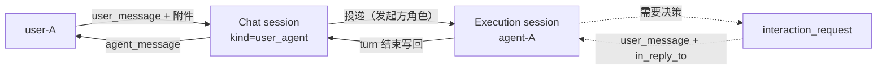
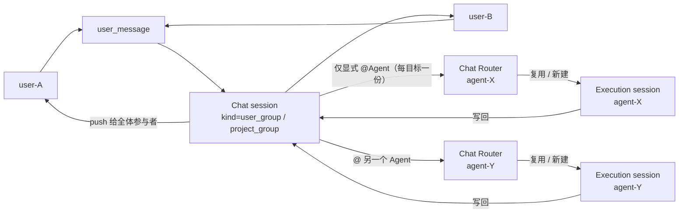
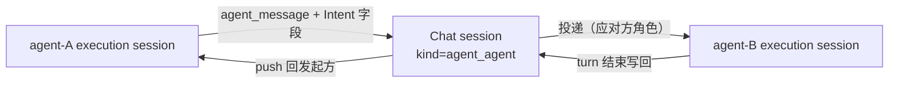
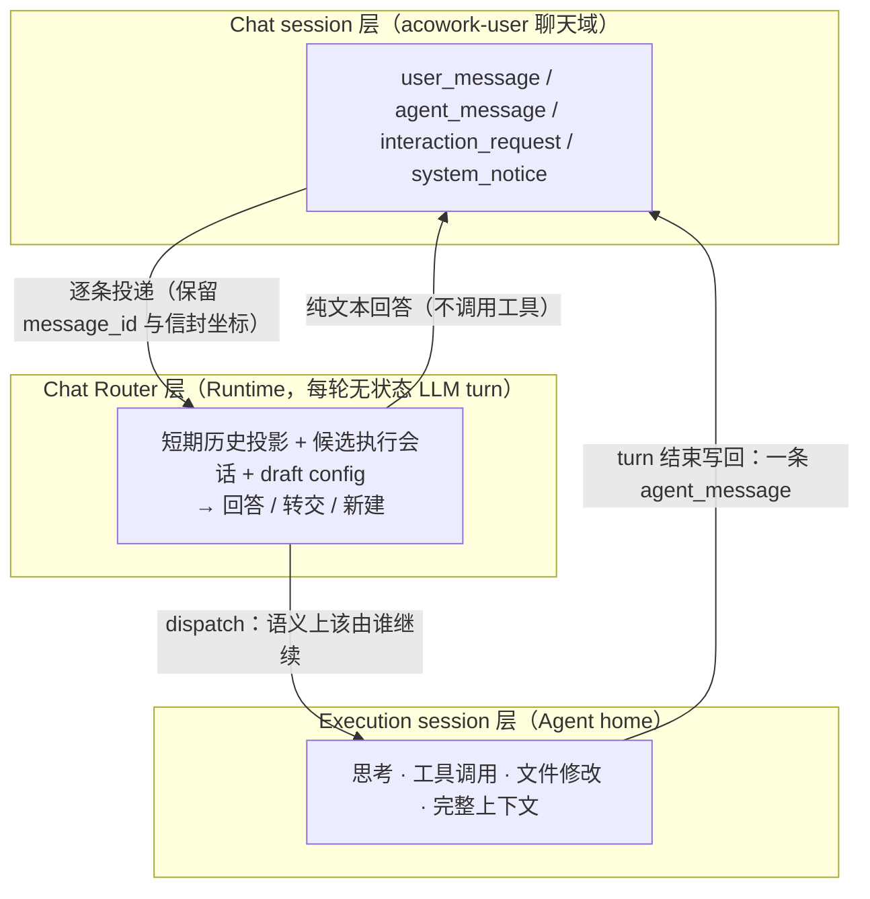
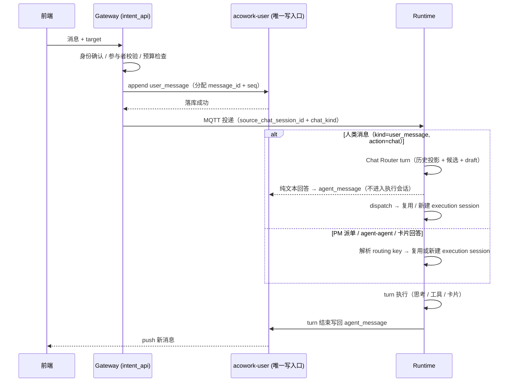
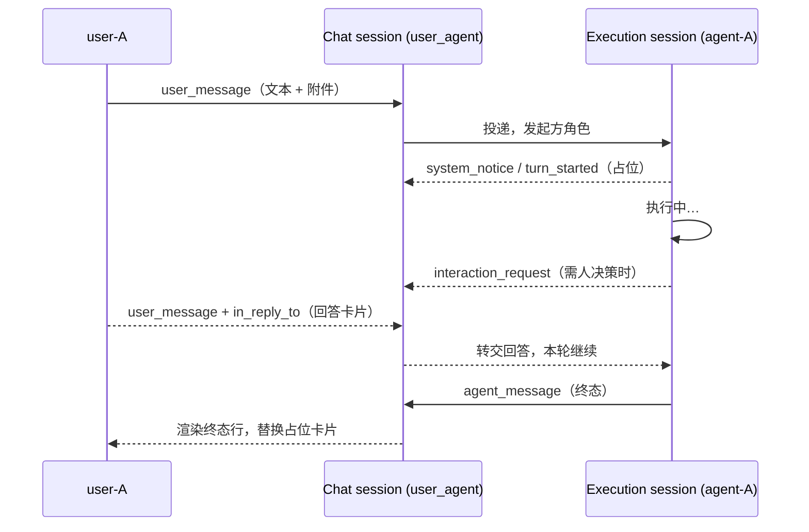
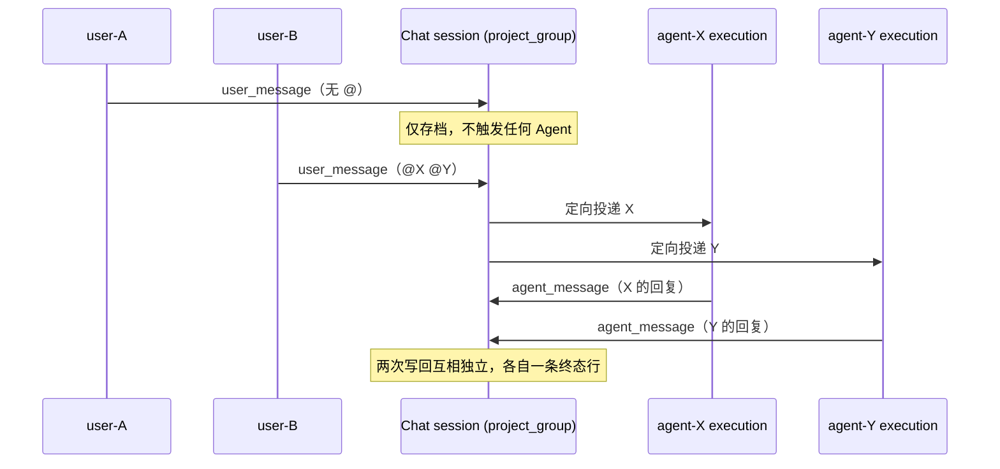
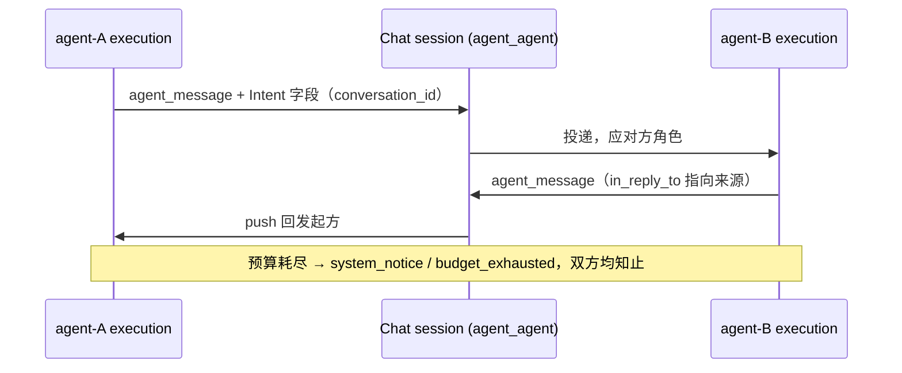
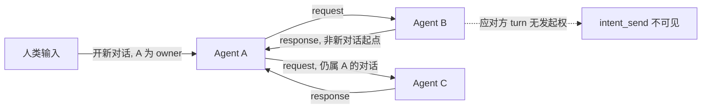
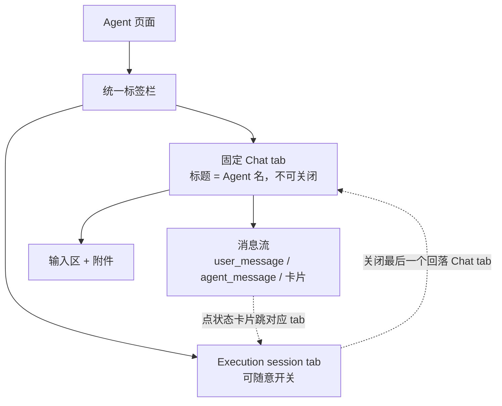

# Intent 通信与聊天 Session 设计

> 状态：设计定稿（框架、需求、数据模型、协议、前端、模块边界已确认；API 与 schema 细节待实现设计）
> 版本：v2.1 | 更新日期：2026-10-18
>
> v2.1 为 **user-agent 单聊形态修订（微信模型）**：每个 (user, agent) 恰好一条 Chat session，作为 Agent 页标签栏的**固定 tab**（标题 = Agent 名），不可关闭、不建列表；execution session 是同一标签栏里可随意开关的普通 tab，与 Chat tab **共存**而非互斥。撤销 v2.0 §5.4.4「点 `+` 新建第二条同 pair 会话」与 §5.5.2「Chat history 列表按钮」。逐项见 §13 v2.1 修订。
>
> v2.0 为**结构重排**：内容按「整体框架 → 需求分析 → 数据模型 → 通信协议 → 前端交互 → 模块分解 → 安全权限 → 落地计划」重组，新增框架图、术语表、非功能需求、数据结构与对外接口、三形态时序图、前端交互设计、权限模型与 ADR 一致性核对。章节编号全部变更，新旧对照与已失效引用清单见 §12。
>
> 关联设计：[06-communication.md](./06-communication.md)、[12-tool-system.md](./12-tool-system.md)、[15-conversation-persistence.md](./15-conversation-persistence.md)、[21-pm-project-management.md](./21-pm-project-management.md)
> 关联协议：[MQTT 协议](../../protocols/zh/mqtt.md)、[HTTP 协议](../../protocols/zh/http.md)

## 1. 概述


本文定义 ACowork 的 Intent 通信与聊天 Session 设计，覆盖用户、Agent、群聊及 PM 之间的消息语义、存储边界、接收 Agent session 选择、对话所有权、回复送达与历史读取。

**Intent 是一条发给 Agent 的消息，不是任务编排协议。**对接收 Agent 而言，Intent 等价于一条触发 Agent 执行的用户消息。发起方可以是真实用户、另一个 Agent，或代表项目 owner 行事的 PM。接收 Agent 在自己的 Agent execution session 中处理消息，处理过程和思考留在该 Agent session；请求和回复作为 Intent 消息记录在双方共享的 chat session 中。

**核心原则：Chat session 记录交流；Agent execution session 记录执行。**二者是不同的会话模型，有各自的数据格式、写入方、生命周期和前端入口。Intent 将 chat session 中的一条消息路由为目标 Agent execution session 的输入；Agent 回复再作为消息写回来源 chat session。

项目群聊是 `acowork-user` 聊天域中的一种特殊 chat session。未来的普通用户群聊、user-agent 群聊和 Agent-Agent 一对一聊天使用同一聊天模型，不为每种参与者组合另建一套会话存储格式。

**本设计关闭的一个结构性缺口：user-agent 单聊此前没有 Chat session。**类型表里列了 User-Agent chat，但落地路径把它排除在 Chat session 之外（用户与 Agent 的普通对话只走 execution session + Session history），于是"打开一个 Agent"和"打开一个聊天对象"是两件不同的事，Agent 页面无法与群聊共用同一套会话 UI。本版把 user-agent 单聊定义为 Agent 页面的默认 Chat session（§5.4.4）：用户打开 Agent 即进入与它的**唯一**默认会话（每 pair 恰好一条，像微信里与联系人的对话），在其中发消息触发该 Agent 的 execution session 执行任务。群聊、单聊、agent-agent 从此是同一个模式的三种实例。

## 2. 整体框架

本章是全篇的心智模型：三种会话形态、两层 session 职责、以及它们之间的消息流。后续各章展开细节；遇到具体规则时，回到本章定位它在整体中的位置。

### 2.1 三形态框图

ACowork 的会话只有三种形态，全部共用同一套 Chat session 存储、同一消息词汇表、同一唯一写入口。区别只在**参与者构成**与**触发规则**。

#### 2.1.1 User-Agent（单聊）



打开 Agent 即进入该 pair 唯一的默认 Chat session（固定 tab，标题 = Agent 名，v2.1）；每条人类消息都触发 Agent 处理，不需要 @。

#### 2.1.2 Group-Agent（群聊 / 项目群聊）



普通群消息只存档不触发；@ 才定向投递，且 @ 只决定"唤醒哪个 Agent"，不决定"进入哪个执行会话"。每个被 @ 的 Agent 各自跑一次 Chat Router（ADR-099），在本群候选集（仅 `meta.chat_session_id` 指向本群聊的执行会话，含该群的 PM 任务会话）内按语义复用或新建；因此同一群里的多个话题可以并行到不同执行会话，而不是全部串进一条 `chat:{group}` 链。多 Agent 被 @ 时各自独立执行、独立写回。

#### 2.1.3 Agent-Agent



无人类参与者，因此不产生决策卡片；A-B 交流**永不**写入 A 与用户的单聊会话。

### 2.2 两层会话模型



边界不变量见 §2.3：Chat session 记录交流，Execution session 记录执行，Chat Router 决定"这条交流该落到哪个执行会话"。Router 是**无状态 turn**——它读 Chat session 的投影，不拥有持久会话、不写执行轨迹；产出只有两种：一条面向用户的回答，或一条带目标的投递决定。


### 2.3 Session 边界不变量

| 维度 | Agent execution session | Chat session |
|---|---|---|
| 职责 | Agent 执行上下文 | 用户与 Agent / Agent 之间的消息历史 |
| 权威存储 | 对应 Agent home / Runtime，沿用现有格式 | `acowork-user` 聊天域 |
| 内容 | 用户输入、模型输出、思考、工具调用等现有运行历史 | 固定类型的消息：`user_message` / `agent_message` / `interaction_request` / `system_notice`，含附件 |
| 写入者 | 对应 Agent Runtime / 现有 session API | `acowork-user` 的唯一聊天写入口 |
| 是否有 LLM | 是（执行 turn，工具集完整） | 是（Chat Router：每轮无状态、只读投影，工具集仅 `dispatch`） |
| 前端入口 | Agent 页统一标签栏里的 execution session tab + Session history | Agent 页固定 Chat tab（每 pair 唯一会话，v2.1） |

禁止把 Chat session 的消息复制成 Agent 思考或工具调用；也禁止把 Agent 内部思考、工具调用写进任何 chat session。Chat 消息与执行历史是两个不同的视图域（v2.1：user-agent 单聊的 Chat 视图是固定 tab，execution 历史经 Session history 与 exec tab）。

**v2.2：Chat session 成为 LLM 的输入，但不是 LLM 的存储。**引入 Chat Router 后，chat 层确实有一个 LLM 在读这段历史，但它是**每轮重建的无状态投影**：不落 router 会话、不写思考、不累积自己的上下文，chat 历史仍是唯一权威（ADR-099）。因此上表的分工不变，新增的只是"谁来决定消息落到哪个执行会话"——由语义判断承担，而不是由 `routing_key` + T1/T2/T3 的键运算承担。

**卡片是唯一的例外，且是语义上的例外而非漏洞。**`interaction_request` 引用的确实是执行内事件（一次待审批的工具调用、一次暂停态），但进入 Chat session 的是**"需要有人做决定"这一交流事实**，不是那个工具调用本身：卡片携带决策所需的摘要，不携带 tool payload、命令行、内部错误 detail 或思考过程。审批结果落回 execution session 继续执行，Chat session 只记录"谁在什么时候答了什么"（§5.5.4）。区分标准是：**这条消息的内容是否对会话的其它参与者有意义**。有 → 进 Chat session；只是 Agent 自己的进度 → 留在 execution session。

执行状态卡片同样遵守这条：进 Chat session 的是"你这句话已被接受、Agent 正在处理"这一交流事实，以及指向该轮的 `agent_session_id`；**处理到哪一步、正在调哪个工具，不进 Chat session**（§5.5.5）。

### 2.4 术语表

| 术语 | 定义 | 不是什么 |
|---|---|---|
| **Chat session** | 持久对话记录，`acowork-user` 聊天域拥有，五种 kind 共用同一物理结构 | 不是执行容器，不含思考与工具调用 |
| **Execution session** | Agent 的执行上下文，Agent home 内的 JSONL + meta | 不是对话记录，不跨 Agent 共享 |
| **kind** | Chat session 的参与者构成类型：`user_user` / `user_group` / `project_group` / `user_agent` / `agent_agent` | 不是物理存储差异 |
| **Intent** | 消息上的一组寻址与回复**字段**（`conversation_id`、`in_reply_to`、`agent_session_id`、`repo`、`status`） | 不是一种消息类型，不是任务编排协议 |
| **发起方 / 应对方** | 一轮 turn 的角色，由**入站消息类型**决定，不由模型声明 | 不是模型可自选的属性 |
| **routing key** | Runtime 侧逻辑执行映射的键：`task:` > `chat:` > `conv:` > `msg:` | 不是物理 session id，可轮转 |
| **Chat Router** | 人类消息的语义路由：每轮无状态 LLM turn，只产出回答或 `dispatch` 决定（v2.2） | 不是常驻会话，不是执行者，不拥有上下文 |
| **候选集** | router 可选的目标执行会话清单，按 chat 绑定与 owner 硬过滤（≤ 10） | 不是全量 session 列表，不是权限授予 |
| **轮转（rotation）** | 逻辑映射指向的物理 execution session 更换为 successor | 不是 Chat session 的变化 |
| **决策卡片** | `interaction_request`：需要人做决定，阻塞 | 不是执行进度展示 |
| **状态卡片** | `system_notice` / `turn_started`：本轮已开始，不阻塞 | 不是实时状态的持久化 |
| **唯一写入口** | 每个 Chat session 的单写者串行队列，`seq` 单调、`message_id` 幂等 | 不是全局串行 |
| **可见性** | 读权限作用域：owner / Chat session 参与者 / 平台级 | 不是「群聊 = Public」 |

## 3. 需求分析

### 3.1 设计目标

1. 提供统一的来源会话 / 回复地址模型，支持 user-user、user-agent、Agent-Agent、PM 派单和群聊中 @Agent。
2. 让 Agent 保留现有 Agent session 存储格式和模型；Intent 只触发目标 Agent 在其 execution session 中处理用户消息。
3. 在聊天域中统一保存聊天消息；聊天记录绝不包含 Agent 的思考过程、工具调用或工具执行细节。
4. 由明确的业务入口决定目标 Agent execution session 的创建或复用，不要求发送方或模型推断 thread 边界。
5. `repo`（代码仓库地址）是 Intent 的可选字段，项目有仓库时由系统在派发时自动注入；授权用户之后可以修改 session 配置，包括工作目录。
6. 单个 chat session 的消息由唯一后端写入口按序串行写入，避免并发写入和顺序不确定。
7. 结果通过 push 送达：应答方的回复由系统写回 Chat session 并路由回发起方，发起方不轮询取结果。
8. 一次对话有唯一 owner（发起方），由 owner 决定何时结束；应对方没有发起新对话的能力。
9. `chat_history_read` 按 offset/count 渐进读取 Chat session 中"不属于本次对话"的消息，并由服务端实施硬性读取上限。
10. Agent 在群聊中默认不发言；明确 @Agent 才向其发送 Intent 并触发处理。

### 3.2 非目标

- 不为 Intent 引入复杂任务生命周期、回调编排或通用状态机。
- 不把 Agent execution session 改造成群聊存储，也不将群聊消息注入 Agent 的执行历史文件。
- 不允许普通聊天消息隐式广播给群内 Agent。
- 本文不要求实现外部 ACP 兼容 API；ACP 仅作为能力描述、消息结构等方面的参考。

### 3.3 非功能需求

| 维度 | 要求 | 依据 |
|---|---|---|
| **成本** | 决策卡片默认不结束本轮；只有无人类可答或超时才以 `waiting` / `aborted` 收尾。一次任务的审批次数不得与 turn 重放次数线性相关 | §5.5.4 |
| **延迟** | 发送侧即时反馈由前端乐观占位承担，不靠提前落库；`turn_started` 允许比按下发送晚一个往返 | §5.5.5 |
| **可靠性** | 任何会写回的 turn 无论成败都必须写回，含崩溃兜底；不允许存在「发完消息永久无响应」的状态 | §5.5.1 |
| **幂等** | `message_id` 全 kind 必填，重复投递不产生第二行；`seq` 单调 | §4.6 |
| **可回滚** | 不迁移历史；Chat surface 不可达（无账号 / 用户服务异常）时 Agent 页退回旧 exec 形态 | §9.1 |
| **安全** | 无人类可答的会话不得创建需要人的东西；越权读执行记录返回 hidden 404；卡片不得成为枚举探针 | §8 |
| **可观测** | 对话预算、轮转事件、写回失败均须可查，且 Gateway 重启不得丢失预算计数 | §5.7 |
| **边界纪律** | Gateway 不承载业务逻辑，不直接访问 Node-local Agent home；业务事实由 Runtime 经唯一写入口落库 | §7.1 |

### 3.4 决策结论

以下为讨论中已确认的决策，作为本设计的结论性内容。

1. **Chat session 只存固定类型消息。**不包含 Agent 思考过程、工具调用或工具执行细节。卡片是语义上的例外：进会话的是"需要有人决定"或"这一轮已开始"这一交流事实，不是执行事件本身。

2. **Chat 消息与执行记录是两个独立视图域。**user-agent 单聊的 Chat 视图是 Agent 页的固定 tab（不靠列表入口进入）；execution 记录经 Session history 与 exec tab 可达。群聊 Chat session 从项目等业务视图进入（v2.1 修订，原「两个入口」表述已失效）。

3. **Intent execution session 的轮转点只有一个。**Intent 执行结束且结果写回 Chat session 之后，才可考虑轮转；轮转后 Chat session 不变，新 execution session 通过 routing key 指向同一 Chat session。Chat Router 的 `dispatch(new)` 不是轮转：它新建一条执行链，没有 predecessor、不带 handoff（§4.1）。

4. **轮转只剩 T1 与 T2，T3 取消（v2.2）。**T1 默认 24 小时（可配置），T2 为 PM task 进入终态或该 session 发生过 compaction；两者 AND，且仅在写回完成后求值。T2 单独不构成轮转理由。T3（`session_config` 与映射 session 自身配置冲突即新建 successor）已删除：配置差异不再具有路由含义，改由 Chat Router 按语义决定"继续该会话并更新配置"还是"新建"（§4.1 / §4.5.2 / ADR-099）。

5. **前端交互 = 语义自动分配 + 显式新建（v2.2）。**默认由 Chat Router 判断复用或新建；用户仍可点会话栏的 `+` 直接创建 execution session——创建请求带上当前 `chat_session_id`，由 Runtime 建立与 `dispatch(new)` 相同的绑定对。这条确定性逃生舱不经过 router：创建后切到 exec 视图，消息直达该会话。自动创建的会话不绑定（ADR-099 D9）。

6. **Agent 页面默认打开 user-agent Chat session。**用户打开某个 Agent 时进入其与它的**唯一** Chat session（每个 (user, agent) 恰好一条，首次打开时幂等创建，v2.1）；群聊、单聊、agent-agent 使用同一套会话模型、消息词汇表与写入口。Agent 的 execution session 不迁移，仍由 Session history 与 exec tab 承载（§5.4.4）。

7. **Chat session 是持久对话记录，execution session 的在途轮次是当前轮次的瞬时视图。**前端 = 历史渲染自 Chat session + 在途轮次渲染自 execution session 事件流；轮次结束、`agent_message` 落库后，用持久行替换瞬时视图。

8. **对话所有权采用 C / S 式模型。**发起方拥有并负责结束对话；应对方只有应答权，无发起权；单个对话的 request 次数设服务端可配置上限（默认 6）；需要第三方信息时把问题写回发起方，不由应对方转问。

9. **应对方 turn 的工具集合裁剪。**应对方 turn 的工具集合中移除 `intent_send` 与 `ask_user_question`，靠工具可见性强制而非运行时报错。

10. **repo 是可选字段，且是地址不是路径。**规范化 remote URL；项目有仓库时由服务端注入，发送方不填路径；接收侧只在自身已注册 / 已授权的工作目录集合内读写，不自动 clone、不建 worktree；格式非法与越权访问均为明确拒绝型错误。

11. **每个 chat session 由后端唯一写入口串行写入。**消息按时间顺序追加，`message_id` 幂等去重。

12. **Intent 词汇表统一为消息类型。**`user_message` / `agent_message` / `interaction_request` / `system_notice` 四类；`conversation_id`、`in_reply_to`、`agent_session_id`、`status` 等 Intent 信息降为字段，不再作为独立消息类型存在（§4.2）。

13. **人类消息是 `user_message`，不是 Intent request。**用户单聊消息若被实现成 request 语义，Runtime 会把该轮判成应对方并摘掉 `ask_user_question` / `intent_send`，单聊即失效。传输可复用 Intent 投递管线，入站类型必须是人类输入、本轮角色是发起方（§5.4.4 / §5.4.5）。

14. **回复写回与本轮角色无关。**只要入站消息携带 `source_chat_session_id`，本轮结束必须写回 `agent_message`——早期版本只在应对方 turn 结束时写回，会使单聊会话永远为空（§5.5.1）。

15. **卡片类型统一、语义按可答者分流。**`interaction_request` 覆盖 ask question、权限审批、暂停续跑、重试等所有需要人决策的东西，持久化用"无 `in_reply_to` 指向它 = 未决"表示；但"本轮持有等待"还是"结束本轮"按卡片类型与成本决定，且纯 agent-agent 会话不创建需要人的东西（§5.5.4 / §5.4.5）。

16. **Chat session 是 Agent 页固定 tab，与 execution session tab 共存。**打开 Agent 必然落在 Chat tab 上，它不可关闭、不可删除；execution session 是同一标签栏里的普通 tab，可随意开关，关掉最后一个也只是回到 Chat tab。`+`、Session history、状态卡片都是 exec tab 的入口——后台不等于隐藏（§5.4.4 / §6.1，v2.1 修订）。

17. **执行状态卡片持久化指针，状态读时投影。**落库的是一行不可变的 `system_notice` / `turn_started`（携带 `in_reply_to` + `agent_session_id`），实时状态来自 execution session 既有状态机的事件流，**不落 Chat session**。状态落库会在一次 turn 内产生几十次改写，必然破坏 §4.6 的 append-only 单写入口或淹没聊天历史（§5.5.5）。

18. **卡片收尾由聊天终态行决定，不由 `Idle` 决定；状态只订阅不轮询。**`Idle` 且无终态行 = 收尾中（§5.5.5）。

19. **群聊触发的 execution session 对该群聊全体参与者可读。**判据由 routing key `chat:{chat_session_id}` 派生，不建独立 ACL；**不得复用 `SessionVisibility::Public`**，它是平台级可见，会让非群成员读到群执行历史。agent-agent 会话的执行记录不对界面外的人类开放（§5.5.5）。

20. **`turn_started` 由 Runtime 写，与 §5.5.1 写回同源。**Gateway 是通信与资源管理边界，不承载业务逻辑；发送侧的即时反馈由前端乐观占位承担，不靠提前落库（§5.5.5）。

21. **不迁移历史。**既有 execution session 留在 Session history，新会话才建 Chat session；好处是该步完全可回滚。（v2.1：两个列表并存的代价表述已失效——Agent 页不再有 chat 列表，并存的是固定 Chat tab 与 exec tab。）

22. **Chat 层引入 LLM 语义路由（v2.2，ADR-099）。**每条人类消息（1:1、群聊 @Agent）先经过目标 Agent 的 Chat Router：一次无状态 LLM turn，工具集只有 `dispatch`，产出"回答 / 转交已有执行会话 / 新建执行会话"三种决策。PM 派单、agent-agent 与卡片回答不经过 router。

23. **Router 不拥有会话。**不建隐藏常驻 session，上下文每轮从 chat 历史 + 候选清单 + draft config 重建；chat 历史是唯一权威，避免双历史分叉与额外轮转维护。

24. **候选集按 chat 绑定与 owner 硬过滤。**1:1 只列当前 chat 映射、该 chat 的历史 predecessor、以及该用户 owner 且未绑定 chat 的会话；群聊只列 `meta.chat_session_id` 指向本群的会话（含 PM 任务会话）。候选上限 10，按最近活动倒序，只暴露 title / 状态 / 活动时间 / model / workspace / 来源，不读执行正文（ADR-096）。

25. **群聊 @ 只决定 agent，不决定执行会话（v2.2）。**同一群里不同话题可并行到不同执行会话；群聊 router 不创建决策卡片，澄清只用文本，且不得复述私聊内容或其他 chat 的会话标题（§5.3.1）。

26. **PM 派单保持确定性映射。**`conversation_id = task:{project}:{task}` 是任务身份与生命周期边界，不经 router；task 会话创建时绑定项目群聊（`chat_session_id` + Members 可见）从而进入该群候选，`close_intent_context` 记入终态清单并在候选中排除，避免终态任务被"复活"（§5.4.2）。

27. **Chat prompt 与 execute system prompt 分离（v2.2）。**chat prompt = 内置基座（不可覆盖）+ 可选 `prompts/chat.md` 人格段（缺失时回退 manifest 元数据）+ 1:1 / 群聊场景段；不加载 `system.md` / `constraints.md` / 其他 prompts / skills / workspace prompt file / retrieved memory。`chat.md` 纳入 ADR-063 override 清单，因而从 execute prompt 拼接中排除；长度上限 4KB，只替换人格段（设计 29）。

28. **Router 失败降级，可用性不退步。**超时（默认 8 s）、provider 报错或连续两次非法工具参数时回退既有 `routing_key` 路径，并写 `system_notice`（`notice_type = router_fallback`）；消息已落库，不因路由失败丢失（§5.7）。降级不是唯一需要约束的失败面：router 链路上的每个 Gateway HTTP 都有界（历史读 `chat_router.timeout_ms`，写回 15 s，附件拉取 60 s），且 router turn 跑在该 chat 的 drain task 上而不是 MQTT 入站循环上，一个挂起的 Gateway 或慢模型只能放慢这一条 chat 的分配，不能停住该 Agent 的接收面（含 `Stop`）。`chat_router.enabled=false` 时不排队，Chat 消息内联走确定性路由（ADR-099 D8）。

### 3.5 现有实现缺陷

按严重度排列，是 §10 开放问题的输入。

| 级别 | 缺陷 | 位置 |
|---|---|---|
| **P0** | `SessionKind::UserAgent` 被创建入口的参与者校验拒绝，单聊 Chat session 完全不可达 | [chat_sessions_api.rs](../../../core/acowork-user/src/http/chat_sessions_api.rs) |
| **P0** | Gateway 客户端把 pair 会话 kind 写死为 `agent_agent`（**存储层已支持 `kind` 参数，非阻塞**） | [chat_client.rs:68](../../../core/acowork-gateway/src/intent/chat_client.rs#L68) |
| **P0** | Agent 页面 Chat history 以 Agent id 作 participant 查询，非管理员必 403（**鉴权规则本身正确，病根在前端传参；不得靠放宽鉴权修**。v2.1：Chat history 按钮撤销，缺陷随入口一并消失） | ChatHistoryDropdown（已删除） |
| **P1** | 回复写回只在应对方 turn 结束时发生，单聊（发起方角色）永不写回，会话恒空 | §5.5.1 |
| **P1** | `user_message` 不要求 `message_id`，而 `in_reply_to` 必须指向它，卡片回答无处可指 | §4.2 |
| **P1** | participants 无身份类型校验，Agent 可冒充人类写 `user_message` | §8.1 |
| **P1** | 代码仍是旧三分类 kind 与旧 status 枚举，未含 `waiting` | [chat_sessions.rs](../../../core/acowork-user/src/chat_sessions.rs) |
| **P2** | `list_for` 全目录扫描，缺 per-participant index | §4.6 |
| **P2** | Agent 重装换 instance id 后旧会话成孤儿 | §10.19 |

> 本表已按代码复核修正三处。逐项 gap 对齐、可交付切片与验收标准见 [`docs/plan/zh/intent-chat-session-unification-plan.md`](../../plan/zh/intent-chat-session-unification-plan.md)。

## 4. 数据模型

### 4.1 Agent execution session

这是现有 Agent session 模型，保存单个 Agent 执行任务所需的上下文和运行历史，包括其普通用户输入、模型输出、思考过程和工具调用等。它继续由对应 Agent Runtime 在 Agent home 中按现有格式管理。

执行 session 可以由用户消息或 Intent 触发。无论触发源是什么，接收 Agent 都在自己的 execution session 中工作。Intent 的发起方、回复地址及聊天消息历史不会使发送方 Agent 的执行上下文与接收方共享。

**兼容原则：保留现有 Agent session 的存储格式和模型。**新聊天模型通过关联 ID 引用 Agent session，不把 chat session 变成新的 Agent 执行记录格式。

#### Intent execution session 的上下文压缩与物理轮转

Intent 驱动的 execution session 沿用现有 Agent session 上下文压缩机制，不为 Intent 单独发明 token compaction 方案。首版沿用当前阈值：上下文使用率 70% 仅记录告警，80% 触发 LLM compaction，95% 触发 `emergency_trim` 安全网；计算分母使用该 session 的有效 context window（遵循现有 per-session 覆盖规则）。压缩只控制送入模型的上下文，不会缩小 JSONL 完整历史文件，因此另需物理 session 轮转。

逻辑映射（例如群聊与 Agent 的对应关系）保持稳定，映射指向的物理 execution session 可轮转。自 v2.1 起，用户在 Agent 页面的单聊也走 `chat:{chat_session_id}` 映射，因此同样适用本策略；v2.2 起经会话栏 `+` 显式创建的会话（ADR-099 D9）同样绑定 Chat session，但它是一条独立执行链——无 predecessor、无 handoff——轮转只在 router 选定的同一逻辑任务内发生（§4.1）。未绑定 Chat session 的会话（自动补建与历史遗留）保持常规生命周期。旧 session 完整历史仍留在 Agent home，供现有 Session history 查阅；不得把旧 JSONL 全量复制到 successor，也不得把执行细节写进 Chat session。

**轮转时机不变量：轮转点只有一个——该 Intent 执行结束、结果已写回来源 Chat session 之后。**执行过程中无论发生多少次 compaction（含 `emergency_trim`），都不得中途切换 session。小 context window 或长程任务在一次 Intent 内多次压缩是正常行为。

轮转在 **router 选定目标会话之后** 求值；降级路径则在 `routing_key` 解析之后求值。T3 已于 v2.2 取消（§3.4 决策 4）：配置差异不再直接触发新建，执行主体从 T3 换成 router——参数变更 + 明确延续 → 在选定会话上更新配置；参数变更 + 新任务 → `dispatch(new)`（§4.5.2）。不设基于执行次数的上限。

| 触发 | 判据 | 默认值 | 适用路径 |
|---|---|---|---|
| T1 话题不连续 | 新消息到达时，距该映射上一次执行结束的空闲间隔超过阈值 | 24 小时；可配置 1–72 小时，`0` 表示关闭 | **降级路径为硬触发**；router 正常路径仅作 prompt 信号——闲置久只是"倾向新建"的证据，由模型结合语义判断 |
| T2 任务已收尾 | 其一：PM task 进入终态（`Done` / `Rejected` / `Cancelled`）；其二：本次执行期间发生过至少一次 compaction，即判定该 Intent 属于长程任务，交付后不再在其历史 session 上继续 work | 开启，不可关闭（属业务边界与上下文成本判断） | 两条路径都生效；在目标会话被选定后、投递前求值 |

**`dispatch(new)` 不是轮转。**轮转是在同一逻辑任务内更换物理上下文（带 predecessor 与 handoff）；router 新建的是另一条执行链，没有 predecessor、不带 handoff、不触发 handoff 生成路径。这条区分保证了"新任务不被旧摘要污染"——T2 摘要只活在它自己的话题链路里。

不设执行次数上限的理由：次数不是可度量的物理指标，无法判断多大合理；而"上下文被不相干 Intent 污染"这一问题已由 compaction 阈值直接覆盖——不相干内容积累到一定程度必然触发压缩，从而触发 T2。文件与磁盘规模由既有 JSONL 硬上限保护。两个边界因此闭合，不存在无限膨胀路径。

T2 的两种情形处理不同：PM task 终态意味着该逻辑执行上下文结束，关闭 session 且不创建 successor，后续新任务使用新映射；compaction 判据触发的轮转仍创建 successor，因为同一话题可能继续追问。

#### Handoff context 分级

轮转后的 successor 只带入精简 handoff，其内容由触发原因决定，避免把旧话题摘要变成新话题的污染源：

| 触发原因 | Handoff 内容 | 上限 |
|---|---|---|
| T1 空闲间隔（仅降级路径） | 只带未决事项、关键决定与引用 ID；若无未决事项可完全省略，不带对话摘要 | 500 tokens（设计固定，不开放配置） |
| T2 compaction 判据 | 当前目标、关键决定、未决事项与引用 ID | 目标 1,500 tokens，可配置 500–4,000 |

T3 的 handoff 行随 T3 一并删除（v2.2）。router 新建的执行链不生成 handoff：新会话只有所属 Chat session 的对话记录作上下文，不携带旧话题的蒸馏摘要。

handoff 不得包含隐藏推理，且该上限只是目标值，仍必须受 successor 有效输入预算约束；超限时由 Compact Model 再压缩，仍无法满足则保留最重要的可执行摘要并记录告警。

#### 存储边界

保留既有 JSONL 硬上限 100,000 行或 50 MiB（先到者）作为绝对安全上限，不再另设主动轮转的 JSONL 阈值：在 T1 / T2 下物理 session 天然较小，正常情况下不会接近该上限。若异常大的单次执行在安全检查点前逼近硬上限，Runtime 必须拒绝继续无界追加，在可恢复检查点暂停、保存状态后轮转；无法安全暂停时明确失败并保留已写入历史，不得静默丢弃或越过硬上限。

#### 前端可配置边界（Agent 设置面板的 Session 设置卡片）

首版只开放两个配置项：

| 配置 | 前端 | 初始行为 |
|---|---|---|
| 空闲间隔轮转阈值（默认 24 小时） | **可配置**，允许范围 1–72 小时；`0` 表示关闭 T1 轮转 | 仅用于 Intent 管理的逻辑映射；Agent 级默认值，有权限用户修改后用于该 Agent 后续 Intent 执行 |
| Handoff context 目标上限（默认 1,500 tokens） | **可配置**，允许范围 500–4,000 tokens | 仅用于 Intent 管理的逻辑映射；修改对该 Agent 后续轮转生成的 handoff 生效 |

以下项**不开放**给普通用户：Compaction 70% / 80% / 95% 阈值（沿用现有 Runtime 行为与配置能力，不因 Intent 重复造配置）、T2 轮转判据（业务边界，不可关闭）、T1 的最小 handoff 上限、JSONL 硬上限 100,000 行 / 50 MiB（绝对安全上限；实现期可由部署级高级配置调整，但必须保留硬上限语义）。

参数变更需要鉴权并记录审计；更改不重写已有历史。运行中的一次执行使用开始时解析出的配置快照。未提供配置时使用默认值。普通用户只能调整授权范围内的 Agent 级参数，不能修改他人 Agent home 中的 session 文件。

#### 并发与失败恢复

达到轮转条件后，当前执行必须先完成；已经排队的后续 Intent 按串行次序绑定到 successor，不再继续向旧 session 追加。若多个 Intent 同时到达，Runtime 仍按既定 session 写入 / 执行队列顺序处理，映射更新与 successor 创建必须以单一串行边界提交。

创建 successor 和切换逻辑映射必须具备崩溃恢复能力：先幂等创建 successor 并持久化 handoff / predecessor 关联，再原子地将逻辑映射指向 successor，最后将旧 session 标记结束。若中途失败，重试不得创建多个 successor 或丢失当前映射。若 Compact Model 不可用，轮转不得静默丢弃上下文；应使用现有最后一次 compaction 摘要与最近若干轮交互构造受限 handoff，并记录降级告警。若连受限 handoff 也无法安全生成，则暂停该映射后续派发并明确报错，等待恢复或有权限用户处理。

### 4.2 Chat session 消息词汇表

Chat session 是用户聊天与 Agent 间消息的持久化会话，由 `acowork-user` 聊天域统一拥有和管理。其消息类型是固定的通信类型，不存 Agent 私有运行轨迹。**词汇表按"谁在说话、这句话要什么"划分，不按传输机制划分**：

| kind | 写入方 | 语义 | 必需约束 |
|---|---|---|---|
| `user_message` | 人类参与者 | 人类发言；带 `mentions` 即 @Agent；带 `in_reply_to` 即**回答一张卡片** | `body` 或 `attachments` 至少一个非空；`message_id` 必需 |
| `agent_message` | Agent 参与者 | Agent 对人类、对群、或对另一个 Agent 的发言。**Agent 在 Chat session 里的所有消息都是这一种** | `message_id` 必需；应答时 `in_reply_to` 必需 |
| `interaction_request` | Agent 或系统 | 要求参与者做出决策的卡片：提问、工具审批、暂停续跑、重试 | `message_id` 必需；须有 `interaction` 载荷与目标参与者 |
| `system_notice` | 系统 | 回执与凭证，按 `notice_type` 分流：`turn_started`（本轮已开始，携带 `agent_session_id`）、`delivery_failed`、`budget_exhausted`、`truncated`、`unavailable` | `message_id` 必需；`turn_started` 另需 `in_reply_to` + `agent_session_id` |

**Intent 不再是消息类型。**`intent_request` / `intent_response` 作为 kind 取消，其语义降级为 `agent_message`（或 `user_message`）上的**字段**：`conversation_id`、`in_reply_to`、`agent_session_id`、`repo`、`status`。一条消息是否为 Intent 应答，由 `in_reply_to` 是否存在推导，不新增判别字段。

这样收口的理由：Agent 对人类说话、对群说话、对另一个 Agent 说话，在聊天域里是同一件事——"Agent 发了一条消息"。若按传输机制分类型，同一句话会因为发起场景不同而落成不同的行，前端必须写四套渲染分支，且 `user_message` 与承载相同正文的 `intent_request` 会在同一 session 里重复落两行。

具体 wire/schema 类型在协议实现阶段定义。Agent 的思考、隐藏推理、工具调用、工具结果和执行中间事件不得作为 chat message 写入。必要的投递或展示状态是消息元数据 / 独立事件，不扩充为任意 Agent 执行事件。

#### 4.2.1 附件

`user_message` 和 `agent_message` 支持附件，用于 Add to Chat、图片、文档和 workspace 引用。附件沿用 user-user 聊天已确立的规则（ADR-076 §决策 9、ADR-092）：

- blob 与元数据 sidecar 分文件存储，**blob 先写**：两次写之间崩溃留下无人引用的孤儿 blob，而不是指向空的元数据；
- 磁盘上的名字是服务端生成的不透明 id，**不是**用户上传的文件名——拼接用户字符串进路径会同时招来穿越和碰撞；
- 上限按 mime 分档（图片 / 文档），文件名长度只是展示约束，永不进路径；
- 附件归属 Chat session 目录，不归属单个参与者：一个文件由该会话的参与者共同寻址，再建一层命名空间只增加查找、不增加边界。

Agent 侧收到的仍是解析后的引用，Runtime 不读 Chat session 目录；附件的读取路径与消息正文一致，经唯一写入口所在的受信任服务。投递载体：**MQTT Intent 信封只携带附件 id，文件字节永不进 MQTT 消息**——Runtime 在回合开始时经 node 鉴权的 HTTP（Gateway 转发 user service 的内部流式端点）逐个拉取字节并物化进 agent home 的 `files/` 目录；user service 校验 durable `user_message` 行确实 addressed 给该 target 且 pin 了该 id，行即授权。单个拉取失败降级为"该附件本轮不可见"，回合照常运行。

#### 4.2.2 卡片

Chat session 里有两类卡片，都指向 execution session 内的事件：

- **决策卡片** `interaction_request`：需要人类决策的中断（`ask_user_question`、工具审批、迭代上限 / 环路检测暂停、失败重试）。
- **执行状态卡片** `system_notice` 的 `turn_started`：一条人类消息被接受、Agent 开始处理这一轮的凭证，携带 `in_reply_to` 与 `agent_session_id`。

两类卡片让单聊与群聊共用同一套"Agent 在问话 / 在干活"的表示。完整规则见 §5.5.4 与 §5.5.5。

**卡片持久化的是指针与事实，不是状态。**`turn_started` 落库的内容是"这一轮开始了、由哪个 execution session 处理"，一次写入不再变更；运行中 / 思考中 / 等工具 / 已暂停这些**实时状态一律不落 Chat session**，读时由 execution session 事件流投影。状态落库会在一次 turn 内产生几十次改写，要么破坏 §4.6 的 append-only 单写入口，要么让聊天历史被执行细节淹没。

#### 4.2.3 统一类型、不同参与者

所有聊天采用同一 Chat session 和消息日志模型，通过会话类型及参与者表达关系，至少覆盖：

| Chat session 类型 | 参与者 / 用途 | 消息内容 |
|---|---|---|
| User-user | 用户创建的一对一聊天 | `user_message`（含附件） |
| User group | 用户创建的通用群聊 | `user_message`；仅当显式 @Agent 时另有 `agent_message` 与卡片 |
| Project group | 项目创建时生成的特殊群聊 | `user_message`、`agent_message`、`interaction_request`、`system_notice` |
| **User-Agent chat** | **用户与单个 Agent 的一对一聊天——Agent 页面的默认对话面**（§5.4.4） | `user_message`、`agent_message`、`interaction_request`、`system_notice` |
| Agent-Agent chat | 两个 Agent 的一对一聊天 | 仅 `agent_message`（Intent 字段）与 `system_notice`；无人类参与者，故不产生卡片（§5.5.4） |

上表是逻辑类型，**物理 schema 完全相同**：同一目录布局、同一 `session.json`、同一 `messages.jsonl`、同一唯一写入口，`kind` 字段是唯一区分。新参与者类型可以扩展同一聊天模型，但不得改变"聊天只记录消息，执行细节留在 Agent session"的边界。

两类会话的差别只在**行为**，不在结构：

| 行为 | 一对一（user-agent / agent-agent / user-user） | 群聊 |
|---|---|---|
| 触发 | 每条 `user_message` 都投递给 Agent 参与者 | 仅显式 @Agent 才投递（§5.3.1） |
| 目标解析 | 会话内唯一的 Agent 参与者，无需 @ | 客户端把 @ 解析成明确的 instance id 列表 |
| 卡片可答者 | 会话内的人类参与者 | 触发该轮的那条人类消息的作者（§5.5.4） |

`user_agent` 会话的 `session_id` 是服务端生成的 UUID，**不从参与者 id 拼接**。理由：participant 携带 agent instance id（ADR-073），重装 Agent 会产生新 instance；若会话身份由参与者推导，重装即丢历史。会话身份必须独立于成员身份。

### 4.3 存储所有权

`acowork-user` 是用户聊天和 Chat session 的权威存储与写入方。项目群聊虽然由 PM 项目创建和关联，但聊天记录归 `acowork-user` 聊天域维护，而不是存放在 PM task 文件或任一 Agent home 中。

远程或本地 Runtime、PM 和 Desktop 都通过受信任的服务接口操作聊天记录；Runtime 不直接访问或改写其它 Agent home 中的 session 文件。PM 持有 `project_id` / `task_id` 等业务关联，由服务端校验后映射到对应 chat session。

### 4.4 项目群聊生命周期

- 每个项目创建时必须创建一个关联项目群聊，且一个项目只能有一个此类群聊。
- 项目群聊不能独立删除；项目与群聊的归档、删除和数据保留关联策略**本阶段不处理**，后续另行决定。
- `project_id` 与项目群聊稳定关联；PM 派发和 Agent 回复使用该群聊作为来源 / 回复地址。

### 4.5 Intent 字段模型

**Intent 是消息上的一组字段，不是一种消息类型**（§4.2）。它是一条 `agent_message`（或人类发起时的 `user_message`）所携带的寻址、处理和回复上下文；接收方看到的仍然是"一条发给我的消息"。下表描述字段语义，不代表存在独立的 Intent 记录：

| 字段语义 | 必需性 | 说明 |
|---|---|---|
| `message_id` | **所有 kind 必需** | 唯一消息标识；用于关联、重复去重、回复指向和诊断。由唯一写入口分配，客户端可提交但服务端可覆写（§4.6）。人类 `user_message` 也必须有 id，否则 Agent 的回复无处可指 |
| `source` | 必需 | 发起主体及类型；身份由可信服务确认，不能仅信任客户端自报 |
| `source_chat_session_id` | 必需 | 来源 Chat session，也是回复地址 |
| `source_agent_session_id` | Agent 发起时必需 | Agent 发起本次 Intent 的 execution session ID。用户 / PM 发起时为空 |
| `target_agent_instance_id` | 必需 | 精确目标 Agent Runtime 实例，遵守 instance ID 寻址约定 |
| `body` / `attachments` | 至少一个非空 | 给接收 Agent 的消息内容与附件（§4.2.1） |
| `mentions` | 群聊 @ 时 | 被 @ 的目标 instance id 列表。一条 `user_message` 只落一行，多个目标写在同一行的 `mentions` 里（§5.3.1） |
| `repo` | 可选 | 本次工作涉及的代码仓库地址（规范化 remote URL）。项目有仓库时由系统在派发时自动注入；发送方不指定目标 Agent 的具体工作目录 |
| `session_config` | 可选 | model / provider / reasoning-effort / 工作目录的**初值建议**；只在 execution session 创建那一刻生效（新建映射或轮转 successor），未提供的字段用目标 Agent 默认值，详见 §4.5.2。**不含 skills**——技能由模型自动加载，非 session 级初值，chat-message 通道也没有逐条指定技能的入口 |
| `conversation_id` | Agent 发起时必需 | 一次对话的标识，由发起方在首次 request 时生成，本次对话的后续 request / response 复用。系统据此统计 request 次数（§5.4.5）。**人类发起的轮次留空**，因此人类消息天然不计入对话预算 |
| `in_reply_to` | 应答时必需 | 被应答消息的 `message_id`；**由系统生成，不是模型可填参数**——它的存在即表示本条是应答（§5.4.5 R2）。人类回答卡片时同样使用此字段（§5.5.4） |
| `target_agent_session_id` | 路由后关联 | 实际处理本条消息的目标 Agent execution session ID。前端"查看执行过程"的下钻句柄 |
| `status` | 应答 / 回执 | `completed` / `failed` / `aborted`（§5.5.1） |

字段名和 wire schema 在协议实现阶段确定；本表约定语义，不构成最终序列化合同。

**投递信封另带 `chat_kind`（`user_agent` / `user_group` / `project_group`），由 Gateway 依来源 Chat session 的 `kind` 填充。**它不进消息体、不落 Chat session，只用于让 Runtime 区分 1:1 与群聊路由：卡片失效后按普通消息 fall through 时 `in_reply_to` 非空，靠它才能判断这其实是群聊而不是单聊（§5.1、ADR-099）。

#### 4.5.1 Repo 字段与接收方边界

`repo` 是可选字段，值为本次工作涉及的代码仓库地址，采用规范化 remote URL（去协议与凭证、host 小写、去 `.git` 尾）。它的语义是"这个任务关于哪个仓库"，**不是"去哪个文件夹"**。

> 术语约定：本文中 `workspace` 一词只指 Agent 侧已注册的工作目录（`WorkspaceDir`、`allowed_dirs()`、前端 workspace 选择器）。Intent 协议不使用该名称：一个仓库可对应多个 workspace（多 clone / 多 worktree），一个 workspace 也可能不是代码仓库。

规则：

1. 项目可以没有代码仓库（非软件项目）。此时 Intent 不带 `repo`，Agent 在自己的默认工作目录处理消息——这是正常目标，不算静默回退。
2. 项目有仓库时，PM 派发的 Intent 与该项目群聊 @Agent 生成的 Intent **由系统自动注入仓库地址**。发送方（人或模型）不需要知道目标 Agent 的目录结构，也不填写具体路径。
3. 收到 `repo` 后如何使用，由接收 Agent 的模型自行理解与决策（在哪些已授权目录里工作、要不要切分支）。协议层不提供工作区选择算法，也不维护"仓库 → workspace"绑定表：这类判断的复杂度无法由单个 Intent 参数覆盖。

模型的自由度到此为止，以下是硬约束：

- Agent 只能在自己已注册 / 已授权的工作目录集合内读写；
- 发送方的本地路径不得作为跨 Node 的寻址依据，也不得出现在 Intent 中；
- 不得因为收到一个仓库地址就自动 clone 或创建 worktree——磁盘失控与供应链风险，且没有任何主体授权过该动作；
- 没有对应工作目录时，明确回复"我没有该仓库的工作区"，不得退到 Agent home 等无关路径写文件。

首版一个项目按 0 或 1 个仓库处理，多仓库场景不设计。

#### 4.5.2 Session 配置为初值、可授权修改

Intent 可携带 model / provider / reasoning-effort / 工作目录的目标 Agent session 配置初值；未提供时使用目标 Agent 默认值。该配置不是不可变快照，授权用户可以在 session 生命周期内修改，包括该 session 的工作目录。

**初值是建议，不是命令，但它不会被默默丢掉。**`session_config` 在 execution session **创建的那一刻**被应用（router `dispatch(new)`，或 §4.1 的 T1/T2 轮转生成 successor）；v2.2 已删除 T3 配置冲突轮转，因此会话被**复用**时初值仍然要落地：model / provider / reasoning-effort 通过 `ConversationSession::apply_config`（ADR-047 唯一配置入口）应用到被路由到的那条会话上，立即持久化、从它的下一轮生效——不是把会话重置成初值，也不是拿不到就默默忽略。**`工作目录` 是唯一例外**：把活任务换到一个不同目录下执行不是配置微调，且所有目录切换必须走 `route_workspace_switch` 单入口（§8 红线，带改 per-agent 默认的副作用），所以 workspace 建议只在新建会话时生效，复用时记录分歧日志（要换目录就 `dispatch(new)`）。

应用前必须先钳制到**接收 Agent 自己的允许集**：model / provider 必须落在该 Agent 的 provider list 内，工作目录必须落在其已注册目录集内；越界的字段被丢弃并回退到 Agent 默认，绝不因一个非法建议而失败整条投递。reasoning-effort 不属 provider 允许集，按现有枚举解析——不可解析的值在解析阶段即丢弃，避免落盘后每次读取都解析为 `None`。

**Chat 表面在发送前就能定这些初值。**用户在 Chat tab 直接选 model / reasoning-effort / 工作目录，随本条 `user_message` 一起发出——因为任务一旦发出，Agent 立即开始 execution session 的执行，等切到执行中的 exec tab 再改，模型可能已经跑了好几轮，配置来不及生效。所选值是本条消息的 draft 初值，不改变 Chat session 本身。技能（skills）在 Chat 表面**不展示**：它由模型自动加载，非 session 级初值，chat-message 通道也无对应字段，无可写入口，故直接隐藏该 chip，而不是显出来再提示不可用。

**这份 draft 落在服务端的 Chat session 记录上，不是前端局部状态。**按"后端是唯一数据源"，model / provider / workspace / reasoning-effort 的选择持久化在 session 行（`ChatSession.session_config`，经 `PATCH /api/chat-sessions/{id}/session-config` 整体覆盖写回，参与者身份即权限，局外人按 §5.3 隐藏 404），因此上一次的选择能扛过切 tab、刷新与换设备；前端的 draft 只是这行的**缓存与乐观显示**，选定即发 PATCH、PATCH 响应回读规范化值、失败即回滚，绝不独立持有一份后端没有的草稿状态（v2.1 修订）。

**显式选择不得被静默丢弃，但不再用"冲突即新建"实现（v2.2）。**`session_config` 只在 execution session 创建的那一刻作为初值；对已存在的会话，配置差异不再是路由信号，而是交给 router 的语义判断：改参数且说明"继续" → `dispatch` 到该会话并按授权修改生效；改参数且描述的是新任务 → `dispatch(new)`，初值用于新会话。`session_config` 缺省的字段表达「无意见」，永不构成冲突。配置修改从被接受后影响后续消息 / 后续执行。正在执行的单次操作使用启动该操作时解析出的配置快照，避免用户更改工作目录后正在进行的文件操作中途切换目录。服务端必须校验用户有权修改目标 Agent 的对应 session 配置；不授权的修改失败，不静默忽略。工作目录的修改只能在目标 Agent 已注册的目录集合内选择，不接受任意路径。

### 4.6 Chat session 的串行写入

聊天消息按时间顺序串行写入，后端只有一个权威写入口。采用**每个 Chat session 单写者 / 串行队列**，不采用整个服务全局串行：同一聊天中的写操作严格排序，不同聊天仍可并行处理。

唯一写入口负责：

1. 校验调用者及参与关系；
2. 按 `message_id` 做幂等去重；
3. 按后端接纳顺序分配该 chat session 内单调递增的消息序号 / 顺序键；
4. 按顺序原子追加消息并持久化；
5. 将 Intent 投递与消息记录关联。

同一聊天的规范顺序是后端串行写入口接受并提交的顺序，而不是不同客户端各自的本地时间戳。时间戳用于展示，不作为唯一排序依据。QoS 1 重投或请求重试不得追加重复消息。

此原则从根上避免多个 Runtime、PM 和 UI 直接并发修改聊天记录。具体队列实现可由 `acowork-user` 选择，但所有写入都必须经过同一逻辑写入边界。

由于唯一写入方在消息被接受的当下就能看到它，这个写入边界同时维护着让读取保持有界的派生状态（ADR-096）。`append_message` 把 `message_count` 与 `last_message_preview` 持久化进 `session.json`，并更新幂等 id 索引，使任何请求路径都无需重开 `messages.jsonl` 去数行、判定重复 `message_id`、或投影列表预览。因此预览字段是**写时派生状态，而非读路径投影**：会话列表直接返回存储值，不触碰日志。对日志的唯一一次全量扫描，是每进程一次的首触协调（它同时完成这些字段存在之前所写数据的迁移）。

### 4.7 对外接口清单

接口细节（字段级 schema、错误码枚举）留待实现设计；此处固定**有哪些接口、谁调用、归属哪个模块**，避免后续把业务逻辑塞进 Gateway。

| 接口 | 归属模块 | 调用方 | 职责 |
|---|---|---|---|
| `POST /chat-sessions` | acowork-user | Gateway 转发 | 创建 Chat session（含 `user_agent` kind 的解封） |
| `GET /chat-sessions?participant=` | acowork-user | Gateway 转发 | 列出某参与者的会话；非参与者 403 |
| `GET /chat-sessions/{id}/messages` | acowork-user | Gateway 转发 | 分页读取历史（append-only 快照） |
| `GET /chat-sessions/{id}/search` | acowork-user | Gateway 转发 | 会话内分类历史查询（文本 / 图片 / 文件，游标分页；ADR-097） |
| `POST /chat-sessions/{id}/messages` | acowork-user | Runtime / Gateway | **唯一写入口**；分配 `message_id` + `seq` |
| `GET /chat-sessions/default?pair=` | acowork-user | Gateway 转发 | 取某 pair 的默认会话（§5.4.4） |
| `POST /intent` | acowork-gateway | 前端 / Runtime / PM | Intent 投递入口，仅做通信与资源管理 |
| `GET /sessions/{sid}` | acowork-runtime | 前端 | 合并 meta + live_state，供状态卡片投影（§5.5.5） |
| `chat_history_read` | acowork-runtime（MCP） | Agent | Agent 侧读取 Chat 历史（§5.5.3） |
| `intent_send` | acowork-runtime（MCP） | Agent | Agent 发起 Intent；声明 `intent:send` 权限 |

不变约束：Chat session 的读写**只经 acowork-user**；Gateway 不得为绕过它而直接访问 Node-local 文件系统（§7.1 红线）。

## 5. 通信协议框架

### 5.1 投递管线

三种形态共用同一条管线，差异只在入口校验与角色判定。



管线上的四个强约束：

1. **落库先于投递**——Chat session 有该行，才允许执行发生；否则 Runtime 崩溃后消息凭空消失。
2. **投递携带来源会话**——写回触发条件只看 `source_chat_session_id` 是否存在，与本轮角色无关（§5.5.1）。
3. **写回经唯一写入口**——Runtime 不直接写文件，Gateway 不代写业务事实（§7.1）。
4. **人类消息的路由是语义决策（v2.2）**——`routing_key` 不再兼任"该由哪个任务接着做"的判断；router 只在候选集内选目标，并使用同一个 `message_id` 与信封坐标转交，不重写正文、不重新落库（ADR-099）。

### 5.2 三形态时序

#### 5.2.1 User-Agent 单聊



#### 5.2.2 群聊



#### 5.2.3 Agent-Agent



### 5.3 项目群聊与 @Agent

#### 5.3.1 群聊消息行为

群聊中的普通 user message 只写入 Chat session，不触发 Agent 执行。Agent 默认不监听并回复群聊中的所有消息。用户明确 @ 一个或多个 Agent 时，系统为每个被提及的目标生成一条定向消息并派发；只有被提及的 Agent 收到并处理。

@Agent 解析必须转成明确的目标 Agent 实例列表，而不是让每个 Runtime 自行从正文猜目标。**一条人类发言只落一行 `user_message`**，多个被 @ 的目标记在该行的 `mentions` 字段里；不得为每个目标另写一条正文相同的行——那会让同一段文字在同一个 session 里出现多次，前端必须去重才能正确渲染，且 `seq` 与计数全部虚增。各目标分别路由、各自维护 execution session；Agent 的回复作为各自的 `agent_message` 写入同一个 Chat session，用 `in_reply_to` 指回那条人类消息。

**@ 只选 agent，router 选会话（v2.2）。**被 @ 的每个 Agent 在自己的 Runtime 内跑一次 Chat Router：候选集只含 `meta.chat_session_id` 指向本群聊的执行会话（含该群的 PM 任务会话）及"新建"选项，绝不列个人私聊会话或其他群的会话。多用户在同一群里发起不同话题时，router 倾向新建而非串进同一条链，多话题因此可并行；同一话题的追问则复用同一会话。群聊 router 没有 `ask_user_question`，需要澄清时只用文本发言（§5.4.5）。

群聊场景下对话的 owner 是那条人类消息：Agent 的回复只写回群聊 Chat session 并渲染给人，**不 @ 任何人，因此不唤醒任何 Agent**。多个 Agent 之间的接力不由 Intent 完成，而由人决定是否 @ 下一个（§5.4.5 R5 的推论）。

#### 5.3.2 群聊历史

项目群聊记录：

1. 项目成员的 user message；
2. 发给 Agent 的 Intent request；
3. Agent 回复群聊的 Intent response；
4. 支撑发送方、接收方、mention、回复关联、展示及排序的最小元数据。

群聊历史不包含 Agent 内部思考、工具调用、工具结果或执行中间内容。被 @ 的 Agent 默认收到当前 Intent 消息，不自动获得整段群聊历史；若需查看上下文，通过 `chat_history_read` 在权限和返回上限范围内读取。

#### 5.3.3 可见性原则

参与同一群聊的用户和 Agent 可以看到该群聊中的公开消息；public 的范围限定在此 Chat session 的参与者 / 项目边界，不是平台全局公开。权限规则保持简单：服务端依据聊天参与关系判断能否读取和写入，不把 session ID 本身视为权限。

### 5.4 接收 Agent execution session 的创建与复用

发送方提供来源 chat session 和业务上下文；目标 execution session 的创建 / 复用由系统根据会话类型决定：人类消息由 Chat Router 按语义在候选集内选择；PM 派单与 agent-agent 由确定性映射决定（ADR-099）。

#### 5.4.1 群聊中的 @Agent：群聊内候选 + Router 选择

群聊中 @Agent B 时，@ 只唤醒 B 的 Runtime；具体进入哪个执行会话由 B 的 Chat Router 决定，候选集是**绑定该群聊的 B 的执行会话**：

- 首次 @B（无候选）→ `dispatch(new)`，创建 B 的 execution session 并写入 `chat_session_id = 群聊 id`；
- 后续 @B → 候选含该群绑定的会话（轮转 predecessor 也在其中，标记 current）与 PM 任务会话；router 按语义复用，或对无关话题新建；
- 同一群里多个话题因此可以并行到不同执行会话，不再被迫串进一条 `chat:{group}` 链；
- router 选定目标后才求值 T2；满足则在该逻辑链内轮转，逻辑映射保持不变；
- B 的 Intent 回复追加到该群聊 Chat session，`in_reply_to` 指回触发它的那条 `user_message`。

群聊候选只看 `chat_session_id` 绑定，**不按 `conversation_id` 推断**：同一群里可以有多个并行的执行链。候选为空是正常首态，不是错误。

#### 5.4.2 PM 任务：每任务独立逻辑执行上下文

PM 创建任务并向 Agent 派发时，以任务作为执行 session 边界：

- 每个 `(project_id, task_id, target_agent_instance_id)` 对应一个稳定的逻辑执行上下文，首次派发时创建其物理 execution session；
- 同一任务后续发给同一 Agent 的 Intent 继续使用该逻辑上下文，其物理 execution session 按 §4.1 的 T1 / T2 条件轮转；
- task 进入终态（`Done` / `Rejected` / `Cancelled`）即视为该逻辑执行上下文结束：关闭当前 execution session，不创建 successor，后续新任务使用新的映射；
- 不同任务创建不同的逻辑执行上下文；
- Intent 的来源 chat session / 回复地址是项目群聊；Agent 回复回到项目群聊，并关联派发消息；
- 任务会话在创建时绑定项目群聊（`chat_session_id` + `SessionVisibility::Members`），因此会出现在该群聊的 router 候选里，用户可在群里追问该任务（§8.2）；
- task 终态时 `close_intent_context` 将其记入终态清单，候选构造时排除——终态任务不会被 router"复活"；按同一任务身份新建的是新任务，不是旧任务的重开；
- **PM 派单本身不经 router**：`conversation_id = task:{project}:{task}` 同时是幂等键与生命周期边界，语义路由会破坏这两者。

任务逻辑执行上下文对应 Agent execution session 链，不是 Chat session。群聊负责可见的项目交流历史，PM task ID 负责选择目标 Agent 的执行上下文。

#### 5.4.3 Agent-Agent：三个 session

Agent A 与 Agent B 建立一对一聊天时存在三个互相独立但可关联的 session：

1. **一个 Agent-Agent Chat session**：由 `acowork-user` 维护，记录 A 与 B 互相发送的 Intent request / response；不含任一 Agent 的思考和工具调用。
2. **Agent A 的 execution session**：由 A 的 Runtime 在 A 的 home 管理，保存 A 处理收到消息或继续对话的执行上下文。
3. **Agent B 的 execution session**：由 B 的 Runtime 在 B 的 home 管理，保存 B 处理收到消息或继续对话的执行上下文。

Agent A 通过 `intent_send` 向 B 发送 request 时，消息先追加到 Chat session，再路由到 B 的 execution session。B 的 turn 结束时由系统生成 response 写回同一个 Chat session（§5.5.1），并**路由为 A 的入站消息**：A 若仍在执行，注入其当前 turn；A 若已空闲，唤醒其开新 turn。被自己的 response 唤醒的 turn 仍属发起方角色，复用同一 `conversation_id`（§5.4.5）。Chat session ID 不等于 A 或 B 的 execution session ID。

Agent-Agent Chat session 的首次创建由明确的聊天入口 / 首次建立对话触发；创建后，按同一聊天关系继续复用该 Chat session。双方各自的 execution session 关联由系统维护，并采用稳定逻辑映射、可轮转物理 session 的规则；Agent 无需在每次消息里判断新建还是复用。

**A-B 之间的消息总是落在双方共享的 agent-agent Chat session，与 A 本轮由什么触发无关。**A 被用户单聊消息触发后去问 B 时，`source_chat_session_id` 填该共享 Chat session，首次发送时幂等创建。这条规则不因 user-agent 单聊本身成为 Chat session 而改变：**user-A 不是 A↔B 这段对话的参与者**，把 A-B 交流写进 A 与用户的会话会把第三方消息泄露给不属于它的人。A 的用户在 Agent 页面看到的是 A 的 execution session 中处理 response 的那一段，以及单聊 Chat session 里 A 转述给他的那条 `agent_message`。

#### 5.4.4 User-Agent 单聊：Agent 页面的默认对话面

用户在 Agent 页面与某个 Agent 的一对一对话**就是一种 Chat session**（`kind = user_agent`），与群聊、agent-agent 共用同一套存储、词汇表、唯一写入口和前端会话模型。它不是 Agent 的 execution session，也不替代 execution session：

- 打开 Agent → 解析该 (user, agent) 的默认 Chat session（不存在则幂等创建）；
- 用户在 Chat session 输入消息 → 落一行 `user_message` → 投递给该 Agent → Chat Router 在本 chat 候选内选择（直接回答 / 复用 / 新建）→ 进入对应 execution session；
- Agent 轮次结束 → 落一行 `agent_message` 回同一 Chat session；
- 每个 (user, agent) 恰好一条 Chat session（v2.1）：没有"新建第二条同 pair 会话"或会话列表的入口。多会话并行仍是业务事实（ADR-086 决策 8 已否决"一个 Agent 一个活动会话"），但它由 **execution session 层**承载——标签栏的 `+` 新建的是 execution session tab，不是第二条 Chat session。

**人类消息是 `user_message`，不是 Intent request。**这条必须钉死：若把用户消息实现成 request 语义，Runtime 会把该轮判成 responder，于是 `ask_user_question` 和 `intent_send` 被从工具集里摘掉、审批被自动拒绝——单聊直接废掉。传输可以复用 Intent 投递管线，**入站类型必须是人类输入，本轮角色是发起方**（§5.4.5）。

**执行过程不进 Chat session，但必须可见。**Chat session 按 §2.3 只存消息；若前端只渲染 Chat session，用户就变成"发完消息空等几分钟，然后蹦出最终答案"。规则：**Chat session 是持久对话记录，execution session 的在途轮次是当前轮次的瞬时视图**。前端 = 历史渲染自 Chat session + 在途轮次渲染自 execution session 事件流；轮次结束、`agent_message` 落库后，用持久行替换瞬时视图。不变量不破，UX 不退化。两条视图用 `target_agent_session_id` + `message_id` 对齐。

**轮转因此对单聊生效。**§4.1 的 T1/T2 轮转原本只管 Intent 映射的 session，用户直聊那条 JSONL 会无限增长。统一后单聊走同一条 `chat:{chat_session_id}` 逻辑映射，"连续性由 Chat session 承载而非物理 execution session"这条已确认原则才对全部会话成立。

**Chat session 是 Agent 页的固定 tab，与 execution session tab 共存（v2.1）。**打开 Agent 必然落在 Chat tab 上，它不可关闭、不可删除，不存在"没有会话可看"的空白态；execution session 是同一标签栏里的普通 tab，可随意开关，关掉最后一个也只是回到 Chat tab，两个表面互不销毁。执行侧入口保留——Session history 仍可达，卡片点击也可达。后台不等于隐藏，否则迁移前的既有 execution session 无从触达，调试与成本审计也失去落点。

**因此 `pairs.json` 的单条语义是对的（v2.1）。**v2.0 里"默认打开 default chat"与"点 `+` 建第二条同 pair 会话"要同时成立，单条索引装不下，该缺陷因此从 P2 升为 P1；微信模型定稿后每个 pair 恰好一条会话，`pairs.json` 存该 pair 的唯一会话正是正确形态，升级项作废。其余 kind 的会话（群聊、agent-agent）仍经 `list_for` 枚举。

**不迁移历史。**既有 execution session 留在 Session history，新会话才建 Chat session。好处是这一步完全可回滚：Chat surface 不可达（无账号、用户服务异常）时 Agent 页整体退回迁移前的 exec 形态（§6.1）。

#### 5.4.5 对话所有权与停止条件

Intent 采用 C/S 式的所有权模型：一次对话由发起方拥有并负责结束，应对方只对每次输入给出结果，不具备开启下一轮的能力。

| 规则 | 内容 |
|---|---|
| **R1 所有权** | 只有被人类输入（用户消息 / PM 派单 / cron）触发的 turn 才能发起对话；作为应对方处理的 turn 不得发起新对话 |
| **R2 两种方向** | Intent 字段只有 request 与 response 两种方向语义。`intent_send` 只能产生 request 方向的 `agent_message`；response 方向只能由系统在应对方 turn 结束时产生（§5.5.1），不构成新对话的起点 |
| **R3 结束** | 发起方不再发 request，对话即结束。结束是"不再说话"，不是进入某个 Ended 状态，无需超时或清理动作 |
| **R4 上限** | 单对话 request 次数有上限；超限时系统拒绝投递并在 Chat session 写回执 |
| **R5 需要第三方** | 应对方不得转问别人，把"我需要什么"写进 response 交回发起方决定 |

角色由入站消息类型决定，不由模型自行声明：

| 入站 | 本轮角色 | `intent_send` | `conversation_id` |
|---|---|---|---|
| 人类消息（用户单聊 / 群聊 @ / PM 派单 / cron） | 发起方 | 可用 | 新建 |
| `agent_message`（别的 Agent 问我） | 应对方 | **不在本轮 tool set 中** | 复用入站值 |
| 应答（别的 Agent 答我） | 发起方，延续自己的对话 | 可用 | 复用 |

R1 的强制点在工具可见性：应对方 turn 的工具集合里没有 `intent_send`，同时移除 `ask_user_question`（靠工具可见性强制，不是运行时报错）。模型看不到这两个工具，因此既不会尝试，也不会消耗 token 想别的路子绕过去——比运行时报错更省，也更硬。

**Chat Router turn 不属于上表两角色（v2.2）。**它的工具集只有 `dispatch` 一个：没有 `intent_send`（不得代人类 @ 其他 Agent——@ 是用户行为，router 代为发起会绕过"谁有权唤醒谁"）、没有 `ask_user_question`（卡片有归属 / 超时 / 答复状态机，router 澄清只用文本）、没有文件与执行工具（它不做任务，只决定谁来做）。执行 turn 则相反：不暴露 `dispatch`，`intent_send` / `chat_history_read` / `ask_user_question` 按既有 responder / 可答者规则裁剪。三层工具可见性互不重叠，同样靠可见性硬约束（设计 29）。

**`ask_user_question` 的移除条件是可答者是否存在，不是消息来自谁。**原文把它写成"应对方背后无人可答"，这个理由比措辞弱：群聊里 @ 这个 Agent 的那个人就是可答者。因此规则改为按事实判定——**该 Chat session 内存在人类参与者 → 卡片可以创建；纯 agent-agent 会话无人类 → 不创建工具、按 §5.5.1 兜底回执**。成本闸门（R4 的 request 计数）与防环路不受影响，因为卡片不产生新对话、也不增加 request 计数。



循环没有生成路径：B 无法延长对话（R1）；A 的每次 request 可计数（R4）；A 的 turn 必然结束。因此不需要因果链深度、链路 ID 或跨 agent 环路检测。

| 参数 | 默认 | 范围 | 开放给 Session 设置卡片 |
|---|---|---|---|
| 单对话 request 次数上限 | 6 | 2–16（0 = 禁止 Agent 间对话） | 是（Agent 级） |

人是唯一切断点，也是唯一重启点：对话触顶后要继续，由用户发一条新消息 = 新对话。**不提供"应对方申请提高上限"的能力**——那等于让循环自行决定是否继续。

编排归属：决定"谁接着做、按什么顺序做"属于人 / PM 的任务依赖图，不属于 Intent（§3.2 非目标"不为 Intent 引入任务编排"）。R5 是这条边界的具体体现。

### 5.5 回复、历史入口与历史读取

#### 5.5.1 回复写回

**Agent 的回复不是模型的工具调用，而是系统在 turn 结束时生成的产物。**Agent 回答一条消息，与用户和 agent 正常对话中"说完话结束"是同一件事；若把回复做成工具，模型说完话就直接结束 turn 是常态，发起方将永远等不到结果。

**写回的触发条件是"本轮由某个 Chat session 的消息触发"，与本轮角色无关。**这一点必须写明：早期版本只在应对方 turn 结束时写回，而 §5.4.4 的用户单聊轮次是**发起方**角色——照原实现，Agent 在单聊里的回复不会落进 Chat session，单聊会话永远是空的。现在的规则：入站消息携带 `source_chat_session_id` → 本轮结束必须写回一行 `agent_message`；不携带（cron 自启、无会话上下文）→ 不写回。

回复正文的来源是**本轮 turn 的最终输出**，不是"从上下文末尾取一段"：一轮 turn 结束后上下文末尾可能有多条 assistant 文本（工具调用前的叙述、中间结论、最终总结），取多少只能靠猜。Runtime 已有一等公民的最终输出（流式结束事件携带本轮回复正文，写入前已剥离思考块），回复正文即该文本——一条消息，不是一个窗口。

任何会写回的 turn，结束时**无论成败都必须写回**：

| 结束形态 | `status` | 正文 |
|---|---|---|
| 正常完成 | `completed` | 本轮最终输出文本 |
| LLM / 工具错误 | `failed` | 仅取面向用户的错误摘要，**不含内部 detail**——内部错误不外发给另一个 agent |
| 用户手动 stop | `aborted` | 本轮已产出的文本，可为空 |
| 以未决卡片结束 | `waiting` | 卡片摘要（§5.5.4），正文可为空 |
| Runtime 崩溃 / 无任何事件 | `failed` | 系统兜底固定文案 |

**应对方 turn 不得进入无限期等待人类的状态。**现有两个暂停态（迭代上限暂停、环路检测暂停）依赖人在前端点"继续"。规则按可答者分流（§5.4.5）：会话内有可答的人类 → 卡片写回、本轮以 `waiting` 结束、**释放该 session 的串行执行槽**，人类回答后开新 turn 继续（§5.5.4）；无可答者（纯 agent-agent）→ 一律按 `aborted` 回执结束，把"卡在哪"写进正文。

写回路径：回复由唯一聊天写入口追加到来源 Chat session；Runtime 不直接写入另一个 Runtime home 下的 session 文件。

**发起方通过 push 获知结果，不轮询。**回复落库后由系统路由为发起方的入站消息：其 execution session 仍在执行则在迭代边界注入当前 turn（同一轮拿到答案），已空闲则唤醒开新 turn。LLM 不具备等待能力，若结果只能靠查询获取，模型会在 turn 内反复重试 = busy-wait，白烧 iteration 与 token；而发起方发完 request 通常已结束 turn，没有"活着的轮次"可轮询。

长度上限：回复正文按字节 / token 双限截断并带 `truncated` 标记。发起方需要更多内容，**再发一条 request 说清要哪部分**，不提供读取对方 execution session 的能力（§2.3 边界不变量）。

回复地址：PM 场景为项目群聊，由 PM 服务读取关联该 task 的回复以推进 task 状态（服务读消息，不是 LLM 轮询）；Agent-Agent 场景为双方共享的一对一 Chat session 并 push 回发起方；用户单聊与群聊场景为对应 Chat session，只渲染给人。

#### 5.5.2 Agent 页面会话历史入口

Agent 页保留现有 **Session history** 入口，用于查看该 Agent 的 execution session 历史。v2.0 另设的 **Chat history** 按钮撤销（v2.1）：user-agent 单聊就是固定 Chat tab，不再经列表入口进入，Agent 页不再有 Chat session 列表 UI。

其它 kind 的 Chat session（与其他 Agent 的一对一聊天、参与的群聊、项目群聊等）仍从各自业务视图（项目、联系人列表等）进入，选择某条会话展示 `acowork-user` 中的聊天消息；它不展示、也不拼接 Agent 私有 execution session 中的思考和工具调用。用户和 Agent 的普通直接会话历史仍留在现有 Session history。

#### 5.5.3 `chat_history_read`

`chat_history_read` 读取 Chat session 的历史消息。它**不用于获取本次对话的结果**——结果由系统 push 送达（§5.5.1）。它的用途是读取"不属于本次对话"的消息：

1. 群聊里更早的人类讨论（§5.3.2：被 @ 的 Agent 不自动获得整段历史）；
2. 同一次 @ 了多个 Agent 时，A 查看 B 的回复；
3. 群里发给其他 Agent 的消息。

工具不能读取任意 session；默认只允许查询调用者有参与关系的 Chat session。入参是 `chat_session_id + offset + count`，**不接受 message_id 作为"等结果"的句柄**——那会把它变成轮询接口。

命名说明：本工具原名 `intent_send_result_query`，与 `intent_send` 成对。该名称会让模型把"发完 request 立刻查询"当成取结果的必经步骤，主动诱导上段的失效模式，因此改名；工具描述必须写明"response 会自动送达，本工具仅用于读取会话中的其他消息"。

工具提供 `offset` 和 `count`，以消息追加顺序分页读取 Chat session 消息。LLM 可以根据已读内容决定是否继续读取，prompt 可以建议单次读取量，但不能代替服务端限制。后端必须对单次 `count`、返回字节数或等效负载设置硬上限，并对查询的 Chat session 做参与关系校验。

建议请求语义：

```json
{
  "chat_session_id": "...",
  "offset": 0,
  "count": 20
}
```

返回至少包含消息、稳定顺序 / offset 信息及是否还有后续消息。若 chat session 为追加写入，offset/count 可作为首期分页方式；并发追加时后端返回的顺序必须稳定。未来若支持中间删除或复杂同步，再评估 cursor，而不在首期引入。

**验收**：Agent 页固定 Chat tab 展示该 pair 唯一会话，无列表入口；其它 kind 的 Chat session 按业务视图列出，点入只读，显示参与者、消息、每条消息的 `agent_session_id`；不提供输入框。

#### 5.5.4 交互卡片：统一类型，按可答者分流

execution session 中需要人决策的东西——`ask_user_question` 的选项、工具权限审批、迭代上限 / 环路的暂停续跑、失败重试——在 Chat session 里以 `interaction_request` 出现（§4.2）。这是**类型层的统一**：同一套卡片类型、同一个写入口、同一份持久记录，用户在 Agent 页面、群聊、单聊里回答的是同一种东西。

**持久化用 append-only 表示，不靠改行。**卡片落一行；它的状态由后续推导——**不存在 `in_reply_to` 指向它的行 = 未决**。过期在读时求值，不写回存储。这样卡片天然满足 §4.6 的"只追加、单写入口"，也无需引入可变状态字段。

**语义层的非统一，两处，必须写明：**

1. **本轮持有 vs 结束本轮。**若所有卡片一律结束本轮，编码 Agent 一次任务里几十次文件写审批就变成几十次"结束 turn → 人回答 → 重放上下文开新 turn"，token 与延迟成本都不可接受。因此：卡片**总是**落进 Chat session（记录 + 回答通道），而执行侧按卡片类型决定是持有本轮等待（沿用现有 `ask_user_question` 的长轮询语义，带超时上限）还是结束本轮、释放执行槽（§5.5.1 的 `waiting`）。前者是执行侧的等待策略，后者是对话层的记录，两者不冲突。

2. **可答者判定。**会话内存在人类参与者 → 卡片可创建、可回答；纯 agent-agent 会话 → 不创建需要人的东西，按 §5.4.5 / §5.5.1 走自动拒绝或 `aborted` 回执。判据是"有没有人能答"这一事实，不是"消息来自谁"。

卡片不产生新对话、不计入 §5.4.5 R4 的 request 上限——它是对话内的一次交互，不是新的委派。回答卡片不唤醒应对方以外的任何 Agent。

#### 5.5.5 执行状态卡片

用户发完消息到 Agent 回复落库之间可能间隔几分钟。若这段时间聊天界面什么都不显示，UX 就退化成"发完消息空等，然后蹦出答案"。§5.4.4 已定"在途轮次渲染自 execution session 事件流"，本节把它落成具体对象。

**持久化：一行 `turn_started`，由 Runtime 写。**Runtime 接受一条 `user_message` 并解析出 execution session 后，经唯一聊天写入口追加一行 `system_notice`，`notice_type = turn_started`，携带 `in_reply_to`（触发本轮的那条消息 id）与 `agent_session_id`。

**写入方必须是 Runtime，不是 Gateway。**Gateway 的既定边界是通信、资源管理与反向代理，不承载业务逻辑（AGENTS.md「Gateway boundary」，并由 `dev/ci.sh` 的 redline 检查强制）。"一轮开始了"是业务事实，只有 Gateway 能写就等于把业务逻辑塞进通信层。此外 §5.5.1 的回复写回**已经**由 Runtime 经同一路径完成，`turn_started` 与它同源，因此写入者仍是一个，不产生第二个写入口。

代价是卡片比用户按下发送晚一个往返出现。用**前端乐观占位**吸收：本地先渲染一张瞬时卡片，`turn_started` 落库后替换为持久行——这正是 §5.4.4"在途轮次是瞬时视图"的既有规则，不新增机制。占位卡片不入库，因此刷新后若持久行尚未落，卡片消失是正确行为（该轮确实没被接受）。

**这一行一次写入、永不修改**——它是凭证，不是仪表盘。有了它，页面刷新、断线重连、换设备登录都能恢复出"有一条消息正在被处理"，而不依赖事件流恰好在线。

**状态：读时投影。**卡片上显示的进行中 / 思考中 / 等工具 / 已暂停，来自 execution session 已有的状态机（`Idle` / `LlmAwaitingFirstChunk` / `Thinking` / `LlmStreaming` / `ToolExecuting` / `WaitingApproval` / `Paused`），经事件流推送。**状态侧零新后端**：该状态机与 meta + live_state 合并读接口均已存在。

**执行界面的 pending 队列也是投影，但需要一小份新状态。**输入框上方那个「消息队列」盒原本只反映前端本地暂存的用户草稿（忙碌时按下停止键存下的输入），与后端真实排队消息无关：一条 chat 转发的 `user_message` 被路由进一个正忙的 execution session 时，它只是在该 session 的入站通道里静默排队，执行界面完全看不见，用户不知道它是否已送达。现在 Runtime 维护一份**有界**的 pending 清单——意图在目标 session 正忙时于入队侧记录、在该轮出队开跑时清除；条目只携带 `message_id`、发送者、受限摘要（≤ 120 字符，ADR-096 受限读）与 `from_chat` 标记，随既有的 retained `session_state` 快照（design 29 §6.4 的同一投影面）推送，执行界面据此显示「来自对话」的排队消息。它是上文 chat 侧 `turn_started` 指针在执行侧的对应物：指针回答「这条消息被哪个 session 接了」，pending 队列回答「这个 session 还压着哪些没跑到」。idle session 不入队（消息直接开跑、落进历史即可），因此这份清单不引入第二个写入口、也不落库。

**卡片是状态镜像，不是精简 banner（v2.1 修订）。**卡片以全局统一的卡片视觉语法（右侧面板 Session/Agent 状态卡、settings/harness 同款：`rounded-md border border-border-outer bg-panel-block` 外壳 + `bg-panel-inset` 内块 + StatRow 标签/值 + ADR-049 六色状态点）展示比一条长条更多的细节：session status、session title、当前 step、model（+ provider）、workspace。当前 step 按优先级派生——待授权的工具名 → 在飞工具 → 活动 todo → 阶段文案，全部是既有 execution session 状态（`sessionStates[exec_sid]`）的读时投影。model / provider / workspace / title 来自 execution session 的 config 快照（`GET /sessions/{sid}/config`，ADR-047），首次拿到 `exec_sid` 时拉取一次，与是否打开 exec tab 无关。

**执行过程的交互统一进卡片，卡片向下线性增长。**服务端错误、工具授权（Allow / Deny）、迭代上限 / 环路检测暂停的 Continue 这些原本只在 exec 视图里的动作，现在也镜像进卡片，按到达顺序在详情区下方逐个追加一个块。卡片仍是**展示与交互入口**：每个动作都转发到既有的 session 作用域 HTTP 端点（ADR-076：`.../sessions/{exec_sid}/approval`、`/continue`），前端不持有独立状态或业务；本地镜像的即时清除（授权项出 pending map、错误 dismiss）只是对后端事件流的乐观缓存，权威确认仍由后端事件（`tool_approval_resolved` 等）给出。`ask_user_question` 不重复进卡片——它已是 §5.5.4 的决策卡片。若 turn 以空 body 结束（stop 后写回的 `agent_message` 无正文），卡片消失后渲染占位文案而非空气泡。


**收尾由聊天行决定，不由 `Idle` 决定。**回复写回发生在最终事件**之后**，中间存在窗口：execution session 已 `Idle`，`agent_message` 尚未落库。若卡片跟 `Idle` 走，用户会以为答案丢了。规则：`Idle` 且该 `in_reply_to` 下没有终态行 = **收尾中**；卡片只在出现 `agent_message`（或失败回执）后消失。

**订阅，不轮询。**状态经事件推送获取，REST 读 execution session 状态只用于首次绘制开着的卡片。若每张开着的卡片各自轮询，等于把 §5.5.1 明确否决的 busy-wait 搬到浏览器，并按并发卡片数放大 Gateway→Runtime 调用。

**点击权限按"是否该 Chat session 的参与者"判定，不按 owner。**群聊的存在理由就是成员共享同一份工作上下文，因此**群聊触发的 execution session 对该群聊全体参与者可读**——否则成员看到的是"Agent 在干活"却永远无法知道它卡在哪，群聊退化成给 Agent 发工单。单聊里用户本就是 owner，行为不变。

判定依据是**派生，不是新表**：群聊 execution session 由 routing key `chat:{chat_session_id}` 创建（§5.4.1），该 key 已持久化在 Runtime 的 `intent-sessions.json`，因此"这个 execution session 属于哪个 Chat session"是已知事实，读权限 = 该 Chat session 的参与者集合。不引入独立 ACL 存储。

**不得使用现有 `SessionVisibility::Public`。**它的语义是"任何已认证用户可读"（[session_meta.rs](../../../core/acowork-memory/src/session_meta.rs)），是**平台级**可见，不是群内可见。拿它实现"群聊默认公开"会让非群成员也能读到该群的执行历史，比原问题更糟。需要新增的是第三种作用域（绑定到某个 Chat session 的参与者集合），不是复用 Public。具体建模（在 execution session 侧记 `chat_session_id` 反查，还是在 Chat session 侧记 session 集合）留实现设计（§10.20）。

**agent-agent 会话的卡片对界面外的人类不可点。**A 与 B 的共享会话没有人类参与者，用户 A 在 Agent 页面看到的 A 侧卡片可点（A 是 A 的 owner），但**不得**借此点开 B 的 execution session——那是 B 的私有执行记录。

**卡片对所有参与者可见**（"Agent 正在为这条消息干活"是交流事实）。只有当查看者既不是该 Chat session 参与者、也不是该 execution session 的 owner 时才置灰，并给原因而不是报错；这类情形现在只剩 agent-agent 与越权访问。

**轮转后仍可点。**`turn_started` 指向当轮实际执行的物理 session；§4.1 轮转后旧 JSONL 仍留在 Agent home，因此点击历史卡片打开的是**当时那一轮**，不是 successor。这是期望行为：卡片是"这条消息产生了哪一次执行"的凭证，不是"当前会话状态"的指针。

**一张卡片对应一个 (消息, Agent) 对。**群聊一条消息 @ 多个 Agent 时产生多行 `turn_started`，各自独立收尾；串行执行槽（§4.6）保证同一 (chat session, agent) 的卡片按序完成。

**与 §5.5.4 的分工。**`interaction_request` 是"要人做决定"，阻塞，必须有人答；`turn_started` 是"正在做"，不阻塞，不需要任何人做任何事。两者共用同一套指针 + 投影规则。一轮之内两者可同时存在（执行中触发审批）。

### 5.6 PM 集成与身份

PM 派发任务是项目 owner 通过项目群聊向 Agent 发消息：

1. PM 项目有明确 owner；
2. `acowork-user` / 受信任服务从已认证项目数据确认 owner 身份，PM 不得任意自报 owner；
3. 项目群聊 Chat session 是 Intent 的来源会话和 Agent 回复地址；
4. 项目可选挂一个代码仓库。有仓库时，PM 派发和项目群聊 @Agent 生成的 Intent 都由服务端注入该仓库地址作为 `repo`；注入发生在服务端，不依赖发送方填写，发送方也无法伪造项目仓库；
5. task ID 与目标 Agent instance ID 决定 Agent execution session；
6. PM task 后续派发消息复用该 task execution session，新的 task 使用新 session；
7. Agent 回复追加为项目群聊消息并关联相应 Intent；
8. PM 场景的对话 owner 是派单这条人类输入：Agent 的 response 写回项目群聊后**不唤醒任何 Agent**，由 PM 服务读取关联该 task 的 response 推进 task 状态（服务读消息，不是 LLM 轮询）；
9. Agent 若需要其他 Agent 掌握的信息，写进 response 交回发起方判断，不由应对方转问（§5.4.5 R5）；任务间的先后与接力由 PM 的任务依赖图和 owner 决定，不由 Intent 承担编排。

群聊存储在 `acowork-user`，不代表 PM 服务失去项目 / 任务领域所有权：PM 仍拥有 task 与项目业务数据，聊天服务拥有会话与消息记录，二者通过稳定 ID 关联。

### 5.7 投递、错误与可靠性

Intent 保持消息语义，不引入通用任务状态机；最低限度的可靠性语义包括：

- `message_id` 跨聊天记录、Intent 路由和回复关联保持稳定；
- MQTT QoS 1 发布成功不等于 Agent 已处理或完成；
- 接收侧按 `message_id` 去重，防止同一消息重复进入 execution session；
- response 由系统 push 回发起方，发起方不以查询方式等待结果（§5.5.1）；
- 单对话 request 次数超限时，系统拒绝投递并写回执，不静默丢弃（§5.4.5 R4）；
- 目标 Agent、来源 chat session、session 配置无效或 `repo` 地址格式非法时明确失败；
- Agent 试图在授权目录集合之外读写，或因 `repo` 触发自动 clone / 建 worktree 时，操作被拒绝并回执，不静默降级；
- 工具反馈只说明消息被记录 / 接受或明确失败，不把“已发布”伪称“已完成”。

建议至少区分 `invalid_repo`、`unauthorized_directory`、`target_not_found`、`source_chat_session_not_found`、`session_config_invalid`、`not_authorized`、`delivery_unavailable`、`conversation_request_limit_reached`、`response_unavailable`（应对方 turn 异常终止时随兜底 response 携带）和重复 message ID。正式错误码在 HTTP / MQTT 协议修订时统一。

## 6. 前端交互设计

- **Agent 页标签栏 = 固定 Chat tab + execution session tab**：打开 Agent 必然落在该 pair 唯一的 Chat session（首次打开时幂等创建），tab 标题 = Agent 名，不可关闭（v2.1 微信模型）。execution session 是同一标签栏里可随意开关的普通 tab，`+` 新建的是 execution session tab。现有 Session history 保持原行为。
- 单聊输入框的附件、@、卡片回答能力与群聊完全一致——同一组件、同一套消息类型，仅按 kind 隐藏不适用的控件（如单聊无需 @）。
- 其它 kind 的 Chat session（agent-agent、群聊）从各自业务视图进入，点击后展示 Chat session 消息；Agent 页不再设 Chat history 下拉列表（v2.1 撤销）。
- PM 项目视图进入项目固定群聊；PM task 派发的 Intent 与回复在群聊中按序可见。
- 群聊普通消息不触发 Agent；@Agent 生成定向 Intent。多个 Agent 被 @ 时分别显示独立请求和回复。
- 聊天历史展示消息和必要的投递提示，不展示 Agent 私有思考、工具调用或执行过程。
- Chat session 视图需展示对话归属：每条对话的 owner（发起方）、request 计数与 response 状态（`completed` / `aborted` / `failed`）。
- request 次数触顶时必须显示明确的限制回执与"继续"入口——点击后由**用户**发一条新消息开新对话。不能让用户只看到"两个 Agent 突然不说话了"。

### 6.1 主视图模型

统一为 Chat session + Execution session 两层后，Agent 页只有一个统一标签栏（v2.1）：



精确规则（v2.1 微信模型，避免「不可关闭」被过度解读）：

| 对象 | 规则 | 理由 |
|---|---|---|
| **Chat tab** | 固定在标签栏最左，标题 = Agent 名，**不可关闭、不可删除** | 打开 Agent 必须有个可说话的地方；删掉就回到「无会话可输入」的老问题 |
| **Execution session tab** | 普通 tab，**可随意开关**；关掉最后一个回落到 Chat tab | 多会话并行由执行层承载（ADR-086 决策 8） |
| **两个表面共存** | 切换表面只切换活动 tab，**不销毁对方 tab** | 「打开 chat 关掉所有 exec tab」的互斥旧模型已于 v2.1 撤销 |
| **单一焦点** | 任意时刻标签栏恰好 **一个** tab 高亮：谁在前台谁是焦点。chat 表面在前台时，执行层记录的 active session 保持不变（翻回 exec 时即恢复），但其 tab **不高亮** | 两层状态各自驱动高亮会出现双焦点，v2.1 修正 |
| **图标区分** | Chat tab（及 NavBar）= 聊天气泡，**仅两态**（选中实心 accent / 未选中描边），**不参与呼吸**；Execution session tab（含历史下拉行）= **brain 图标**，四态矩阵（描边/实心/呼吸/accent）形态不变，只换形状 | 两个表面共用气泡没有区分度；气泡专属 Chat 表面，brain 表达「agent 正在思考/执行」；chat 回合必然跑在某个 execution session 里，其 brain 图标已在呼吸，Chat tab 再跟着呼吸只是噪声 |
| **Agent 未启动** | Agent 页维持旧启动屏交互（大 Play 按钮 + 空白聊天背景），**不显示统一标签栏与 Chat session**；启动后才进入标签栏形态 | Chat session 消息没有 Runtime 无法得到回应，未启动时显示它没有意义 |
| **同 pair 第二条 Chat session** | **不存在** | 每个 (user, agent) 恰好一条，无新建/列表入口 |

Execution session 不再是对话的默认入口，但也不降级为"只通过卡片进入的后台会话"：它是同一标签栏里平权的一等 tab，Session history 仍是并列入口。

### 6.2 组件与状态映射

状态卡片的视觉状态**读时投影**自 execution session 的 `live_state`，不落库（§5.5.5）。

v2.2 新增一个**不属于 `SessionStatus` 的前置态**：消息已落库、`turn_started` 尚未到达的窗口（router 正在决策，或已投递但目标会话未开轮）。前端在气泡区显示本地"正在分配…"占位，不落库；`turn_started` 到达即替换为目标会话的状态卡片。router 直接以文本回答时没有 `turn_started`，占位在 `agent_message` 到达时直接替换为终态消息。

| 状态来源 | 卡片状态 | 文案基调 |
|---|---|---|
| （无 `turn_started`，消息已落库） | 分配中 | 已发出，正在判断由谁处理（前端本地态，不落库） |
| `LlmAwaitingFirstChunk` | 排队中 | 已发出，等待响应 |
| `Thinking` | 进行中 | Agent 正在思考 |
| `LlmStreaming` | 输出中 | Agent 正在输出 |
| `ToolExecuting` | 执行中 | 显示当前工具名（不显示参数） |
| `WaitingApproval` | 等待确认 | 引导到决策卡片 |
| `Paused` | 已暂停 | 提供续跑入口 |
| `Idle` **且无终态行** | 收尾中 | 不显示「完成」——写回存在窗口期 |
| 存在 `agent_message` 终态行 | **卡片消失，替换为终态消息** | 聊天终态才是收尾判据 |

收尾判据是**聊天侧的终态行**，不是 Runtime 的 `Idle` 事件：写回发生在最终事件之后，`Idle` 只说明"执行结束"，不说明"结果已落库"。状态**只订阅不轮询**。

`notice_type = router_fallback` 的 `system_notice` 渲染为轻量系统行（"已自动分配"），与 `turn_started` 一样不带执行细节：它告知的是"这次没有经过语义判断"这一事实，不暴露降级原因的内部细节（§5.7）。

### 6.3 卡片规范

| | 决策卡片 `interaction_request` | 状态卡片 `system_notice` |
|---|---|---|
| 是否阻塞 | 是，Agent 本轮持有等待 | 否，纯展示 |
| 持久化 | 一行 append-only 记录 | 一行 `turn_started` 指针 |
| 未决判定 | 不存在 `in_reply_to` 指向它的后续行 | 不适用 |
| 过期 | 读时求值（不落库改状态） | 不适用 |
| 可操作性 | 按钮 / 选项 / 输入 | 点击打开 execution session（受权限约束） |
| 无人类参与者时 | **不创建**（§5.4.5） | 仍创建 |

不可点时置灰而非隐藏——卡片对全体参与者可见，可点性由读权限决定（§8.2）。

### 6.4 群聊特有交互

- **@ 选择器**：只有 @ 到 Agent 才触发执行；@ 到人仅产生提及，不触发（§5.3.1）。
- **多 Agent 并发**：同一消息 @ 多个 Agent 时，各自一条独立状态卡片，互不合并。
- **成员变更**：被移出群的成员，其视图中的历史群消息保留，但群 execution session 立即不可达（§8.3）。

### 6.5 移动端

移动端（ADR-086）与桌面共用同一视图模型，差异仅在：状态卡片折叠为单行摘要、点击展开；决策卡片以底部弹层呈现，避免误触。

### 6.6 会话内历史查询与消息定位（ADR-097）

**入口与形态。** Agent 单聊与群聊面板顶部各有一个「聊天记录」入口，打开同一个 `ChatHistoryDialog`：`文本 / 图片 / 文件` 三个类目共用 `GET /chat-sessions/{id}/search`。文本类目走 FTS trigram（短词回退 `LIKE`），图片 / 文件按 `cat` 位掩码列出，文件类目再按 filename 子串过滤。

**查询只读侧表。** 对话框只读 `search.sqlite`（ADR-097 D4/D5），`before_line` 是向更旧翻的游标，满页时返回 `next_before_line`；`total_lines` 是权威物理行数，前端据此把命中的 `line_pos` 换算成 `read_messages` 的 offset。因此打开与翻页都不扫 `messages.jsonl`。

**定位是窗口重锚，不是整段加载。** 点击命中后，前端以 `line_pos` 为基准取「命中行上方半页」（`PAGE/2` 行 lead）的一页，把窗口模型从队尾页改成双向游标 `firstPos/lastPos`，滚动到对应 `data-seq` 锚点并短暂高亮。读者停车在中段时，门铃 `refresh` 只更新 `total` 与 in-flight 投影，不把人拽回队尾；发送消息或重新打开会话走 force refresh，才回到队尾。滚动到两端分别触发 `loadOlder` / `loadNewer`，加载文案分别是「加载更早消息…」与「加载更新消息…」。

**边界。** 本期定位为桌面端先行：移动端仍是队尾单向加载，后续按 ADR-086 的移动交互补齐；查询权限与读消息共用同一条参与校验，非参与者与未知会话一律隐藏 404。

### 6.7 i18n

既有键位可直接复用：`sessionTabBar.closeChat` / `closeOtherChats` / `deleteSession` / `openNewSession`、`sessionHistory` 历史入口。`chatHistory` 命名空间随 §6.6 的历史查询对话框重新启用（`title` / `close` / `tabText` / `tabImage` / `tabFile` / `loading` / `loadingEarlier` / `loadingNewer` / `empty` / `error` 等），新增入口级键位限定在该命名空间内；中英语言文件必须同批同步。

## 7. 架构边界与现有实现

### 7.1 职责边界

- **`acowork-user`**：拥有全部四种 kind 的 Chat session（含 user-agent 单聊）、参与者关系、固定类型聊天消息及唯一串行写入口；提供聊天历史分页查询。会话记录一律由聊天域拥有，不按 kind 分裂存储路径——按 `userId/chats/{peerId}` 一类"每个发起者一个目录"的布局存单聊，会与 Chat session 的 UUID 会话 + IntentMeta 布局并存成两套系统，同一语义两处权威，正是本设计要消除的。
- **PM 服务**：拥有项目与任务数据（项目可选关联一个代码仓库）；项目创建时请求创建项目群聊；派单时提供经验证的 owner / project / task 关联及项目仓库地址。
- **Gateway / 可信路由边界**：验证 Runtime / PM 身份、解析目标、注入并校验 `repo` 地址与 `chat_kind`、路由 Intent、按 `conversation_id` 统计 request 次数并拒绝超限、把 response push 路由回发起方的 execution session，并协调 user chat 与 Node / Runtime；不直接访问 Node-local Agent home 文件，也不承载“该由哪个执行会话接话”的语义判断（v2.2，ADR-099）。
- **Agent Runtime**：按入站消息类型判定本轮角色（发起方 / 应对方）并据此裁剪 tool set（§5.4.5）；对人类消息先跑 Chat Router（无状态、工具集仅 `dispatch`、失败降级回旧路由），在候选集内选择回答 / 复用 / 新建；将选中的消息作为指定 Agent execution session 的用户输入；在 Agent home 保持现有 session 格式；只在自身已注册 / 已授权的工作目录集合内读写，不因 `repo` 自动 clone 或建 worktree；turn 结束时由系统生成 response（含异常与中止的兜底形态）交回可信消息写入口，不依赖模型调用回复工具。
- **Desktop**：Agent 页固定 Chat tab 呈现该 pair 唯一的 user-agent Chat session，execution session tab 在同一标签栏共存；经 Session history 呈现执行历史；不自行拼接或持久化业务历史。

### 7.2 传输与 ACP

Intent 的消息语义不绑定 MQTT。MQTT 可继续承担 Runtime 控制消息传输；Chat session 读写经 `acowork-user` 提供的受信任 HTTP / 服务接口，实际接口需与 Gateway 反向代理、Node 远程拓扑和认证边界一致。

ACP 可参考其 Agent 能力描述、发现和结构化消息；本设计不要求内部消息采用 ACP REST API，也不采用 ACP run lifecycle。

### 7.3 现有实现需调整

当前 [intent_send.rs](../../../core/acowork-runtime/src/tools/builtin/intent_send.rs) 通过 MQTT control topic 发 Intent，且 `async` 参数不代表已实现请求等待 / 结果返回。实现新模型时应以本设计的消息和 Chat session 语义为准，复核或退役 Gateway 中依赖已移除 gRPC 的旧 Intent Router 路径，并更新 [06-communication.md](./06-communication.md)、[12-tool-system.md](./12-tool-system.md) 及 MQTT / HTTP 协议，形成唯一权威合同。

## 8. 安全与权限

### 8.1 身份冒充防护

`participants` 必须携带**身份类型**（human / agent），写入时按类型校验：

- `user_message` 只能由已认证的人类身份写入；Agent 不得写入该 kind。
- `agent_message` / `interaction_request` 只能由该 Chat session 的 Agent 参与者写入。
- `system_notice` 只能由系统写入。

校验放在唯一写入口（§4.6），不放调用方——否则任何持有 Runtime 权限的 Agent 都能伪造人类发言。当前实现缺此校验（§3.5 P1）。

### 8.2 可见性模型

三层作用域，从窄到宽：

| 层级 | 判据 | 适用 |
|---|---|---|
| **owner** | 会话创建者 / 账号所有者 | 用户私有数据 |
| **参与者派生** | 是否为该 Chat session 的参与者 | 群聊触发的 execution session |
| **平台级 `Public`** | 任何已认证用户可读 | 明确公开的内容 |

关键区分：**群聊可见 ≠ `Public`**。`session_meta` 的 `Public` 是平台级作用域，按字面用于群聊会让任何登录用户读到群执行历史。群聊 execution session 的正确判据是从 routing key `chat:{chat_session_id}` 派生——读权限等于该聊天会话的参与者集合，**不新建 ACL 表**（§5.4.2）。

**v2.2：候选集是权限边界的一部分。**router 只能看到并选择候选集内的执行会话，而候选集已按 `chat_session_id` 绑定与 owner 硬过滤：1:1 只含该用户自己的会话，群聊只含本群绑定的会话。因此"可见性"与"可路由性"同源——不存在 router 把群消息投递到某成员私聊会话的路径，也不存在通过候选标题探测他人会话的路径（ADR-099）。PM task session 绑定项目群聊后为 Members 可见，与 §8.3 的回收规则一致：被移出群聊者同时失去对它的读权限。

### 8.3 权限回收

被移出群聊的成员，对该群既往 execution session **同时不可达**。执行记录含思考过程、工具调用与文件内容，敏感度高于聊天消息；聊天消息保留而执行记录失权，是有意设计的不对称，不是遗漏。

### 8.4 数据暴露面

| 暴露面 | 控制 |
|---|---|
| 执行记录（思考 / 工具 / 文件） | 参与者派生读权限 + hidden 404（不区分"不存在"与"无权"） |
| 卡片 | 不得作为枚举探针：无权时置灰而非隐藏，且不返回 403 细节 |
| 附件 | 随消息体，不单独可寻址 |
| Agent home 内部状态 | 仅经 Runtime HTTP 读写，Gateway 不直连文件系统（§7.1） |
| 预算计数 | Gateway 重启不得丢失（§5.7） |

## 9. 落地计划

### 9.1 分阶段落地建议

### Phase 1：Chat session 存储与消息写入

- 在 `acowork-user` 实现通用 Chat session / participant / message 模型，支持 project group、user group、user-agent 和 agent-agent 类型；
- 消息类型统一为 `user_message` / `agent_message` / `interaction_request` / `system_notice` 四类，Intent 信息降为字段（§4.2）；四类都要求服务端分配的 `message_id`；
- 解封 `SessionKind::UserAgent`：放开创建入口的参与者校验 + `ensure_pair` 的 kind 参数化，并补参与者身份类型校验（§10.14）；
- 写回触发点改为"入站消息携带 `source_chat_session_id`"，与本轮角色无关（§5.5.1）；
- `pairs.json` 保持"每 pair 单条会话"语义即为正确形态（v2.1：每个 (user, agent) 恰好一条），无需改造；其余 kind 会话经 `list_for` 枚举（§5.4.4）；
- 落 `system_notice` 的 `notice_type` 分流与 `turn_started` 凭证行（§4.2 / §5.5.5）；
- 建立单一后端写入口、每 Chat session 串行化、顺序键及 `message_id` 幂等；
- 固化 Chat session 与现有 Agent execution session 的边界及关联引用。

### Phase 2：项目群聊与定向 Intent

- PM 创建项目时幂等创建唯一项目群聊；项目生命周期处理策略暂缓；
- 群聊 user message 只存档；@Agent 才写 Intent 并定向投递；
- 群聊按 `(chat_session_id, target_agent_instance_id)` 维护稳定逻辑执行映射，映射到的物理 execution session 按 §4.1 的 T1 / T2 条件轮转；
- `repo` 为可选字段，项目有仓库时由服务端注入；接收方只能在已授权工作目录内操作，缺失对应目录时明确回执，不自动 clone；
- 按入站消息类型判定本轮角色并裁剪应对方 tool set（`intent_send` / `ask_user_question` 不可见），实现 §5.4.5 R1；
- 按 `conversation_id` 统计 request 次数并实施上限（默认 6），超限拒绝投递并写回执；
- session 配置使用目标默认值或 Intent 初值；有权用户可以后续修改工作目录。

### Phase 3：PM task 与 Agent-Agent Chat

- PM task 按 `(project_id, task_id, target_agent_instance_id)` 映射专属 Agent execution session，回复回项目群聊；该逻辑映射指向的物理 execution session 按 §4.1 轮转；
- response 由系统在应对方 turn 结束时生成（正文 = 本轮最终输出），四类结束形态均有回执，并 push 路由回发起方；
- 实现 Agent-Agent Chat session 及双方各自 execution session 的关联，A-B 之间的 Intent 一律落在共享 Chat session（§5.4.3）；
- 提供 `chat_history_read(offset, count)`，实施服务端硬上限；
- Agent 页不新增 Chat history 入口（v2.1 撤销 v2.0 该项），保留原 Session history；其它 kind 的 Chat session 从各自业务视图进入。

### Phase 4：Chat Router 与语义路由（v2.2）

- Runtime 新增 `chat_router` 模块与 `ChatSessionManager`（每 chat 串行队列），人类消息走无状态 router turn，工具集仅 `dispatch`；
- 候选构造按 1:1 / 群聊两套过滤规则（chat 绑定 + owner + 终态排除），上限 10，只读 session meta 不读 JSONL（ADR-096）；
- 三段式上下文编排（Block A / B / C）、窗口锚点与 cache 断点按设计 29 实施；
- 删除 T3；T1 降级为 prompt 信号，仅降级路径保留硬触发；T2 保留在 router 选定目标之后；
- 群聊 @Agent 经过该 agent 的 router，多话题可并行；PM task 会话绑定项目群聊并进入候选，终态清单排除；
- 失败降级回旧 `routing_key` 路径，写 `router_fallback` 回执；决策日志 `chat-router-decisions.jsonl` 可审计；
- 前端补 origin 标识与"正在分配…"前置态；显式新建不新增 composer 按钮，而是复用会话栏的 `+`（创建即绑定 chat，ADR-099 D9）。

---

**核心决策总结：**

- Chat session 与 Agent execution session 是两种不同模型；前者由 `acowork-user` 管理聊天消息，后者保留现有格式并由各 Agent home 管理执行上下文。
- Chat session 消息类型固定为 user message 与 Intent message；思考、工具调用和工具结果只存在于 Agent execution session。
- Agent-Agent 对话有三个 session：一个共享 Chat session，加 A、B 各自的 Agent execution session。
- 群聊普通消息不触发 Agent；@Agent 才发送 Intent。群聊 @Agent 使用每 Agent 每群聊稳定逻辑映射，并在轮转时切换物理 execution session；PM task 使用每 task、每 Agent 专属逻辑执行上下文，也遵守同一轮转规则。
- Intent execution session 沿用 70% 告警、80% LLM compaction、95% emergency trim，执行过程中的压缩次数不作为轮转条件；轮转点只有一个——Intent 执行结束且结果写回 Chat session 之后。触发条件为 T1 空闲间隔（默认 24 小时）与 T2 任务已收尾（PM task 终态，或本次执行发生过 compaction 即视为长程任务）。不设执行次数上限：上下文污染由 compaction 阈值直接覆盖，文件规模由既有 100,000 行 / 50 MiB 硬上限保护。v2.2 已删除 T3（配置冲突不再强制新建）。
- **人类消息的路由是 LLM 语义决策（v2.2，ADR-099）**：每条 1:1 / 群聊 @ 消息先经过目标 Agent 的 Chat Router（无状态、工具集仅 `dispatch`），产出回答 / 转交已有会话 / 新建会话；router turn 在 per-chat drain task 上顺序执行，不占用 MQTT 入站循环；T3 删除，T1 降级为提示信号，T2 保留为执行侧轮转；复用到的会话也会拿到 draft 配置（§4.5）。PM 派单与 agent-agent 保持确定性映射，不经 router。
- Handoff 按触发原因分级：T1 只带未决事项与关键决定（上限 500 tokens，可为空）；T2 compaction 触发的轮转目标 1,500 tokens。Session 设置卡片只开放空闲间隔阈值与 handoff 目标上限两项给有权限用户；compaction 阈值、T2 判据与 JSONL 硬上限不开放。
- PM 项目群聊由 `acowork-user` 保存，项目与群聊生命周期联动暂不处理。
- 每 Chat session 由后端唯一写入口串行写入；Intent 配置作为初值，授权用户可在之后修改。
- Intent 用 `repo`（可选、服务端按项目注入的仓库地址）而不是 `workspace` 表达工作对象；`workspace` 一词在本文只指 Agent 侧已注册工作目录。工作区如何选择交给接收 Agent 的模型，协议层不做绑定表或选择算法；硬约束是只能在已授权目录内读写、不得因 `repo` 自动 clone 或建 worktree、无对应目录时明确回执。
- `chat_history_read` 用 offset/count 分页读取有权访问的聊天历史，服务端设硬上限；它不用于获取本次对话的结果。

**对话所有权与结果送达：**

- 一次对话由发起方拥有并结束（C/S 式）。只有被人类输入触发的 turn 能发起对话；应对方 turn 的工具集合里没有 `intent_send`，也没有 `ask_user_question`。应对方无法延长对话，因此不存在无限循环，不需要因果链深度或跨 agent 环路检测。
- Intent 只有 request 与 response 两种语义：`intent_send` 只产生 request；response 由系统在应对方 turn 结束时生成，正文 = 本轮最终输出（不是"从上下文末尾取一段"），异常、中止、崩溃均有兜底回执。
- 发起方通过 push 获知结果：response 落库后路由为发起方的入站消息（执行中则注入当前 turn，空闲则唤醒新 turn）。禁止以查询方式等待结果——LLM 不具备等待能力，轮询等于 turn 内 busy-wait。
- 唯一的成本闸门是单对话 request 次数上限（默认 6，Agent 级可配）；人是唯一切断点和重启点，不提供应对方申请提高上限的能力。
- 编排（谁接着做、按什么顺序）归人 / PM 任务依赖图，不归 Intent：应对方需要第三方信息时写进 response 交回发起方；群聊与 PM 场景的 response 只写回群聊，不唤醒任何 Agent。

## 10. 开放的实现问题

核心语义已确定，以下是实现细节而非待定产品原则：

1. `acowork-user` 内 Chat session、participant、message、Agent execution session 映射的具体存储 schema；应使用一个可扩展的统一模型，参与者类型和 chat 类型可扩展。
2. `acowork-user` 唯一写入口和每 Chat session 串行队列的进程内 / 持久队列实现、崩溃恢复和事务边界。
3. PM 创建项目与 user 服务创建项目群聊之间的幂等创建、失败恢复和删除 / 保留策略。项目归档或删除策略本阶段不展开。
4. 有权用户修改执行中的 Agent session 配置时的 API、审计事件及在途操作配置快照实现。
5. 首版 session 轮转参数已在 §4.1 给出；实现时需将 Agent 级可配置项接入 Session 设置卡片，并定义配置持久化、边界校验和审计 API。
6. successor / handoff 的事务边界与恢复实现，以及物理 session 达到 JSONL 硬上限时如何在执行中的安全检查点切换，必须保证不丢失消息、不产生双 successor。
7. `chat_history_read` 的硬性 count / bytes 上限、输出 schema 和 prompt 中建议的软上限。
8. Agent-Agent Chat session 首次创建入口，以及 Chat session 与双方逻辑执行映射 / 物理 execution session 链的持久化位置。
9. 群聊 mention 的 ID 表示、消息展示与多个目标的回复排序 UI。
10. `repo` 的规范化规则（remote URL 归一、host 小写、凭证剥离、`.git` 尾处理）与 PM 项目关联仓库字段的存储 / API；项目多仓库场景延后。
11. response 正文的字节 / token 双限具体数值，以及 `truncated` 标记在 Chat session schema 中的表示。
12. 应对方 turn 异常终止的兜底实现点：Runtime 崩溃或未产出任何结束事件时，由谁、在何时、依据什么判据写出 `status=failed` 的 response（发起方不轮询，因此该兜底必须存在）。
13. `conversation_id` 的 request 计数存储位置与持久性：Gateway 重启后不得丢失对话预算，否则上限可被绕过。
14. **user-agent 单聊的可达性解封**：`SessionKind::UserAgent` 当前在创建入口被参与者校验拒绝（多参与者仅允许 user_group / user_user），且 `ensure_pair` 将 pair 会话 kind 硬编码为 `agent_agent`——两处改动即可解封，但需同时补参与者身份类型校验，否则 Agent 可冒充人类写 `user_message`。
15. **Agent 页面 Chat history 的鉴权路径**（v2.1 随入口撤销关闭：Agent 页不再有 Chat history 列表，user-agent 单聊经 pair 寻址的 default 会话 API 读取；其它 kind 会话的读取仍受 §8.2 参与者作用域约束，鉴权模型本身不变）。
16. **`user_message` 的 `message_id` 与幂等**：当前仅 Intent 类消息强制 `message_id`，人类消息没有；统一词汇表后四类消息都需服务端分配稳定 `message_id`，否则卡片回答的 `in_reply_to` 无处可指。
17. **附件与未读计数**：`chat_sessions.rs` 目前无附件存储与 sidecar、无 per-participant unread 计数，而单聊 UX 两者都需要；复用 `chat.rs` 的 `files/` + sidecar 与 `BTreeMap<uid,u32>` 方案还是新做，需定。
18. **卡片超时的具体数值**与超时后执行侧行为（自动拒绝 / 保持暂停）；以及"本轮持有等待"与"结束本轮"按卡片类型的分流表。
19. **Agent 重装换 instance id 后旧 Chat session 的孤儿处理**：`session_id` 是服务端 UUID 而非参与者推导，历史不会丢，但 participants 里的旧 id 需要重绑或标记。
20. **群聊 execution session 的参与者级可见性如何建模**：判定依据是 routing key `chat:{chat_session_id}`（已存在于 `intent-sessions.json`）。v2.2 已选定落地方式：execution session 侧存 `chat_session_id`，`set_chat_binding` 同时置 `SessionVisibility::Members`（实现已存在），群聊与 PM task session 均走此路径；剩下的是读时如何反查参与者集合（或由 Gateway 注入会话作用域令牌），以及群成员被移出后对既往执行记录的访问如何回收。
21. **卡片状态事件的订阅拓扑**：前端订阅的是 execution session 的 `SessionStateChanged` 频道，需确认远程拓扑（Gateway ↔ Node ↔ Runtime）下该频道对非 owner 用户是否可达、以及多卡片并发时的订阅成本。
22. **`turn_started` 与 `agent_message` 的配对窗口**：崩溃时可能留下永不收尾的 `turn_started`。需定义读时的陈旧判定（超过 execution session 存活上限即渲染为中断），并确认它与 §5.7 的 `response_unavailable` 兜底不重复落行。
23. **卡片置灰的展示文案**：不可点时向无权限参与者显示什么，既不能泄露 session 是否存在（hidden 404 的语义），又要让用户明白"这里有个执行过程但你不能看"。
24. **Router 的模型与成本口径（v2.2）**：`AgentConfig.chat_router.model` → compact model → Agent 默认模型的解析优先级；router turn 是否计入 Agent 预算；离线部署无 compact model 时的降级选择（关闭 router 回旧路径 vs 用主模型）。
25. **候选枚举的成本与一致性（v2.2）**：候选需合并 `SessionMetadataService::list_sessions` 与 `intent-sessions.json`，而当前 `list_for` 是目录扫描（§3.5 P2）；router 每条消息都要枚举一次，需补 per-chat 索引或短期缓存，否则会把 P2 缺陷放大成 P1。
26. **决策日志的保留与隐私（v2.2）**：`chat-router-decisions.jsonl` 记录候选标题与决策理由，属 Agent-private 数据，只经 Runtime HTTP 读取；需定保留窗口、轮转与导出边界（不得把其他 chat 的标题写进日志）。
27. **降级回执的语义（v2.2）**：`router_fallback` 对用户只说"已自动分配"，但排障需要知道回退原因（超时 / provider 错误 / 非法参数）；需定 WARN 日志字段与是否在 DevMode 下透出。

## 11. 与既有 ADR 的关系

| ADR | 与本设计的关系 |
|---|---|
| **ADR-009** Gateway Workspace 隔离 | 本设计的红线依据：Gateway 不直接读写 Agent-private 数据，Chat session 读写只经 acowork-user（§7.1） |
| **ADR-055** Runtime 远程化 / Node Agent | `install_path` 为 node-local 路径，使"Gateway 侧 fs 直读"在跨机部署时必然失败；这是写回必须由 Runtime 承担的部署学理由 |
| **ADR-073** 身份模型分层 | `agent_instance_id` 寻址使 Agent 重装后旧会话成孤儿（§10.19）；kind 中的 Agent 参与者存 instance id 而非 `agent_id` |
| **ADR-082** 记忆存储迁移 SQLite | Chat session 仍为文件存储（JSONL），未纳入 SQLite；两者边界需在实现设计中确认 |
| **ADR-084** 账号/用户聊天剥离为 acowork-user | 本设计把聊天域统一到 `chat_sessions.rs` 新布局；`chat.rs` 的旧 `users/{min}/chats/{max}` 布局是待收敛项（§4.3） |
| **ADR-060** Prompt Cache 友好的上下文块重排 | chat 层上下文编排的直接依据：Block A 静态内核 + Block B append-only 历史 + Block C 末尾动态块，cache 断点只在 A/B 末尾（设计 29） |
| **ADR-063** 包级 Prompt 覆盖 | `prompts/chat.md` 纳入 override 清单后从 execute prompt 拼接中排除；新增 override 需三处协同改动（§3.4 决策 27） |
| **ADR-066** Provider Cache Tokens | 缓存命中率的口径与观测点（cache_read / cache_write），用于验证编排效果 |
| **ADR-099** Chat Session 的 LLM 语义路由 | 本设计 v2.2 的决策来源：Chat Router 分层、T3 删除、群聊 / PM 边界、chat prompt 与 execute prompt 分离 |
| **ADR-086** 移动端 | §6.5 的移动端交互约束 |
| **ADR-091** LSP 注册表下沉 Node | 无直接耦合；仅共享"业务状态下沉到 Node/Runtime"的同一取向 |

## 12. 新旧编号对照

v2.0 重排了章节。代码注释中对本设计的 `§` 引用需按此表更新。

| 旧 | 新 | 旧 | 新 |
|---|---|---|---|
| §1.1 | §3.1 | §6 | §5.4 |
| §1.2 | §3.2 | §6.1 | §5.4.1 |
| §2 | §4 | §6.2 | §5.4.2 |
| §2.1 | §4.1 | §6.3 | §5.4.3 |
| §2.2 | §4.2 | §6.4 | §5.4.4 |
| §2.3 | §2.3 | §6.5 | §5.4.5 |
| §3 | §4 | §7 | §5.5 |
| §3.1 | §4.3 | §7.1 | §5.5.1 |
| §3.2 | §2.3 | §7.2 | §5.5.2 |
| §3.3 | §4.4 | §7.3 | §5.5.3 |
| §4 | §4.5 | §7.4 | §5.5.4 |
| §4.1 | §4.5.1 | §7.5 | §5.5.5 |
| §4.2 | §4.5.2 | §8 | §4.6 |
| §5 | §5.3 | §9 | §5.6 |
| §5.1 | §5.3.1 | §10 | §5.7 |
| §5.2 | §5.3.2 | §11 | §3.4 |
| §5.3 | §5.3.3 | §12 | §7 |
| | | §13 | §6 |
| §14 | §10 | §15 | §9.1 |

**重要更正与前置问题：设计文档编号 27 被两份文档同时占用。**

`docs/design/zh/27-global-search-llm-summary.md`（全局搜索 LLM 摘要，ADR-093）与本文件 `27-intent-messaging-and-group-chat.md` 共用编号 27。代码中 109 处 `design 27 §X` 引用里，**21 处指向全局搜索文档**，其中 18 处（`§4.4`×8、`§4.6`×4、`§4.1`、`§5`、`§5.1`、`§5.4`、`§4.2`、`§7`）的编号在本文件 v2.0 里**也存在**，因此会被静默解析成完全错误的章节（例如 `design 27 §4.4` 实义为"摘要 API"，本文件里却是"项目群聊生命周期"）。

本版本已把 81 处指向本文件的引用改写到 v2.0 编号；指向全局搜索文档的 21 处**未改动**，需先解决编号冲突才能修正。

**建议**：(1) 先消除文档编号冲突（重命名全局搜索文档并更新其引用与互链），(2) 代码注释改用章节标题引用（如 `design 27 "回复写回"`）而非纯编号——编号耦合是本次歧义的根因。

## 13. 变更记录

保留历史修订要点（原文照录；其中 § 引用为当时的旧编号，新旧对照见 §12）

> v2.2 修订（Chat Router）：每条人类消息（1:1、群聊 @Agent）先经过目标 Agent 的**无状态 Chat Router turn**，工具集只有 `dispatch`，产出回答 / 转交已有执行会话 / 新建；T3 配置冲突轮转删除，T1 降级为 prompt 信号（仅降级路径硬触发），T2 保留且在 router 选定目标后求值；群聊 @ 只决定 agent、不决定执行会话，多话题可并行；PM 派单保持确定性 `task:` 映射，但 task 会话绑定项目群聊并进入候选、终态排除；chat prompt 与 execute system prompt 分离（内置基座 + 可选 `prompts/chat.md` + 场景段）；新增 `dispatch` 不替代 `intent_send` / `chat_history_read` / `ask_user_question`，只按 turn 类型裁剪可见性。详见 ADR-099 与设计 29，逐项见 §2.2 / §3.4 决策 22–28 / §4.1 / §5.1 / §5.4.1 / §5.4.5 / §6.2 / §8.2。

> v2.1 修订（user-agent 单聊微信模型）：每个 (user, agent) 恰好一条 Chat session，作为 Agent 页统一标签栏最左的固定 tab（标题 = Agent 名，不可关闭/删除）；execution session 是同一标签栏里可随意开关的普通 tab，两个表面共存互不销毁，关掉最后一个 exec tab 回落 Chat tab。撤销 v2.0 §5.4.4「点 `+` 新建第二条同 pair 会话」与 §5.5.2「Chat history 按钮」；`pairs.json` 单条语义即正确，原 P1 升级作废；§10.15 鉴权开放问题随入口撤销关闭。ADR-086 决策 8 的多会话并行改由 execution session 层承载。逐项见 §5.4.4 / §6 / §6.1。

> v1.8 修订：群聊触发的 execution session 对该群聊全体参与者可读，判据由 routing key `chat:{chat_session_id}` 派生、不建独立 ACL，并明确**不得复用 `SessionVisibility::Public`**（其语义为平台级可读，会泄露群执行历史）；`turn_started` 写入方定为 Runtime，与 §7.1 写回同源，Gateway 不承载业务逻辑，发送侧即时反馈改用前端乐观占位（§7.5）。
> v1.6 修订：user-agent 单聊正式定义为 Agent 页面的默认 Chat session（§6.4），与群聊、agent-agent 共用同一套存储、消息词汇表与唯一写入口；Intent 从消息类型降为字段，词汇表收口为 `user_message` / `agent_message` / `interaction_request` / `system_notice` 四类（§2.2）；交互卡片纳入 Chat session 并按可答者分流（§7.4、§6.5）；回复写回触发条件改为与本轮角色无关（§7.1）。
> v1.7 修订：Chat session 正式成为 Agent 页面唯一主视图且不可隐式关闭，execution session 降为后台但入口保留（§6.4）；新增§7.5 执行状态卡片——持久化不可变的 `turn_started` 指针行，实时状态一律读时投影不落 Chat session，收尾由聊天终态行而非 `Idle` 决定，状态只订阅不轮询，可点性由 execution session 读权限决定；`pairs.json` 由 P2 升为 P1。
