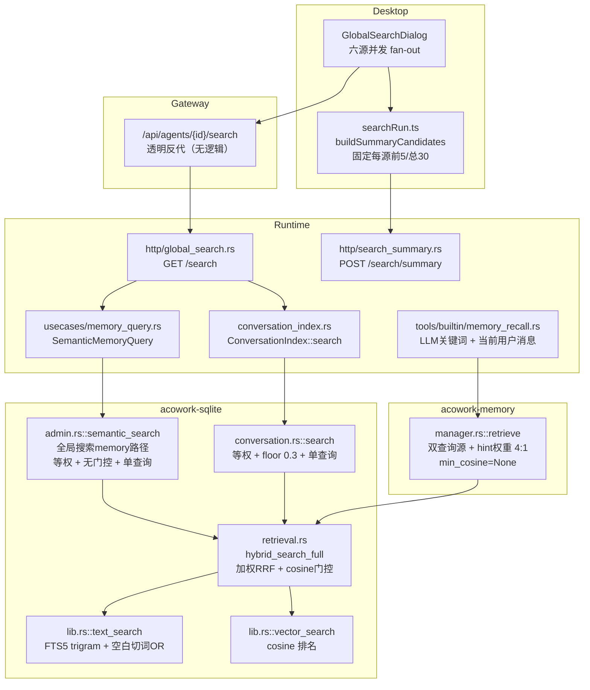
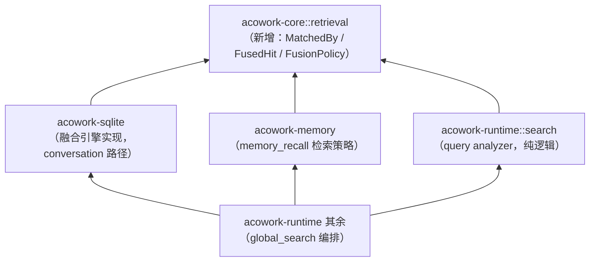
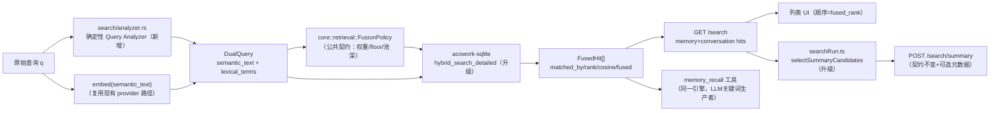

# 28 · 全局搜索检索优化与摘要候选筛选 — 详细设计

- **对应决策**：[ADR-095 全局搜索的对话与记忆检索优化及摘要候选筛选](../../adr/zh/ADR-095-global-search-conversation-memory-retrieval-and-summary-candidates.md)
- **上游文档**：ADR-081（全局搜索）、ADR-082（SQLite 向量与 FTS 检索）、ADR-093（LLM 摘要与引用）、设计文档 [27-global-search-llm-summary.md](27-global-search-llm-summary.md)
- **状态**：草案（待评审）
- **作者**：Software Architect

---

## 0. 本文回答的问题

ADR-095 给出了决策（D1–D6）与阶段（Phase 0–4），但没有落到模块与接口。本文回答：

1. **哪些能力可以复用**——特别是 `memory_recall` 已有的双查询召回与 ADR-095 要求的检索，如何收敛为同一条通用检索管线；
2. **新增哪些模块**（Runtime query analyzer、通用融合原语、评估 harness）；
3. **修改哪些模块**（acowork-sqlite / acowork-memory / acowork-runtime / Desktop），每处的接口变化与兼容策略；
4. 分阶段交付、验证与回滚如何映射到具体代码单元。

> 英文版 `docs/design/en/28-global-search-retrieval-optimization.md` 在评审通过后随首个实现 PR 补齐。

---

## 1. 现状分析（代码事实）

### 1.1 现有检索链路



### 1.2 关键事实盘点

| # | 事实 | 位置 | 对 ADR-095 的意义 |
|---|------|------|------------------|
| F1 | `hybrid_search_full(label, query, embedding, k, text_w, vector_w, min_cosine)` 已实现：双路各取 `2k` 候选池 → 向量路 cosine 门控 → 加权 RRF（k=60）→ 去重截断 | [core/acowork-sqlite/src/retrieval.rs:51](../../../core/acowork-sqlite/src/retrieval.rs) | **通用融合引擎已存在**，D3 的"有界候选池 + 加权 RRF + 词法独立证据"结构无需新建，只需扩展返回值 |
| F2 | 融合结果只返回 `Vec<(u64, f64)>`（id + RRF 分数），**matched_by / 各路 rank / cosine 在融合处丢失** | 同上 | D4 的根因缺口：元数据必须先在引擎层保留 |
| F3 | `memory_recall` 已是双查询形态：`MemoryQuery.embedding_text`（当前用户整句）→ 向量源；`MemoryQuery.query_text`（LLM 提取关键词）→ BM25 源；Semantic hint 权重 `(0.8, 0.2)` = 4:1 | [core/acowork-memory/src/manager.rs:287](../../../core/acowork-memory/src/manager.rs)、[manager.rs:964](../../../core/acowork-memory/src/manager.rs)、[tools/builtin/memory_recall.rs:187](../../../core/acowork-runtime/src/tools/builtin/memory_recall.rs) | D2 的"双查询表达"与 D3 的 4:1 权重**在 memory 路径已被验证**，是抽取通用原语的直接依据 |
| F4 | 全局搜索 memory 走 `admin.rs::semantic_search`：同一查询文本驱动向量+文本两路、等权 `(1.0, 1.0)`、无 cosine floor，且 `global_search.rs` 把返回顺序改写为合成 `1.0 - i*1e-4` | [core/acowork-sqlite/src/admin.rs:102](../../../core/acowork-sqlite/src/admin.rs)、[core/acowork-runtime/src/http/global_search.rs:262](../../../core/acowork-runtime/src/http/global_search.rs) | 与 F3 是**同一引擎的两条平行调用路径**——收敛到 memory 已验证的策略即是复用 |
| F5 | 全局搜索 conversation 走 `ConversationStore::search`：等权 `(1.0, 1.0)` + cosine floor `DEFAULT_MIN_COSINE=0.3`，单查询文本 | [core/acowork-sqlite/src/conversation.rs:283](../../../core/acowork-sqlite/src/conversation.rs) | D3 要求词法候选不受向量 floor 影响——现状已满足（floor 只门控向量路），保留 |
| F6 | FTS 查询构造（空白切词、≥3 字符词项、短语引号转义、<3 字符 LIKE 回退）内嵌在 `text_search` 中；trigram tokenizer 下无空格中文整串按一个短语匹配 | [core/acowork-sqlite/src/lib.rs:841](../../../core/acowork-sqlite/src/lib.rs) | D2 的 term 编码/转义/上限**已有部分实现**；analyzer 应输出词项列表，把编码职责留在存储层（单一实现） |
| F7 | `acowork-memory::keyword.rs` 是**写入时**关键词净化器（长度≤30、小写、去重、停用词、≤8 个），非查询时分析器 | [core/acowork-memory/src/keyword.rs](../../../core/acowork-memory/src/keyword.rs) | 其规则与停用词表可复用为查询 analyzer 的一部分（同一治理意图：防 LLM/整句污染 BM25） |
| F8 | Desktop `buildSummaryCandidates`：固定源序、每源前 5、总 30；`CandidateInput` 只有 `{title, snippet}`，无任何匹配元数据 | [apps/acowork-desktop/src/lib/searchRun.ts:149](../../../apps/acowork-desktop/src/lib/searchRun.ts) | D5 的候选筛选需要 `matched_by`/rank 输入——需扩展 DTO |
| F9 | Runtime 摘要端点校验契约：≤30 候选、id `[A-Za-z0-9_-]{1,32}`、title≤200、snippet≤500、64KiB body、citation allowlist、prompt injection 防护 | [core/acowork-runtime/src/http/search_summary.rs:57](../../../core/acowork-runtime/src/http/search_summary.rs) | 全部保留（ADR-093 契约不变），只做**可选字段增量** |
| F10 | Gateway 对 `/search`、`/search/summary` 均为透明反代，无业务逻辑 | [core/acowork-gateway/src/http/proxy.rs:139](../../../core/acowork-gateway/src/http/proxy.rs) | 本设计**不改 Gateway**（ADR-009 红线） |

### 1.3 复用判断（Rule of three 检视）

同一"双路召回 → 门控 → 加权 RRF"逻辑目前有 **3 个调用方**（memory_recall、全局搜索 memory、全局搜索 conversation），其中 2 个在全局搜索里退化成了等权/单查询的旧配置。按 Rule of three，把"查询表达 + 融合策略 + 结果元数据"抽成显式共享原语是**已被重复验证的抽象**，不是投机性框架。

---

## 2. 总体设计：一条通用检索管线

### 2.1 设计原则

1. **引擎复用、不新建引擎**：融合仍只有 `acowork-sqlite` 一处实现（F1）；本次把它升级为"保留来源内信号"的通用形态，三个调用方共享。
2. **双查询表达统一化**：`memory_recall` 的 `(embedding_text, query_text)` 形态上升为通用类型 `DualQuery (semantic_text, lexical_terms)`。词法词项的**生产者**可以不同（LLM 关键词 / 确定性 analyzer / 原始查询回退），**消费者**只有一个（FTS 执行器）。
3. **策略与机制分离**：权重、floor、池深是"检索策略"（`FusionPolicy`，可配置、可被评估扫描）；RRF/门控/转义是"机制"（代码内固定）。
4. **摘要候选是纯后处理**：不新增检索调用，只消费列表结果（D5）。
5. **一切新增 API 字段可选**：旧客户端零破坏，按 Phase 渐进迁移（ADR-095 §5）。
6. **依赖方向收敛到公共契约，memory 与 search 互不引用**：通用检索词汇（`MatchedBy`、`FusedHit`、`FusionPolicy`）下沉到 `acowork-core::retrieval`（新增模块）。既有 crate 依赖方向是 `acowork-sqlite → acowork-memory`（sqlite 实现 memory 定义的 `MemoryProvider` trait），因此共享契约**不能**放 memory（否则对话检索路径被迫引用 memory 域类型），也**不能**放 sqlite（否则 memory 反向依赖 sqlite，成环）。唯一无环的公共点是 `acowork-core`——它已经承载 `memory/traits.rs`、`embedding.rs` 等跨 crate 契约，检索契约放这里是同构扩展。



`acowork-runtime::search`（analyzer/policy 装载）与 `acowork-memory` 是**兄弟模块**：只共同依赖 core 契约，彼此零引用。memory 召回要消费 analyzer 产物时，由 Runtime 编排层把词项经 `MemoryQuery` 已有字段传入（数据流，不是依赖边）。

### 2.2 目标架构



### 2.3 复用映射总表（ADR-095 条款 → 组件）

| ADR-095 条款 | 复用（已有，仅升级/换配置） | 新增 | 修改 |
|---|---|---|---|
| D2 双查询表达 | `MemoryQuery(embedding_text, query_text)` 形态（F3）；FTS 转义/回退（F6） | Runtime `search/analyzer.rs` | `text_search` 拆出 `text_search_terms`；`SemanticMemoryQuery` 增 `lexical_terms` |
| D2 词法回退 | `embed_query` 失败回退 BM25 的既有语义 | analyzer 的 `None → raw` 回退 | 各调用点接 analyzer 输出 |
| D3 有界池+加权RRF | `hybrid_search_full` 引擎本体（F1） | `FusionPolicy` 结构（`acowork-core::retrieval`） | 返回值升级为 `FusedHit`；memory 全局路径改 4:1 |
| D3 词法独立证据 / conversation floor | floor 仅门控向量路（F5） | — | 保持不变 |
| D4 可解释元数据 | — | `FusedHit`、`MatchedBy` | `SearchHit.payload`、`SearchResult`、`ConversationHit` |
| D5 摘要候选筛选 | 预算/长度/allowlist 契约（F9） | 候选选择策略（both>text>vector-only 的确定性规则、会话去重） | `searchRun.ts` builder、`SummaryCandidate` 可选字段 |
| D6 数据驱动门槛 | `SqliteStore` 全量检索 API | 评估 harness + 标注数据集 | 无（评估不改运行时） |

---

## 3. 新增模块设计

### 3.1 Runtime Query Analyzer — `acowork-runtime/src/search/analyzer.rs`

**职责**（ADR-095 §5：纯逻辑、确定性、可单测、不拥有存储或 HTTP 状态）：

```rust
/// One shared lexical/semantic query expression for conversation & memory
/// retrieval (ADR-095 D2). Producers differ (LLM keywords, deterministic
/// analyzer, raw-query fallback); there is exactly one consumer
/// (`SqliteStore::text_search_terms` + embedding provider).
pub struct DualQuery {
    /// Raw full user query — always embedded (semantic source).
    pub semantic_text: String,
    /// Deterministic lexical terms for BM25/FTS. Empty ⇒ caller falls back
    /// to tokenizing `semantic_text` at the storage layer (no recall loss).
    pub lexical_terms: Vec<String>,
}

/// Deterministic, bounded query analyzer. Pure function, no I/O.
pub fn analyze(raw: &str, cfg: &AnalyzerConfig) -> DualQuery;
```

**规则（v1）**：

| 规则 | 值 | 依据 |
|---|---|---|
| 输入长度上限 | 512 chars（超出截断） | ADR §6 输入限制 |
| 切分 | 空白 + ASCII 标点；保留词内 `-`/`_`；连续 CJK 视为独立 run | 与 FTS 执行器现状一致（F6） |
| 英文词项 | 小写、去停用词、长度 `3..=30`、上限 16 个 | 3 字符下限对齐 trigram tokenizer；30/停用词复用 `keyword.rs` 规则（F7） |
| 中文词项 | **v1 默认 `CjkStrategy::Keep`**（整 run 原样传递，等价现行为，零回归）；`CjkStrategy::Trigram`（3-gram 展开）作为评估开关 | ADR-095 明确"不得未经测试将任意 3-gram OR 当作已验证策略"（§9.2 待评审项） |
| 失败/空结果 | 返回 `lexical_terms = []`，调用方回退原始查询 | D2"分析器无结果不得丢召回" |
| FTS 注入防护 | analyzer **不做**转义（只产出裸词项）；转义唯一实现留在 `text_search_terms`（F6 现状） | 单一职责；避免两处转义规则漂移 |

**放置说明**：Analyzer 是 Runtime 对 conversation/memory 检索的共享中间层（ADR §5），放 `acowork-runtime/src/search/`，不放 `acowork-memory`（避免 memory crate 反向承载对话检索关注点），也不放 `acowork-sqlite`（不侵入存储层）。`memory_recall` 工具路径**不强制接 analyzer**——其 LLM 关键词已是合规的 `lexical_terms` 生产者（D2 明文允许）。

### 3.2 检索策略契约 — `acowork-core/src/retrieval.rs`（类型）+ Runtime 配置装载

**职责**（D6 前置）：`FusionPolicy` 作为**跨 crate 公共契约**定义在 `acowork-core::retrieval`（与 `MatchedBy`/`FusedHit` 同模块），三个调用方与评估 harness 共用同一类型；Runtime `search/policy.rs` 只做配置装载（读 agent config、套默认值、产出 `FusionPolicy`），不拥有类型定义。这样 memory 与 search 都只依赖 core，彼此零引用。

```rust
/// Per-source fusion knobs (ADR-095 D3). Values are rank-fusion weights,
/// NOT probabilities or similarities. Calibrated via the Phase-0 eval set.
#[derive(Debug, Clone, Copy)]
pub struct FusionPolicy {
    pub vector_weight: f64,
    pub text_weight: f64,
    /// Vector-source-only cosine gate; `None` disables.
    pub min_cosine: Option<f32>,
    /// Per-source candidate pool = `pool_factor * k` (engine default 2).
    pub pool_factor: usize,
}

impl FusionPolicy {
    /// Initial semantic policy: vector:text = 4:1, mirroring the
    /// production `memory_recall` Semantic hint weights (ADR-095 D3).
    pub const SEMANTIC_4TO1: Self = Self { vector_weight: 0.8, text_weight: 0.2, min_cosine: None, pool_factor: 2 };

    /// Conversation default: same weights, keep the existing floor.
    pub const CONVERSATION_BASELINE: Self = Self { vector_weight: 1.0, text_weight: 1.0, min_cosine: Some(0.3), pool_factor: 2 };
}
```

**配置来源**：Runtime agent config 增 `search` 段（`analyzer_mode: off|shadow|on`、可选权重覆盖，供 Phase 4 阈值 sweep 使用）。默认值即上表常量；**Phase 2 之前不改任何线上权重**。

### 3.3 评估 Harness — `dev/eval/retrieval/` + 按二进制边界拆分的三个 runner

**职责**（D6 / Phase 0）：离线比较检索变体，产出指标报告；不进入任何线上路径，也不链接进任何发布二进制（runner 是集成测试，共用内核 `core/acowork-eval` 只以 `[dev-dependencies]` 被依赖）。

- **数据集** `dev/eval/retrieval/dataset.jsonl`（脱敏、人工标注）：

```json
{"id":"q-001","lang":"zh","kind":"full_sentence","query":"上次网关的 MQTT 端口配置是多少来着",
 "relevant":[{"scope":"memory","node_id":42},{"scope":"conversation","session_id":"s-7","message_index":12}],
 "exact_terms":["MQTT","端口"]}
```

  覆盖矩阵（D6 最低要求）：英文/中文/混合 × 短关键词/整句/精确实体/仅语义/无相关结果/对话与记忆重复候选。
- **语料 fixture**：`corpus.jsonl`（38 行：22 memory + 16 conversation）→ 每个 harness 只建自己 scope 的临时 store（memory label 表 / 对话索引）。向量是 `dev/eval/retrieval/embeddings.json` 里的**确定性 hashed-token 占位投影**（非生产模型；生产模型的预生成缓存是它预留的接缝，不是它当前的内容），因此两次运行可字节比较。该文件是 `corpus.jsonl` 的派生数据，`EvalDataset::load` 会拒绝与内核分词器不一致的旧文件——语料与查询必须由同一个分词器投影，否则语义权重静默变味；改分词器/维度/语料文本后用 `cargo test -p acowork-eval --test regenerate_stand_in_embeddings -- --ignored` 重生成。
- **runner 按 ADR-100 的二进制边界拆分**（不再存在"一个 harness 同时喂两个引擎"的形态）：

| runner | scope | 位置 | 变体 |
|---|---|---|---|
| 离线 memory | memory | `core/acowork-memory/tests/retrieval_eval.rs` | 现状 4:1 / 等权 / 4:1+floor / 2:1 |
| 离线 conversation | conversation | `core/acowork-runtime/tests/retrieval_eval.rs` | baseline / dual 等权 / dual 4:1 / dual 4:1+floor |
| 线上 E2E | conversation（真实 HTTP + 生产模型） | `core/acowork-runtime/tests/global_search_e2e.rs` | Tier 1/3 结构断言默认可跑；Tier 2 质量数字 `--ignored` |

  每个 harness 只播种并只打分自己 scope 的行；ground truth 全在另一 scope 的查询跳过并计入 `skipped` 列（不进均值）——把没发给某引擎的行算成它的命中或误召回，都会让它的数字朝有利的方向动。变体是 `enum Variant` 里的固定清单，不是 CLI 参数：可以现场改出来的变体不构成可复现的对比。
- **共用内核** `core/acowork-eval/src/lib.rs`：指标数学、数据集读取、stand-in 投影、报告形状。集成测试无法跨 crate 互相 import，而两侧各抄一份定义就等于一次权重变更被两把尺子量；把它放进 `acowork-core` 又会把测量代码链接进发布二进制，故独立成 dev-only crate（`tests/shipping_redline.rs` 守住这条线）。
- **指标**：Recall@K、Precision@K、MRR、nDCG@K、无关查询误召回率、**文本精确命中保留率**（单列，D6）。输出 JSON + Markdown 报告到 `dev/eval/retrieval/reports/`（`memory-report.*` / `conversation-report.*` / `conversation-live-model-report.*` / `conversation-live-cosine.json`）。

### 3.4 Desktop 候选选择策略 — `searchRun.ts` 内新函数（非新文件）

见 §4.4。逻辑仍是纯函数（可单测），与现有 `buildSummaryCandidates` 同文件共存。

---

## 4. 修改模块设计

### 4.1 `acowork-sqlite` — 融合引擎升级（核心复用点）

#### 4.1.1 `retrieval.rs`：新增 `hybrid_search_detailed`，保留旧签名

`MatchedBy` / `FusedHit` **定义在 `acowork-core::retrieval`**（§3.2 公共契约模块），`acowork-sqlite` 只做 `pub use` 再导出并实现引擎：

```rust
// acowork-core/src/retrieval.rs — the shared vocabulary (no storage logic).

/// Which ranked source(s) produced a candidate (ADR-095 D4). NOT a
/// similarity claim: `both` means the id appeared in both bounded pools.
#[derive(Debug, Clone, Copy, PartialEq, Eq, serde::Serialize)]
#[serde(rename_all = "snake_case")]
pub enum MatchedBy { Vector, Text, Both }

/// One fused candidate with per-source, in-source signals.
#[derive(Debug, Clone)]
pub struct FusedHit {
    pub id: u64,
    pub matched_by: MatchedBy,
    /// 0-based rank inside the vector pool (None = not a vector hit).
    pub vector_rank: Option<usize>,
    /// 0-based rank inside the text pool (None = not a text hit).
    pub text_rank: Option<usize>,
    /// Cosine similarity, kept only when the vector source actually ran.
    pub cosine: Option<f64>,
    /// Weighted RRF fused score. In-source rank signal only — never
    /// comparable across queries or scopes, never a similarity.
    pub fused_score: f64,
    /// 0-based rank after fusion + dedup + truncate.
    pub fused_rank: usize,
}

// acowork-sqlite/src/retrieval.rs — the engine.
impl SqliteStore {
    /// The single shared hybrid retrieval engine (ADR-095 D3).
    /// `lexical_query` drives BM25/FTS; `embedding` drives cosine.
    pub fn hybrid_search_detailed(
        &self,
        label: &str,
        lexical_query: &str,
        embedding: Option<&[f32]>,
        k: usize,
        policy: &acowork_core::retrieval::FusionPolicy,
    ) -> Result<Vec<FusedHit>>;

    /// Existing API kept as a thin compat wrapper (maps FusedHit → (id, fused_score))
    /// so untouched callers keep compiling through Phases 1–2.
    pub fn hybrid_search_full(/* unchanged signature */) -> Result<Vec<(u64, f64)>>;
}
```

**实现要点**：
- 现有流程（双池 `2k` → 向量门控 → 加权 RRF → 去重截断）**一行不改语义**，只是不再丢弃 `vector_rank/text_rank/cosine`；`matched_by` 由两个 rank 的 presence 推出。
- 引擎直接消费 `core::retrieval::FusionPolicy`（纯数据，无存储语义）——sqlite 已依赖 core，不新增任何依赖边；原稿的 `FusionPolicyView` 垫片**取消**（它是为绕开"类型放 runtime"的权宜设计，契约下沉后不再需要）。
- **不新增** memory 侧 cosine floor 逻辑（D3/D6：未校准前 `min_cosine: None`）。

#### 4.1.2 `lib.rs::text_search`：拆出词项执行器

```rust
/// Execute an FTS search over pre-tokenized, bounded terms. This is the
/// ONLY place that quotes/escapes terms for FTS5 (single implementation).
/// Terms shorter than the trigram minimum are dropped here (v1 behavior).
pub fn text_search_terms(&self, label: &str, terms: &[String], k: usize) -> Result<Vec<(u64, f64)>>;

/// Existing entry kept: tokenizes `query` on whitespace, then delegates.
pub fn text_search(&self, label: &str, query: &str, k: usize) -> Result<Vec<(u64, f64)>>;
```

- 现状的短语引号转义、`OR` 拼接、`<3` 字符 LIKE 回退逻辑原样搬入 `text_search_terms`，`text_search` 变为"切词 + 委托"。
- 词项数上限（16）由 analyzer 保证；执行器侧再做一次防御截断（≤32），超限退回原始查询（D2）。
- **无 schema 迁移、无索引重建**（trigram tokenizer 不变；§9.2 若评估后换中文分词器，另行审议）。

#### 4.1.3 `admin.rs::semantic_search`（全局搜索 memory 路径）

- 签名扩展（或新增 `semantic_search_detailed`）：入参增加 `lexical_terms: &[String]`（空则回退 `query_text`），hybrid 分支从 `(1.0, 1.0, None)` 改为传入 policy（默认 `SEMANTIC_4TO1` 起步，Phase 2 由评估定稿）；返回 `Vec<(AdminNodeRecord, FusedHit)>`。
- 跨 label 合并逻辑保持（labels 不相交，按 fused_score 排序），但**每个 label 内 rank 语义保留在 FusedHit 中**；跨 label 的 fused_rank 重算并记录。

#### 4.1.4 `conversation.rs::search`（全局搜索 conversation 路径）

- 新增 `search_detailed(lexical_query, embedding, k, policy)` → `Vec<(ConversationHit, FusedHit)>`；`ConversationHit.score` 文档注释明确为 RRF 融合排名信号（现状已如此注释，保持）。
- floor `DEFAULT_MIN_COSINE=0.3` **继续只对向量路生效**（F5，符合 D3）；词法命中不经 floor。

### 4.2 `acowork-memory` — 结果元数据透出（memory_recall 复用同一引擎）

#### `types.rs`

```rust
pub struct SearchResult {
    // ... existing fields unchanged ...
    /// Which retrieval source(s) matched this node (ADR-095 D4).
    /// `Hybrid` here previously meant "the query ran in hybrid mode" —
    /// per-hit `matched_by` supersedes it for relevance explanations.
    pub matched_by: Option<MatchedBy>,
    pub vector_rank: Option<usize>,
    pub text_rank: Option<usize>,
}
```

- `MatchedBy` / `FusedHit` / `FusionPolicy` 一律来自 `acowork-core::retrieval`（§2.1 原则 6）：`acowork-memory` 与 `acowork-sqlite` 各自只依赖 core 契约，**memory 不依赖 sqlite，sqlite 也不从 memory 借域类型**。`MemoryProvider` trait（定义在 memory，实现在 sqlite）增加 `hybrid_search_detailed`，返回 `Vec<acowork_core::retrieval::FusedHit>`；带默认实现（委托 `hybrid_search_full`、元数据降级为 `None`），保证 Grafeo 遗留实现/测试桩不破。

#### `manager.rs::retrieve`

- 内部改调 `hybrid_search_detailed`（policy 由 `hint_weights` 映射为 `core::retrieval::FusionPolicy`——**4:1 权重从 memory 侧私有配置变为跨路径共享的策略常量**，见 §3.2；`hint_weights` 本身留在 memory，属记忆召回策略，不外泄给 search 模块）。
- **memory 与 search 的解耦边界**：memory 的输入契约仍是 `MemoryQuery`（`query_text` 词法 / `embedding_text` 语义，双查询形态不变）；Runtime 编排层若要把 analyzer 词项喂给 memory 路径，走 `MemoryQuery` 已有字段传值，`acowork-memory` 不 import `acowork-runtime::search` 的任何类型。
- 行为不变项：`min_cosine=None`、Dormant 排除、跨 label 去重、exclude_session、RAG 通道合并。`source` 字段（"hybrid"/"text"）保留为兼容信息，`matched_by` 为其精确化替代。
- `memory_recall` 工具输出**不强制**展示新字段（工具 schema 可先不动，Phase 1 视需要加 `matched_by` 到结果 JSON，向后兼容）。

### 4.3 `acowork-runtime` — 检索编排与 API

#### `http/global_search.rs`（GET /search）

- 流程改为：`analyze(q)` → `DualQuery` → `embed(semantic_text)`（失败回退：embedding=None → 纯文本路，保留现状）→ memory 用 `lexical_terms.join(" ")`（空则 raw q）驱动 `semantic_search_detailed`；conversation 同词项驱动 `search_detailed`。
- `SearchHit` 变化（全部**可选字段**，旧 UI 忽略即可）：

```rust
pub struct SearchHit {
    pub scope: String,
    pub title: String,
    pub snippet: String,
    pub score: f64,          // memory/conversation: 改为真实 fused_score（不再 1.0-i*1e-4）
    pub payload: Value,      // 增: "matched_by","vector_rank","text_rank","fused_rank";cosine 仅入诊断
}
```

  - **删除 F4 的合成顺序分数**：memory hits 的 `score` 直接返回 fused_score 并在文档注明"来源内融合排名信号"（D4"不得再将顺序合成值命名为相似度"）。前端列表顺序 = 服务端 `fused_rank`，本就等价。
  - `cosine` 默认**不**进 `payload`，只进 `scopes` 诊断块与评估接口（§9.4 待评审项的默认建议）。
- `shadow` 模式（Phase 1）：`analyzer_mode=shadow` 时线上仍走旧单查询路径，异步对同一 q 跑 analyzer 路径并把两组 `matched_by`/rank 差异记入 tracing（只记 id、计数、来源，不记正文——§6 隐私要求）。

#### `usecases/memory_query.rs`

- `SemanticMemoryQuery` 增 `#[serde(default)] pub lexical_terms: Vec<String>`；`mode` 语义不变。
- `MemoryNode` DTO 增可选 `matched_by` 等（admin 层透传）。

#### `conversation_index.rs`

- `ConversationIndex::search(query_text, embedding, k)` 增词法参数重载 `search_dual(&DualQueryView, k, policy)`；旧签名保留为 wrapper。

#### `http/search_summary.rs`（POST /search/summary）

- `SummaryCandidate` 增可选字段：

```rust
pub struct SummaryCandidate {
    pub id: String, pub scope: String, pub title: String, pub snippet: String,
    /// Evidence class for the model (ADR-095 D5). Validated against
    /// {"vector","text","both"}; absent ⇒ omitted from the prompt line.
    #[serde(default)] pub matched_by: Option<String>,
}
```

- 校验：枚举白名单 + 现有全部上限不变（F9）；`matched_by` 仅作为**证据类别**渲染进 prompt（如 `[both]`），**不得**渲染为 confidence；prompt 增加"证据不足/互相矛盾须明说"指令（D5）。
- 空候选契约不变：0 候选时 Desktop 不发请求（见 4.4），服务端收到空列表仍按 ADR-093 返回无结果状态。

### 4.4 Desktop — 摘要候选 builder（`apps/acowork-desktop/src/lib/searchRun.ts`）

`buildSummaryCandidates` 升级为 `selectSummaryCandidates`（保留旧导出为 deprecated wrapper 一个发布周期）：

```ts
export interface CandidateInput {
    title: string;
    snippet: string;
    /** From GET /search payload (ADR-095 D4). Absent ⇒ treated as unknown. */
    matchedBy?: 'vector' | 'text' | 'both';
    /** In-source fused rank (0-based). */
    fusedRank?: number;
    /** Dedup key: session_id (conversation) / node_id (memory). */
    dedupKey?: string;
}
```

**选择规则（确定性、可单测，不用任何未校准阈值）**：

| 来源 | 规则 |
|---|---|
| file / git / doc / project | 完全不变：来源内既有顺序，每源前 5（D5） |
| conversation | 按服务端顺序（=fused_rank）；`matched_by==='both'` 在同预算内优先占位；**每 session_id 最多 2 条**（会话多样性）；`vector`-only 且 `matched_by!=='both'` 的条目排在 `text`/`both` 之后 |
| memory | 同上（无 session 维度，去重键为 node_id + snippet 前缀哈希防重复内容） |
| 全局 | 每源预算是**上限非目标**；不足即少交；0 条合格 → 不调 `/search/summary`（前端直接显示"无足够证据"态） |

- `id` 仍为 `r1..rN` 白名单引用号（ADR-093 citation 机制不动）；`indexOf` 需映射回**列表行序**（服务端 fused_rank 序），保证点击跳转不错位。
- `GlobalSearchDialog.tsx`：列表渲染顺序改为直接采用服务端返回序（memory tab 不再本地按合成 score 排序）。

### 4.5 不改动的模块（显式声明）

| 模块 | 原因 |
|---|---|
| Gateway（`http/proxy.rs` 等） | 透明反代，无逻辑（F10 / ADR-009 红线） |
| file / git / doc / project 检索与 `acowork-doc` | D1 明确排除 |
| `acowork-embed` / embedding provider 链 | 仅复用现有 `embed_query` 失败回退 |
| SQLite schema / FTS tokenizer | 无索引重建（除非 Phase 0 评估触发另行审议） |
| `memory_store` 写入路径 / `keyword.rs` | analyzer 复用其规则常量，不改写入治理 |

---

## 5. 接口契约汇总

### 5.1 `GET /search` 响应（增量）

```jsonc
{
  "hits": [
    {
      "scope": "memory",
      "title": "knowledge",
      "snippet": "...",
      "score": 0.0163,            // fused RRF — in-source rank signal
      "payload": {
        "node_id": 42,
        "matched_by": "both",     // NEW: "vector" | "text" | "both"
        "vector_rank": 1,         // NEW: optional
        "text_rank": 3,           // NEW: optional
        "fused_rank": 0           // NEW
      }
    }
  ],
  "scopes": { "memory": {"status":"ok","count":12} },
  "indexing": false
}
```

### 5.2 `POST /search/summary` 请求（增量）

```jsonc
{ "query": "...", "partial": false,
  "candidates": [ { "id":"r1","scope":"memory","title":"...","snippet":"...",
                    "matched_by":"both" } ] }   // NEW: optional, enum-validated
```

### 5.3 内部 Rust 契约

| 类型 | 所在 crate | 消费者 |
|---|---|---|
| `MatchedBy` / `FusedHit` / `FusionPolicy` | `acowork-core::retrieval`（**唯一公共契约点**） | sqlite 引擎、memory manager、Runtime search 模块与 API |
| `DualQuery` | `acowork-runtime::search`（Runtime 内部编排类型，非跨 crate 契约） | analyzer 产出、global_search 消费；memory 路径经 `MemoryQuery` 字段传值，不 import 此类型 |
| `MemoryProvider::hybrid_search_detailed` | trait 与实现均在 `acowork-memory`（`src/provider.rs` + `src/sqlite/`，随 ADR-100 迁入） | memory manager；返回 core 契约类型 |
| `retrieval_eval`（指标数学 / 数据集读取 / stand-in 投影 / 报告形状） | `acowork-eval`（**dev-only crate**） | 仅 `acowork-memory/tests/` 与 `acowork-runtime/tests/` 的检索 harness；以 `[dev-dependencies]` 被依赖 |

依赖红线（评审/CI 检查项）：`acowork-memory` ✗→ `acowork-runtime::search`；`acowork-runtime::search` ✗→ `acowork-memory`；`acowork-sqlite::conversation` ✗→ `acowork-memory` 域类型。三者只允许各自指向 `acowork-core::retrieval`。测量面另有一条：`acowork-eval` ✗→ 任何发布二进制（它不得出现在 `[dependencies]`/`[build-dependencies]` 下，也不得回住 `acowork-core`），且两个引擎的测试不得互相引用——由 `acowork-eval/tests/shipping_redline.rs` 与 `dev/ci.sh` 的对应步骤强制。

---

## 6. 可靠性、安全与性能

- **降级矩阵**（全部保留/复用现有语义）：
  - analyzer 无结果/超限 → 原始查询单路文本检索（零召回损失承诺）；
  - embedding 失败 → 纯 BM25（现状 F1 路径已支持）；
  - 任一 scope 失败 → 部分结果（现状 `scopes.status`）；
  - 摘要失败不影响列表（现状）。
- **FTS 注入**：转义唯一实现 `text_search_terms`；analyzer 只产裸词项且有词项数/长度上限。
- **隐私**：整句文本不复制进额外持久化（embedding 即用即弃）；shadow 模式日志只记 id/计数/rank；`cosine` 原值默认不出 UI 边界（§9.4）。
- **性能**：融合仅在 `2k` 有界池内进行（现状）；analyzer 为 O(|q|) 纯函数；摘要请求字节上限不变（64KiB）。新增开销≈每查询一次 analyzer 调用（微秒级）。
- **预算**：`pool_factor` 可配，防止 Phase 4 阈值 sweep 时池爆炸。

---

## 7. 分阶段交付（映射 ADR-095 Phase 0–4）

| Phase | 交付物（代码单元） | 验证 | 回滚 |
|---|---|---|---|
| 0 | `dev/eval/retrieval/dataset.jsonl` + `corpus.jsonl` + 两个离线 runner（`acowork-memory/tests/retrieval_eval.rs`、`acowork-runtime/tests/retrieval_eval.rs`）+ 共用内核 `core/acowork-eval` | 基线三指标报告入库（分 scope 两份）；数据集覆盖矩阵完整 | 纯离线，删文件即可（内核是 dev-only crate，不牵扯发布面） |
| 1 | `acowork-core::retrieval` 契约模块、`search/analyzer.rs`、`text_search_terms` 拆分、`hybrid_search_detailed`、`analyzer_mode=shadow` | analyzer 单测（中英/上限/回退）、FTS 转义测试、现有检索回归全绿、shadow 对比报告、**依赖方向检查（§5.3 红线）** | 配置 `analyzer_mode=off`；旧 API wrapper 未删 |
| 2 | 全局搜索 memory 切 `SEMANTIC_4TO1` + detailed 路径；`SearchHit.score` 换真实 fused_score；conversation 按评估结果定权重；Desktop 采用服务端序 | eval 达标（预约定 Precision@K/Recall@K 门槛，评审时定数）；`matched_by` 正确性测试；文本精确命中保留率单列验证 | 恢复旧 mapper 常量（一行 policy 改动）；可选响应字段保留不影响旧客户端 |
| 3 | `selectSummaryCandidates`（多样性/去重/可欠预算）、`SummaryCandidate.matched_by`、prompt 证据类别与"不足须声明" | builder 单测（含 0 候选、部分源失败）、citation/prompt 回归 | 恢复固定每源前 5 builder（旧导出保留一周期）；检索行为不受影响 |
| 4 | memory 向量弱候选拒绝阈值 sweep（仅当 Phase 0/2 数据支持） | 阈值 sweep 报告、误拒/误接纳分析；未达标则**不启用** | 阈值配置归 `None`，回到向量排名 + 词法独立证据 |

每阶段独立可发布；Phase 2 的权重数值以评估结论为准，本设计中的 4:1 仅为 ADR 指定的初始策略。

---

## 8. 测试策略

| 层 | 测试 | 位置 |
|---|---|---|
| 单元 | analyzer：中英混合、上限截断、空结果回退、CJK Keep/Trigram 开关 | `search/analyzer.rs` tests |
| 单元 | `text_search_terms`：转义、词项数防御截断、<3 字符 LIKE 回退、label 隔离 | `acowork-sqlite/tests.rs` 扩展 |
| 单元 | `hybrid_search_detailed`：matched_by 正确性（vector-only/text-only/both）、floor 仅作用向量路、rank 语义、稳定序 | `retrieval.rs` tests（沿用现有 `hybrid_search_keeps_lexical_hit_whose_embedding_is_far` 并扩展） |
| 集成 | `GET /search` 新 payload 字段；memory scope 已按 ADR-100 下线（返回 `not_available` 且零命中），断言归位 `global_search_e2e.rs` Tier 1 | `core/acowork-runtime/tests/global_search_e2e.rs` |
| 集成 | summary 校验：`matched_by` 枚举白名单、旧请求（无新字段）通过 | `global_search_e2e.rs` Tier 3（走真实 HTTP） |
| 前端 | `selectSummaryCandidates`：多样性、去重、欠预算、0 候选不发请求 | `searchRun.test.ts` 扩展 |
| 离线 | 分 scope 的变体对比 + 指标（CI 手动/定时任务，不入 PR 阻塞） | memory：`cargo test -p acowork-memory --test retrieval_eval -- --ignored`；conversation：`cargo test -p acowork-runtime --test retrieval_eval -- --ignored`；指标定义共用 `core/acowork-eval` |
| 线上 E2E | Tier 1/3（真实 HTTP + SQLite + FTS，无外部依赖）默认可跑；Tier 2（生产嵌入模型）`--ignored` | `cargo test -p acowork-runtime --test global_search_e2e [-- --ignored]` |

---

## 9. 风险与待评审事项（对齐 ADR-095 §9）

1. **质量门槛数值未定**：Phase 2/4 的启用条件（Precision@K / Recall@K 目标）须在评审时约定具体数字，否则"数据驱动"无法验收。→ 建议评审会上由架构组 + 搜索评估负责人定数。
2. **中文词法方案**：v1 用 `Keep`（零回归），`Trigram` 开关进评估；是否引入分词 crate（如 jieba-rs）取决于 Phase 0 报告，本设计不预设。
3. **Conversation 权重**：是否沿用 4:1 取决于其 FTS 分布（消息正文比记忆更口语化），评估单列。
4. **`SearchHit.score` 语义变更是破坏性微调**：memory scope 从合成 `1.0-i*1e-4` 改为 fused_score，值域变小且可能出现同分。Desktop 列表若曾按 score 二次排序需改为按返回序（Phase 2 同批发布；本仓库内仅 Desktop 一个消费者，风险可控）。
5. ~~**`MatchedBy` 契约位置**~~（已决，2026-10-16 评审意见）：下沉 `acowork-core::retrieval`。放 memory 会让对话检索路径（conversation → sqlite）被迫引用 memory 域类型，形成 search 依赖 memory 的耦合；放 sqlite 会让 memory 反向依赖 sqlite 成环。core 是唯一无环公共点，且 memory 与 runtime search 成为只依赖契约的兄弟模块。若未来 doc 检索复用融合引擎，契约已就位，无需再搬。

## 10. 决策记录

- 2026-10-16：初稿。核心结论：不新建检索引擎，将 `acowork-sqlite::hybrid_search_full` 升级为保留来源内信号的共享融合原语；`memory_recall` 的双查询形态（embedding_text/query_text）泛化为 `DualQuery`，analyzer 与 LLM 关键词作为并列的词项生产者；摘要候选选择升级为消费 `matched_by`/rank 的确定性后处理。
- 2026-10-16（评审意见）：按"memory 与 search 不得互调，各自依赖公共模块"的要求，检索公共契约（`MatchedBy`/`FusedHit`/`FusionPolicy`）从原稿的 `acowork-memory::types` 改放 `acowork-core::retrieval`；取消 `FusionPolicyView` 垫片；`hint_weights` 留在 memory 内部，跨路径共享的是常量语义而非代码依赖。
