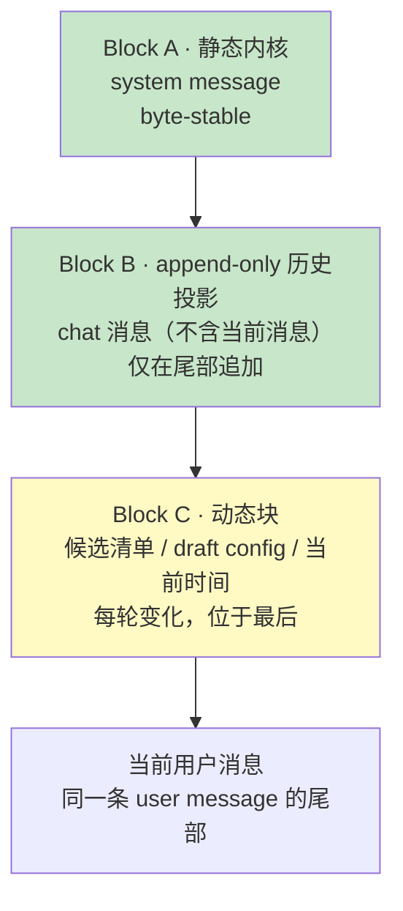

# Chat Session 上下文编排设计（Chat Router）

> 版本：v1.0 | 更新日期：2026-10-21
>
> 关联：[ADR-099](../../adr/zh/ADR-099-chat-session-llm-router.md)（Chat Router 决策）、[ADR-060](../../adr/zh/ADR-060-prompt-cache-friendly-context-block-reorg.md)（稳定前缀 + 末尾追加）、[ADR-063](../../adr/zh/ADR-063-package-level-prompt-override.md)（包级 Prompt 覆盖）、[ADR-066](../../adr/zh/ADR-066-llm-provider-cache-tokens.md)（Cache Token 统计）、设计 27（Intent 消息与群聊）

## 1. 目标与约束

Chat Router 每轮都是**无状态**的 LLM 调用（一轮内可多次调用模型：信息工具轮次见 ADR-099 D3）：不建常驻 session，上下文全部从 chat 历史与运行时状态重建。因此编排必须同时满足三件事：

1. **语义完整**：模型能看到近期对话、当前草稿配置、可路由的执行会话；
2. **前缀稳定**：相邻轮次之间，除末尾追加外不改动任何字节，最大化 provider prompt cache 命中；
3. **成本可控**：历史窗口与单条消息都有硬上限，不因群聊或长附件膨胀。

设计原则只有一条：**稳定前缀 + 末尾追加**（ADR-060）。任何每轮变化的内容都必须放在 Block C，绝不能进入 Block A/B。

### 1.1 非目标

- 不改变 execute session 的 Block A/B 布局（ADR-060 已定义）；
- 不让 router 读取 execute session 的 JSONL 正文（ADR-096）；
- 不对 chat 历史做摘要压缩——窗口裁剪即丢弃，router 只需要近期上下文。

## 2. 三段式布局



最终 `messages` 数组：

| 下标 | 角色 | 内容 | 变化频率 | 缓存 |
|---|---|---|---|---|
| `[0]` | system | Block A（基座 + persona + 场景段） | 进程/包升级时 | `ephemeral` 断点 |
| `[1..N]` | user/assistant | Block B（历史投影，不含当前消息） | 仅尾部追加（裁剪时批量重建） | `ephemeral` 断点在末尾 |
| `[N+1]` | user | Block C + 当前用户消息（同一条消息，Block C 在前） | 每轮 | 不缓存 |

Block C 与当前消息合并成一条 user 消息，避免连续两条 user 消息；格式见 §5.3。

## 3. Block A：静态内核

### 3.1 组合顺序

```
[chat.md 覆盖]                   // 存在且非空白：整段替换下面三层
                                 // 会话级（群聊）chat.md 优先于包级 prompts/chat.md
                                 // 只有 {{agent_name}} 被替换
— 无覆盖时为内置默认 —
[CHAT_ROUTER_BASE_PROMPT]        // Runtime 常量（acowork_core::chat_prompt）
                                 // 角色边界 / dispatch 契约 / 决策规则 / 安全规则
## Persona                       // manifest 回退
<persona text>
## Scenario                      // 1:1 或 group，两个稳定变体
<scenario text>
— 两种情况都追加 —
## Identity                      // 用户语言 / 时区（identity_context）
<identity text>
```

顺序固定，段间分隔符固定（`\n\n`），不做任何按内容排序或条件性省略之外的拼接。基座、Persona 与场景段的字面量集中于 `acowork_core::chat_prompt`：`acowork-user` 用它给群聊会话的 `chat.md` 播种、`acowork-runtime` 用它组装内置默认，二者不会漂移。

### 3.2 基座

基座由 Runtime 维护，包含：

1. 角色边界：你是 `<agent display_name>` 的对话前台，只能回答、查一个信息、路由或新建执行会话；
2. 工具契约：路由工具只有 `dispatch`（参数语义与别名规则）；另有两个只读信息工具 `memory_recall` / `http_request`（GET-only），轮数由提示词软约束（"通常零次，最多一两次"），不用代码硬上限；
3. 决策规则：回答 / 转交 / 新建 / 澄清的判据（与 ADR-099「路由行为准则」一致，核心是 dispatch 代价不对称：错发远比漏发贵，不确定就问）；
4. 安全规则：只使用候选清单中的信息；不复述其他 chat 的内容；不承诺执行细节；不代人类 @ 其他 agent。

`chat.md` 存在且非空白时**整段替换**内置 chat prompt 正文（基座 + Persona + 场景段），只替换 `{{agent_name}}`；缺省时使用内置默认。有两部分不是该文件能删掉的。其一，`# Safety` 不变量是一段不可裁剪的尾块，Runtime 每轮都会重新追加到正文末尾（`chat_prompt::with_chat_prompt_tail`），从 `chat.md` 里删掉它对模型实际看到的内容没有影响。其二，安全边界由结构而非提示词字面量保证：router 只有 `dispatch` 与两个只读工具，改写提示词不会给它新的能力（ADR-099 D6）。此外，群聊的 `chat.md` **仅群主或管理员可写**（ADR-098 治理），任何成员可读，因此单个成员无法注入一段去操控他人 agent 的提示词。群聊右侧设置面板只编辑正文——`# Safety` 尾块不在面板中显示（`chat-md` 接口返回的是剥掉尾块后的正文），保存时由存储与 Runtime 重新追加，因此不会把成员改不动的内容摆进可编辑框再静默还原。

### 3.3 Persona 与 chat.md 来源优先级

任一份非空白的 `chat.md` 都整段替换内置 prompt，**不再只替换 Persona 段**。按序查找：

1. 会话级 `chat.md`：`acowork-user` 的 `chat-sessions/{id}/chat.md`，仅 `user_group` / `project_group`，任何成员可读、仅群主或管理员可写（ADR-098），从群聊右侧设置面板编辑；首读时用内置默认（群聊变体，含不可裁剪的 `# Safety` 尾块）生成；
2. 包级 `prompts/chat.md`（≤ 16KB，空白文件视为缺失；agent 启动时若无则用内置默认生成，单聊走这一档）；
3. 内置默认 = 基座 + manifest 人格（`display_name` / `name` + `role` + `description` 拼成一句）+ 场景段。

`chat.md` 纳入 ADR-063 的 `OVERRIDABLE_PROMPTS` 清单：

- 从 execute system prompt 的拼接中排除（与 `summary.md` 同一排除规则）；
- 由 `POST /agents/{id}/prompts/reload` 同步刷新；
- Debug 面板可查看与编辑。

### 3.4 场景段

| 场景 | 判定 | 追加规则 |
|---|---|---|
| 1:1（`user_agent`） | `chat_kind == "user_agent"` | draft config 语义（用户在 chat 里改参数）、直接对话语气 |
| 群聊（`user_group` / `project_group`） | 其余 | 多用户发言者标识、@ 目标说明、隐私规则、任务追问规则 |

场景段是**两个独立的稳定字符串**，因此 1:1 与群聊各自形成一条缓存前缀，互不影响。

### 3.5 稳定性规则

Block A 禁止出现：

- 当前时间、日期、"今天/昨天"；
- 候选清单、会话状态、活跃时间；
- 随机数、请求 id、消息 id；
- 任何按 HashMap 顺序序列化的结构。

`identity_context` 只在用户语言/时区变化时改变（低频），可接受。

### 3.6 与 execute prompt 的隔离

router **不加载**：

| 来源 | 原因 |
|---|---|
| `prompts/system.md` | 执行身份与工程规范，诱导 router 执行任务 |
| `prompts/constraints.md` | 执行行为约束，与 router 角色冲突 |
| 其他 `prompts/*.md` | 任务/输出格式指令，与路由无关 |
| skills summary | 执行技能，router 无对应工具 |
| workspace prompt file（AGENTS.md） | 项目执行规范，应由执行会话读取 |
| retrieved memory | 每轮变化，破坏 Block A 稳定性；且属于执行上下文 |

## 4. Block B：append-only 历史投影

### 4.1 消息投影

每条 chat 消息投影为一条 `ChatMessage`：

| chat kind | role | content 格式 |
|---|---|---|
| `user_message` | user | `[user:<from>] <body>` |
| `agent_message` | assistant | `[agent:<from>] <body>` |
| `interaction_request` | user | `[card] <title>` + 选项（固定格式） |
| `system_notice` | user | `[system] <固定文案>`（见 §4.3） |

附件不内联字节，只在正文末尾追加固定格式的元数据：

```
[attachments] report.pdf (application/pdf, 12KB), screenshot.png (image/png, 340KB)
```

### 4.2 确定性要求

同一条 chat 消息在任何一轮、任何进程重启后，投影结果必须**逐字节相同**：

- 不含相对时间（"3 分钟前"）、绝对时间；
- 不含消息 id、offset、序号；
- 截断按 UTF-8 字符边界，后缀固定为 `…[truncated]`；
- 单条正文上限 `max_message_bytes`（默认 2KB），附件元数据上限 512B；
- 字段顺序固定，不使用 HashMap 迭代。

测试用「同一输入两次投影结果相等」作为守卫。

### 4.3 卡片与系统通知的固定文案

| notice_type | 投影文案 |
|---|---|
| `turn_started` | `[system] A round started in session <sid8>`（`sid8` = meta.agent_session_id 前 8 位） |
| `interaction_request` | `[card] <title>` + 每个选项一行 |
| `delivery_failed` | `[system] Delivery failed` |
| `budget_exhausted` | `[system] Conversation budget exhausted` |
| `truncated` | `[system] Response truncated` |
| `unavailable` | `[system] Agent unavailable` |
| `router_fallback` | `[system] Routed automatically` |

`<sid8>` 来自消息 meta，写入后不再变化，因此投影稳定。

### 4.4 窗口锚点与批量裁剪

朴素实现「最近 N 条」会在每来一条新消息时丢掉最旧一条，导致整个 messages 数组左移、前缀 hash 全变——缓存命中率接近 0。本设计用**锚点 + 批量裁剪**摊销重建成本：

- `anchor_seq`：窗口前端边界——已排除的最新一条消息的 `seq`，返回的窗口全部满足 `seq > anchor_seq`；
- `max_history`：默认 32 条（router 获得信息工具后从 24 放宽：一轮里用于查询的 think/工具轮会占用上下文，需要多留几轮对话才能判准相关性）；
- `slack`：默认 8 条；
- `retain`：默认 16 条。

每轮：

```
history = seq > anchor_seq 的消息         // 不含当前消息
if len(history) > max_history + slack:
    保留最新 retain 条                     // 一次性裁掉多余部分
    anchor_seq = 被裁掉的最新一条的 seq
if total_bytes(history) > max_bytes:        // 兜底：极端长消息
    从头部丢弃直到满足 max_bytes
    anchor_seq = 被裁掉的最新一条的 seq
```

稳态下 `anchor_seq` 不变，Block B 只在尾部追加；每隔约 `slack + retain` 轮才发生一次批量重建。`anchor_seq` 存在 ChatSessionManager 内存中，Runtime 重启后没有持久化的锚点，按最近一页重新锚定（可接受的一次 miss）。`max_history` 上限低于网关单页 50 条，保证整个窗口始终在一页之内。

### 4.5 当前消息的排除

Gateway 先落库再投递，因此当前用户消息已在 chat 历史末尾。构建 Block B 时必须排除它，避免与 Block C 合并后的最后一条消息重复（ADR-060 §5.5 的同一教训）：

- 群聊 @：用 `in_reply_to`（共享 `user_message` 的 row id）匹配；
- 1:1：用信封 `message_id` 匹配。

匹配失败（例如历史分页边界）时保留原样，不做启发式删除——宁可重复一次，不可漏消息。

## 5. Block C：末尾动态块

### 5.1 内容

| 字段 | 示例 | 说明 |
|---|---|---|
| `now` | `2026-10-21T14:03:00+08:00` | 当前时间（仅此处出现） |
| `speaker` | `alice` | 当前消息的发送者（群聊必需） |
| `surface` | `group` / `dm` | 场景 |
| `draft` | `model=claude-sonnet, workspace=ws-1` | 信封 `session_config_json`，无则为空 |
| `candidates` | 见 §5.2 | 最多 10 条 |
| `task` | `project=proj, task=T-12` | 仅 PM 任务相关追问时存在 |

### 5.2 候选清单格式

```
[candidates]
S1  current  working  2m   chat   Fix login redirect
S2           idle     3h   task   Review ADR-098
S3           closed   2d   chat   Refactor auth middleware
```

列：别名、`current` 标记、状态、最近活动（相对时间，仅此处允许）、来源（chat/task）、title。不含 session id、owner、model——减少 token 与泄漏面；router 需要时通过 dispatch 别名间接操作。

排序：`current` 优先，其余按 `last_active_at` 倒序。排序稳定（同时间戳按 title 字典序），保证同一候选集每轮顺序一致。

### 5.3 与当前消息的合并

Block C 与当前消息合并为最后一条 user 消息：

```
[runtime context]
surface: group
speaker: alice
now: 2026-10-21T14:03:00+08:00
draft: (none)
[candidates]
S1  current  working  2m  chat  Fix login redirect
S2           idle     3h  task  Review ADR-098

[user message]
这个登录跳转的问题继续弄一下，顺便看下 ADR-098 的评审意见
```

合并的好处：最后一条消息承载全部「本轮视图」，它前面的历史与 system 保持逐字节稳定。

## 6. 请求参数与缓存

### 6.1 cache_control 断点

| Provider | 机制 | 断点位置 |
|---|---|---|
| Anthropic | 显式 `cache_control: {type: "ephemeral"}` | Block A 的 system message、Block B 的最后一条消息 |
| OpenAI / Azure | 自动前缀缓存 | 无需标记，依赖字节稳定 |
| DeepSeek / 其他 OpenAI-compatible | 自动前缀缓存（若支持） | 同上 |
| Ollama | 无 | 忽略 |

`ChatMessage.cache_control` 字段已存在（ADR-060），此处只负责置位，不新增协议。Block C 与当前消息不打断点。

### 6.2 请求参数固定

跨轮必须逐字节一致：

- `model` / `provider`（来自 `chat_router` 配置，不随消息变化）；
- `temperature`（默认 0）、`max_tokens`（默认 2048，保证一轮 `assistant → tool_call → tool_result → assistant` 的 think + 工具参数 + 终稿不被截断）；
- `tools` 数组：`dispatch` + 按启用状态拼接的只读信息工具（`memory_recall`、GET-only `http_request`），schema 用固定字面量序列化，字段顺序固定，对固定的（二进制版本，启用集合）逐字节稳定；
- `tool_choice`：默认 `auto`，不随轮次变化；
- 信息轮次产生的 `assistant(tool_calls)` / `tool` 消息只存在于本轮 request 内，不写回 chat 历史，不进入 Block B。

### 6.3 最小可缓存长度

部分 provider 要求前缀达到最小长度才缓存（典型 1024 tokens）。Block A 通常为 1–2KB，Block A+B 在几轮后即可超过门槛。不为此填充内容；命中率指标按「可缓存前缀」口径统计。

### 6.4 prefix_hash

对 `Block A bytes + tools schema bytes + Block B bytes` 计算 hash（如 SHA-256 前 8 字节），写入决策日志。用途：

- 验证「稳态轮次前缀不变」；
- 定位是哪次改动（prompt、窗口裁剪、投影格式）导致缓存失效。

## 7. 可观测性

`chat-router-decisions.jsonl` 每行在原有字段上增加：

```json
{
  "prefix_hash": "9f2c1a7b",
  "anchor_seq": 42,
  "history_len": 18,
  "prompt_tokens": 3120,
  "cache_read_tokens": 2816,
  "cache_write_tokens": 0,
  "hit_rate": 0.90
}
```

验收指标（首版）：

| 指标 | 目标 |
|---|---|
| 稳态轮次 `prefix_hash` 不变比例 | ≥ 90%（窗口未裁剪的轮次必须 100%） |
| OpenAI 稳态 `cache_read / prompt_tokens` | ≥ 70% |
| Anthropic 稳态 `cache_read / (input + cache_read + cache_write)` | ≥ 60% |
| 窗口批量重建频率 | ≤ 每 `slack + retain` 轮一次 |

指标只做观测与调优，不改变路由行为。

## 8. 失败与降级

| 场景 | 处理 |
|---|---|
| chat 历史读取失败 | 本轮只带 Block A + Block C，prompt 提示"历史不可用"，降级旧路由 |
| 当前消息匹配失败 | 不删除历史，允许重复一次 |
| provider 不支持 cache | 行为不变，仅多 token 开销 |
| `chat.md` 超长/不可读 | 超长按 UTF-8 边界截断；不可读记录 WARN，回退内置默认提示词 |
| Block A 组装异常 | 使用内置基座 + display_name，保证可用 |

## 9. 测试计划

- **投影确定性**：同一输入两次投影字节相等；卡片文案固定；截断不破坏 UTF-8；附件元数据格式固定。
- **前缀稳定性**：窗口未越界时，连续 N 轮 `prefix_hash` 不变；裁剪只在阈值处发生；`anchor_seq` 批量前移。
- **Block 隔离**：Block A 不含动态内容；Block C 不含历史；当前消息只出现一次。
- **缓存标记**：Anthropic 序列化后 `cache_control` 只出现在预期位置；OpenAI 请求不携带该字段。
- **prompt 分层**：任一份非空白 `chat.md` 整段替换内置 chat prompt；缺省回退内置默认（基座 + manifest 人格 + 场景段）；`chat.md` 不进入 execute prompt。
- **回归**：窗口裁剪后路由结果与未裁剪时一致（MockProvider 固定输出）。

## 10. 与其他文档的关系

| 文档 | 关系 |
|---|---|
| ADR-060 | 本设计把 Block A/B 原则扩展到 chat 层，并新增 Block C |
| ADR-063 | `chat.md` 作为新的包级 override，与 execute prompt 对称排除 |
| ADR-066 | 复用 cache token 的统计与命中率口径 |
| ADR-096 | 候选与历史都通过有界读取获取，不读 JSONL 正文 |
| 设计 27 | 消息词汇与写回通道不变，本设计只决定「送进模型的内容」 |
