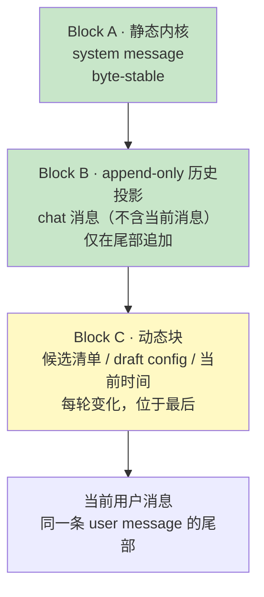

# Chat Session 上下文编排设计（Chat Router）

> 版本：v1.3 | 更新日期：2026-11-04
>
> v1.1：按 [ADR-106](../../adr/zh/ADR-106-chat-execution-reference-projection.md) 同步 chat kind 词表——`execution_round` 引用行不进 Router 上下文，`interaction_request` / `turn_started` / `router_fallback` 只为历史行保留投影（P4 / P6 后不再新增）。
>
> v1.2：act 族更名 `exec_session_create` / `exec_session_propose_continue`，新增只读 `exec_session_read_round`，候选列删 `current` 表述，并写明上下文缓存硬约束（见 §11）。
>
> v1.3：`exec_session_create` 的入参由 `message`（整段简报）改为 `background`（只补背景，人的原话由 Runtime 原样投递），背景以引用部件（`params.context_refs` → `context_ref` 条目）随行在执行会话的 `user` 行之后，见 [ADR-107](../../adr/zh/ADR-107-message-ref-part.md)。
>
> 关联：[ADR-099](../../adr/zh/ADR-099-chat-session-llm-router.md)（Chat Router 决策）、[ADR-060](../../adr/zh/ADR-060-prompt-cache-friendly-context-block-reorg.md)（稳定前缀 + 末尾追加）、[ADR-063](../../adr/zh/ADR-063-package-level-prompt-override.md)（包级 Prompt 覆盖）、[ADR-066](../../adr/zh/ADR-066-llm-provider-cache-tokens.md)（Cache Token 统计）、设计 27（Intent 消息与群聊）

## 1. 目标与约束

Chat Router 每轮都是**无状态**的 LLM 调用（一轮内可多次调用模型：信息工具轮次见 ADR-099 D3）：不建常驻 session，上下文全部从 chat 历史与运行时状态重建。因此编排必须同时满足三件事：

1. **语义完整**：模型能看到近期对话、当前草稿配置、可路由的执行会话；
2. **前缀稳定**：相邻轮次之间，除末尾追加外不改动任何字节，最大化 provider prompt cache 命中；
3. **成本可控**：历史窗口与单条消息都有硬上限，不因群聊或长附件膨胀。

设计原则只有一条：**稳定前缀 + 末尾追加**（ADR-060）。任何每轮变化的内容都必须放在 Block C，绝不能进入 Block A/B。

### 1.1 非目标

- 不改变 execute session 的 Block A/B 布局（ADR-060 已定义）；
- 不让 router 读取 execute session 的 JSONL 正文（ADR-096）；
- 不对 chat 历史做摘要压缩——窗口裁剪即丢弃，router 只需要近期上下文。

## 2. 三段式布局



最终 `messages` 数组：

| 下标 | 角色 | 内容 | 变化频率 | 缓存 |
|---|---|---|---|---|
| `[0]` | system | Block A（基座 + persona + 场景段） | 进程/包升级时 | `ephemeral` 断点 |
| `[1..N]` | user/assistant | Block B（历史投影，不含当前消息） | 仅尾部追加（裁剪时批量重建） | `ephemeral` 断点在末尾 |
| `[N+1]` | user | Block C + 当前用户消息（同一条消息，Block C 在前） | 每轮 | 不缓存 |

Block C 与当前消息合并成一条 user 消息，避免连续两条 user 消息；格式见 §5.3。

## 3. Block A：静态内核

### 3.1 组合顺序

```
[chat.md 覆盖]                   // 存在且非空白：整段替换下面三层
                                 // 会话级（群聊）chat.md 优先于包级 prompts/chat.md
                                 // 只有 {{agent_name}} 被替换
— 无覆盖时为内置默认 —
[CHAT_ROUTER_BASE_PROMPT]        // Runtime 常量（acowork_core::chat_prompt）
                                 // 角色边界 / exec_session_* act 契约（含 exec_session_read_round）/ 决策规则 / 安全规则
## Persona                       // manifest 回退
<persona text>
## Scenario                      // 1:1 或 group，两个稳定变体
<scenario text>
— 两种情况都追加 —
## Identity                      // 用户语言 / 时区（identity_context）
<identity text>
```

顺序固定，段间分隔符固定（`\n\n`），不做任何按内容排序或条件性省略之外的拼接。基座、Persona 与场景段的字面量集中于 `acowork_core::chat_prompt`：`acowork-user` 用它给群聊会话的 `chat.md` 播种、`acowork-runtime` 用它组装内置默认，二者不会漂移。

### 3.2 基座

基座由 Runtime 维护，包含：

1. 角色边界：你是 `<agent display_name>` 的对话前台，只能回答、查一个信息、路由或新建执行会话；
2. 工具契约：路由 act 只有 `exec_session_create(background)`（无 `target`，只能新开；`background` 只补背景、不复述人的原话——原话由 Runtime 原样投递，背景作为引用部件跟在 `user` 行之后，ADR-107；原 `new_task`）与 `exec_session_propose_continue(target, why)`（只提案不投递，`why` 必须给——一张不写理由的卡等于把路由工作推回给人类；原 `propose_existing`）；另有只读信息工具 `memory_recall` / `http_request`（GET-only，按启用状态拼接）与恒常暴露的 `exec_session_read_round(target, rounds)`（2026-11-04 增设，见 §11），轮数由提示词软约束（"通常零次，最多一两次"），不用代码硬上限；
3. 决策规则：回答 / 转交 / 新建 / 澄清的判据（与 ADR-099「路由行为准则」一致，核心是路由代价不对称：错发远比漏发贵，不确定就问）；
4. 安全规则：只使用候选清单中的信息；不复述其他 chat 的内容；不承诺执行细节；不代人类 @ 其他 agent。

`chat.md` 存在且非空白时**整段替换**内置 chat prompt 正文（基座 + Persona + 场景段），只替换 `{{agent_name}}`；缺省时使用内置默认。有两部分不是该文件能删掉的。其一，`# Safety` 不变量是一段不可裁剪的尾块，Runtime 每轮都会重新追加到正文末尾（`chat_prompt::with_chat_prompt_tail`），从 `chat.md` 里删掉它对模型实际看到的内容没有影响。其二，安全边界由结构而非提示词字面量保证：router 只持有 `exec_session_create` / `exec_session_propose_continue` 与只读工具，改写提示词不会给它新的能力（ADR-099 D6）。此外，群聊的 `chat.md` **仅群主或管理员可写**（ADR-098 治理），任何成员可读，因此单个成员无法注入一段去操控他人 agent 的提示词。群聊右侧设置面板只编辑正文——`# Safety` 尾块不在面板中显示（`chat-md` 接口返回的是剥掉尾块后的正文），保存时由存储与 Runtime 重新追加，因此不会把成员改不动的内容摆进可编辑框再静默还原。

基座还是这条链路上**唯一会随每个 agent 的每一轮 chat 一起发送**的文本，因此它带一个字节预算（5 KiB，由 `chat_prompt::tests::kernel_stays_within_its_byte_budget` 断言；算上 Persona、场景段与尾块，整份内置默认约 6 KiB）。预算是上限而非目标：只花在政策与约束上，不花在措辞上。两条规则保证它不被悄悄撑大——一条规则只在一处出现（决策规则不复述场景段和 `# Safety` 尾块已说过的话）；每个工具名、参数名与内联块名（`[candidates]` / `[attachments]` / `[attached refs]` / `[referenced rounds]`）都必须按字面教会，因为基座与 wire schema 是同一份契约的两半（`chat_prompt::tests::compression_kept_every_contract_token`，以及 `acowork-runtime` 的 `the_prompt_teaches_exactly_the_tools_the_wire_offers`）。因此新增一条规则意味着压缩别处，或者有意识地抬高预算。

### 3.3 Persona 与 chat.md 来源优先级

任一份非空白的 `chat.md` 都整段替换内置 prompt，**不再只替换 Persona 段**。按序查找：

1. 会话级 `chat.md`：`acowork-user` 的 `chat-sessions/{id}/chat.md`，仅 `user_group` / `project_group`，任何成员可读、仅群主或管理员可写（ADR-098），从群聊右侧设置面板编辑；首读时用内置默认（群聊变体，含不可裁剪的 `# Safety` 尾块）生成；
2. 包级 `prompts/chat.md`（≤ 16KB，空白文件视为缺失；agent 启动时若无则用内置默认生成，单聊走这一档）；
3. 内置默认 = 基座 + manifest 人格（`display_name` / `name` + `role` + `description` 拼成一句）+ 场景段。

`chat.md` 纳入 ADR-063 的 `OVERRIDABLE_PROMPTS` 清单：

- 从 execute system prompt 的拼接中排除（与 `summary.md` 同一排除规则）；
- 由 `POST /agents/{id}/prompts/reload` 同步刷新；
- Debug 面板可查看与编辑。

### 3.4 场景段

| 场景 | 判定 | 追加规则 |
|---|---|---|
| 1:1（`user_agent`） | `chat_kind == "user_agent"` | draft config 语义（用户在 chat 里改参数）、直接对话语气 |
| 群聊（`user_group` / `project_group`） | 其余 | 多用户发言者标识、@ 目标说明、隐私规则、任务追问规则 |

场景段是**两个独立的稳定字符串**，因此 1:1 与群聊各自形成一条缓存前缀，互不影响。

### 3.5 稳定性规则

Block A 禁止出现：

- 当前时间、日期、"今天/昨天"；
- 候选清单、会话状态、活跃时间；
- 随机数、请求 id、消息 id；
- 任何按 HashMap 顺序序列化的结构。

`identity_context` 只在用户语言/时区变化时改变（低频），可接受。

### 3.6 与 execute prompt 的隔离

router **不加载**：

| 来源 | 原因 |
|---|---|
| `prompts/system.md` | 执行身份与工程规范，诱导 router 执行任务 |
| `prompts/constraints.md` | 执行行为约束，与 router 角色冲突 |
| 其他 `prompts/*.md` | 任务/输出格式指令，与路由无关 |
| skills summary | 执行技能，router 无对应工具 |
| workspace prompt file（AGENTS.md） | 项目执行规范，应由执行会话读取 |
| retrieved memory | 每轮变化，破坏 Block A 稳定性；且属于执行上下文 |

## 4. Block B：append-only 历史投影

### 4.1 消息投影

每条 chat 消息投影为一条 `ChatMessage`：

| chat kind | role | content 格式 |
|---|---|---|
| `user_message` | user | `[user:<from>] <body>` |
| `agent_message` | assistant | `[agent:<from>] <body>` |
| `interaction_request` | user | `[card] <title>` + 选项（固定格式）。**P6 后不再新增**，仅为旧转录保留投影（ADR-106 D8 / D14） |
| `system_notice` | user | `[system] <固定文案>`（见 §4.3） |
| `execution_round` | —— | **不进上下文**：它是空正文指针，不是可读的一句话；本轮的内容在引用行下方的 `user_message` 里，Router 读那一条（ADR-106 D3） |

附件不内联字节，只在正文末尾追加固定格式的元数据：

```
[attachments] report.pdf (application/pdf, 12KB), screenshot.png (image/png, 340KB)
[attached refs] chat_prompt.rs, src/lib.rs (L12-L25)
```

两行是回合携带的两类附件，来自两个不同的参数：`[attachments]` 是上传进本 chat 的文件（`chat_attachments`，Gateway 能从会话 `files/` 读回元数据）；`[attached refs]` 是人从工作区指过来的引用（`attached_items`，node-local 路径 Gateway 读不到，所以 prompt 里只有显示名与行区间——即 `acowork_core::protocol::AttachmentLabel` 这一枚投影，与 chat 行 `meta.exec_attachments`、与桌面芯片同一形状；工作区臂另带一枚 `absPath` 供芯片点击，prompt 永不渲染它——ADR-100 D12 Rev. 9）。

两行都由 `context::attachment_lines` 渲染，Block B（历史行）与 Block C（当前回合）走同一条路径：**被路由的那一条，必须在它成为历史之后逐字节读起来一样**，否则之后的每一轮都在推理一份从未出现过的记录。行区间统一拼作 `L{start}-L{end}`（单行 `L{start}`），与芯片的 `selectionRange` 一致。

### 4.2 确定性要求

同一条 chat 消息在任何一轮、任何进程重启后，投影结果必须**逐字节相同**：

- 不含相对时间（"3 分钟前"）、绝对时间；
- 不含消息 id、offset、序号；
- 截断按 UTF-8 字符边界，后缀固定为 `…[truncated]`；
- 单条正文上限 `max_message_bytes`（默认 2KB），附件元数据上限 512B；
- 字段顺序固定，不使用 HashMap 迭代。

测试用「同一输入两次投影结果相等」作为守卫。

### 4.3 卡片与系统通知的固定文案

| notice_type | 投影文案 |
|---|---|
| `turn_started` | `[system] A round started in session <sid8>`（`sid8` = meta.agent_session_id 前 8 位） |
| `interaction_request` | `[card] <title>` + 每个选项一行 |
| `delivery_failed` | `[system] Delivery failed`（遗留臂：2026-11-06 起无写者，仅供读旧转录，ADR-105 D5 修订） |
| `budget_exhausted` | `[system] Conversation budget exhausted` |
| `truncated` | `[system] Response truncated` |
| `unavailable` | `[system] Agent unavailable` |
| `router_fallback` | `[system] Routed automatically` |

`turn_started` / `router_fallback` 两行与上表的 `interaction_request` 同理：**P4 / P6 后不再有生产者**，投影留着只为了让旧历史逐字节读起来不变（§4.2 确实定性与 ADR-106 D14：呈现层隐藏，上下文不隐藏）。今天仍在写入的寻址类 `notice_type` 是 `session_choice` / `confirm_continue`（ADR-106 D6），它们进上下文，因为那就是摆在人类面前的一个问题——但走的是 `notice_text` 的兜底臂 `[system] Notice: {notice_type}`，不是上表里的固定文案；上表列的是遗留臂与仍有专属文案的通道事实。

`<sid8>` 来自消息 meta，写入后不再变化，因此投影稳定。

### 4.4 窗口锚点与批量裁剪

朴素实现「最近 N 条」会在每来一条新消息时丢掉最旧一条，导致整个 messages 数组左移、前缀 hash 全变——缓存命中率接近 0。本设计用**锚点 + 批量裁剪**摊销重建成本。

窗口按**上下文大小（tokens）**计量，而不是按条数：一条「好的」和一份 2KB 的故障报告不是同等量的上下文，固定条数对闲聊型对话过于宽松、对信息密集的对话又过于苛刻。因此裁剪判据是 `max_tokens`，条数只作为传输层上限（网关单页）。

- `anchor_seq`：窗口前端边界——已排除的最新一条消息的 `seq`，返回的窗口全部满足 `seq > anchor_seq`；
- `max_tokens`：默认 8000 tokens（Agent Setup 面板可配，`chat_router.history_max_tokens`，clamp 1000–64000），按 `crate::token::count_text` 统一口径估算；网关单页字节上限 32 KiB 在默认 3.5 chars/token 下约 9.1k tokens，因此默认值正好落在传输上限之内；
- `slack_tokens`：默认 `max_tokens / 8`，即允许窗口超出预算的容忍量；
- `retain_tokens`：默认 `max_tokens / 2`，即重建后保留的上下文量；
- `max_rows`：网关单页可承载的行数（50 减去当前消息与锚点行的余量），仅由传输层决定，可在配置里进一步收紧（`chat_router.history_window`，已降级为条数上限）；重建后保留 `max_rows / 2` 条。

每轮：

```
history = seq > anchor_seq 的消息         // 不含当前消息
if len(history) > max_rows:                // 传输层上限
    保留最新的 max_rows / 2 条             // 同样是批量重建，不逐条滑动
    anchor_seq = 被裁掉的最新一条的 seq
if total_tokens(history) > max_tokens + slack_tokens:
    从最新往回保留，直到累计超过 retain_tokens（至少保留 1 条）
    anchor_seq = 被裁掉的最新一条的 seq
```

稳态下 `anchor_seq` 不变，Block B 只在尾部追加；重建按 `retain_tokens` 到 `max_tokens + slack_tokens` 之间的差额摊销，即大约每隔 0.6 个预算的增量才发生一次批量重建，而不是每条消息滑动一次。短消息的对话永远碰不到 token 预算，此时由行数上限兜底：满页时有「48 → 24 条 → 逐轮追加到 48」的同样节奏，稳态窗口在 25–48 条之间（旧实现是 17–41 条）。单条超长消息也不会把窗口清空——至少保留最新一条：丢掉用户刚说的话，比多带一条稍微超预算的消息对路由伤害更大。

`anchor_seq` 存在 ChatSessionManager 内存中，Runtime 重启后没有持久化的锚点，按最近一页重新锚定（可接受的一次 miss）。因为预算无法预先折算成行数，每轮按网关单页上限取历史（50 条），由 token 预算决定实际投影多少；网关侧仍有页字节预算兜底。

### 4.5 当前消息的排除

Gateway 先落库再投递，因此当前用户消息已在 chat 历史末尾。构建 Block B 时必须排除它，避免与 Block C 合并后的最后一条消息重复（ADR-060 §5.5 的同一教训）：

- 群聊 @：用 `in_reply_to`（共享 `user_message` 的 row id）匹配；
- 1:1：用信封 `message_id` 匹配。

匹配失败（例如历史分页边界）时保留原样，不做启发式删除——宁可重复一次，不可漏消息。

## 5. Block C：末尾动态块

### 5.1 内容

| 字段 | 示例 | 说明 |
|---|---|---|
| `now` | `2026-10-21T14:03:00+08:00` | 当前时间（仅此处出现） |
| `speaker` | `alice` | 当前消息的发送者（群聊必需） |
| `surface` | `group` / `dm` | 场景 |
| `draft` | `model=claude-sonnet, workspace=ws-1` | 信封 `session_config_json`，无则为空 |
| `candidates` | 见 §5.2 | 最多 10 条 |
| `task` | `project=proj, task=T-12` | 仅 PM 任务相关追问时存在 |
| `attachments` | `report.pdf (application/pdf, 12KB), shot.png (image/png, 340KB)` | 本轮附件元数据；行格式与 §4.1 的历史投影**完全一致**，且由同一个渲染函数产出 |

附件行只在本轮真的带文件时出现，位置固定在 `[user message]` 之后。它与 Block B 的历史行**逐字节相同**——同一条消息在"正在被路由"和"已经成为历史"两种视角下必须长得一样，否则 router 会引用旧截图却看不见刚附上的那张。

### 5.2 候选清单格式

```
[candidates]
S1  working   2m    chat   Fix login redirect
S2  idle      3h    task   Review ADR-098
S3  closed    2d    chat   Refactor auth middleware
```

列：别名、状态、最近活动（相对时间，仅此处允许）、来源（chat/task）、title。不含 session id、owner、model——减少 token 与泄漏面；router 只能把别名用在 `exec_session_propose_continue` 与只读的 `exec_session_read_round` 里，不能凭它直接投递。

排序：按 `last_active_at` 倒序。排序稳定（同时间戳按 title 字典序），保证同一候选集每轮顺序一致。（原 `current` 标记列已随 ADR-106 P5 退役——候选纯按 recency 排序，内核提示词不再教这一列。）

### 5.3 与当前消息的合并

Block C 与当前消息合并为最后一条 user 消息：

```
[runtime context]
surface: group
speaker: alice
now: 2026-10-21T14:03:00+08:00
draft: (none)
[candidates]
S1  working   2m    chat   Fix login redirect
S2  idle      3h    task   Review ADR-098

[user message]
这个登录跳转的问题继续弄一下，顺便看下 ADR-098 的评审意见
[attachments] login-error.png (image/png, 182KB)
```

纯附件轮（`text` 为空或只有空白，**上传件或引用任一非空**）**不是**空消息：`[user message]` 位置写固定占位 `(no text — the message is its attachments)`，再接附件行。空 body 会让模型当作"没说话"而倾向于不路由；固定占位明确告诉它人发了东西、只是没打字。占位文案逐字节固定（决策可复现性要求），与决策日志的 `attachment_only` 共用同一个谓词（`context::is_attachment_only`），避免"日志说纯附件轮、提示词却渲染了文本"这类漂移。"这一轮到底有没有内容"同样只有这一处判据（`context::turn_has_content`）：`chat_turn_text` 的路由闸门问它，Block C 也问它，不会再出现闸门按一份列表放行、提示词按另一份列表渲染成空白。

合并的好处：最后一条消息承载全部「本轮视图」，它前面的历史与 system 保持逐字节稳定。

## 6. 请求参数与缓存

### 6.1 cache_control 断点

| Provider | 机制 | 断点位置 |
|---|---|---|
| Anthropic | 显式 `cache_control: {type: "ephemeral"}` | Block A 的 system message、Block B 的最后一条消息 |
| OpenAI / Azure | 自动前缀缓存 | 无需标记，依赖字节稳定 |
| DeepSeek / 其他 OpenAI-compatible | 自动前缀缓存（若支持） | 同上 |
| Ollama | 无 | 忽略 |

`ChatMessage.cache_control` 字段已存在（ADR-060），此处只负责置位，不新增协议。Block C 与当前消息不打断点。

### 6.2 请求参数固定

跨轮必须逐字节一致：

- `model` / `provider`（来自 `chat_router` 配置，不随消息变化）；
- `temperature`（默认 0）、`max_tokens`（默认 8192，`chat_router.max_output_tokens`，clamp 1024–32768，Config 文件可配、不上 UI wire）。这个上限必须同时容纳一次信息轮的 think + 工具参数 + 终稿**和**一份 `exec_session_create` 简报——旧值 2048 容不下后者，被截断的响应里工具调用 JSON 是不完整的，`act_call()` 找不到 act，于是整轮降级成一句聊天回复：用户看到一条 agent 消息，执行会话根本没建。`finish_reason == "length"`（Anthropic 的 `max_tokens` 在 provider 层已归一化为 `length`）现在被显式检查，按截断降级而不是当作决策，日志里也不会再伪装成 `reply` / `empty reply`；
- `tools` 数组：`exec_session_create` + `exec_session_propose_continue` + 按启用状态拼接的只读信息工具（`memory_recall`、GET-only `http_request`）+ 恒在末尾的只读 `exec_session_read_round`，schema 用固定字面量序列化，字段顺序固定，对固定的（二进制版本，启用集合）逐字节稳定；提示词里教到的动作名与这里下发的集合由单测钉死（`tool.rs::the_prompt_teaches_exactly_the_tools_the_wire_offers`），两者漂移过一次就够；
- `tool_choice`：默认 `auto`，不随轮次变化；
- 信息轮次产生的 `assistant(tool_calls)` / `tool` 消息只存在于本轮 request 内，不写回 chat 历史，不进入 Block B。

### 6.3 最小可缓存长度

部分 provider 要求前缀达到最小长度才缓存（典型 1024 tokens）。Block A 通常为 1–2KB，Block A+B 在几轮后即可超过门槛。不为此填充内容；命中率指标按「可缓存前缀」口径统计。

### 6.4 prefix_hash

对 `Block A bytes + tools schema bytes + Block B bytes` 计算 hash（如 SHA-256 前 8 字节），写入决策日志。用途：

- 验证「稳态轮次前缀不变」；
- 定位是哪次改动（prompt、窗口裁剪、投影格式）导致缓存失效。

## 7. 可观测性

`chat-router-decisions.jsonl` 每行在原有字段上增加：

```json
{
  "prefix_hash": "9f2c1a7b",
  "anchor_seq": 42,
  "history_len": 18,
  "attachments": 1,
  "attachment_only": false,
  "prompt_tokens": 3120,
  "cache_read_tokens": 2816,
  "cache_write_tokens": 0,
  "hit_rate": 0.90
}
```

`attachments` 是本轮附件**个数**，`attachment_only` 表示这一轮是纯附件轮（§5.3 的占位分支）。两者只记计数与判定，**不记文件名、mime、size**——决策日志是路由元数据，不是消息内容（ADR-096）。加这两个字段的动机是可观测性：在此之前，带附件的一轮与"同样的文字、什么都没带"在日志里完全一样，router 对附件盲视这件事因此一直不可见。旧日志行读作 `attachments: 0` / `attachment_only: false`，向前兼容。

验收指标（首版）：

| 指标 | 目标 |
|---|---|
| 稳态轮次 `prefix_hash` 不变比例 | ≥ 90%（窗口未裁剪的轮次必须 100%） |
| OpenAI 稳态 `cache_read / prompt_tokens` | ≥ 70% |
| Anthropic 稳态 `cache_read / (input + cache_read + cache_write)` | ≥ 60% |
| 窗口批量重建频率 | ≤ 每 `slack + retain` 轮一次 |

指标只做观测与调优，不改变路由行为。

## 8. 失败与降级

| 场景 | 处理 |
|---|---|
| chat 历史读取失败 | 本轮只带 Block A + Block C，prompt 提示"历史不可用"，降级旧路由 |
| 当前消息匹配失败 | 不删除历史，允许重复一次 |
| provider 不支持 cache | 行为不变，仅多 token 开销 |
| `chat.md` 超长/不可读 | 超长按 UTF-8 边界截断；不可读记录 WARN，回退内置默认提示词 |
| Block A 组装异常 | 使用内置基座 + display_name，保证可用 |

## 9. 测试计划

- **投影确定性**：同一输入两次投影字节相等；卡片文案固定；截断不破坏 UTF-8；附件元数据格式固定。
- **前缀稳定性**：窗口未越界时，连续 N 轮 `prefix_hash` 不变；裁剪只在阈值处发生；`anchor_seq` 批量前移。
- **Block 隔离**：Block A 不含动态内容；Block C 不含历史；当前消息只出现一次。
- **缓存标记**：Anthropic 序列化后 `cache_control` 只出现在预期位置；OpenAI 请求不携带该字段。
- **prompt 分层**：任一份非空白 `chat.md` 整段替换内置 chat prompt；缺省回退内置默认（基座 + manifest 人格 + 场景段）；`chat.md` 不进入 execute prompt。
- **回归**：窗口裁剪后路由结果与未裁剪时一致（MockProvider 固定输出）。

## 10. 与其他文档的关系

| 文档 | 关系 |
|---|---|
| ADR-060 | 本设计把 Block A/B 原则扩展到 chat 层，并新增 Block C |
| ADR-063 | `chat.md` 作为新的包级 override，与 execute prompt 对称排除 |
| ADR-066 | 复用 cache token 的统计与命中率口径 |
| ADR-096 | 候选与历史都通过有界读取获取，不读 JSONL 正文 |
| 设计 27 | 消息词汇与写回通道不变，本设计只决定「送进模型的内容」 |

## 11. 修订（2026-11-04）：act 族更名、`exec_session_read_round` 与缓存硬约束

**act 族更名**。Router 的两个 act 从历史昵称 `new_task` / `propose_existing` 更名为与只读工具同族的 `exec_session_create` / `exec_session_propose_continue`：名字描述的是操作对象（执行会话），不是模型的主观判断（"是不是新任务"）。旧名进 `RETIRED_ACT_NAMES` 漂移守卫，内核 prompt 与 wire 工具名/参数名由既有单测双向钉住；`allow_new_task` 是确认卡的 wire 协议字段，不在本次更名范围。改名与字面量变化会让 provider 前缀缓存 miss 一次，属预期，落地后即稳定。

**新增只读 act：`exec_session_read_round`**。回答"那个任务结果如何"此前没有合法信息源：`execution_round` 引用行无正文（D1），Block B 也不投影轮次内容（D4 的写时派生只管执行侧），Safety tail 又禁止模型声称执行会话做了什么——三者叠加后模型只能拒答。新工具走 info-tool 同一条循环（受同一轮 model-call 超时预算约束）：`target` 取本轮别名表里的候选别名（权限过滤后的集合，不新增授权面），`rounds` 钳 1–3；实现在 Runtime 进程内直接复用 D4 轮次投影读（侧表 fold + 两行有界读 + 附件窗背书），disk-only 故 Closed 会话照样可读；答案体过 2KB 截断、问题摘要过 512B 截断，整体再过 `truncate_info_result` 的 8KB 上限。一切失败（别名不合法、读不到、坐标漂移）都是 tool_result 文本里的显式空洞，绝不整轮 degrade。不提供 `exec_session_send_msg`：寻址归人，维持 ADR-106 D6 的静默投递禁令。Safety tail 相应放宽为"只可转述本轮 `exec_session_read_round` 读回的内容，不得声称执行会话进行中或将要做什么"。

**上下文缓存的硬约束**（防止呈现层改动被误读成上下文重排）：块锚点沉底只发生在呈现层，Block B 按 seq 的确定性投影不受影响，转录的视觉顺序与送进模型的顺序从来不是同一个函数。任何执行会话的信息要进入 router 上下文，只允许两条路：Block C 动态区（每轮重建，不进缓存前缀），或 Block B 按 seq 的确定性投影。执行块的视觉重排（含本修订配套的呈现契约折叠分叉，见 ADR-106 修订章节）永不反馈到投影顺序。`execution_round` 引用行本身暂不投影进 Block B——"知道派过单且结果如何"的诉求由 `exec_session_read_round` 覆盖，不必为它支付前缀不稳定的代价。

**引用材料的装配（2026-11-04 修订二并入）**。带 `@session` 引用的 turn，其材料由单一读者 `pinned_chat_refs`（读 `params.chat_refs` 里钉好的四元组 `{agent_instance_id, session_id, round_id, terminal}`）取得——级别 3 抑制检查、Block C 段、投递的 `referenced_round` parts 都走这一个读者，所以"本轮是否引用了材料"只有一个答案。渲染只有**一个生产者** `render_pinned_rounds`：每条 ref 复用 `read_round_result` 为 `exec_session_read_round` 画的同款行（问题 / 答案 / 卡片，沿用 per-field 钳——答案 2KB、问题 512B），前置源坐标与非终态标记（`(was still running)`）；disk-only（`fold_or_rebuild` + `project`），`Closed` 会话照样可读，任何失败形状都是显式空洞、绝不吞掉一条 ref。段总预算 `REFS_TOTAL_MAX_BYTES = 8 KiB`：五条满尺寸引用会盖过人的原话，所以超预算的后续 ref 折叠成一行 `dropped: reference budget exhausted` 并停止——读者知道材料被裁过，从不知道它悄悄消失了。装配结果**同时**进入两处：Block C 动态区的 `[referenced rounds]` 段（每轮重建、绝不进缓存前缀，符合 §1 的稳定前缀原则），以及若该 turn 被投递则原样成为执行侧的 `referenced_round` 参照 part（ADR-107，`params.context_refs` → `context_ref` 系统行）——同一批字节，router 所见与执行会话所受不可能漂移。级别 3 续投分支对带 refs 的 turn 不触发（引用已是明确材料，不再让模型猜归属）。
