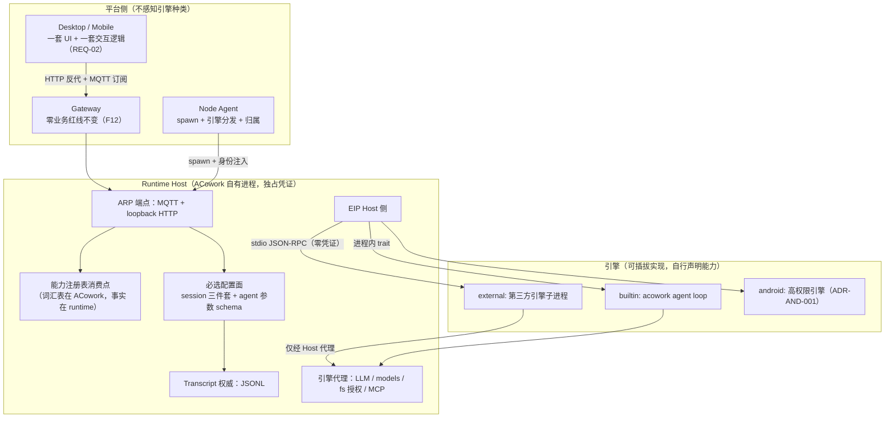
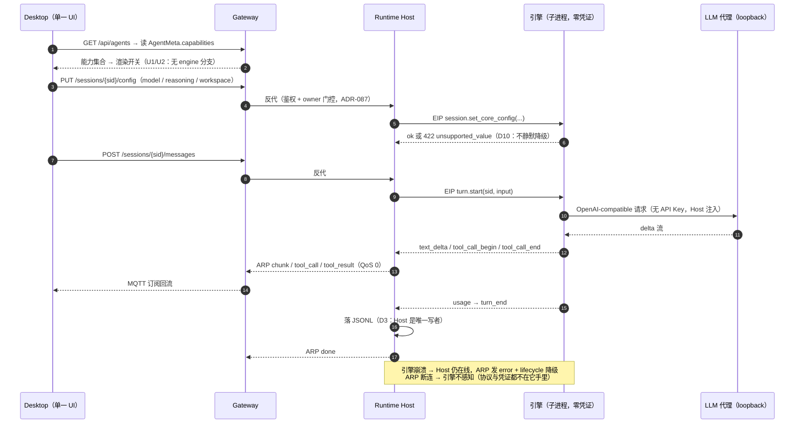

# 30-runtime-protocol-and-pluggable-engine — Runtime 协议壳、能力模型与可插拔引擎接入

> **版本**: v0.2（纳入四条核心诉求；v0.1→v0.2 变更见 §14）
> **状态**: 📝 待评审（REQ-01~04 为**约束条件**，不再开放讨论；§11 剩 4 个开放问题）
> **范围**: ACowork 平台协议层（Gateway / Node / Runtime / Desktop 四方契约）
> **一句话结论**: ACowork 只定义**一个协议壳 + 一套能力模型**，不定义引擎该有什么能力。壳的必选面是三件事：**轮次流、session 基础配置（模型 / reasoning / workspace）、agent 参数设置面**；其余全部由 runtime 自行声明，声明的词汇表由 ACowork 拥有。Desktop 只有一套界面和一套交互逻辑，差异一律表现为能力开关的**开与关**，不表现为代码分支。
> **Android 高权限 runtime** 是本框架下的第 2 个内置引擎实现，不是特例（§9）。

---

## 1. 背景与核心诉求

### 1.1 触发背景

roadmap 上有一条：**把第三方开源 agent 运行时接入 Gateway，在 Desktop 上统一管理**，候选对象（待 S0 核实形态）包括 codex 开源版、deepseek harness、hermes 等。这条 roadmap 的架构权重高于 Android 高权限 runtime：受益面覆盖所有引擎与所有客户端，且**协议一旦对外发布就不可逆**，而 Android 侧只是新增一个 backend 实现。

### 1.2 四条核心诉求（本方案的约束条件）

| ID | 诉求 | 架构含义 | 落点章节 |
|---|---|---|---|
| **REQ-01** | ACowork **只约束一个 runtime 协议壳**；第三方 runtime 的能力由 runtime 自己声明，但 **ACowork 必须对能力模型有定义** | 权威二分：**词汇表 + 分层 + UI 效应**归 ACowork（注册表，随协议版本发布）；**有没有**归 runtime（声明）。引擎不能自造能力 ID 上 UI | §6.2 |
| **REQ-02** | 不同 runtime 在 Desktop 端**共用一套交互界面与交互逻辑**，功能开关由能力模型驱动 | "统一"必须是**可检查的硬约束**：一个开关 ↔ 恰好一个能力 ID；前端禁止出现 `engine_kind` 分支 | §6.4 |
| **REQ-03** | **session 基础配置是必选项**：模型、reasoning、workspace | 三件套进 ARP 必选面（T1C）；EIP 必须有对应动作；必选缺失 = **启动即失败**，不是运行时降级 | §6.3.1 |
| **REQ-04** | **agent 参数设置是必选项** | 必选的是**接口面**（schema 声明 + 读写 + retained 同步），不是参数个数；空 schema 是合法实现。必须终结"opaque JSON + 前端硬编码字段名"（F17） | §6.3.2 |

> REQ-01 与 REQ-02 天然张力：**自由度**与**统一性**。本方案的调和点是——**交互逻辑分支只允许由注册表能力驱动；引擎自定义内容只允许出现在 schema 驱动的表单字段里**。表单字段不产生第二套交互逻辑，所以可以开放；代码分支会，所以必须封闭。

### 1.3 问题不是"能不能连上"，而是"协议里有多少引擎私货"

现状的 Runtime 对外协议是从 acowork-runtime **单一引擎的行为**里长出来的，从未作为契约评审：

1. **引擎内部概念泄漏**：`CompactingPayload` / `IterationLimitPausedPayload` / `LoopDetectedPausedPayload` / `SkillExecutedPayload` / `MemoryUpdatedPayload`（[mqtt_payload.proto:649-760](../../../core/acowork-core/proto/mqtt_payload.proto)）——这些是我们主循环的具体策略，不是任何 agent 引擎都有的阶段。
2. **HTTP 面把实现细节当接口**：`/sessions/{sid}/compress`、`/api/debug/context/{iteration}/sections/{section}`、`/conversation/index/rebuild`（[server.rs:598-760](../../../core/acowork-runtime/src/http/server.rs)）。
3. **进程契约写死唯一引擎**：Node 把二进制定位成自己的兄弟文件 `acowork-runtime[.exe]` + 一长串固定 flag（[spawn.rs:110-200](../../../core/acowork-node/src/process/spawn.rs)）——这是最硬的耦合点。

---

## 2. 现状事实基线（实测）

| # | 事实 | 数据/位置 |
|---|---|---|
| F1 | Runtime 协议 = **4 个互相咬合的面**，没有一份文档把它们当契约评审过 | §3.2 |
| F2 | MQTT 线协议单文件定义，`DataEnvelope.payload` oneof **34 个分支**（字段号已用至 36） | [core/acowork-core/proto/mqtt_payload.proto](../../../core/acowork-core/proto/mqtt_payload.proto)（1649 行） |
| F3 | 会话增量事件 `SessionMessage.event` oneof ≈ **25 种**，QoS 0 | 同上 |
| F4 | Runtime HTTP ≈ **40 条路由**，Gateway 反代给 Desktop | [server.rs:598-760](../../../core/acowork-runtime/src/http/server.rs) |
| F5 | 上线契约 = **Bootstrap 五步**（status/meta/config → subscribe global → subscribe control），重连必须重做 | [mqtt.md §5.1.1](../protocols/zh/mqtt.md)（ADR-039） |
| F6 | 生命周期是**能力枚举**而非阶段枚举；`UNSPECIFIED` 兜底；只追加不重编号 | `AgentLifecycleState`（proto:459-482，ADR-085） |
| F7 | 能力协商先例**只存在于 Node 层**：`NodeInfo.protocol_version` + `repeated capabilities` | proto:1256-1288（ADR-055 §6.9） |
| F8 | **Agent 层没有能力字段**：`AgentMeta` 只有 agent_id/name/version/instance_id/node_id | proto:484-502 |
| F9 | 引擎侧已有一处干净抽象可复用：`Provider` trait + `StreamEvent`（6 种） | [providers/traits.rs:714-748](../../../core/acowork-core/src/providers/traits.rs) |
| F10 | 记忆已抽成**独立 MCP 服务**，外部进程可通过 MCP 使用 ACowork 记忆 | ADR-100 |
| F11 | 安装/执行同机是既定约束，引擎分发归属 Node | ADR-090 / ADR-091 |
| F12 | Gateway 红线：不做业务事件转发（零业务）；Node 不得依赖 Gateway | [mqtt.md §7.3](../protocols/zh/mqtt.md)、`tests/dependency_redline` |
| F13 | Runtime LOC 分布（量级指示）：`agent/` 46.3k、`tools/` 15.6k、`http/` 11.4k、`usecases/` 10.2k、`providers/` 7.7k、`startup/` 6.7k、`mqtt/` 4.8k、`security/` 4.0k、`debug/` 3.4k，总计 ≈13.3 万行 | `wc -l` 实测 |
| F14 | **命名冲突预警**："Adapter" 已被占用——ADR-040 的 "Runtime Adapter" 指 `acowork-runtime/src/usecases/` 的 UseCase trait 层，不是引擎适配器 | [ADR-040](../../adr/zh/ADR-040-runtime-adapter-use-case-layer.md) |
| F15 | 既有准则 RXT-01~06（依赖倒置/生命周期钩子/配置外置/中间件/存储可替换/事件可观测）；本方案是其**对外一层** | [03-agent-runtime.md §9.1](./03-agent-runtime.md) |
| **F16** | **REQ-03 的三件套在现有契约里已经有字段**：`SessionConfig` 含 `provider_id` / `model_id` / `reasoning_effort`（`""` = 不覆盖） / `workspace_id`，另有 temperature / context_window / account_id | proto:584-617 |
| **F17** | **REQ-04 的真实阻塞点**：agent 参数在 MQTT 上是 **opaque JSON 字符串**（`AgentConfig.config_json`，注释明写"避免在 protobuf 里复制 config schema，让 Runtime 自行演进"）；Desktop 侧 `agentStore` / `chatStore` **硬编码解析字段名**（`temperature`、`context_window`…，见 `chatStore.ts:4305` 读 `config_json`）。没有 schema，就没有泛化渲染 | proto:503-515；[agent_config.rs:121-175](../../../core/acowork-runtime/src/agent_config.rs)；`apps/acowork-desktop/src/stores/` |
| F18 | 现有 agent 参数是**三层解析链**：`agent_config.json`（用户）→ `manifest.llm.*`（包作者）→ `DEFAULT_*`（硬编码）。REQ-04 的 schema 必须与这条链共存，不能另起一套 | [agent_config.rs:135-160](../../../core/acowork-runtime/src/agent_config.rs) |

**F1 的四面拆解**：

| 面 | 内容 | 现状 | 引擎中立性 |
|---|---|---|---|
| ① 线协议 | MQTT topic 树 + protobuf envelope | 事实存在（`docs/protocols/zh/mqtt.md`） | 🟡 T1 中立，T3 泄漏 |
| ② HTTP API | ~40 路由，Gateway 反代 | 事实存在（`docs/protocols/zh/http.md`） | 🔴 强引擎耦合 |
| ③ 进程契约 | Node 定位二进制 + flag + 身份注入 | **硬编码单引擎** | 🔴 最硬耦合 |
| ④ 上线契约 | Bootstrap 五步 + lifecycle 状态机 | 已文档化（ADR-039/085） | 🟢 基本中立 |

---

## 3. 概念澄清

### 3.1 "第三方 agent" 是三类东西的混称

接入点完全不同。**S0 的第一项产出就是这张表的实证版本**——它决定 roadmap 上每个候选走哪条路。

| 档 | 对象形态 | 正确接入点 | 本方案覆盖 | 例子（待核实） |
|---|---|---|---|---|
| **M 模型级** | 只有权重/API，无 agent 循环 | `Provider` trait + provider 目录（F9、design 23 同模式） | ❌ 不需要新协议 | 若 hermes 是模型 → 归此类 |
| **E 引擎级** | 有主循环 + 自有工具 + 自有 transcript，无 UI | **EIP**（§6.5） | ✅ 主战场 | codex 开源版、deepseek harness |
| **P 产品级** | 自带账号/UI/云端的完整产品 | **ARP 直连**（选项 B）或仅互操作 | ⚠️ 例外通道 | 云端 agent 服务 |

### 3.2 "协议壳" 的两层命名（REQ-01 的具体化）

| 名称 | 全称 | 两端 | 状态 |
|---|---|---|---|
| **ARP** | ACowork **R**untime **P**rotocol（协议壳） | Runtime 实例 ↔ 平台（Gateway/Node/Desktop/移动端） | 已存在（事实协议）→ 本方案将其显式化、分层、能力化 |
| **EIP** | **E**ngine **I**nterface **P**rotocol | Runtime Host（ACowork 自有进程）↔ 引擎 | **新增**，本方案核心设计物 |

依赖方向（不可违反）：`引擎实现 → EIP 契约 ← ARP 契约 ← Host 实现`。**引擎永不 import ARP 的 protobuf 生成物，也永不 import `acowork-runtime`**。



---

## 4. 目标与非目标

### 4.1 目标

- **G1** 定义**能力模型**（注册表 + 声明 + 校验 + 演进流程），词汇表归 ACowork，事实归 runtime（REQ-01）。
- **G2** ARP 显式化为可发布契约：版本化、分层（必选集 T0/T1/T1C + 可选集 T2/T3）、缺失即不可表达。
- **G3** 定义 EIP：引擎实现 **9 动作 + 7 事件 + 3 类反向调用** 即可被平台管理（§6.5）。
- **G4** **必选配置面**：session 三件套（模型 / reasoning / workspace）+ agent 参数设置面，跨引擎语义一致（REQ-03/04）。
- **G5** Desktop **一套界面一套逻辑**：所有差异收敛为能力开关状态（REQ-02），并给出可检查的禁止规则。
- **G6** 安全边界：引擎进程拿不到 MQTT 凭证、Gateway token、LLM API Key；出网经 Host 代理。
- **G7** 让引擎归属问题（Android 的 D0）降级为"依赖两个已发布契约 crate 的稳定版本"。

### 4.2 非目标（YAGNI）

- ❌ 通用插件框架 / 扩展点市场 / 引擎沙箱平台
- ❌ 引擎间语义互操作（不做"A 引擎 skill 转 B 引擎"）
- ❌ 支持任意语言写引擎（v1 只有：进程内 Rust trait、进程外 stdio JSON-RPC）
- ❌ 让引擎直接读写 ARP retained topic（协议端点归 Host 独占）
- ❌ 替换 Gateway 的 provider / budget / 审批权威
- ❌ **在本方案里规定"一个引擎应该有哪些能力"**——REQ-01 明确 ACowork 只定义模型，不定义内容
- ❌ 为不同引擎做差异化 UI（REQ-02 直接排除）

---

## 5. 方案选项与取舍

| 选项 | 做法 | 引擎改造量 | 平台改造量 | 凭证暴露 | REQ 符合度 | 判定 |
|---|---|---|---|---|---|---|
| **A 源码级上游化** | 第三方引擎作为 crate 编进 `acowork-runtime` | 🔴 需 Rust 重写 | 中 | 无新增 | REQ-01 ❌（壳变成实现） | 仅用于**自有**引擎（Android） |
| **B 完整 ARP 适配** | 第三方自己实现 MQTT+protobuf+40 路由，直连 broker | 🔴 极大 | 🟢 零 | 🔴 **持有 broker 凭证 + API Key** | REQ-01 ❌（约束的是整个协议，不是壳） | 仅作 **P 类例外通道**，待 Q2 |
| **C Gateway 侧连接器** | Gateway 内置 connector 驱动引擎，合成事件 | 🟢 零 | 🔴 大（Gateway 长出业务） | 🟡 凭证集中 Gateway | REQ-02 ⚠️（统一性变成 Gateway 单点猜测） | ❌ **否决** |
| **D 协议壳 + 窄 EIP**（推荐） | Host 独占 ARP 与凭证；引擎只实现 EIP 并**声明能力** | 🟢 小（9 动作/7 事件） | 🟡 中（一次性） | 🟢 引擎零凭证 | REQ-01~04 ✅ | ✅ **主干** |

**否决 C 的具体理由（记录以避免重复讨论）**：① 违反 F12 Gateway 零业务红线，一旦内置 connector，`GET /api/agents` 的生命周期语义（ADR-085）要在 Gateway 里再造一套引擎状态机；② 违反 F11 install/spawn 同机，引擎是 Node 本地资源；③ N 个引擎 = Gateway 里 N 个 connector，全部依赖压在 Gateway 重启窗口。

**REQ 如何排除 B**：REQ-01 要求"只约束一个壳"。B 形态要求外部引擎实现 34 分支 envelope + 25 事件 + 40 路由 + 五步 bootstrap + LWT/retained 语义——那是把**整个实现细节当契约**，不是壳。

---

## 6. 推荐架构

### 6.1 ARP 分层：必选集与可选集

| 层 | 内容 | 必选性 | 缺失时行为 |
|---|---|---|---|
| **T0 存在性** | Bootstrap 五步（F5）、`AgentStatus`/`AgentLifecycleState`（F6）、`AgentMeta`（追加 `engine_kind`/`protocol_version`/`capabilities`）、`http_endpoint` | ✅ 必选 | 无"部分在线"，只有 OFFLINE/STARTING/HTTP_READY/SESSIONS_READY/FAILED |
| **T1 轮次流** | `POST/GET /sessions/{sid}/messages`、核心 **9 个事件**（reasoning 起止成对）：`chunk` / `reasoning_started` / `reasoning_ended` / `tool_call` / `tool_result` / `done` / `error` / `stopped` / `context_usage`；`SessionState` | ✅ 必选 | **启动即失败**（FAILED + detail） |
| **T1C 必选配置面**（新增，REQ-03/04） | `SessionConfig` 三件套（`provider_id`+`model_id` / `reasoning_effort` / `workspace_id`）读写与 retained 同步；**agent 参数面**（schema 声明 + 读写 + retained 同步） | ✅ 必选 | **启动即失败**（FAILED + detail） |
| **T2 会话控制** | `open`/`close`/`visibility`、`stop`、`approval`、`answer`、`cancel-tool`、`todo_updated`、`ask_question` | 🟡 能力声明 | 开关关闭 + 标注"该 runtime 不支持"；**禁止静默 fallback** |
| **T3 引擎私货** | `compacting_*`/`compaction_cancelled`、`iteration_limit_paused`、`loop_detected_paused`、`skill_executed`、`memory_updated`、`/compress`、`/search/summary`、`/conversation/index/rebuild`、`/api/debug/*`、`prompt-file` | 🟡 能力声明 | 面板不渲染；HTTP 返回 `404 unsupported_capability`（不塌缩成 500，不返回假成功） |

> **分层即评审闸门**：任何新增 topic/路由/事件必须先回答"属于哪一层"。进 **T1/T1C** 需要该语义已被 REQ 列为必选，或至少 2 个引擎天然具备（rule-of-three）；否则进 T3。这是防协议膨胀的唯一有效手段。

### 6.2 能力模型（REQ-01 的交付物）

**权威二分**是这一节的全部要点：

| 维度 | 权威 | 载体 | 变更成本 |
|---|---|---|---|
| 能力**词汇表**（ID、命名空间、tier、依赖、UI 效应、引入版本） | **ACowork** | `acowork-runtime-protocol` crate 的注册表 + 本文档附录 | 随 ARP minor 发版，需评审 |
| 能力**事实**（本实例有没有） | **runtime 自己** | `AgentMeta.capabilities`（retained） | 引擎自行决定，零平台改动 |

**注册表条目结构**（ACowork 定义，引擎不可修改）：

```text
capability_id   = "session.reasoning.effort"     # 命名空间.对象.动作
tier            = T1C | T2 | T3                  # 必选性 —— 归注册表，不进 wire
requires        = ["turn.stream"]                 # 依赖；不满足则整组不可用
ui_effect       = "reasoning_picker"              # 驱动哪个 UI 开关（REQ-02 的映射）
since           = 1                               # 引入的 ARP 版本
```

**命名空间**（封闭集合，新增需评审）：`turn.*` `session.*` `agent.*` `tool.*` `approval.*` `context.*` `memory.*` `skill.*` `search.*` `debug.*` `fs.*`

**校验规则（fail closed）**：

| 情况 | 处理 |
|---|---|
| runtime 声明了**未注册**的 ID | Host **丢弃 + 日志告警**，不转发、不渲染、不崩溃。→ 杜绝"引擎自造能力 ID 直接上 UI"（否则 REQ-02 立刻破功） |
| 已注册但 runtime **未声明** | 视为不可用（**绝不默认 true**，与 ADR-AND-001 §7.3 dangerous-mode 默认拒绝同构） |
| `requires` 不满足 | 整组不可用，UI 不出现"半套开关" |
| `protocol_version` 协商失败 | `UNSPECIFIED` 门控（等价 OFFLINE，UI 显示"版本不匹配"）——沿用 ADR-085 D3/Q2 |
| runtime 声明了必选层能力但实际行为不符 | 由 S1 的**一致性探针**（conformance test）拦截，见 §10 |

**三条关键裁定**：

- **tier 不进 wire**（D11）：runtime 只能声明"有没有"，**不能声明"重不重要"**。否则引擎可以把自己的私货谎报成必选，把 T3 抬成 T1，REQ-01 的"只约束壳"就被反噬。
- **能力是布尔开关，不带参数**：需要参数化差异（如 reasoning 档位取值域）走 **schema 驱动**（§6.3.2），不塞进能力 ID。否则能力 ID 会退化成无界字符串空间。
- **新增能力的唯一路径是注册表 PR**：不存在"运行时自定义能力"通道。引擎的自由度由 §6.3.2 的自定义参数承接，而不是由新能力 ID 承接。

### 6.3 必选配置面（REQ-03 / REQ-04）

#### 6.3.1 Session 基础配置三件套

现有 `SessionConfig` 已有对应字段（F16），本方案把它们**升格为必选契约**并补齐语义：

| 字段 | 必选语义 | 引擎要求 | 取值域权威 |
|---|---|---|---|
| **model**（`provider_id` + `model_id`） | 必须能解析到 Gateway provider 池中的**至少一个模型**，并在 session 内切换 | 引擎的 LLM 调用只能经 Host 代理（§6.5），代理的 `/v1/models` 就是可选集 | **Gateway**（provider 目录，不变） |
| **reasoning**（`reasoning_effort`） | 必选**字段**；取值域为注册表定义的档位集合（`none` / `low` / `medium` / `high`） | 必须至少支持 `none`；其余档位由能力声明（`session.reasoning.effort.low` 等） | **ACowork**（档位词汇表）+ runtime（支持子集） |
| **workspace**（`workspace_id`） | 必须落到 ADR-009 隔离的工作区根，且**不得越界读写** | 引擎接受 Host 授予的 workspace 根（`fs.grant`），越界即显式失败 | **Host / Node**（授予），引擎不可自扩 |

**失败语义（D10，关键）**：请求一个引擎不支持的 reasoning 档位时，`session.set_core_config` 必须在**设置时**返回结构化 `422 unsupported_value`，**不得静默降级为别的档位**。这符合项目既有原则"explicit failure, no silent fallback"，也避免 Desktop 显示与实际行为不一致（REQ-02 的隐性要求）。

#### 6.3.2 Agent 参数设置面

REQ-04 要求"agent 参数设置是必选项"。**必选的是接口面，不是参数个数**——空 schema 是合法实现。这一条把 F17 的 opaque JSON 换成 schema 驱动：

```text
ParamDef {
  key          : "max_iterations"          # 引擎自定义命名空间内 key
  type         : int | float | bool | enum | string | secret
  scope        : agent | session
  range/enum   : 值域（int/float 必带边界，enum 必带取值集合）
  default      : 默认值（可空 = 继承下一层）
  unit/label/i18n_key : 渲染元数据（Desktop 泛化渲染用）
  requires_capability   : 可选，绑定能力 ID（能力关则字段隐藏）
  editable     : bool（只读参数用于展示）
}
```

契约：`GET /agent/params/schema` → `ParamDef[]`；`PUT /agent/params` → 校验后生效；retained `AgentConfig` 从 **opaque `config_json`** 改为 **schema 版本 + 值映射**（或保留 `config_json` 作兼容只读镜像，见 §12）。

**与现有三层解析链共存（F18，D14）**：schema 只描述"用户可设置项"，**不接管解析链**。生效顺序保持 `用户 agent 参数 → manifest → 引擎内置默认`；schema 的 `default` 字段语义是"该层的继承点"，不是"最终值"。避免再造一套配置权威。

**为什么这是 REQ-01 与 REQ-02 的调和点**：参数 key 由引擎自定义（自由度），但渲染方式是平台统一的（表单泛化）。自定义字段**不产生新的交互逻辑分支**，所以不违反 REQ-02。

### 6.4 统一交互界面规则（REQ-02 的可检查形式）

"统一 UI" 若只写成愿望就无法执行。本方案把它变成三条**可评审、可 lint** 的硬规则：

| # | 规则 | 检查方式 |
|---|---|---|
| **U1** | 一个 UI affordance ↔ 恰好一个能力 ID；映射表在注册表里，**不在前端代码里** | 注册表 `ui_effect` 字段是唯一来源；前端不得出现自造开关 |
| **U2** | 前端代码**禁止** `engine_kind` 分支（`engine_kind` 只用于展示与埋点） | lint/review 规则；出现即视为架构违规 |
| **U3** | 必选面（T0/T1/T1C）的交互逻辑**只有一套实现**；T2/T3 只允许"开关关"，不允许"另一套流程" | 评审闸门：新引擎若要求改交互流程 → 说明该能力应进必选层（走 §6.2 注册表流程），或该引擎不该接 |

推论：**"能力缺失 = 开关关 + 明确标注不支持"**，不是隐藏到看不见、也不是另做精简版页面。缺失原因（引擎未声明 / requires 不满足 / 版本不匹配）必须在 UI 上可区分——三者对用户的行动指引不同。

> 这一节同时关闭了 v0.1 的 **Q3**：裁定为"Desktop 接受能力门控渲染，且必须保持单一交互逻辑"。

### 6.5 EIP 最小集

**9 个动作**（v0.1 的 6 个 + REQ-03/04 带来的 3 个）：

| 动作 | 语义 | 必选性 |
|---|---|---|
| `engine.info()` | engine_kind / 版本 / **能力声明** / 参数 schema 摘要 | ✅ |
| `session.create(cfg)` → `sid` | 创建引擎侧会话对象，**cfg 必含三件套** | ✅ |
| `session.resume(sid)` | 尽力恢复；不支持则返回 `cold_start` 标记 | ✅（可返回 cold_start） |
| `session.set_core_config(model, reasoning, workspace)` | 三件套变更；不支持的取值 → **422 显式拒绝** | ✅（REQ-03） |
| `agent.param_schema()` → `ParamDef[]` | 参数面；**空数组合法** | ✅（REQ-04） |
| `agent.set_params(map)` | 校验后生效，返回生效值 | ✅（REQ-04） |
| `turn.start(sid, input)` → 事件流 | 一次轮次 | ✅ |
| `turn.cancel(sid)` / `session.dispose(sid)` | 停止 / 释放（dispose 幂等） | ✅ |

**7 类事件**（→ ARP 映射）：

| EIP 事件 | ARP 落点 | 说明 |
|---|---|---|
| `text_delta` | `chunk` | 增量文本 |
| `reasoning_delta`（begin/end 由 Host 合成） | `reasoning_started/ended` | 无则不发；对应能力缺失时 UI 关 |
| `tool_call_begin` / `tool_call_end` | `tool_call` / `tool_result` | 含 `call_id` 关联 |
| `usage` | `context_usage` | 缺失时 Host 显示"未知"，**不显示 0** |
| `turn_end` | `done` | `message_id` 由 Host 分配 |
| `turn_error` | `error` | 结构化错误，不做字符串匹配（对齐 F9 的 `StreamError` 风格） |
| `permission_request` | `tool_approval_needed` / `ask_question` | 可选；不实现则 T2 审批能力不声明 |

**3 类反向调用**（全部经 Host，凭证不下沉）：

| 反向调用 | 内容 | 为什么必须经 Host |
|---|---|---|
| `llm.complete/stream` + `llm.models` | loopback OpenAI-compatible 端点（复用 F9 Provider 层 + design 23）；`/v1/models` 即 REQ-03 "model 必选"的可选集来源 | API Key 不外泄；budget / rate-limit / 429 UX / 用量审计不旁路 |
| `fs.grant` | workspace 路径授权（ADR-009 isolation） | 引擎不继承 Node 进程的全部文件可见性；REQ-03 的 workspace 边界由此保证 |
| `mcp.endpoints` | 已授权 MCP 列表，**含 ADR-100 记忆 MCP** | 外部引擎"免费"获得 ACowork 记忆，无需实现我们的私有记忆协议 |

> 记忆是本方案性价比最高的复用：引擎接记忆 = 接一个 MCP server，而不是接 ARP。

---

## 7. 关键设计决策

| ID | 决策 | 被否方案与理由 |
|---|---|---|
| **D1** | 能力字段追加进 `AgentMeta`（retained），**不新建 topic** | 新建 `agents/{id}/capabilities`：MQTT 每连接只有一个 LWT，独立 retained topic 崩溃后永久 stale——与 ADR-085 F2 教训同构 |
| **D2** | ARP 端点由 **Host 独占**；引擎进程零凭证 | B 形态等于把 Gateway 凭证 + LLM Key + 执行远端指令交给第三方二进制，一次 prompt injection 换整机；与 ADR-AND-001 §2「主体非特权、提权下沉」自相矛盾 |
| **D3** | **transcript 唯一权威在 Host**：ARP 事件流由 Host 落既有 JSONL（15 号规范）；引擎内部历史视为私有缓存 | 让引擎自持 transcript：`GET /sessions/{sid}/messages` 变成 N 种格式，Desktop/移动端、全局搜索（ADR-095/097）、记忆蒸馏全部分叉。明确接受的代价：跨引擎恢复 = 冷启动 + 历史重放 |
| **D4** | 工具默认 **engine-native**；ACowork 能力经 **MCP** 暴露 | 强加我们的 `[[tools]]` 清单 = 要求外部引擎实现 15.6k 行 tools/；MCP 是外部引擎唯一有落地率的接口 |
| **D5** | 版本协商失败 → `UNSPECIFIED` 门控（等价 OFFLINE，UI 显示"版本不匹配"） | 静默按最低版本运行：Desktop 显示半套功能且无法解释（沿用 ADR-085 Q2） |
| **D6** | 引擎分发归属 **Node**，`package kind = engine`，沿用 ADR-090/091 | 引擎注册表放 Gateway：违反 F11/F12 |
| **D7** | Desktop **不新增第二套 UI**，只做能力门控渲染 | 为第三方引擎做"精简模式"页面：两套 UI 各自漂移，把 T3 差异变成产品差异 |
| **D8** | EIP v1 **只有两种形态**：进程内 Rust trait、进程外 stdio JSON-RPC | 现在就做多 transport 抽象：投机扩展点，rule-of-three 后再谈 |
| **D9** | 命名避开 "Adapter"（F14），对外统一 **EIP / Engine** | 沿用 "Runtime Adapter" 与 ADR-040 撞名，两个语义混在一起会毁掉后续所有文档可读性 |
| **D10** | **必选层缺失 = 启动即失败（FAILED + detail）；可选层缺失 = 开关关 + 标注**；不支持的配置取值 = **设置时 422 显式拒绝** | 统一为"运行时静默降级"：Desktop 显示与实际行为不一致，直接违反 REQ-02；统一为"全部启动失败"：把 T2/T3 当必选，方案退化成 A |
| **D11** | **tier（必选性）归注册表，不进 wire** | 让 runtime 声明 tier：引擎可把私货抬成必选，REQ-01 被反噬 |
| **D12** | **能力是布尔开关；参数化差异走 schema，不走能力 ID** | 能力 ID 带参数（如 `session.reasoning.effort[low\|medium]` 变体爆炸）：ID 空间无界，注册表失去控制 |
| **D13** | **agent 参数面必选，参数内容引擎自定义**（空 schema 合法） | 规定统一参数清单：等于替所有引擎决定行为，违反 REQ-01；不要求参数面：违反 REQ-04，且 Desktop 无法统一渲染 |
| **D14** | 参数 schema **不接管三层解析链**（F18），只描述"用户可设置项" | schema 兼做生效值来源：与 `agent_config → manifest → default` 冲突，出现第二套配置权威 |

---

## 8. 一轮对话的完整时序



---

## 9. 与既有决策的关系

| 既有件 | 关系 |
|---|---|
| ADR-033/034/035/039/048 | ARP 的 T0/T1 就是其现状描述；本方案**不改语义**，只做分层标注 + 能力门控 |
| ADR-073 / ADR-075（instance / node identity） | 不变；`engine_kind` 是实例属性，不参与路由 |
| ADR-085（lifecycle 状态机） | 直接复用；D1/D5/D10 沿用其 F2/Q2/D3 裁定；必选层缺失借 `FAILED + detail` 表达，**不新增状态** |
| ADR-087（node/agent owner 门控） | 反向调用（`llm.*` / `fs.grant`）放行判定挂在 Host，门控来源不变 |
| ADR-090 / ADR-091（install/spawn 同机） | D6 沿用；引擎作为 `package kind = engine` |
| ADR-100（记忆独立 MCP 服务） | §6.5 `mcp.endpoints` 复用，外部引擎获得记忆能力的唯一路径 |
| ADR-043（SessionConfig / SessionState 拆分） | T1C 必选面直接建立在这次拆分上——config 已经是"仅用户可配置项"的 retained 快照，无需新造 |
| ADR-074（context window 三层解析链） | D14 的既有先例：配置分层与 schema 共存的模式已被验证 |
| design 03 §9.1 RXT-01~06 | 本方案 = RXT 准则的**对外一层**；建议追加 RXT-07（引擎边界 EIP 与平台边界 ARP 不得混用） |
| design 15（会话持久化 JSONL） | D3 要求其**升格为 ARP 契约的一部分**（不再是引擎内部实现细节）——本方案对既有文档的唯一"改性质"要求 |
| **ADR-AND-001**（Android host profiles / ExecutionBackend） | 正交且受益：`ExecutionBackend` 在**引擎内部**，EIP 在**引擎外部**；其 HostProfile 能力上报（§7.1）应改为同一份能力注册表（§6.2）的一个来源；其 D0 引擎归属在 D 方案下消解为"依赖已发布 Host crate" |

### 9.1 对"依赖问题（D0）"的连带解法

Android 仓库对上游的依赖痛点（无 tag、无发布、path 依赖、103MB 仓库）在 D 方案下有明确解：**需要被发布的是两个契约 crate，不是整个 runtime**。

- 新增 `acowork-runtime-protocol`：ARP 契约（topic 布局 + envelope 类型 + **能力注册表** + 参数 schema 类型），从 `acowork-core` 切出
- 新增 `acowork-engine-interface`：EIP 契约（9 动作 + 7 事件 + 3 反向调用）
- 二者**独立 semver 发布 + 打 tag**；下游引擎只依赖这两个 crate。
- 满足 F12 依赖红线：契约 crate 不依赖 Gateway/Node。
- **能力注册表放在协议 crate 里**，是 REQ-01"词汇表归 ACowork"的物理落点——引擎升级能力词汇表的唯一方式是升级该 crate 版本。

---

## 10. 分阶段落地

| 阶段 | 内容 | 交付判据 | 回滚 |
|---|---|---|---|
| **S0 实证 spike**（1–2 周） | ①候选引擎按 M/E/P 归类（§3.1）；②选 1 个 E 类引擎，用原型脚本验证 **7 事件能否覆盖其输出面**；③验证它对**三件套**（model/reasoning/workspace）能否给出真实语义——这是 REQ-03 的可行性风险点；④列出映射缺口 | 归类表 + 事件覆盖缺口清单 + 三件套映射结论 | 纯 spike，零生产影响 |
| **S1 协议壳显式化**（不动引擎） | 能力注册表 crate 化；`AgentMeta` 追加字段（D1）；ARP 分层文档化；**必选配置面契约固化**（T1C）；`ParamDef` schema 契约 + Desktop 泛化渲染（终结 F17）；T3 路由返回 `404 unsupported_capability`；U1/U2/U3 三条规则进 lint/review | 现有 builtin 引擎声明全能力、行为零变化；**一致性探针**（conformance test）能验证"声明了就必须做到"；缺能力引擎在 UI 上不崩 | 字段只追加；回滚 = 撤 UI 门控与 lint 规则 |
| **S2 EIP 抽象**（纯重构） | 把现有 agent loop 封成 **EIP 内置实现 #1**；Host 与引擎分离（对应 F13 的 ~33k Host / ~72k 引擎量级） | 现有 e2e（含移动端 store e2e）全绿；**零行为变化**为唯一验收 | 风险最高的一步：分片 PR、逐模块合，每片可独立回滚 |
| **S3 首个外部引擎** | stdio JSON-RPC 形态 + Host 侧 LLM 代理（含 `/v1/models`）+ `fs.grant` | 该引擎在 Desktop 可聊天、可停、可见工具调用、**三件套可配**、参数面板可渲染、transcript 与既有 JSONL 同构 | 单引擎下线即可，不影响 builtin |
| **S4 分发与归属** | `package kind = engine` 的 Node 侧安装/探测（D6）；Desktop 引擎选择与能力展示 | 换一台机器能装能跑；PATH 探测复用 ADR-090 机制 | 保留手工 spawn 通道 |
| **S5 第 2、3 个引擎** | 按 rule-of-three 决定 EIP 是否升级（多 transport、更细 usage） | 第 3 个引擎接入成本 < 第 1 个的 1/3；**且未新增任何前端 `engine_kind` 分支**（REQ-02 的终局检验） | — |

**顺序判断**：S1 与 S2 可并行准备，但**必须 S1 先合**——能力门控是 S2 拆分的安全网（拆错了会以"能力缺失"显式暴露，而不是静默降级）。S0 未出结论前不启动 S2。**S1 的 conformance 探针是 REQ-01 的执法机制**：声明了却没做到，比没声明更危险。

---

## 11. 开放问题

> v0.1 的 **Q3（Desktop 能否接受能力门控而非功能齐平）已由 REQ-02 裁定关闭**：接受门控，且必须保持单一交互逻辑（§6.4）。

| # | 问题 | 选项 | 我的倾向 |
|---|---|---|---|
| Q2 | 是否允许 **B 形态**（P 类产品自实现完整 ARP 直连 broker）作为例外通道 | 允许 / 禁止 / 需额外 scoped credential 方案 | **暂缓**：先证明 D 覆盖不了 P；例外不能当默认路径 |
| Q4 | 引擎子进程出网策略 | 完全禁止（仅经 Host 代理）/ 白名单 | **默认禁止**，白名单逐条审批（与 dangerous-mode 同构） |
| Q5 | **reasoning 档位取值域**：注册表定死 `none/low/medium/high`，还是允许引擎声明自定义档位（再映射）？ | 封闭枚举 / 封闭枚举 + 引擎子集 / 开放 | **封闭枚举 + 引擎子集**（§6.3.1）。开放枚举会让"统一交互"退化成每个引擎一个下拉框 |
| Q6 | 必选层缺失即 `FAILED`，对**已存在的旧包**（无 `capabilities` 字段）如何处置？ | 视为全能力 / 视为仅 T0/T1 / 拒绝启动 | **视为全能力**（旧包只有 builtin 引擎，事实如此），并设 `protocol_version` 门槛：新引擎必须显式声明。避免一次性打断全部存量实例 |

### 11.1 主要风险

| 风险 | 影响 | 缓解 |
|---|---|---|
| **三件套在部分引擎上无真实语义**（如引擎只认自己的 model 名、无 reasoning 概念） | REQ-03 直接卡死首个接入 | S0 第 ③ 项就是为这个；若确实无对应概念，唯一合法解是"接受配置但显式声明子集"，**不允许改成必选项可缺**（REQ-03 是约束） |
| **EIP 事件语义不完备**（引擎有 plan/subagent/多模型分支映射不进 7 事件） | 接入即降级，或被迫把 T3 塞进 T1 | S0 缺口清单；宁可先拒绝一个引擎，也不膨胀 T1 |
| **能力谎报**（声明了但行为不符） | UI 显示可用 → 运行时失败，比"没能力"更伤信任 | S1 conformance 探针 + 逐能力最小验收用例 |
| **transcript 保真度**（D3） | 跨引擎恢复丢上下文 | 明确产品语义为"冷启动 + 历史重放"；`cold_start` 标记如实提示 |
| **治理旁路**（绕过 budget/rate/审计） | 成本失控、不可审计 | D2 + `llm.*` 必经 Host，用量沿用 `UsageReport` |
| **协议膨胀**（每个引擎都想加事件/参数） | ARP 变成 N 引擎并集 | §6.1 分层闸门 + §6.2 注册表 PR 流程 + D12 |
| **schema 渲染退化成"引擎自定义 UI"** | REQ-02 破功（表单里塞交互逻辑） | `ParamDef` 只有类型/值域/元数据，**不含组件、不含回调、不含联动表达式** |
| **S2 重构回归** | 现有会话/搜索/记忆全受影响 | 零行为变化验收 + 现有 e2e + 分片 PR |
| **安全边界**（引擎读 workspace 全量文件） | 隐私/越权 | `fs.grant` 显式授权 + ADR-009 + ADR-087 双条件与、默认拒绝 |

---

## 12. 需要改动的契约清单（供评审对照，非实施计划）

| 位置 | 改动 | 性质 |
|---|---|---|
| 新增 `crates/acowork-runtime-protocol` | ARP 契约 crate：topic 布局 + envelope 类型 + **能力注册表**（§6.2）+ `ParamDef` 类型；独立 semver + tag | 新增 |
| 新增 `crates/acowork-engine-interface` | EIP 契约 crate：9 动作 + 7 事件 + 3 反向调用 | 新增 |
| `mqtt_payload.proto` `AgentMeta` | 追加 `engine_kind` / `protocol_version` / `capabilities`（字段号从 8 起，只追加） | 兼容性追加 |
| `mqtt_payload.proto` `SessionConfig` | 标注 `provider_id`+`model_id` / `reasoning_effort` / `workspace_id` 为**必选三件套**（文档性质变更，字段已在，见 F16）；新增 `ConfigRejection` 错误语义 | 语义升格 |
| `mqtt_payload.proto` `AgentConfig` | 从 opaque `config_json` 改为 `schema_version` + `params`（保留 `config_json` 作只读兼容镜像一段时间，见 Q6） | 🔴 破坏性（需兼容旧 Desktop） |
| 新增 `AgentParamsSchema` message | `ParamDef[]` 的 wire 形态，retained 于 `acowork/agents/{id}/agent-params/schema` 或并入 `AgentConfig`（**倾向并入，避免 D1 的 stale 教训**） | 新增 |
| `core/acowork-node/src/process/spawn.rs:110-200` | 二进制定位从"兄弟文件硬编码"改为"按 `package kind = engine` 解析引擎命令"；flag 收敛为 Host 契约 | 🔴 破坏性（逐 Node 灰度） |
| `core/acowork-runtime/src/http/server.rs` | T3 路由能力缺失时返回 `404 unsupported_capability`；新增 `GET /agent/params/schema` / `PUT /agent/params`；**前置**：Gateway `send_runtime_json` 需停止把非 2xx 塌缩成 404（ADR-085 F3） | 行为变更，依赖 F3 |
| `apps/acowork-desktop/src/stores/agentStore.ts` / `chatStore.ts` | 移除对 `config_json` 字段名的硬编码解析（F17），改为 schema 驱动泛化渲染；新增能力门控与 U2 lint 规则 | 🔴 前端结构性改动 |
| `docs/protocols/zh/mqtt.md` / `http.md` | 每条 topic/路由标注 T0–T3 与能力 ID | 文档 |
| `docs/design/zh/15-conversation-persistence.md` | 声明 JSONL 为 ARP 契约一部分（D3） | 性质变更 |
| `docs/design/zh/03-agent-runtime.md` §9 | 追加 RXT-07：引擎边界（EIP）与平台边界（ARP）不得混用 | 准则追加 |

---

## 13. 评审检查表自评

| 项 | 结论 |
|---|---|
| 正确性 | 覆盖发现→安装→上线→配置→对话→控制→观测全链路；REQ-01~04 每条都有落点章节与决策编号 |
| 简单性 | EIP 仅 9 动作/7 事件；能力是布尔开关（D12）；拒绝多 transport（D8）；拒绝插件框架 |
| 边界 | Host（协议+凭证+transcript+配置权威）/ 引擎（循环+工具+能力事实）/ Gateway（零业务不变）/ Node（分发） |
| 契约 | T0/T1/T1C 必选 + T2/T3 能力声明；`404 unsupported_capability` 与 `422 unsupported_value` 错误语义明确 |
| 可靠性 | 引擎崩溃不影响 Host 在线；ARP 断连不影响引擎；谎报由 conformance 探针拦截 |
| 安全性 | D2/D4/Q4 三重：无凭证、fs 显式授权、默认禁止出网 |
| 可运维 | 逐引擎接入、单引擎下线回滚；S1 门控是 S2 的安全网 |
| 可逆 | 最高危 S2 以"零行为变化"验收；协议字段只追加不复用；旧包兼容见 Q6 |
| 增量 | S0 不碰生产；S1 对现有引擎即有独立价值（能力门控 + schema 驱动设置面板） |
| **REQ 追溯** | REQ-01→§6.2+D11/D12；REQ-02→§6.4+D7/D13+U1~U3；REQ-03→§6.3.1+D10+F16；REQ-04→§6.3.2+D13/D14+F17/F18 |

---

## 14. 变更记录

| 版本 | 变更 |
|---|---|
| v0.1 | 首版：ARP/EIP 两层拆分、T0–T3 分层、选项 A/B/C/D 对比（D 主干、C 否决）、D1–D9、S0–S5；开放问题 Q1–Q4 |
| **v0.2** | **纳入四条核心诉求 REQ-01~04**（§1.2）。新增：§6.2 能力模型（权威二分 + 注册表条目结构 + 5 条校验规则 + 3 条裁定）、§6.3 必选配置面（三件套语义 + `ParamDef` schema）、§6.4 统一交互界面规则（U1/U2/U3）。ARP 分层新增 **T1C 必选配置面**；EIP 从 6 动作扩为 **9 动作**；新增事实 **F16/F17/F18**；新增决策 **D10–D14**；**Q3 关闭**（REQ-02 裁定），新增 **Q5/Q6**；§10 的 S1 扩为含 schema 驱动设置面板 + conformance 探针，S5 增加"零 `engine_kind` 分支"终局检验；§12 契约清单补 `AgentConfig` schema 化与 Desktop 去硬编码；§13 增加 REQ 追溯行 |
