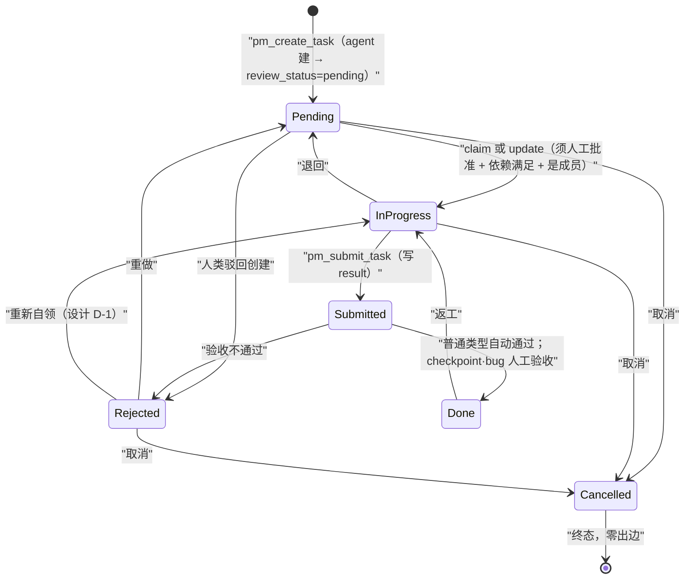
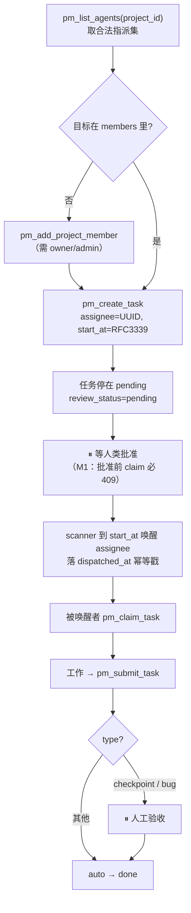

# PM / Doc MCP 工具面与官方 Agent 深度融合设计

> 版本：**v1.0（定稿）** | 日期：2026-11-05
>
> 关联设计：[`21-pm-project-management.md`](./21-pm-project-management.md)（§6 本文修订其工具面）、[`20-doc-online-document.md`](./20-doc-online-document.md)（§6 同）
> 关联 ADR：[`ADR-073-agent-instance-identity-decomposition`](../../adr/zh/ADR-073-agent-instance-identity-decomposition.md)（instance_id 唯一身份）· [`ADR-098-unified-standard-group-model`](../../adr/zh/ADR-098-unified-standard-group-model.md)（项目群聊）· [`ADR-102-turnorigin-vocabulary-and-pm-dispatch-chain`](../../adr/zh/ADR-102-turnorigin-vocabulary-and-pm-dispatch-chain.md)（PM 派工链）· [`ADR-104-agent-manifest-declaration-surface`](../../adr/zh/ADR-104-agent-manifest-declaration-surface.md)（manifest 声明面）
> 关联 PRD：[`docs/prd/zh/prd-doc-pm.md`](../../prd/zh/prd-doc-pm.md)
> 实现落点：[`core/acowork-pm/src/mcp/`](../../../core/acowork-pm/src/mcp/) · [`core/acowork-doc/src/mcp/`](../../../core/acowork-doc/src/mcp/) · [`examples/project-manager-agent/`](../../../examples/project-manager-agent/) · [`examples/document-manager-agent/`](../../../examples/document-manager-agent/)
> 执行计划：[`docs/plan/zh/pm-doc-mcp-agent-integration-plan.md`](../../plan/zh/pm-doc-mcp-agent-integration-plan.md)
>
> **一句话**：PM MCP 从 12 工具重整为 **14**（合并 3、增强 2、新增 5），Doc MCP 补 4 个缺口，两个官方 agent 的 prompt + 14 个 skill 全部改写到这套工具面上——当前它们对 `pm_*` / `doc_*` 的引用是 **0 处**。

---

## 1. 问题

### 1.1 现状证据

```
grep -rniE 'pm_[a-z]+|doc_[a-z]+|mcp' examples/project-manager-agent examples/document-manager-agent
→ 74 处命中，全部为 mcp_memory__*；pm_* / doc_* 命中 0 处
```

14 个 `SKILL.md` 的 `tool_deps` 清一色 `file_read / file_write / mcp_memory__*`。两个 agent 在 manifest 里**已经**声明了 `hosted = "pm"` / `hosted = "doc"`（[project-manager manifest.toml:119](../../../examples/project-manager-agent/manifest.toml#L119)、[document-manager manifest.toml:119](../../../examples/document-manager-agent/manifest.toml#L119)）——**工具在手上，prompt 里没有它们**。

后果不是「用得不够好」，而是**用错了地方**：

| 本该发生 | 实际发生 |
|---|---|
| 任务进 PM 服务（状态机、依赖图、审批闸门、定时唤醒） | 任务写进 `mcp_memory__memory_store` 的自然语言里 |
| PRD / 风险登记册进文档库（版本、原子发布、回收站、ACL） | PRD 写进本地 workspace 的 `.md` 文件 |
| `pm_list_tasks(only_blocked=true)` 一次拿到阻塞面 | 人肉读散文回忆谁卡谁 |

### 1.2 为什么「工具注入了」不等于「会被用」

MCP 工具注入只解决**可达性**，不解决**可用性**。这个工具面上有 **7** 个机制，其正确用法**无法从工具名与 schema 推断**——LLM 第一次调用必然踩错：

| # | 机制 | 代码出处 | 不写进 prompt 的后果 |
|---|---|---|---|
| **M1** | Agent 建的任务 `review_status=pending`，未经人批准时 `claim` / `update(status=in_progress)` **两条路径**都返回 409 `review_not_approved` | [tree.rs `ensure_creation_approved`](../../../core/acowork-pm/src/store/tree.rs) | PM 派完工以为结束了，实际一个都没启动 |
| **M2** | `start_at` 是**唤醒钩子**：dispatch scanner 周期扫描，选中 `pending` + agent-assigned + 已批准 + 未派发 + `start_at` 到点的任务，逐个发 wake-up intent，落 `dispatched_at` 幂等戳 | [dispatch.rs:1-23](../../../core/acowork-pm/src/dispatch.rs#L1) | 唯一的定时派工原语被闲置，改用 `intent_send` 手动催，失去幂等 → 重复催办 |
| **M3** | 状态机窄出口：`in_progress → done` **非法**（必须经 `submitted`）；`Cancelled` 是终态（零出边） | [tree.rs `validate_transition`](../../../core/acowork-pm/src/store/tree.rs#L670) | agent 高频撞 `InvalidStateTransition`，然后开始瞎试 |
| **M4** | `assignee` 必须是 Gateway agent 目录里存在的 **UUID instance_id**（ADR-073）；`agent_id`（`com.acowork.xxx`）只用于展示 | [mcp/tools.rs 头注释](../../../core/acowork-pm/src/mcp/tools.rs) §9.1 | 派工必失败，且报错（not in directory）不自解释 |
| **M5** | `type=checkpoint/bug` 提交后进人工审核；其余类型 auto-approved → `done` | [manifest.rs `pm_submit_task`](../../../core/acowork-pm/src/mcp/manifest.rs) | PM 不知道该在哪设验收闸 |
| **M6** | 治理**不在动词里**：同一个 `doc_write`，策略命中即返回 `pending_review` + `request_id`；大文档走 tmp → `doc_move(overwrite=true)` 原子发布 | [doc manifest.rs 设计说明](../../../core/acowork-doc/src/mcp/manifest.rs) | Docs agent 把半成品直接落到正式路径给读者看 |
| **M7** | **`assignee` 必须先是项目成员**：`assignee ∈ ∅ ∪ project.members`，**store 层强制**，错误码 `assignee_not_project_member`；邀请成员是治理动作，需 owner/admin | [types.rs:233](../../../core/acowork-pm/src/types.rs#L233) · [error.rs:44](../../../core/acowork-pm/src/error.rs#L44) · [tree.rs `ensure_assignee_is_member`](../../../core/acowork-pm/src/store/tree.rs#L620) | **本次调研新发现。** agent 对着目录里明明存在的 agent 派工，被一句「not a member」挡死，且 MCP 面上没有任何工具能修 → 只能回去找人。**派工链在 M4 之后还有这道闸，而它此前完全没被文档化。** |

> **本文核心主张**：prompt/skills 不是 MCP 的「使用说明附录」，而是这套工具面**唯一的人机接口文档**。M1–M7 必须写进 system prompt 正文，不能只靠 tool description——tool description 在长会话里会被上下文压力挤掉，system prompt 不会。

---

## 2. 设计原则

沿用 doc MCP 已成文的三条（[doc manifest.rs](../../../core/acowork-doc/src/mcp/manifest.rs)），补两条：

1. **资源 + 动作，不是用例动词。** `doc_write` 一个动词覆盖 add/update/append；`pm_list_tasks` 一个动词覆盖「我的 / 阻塞的 / 某父下 / 跨项目搜索」。
2. **治理是正交维度，不改变动词。** 是否需要人审批由策略决定，不由工具名决定（`governance_is_not_encoded_in_tool_names` 测试已钉死）。
3. **带副作用或闸门的转移，保留显式动词**（第 1 条的唯一例外）。判据：**该动作是否改变别人可见的承诺**——`claim` 改变（别人知道有人接了），改标题不改变。
4. **合并优于新增，除非新语义无处安放。** 每个新增工具必须写明它吸收哪条既有 REST 路由；**若既有只读工具的返回值已覆盖该信息，则不新增**（见 §3.3 对 `pm_list_project_members` 的否决）。
5. **不新建授权模型，复用既有闸。** 能靠 store 层已有校验（M7 的成员制、`require_governance` 的 owner 制）解决的，一律不设计第二套权限。

---

## 3. PM MCP 工具面 v2（12 → 14）

### 3.1 合并（删除 3 个）

| 删除 | 折入 | 依据 |
|---|---|---|
| `pm_check_task` | `pm_get_task` | `pm_get_task` 返回完整 `TaskResponse`，**已含** `review_status` / `is_blocked` / `blocked_by` / `parent_id` / `depth`（[tools.rs `task_to_value_with_meta`](../../../core/acowork-pm/src/mcp/tools.rs)）。`pm_check_task` 的唯一差异是「仅创建者可读」——那不是保护（同一字段在匿名可读的 `pm_get_task` 里），只是噪音。**真冗余。** |
| `pm_list_my_tasks` | `pm_list_tasks(assignee="me")` | 设计文档 [21 §6](./21-pm-project-management.md) 自己就写了 `pm_list_tasks` 是「Agent 自查任务主入口（可过滤 assignee=自己）」，却又存在一个专用工具。`"me"` 哨兵由服务端解析为 actor，agent 不必知道自己的 UUID。 |
| `pm_reparent_task` | `pm_update_task(parent_task_id=…)` | POSIX 语义下「移动」是属性变更而非独立动词；`pm_update_task` 已接受 `depends_on` 这类结构字段。`cycle_detected` 错误码原样保留。 |

**不合并** `pm_claim_task`：唤醒链在 [intent_turn.rs:1162](../../../core/acowork-runtime/src/agent/intent_turn.rs#L1162) 里向被唤醒的 agent 显式下达「call the MCP tool `pm_claim_task`」，且 [dispatch.rs `build_assignment_brief`](../../../core/acowork-pm/src/dispatch.rs) 把 claim→work→submit 四要素写进了 `assignment_brief`。它是 ADR-102 派工链的承重墙，也符合原则 3。

### 3.2 增强（2 个）

**`pm_list_tasks` — 吸收 REST `/search` 与 `/tasks/{tid}/children`，成为唯一查询入口**

| 参数 | 变更 | 说明 |
|---|---|---|
| `project_id` | **改为可选** | 省略 = 跨项目。当前强制单项目 + `limit≤100`，agent 无法回答「所有卡住的任务」 |
| `assignee` | 支持哨兵 `"me"` | 服务端解析 actor；替代 `pm_list_my_tasks` |
| `parent_task_id` | **新增** | 取某父任务下子任务；替代 `GET /tasks/{tid}/children` |
| `query` | **新增** | title/description 子串；替代 `GET /api/pm/search`（ADR-081 P0-2） |
| `type` / `review_status` | **新增** | 按类型过滤；按审批态过滤 `pending` 积压——M1 的可观测面 |
| `order_by` | **新增** | `due_at / priority / created_at / updated_at` |
| `offset` | **新增** | 配合 `limit` 翻页；当前只有 `limit`，**超过 100 条就永久看不见** |
| `only_blocked` | 保留 | 已存在，agent 完全不知道它存在（§1.1） |

**`pm_update_task` — 补齐已实现但未声明的字段**：新增 `parent_task_id`（吸收 reparent），并把代码已接受、manifest 漏声明的 `type` / `depends_on` 补进 schema（缺陷 D2）。

### 3.3 新增（5 个）

| 工具 | 吸收的 REST 路由 | 为什么必须有 |
|---|---|---|
| `pm_list_agents` | 无（[agent_dir.rs](../../../core/acowork-pm/src/mcp/agent_dir.rs) 目前只做**内部**存在性校验）+ `Project.members` | **派工链的入口，同时解决 M4 与 M7。** `pm_list_agents(project_id)` → 返回**该项目成员**的目录元信息（`instance_id / agent_id / name / role / online / added_at`），即「合法可指派集合」——按构造返回合法答案，agent 不可能拿到一个派不动的 id。省略 `project_id` → 返回全局目录，供「该邀请谁」决策。**这是原则 5 的落地：不新建权限模型，直接把 store 已有的成员闸当查询边界。** 三条实现期定稿的边界（见 §8 Q7）：① roster 模式**只列 agent 成员**，人类成员以 `human_member_count` 计数上报而不进指派集（D7）；② roster 模式**不因目录不可用而 503**——可指派的 key 来自 PM store，行内元信息为 null 并置 `directory_available: false`；503 只属于全局目录模式；③ `online` 取 Gateway `alive`（ADR-085），**是信息不是闸门**——派工投递本身会拉起离线目标（`intent/delivery.rs` `wake_and_deliver` 第 3 步），`null` 表示「未上报」而非「离线」。 |
| `pm_add_project_member` | `POST /projects/{pid}/members` | **M7 的解锁键。** 没有它，agent 撞上 `assignee_not_project_member` 后在 MCP 面上无路可走。复用 REST 侧 `require_governance`（owner/admin）——PM agent 建的项目里它天然是 owner（[projects.rs:68](../../../core/acowork-pm/src/api/projects.rs#L68)：创建者被 seed 进 `members`），因此**不需要新权限设计**。附带收益：加成员会 `sync_group_chat`，项目群聊参与者自动收敛（[projects.rs:351-355](../../../core/acowork-pm/src/api/projects.rs#L351)）。 |
| `pm_add_activity` | `POST /tasks/{tid}/activity` | PM→工程师的上下文通道。没有它 `description` 是唯一沟通位，改 description 会**覆盖掉原始验收标准**——这是 agent 实际会犯的错。也是阻塞原因、改期理由的落点（Desktop §7 已渲染成活动流）。 |
| `pm_list_activity` | `GET /tasks/{tid}/activity` | 被唤醒的执行 agent 需要读回上下文；`pm_get_task` 里没有。 |
| `pm_update_project` | `PATCH /projects/{pid}` | MCP 只有 `pm_create_project`，项目名写错、描述过期、需归档，agent 全都改不动。 |

**否决一个候选工具**：`pm_list_project_members` —— `pm_get_project` 返回的 `Project` **已含 `members: Vec<ProjectMember>`**（[types.rs:283](../../../core/acowork-pm/src/types.rs#L283)），再加一个只读工具违反原则 4。同理**不做** `pm_remove_project_member`：踢人会使项目群聊参与者收缩，属治理动作，留给人。

### 3.4 v2 完整清单

```
只读（匿名可用）    pm_list_projects  pm_get_project（含 members）  pm_list_tasks  pm_get_task
                    pm_list_agents
写（需身份）        pm_create_project  pm_update_project  pm_add_project_member
转移（需 assignee） pm_claim_task  pm_submit_task
写（需身份/创建者） pm_create_task  pm_update_task  pm_add_activity  pm_list_activity
                                                          合计 14（+ 3 个临时 deprecated 别名）
```

### 3.5 兼容策略

工具名**不是内部实现细节，是持久化数据**：Desktop 的 `agent_config.json` 按工具名存开关（[proxy.rs:3043](../../../core/acowork-gateway/src/http/proxy.rs#L3043)），CreateWizard 按工具名渲染 enable 开关（[CreateWizard.test.tsx:73](../../../apps/acowork-desktop/src/components/agent-list/CreateWizard.test.tsx#L73)）。已安装 agent 的配置里可能写着 `pm_list_my_tasks`。

**别名期**：被删的 3 个工具保留为 deprecated 薄别名，dispatch 转发到新路径，manifest description 前缀 `[deprecated: use X]`，仍在 `tools/list` 出现。

**移除机制（Q4 定稿）**：沿用 [agent_config.rs:1097-1113](../../../core/acowork-runtime/src/agent_config.rs#L1097) 已确立的**读时迁移 + 立即回写**模式（旧版 flat `Vec` 格式就是这样自愈的）：加载 `agent_mcp_tools.json` 时按别名表把旧名重写为新名并原子回写。配置一旦被加载即自愈，因此别名删除不再受「某个 agent 从未被启动」阻塞。移除时点与验收见计划文档 P4-T4-5。

---

## 4. Doc MCP 工具面 v2（9 → 12）

Doc 侧**不改动现有 9 个工具**——文件系统语义已收敛（`doc_add/submit_update/pull` 三件套已删并有测试守护）。只补缺口。

| 工具 | 类型 | 吸收的 REST 路由 | 为什么必须有 |
|---|---|---|---|
| `doc_list_requests` | **新增 P1** | `GET /requests`、`GET /docs/{id}/requests` | `doc_check_request` 需要 `request_id`（`r-{hex12}`），而**该 id 只存在于工具返回值里**——上下文压缩后丢失，那笔 `pending_review` 改动就**永久失联**：查不到、撤不回。这是 M6 的闭环缺口。 |
| `doc_list_trash` / `doc_restore` | **新增 P1** | `GET /trash`、`POST /trash/{id}/restore` | `doc_remove` 明确「进回收站，可恢复」，但恢复面在 MCP 上不存在——能删不能救。**声明了可恢复却不给恢复路径，是语义上的欺骗。** 恢复走与 `doc_remove` 对称的所有权闸门。**不暴露 `purge`**——agent 不该有不可逆删除权。 |
| `doc_move` 支持目录 + `doc_rmdir` | **增强 P2** | `PATCH/DELETE /dirs/{id}` | POSIX `mv` 本不区分文件与目录。当前有 `doc_mkdir` 却无任何目录改名/删除能力 → **信息架构重构在 agent 面上做不了**，而这正是 `document-organization` skill 的看家本领。`doc_rmdir` 仅空目录可删，非空返回明确错误、**不级联**。 |
| `doc_list(recursive=true)` | **增强 P3** | `GET /tree` | 合并优于新增：不造 `doc_tree` 动词。默认 `false` 保持现行为，递归模式带深度与节点数上限。 |
| `doc_get_acl` / `doc_set_acl` | **新增 P3** | `GET/PUT /permissions/{kind}/{id}` | agent 撞 ACL 才发现不能改。优先级最低：读默认公开、admin 在 ACL 层已豁免，多数场景不阻塞。 |

---

## 5. 必须进 system prompt 的机制清单

§1.2 的下游落地。内容**不是工具列表复述**（runtime 已注入），而是**行为契约**。

### 5.1 PM agent — 状态机（M3）



> 三条必须背下来：① 想 done 只能走 `submit`；② `Cancelled` 不可逆；③ `Rejected` 可以重新 `claim`。

### 5.2 PM agent — 派工模型（M1 + M2 + M4 + M5 + M7）



推论（不写进 prompt，agent 必然误判进度）：
- **派工有两个不可跳过的人工闸**：创建批准 + （可选）结果验收。计划里必须显式留时间窗。
- **`intent_send` 用于临时协调，不用于派工**。绕过 PM 服务发的 intent 不产生任务、不进看板、无审批、无幂等戳 → 会重复催办。
- 跟进用 `pm_get_task`（读 `review_status` + `status` + `dispatched_at`），**不是**重新 `pm_create_task`。
- 撞 `assignee_not_project_member` 是**配置缺失**，不是错误——先邀请，再派工。

### 5.3 Docs agent — 写入纪律（M6）

- **版本纪律**：`doc_stat` 取 version → `doc_write(if_version=N)`。禁止盲 `overwrite`（静默覆盖他人改动）。
- **原子发布**：超过一屏的内容一律 tmp 名 `create` → `append` → `doc_move(overwrite=true)`。读者永远看不到半成品。
- **审批闭环**：拿到 `pending_review` 时，把 `request_id` 落到文档元信息区**并**记进对应任务 activity，之后 `doc_list_requests` 可复查。
- **删除是软的**：`doc_remove` 进回收站；`doc_move(overwrite=true)` 替换掉的文档也进回收站、永不 unlink。非 owner 的结构操作会被所有权闸门拒（无主文档回落 ACL）→ 该找人就找人，不要绕。
- **搜索优先**：新建前先 `doc_search`。库的最大敌人是重复，不是缺页。
- **命名约束**（[path.rs](../../../core/acowork-doc/src/path.rs)）：名 ≤200 字节、不含 `/` `\` NUL、**同级唯一**、路径 ≤4096 字节。

### 5.4 两者共用 — ID 与路径纪律

- 前缀即类型：`p-` 项目 / `t-` 任务 / `att-` 附件 / `r-` 审批请求 / `doc-` 文档。**禁止臆造 id**，一律从工具返回值读回。
- doc 参数同时接受 `doc_id` 与 path；**path 是人类可读面**，写进产出物用 path，程序回读用 doc_id。

### 5.5 PM ↔ Doc 路径约定（Q6 定稿）

PM 的规划产出落文档库，固定形态：

```
项目管理/{project_id}/README.md          ← 人面入口（H1 = 项目标题，链接下列全部产出）
项目管理/{project_id}/PRD.md
项目管理/{project_id}/风险登记册.md
项目管理/{project_id}/冲刺计划.md
项目管理/{project_id}/复盘.md
项目管理/{project_id}/周报/{YYYY-WW}.md
项目管理/{project_id}/会议纪要/{YYYY-MM-DD}-{slug}.md
```

**目录名用 `project_id` 而非项目标题**，理由与代价都已权衡：

| 要求 | 用 `{project_id}` | 用 `{title-slug}` |
|---|---|---|
| **可从项目单值推导**（任何会话、任何 agent 无需查表即可算出路径） | ✅ | ❌ 需存 slug |
| **改名后不断链**（`pm_update_project` 本次刚加，标题一定会被改） | ✅ | ❌ 断链或需连带 `doc_move` 迁移 |
| 人类可读 | ❌ 丑 | ✅ |

丑的问题由 **`README.md` 承担人面**解决：它的 H1 就是项目标题，也是 `doc_search` 的命中面——人进库看到的是文档名，不是目录名。**这是刻意选择：目录是机器把手，README 是人的脸。** 不引入「slug 存在项目 description 首行」这类约定——解析自由文本当外键用，是后续所有迁移事故的源头。

- 词汇表**封闭**：产出物文件名只允许上述集合，agent 不得自造名。新增一类产出须先改本节。
- 单向依赖：**PM 引用 doc，doc 不知道 PM**。这是两个服务之间唯一的耦合点。

---

## 6. 官方 Agent 融合改造范围

### 6.1 `project-manager-agent`

| 文件 | 改造 |
|---|---|
| `prompts/system.md` | 新增 §5.1 状态机 / §5.2 派工模型 / §5.4 ID 纪律 / §5.5 路径约定；`todo_write` 降级为「会话内临时清单」——凡跨会话或需他人履约的，一律落 PM 服务 |
| `manifest.toml` | 补 `[[mcp_servers]] hosted = "doc"`（产出物需要文档库）；`tool_deps` 声明 `pm_*` / `doc_*`；`capabilities` 指向新增 skill；**shell 三件套保留**，仅修 D4 矛盾注释 |
| 现有 7 skills | 全部重写 `tool_deps` 与步骤：`requirements-analysis` → doc 发布 + `pm_create_project`；`task-decomposition` → `parent_task_id` + `depends_on` + `start_at` 建真树；`progress-tracking` → `only_blocked` + `pm_get_project` 计数；`sprint-planning` → `type=milestone` |
| 新增 2 skills | `task-dispatch`（成员 → 派工 → 双审批闸 → 跟进全链路，覆盖 M1/M2/M4/M5/M7）、`project-setup`（项目 + 文档目录树 + 名册 bootstrap） |

### 6.2 `document-manager-agent`

| 文件 | 改造 |
|---|---|
| `prompts/system.md` | 新增 §5.3 写入纪律 / §5.4 ID 路径纪律 / §5.5 约定（PM 产出物是它的被服务对象，不得随意搬动 `项目管理/**`）；确立「库是事实源，workspace 只是导入源」 |
| `manifest.toml` | `tool_deps` 声明 `doc_*`；修 D4 注释；shell 保留 |
| 现有 7 skills | `document-collection` 改为「读 workspace → `doc_write(mode=create, source_workspace, source_path)`」；`document-organization` 用 `doc_mkdir` / `doc_move`（含目录）；`document-quality-review` 用 `doc_read` + `doc_stat` |
| 新增 1 skill | `review-tracking`（`pending_review` 生命周期，依赖 `doc_list_requests`） |

---

## 7. 现存缺陷清单（本次一并修）

| # | 缺陷 | 证据 | 处置 |
|---|---|---|---|
| **D1** | `pm_check_task` / `pm_list_my_tasks` / `pm_reparent_task` 与主工具语义重叠 | §3.1 | 合并 + deprecated 别名 |
| **D2** | **manifest / 代码 schema 漂移**：`pm_update_task` 的 `Args` 接受 `type` 与 `depends_on`，manifest 未声明 → LLM 永远用不到 | [tools.rs:637,650](../../../core/acowork-pm/src/mcp/tools.rs#L637) vs [manifest.rs](../../../core/acowork-pm/src/mcp/manifest.rs) | 补声明；**测试从「6 字段抽查」升级为「`Args` 结构体字段集 ⊆ manifest properties」强断言**（现测试只比 `start_at/due_at/title/description/priority/assignee`，故漂移静默通过） |
| **D3** | `pm_submit_task` 接受 `attachment_ids`，但 MCP 面**无任何途径创建附件**（上传只在 REST `POST /tasks/{tid}/attachments`）→ 死参数 | [routes.rs](../../../core/acowork-pm/src/api/routes.rs) vs manifest | **从 manifest 移除该参数**（Q2 定稿），description 注明「附件由人类在 Desktop 上传；agent 产出走文档库路径引用」。**不加 `pm_upload_attachment`**：那会在文档库之外长出第二套二进制体系，需要另做去重/保留/ACL，方向错误 |
| **D4** | 两个 manifest 注释写 `# No shell tools — … does not hold a Shell permission.`，紧接着声明 `bash`/`powershell`/`shell` | [pm manifest:36-59](../../../examples/project-manager-agent/manifest.toml#L36)、[doc manifest:36-59](../../../examples/document-manager-agent/manifest.toml#L36) | **只改注释，声明保留**（Q3 已决）。注释改为说明「shell 为跨平台探测项，非核心工作流依赖」 |
| **D5** | 设计文档 [21 §6](./21-pm-project-management.md) 工具表与代码不一致（缺 `pm_reparent_task`/`pm_check_task` 完整参数、`pm_list_tasks` 缺 `only_blocked`） | 21 §6 | 21 §6 改为指向本文；保留机制叙述，工具表以代码 manifest 为准 |
| **D6** | **M7（成员闸）从未出现在任何面向 agent 的文档里**：[21 §6](./21-pm-project-management.md) 工具表未提，`pm_create_task` 的 manifest description 只说「must exist in the Gateway agent directory」 | [manifest.rs `assignee`](../../../core/acowork-pm/src/mcp/manifest.rs) vs [tree.rs:620](../../../core/acowork-pm/src/store/tree.rs#L620) | **manifest description 补写成员要求 + 错误码**，并加 `pm_add_project_member` 指引。这是本次调研发现的**文档与实现不一致**，比缺工具更危险：它让 agent 的错误看起来像平台 bug |
| **D7** | **人类成员在三层之间不一致，MCP 面的「可指派」承诺是假的**：store 的成员闸只比 `instance_id`、**接受人类账号**（`assignee ∈ project.members` 成立），而 ① `pm_create_task` 要求 assignee 在 Gateway Agent 目录中存在、② 派工扫描器把 `task.assignee` 当 intent 目标投递，人类账号会得到 `target_not_installed`。三层各说各话的后果是「任务建成功了，但永远不会被派出去」——比直接报错难诊断一个数量级 | [tree.rs `ensure_assignee_is_member`](../../../core/acowork-pm/src/store/tree.rs#L620) vs [tools.rs `pm_create_task`](../../../core/acowork-pm/src/mcp/tools.rs) vs [dispatch.rs:191,232](../../../core/acowork-pm/src/dispatch.rs#L191) + [delivery.rs `wake_and_deliver`](../../../core/acowork-gateway/src/intent/delivery.rs#L168) | **P0 内收紧工具面承诺**：`pm_list_agents(project_id)` 只把 **agent 成员**放进指派集，人类成员以 `human_member_count` 显式计数上报（不静默隐藏），description 写明「人类成员由 Desktop 侧指派」。**不做**「让 agent 给人类派工」——那要改派工投递的目标解析与重试语义，是独立设计，见计划 §7 范围外 |

---

## 8. 决策记录（全部关闭）

| # | 项 | 结论 | 依据 |
|---|---|---|---|
| Q1 | 先补 MCP 还是先改 agent | 先出设计 + 计划留底，按文档开发；P3 依赖 P0-P2 | 用户决策 |
| **Q2** | `attachment_ids` 死参数 | **从 manifest 移除**，不建 `pm_upload_attachment`；agent 产出统一走文档库 | 原则 4；避免长出第二套二进制存储（D3） |
| **Q3** | 官方 agent 是否保留 shell | **保留**，仅修 D4 矛盾注释 | 用户决策 |
| **Q4** | deprecated 别名移除时点 | **读时迁移 + 原子回写**（复用 [agent_config.rs:1097](../../../core/acowork-runtime/src/agent_config.rs#L1097) 既有模式），配置一经加载即自愈；别名随 P4 交付的重写表在**下一 minor** 删除，删除门为可验证 checklist（计划 T4-5） | 不受「某 agent 从未启动」阻塞 |
| **Q5** | `pm_list_agents` 是否按权限过滤 | **按项目成员过滤**（`project_id` 参数即边界）。**原风险「越权指派」是虚警并已撤销**——`assignee ∈ project.members` 早已由 store 强制（M7）。因此不新建权限模型（原则 5），改为：① `pm_list_agents(project_id)` 返回合法指派集；② 补 `pm_add_project_member` 作为 M7 的解锁键；③ `pm_create_task` 存在性校验**不放宽** | [types.rs:233](../../../core/acowork-pm/src/types.rs#L233) · [tree.rs:620](../../../core/acowork-pm/src/store/tree.rs#L620) · [projects.rs:327](../../../core/acowork-pm/src/api/projects.rs#L327) |
| **Q6** | PM 产出物路径约定 | `项目管理/{project_id}/…`，目录名用 id 不用 slug，`README.md` 承担人面；文件名词汇表封闭 | §5.5 权衡表：可从单值推导 + 改名不断链 优先于 目录可读性 |
| **Q7** | `pm_list_agents` 的两条实现期边界 | ① **模式不对称的失败语义**：全局目录模式在首次刷新未完成时 503（假阴性「没人可派工」比一次重试昂贵），roster 模式**不**503——指派 key 来自 PM store，目录挂了也照样能派给已知成员，行内元信息为 null 并以 `directory_available: false` 说明；② **`online` 是信息不是闸门**：投递本身会拉起离线目标（`wake_and_deliver` 第 3 步在宿主节点 start 并等 online 翻转），故 `null` ≠ 离线，description 明写「派给离线 agent 可行」，防止 agent 自行加一条平台没有的闸门 | 实现期发现（P0）；[delivery.rs:215-251](../../../core/acowork-gateway/src/intent/delivery.rs#L215) |

---

## 10. 变更记录

| 版本 | 日期 | 变更 |
|---|---|---|
| v1.0 | 2026-07-08 | 首版定稿：机制 M1–M7、工具面（PM 12→14 + 3 别名 / Doc 9→12）、缺陷 D1–D6、§8 决策全部关闭 |
| v1.1 | 2026-07-08 | P0 实施期新增 **D7**（成员闸 / 目录存在性校验 / 派工投递目标三层不一致：人类账号可被存为 assignee 却永远派不出去）与 **Q7**（`pm_list_agents` 两种模式的失败语义不对称；`online` 是信息不是闸门）。据此：roster 模式只列 agent 成员 + `human_member_count` 显式上报；不做 agent→human 派工。 |
| v1.2 | 2026-07-08 | P1 T1-1：`pm_list_tasks` 收敛为唯一任务查询——`project_id` 可选（省略 = 跨项目，须至少一个过滤条件 + 有限 `limit`）、新增 `parent_task_id`/`type`/`review_status`/`query`/`order_by`/`offset`、`assignee` 接受哨兵 `"me"`（服务端按 actor 解析，agent 无需知道自己的 instance id）；返回统一为 `{total,count,tasks,truncated,next_offset}` 信封。`TaskIndex` 随之携带 `type`/`parent_task_id`，全部过滤走内存索引、不做逐项目扫描。 || v1.3 | 2026-07-08 | P1 T1-2：`pm_update_task` 吸收 `parent_task_id`（三态：省略=不动、`null`=提升为根、给 id=改父），结构移动仍走 store 的 reparent 路径（含防环），字段写入与移动在同一调用内完成。`pm_reparent_task` 待 T1-4 转 deprecated 别名。实施期发现：MCP 的任务投影**不含 `children` 字段**——子树只能由 `pm_list_tasks(parent_task_id=…)` 读出，已在测试与本文注明，避免后续误以为可读。 || v1.4 | 2026-07-08 | P1 T1-3：新增 `pm_update_project`（改名 / 描述 / 归档 / 完成），授权沿用 `Project::can_govern`（与 `PATCH /projects/:id` 同一规则，不新建模型）；`status=completed` 触发设计 27 §2.1 T2-a 的任务上下文收尾。为此把 `close_task_contexts` / `provisioner` 从依赖 `ApiState` 改为依赖 `&Option<(String, Option<String>)>`，MCP 面与大 REST 面共用同一实现（同 P0 的 `sync_group_chat` 手法）。空调用（无可改字段）显式报错而非静默 200。工具数 16→17。 || v1.5 | 2026-07-08 | P1 T1-4：`pm_check_task` / `pm_list_my_tasks` / `pm_reparent_task` 转为 **deprecated 别名**——参数翻译后调用**同一个** handler，故返回**逐字节相同**的 JSON（只差两次写入必然不同的 `updated_at`），等价测试按此断言。**旧形状明确废弃**：`pm_check_task` 的扁平评审摘要、`pm_list_my_tasks` 的裸数组、`pm_reparent_task` 的 `{ok:true}` 均不再返回；`pm_check_task` 连带不再单独要求 actor（与 `pm_get_task` 同权限）。manifest 加 `version: 0.2.0`，三个别名 description 前缀 `DEPRECATED — use …`。工具数仍为 17（14 主 + 3 别名）。 || v1.6 | 2026-07-08 | P1 T1-6：状态机转移表上移到 `TaskStatus::legal_successors()` 作为单一事实来源，`validate_transition` 与错误消息同读一张表——`InvalidStateTransition` 现在带 `allowed` 字段，消息形如 `invalid state transition for task t-x: in_progress → done; from in_progress you may go to: pending, submitted, cancelled`；终态（`cancelled`）报 `(none — terminal status)` 而非空列表。理由：agent 无法靠重试猜出状态机，第一次报错就得告诉它合法去向。 || v1.7 | 2026-07-08 | P1 T1-5：21 §4 的 Mermaid 状态机与 `legal_successors()` **逐格核对一致**（含易漏的 `rejected → cancelled`）；21 §6 的工具表**删除**，改为指向本文与 manifest 单一事实来源，只保留三条面向 agent 的不变式——复制出的第二份清单必然漂移（迁移前已缺 `type`/`depends_on`/`only_blocked`，并把别名写成"仅创建者可查"）。**P1 收口**：14 主工具 + 3 别名 = 17。 || v1.8 | 2026-07-08 | P2 完成（Doc 面 9→13）：新增 `doc_list_requests`（默认 `pending` 队列，可按文档过滤，`status=all` 取消过滤）、`doc_list_trash`、`doc_restore`（与 REST 同 `check_trashed` 编辑权；**无 purge**）、`doc_rmdir`。**`doc_rmdir` 语义刻意与 REST 不同**：`DELETE /dirs/{id}` 是级联进回收站，而 agent 面只允许删**空目录**、绝不级联——一个路径写错就把整套信息架构扫走，代价与收益不成比例；非空时报出文档数与子目录数。实施期发现：MCP 测试辅助 `raw()` 每次调用新建临时库，**跨调用状态不存在**（此前测试全是单调用形状），故新增 `shared_router()` / `call_shared()` 才能测多步场景（建目录→列表→删除→恢复）。**未做**：`doc_move` 的目录跨父级移动与 `doc_get_acl`/`doc_set_acl`——`DirMeta` 无 `parent` 字段（父子关系即物理嵌套），跨父移动要整体搬迁子树，属独立特性；ACL 面按设计优先级最低。 |
