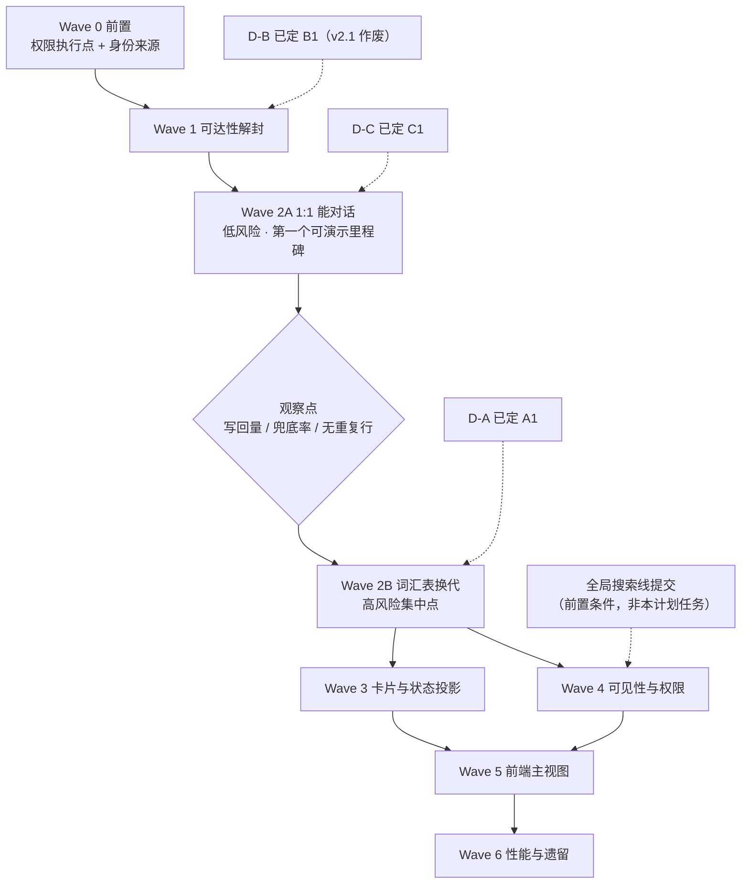

# Intent / Chat Session 统一模型 — 文档到实现的 Gap 拆解

> 版本：v1.1（定稿）| 日期：2026-10-18
>
> v1.1 修订：设计文档升级到 **v2.1（user-agent 单聊微信模型）**后，同步作废 D-B/1.5（Chat history 入口撤销）、重写 Wave 5（固定 Chat tab + exec tab 共存）、新增 §10 决策 8；其余 Wave 不变。历史决策原文保留不删。
>
> 关联设计：[`docs/design/zh/27-intent-messaging-and-group-chat.md`](../../design/zh/27-intent-messaging-and-group-chat.md)（**v2.1**，章节已重排）
> 关联计划：[`intent-delivery-tech-debt-plan.md`](intent-delivery-tech-debt-plan.md)（v0.1，投递与身份链路前置技术债）
> 关联 ADR：ADR-009（Gateway 边界）、ADR-055（Node 拓扑）、ADR-073（instance 寻址）、ADR-084（acowork-user 剥离）
>
> **状态**：§4 三项架构决策已定稿，Wave 顺序已确定，可直接进入实现排期。
>
> **一句话**：设计文档 v2.0 描述的统一模型（五种 kind 共用一套 Chat session + 四类消息词汇表 + 卡片 + 状态投影）在代码里**只落地了大约三分之一**——存储骨架、幂等写入、投递、超时兜底、routing key 派生都已存在且质量良好；缺的是**消息词汇表换代、写回触发点、身份类型、参与者派生可见性、前端主视图**。本文按可交付切片拆解，并标出三处必须先拍板的架构决策。

---

## 1. 定位与边界

| 项 | 说明 |
|----|------|
| 范围 | 仅覆盖「文档 v2.0 已定稿语义 → 代码实现」的 gap 拆解与排期 |
| 不在范围 | 设计语义本身的再讨论；文档 §10 的 23 条开放问题（除阻塞项外）；全局搜索线（ADR-093/095，工作区有未提交改动，勿碰） |
| 与既有技术债计划的关系 | 那份计划处理**投递与身份链路的既有缺陷**（信箱、权限执行点、`IntentRouter` 死代码等 8 项）。本文的 Wave 0 依赖其 **D1/D2**（权限执行点、身份来源），其余 Wave 与之无依赖，可并行 |
| 判据 | 每项以「可观测行为 + 测试」验收，不以「代码改了」验收 |
| 硬约束 | 不引入任务状态机；Chat session 不含思考与工具调用；Gateway 不承载业务逻辑、不直读 Agent home（ADR-009 §5 红线，`dev/ci.sh` 的 `run_gateway_fs_redline` 强制） |

---

## 2. 本次核验对文档 §3.5 的三处修正

文档 §3.5 的缺陷表基于早先分析。逐条对着当前代码复核后，**三处需要修正**——两处让工作量变小，一处让风险定位变了。

| 文档说法 | 复核结论 | 证据 |
|---|---|---|
| P0-2「`ensure_pair` 将 kind 硬编码」 | **服务端已不阻塞**。`chat_sessions::ensure_pair` 与 `SystemPairRequest` 都已接受 `kind` 参数，只有 Gateway 客户端写死 `"agent_agent"`。工作量从「改两层」降为**改一行** | [chat_sessions.rs](../../../core/acowork-user/src/chat_sessions.rs) `ensure_pair(.., kind: SessionKind, ..)`；[chat_sessions_api.rs:244](../../../core/acowork-user/src/http/chat_sessions_api.rs#L244) `pub kind: String` + `default_pair_kind()`；[chat_client.rs:68](../../../core/acowork-gateway/src/intent/chat_client.rs#L68) 写死 |
| P0-3「Agent 页 Chat history 非管理员必 403」 | **成立，但正确修法不是放宽鉴权**。前端把 `agentId` 当 participant 查询才是病根；用户以自己 id 查询已能通过。若按字面「放开鉴权」会把 `list_sessions` 变成越权读取面 | [ChatHistoryDropdown.tsx:91](../../../apps/acowork-desktop/src/components/chat/ChatHistoryDropdown.tsx#L91) `/api/chat-sessions/${agentId}`；[chat_sessions_api.rs](../../../core/acowork-user/src/http/chat_sessions_api.rs) `list_sessions`：`!ctx.is_admin() && ctx.effective_user_id() != participant → 403` |
| P1「代码仍是旧三分类 kind」 | **成立且比文档描述更严重**：新词汇表的 `agent_message` / `interaction_request` / `system_notice` 在**整个代码库中出现 0 次**——不是部分实现，是完全未开工。这是本文最大的一块 gap | `grep -rn "turn_started\|interaction_request\|system_notice" core/ apps/` → 0 命中；[chat_sessions.rs:46-48](../../../core/acowork-user/src/chat_sessions.rs#L46) 仅 `KIND_USER_MESSAGE` / `KIND_INTENT_REQUEST` / `KIND_INTENT_RESPONSE` |

另外两处**已具备**、文档未充分肯定的基础，值得记下来（它们让后续 Wave 变轻）：

- routing key `chat:{chat_session_id}` 已实现并有测试 → §8.2 参与者派生可见性的**判据来源已存在**，无需新建（[intent_routing.rs:296](../../../core/acowork-runtime/src/agent/session/intent_routing.rs#L296)）
- 响应超时兜底 sweeper 已实现，且语义与新文档 §5.5.1 的「崩溃兜底」一致（[sweeper.rs](../../../core/acowork-gateway/src/intent/sweeper.rs)）

---

## 3. Gap 总览

按「文档章节 → 代码现状」对齐，`✅` 已实现 / `🟡` 部分 / `❌` 未实现。

| 文档 | 语义 | 现状 | 证据 |
|---|---|---|---|
| §4.2 | 四类消息词汇表 | ❌ 仍是旧三分类 | chat_sessions.rs:46-48；新 kind 全库 0 命中 |
| §4.2 | `message_id` 全 kind 必填 | 🟡 仅 intent_* 必填 | chat_sessions.rs:331（`user_message` 走 :326 分支，不校验） |
| §4.2 | `in_reply_to` 语义推导应答 | ❌ `intent_response` 硬要求非空，1:1 回复无处可指 | chat_sessions.rs:337 |
| §4.2.1 | 附件 | ❌ 完全没有（旧 `chat.rs` 有） | `grep -c attachment chat_sessions.rs` → 0 |
| §4.2.2 | 决策卡片 / 状态卡片 | ❌ 未实现 | 同 §4.2 |
| §4.4 | `pairs.json` 语义（默认会话 + 可建第二条） | ❌ 一 key → 一 session_id，装不下第二条（**v2.1 作废**：每 pair 恰好一条，单条语义即正确形态） | chat_sessions.rs `ensure_pair` `index.insert(key, ..)` |
| §4.6 | 唯一写入口 + seq 单调 + 幂等 | ✅ 已实现 | chat_sessions.rs:305 起，10 个单测覆盖 |
| §4.7 | `GET /chat-sessions/default?pair=` | ❌ 端点不存在 | chat_sessions_api.rs 路由表无 default |
| §5.4.2 | 群聊固定 execution session | ✅ routing key 已具备 | intent_routing.rs:296 |
| §5.4.4 | user_agent 默认会话 | ❌ kind 不可达 | chat_sessions_api.rs `create_session` 拒绝 participants>1 的非 group/user_user |
| §5.4.5 | R1 按「会话内是否有人类」判定 | ❌ 仍按「本轮是否有 pending_intent」 | [loop_tools.rs:1321](../../../core/acowork-runtime/src/agent/loop_tools.rs#L1321) |
| §5.5.1 | 写回触发点 = 入站带 `source_chat_session_id` | ❌ 触发点是「本轮是 responder turn」 | [session_task.rs:1286](../../../core/acowork-runtime/src/agent/session/session_task.rs#L1286) `if let Some(ctx) = ctx` |
| §5.5.5 | 状态卡片读时投影 | 🟡 状态源已具备（`SessionStatus` 事件流 + `GET /sessions/{sid}` 合并 live_state），卡片与投影消费未建 | 后端零改动，缺前端 + `turn_started` 行 |
| §5.6 | PM 归一到投递语义 | 🟡 投递在用，但 PM 群成员变更不回传 Chat session | [projects.rs:224](../../../core/acowork-pm/src/api/projects.rs#L224) `remove_member` 未触达 participants |
| §8.1 | participants 身份类型校验 | ❌ `Vec<String>`，无类型 | chat_sessions.rs:152 |
| §8.2 | 参与者派生可见性 | ❌ `SessionVisibility` 只有 Public / Private | [session_meta.rs:188](../../../core/acowork-memory/src/session_meta.rs#L188) |
| §8.3 | 踢人即失既往执行记录 | ❌ 无 participants 变更 API，也无派生判据 | chat_sessions.rs 只有 `set_repo`，无 add/remove participant |
| §6.1 | Agent 页主视图 = 默认 Chat session（v2.1：固定 Chat tab 与 exec tab 共存，见 §10 决策 8） | ❌ 前端 `createSession` 直接建 execution session | [agentStore.ts:1160](../../../apps/acowork-desktop/src/stores/agentStore.ts#L1160) |
| §4.6 | unread 计数 | ❌ 新存储丢了旧能力 | `grep -c unread` → chat_sessions.rs 0 / chat.rs 32 |
| §4.6 | `list_for` per-participant index | ❌ 全目录扫描 | chat_sessions.rs `list_for` `fs::read_dir` |

---

## 4. 架构决策（已定稿）

三项决策已拍板。每项记录选定方案、被否方案与否决理由，避免实现时重新讨论。

### D-A：旧消息行的兼容策略 —— 选定 **A1「写新读旧」**

`messages.jsonl` 里已有 `intent_request` / `intent_response` 两类行，新词汇表要求 `agent_message` + 字段推导，而 §3.3 定了「不迁移历史」。三者调和方式：

| 方案 | 做法 | 结论 |
|---|---|---|
| **A1** | **写新读旧**：写入端只产生新四类；读取端把旧两类归一化为 `agent_message`（`conversation_id` / `in_reply_to` 原样保留）。归一化是纯函数，落在唯一读路径上 | ✅ **选定** |
| A2 | 一次性迁移脚本重写所有 `messages.jsonl` | ❌ 违反「不迁移历史」；改写 append-only 文件破坏 §4.6 幂等前提；不可回滚 |
| A3 | 两套 kind 长期共存，前端各自渲染 | ❌ 渲染分支永久翻倍，正是本设计要消灭的「两套权威」 |

选定理由：唯一写入口不变量不受扰动；旧行永不改写，回滚等于删掉一个读侧纯函数。

### D-B：Agent 页历史入口 —— 选定 **B1「改前端传参，不动鉴权」**（**v2.1 作废**）

| 方案 | 做法 | 结论 |
|---|---|---|
| **B1** | 前端以**当前用户 id** 查询，按 `kind == user_agent && participants 含该 agent` 过滤；服务端加可选 `?agent=` 避免拉全量 | ✅ **选定** |
| B2 | 放宽 `list_sessions`，允许以 agent id 作 participant 查询 | ❌ 等于给任意登录用户一个「枚举他人会话」的探针面，与 §8.4 最小暴露原则相反 |

选定理由：现有鉴权规则（`!is_admin && effective_user_id != participant → 403`）本身正确，不该为一个传参错误开安全洞。

> **v1.1 注**：设计 v2.1 撤销了 Agent 页 Chat history 按钮（user-agent 单聊就是固定 Chat tab，无列表入口），本决策与其验收对象一并作废；「鉴权规则本身正确、不得靠放宽修」的结论仍成立，其它 kind 会话的读取照旧受参与者作用域约束。

### D-C：写回触发点 —— 选定 **C1「拆分角色判定与写回判定」**

**本次核验查出的根因（比文档 §3.5 的描述更精确）**：Runtime 里「是否写回」和「本轮是否 responder」是**同一个字段**——[loop_.rs:442](../../../core/acowork-runtime/src/agent/loop_.rs#L442) 的 `pending_intent: Option<IntentTurnContext>` 同时是两处判据：

- [session_task.rs:1286](../../../core/acowork-runtime/src/agent/session/session_task.rs#L1286) `if let Some(ctx) = ctx` → 决定是否写回
- [loop_tools.rs:1321](../../../core/acowork-runtime/src/agent/loop_tools.rs#L1321) `if self.pending_intent.is_some()` → 决定摘掉 `ask_user_question` / `intent_send`

**一个字段承载两个正交语义，这就是 1:1 单聊在架构上不可能工作的原因**：想写回就必须是 responder，是 responder 就没有向人提问的能力。任何不拆开这个字段的改法都会撞回来。

| 方案 | 做法 | 结论 |
|---|---|---|
| **C1** | 拆成两个字段：`chat_writeback: Option<ChatWritebackContext>`（入站带 `source_chat_session_id` 即构造，只决定写回）与 `pending_intent`（仅入站为待答 Intent request 时构造，只决定角色与 tool set）。Gateway 侧人类消息可登记在途追踪，但**不以 request 形态投递** | ✅ **选定** |
| C2 | Gateway 收到 agent 输出后代为写回 | ❌ 违反 ADR-009 §5 红线；`install_path` 是 node-local，跨机部署必失败 |
| C3 | 人类消息也走 `kind: "request"` 投递，复用现有 responder 写回链路 | ❌ **陷阱**：会置 `pending_intent`，摘掉 `ask_user_question` / `intent_send`，单聊直接失效——正是 §4.2 警告的「人类消息必须是 `user_message` 而非 request 语义」 |

选定理由与附带收益：`MailboxEntry` **已有 `source_chat_session_id` 与 `answered_at` 字段**，且已支持非 Agent 发起方（`from_instance` 注释明确写了 cron 与 user 来源为空 session）。因此 C1 不需要新建机制，且**超时兜底 sweeper 自动覆盖 1:1**——直接满足 §3.3「不允许存在发完消息永久无响应的状态」。

> 实现约束：「登记为在途追踪」与「以 request 形态投递」必须解耦。前者是 Gateway 侧的可靠性事实，后者是 Runtime 侧的角色语义。

## 5. Wave 拆解

依赖关系见 §6 图。**同一 Wave 内可并行，跨 Wave 有硬依赖**。

### Wave 0 · 前置（依赖既有技术债计划）

| ID | 任务 | 涉及 | 依赖 |
|---|---|---|---|
| 0.1 | 权限执行点落地：`intent:send` / `intent:receive` 从类型定义变为有执行点 | acowork-core/permission.rs, gateway | 技术债 D1 |
| 0.2 | 身份来源统一：`source` 由可信服务注入，不信任客户端自报 | gateway/intent, acowork-user | 技术债 D2 |
| 0.3 | 确认 `dev/ci.sh` 的 `run_gateway_fs_redline` 在本计划全程为绿 | dev/ci.sh | — |

**退出判据**：0.1/0.2 完成后，任何 `user_message` 的写入者身份不可伪造（这是 Wave 1 解封 kind 的安全前提）。

### Wave 1 · 可达性解封（最小可验证切片）

| ID | 任务 | 涉及 | 验收标准 |
|---|---|---|---|
| 1.1 | `create_session` 允许 `user_agent` / `agent_agent` 两类 2 参与者会话 | chat_sessions_api.rs | 非管理员用户能创建自己 + 某 agent 的会话；**同批**加入 1.2，否则越权 |
| 1.2 | participants 携带身份类型并按 kind 校验写入者 | chat_sessions.rs:152, `append` | agent token 写 `user_message` → 4xx；人类 token 写 `agent_message` → 4xx |
| 1.3 | `ensure_pair` 客户端 kind 参数化 | chat_client.rs:68 | 同一对 user+agent 二次调用返回同一 session_id（幂等） |
| 1.4 | 默认会话解析端点 `GET /api/chat-sessions/default?pair=` | chat_sessions_api.rs | 打开 Agent 页能在 1 次请求内拿到默认会话 id |
| 1.5 | ~~Agent 页历史入口按 **D-B/B1** 修~~（**v2.1 作废**：Chat history 入口撤销，任务随 D-B 一并关闭） | — | — |

### Wave 2A · 让 1:1 真正能对话（沿用现有词汇表，低风险）

**这是第一个可演示里程碑**：不碰词汇表换代，只修「写回不触发」这一条，就把「打开 Agent 就能说话」跑通。

| ID | 任务 | 涉及 | 验收标准 |
|---|---|---|---|
| 2a.1 | `message_id` 全 kind 必填、服务端分配 | chat_sessions.rs:326-331 | 不带 id 的 `user_message` 被接受且服务端补齐；重复 id 不产生第二行 |
| 2a.2 | 去掉 `intent_response` 对 `in_reply_to` 的硬约束 | chat_sessions.rs:337 | 1:1 中 agent 回复能指向触发它的人类消息 |
| 2a.3 | 拆分 `pending_intent` 与写回判定（**D-C/C1**） | runtime: loop_.rs:442, session_task.rs:1286, loop_tools.rs:1321, intent_turn.rs | 人类在 1:1 会话发消息 → 会话出现 agent 终态行，**且该轮 `ask_user_question` 可用** |
| 2a.4 | 人类触发消息登记在途追踪（不置 responder 角色） | gateway: intent_api.rs, mailbox.rs | 1:1 超时无响应 → sweeper 产出兜底回执，不静默 |

**为什么能独立交付**：2a.3 写回的行仍是旧 `intent_response` 形态，Wave 2B 的读侧归一化（2b.2）之后会把它们与新生成行一并渲染成 `agent_message`。旧行永不改写，所以 2A 先上线不会造成需要二次迁移的数据。

### Wave 2B · 词汇表换代（高风险集中点，2A 稳定后再动）

| ID | 任务 | 涉及 | 验收标准 |
|---|---|---|---|
| 2b.1 | 引入四类 kind，`intent_request`/`intent_response` 降级为字段 | chat_sessions.rs:46-48 | 新写入只产生四类；旧常量仅存在于读侧归一化函数内 |
| 2b.2 | 读侧归一化（**D-A/A1**） | chat_sessions.rs 读路径 | 含旧行的会话渲染结果与新行逐字段一致（黄金样例） |
| 2b.3 | R1 判定改为「会话内是否存在人类参与者」 | runtime: loop_tools.rs, inbound.rs | 纯 agent↔agent 会话不创建 `ask_user_question`；群聊里被 @ 的 agent 仍可用 |

**2A 与 2B 之间设一个观察点**：2A 上线后确认 1:1 写回量、兜底回执频率、无重复行，再启动 2B。词汇表换代是全计划唯一会触碰存量数据读取语义的改动，不应与行为修复同批验证。

### Wave 3 · 卡片与状态投影

| ID | 任务 | 涉及 | 验收标准 |
|---|---|---|---|
| 3.1 | `interaction_request` 卡片落 Chat session（提问 / 工具审批 / 暂停续跑 / 重试） | chat_sessions.rs, runtime | 卡片在群聊与 1:1 均可见；未决 = 无 `in_reply_to` 指向它 |
| 3.2 | 卡片回答通道：`user_message + in_reply_to` 转交执行侧 | gateway/intent, runtime | 回答后 agent 本轮继续（不重放） |
| 3.3 | `system_notice / turn_started` 指针行 | runtime（**由 Runtime 写**，非 Gateway） | 每轮一条；不落 live_state；重复投递不产生第二行 |
| 3.4 | 状态读时投影：`GET /sessions/{sid}` → 卡片状态 | 前端 | 收尾判据是聊天终态行，非 Runtime `Idle` |
| 3.5 | 附件支持（对齐旧 chat.rs 能力） | chat_sessions.rs | `user_message`/`agent_message` 可带附件；blob 与 sidecar 分离 |
| 3.6 | unread 计数回归 | chat_sessions.rs | 新消息使未读数 +1，读取后清零 |

### Wave 4 · 可见性与权限

| ID | 任务 | 涉及 | 验收标准 |
|---|---|---|---|
| 4.1 | 新增参与者派生作用域（**不是** `Public`） | session_meta.rs:188, conversation.rs | 群成员可读群执行会话；非成员 hidden 404（不区分不存在/无权） |
| 4.2 | 派生判据从 routing key `chat:` 取参与者集合 | runtime + acowork-user | 判据即 §5.4.2 已有 routing key，**不新建 ACL 表** |
| 4.3 | participants 变更 API（add / remove） | chat_sessions.rs | 群成员集合可增删且幂等 |
| 4.4 | PM `remove_member` 回传 Chat session participants | pm/api/projects.rs:224 | 被移出者**立即**读不到该群既往执行会话（§8.3） |
| 4.5 | 卡片不可点时置灰而非隐藏 | 前端 | 卡片不构成枚举探针 |

### Wave 5 · 前端主视图切换（v1.1：按设计 v2.1 微信模型执行）

| ID | 任务 | 涉及 | 验收标准 |
|---|---|---|---|
| 5.1 | Agent 页统一标签栏：**固定 Chat tab**（标题 = Agent 名，不可关闭/删除）+ 可开关的 execution session tab | AgentPage.tsx, SessionTabBar.tsx, chatSessionStore.ts | 打开 Agent 必落在 Chat tab；exec tab 可随意开关，关掉最后一个回落 Chat tab |
| 5.2 | chat 与 exec 两个表面**共存**：`mode` 只切换活动 tab，不销毁对方 tab | chatSessionStore.ts, SessionTabBar.tsx | 打开 chat 不再关闭全部 exec tab；切换表面后台 tab 与状态保持 |
| 5.3 | ~~execution session 降级为后台，仅经状态卡片进入~~（**v2.1 撤销**：exec 是平权 tab；状态卡片点击跳转到对应 exec tab） | 前端 | 卡片可跳转到对应执行 tab（受 4.1 权限约束） |
| 5.4 | 历史渲染自 Chat session + 在途轮次读时投影（`projectInFlight`） | AgentChatView.tsx, ChatPanel.tsx | 终态行到达后替换瞬时视图，无重复气泡；doorbell `chat/changed` 触发重读 |
| 5.5 | 移动端对齐（ADR-086）；回滚路径：无账号 / chat surface 不可达 → `chatSessionId: null` → 退回旧 ChatPanel 全量形态 | acowork-mobile, AgentPage.tsx | 卡片折叠 / 底部弹层；local mode 行为与迁移前一致 |

### Wave 6 · 性能与遗留

| ID | 任务 | 涉及 | 验收标准 |
|---|---|---|---|
| 6.1 | per-participant index 取代 `list_for` 全扫描 | chat_sessions.rs | 会话数增长时列表读取不再线性扫目录 |
| 6.2 | 旧 `chat.rs` 布局收敛（ADR-084 遗留） | acowork-user | 聊天域只剩一套权威写入口 |
| 6.3 | Agent 重装换 instance id 的会话孤儿处理 | 设计 §10.19 | 有明确策略（重绑或标记），不静默丢历史 |

---

## 6. 依赖顺序

### 必须同批落地的组合（拆开会造成安全洞或功能不可用）

| 组合 | 原因 |
|---|---|
| **1.1 + 1.2** | 只放开 kind 校验而不校验参与者身份类型，等于给 agent 一个冒充人类写 `user_message` 的入口 |
| **2a.1 + 2a.2 + 2a.3** | `message_id` 全 kind 必填、去掉 `in_reply_to` 硬约束、写回与角色判定解耦——三者共同构成「1:1 能正常对话」，缺任一都表现为会话恒空或回复无处可指 |
| **2b.1 + 2b.2** | 新 kind 上线时读侧归一化必须同步，否则旧行在前端直接消失 |
| **4.3 + 4.4** | 只有 participants 变更 API 而 PM 不回传，踢人失权仍是空谈 |
| **0.1 + 0.2 先于 1.1** | 身份来源不可信时解封 kind，等于在可伪造身份上扩大可写面 |

### 明确可并行的

- Wave 3 的 3.5（附件）/ 3.6（unread）与 Wave 4 无依赖
- Wave 6.1（index）随时可做，纯性能
- 既有技术债计划的 D3–D8 与本文 Wave 1+ 无强依赖

---

## 7. 测试与验收策略

| 层 | 手段 | 覆盖目标 |
|---|---|---|
| **存储单测** | chat_sessions.rs 现有 10 个测试为基线，每个 Wave 追加 | 幂等（重复 `message_id` 不产生第二行）、seq 单调、身份类型校验拒绝路径、pairs 幂等 |
| **黄金样例** | 固定一组含旧 `intent_request`/`intent_response` 的 `messages.jsonl` 样例 | D-A 读侧归一化的输出与新行逐字段一致 |
| **端到端** | 三条形态各一条：① 1:1 人类消息 → 会话出现 agent 终态行；② 群聊 @ 两个 agent → 两条独立终态行；③ agent↔agent → 落在 pair 会话且不污染 1:1 | Wave 2/3 的「可观测行为」判据 |
| **鉴权负例** | 非参与者查别人会话 → 403；群执行会话非成员读 → **404**（不区分不存在与无权） | §8.2 / §8.4 |
| **红线守卫** | `dev/ci.sh` 的 `run_gateway_fs_redline` 必须全程绿 | 防止有人把写回塞回 Gateway（D-C 的 C2 反例） |
| **回滚演练** | 每个 Wave 完成后演练一次「关掉新路径」 | §8 回滚条目可执行；杠杆、演练步骤与 6.2 导出配方见 [回滚演练手册](../runbooks/intent-chat-session-rollback.md) |

**不做**：不为覆盖率补测试；旧 `chat.rs` 路径不加新测试（Wave 6.2 要收敛它）。

---

## 8. 风险与回滚

| 风险 | 影响 | 缓解 / 回滚 |
|---|---|---|
| Wave 2 改 `append` 校验逻辑，可能拒掉现存合法写入 | 群聊与 agent↔agent 投递中断 | 2b.1 + 2b.2 合为一个 PR，用现有 10 个单测 + 黄金样例守住；回滚 = revert 该 PR，旧行未被改写（A1 保证） |
| 写回触发点解耦后，人类 turn 也开始写回 → 可能重复落行 | 会话出现重复气泡 | 依赖 `message_id` 幂等（2a.1 先行）；回滚 = 恢复单一 `pending_intent` 门，1:1 退回「不可用」但不产生脏数据 |
| 放开 `create_session` 参与者校验 | 越权创建他人会话 | 1.2 同批；负例测试进 CI |
| 派生可见性误用 `Public` | 群执行历史泄露给任意登录用户 | §8.2 明确禁止；4.1 的负例测试是硬门禁 |
| 前端主视图切换（Wave 5）改动面大 | Agent 页不可用 | 5.1–5.4 与 5.5 分开；v1.1：回滚杠杆不是入口开关，而是 chat surface 不可达时自然退回旧 ChatPanel（无 feature flag，见回滚演练手册） |
| 与全局搜索线（ADR-093/095）文件冲突 | 合并冲突、互相覆盖 | 本文**不触碰** `search*` / `summary*` / `PreviewPane` / `GlobalSearchDialog`；若必须改 `session_meta.rs`，与搜索线协调后再动 |

---

## 9. 粗粒度工作量

按「改动面 + 风险」估，非承诺工时。

| Wave | 相对规模 | 说明 |
|---|---|---|
| 0 | 小 | 依赖既有技术债计划，本文不重复计 |
| 1 | **很小** | 复核后比文档预估小：服务端 `ensure_pair` 已参数化，1.3 是一行；主要工作在 1.2 身份类型建模 |
| 2A | **小** | 三处校验放宽 + 一个字段拆分；产出第一个可演示里程碑（1:1 能对话） |
| 2B | **大** | 词汇表换代，全计划风险集中点；唯一触碰存量数据读取语义的改动 |
| 3 | 中 | 卡片是新表面；3.4 后端零改动（状态源已具备） |
| 4 | 中 | 4.1 触碰 `session_meta` 可见性模型，需与既有约定协调 |
| 5 | 中 | 前端交互面大但逻辑薄 |
| 6 | 小 | 可延后，不阻塞统一模型可用 |

---

## 10. 决策记录

| # | 事项 | 决定 | 依据 |
|---|---|---|---|
| 1 | 旧消息行兼容 | **A1 写新读旧**，不做迁移、不双轨共存 | 保住 append-only 与「不迁移历史」，回滚面最小 |
| 2 | Agent 页历史入口 | **B1 改前端传参**，不放宽 `list_sessions` | 鉴权规则本身正确；放宽会开出会话枚举面 |
| 3 | 写回触发点 | **C1 拆分 `pending_intent` 与写回判定**；排除 C2（违红线）与 C3（角色陷阱） | 一个字段承载两个正交语义是 1:1 不可用的根因 |
| 4 | Wave 顺序 | **先 2A 后 2B，中间设观察点**；不一次性做完 Wave 2 | 2A 是行为修复（低风险、可演示），2B 改存量读取语义（高风险）；两者同批会让故障归因失效 |
| 5 | 英文版 plan | **不出** | `docs/plan/` 全仓仅中文集（见 AGENTS.md），单开 en 目录会制造第二套权威 |
| 6 | 与全局搜索线的冲突 | Wave 4.1 排在**其提交之后**；本计划不触碰 `search*` / `summary*` / `PreviewPane` / `GlobalSearchDialog` | 同文件改动需串行；对方即将收口 |
| 7 | 设计文档 §3.5 三处误判 | 已回写修正（中英同步），本计划不另立缺陷表 | 设计文档是缺陷事实的唯一来源，plan 只引用不复制 |
| 8 | user-agent 单聊形态（设计 v2.1 微信模型） | **每 (user, agent) 恰好一条 Chat session**，固定 Chat tab（标题 = Agent 名）与 exec tab 同栏共存；撤销「`+` 建第二条同 pair 会话」「Chat history 列表按钮」及 D-B/1.5 | 用户反馈：聊天应对照微信——会话即联系人的唯一对话；多会话并行由 execution 层承载（ADR-086 决策 8） |

### 实现期不再讨论的事项

上述 8 条已定。实现中若发现需要推翻其中任一条，**必须先回到设计文档改语义并说明为何代码事实与 §4 的判据不符**，不得在 PR 里就地改主意。

### 仍需在设计层回答（不阻塞本计划 Wave 0–3）

- §10.19 Agent 重装换 instance id 的会话重绑策略（Wave 6.3 前定）
- 旧 `chat.rs` 布局的收敛路径（Wave 6.2 前定）
- 附件与旧 `chat.rs` files/+sidecar 的复用边界（Wave 3.5 前定）

这三条都是「越晚定越贵」但不阻塞主链路的问题，按 Wave 到位前决策即可。
