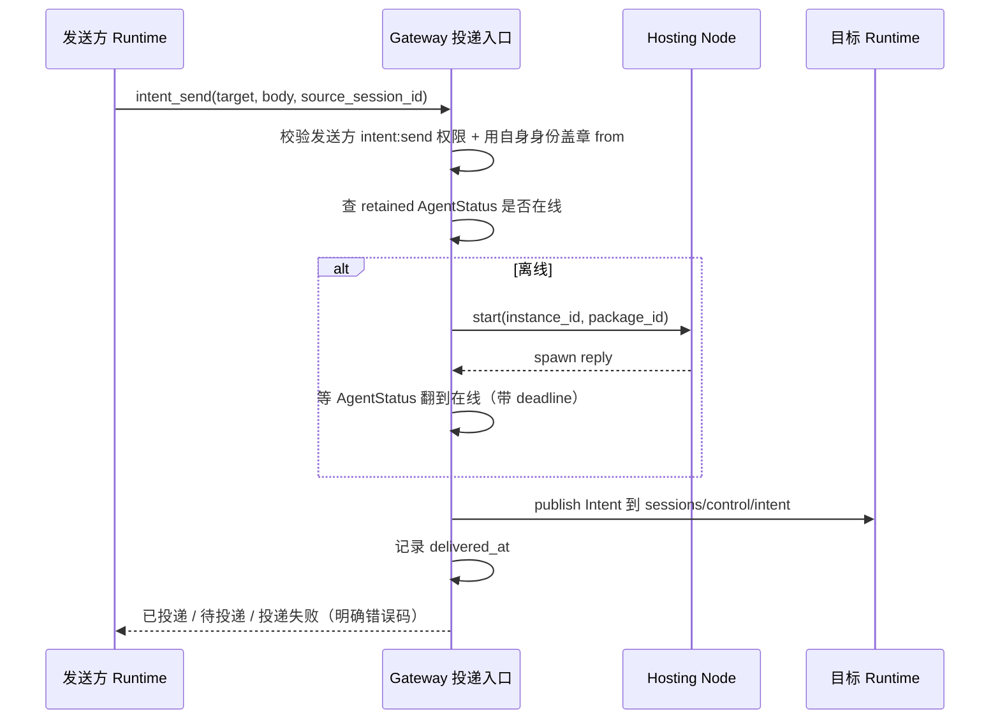
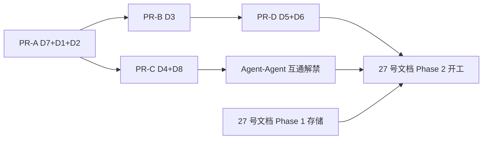

# Intent 投递链路前置技术债清理计划

> 版本：v0.1（草案）| 日期：2026-09-08
>
> 关联设计：[`docs/design/zh/27-intent-messaging-and-group-chat.md`](../../design/zh/27-intent-messaging-and-group-chat.md)（v1.3）
> 关联 ADR：ADR-033（gRPC 移除）、ADR-055（Node 托管进程）、ADR-073（instance 身份寻址）、ADR-076 §决策 4（control channel 无身份）、ADR-085（retained AgentStatus）
>
> **一句话**：27 号文档描述的是目标设计；当前 intent 发送链路存在 8 项已定性缺陷，**不修就没法按文档开发**。本计划把这些缺陷作为前置依赖单独排期，设计文档本身不记录它们。

---

## 1. 定位与边界

| 项 | 说明 |
|----|------|
| 范围 | 仅覆盖 Intent **投递与身份**链路的既有缺陷修复，不含群聊、Chat session、acowork-user 存储等 27 号文档的新增能力 |
| 不在范围 | 27 号文档的目标功能实现；其中 Phase 1（`acowork-user` Chat session 存储）与本计划无依赖关系，**可并行推进**；Phase 2 / Phase 3 的投递与身份相关部分依赖本计划 |
| 判据 | 每项债以「可观测的行为变化 + 测试」验收，不以「代码改了」验收 |
| 硬约束 | 不引入任务状态机（27 号文档核心不变量）；信箱只是投递缓冲，不是 workflow engine |

---

## 2. 现状事实（代码证据）

| 环节 | 现状 | 位置 |
|------|------|------|
| 发送 | 裸 MQTT publish，不查在线、不查权限、不等回复、无来源 session | [intent_send.rs:131-175](../../../core/acowork-runtime/src/tools/builtin/intent_send.rs#L131) |
| `async` 参数 | 只改变返回文案，行为完全一致 | [intent_send.rs:158-164](../../../core/acowork-runtime/src/tools/builtin/intent_send.rs#L158) |
| 离线语义 | 连接 `set_clean_session(true)` + 非保留消息 → 无人订阅即被 broker 丢弃 | [mqtt-session/client.rs:201](../../../core/acowork-mqtt-session/src/client.rs#L201) |
| 反代 | Runtime 未注册直接 503，不会自动拉起 | [proxy.rs:7](../../../core/acowork-gateway/src/http/proxy.rs#L7) |
| Gateway 路由 | `IntentRouter` 死代码：无实例化点；`route_sync` 即使目标在运行也必返错（gRPC 已移除）；`route_async` 只写 pending map | [router.rs:120-166](../../../core/acowork-gateway/src/intent/router.rs#L120) |
| 接收 | 唯一保留的控制命令，注入 agent loop 当普通用户消息 | [control_handler.rs:59-93](../../../core/acowork-runtime/src/mqtt/control_handler.rs#L59)、[gateway_loop.rs:183-197](../../../core/acowork-runtime/src/startup/gateway_loop.rs#L183) |
| 权限 | `intent:send:<target>` / `intent:receive` 仅有类型定义，全仓无执行点 | [permission.rs:134-138](../../../core/acowork-core/src/permission.rs#L134) |
| 能力表 | `CapabilityRegistry::find_by_action` 除自身测试外无调用方 | [registry.rs:126](../../../core/acowork-gateway/src/capability/registry.rs#L126) |
| 唯一可用参考实现 | cron「先 start 再 publish」 | [cron/mod.rs:500-614](../../../core/acowork-gateway/src/cron/mod.rs#L500) |

---

## 3. 债项清单

| ID | 债项 | 症状 | 阻塞设计文档 §14 | 完成判据 | 估时 |
|----|------|------|--------------|----------|------|
| **D1** | Gateway 侧 wake-then-deliver | 目标离线即静默丢消息，发送方仍看到 "Intent sent" | Phase 2「@Agent 才写 Intent 并定向投递」、Phase 3「PM task 派发」 | Gateway 成为唯一投递入口：查在线 → 不在线则向 hosting node 发 start → 等在线（带 deadline）→ 投递；失败返回明确错误码 | 2d |
| **D2** | 冷启动竞态 | Node 回 OK 只代表进程起来 + 表项写入，不代表 Runtime 已 CONNECT 并订阅 control filter；cron 现在就有这个洞 | Phase 2（与 D1 同一改动） | 在线判据统一为 retained `AgentStatus` 翻转（ADR-085），cron 复用同一函数；冷启动场景测试不丢消息 | 1d |
| **D3** | 投递确认 / 最小信箱 | QoS1 + `clean_session=true` + 非保留 = 无人订阅即丢，且无 delivered 状态可查 | Phase 2–3（Chat session 需要可信的「已投递」事实） | 每条 Intent 有 `message_id / conversation_id / from(instance, session_id) / to(instance) / body / created_at / delivered_at / result_ref` 可查；`intent_send` 返回值区分「已投递 / 待投递 / 投递失败」；`conversation_id` 的 request 计数在 Gateway 重启后不丢（设计文档 §13-13） | 2d |
| **D4** | `from` 可伪造 | control channel 无身份（ADR-076 §决策 4），任何连上 broker 的客户端可冒充任意 agent | Phase 3「Agent-Agent Chat」（互通前必须堵） | `from` 由 Gateway 依据自身 MQTT 会话身份盖章；Runtime 传入的 `from` 不采信；越权伪造测试返回拒绝 | 1.5d |
| **D5** | 入站无 schema 校验 | Intent 被格式化成普通 user 文本；无 `repo` 字段，也无从校验授权目录边界 | Phase 2「`repo` 注入 + 已授权目录硬约束」 | Intent 为版本化结构体；`repo` 地址格式非法、或 Agent 试图越出已授权目录 / 因 `repo` 自动 clone 时明确失败并回执，不进 agent loop | 1.5d |
| **D6** | `async` 假参数 | 参数存在但无行为差异，误导 LLM | Phase 2 | 删除该参数（YAGNI：不做真同步等待），工具描述与 prompt 同步 | 0.25d |
| **D7** | `IntentRouter` 死代码 | 无人实例化，模块注释声称 "Target Agent auto-spawn when not running"，读代码的人会当成事实 | 横切（会误导实现者） | 按 D1 重写为真正的投递入口，或整块删除；不允许保留「注释承诺但无实现」的状态 | 0.5d |
| **D8** | 权限无执行点 | 发送侧 `intent:send:<target>`、接收侧 `intent:receive` 均不校验 | Phase 3（跨 agent 读他人历史前必须校验） | manifest 权限在投递前校验；能力表 `find_by_action` 接入或明确废弃；有正反用例 | 1d |

**合计约 10.75 人日。**

---

## 4. 目标投递链路（D1–D4 落地后）

---

## 5. 实施顺序与 PR 切分

| 顺序 | PR | 内容 | 依赖 | 出口 |
|------|----|------|------|------|
| 1 | PR-A | D7 + D1 + D2：投递责任收进 Gateway，在线判据改为 AgentStatus，cron 复用 | — | 冷启动与离线目标都不再静默丢消息 |
| 2 | PR-B | D3：最小信箱 + delivered 状态可查 | PR-A | `intent_send` 返回真实投递态 |
| 3 | PR-C | D4 + D8：`from` 盖章 + 权限执行 | PR-A | 伪造与越权被拒 |
| 4 | PR-D | D5 + D6：Intent 结构化（含 `repo` 字段）+ 授权目录边界校验 + 删假参数 | PR-B | 入站有 schema；非法 `repo` 与越权目录操作明确失败 |

> PR-C 之前**不得开启** Agent-to-Agent 互通：伪造 `from` 是实打实的越权面。

> Phase 1（`acowork-user` Chat session 存储）不依赖本计划，可与 PR-A/PR-B 并行开工；但 Phase 2 的「@Agent 定向投递」必须等 PR-D 收口，否则 `repo` 校验、授权目录边界与真实投递态都还不成立。

---

## 6. 风险与缓解

| 风险 | 影响 | 缓解 |
|------|------|------|
| Gateway 新增投递入口成为热点 | 单点吞吐 | 信箱只做缓冲与状态记录，不落业务逻辑；先按现有 QPS 量级验证，不做预优化 |
| 等在线引入超时语义，改变 cron 行为 | 定时任务回归 | cron 与 intent 共用一个函数 + 一条集成测试覆盖冷启动路径 |
| `from` 盖章改动触及 ADR-076 边界 | 协议语义漂移 | 明确：Intent 是 agent 发起、非用户动作，仍留在 control channel；身份由 Gateway 侧会话属性提供，不改 ADR-076 的用户动作约束 |
| 权限校验上线后有存量 agent 被拒 | 现网 agent 失效 | 先以 warn-only 灰度一轮，确认清单后再转 enforce |

---

## 7. 明确不做（YAGNI 后置）

- 不做 Intent 任务状态机（`created/running/awaiting/cancelled`）——与 27 号文档核心不变量冲突。
- 不做 MQTT 持久会话（`clean_session=false`）来替代信箱：信箱在应用层，语义可控且不依赖 broker 会话保留策略。
- 不做 Intent 同步等待回复（`async=false` 真语义）：结果由系统在应对方 turn 结束时 push 回发起方（设计文档 §7.1），发起方不轮询，因此工具内不需要等待语义。
- 不重写 `privacy.rs` 的敏感内容过滤：与投递链路无关，另案处理。

---

## 8. 决策记录

| # | 决策 | 理由 |
|---|------|------|
| 1 | 投递责任归 Gateway，不归 Runtime | Runtime 无法感知目标在线状态与 hosting node；跨机场景下 Runtime 侧发起 start 必然失败 |
| 2 | 在线判据 = retained `AgentStatus`，不是 Node spawn reply | reply 只证明进程存在，不证明已订阅 control filter |
| 3 | 信箱是最小投递缓冲，不是 workflow engine | 保持「Intent 是消息」的产品语义 |
| 4 | `async` 参数直接删除而非实现 | 参数已存在但无行为，属于误导；真需求由 result query 覆盖 |

---

## 9. 排期起点建议

从 PR-A 开始：先删/重写 `IntentRouter`（D7），它决定了 D1 的投递入口长在哪，避免先建再拆。

---

## 10. Phase 3 落地后的已知缺口（Phase 4 待办）

> 2026-10-15 补记：PR-A..PR-D 与 27 号文档 Phase 1–3 已落地（`53c5921b..e6f40d0d`）。
> 以下是评审确认的偏差与缺口，按优先级排列；除 #1 外均为设计文档已标注的开放实现问题或已声明的阶段性简化。

| # | 缺口 | 对应设计条款 | 现状 | Phase 4 判据 |
|---|------|------------|------|------------|
| 1 | ~~**应对方崩溃兜底回执缺失**~~ | §7.1 表末行、§13-12 | **已落地**：Gateway 侧 `intent/sweeper.rs` 周期扫描「已投递、超 `[intent] response_timeout_secs`（默认 1h）、未答」的 request，经唯一写入口补确定性 id（`fallback-{request_id}`，§8 幂等去重）的 `failed` 回执行并 push 回发起方；`task:` 与人类发起对话按 relay 语义只落群聊（§5.1/§9-8）。真实 write-back 即时 `mark_answered` 关闭请求 | 单测覆盖选取判据；崩溃窗口（mark 前后）由确定性 id 重试兜住 |
| 2 | ~~**successor 轮转非崩溃幂等**~~ | §2.1 并发与失败恢复 | **已落地**：`IntentSessionMap::plan_rotation` 先把 successor id 持久化进映射（`pending_successor`），再按预分配 id 建 session，`rekey` 消费计划；崩溃重放返回同一 id，不再产生第二个 successor/孤儿 | 重放幂等 + reload 持久性单测 |
| 3 | **Handoff 是指针不是蒸馏摘要**：轮转 handoff 只带旧 session id 的一句话指针；§2.1 分级表要求 T2 带"当前目标/关键决定/未决事项"（目标 1,500 tokens） | §2.1 Handoff context 分级 | 代码有 `ponytail:` 注释声明升级路径；不变量（不整份复制 JSONL、执行细节不进 Chat session）未破坏 | 轮转时从旧 session 最后一次 compaction 摘要蒸馏；settings card 落地 token 上限 |
| 4 | **T1 阈值 / handoff 上限的配置面**：现为部署级环境变量（`ACOWORK_INTENT_IDLE_ROTATE_HOURS`），设计要求 Agent 级配置 + 鉴权 + 审计 + 前端 Session 设置卡片 | §2.1 前端可配置边界 | `ponytail:` 注释已声明 interim 形态 | Agent settings 面板两个配置项 + 变更审计 |
| 5 | **`session_config` 可选字段未上 wire**：Intent 可携带 model/reasoning/skills 初值 | §4 字段表、§4.2 | 未实现，无消费方依赖，加性字段可后补 | 与 §4.2 授权修改一起做 |
| 6 | **信箱 `MAX_ENTRIES` 淘汰**：驱逐老 request 条目后，极晚到的 response 会因 `no recorded request` 被拒 | — | 预算计数器（`conversation_requests`）不受淘汰影响，上限不可绕过成立；6 次预算的对话窗口内实际不会触发 | 可接受为已知上限；触发时记 WARN |

