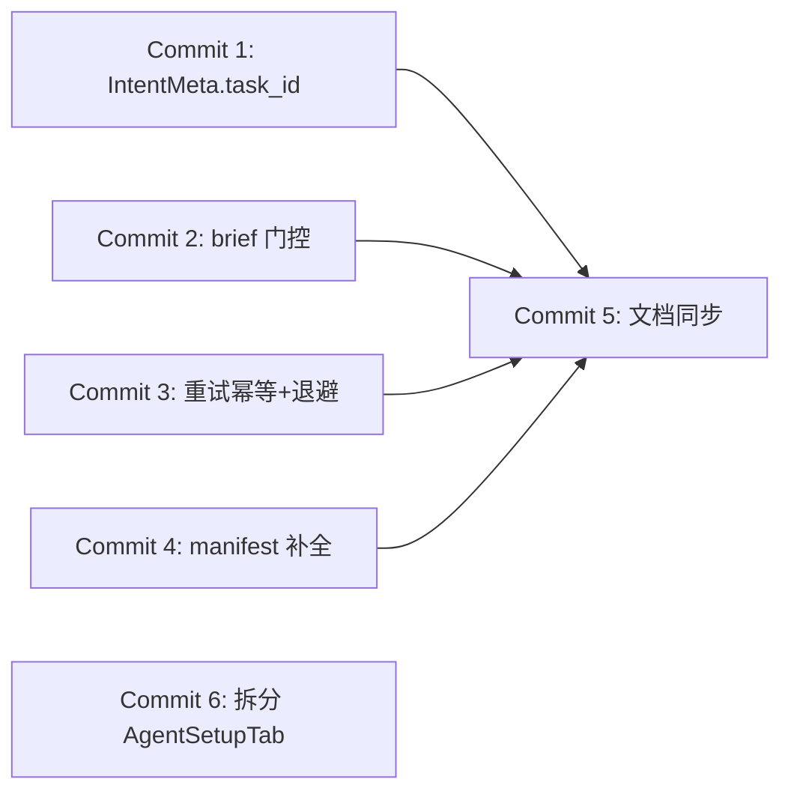

# PM 任务派发重构 Review 修复计划

> 版本：v1.0 | 日期：2026-10-25
>
> 关联设计：[`docs/design/zh/27-intent-messaging-and-group-chat.md`](../../design/zh/27-intent-messaging-and-group-chat.md)（v2.7，本计划 Commit 5 将其推进到 v2.8）
> 关联 ADR：ADR-099（Chat Router）、ADR-100（chat 事件日志）、ADR-060（系统块字节稳定）、ADR-076（PM 服务）
> 关联 changeset：本地未提交的「PM 任务派发重构」（TurnOrigin 策略表 + dispatch 扫描器 + assignment_brief + 群聊 TaskChip，33 文件 + 2 新文件）
>
> **一句话**：该 changeset 架构方向正确（推断收敛为策略表、触发源收敛为扫描器、人读/机读通道分离），但 review 发现 **2 个阻塞 + 1 个必修回归 + 若干应修项**，当前状态**不可提交**；本计划把修复拆成 6 个独立可 review、可测试、可回滚的 commit，全部闭环后方可入库。

---

## 1. 定位与边界

| 项 | 说明 |
|----|------|
| 范围 | 仅覆盖本地未提交 changeset 的 review 修复项（阻塞 #1 #2、必修 #3、应修 #4 #5 #6 #7 #8） |
| 不在范围 | Mobile 群聊 TaskChip / `start_at` 展示对齐（当前优雅降级，无破坏）；扫描器 metrics、优雅停机句柄、派发失败的任务面可见状态；`TaskEditDialog` date-only 输入的时区/时分漂移（与 `due_at` 同既有模式，改则一起改）——三项记为后续债务（§8） |
| 判据 | 每项修复以「可观测的行为变化 + 能复现原失败模式的测试」验收，不以「代码改了」验收 |
| 硬约束 | 不杀 gateway / runtime / pm 进程（测试用 `--lib` 绕开被锁定的 exe，完整二进制验证留给 CI）；ADR zh/en 同 commit 更新；Rust 注释一律英文 |

---

## 2. 现状事实（代码证据）

### 2.1 阻塞 #1：`meta.task_id` 被存储层静默丢弃 → TaskChip 功能坏死

| 环节 | 事实 | 位置 |
|------|------|------|
| 生产 | Gateway 派发行 meta 携带 `task_id` | [intent_api.rs:413](../../../core/acowork-gateway/src/http/intent_api.rs#L413) |
| 传输 | user 服务以强类型 `SystemAppendRequest { message: SessionMessage }` 反序列化 | [chat_sessions_api.rs:1053](../../../core/acowork-user/src/http/chat_sessions_api.rs#L1053) |
| 存储 | `SessionMessage.meta` 是 `IntentMeta`，**全 crate 无 `task_id` 字段**、无 serde flatten 兜底 → 键在落盘前被静默丢弃 | [chat_sessions.rs:218](../../../core/acowork-user/src/chat_sessions.rs#L218) |
| 消费 | Desktop `row.meta?.task_id` 永远 undefined → chip 一次都不渲染，且无任何报错 | [GroupChatPanel.tsx:421](../../../apps/acowork-desktop/src/components/chat/GroupChatPanel.tsx#L421) |

design 27 决策 29 已明文警告此陷阱：「未声明的 meta 键会被 serde 静默丢弃，症状是投影写成功而盘上没那一项」。旧代码的 `project_id` 同样从未声明、一直被丢弃（本次移除是 no-op 清理，无害）。

### 2.2 阻塞 #2（安全）：`assignment_brief` 提取无来源门控 → 对等 agent 可注入系统提示词

| 环节 | 事实 | 位置 |
|------|------|------|
| 注入面 | `intent_send` 的 params 是调用方 agent 的任意 JSON，原样透传 | [intent_send.rs:149](../../../core/acowork-runtime/src/tools/builtin/intent_send.rs#L149)、[intent_api.rs:1013](../../../core/acowork-gateway/src/http/intent_api.rs#L1013) |
| 提取 | Runtime 对**所有 kind** 无条件提取 `params.assignment_brief` | [gateway_loop.rs:1459](../../../core/acowork-runtime/src/startup/gateway_loop.rs#L1459) |
| 生效 | 非空即 `set_task_brief` → 注入 Block A `## Task Assignment`，**会话级持久** | [session_task.rs:1383](../../../core/acowork-runtime/src/agent/session/session_task.rs#L1383) |

后果：任何有 `intent:send` 权限的 agent 可把任意指令文本放进目标 agent 的系统提示词信任槽位——从「对等消息内容」提权为「持久系统级指令」，绕过 responder 角色的一切约束。与 design 27 v2.6「指令永不信任客户端」原则相悖。

### 2.3 必修 #3：扫描器重试 × 预算语义冲突 → 重复行刷屏 + 任务永久饿死

| 环节 | 事实 | 位置 |
|------|------|------|
| 行先于投递 | `dispatch_task` 先追加 chat 行（每次新 message_id）再投递 | [intent_api.rs:405-437](../../../core/acowork-gateway/src/http/intent_api.rs#L405) |
| 失败也计预算 | `wake_and_deliver` 投递前 `mb.record()`，失败投递同样计入会话预算（默认 6、持久化、永不回收） | [delivery.rs:175](../../../core/acowork-gateway/src/intent/delivery.rs#L175)、[mailbox.rs:159](../../../core/acowork-gateway/src/intent/mailbox.rs#L159) |
| 无限重试 | 扫描器失败后平面 60s 重试，无上限、无退避递增 | [dispatch.rs:147](../../../core/acowork-pm/src/dispatch.rs#L147) |

后果：agent 已安装但不可达（节点下线、唤醒失败）时，约 6 分钟内群聊刷入最多 6 条重复派发行；随后预算耗尽，**该任务永久无法派发（agent 恢复也没用）**；扫描器继续每 60s 空转告警。旧事件钩子一次性触发不存在此问题——这是扫描器引入的回归。

### 2.4 应修项

| # | 事实 | 位置 |
|---|------|------|
| #4 | `pm_update_task` manifest schema 缺 `start_at`（`due_at` 也缺，既有缺口）；tools.rs 代码接受但模型无从发现 | [manifest.rs:156](../../../core/acowork-pm/src/mcp/manifest.rs#L156) |
| #5 | 文档零同步：docs/ 无 `pm_task` / `assignment_brief` / `start_at` / 扫描器任何记载，代码注释却引用「Design 27 §5.4（修订）」 | design 27 / protocols / adr |
| #6 | AgentSetupTab `chatRouterOpen` 默认值改动（false→true）与本 changeset 无关，scope mixing | [AgentSetupTab.tsx:232](../../../apps/acowork-desktop/src/components/right-panel/AgentSetupTab.tsx#L232) |
| #7 | TaskChip 无组件测试；`chat_attachment_ids` 行缩进异常（既有，紧邻 diff） | GroupChatPanel.tsx / [session_task.rs:1372](../../../core/acowork-runtime/src/agent/session/session_task.rs#L1372) |
| #8 | 版本偏差单向保护：旧 Gateway→新 Runtime 有 `task:` 前缀 fallback；新 Gateway（`pm_task`）→旧 Runtime 落回 responder 语义（旧 bug 复现） | [intent_routing.rs:350](../../../core/acowork-runtime/src/agent/session/intent_routing.rs#L350) |

### 2.5 已独立复核通过的项（无需修复）

- Rust 测试：runtime 1777 / core 272 / pm 86 / gateway 654 全绿；clippy 4 crate 0 warning；Desktop `tsc --noEmit` 0 错、受影响 vitest 4 文件 26 用例全绿。
- `close_task_context_if_terminal` 有内部守卫，review() 无条件调用安全；`GatewayClient::dispatch_task` 只认 `status=="delivered"`，正确；`TaskEntry::new` 单一构造入口防索引字段漂移；`routing_key` 混版 fallback 双路径有测试；i18n 5 语言键齐全；Mobile 无改动、附加字段运行时忽略无破坏。

---

## 3. Commit 1 🔴 阻塞 #1：`IntentMeta` 声明 `task_id`（存储边界）

| 项 | 内容 |
|---|---|
| 改动 | [chat_sessions.rs](../../../core/acowork-user/src/chat_sessions.rs) `IntentMeta` 增加 `#[serde(default, skip_serializing_if = "Option::is_none")] pub task_id: Option<String>`，doc 注释注明「PM 派发行专属，chip 渲染依据（design 27 §4.2）」 |
| 消费端测试 | acowork-user 新增测试：用 **Gateway 实际发送的 meta JSON 形状**（`{message_id, conversation_id, task_id, repo}`）反序列化 `SystemAppendRequest` → `append_message` 落盘 → 读回断言 `task_id` 存活。必须走完整 JSON 边界——只测前端渲染测不出静默丢弃 |
| 生产端 pin | [intent_api.rs](../../../core/acowork-gateway/src/http/intent_api.rs) `dispatch_task` 测试 pin 住派发行 meta 键集合（防两端再漂移） |
| 前端测试 | GroupChatPanel 新增 TaskChip 用例：`meta.task_id` 存在 → chip 渲染含任务 id；不存在 → 不渲染（同时闭环 #7 的测试缺口） |
| 验收 | 三处测试红→绿；手动路径：派发任务 → 群聊行读回含 `task_id` → chip 可见 |

## 4. Commit 2 🔴 阻塞 #2：`assignment_brief` 按 origin 门控（信任边界）

| 项 | 内容 |
|---|---|
| 核心改动 | 提取逻辑抽成纯函数放 [intent_turn.rs](../../../core/acowork-runtime/src/agent/intent_turn.rs)：`extract_assignment_brief(origin: TurnOrigin, params: &Value) -> String`——**仅 `PmTask` 返回内容，其余 origin 恒空**；[gateway_loop.rs:1459](../../../core/acowork-runtime/src/startup/gateway_loop.rs#L1459) 改为调用它 |
| 纵深防御（推荐，可裁剪，见 §9 决策点 2） | Gateway send 端点对 agent 来源 params **剥离 `assignment_brief` 键**——保护混部场景下的旧 Runtime（旧版无条件提取）。PM 走独立 task-dispatch 端点，不受影响 |
| 测试 | ① 纯函数单测：`request` / `user_message` / `response` 携带该键 → 恒空；`pm_task` → 原样。② session_task 层回归：`kind="request"` 带 `assignment_brief` 的 Intent 不得进入系统块。③ Gateway 剥离测试（若做） |
| 顺手 | 修正 [session_task.rs:1372](../../../core/acowork-runtime/src/agent/session/session_task.rs#L1372) 附近 `chat_attachment_ids` 缩进异常（#7，`cargo fmt` 限定该文件） |
| 验收 | 攻击路径测试红→绿；PM 正常派发链路 brief 注入不受影响（既有测试保持绿） |

## 5. Commit 3 🟠 必修 #3：派发重试幂等 + 有界退避

**设计取舍**：不能把 chat 行挪到投递成功之后——PM 派发路径在路由时就会写 `turn_routed` 反应行（毫秒级），挪后会产生 seq 倒挂与 `in_reply_to` 悬空。正确方向是**稳定 message_id 复用存储层既有幂等**（design 27 §8：`meta.message_id` 重复 → `already_written`，不落第二行）。

| 子项 | 改动 | 测试 |
|---|---|---|
| 3a Gateway mailbox 幂等 | [mailbox.rs](../../../core/acowork-gateway/src/intent/mailbox.rs) `record()` 按 `message_id` 去重：已存在 → 更新条目、**不重复计入会话预算** | 同 id 二次 record → 1 条目、预算计数 1；重启重载后计数一致（既有 §13-13 测试不回归） |
| 3b Gateway 接受外部 message_id | `TaskDispatchRequest` 增 `#[serde(default)] message_id: Option<String>`；提供则用于 chat 行 + 信封，缺省仍自 mint（向后兼容旧 PM） | 同 message_id 重试 dispatch → chat 仅 1 行、预算仅计 1、投递可重试 |
| 3c PM 持久化派发代次身份 | `Task` 增 `dispatch_message_id: Option<String>`（serde default，旧数据兼容）：扫描器**首次尝试前落盘**（crash-safe），重试复用；成功后与 `dispatched_at` 并存（历史事实）；状态跃迁/换人时与 `dispatched_at` 一同清除（新代次新 id） | tree.rs：首派生成、重试复用、跃迁清除、PM 重启后复用（重读 store 再扫） |
| 3d 扫描器有界退避 | [dispatch.rs](../../../core/acowork-pm/src/dispatch.rs) 平面 60s 重试改指数退避（60s→5min→15min→30min），**5 次失败后放弃**并 `tracing::error!`（含 task_id / assignee / 最后错误）；任务离开候选集或成功时清退避状态 | 退避序列、放弃后不再尝试、回退 pending 后重新计数 |
| 效果 | 预算不再被失败重试耗尽（3a 后每代次恒占 1 名额）→ **永久饿死消除**；重复行消除（3b+3c）；无限空转消除（3d） | 端到端（store 级）：投递持续失败 N 轮 → 群聊 1 行、预算 1、放弃有 error 日志 |

> 注：「投递失败释放预算」方案**不做**——3a 后每代次只占 1 名额，「一次派发占一轮」语义成立，避免动 §6.5 R4 既有语义。

## 6. Commit 4 🟡 应修 #4：`pm_update_task` manifest 补全

[manifest.rs:156](../../../core/acowork-pm/src/mcp/manifest.rs#L156) schema 增 `start_at`、`due_at`（后者既有缺口，代码已接受）；描述口径与 `pm_create_task` 一致。测试：manifest JSON 解析 + 两工具 schema 键集断言。

## 7. Commit 5 🟠 应修 #5+#8：文档同步（zh 为真源，en 同 commit）

| 文档 | 内容 |
|---|---|
| design 27（zh+en） | 出 **v2.8 修订节**：① §4.5 Intent 字段表增 `assignment_brief`（仅 `pm_task`、信封字段、入系统块、不落历史/chat）；② kind 词汇增 `pm_task`（人类输入、keyed 路由、不经 router——与 §5.4.2 既有表述对齐）；③ §5.4 派发触发改为**扫描器单一触发源**（`start_at` / `dispatched_at` / `dispatch_message_id` 生命周期，撤销「创建/审批即派发」事件钩子表述）；④ 派发行 meta 增 `task_id`（chip 渲染依据）、`project_id` 移除说明 |
| protocols（HTTP，zh+en） | `POST /api/intents/task-dispatch`：`assignment_brief`、可选 `message_id`、kind=`pm_task`；PM task 资源新字段 |
| 新 ADR（zh+en，编号取下一空位） | 记录三个决策：TurnOrigin 词汇表拆分；事件钩子→扫描器；brief 走系统块不走消息体（含信任边界规则：**信封高信任字段只认系统生产者**） |
| runbook | 混部版本偏差注记（#8）：新 Gateway + 旧 Runtime 会把 `pm_task` 误判为 responder 语义，多节点升级需 Runtime 先行/同批 |

## 8. Commit 6 🟡 应修 #6：拆分无关改动

[AgentSetupTab.tsx](../../../apps/acowork-desktop/src/components/right-panel/AgentSetupTab.tsx) 的 `chatRouterOpen` 默认值改动单独成 commit（`feat(desktop): expand the Chat Router card by default`），不混入派发重构。

---

## 9. 执行顺序、决策点与验证

### 9.1 顺序与依赖

1、2、3、4 相互独立可并行；5 必须最后（文档描述终态）；6 随时。

### 9.2 待拍板决策点

1. **Commit 3 范围**：推荐全套 3a–3d（约 300 行含测试）。最低限度 3d（有界退避）——但残留「每卡住任务最多 ~5 条重复行 + 预算占 5 名额」，不推荐。
2. **Commit 2 的 Gateway 剥离**（纵深防御）：推荐做——保护混部旧 Runtime；若确定所有节点同批升级可裁剪，Runtime 门控本身已闭环漏洞。

### 9.3 验证矩阵

| 层 | 命令 | 门槛 |
|---|---|---|
| Rust 单测 | `cargo test -p acowork-user -p acowork-core -p acowork-pm -p acowork-runtime -p acowork-gateway --lib` | 全绿（`--lib` 绕开被运行中服务锁定的 exe；完整二进制测试留给 CI） |
| Clippy | `cargo clippy -p acowork-user -p acowork-core -p acowork-pm -p acowork-runtime -p acowork-gateway --all-targets -- -D warnings` | 0 warning |
| Desktop | `npx tsc --noEmit` + `npx vitest run`（全量） | 0 错 / 全绿 |
| E2E（手动，可选） | 建任务指派 agent → 群聊单行+chip → agent 系统块含 brief → claim/submit；停节点模拟不可达 → 有界重试、无重复行、预算不耗尽 | 用测试 agent，不动 gateway/runtime 进程 |

### 9.4 后续债务（本轮不做，记录备查）

- Mobile 群聊 TaskChip / `start_at` 展示对齐。
- 扫描器 metrics、优雅停机句柄、派发失败的任务面可见状态（当前「任务不派发」是静默故障）。
- `TaskEditDialog` date-only 输入的时区/时分漂移（与 `due_at` 同既有模式）。
- `dispatch_due_ids` 每 tick 克隆全部 pending 条目、`compute_blocked_by` 每候选任务读盘——任务量上万后改索引侧游标或放宽 tick。
