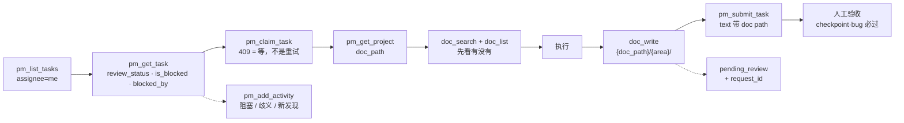

# PM / Doc 参与契约 — 原生 Agent 改造计划（Product / QA / SSE / Architect）

> 版本：**v1.3（T5 实施期修订）** | 日期：2026-11-11
>
> 关联设计：[`docs/design/zh/32-pm-doc-mcp-tool-surface-for-agents.md`](../../design/zh/32-pm-doc-mcp-tool-surface-for-agents.md)（PM / Docs 两个 agent 的工具面契约，本文只做**其余原生 agent 的参与侧**）
> 前序计划：[`pm-doc-mcp-agent-integration-plan.md`](pm-doc-mcp-agent-integration-plan.md)（P3 已交付 PM / Docs 两个 agent）
> 关联 ADR：[`ADR-029`](../../adr/zh/ADR-029-agent-tools-persistence-and-toggle.md)（工具 opt-in）· [`ADR-069`](../../adr/zh/ADR-069-mcp-tool-level-optin.md)（MCP 工具级 opt-in）· [`ADR-073`](../../adr/zh/ADR-073-agent-instance-identity-decomposition.md)（instance_id 身份）· [`ADR-104`](../../adr/zh/ADR-104-agent-manifest-declaration-surface.md)（manifest 声明面 / `[[mcp_servers]].tools` 白名单）· [`ADR-106`](../../adr/zh/ADR-106-chat-execution-reference-projection.md)（任务作者须能在项目群里发声）
>
> **一句话**：PM 与 Docs 两个 agent 已经把 `acowork-pm` / `acowork-doc` 用到了工具面上；**另外 4 个原生 agent 的 skills 至今在写 `file_write`——一个它们 manifest 里根本没声明的工具**。本文把这 4 个 agent 按「不管理项目、只参与项目」的契约改造：承接任务、发布交付物、提交结果、留下交接点。

---

## 1. 问题与证据

### 1.1 现状证据

```
grep -rc "file_write" agents/{product-manager,quality-assurance,senior-engineer,software-architect}-agent/skills/*/SKILL.md \
  | awk -F: '{s+=$2} END {print s}'        # → 41
grep -c 'name = "file_write"' agents/{product-manager,quality-assurance,senior-engineer,software-architect}-agent/manifest.toml
                                          # → 0 0 0 0
```

| # | 事实 | 证据 |
|---|---|---|
| **E1** | 4 个 agent 的 23 个 skill 里有 **41 行**写「save with `file_write`」，而 4 个 manifest **都没声明 `file_write`**（只有 `file_edit`）。按 ADR-029，未声明的工具不会出现在 `agent_tools.json` 的启用集里 → 这 41 句是**不可执行的指令** | `agents/*/manifest.toml` `[[tools]]` |
| **E2** | 同一批 skill 声明了 **46 行** `file_read`，同样一个都没声明 → `validate_graph` 在打包/安装期只会给出 warning（[manifest.rs:950](../../../core/acowork-core/src/manifest.rs#L950)），agent 实际退化成用 `bash` / `shell` 读文件 | 同上 |
| **E3** | Product / QA 的 manifest 有 `hosted = "pm"` 但**无 tool 白名单**（= 「没有意见」，激活后全开，与 ADR-104 「白名单就是初始启用集」的注释自相矛盾）；SSE / Architect **完全没有 `pm` / `doc` 声明** | `agents/product-manager-agent/manifest.toml`、`.../software-architect-agent/manifest.toml` |
| **E4** | 线上项目 `p-66e68d1a`（ACowork）：**56 个任务 / 12 个成员 / `项目管理/**` 下 0 个文档**。已完成的调研任务 `t-bcb6215e` 的交付物是 `E:\projects\tranxon\ACoworkAgentHub\docs\research\*.md`（本地路径 + commit），且**任务描述本身**就要求「写成文件、路径写进结果文本」 | `pm_get_project` / `doc_list` / `pm_get_task` 实测 |

**结论与设计 32 §1.1 同构**：工具在手上、prompt 里没有它们 → 真实行为退化成「chat 里汇报 + bash 落本地文件」。差别只是这次的主体从 PM/Docs 换成了参与方。

### 1.2 本次要解决的三件事

| 应当发生 | 现在发生 |
|---|---|
| 任务走 `pm_claim_task` → `pm_submit_task`，状态机与审批闸门可见 | 任务在 chat 里「我收到了 / 我做完了」，看板不动 |
| 交付物落 `项目管理/{project_id}/`，有版本、有 owner、可检索 | 交付物落某台机器的某个仓库路径，压缩上下文后就消失了 |
| 阻塞、歧义、新发现走 `pm_add_activity`，人类和下一个 session 读得到 | 阻塞写在回复正文里，下一个人从零复述 |

---

## 2. 设计原则

1. **不管理，只参与。** 规划、拆解、排期、派工、跟踪是 PM agent 的职责。参与方只有四步：**承接 → 执行 → 发布 → 汇报**。边界不是文案自律，而是**工具白名单**（§5.2：不给 `pm_update_task` / `pm_create_project` / `pm_add_project_member` / `pm_list_agents`）。
2. **机制进 skill，规则进 prompt。** prompt 常驻上下文且被压缩吃掉；skill 按需加载、压缩后可重新 `load_skill`。所以 prompt 只放 ~34 行规则 + 一行指针，完整机制放 `project-participation`（与设计 32 §1.2 的同一个理由）。
3. **不复述工具列表。** runtime 已经注入工具与 schema；写进文的是**schema 里看不出来的 5 条机制**（§3.3）。
4. **不造 id、不造路径。** `project_id` / `task_id` / `doc_path` 一律从工具响应读回，路径只从 `pm_get_project().doc_path` 取，不从标题推导。
5. **词汇表封闭。** 参与方不得自造产出物文件名；缺口走 §6 的受控扩展，而不是「写的时候顺手起个名」。
6. **文字预算**：prompt 增量 ≤ 40 行/agent（≈350 token 常驻）；新增 skill ≤ 90 行（按需）；23 个既有 skill 的改法是**等量替换**，净增 ≈ 0。

---

## 3. 参与契约

### 3.1 主干



### 3.2 system prompt 增量（4 个 agent 共用，约 34 行）

内容即共识的前文草稿，落地时只把 `{area}` 行按 §4.2 替换。要素与外显程度：

| 段 | 行数 | 作用 |
|---|---|---|
| 3 行导语 | 3 | 「chat 回复与本地文件到不了任何人」 |
| 4 行系统表（Need / Use / Never） | 6 | 把四个**错误替代品**当场否掉：记忆当待办、chat 当交付、`file_write` 当文档、想象当共享状态 |
| `**Loop.**` 一段 | 6 | 一条命令链，不含解释 |
| `**Five rules the schemas do not tell you.**` | 12 | M1 审批闸 / M3 状态机 / 依赖闸 / M7 成员闸 / M6 文档治理 |
| `**Non-goals.**` | 4 | 把「不管理项目」写死，并给出越界时的正确出口（`pm_add_activity`） |

> 不写进 prompt 的：工具清单、schema、doc 工具的参数细节、ID 前缀规则（这些 runtime 注入或 skill 承载）。

### 3.3 必须写进文（否则必错）的 5 条机制

| # | 机制 | 代码出处 | 不写的后果 |
|---|---|---|---|
| M1 | agent 建的任务 `review_status=pending`，人未批准前 `claim` 必 409 | [tree.rs `ensure_creation_approved`](../../../core/acowork-pm/src/store/tree.rs) | 被派工后一直重试 claim |
| M3 | `in_progress → done` 非法，必须经 `submitted`；`cancelled` 零出边 | [tree.rs `validate_transition`](../../../core/acowork-pm/src/store/tree.rs) | 撞 `invalid_state_transition` 后瞎试 |
| M6 | 同一个 `doc_write`：自己建的文档直接生效，别人的文档返回 `pending_review` + `request_id`；结构操作只有创建人可做 | [policy.rs `gate_write` / `gate_owner`](../../../core/acowork-doc/src/service/policy.rs) · [acl.rs](../../../core/acowork-doc/src/service/acl.rs) | 把「提案」当失败重投，或盲 `overwrite` 覆盖他人改动 |
| M7 | 创建/自领都要求调用方是项目成员（owner 或 member） | [tree.rs `ensure_assignee_is_member` / `ensure_author_has_voice`](../../../core/acowork-pm/src/store/tree.rs#L620) | 对着目录里存在的 agent 建单，被 `AuthorNotProjectMember` 挡死且不自解释 |
| M-新 | **`assignee` 是 instance UUID**：同包双实例（`SSE.Kevin` / `SSE.Cassie`）互不相认；自己被重装后 UUID 变化，旧任务无人可领 | [tools.rs `ensure_assignee`](../../../core/acowork-pm/src/mcp/tools.rs#L166) | 把 `forbidden` 当 bug 重试，或建重复任务绕过 |

---

## 4. 逐 agent 改造

### 4.1 范围

| Agent | 包名 | 改 prompt | 新增 skill | 改既有 skill | 改 manifest |
|---|---|---|---|---|---|
| Product | `com.acowork.product-manager` | ✅ | `project-participation` | 7 | ✅ |
| QA | `com.acowork.quality-assurance` | ✅ | `project-participation` | 6 | ✅ |
| SSE | `com.acowork.senior-engineer` | ✅ | `project-participation` | 6 | ✅ |
| Architect | `com.acowork.software-architect` | ✅ | `project-participation` | 4 | ✅ |
| **合计** | — | **4** | **4** | **23** | **4** |
| ~~Ponytail~~ | `github.ponytail` | ❌ **排除**：第三方开源 agent（作者 DietrichGebert），persona（「最好的代码是没写的代码」/「不要没人要求的样板」）与「留痕、发布、提交」天然张力，改造它会等于改写别人的产品定位 | | | |

### 4.2 角色差异（只差 3 行，其余共用）

| Agent | `{area}` | 交付物 | 特化规则 |
|---|---|---|---|
| Product | `验收/` `调研/` | 验收报告、用户调研、PRD 提案、发布计划 | PM 的 `PRD.md` 只读；要改就 `doc_write`（→ `pending_review`），把 `request_id` 写进 `pm_add_activity` |
| QA | `测试/` | 测试计划、测试报告、回归报告、缺陷证据 | 缺陷用 `pm_create_task(type="bug")`（提交后**必过人工验收**），**不指派**，疑似责任人写进 activity |
| SSE | `技术方案/` `评审/` | 设计说明、ADR、代码评审报告、调试复盘 | 代码走仓库（`file_write` 在这里是正确的）；评审结论必须落 `评审/` 才可追溯 |
| Architect | `技术方案/` `评审/` | 系统设计、权衡分析、设计评审 | ADR 落 `技术方案/`；与 SSE 的交接靠 doc path，不靠在 chat 里讲 |

### 4.3 新增 skill `project-participation`（4 份同名，结构一致）

| 章 | 内容 | 行数 |
|---|---|---|
| Core Rule | 一句话：未 claim 的不是你的、没进库的没共享、chat 不是提交 | 4 |
| Intake | 4 步 + 「claim 的三种失败分别意味着什么」表 + **未指派任务你领不了**（G1 的诚实出口） | 22 |
| Publishing | `doc_path` 来源、先搜后写、**area 目录由 PM 建、缺失就报缺口（不自建）**、`mode="create"` 的 O_EXCL 语义、长文 tmp→`doc_move`、`if_version` | 22 |
| Submitting | `pm_submit_task` 的 text 必须含什么；`submitted ≠ done`；chat 不是提交通道 | 12 |
| Handoffs | 4 行表：歧义 / 超范围 / 别人的目录 / 不是成员 | 10 |
| Anti-patterns | 4 条（chat 当交付、建单当私人待办、改 `description` 记进度、猜 id） | 6 |
| Output Format | 6 行表（Claimed / Artifact / Proposals / Submitted / Waiting on） | 10 |

`tool_deps` 与 manifest 白名单**同一份集合**（ADR-104 要求两边一致，否则安装期只出 warning 不报错，静默失效）：

```
pm_list_tasks  pm_get_task  pm_get_project  pm_claim_task  pm_submit_task
pm_add_activity  pm_list_activity  pm_create_task
doc_list  doc_search  doc_read  doc_stat  doc_write  doc_move
doc_list_requests  doc_check_request
mcp_memory__memory_recall  mcp_memory__memory_store
```

**刻意不给**：`doc_mkdir`（见 D-7）、`doc_remove` / `doc_rmdir`（删除与目录裁剪是 owner 或 Docs agent 的事）、`pm_update_task` / `pm_create_project` / `pm_update_project` / `pm_add_project_member` / `pm_list_agents`（管理面）。

### 4.4 23 个既有 skill 的统一改法（每个 2–3 行，不新增散文）

| 步骤 | 改动 |
|---|---|
| a | `tool_deps`：删 `file_read` / `file_write`；读 → `doc_read` + `doc_search`，写 → `doc_write`；任务类 skill 加 `pm_get_task` + `pm_add_activity` |
| b | 把 `- Use \`file_write\` to save X when requested` 换成 `- Publish with \`doc_write\` into \`{doc_path}/{area}/\` (see \`project-participation\`).` |
| c | 输入步骤（原文 "Use `file_read` to inspect PRD / reports / tickets"）→ `doc_read` / `doc_search`；**只有当被读的是源码**才保留 `file_read` |

保留 `file_read` 的 7 个 skill（并在 manifest 补声明）：`test-case-design`（QA）、`architecture-design`、`code-review`、`debugging`、`refactoring`（SSE）、`system-design-review`、`technical-planning`（Architect）。

**`file_write` 只保留在「产物是仓库源码」的 3 个 skill**（判定标准：该 skill 的交付物是仓库里的代码/测试文件，不是文档）：

| Agent | skill | 理由 |
|---|---|---|
| SSE | `debugging` | 修复落在源码 |
| SSE | `refactoring` | 改造落在源码 |
| SSE | `testing` | 新增测试文件 |

因此 **`file_write` 只在 `senior-engineer` 的 manifest 里声明**；Architect 的产物全是文档（`doc_write`），不声明 `file_write`。名单是 CI 常量（§8），不是「大约 3 个」——加第 4 个必须先改这一节。

---

## 5. 文件级改动清单

### 5.1 改写（4 + 4 + 23）

| 文件 | 动作 |
|---|---|
| `agents/{product-manager,quality-assurance,senior-engineer,software-architect}-agent/prompts/system.md` | 插入 §3.2 的 `## Project Participation` 块（位置：`Core Competencies` 之前，即「读这段之前先读那段」的位置） |
| `agents/*-agent/skills/project-participation/SKILL.md` | 新增 ×4 |
| 23 个既有 `SKILL.md` | 按 §4.4 三处替换；`version` 升 minor |

### 5.2 manifest（4 个）

| 改动 | 细节 |
|---|---|
| 补 `[[tools]] name = "file_read"` | 消除 E2 的 warning，并让「读」真的可用（按 §4.4 的 7 个 skill 判定） |
| 补 `[[tools]] name = "file_write"` | **仅 `senior-engineer`**（§4.4 的 3 个 skill）；Architect / QA / Product 不声明 |
| `[[mcp_servers]] hosted="pm"` 改显式白名单 | 用 §4.3 的 8 个 `pm_*`（Product / QA 已声明过 `pm`，只补 `tools`；SSE / Architect 新声明） |
| 新增 `[[mcp_servers]] hosted="doc"` | 用 §4.3 的 8 个 `doc_*`（SSE / Architect 新声明；Product / QA 全新） |
| 新增 `[capabilities.project_participation]` | `description` + `skills = ["project-participation"]`（否则 `validate_capability_skills` 不校验、能力面板也不显示） |
| `why` 字段 | 一句话：PM=「任务承接与提交」；doc=「交付物进共享库，不落本地文件」 |

### 5.3 打包与文档收口

| 项 | 动作 |
|---|---|
| 重打包 | `./dev/common/build-agent.ps1 -All`，但**只有 5 个包的字节允许变化**：4 个参与方 + `project-manager`（D-2 联动的直接后果——改了 `project-setup` 不重打包等于没改）。`github.ponytail` 与 `document-manager` 的 `.agent` 必须**逐字节不变**，作为打包守卫断言 |
| 设计文档 | 设计 32 新增 **§6.3「其余原生 Agent：参与契约」**（一句话 + 指向本文），并把 §5.5 词汇表改成 §6 的扩展版 |
| 词汇表契约测试 | `acowork_core::doc_layout` 增加 5 个 area 常量 + 断言（PM 渲染、Doc 侧测试引用同一常量） |
| en 版 | 设计 32 **当前没有 en 版本**（`docs/design/en/` 从 31 跳到 33）——本次不补全整篇，只在 §6.3 落地时同步补该节，并把「32 缺 en」记为独立缺口 |

---

## 6. 词表扩展（设计 32 §5.5 的受控修订）

现状只覆盖 PM 的产出物，参与方的交付物**在树下没有位置**——这是必须补的缺口，否则参与方只有两条路：自造文件名（违反封闭词表）或改 PM 的文件（每次都 `pending_review`）。

| 路径 | owner | 内容 |
|---|---|---|
| `项目管理/{project_id}/` 既有 7 类 | PM | `README.md`、`PRD.md`、`风险登记册.md`、`冲刺计划.md`、`复盘.md`、`周报/{YYYY-WW}.md`、`会议纪要/{YYYY-MM-DD}-{slug}.md` |
| `技术方案/{slug}.md` | Architect、SSE | 系统设计、ADR、权衡分析、技术调研 |
| `评审/{YYYY-MM-DD}-{slug}.md` | Architect、SSE | 设计评审、代码评审 |
| `测试/{测试计划\|测试报告\|回归报告}.md` | QA | 测试侧交付物 |
| `验收/{slug}-验收报告.md` | Product | 产品验收 |
| `调研/{slug}.md` | Product | 用户调研、市场调研 |

**决策 D-2（已定）**：`项目管理/**` 的目录由 **PM 的 `project-setup` 一次建好**（含上面 5 个 area），参与方**只写文件、不建目录**。理由：「谁建谁治理」——若参与方自己 `doc_mkdir`，该目录此后只有它能改名/裁撤，PM 的 IA 重构会被 `forbidden` 卡住；一个项目树的治理人应当只有一个。代价：PM 的 `project-setup` 要跟一次小改（建 5 个空目录），属**联动项**，见 §9-T4。

---

## 7. 能力缺口（core 侧，不进本文案提交）

| # | 缺口 | 证据 | 建议 | 优先级 |
|---|---|---|---|---|
| **G1** | **无法自领任务**：未指派的任务 `pm_claim_task` 直接 `forbidden: task has no assignee`；`pm_submit_task` / `pm_update_task` 同样要求 `actor == assignee`；`pm_create_task` 不解析 `assignee="me"`（只有 `pm_list_tasks` 解析，且代码注释直言 agent **读不到自己的 instance id**）。**实测更严重**：`pm_update_task` 连**创建者 + 项目 owner** 都拒（同一 `ensure_assignee`），即未指派的单对 agent **完全冻结**——连改一个错字都做不到 | [tools.rs:166](../../../core/acowork-pm/src/mcp/tools.rs#L166)、[:956](../../../core/acowork-pm/src/mcp/tools.rs#L956)；实测：PM 建 G1 总卡时设错父级，两次修复调用全被拒 | ① `pm_create_task` 支持 `assignee="me"`；② 允许**项目成员** claim 未指派任务（同一审批 + 依赖闸）；③ 孤儿任务（重装后 UUID 变化）需要 owner 级 `pm_update_task(assignee=…)` 收养；④ **创建者可改自己任务的非状态字段**（标题/描述/父级），状态机路径仍受限 | **P0** |
| **G2** | 参与方产出物在树下无位置（同 §6） | 设计 32 §5.5 | 扩 5 个 area + PM bootstrap + 契约测试 | **P0**（文案侧已按 §6 写，需 PM 联动） |
| **G3** | 派工 playbook 没有 doc 腿：`build_assignment_brief` 明说「do the work in the repository attached to this conversation」「text=<result summary>」——它是 prompt **之后**注入的最高显著度指令，对所有 agent（含用户自建）生效 | [dispatch.rs:52](../../../core/acowork-pm/src/dispatch.rs#L52) | 加一步：发布到 `pm_get_project.doc_path` 并在 submit 文本带 path；没有 path 就说明没有，而不是落本地文件。**改一个字符串，覆盖全平台** | **P0**（成本最低、收益最广） |
| **G4** | `pm_submit_task` 无产物字段：`attachment_ids` 只能由人在桌面上传，doc path 只活在自由文本里，桌面任务面板无法把交付物做成链接 | `pm_submit_task` manifest | 增加 `doc_refs: [doc_id\|path]`，doc 侧校验存在性，面板渲染成链接 | P1 |
| **G5** | `pending_review` 无面向 agent 的回执、无 push：`acowork/doc/tree/changed` 只是 UI 事件 | [mqtt_publisher.rs](../../../core/acowork-doc/src/mqtt_publisher.rs) | 短期：skill 里固化为「`request_id` 写进 `pm_add_activity`」；中期：审批落地时向发起方发一条 intent | P1 |
| **G6** | `pm_list_tasks` 无 `updated_since`：「我上次之后变了什么」只能全量重读 | manifest | 加时间过滤 | P2 |
| **G7** | `type` 枚举三处不一致：创建/更新可传 `chore`·`milestone`，筛选只能传 `epic`·`checkpoint`（筛不出 chore，却筛得出从来建不了的 epic） | `pm_list_tasks` vs `pm_create_task` / `pm_update_task` | 归并一套枚举（D2 同类缺陷） | P2 |

---

## 8. 验收场景（改造后必须能跑通）

| # | 场景 | 通过判据 |
|---|---|---|
| S1 | 人派给 SSE 一个「出技术方案」任务 | `pm_claim_task` 成功 → `doc_write` 落 `项目管理/{pid}/技术方案/*.md` → `pm_submit_task` 的 text 里有该路径 → 人可在文档库打开 |
| S2 | 人派给 QA 一个「回归验证」任务，验证失败 | QA 建 `type="bug"` 任务（**不指派**）+ `测试/回归报告.md` → 提交后停在 `submitted`（等人工验收），QA 明确说出「等验收」而非「已完成」 |
| S3 | Product 想改 PM 的 `PRD.md` | `doc_write` 返回 `pending_review` + `request_id`；Product 把 `request_id` 写进 `pm_add_activity`，**不重投、不覆盖** |
| S4 | Architect 收到一个指派给孪生实例的任务（`SSE.Kevin` vs `SSE.Cassie`） | `pm_claim_task` 返回 `forbidden`；agent 报告给人并停止，**不建重复任务** |
| S5 | 分支：agent 没被邀请进项目 | `pm_create_task` 返回 `AuthorNotProjectMember`；agent 用 `intent_send` 找 PM 或直接告诉人，**不绕道**建本地文件 |

文案侧的自动化检查（可进 CI，不需要活体服务）。**两种用途，不要混淆**：① 当作未来的 CI 守卫；② **当作本批卡（T1–T4）的兜底回归闸** —— 它们跑红就意味着有卡照错口径落了地，代价是**返工三张卡 + 一次重打包**，不是事故。断言是最后一道网，不是第一道：**卡描述错了，网再密也已经晚了**。

1. `file_write` **只允许出现在 3 个 (agent, skill) 对**：`senior-engineer/{debugging,refactoring,testing}`（§4.4）。名单写成 CI 常量，出现第 4 个即红。
2. `doc_mkdir` **不得出现在 4 个参与方的 `tool_deps` 与白名单**（D-7）。这是 T2 描述里那句「必须正好 19 项」的兜底：照 19 项做会在 T5 变红。
3. 每个 skill 的 `tool_deps` ⊆ manifest 的 `[[tools]] ∪ [[mcp_servers]].tools`（把 `validate_graph` 的 warning 变成测试断言）。
4. 4 个 manifest 的 `capabilities.*.skills` 都能在包内解析（既有 `validate_capability_skills` 已是 error）。
5. 打包守卫：`.agent` 字节变化的包集合 == {4 个参与方 + `project-manager`}（§5.3）。

---

## 9. 任务卡

| ID | 任务 | 估时 | 依赖 |
|---|---|---|---|
| T1 | §3.2 的 prompt 块定稿，插入 4 个 `system.md` | 0.5d | — |
| T2 | `project-participation` skill 模板定稿 + 4 份角色特化 | 1d | T1 |
| T3 | 23 个既有 skill 的 `tool_deps` / 持久化行 / 读入行替换 | 1.5d | T2 |
| T4 | 4 个 manifest：`file_read`/`file_write` 声明 + pm/doc 白名单 + capability（**+ PM `project-setup` 建 5 个 area 的联动改**） | 1d | T3 |
| T5 | 重打包 **5 个** `.agent`（4 参与方 + `project-manager`，D-8）+ 设计 32 §6.3 + 词汇表扩展 + 5 条契约断言 | 0.5d | T4 |
| T6 | S1–S5 场景走查（人工，记录截图与 tool 调用） | 0.5d | T5 |
| **合计** | — | **5d** | — |

G1 / G3 属 core 改动，单独一张计划（建议排在 T1 之前或并行：**G3 改一行字符串，能直接提升 S1 的通过率**）。

---

## 10. 不在本次范围

| 项 | 原因 |
|---|---|
| Ponytail（`github.ponytail`） | 第三方开源 agent，persona 与「留痕 / 发布 / 提交」有张力；已确认不改 |
| `document-manager` 的 `document-collection` skill 里残留的 `file_read`/`file_write` | 属前序计划已交付范围，本次不回头改 |
| 设计 32 的 en 全篇（含新 §6.3 节） | **独立缺口**：`docs/design/en/` 从 31 跳到 33。T5 不补全、也不补 §6.3 节——单独立卡跟进；缺口记录只在这一行（设计 32 的 v1.10 变更记录只指向本行，不另写半份） |
| G1–G7 的代码实现 | §7，单独排期 |
| 用户自建 agent | prompt 覆盖不到；G3 的 dispatch 文案是唯一能覆盖它们的杠杆 |

---

## 11. 决策记录

| # | 决策 | 理由 |
|---|---|---|
| D-1 | 参与方**不做**项目管理：不给 `pm_update_task` / `pm_create_project` / `pm_add_project_member` / `pm_list_agents` | 边界靠白名单强制，不靠文案自律；白名单同时是 ADR-104 的初始启用集，一处改动两处生效 |
| D-2 | 项目树由 PM `project-setup` 建好 5 个 area，参与方只写文件（不 `doc_mkdir`） | 「谁建谁治理」：一个项目树只应有一个治理人 |
| D-3 | 参与方建单**不指派**（`pm_create_task` 无 `assignee`），且必须在 activity 里写明「此单等人指派」 | 指派需要成员校验 + 孪生实例 UUID，参与方没有这份名册的治理权。**代价（实测）**：未指派的任务连创建者都改不动（G1），所以在 G1-a 落地前，这类单只有人类能处理——它是一份「交给人的报告」，不是一张能自己推进的卡。G1-a 之后优先走 `assignee="me"` 自领 |
| D-4 | 机制进 skill、规则进 prompt，prompt 增量 ≤ 40 行 | 常驻上下文成本 vs 抗压缩；同时满足「节省 token」要求 |
| D-5 | 不给 `doc_remove` / `doc_rmdir` | 删除是 owner 的权利；参与方要下架自己的半成品，用 `doc_move` 换名或找人 |
| D-6 | 4 份 `project-participation` 同名同构，只特化 `{area}` 与 3 行角色规则 | 人只需学一次；agent 之间可互相引用同一个 skill 名 |
| D-7 | **`doc_mkdir` 也不给参与方** | 与 D-2 同一理由：给了 `doc_mkdir` 就不是「靠工具强制边界」而是「靠 skill 文案自律」——而文案会被压缩吃掉。area 缺失 → `pm_add_activity` 报缺口，PM 补树。代价：多一次往返 |
| D-8 | 重打包是 **5 个包**（4 参与方 + `project-manager`），不是 4 个 | 改了 PM 的 `project-setup` 不重打包等于没改。守卫：`github.ponytail` 与 `document-manager` 的 `.agent` 逐字节不变 |

---

## 12. 变更记录

| 版本 | 日期 | 变更 |
|---|---|---|
| v1.3 | 2026-11-11 | §10 的「设计 32 的 en 全篇」行改为独立缺口：T5 落地 §6.3 时不补 en（既不全篇也不补该节），单独立卡跟进；缺口记录只留本行一份（设计 32 v1.10 变更记录只指向本行）。T5 契约测试按任务卡落地 3 条（§8 的 1/3/4 条），§8 第 2 条（`doc_mkdir` 禁现）未进测试——现状 grep 核验为干净（4 参与方 `tool_deps` 与白名单均无 `doc_mkdir`），留作后续 |
| v1.0 | 2026-11-09 | 首版：证据（E1–E4）、参与契约、4 agent 改造范围、词表扩展、G1–G7 缺口、验收场景、任务卡 |
| v1.2 | 2026-11-09 | §8 断言定位改为双用途（未来 CI 守卫 + 本批 T1–T4 的兜底回归闸），并明确「断言是最后一道网，不是第一道：卡描述错了，网再密也已晚了」。起因：本文件 v1.1 已含「`doc_mkdir` 不得出现在参与方 `tool_deps`」的断言，故「19 项不会被任何测试发现」的判断是错的——修正为「现有测试没有，T5 的计划断言才会红，且红在 T2–T4 已完成之后」 |
| v1.1 | 2026-11-09 | 按 PM 建卡反馈收敛 5 项：G2 由 T4+T5 覆盖（不单独立卡）；重打包改 5 个包（D-8）；`doc_mkdir` 从参与方白名单删除（D-7）；`file_write` 白名单点名为 3 个 SSE skill 且 Architect 不声明；D-3 补「未指派单只有人类能动」的实测代价，G1 追加「创建者可改非状态字段」 |
