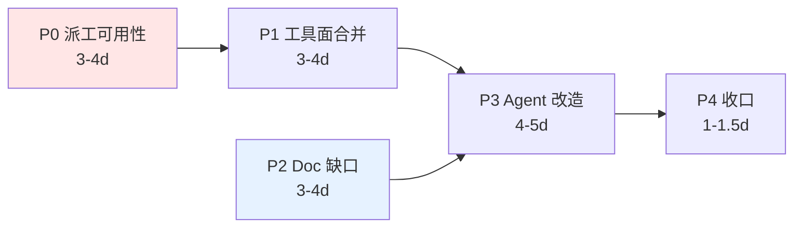

# PM / Doc MCP 与官方 Agent 融合 — 开发计划

> 版本：**v1.0（定稿）** | 日期：2026-11-05
>
> 关联设计：[`docs/design/zh/32-pm-doc-mcp-tool-surface-for-agents.md`](../../design/zh/32-pm-doc-mcp-tool-surface-for-agents.md)（**v1.0 定稿；工具面契约与全部决策以该文档为准，本文只排期**）
> 上游设计：[`21-pm-project-management.md`](../../design/zh/21-pm-project-management.md) §6 · [`20-doc-online-document.md`](../../design/zh/20-doc-online-document.md) §6
> 关联 ADR：[`ADR-073`](../../adr/zh/ADR-073-agent-instance-identity-decomposition.md) · [`ADR-098`](../../adr/zh/ADR-098-unified-standard-group-model.md) · [`ADR-102`](../../adr/zh/ADR-102-turnorigin-vocabulary-and-pm-dispatch-chain.md) · [`ADR-104`](../../adr/zh/ADR-104-agent-manifest-declaration-surface.md)
>
> **一句话**：PM MCP 重整为 14 工具（合并 3、增强 2、新增 5）、Doc MCP 补 4 个缺口，再把两个官方 agent 的 prompt + 14 个 skill 全部改写到这套工具面上；**P0→P4 五阶段，14-18 人日**。

---

## 1. 排期假设

- **团队规模**：单人全职；P2（doc crate）与 P0/P1（pm crate）代码路径不相交，两人协作可全程并行。
- **工时口径**：1d = 8h，含编码 + 单测 + 集成测试 + 文档同步。不含评审与合并 buffer。
- **前置依赖（已就绪，无需新工作）**：
  - 状态机 + 审批闸门 + **成员闸**（[tree.rs `validate_transition` / `ensure_creation_approved` / `ensure_assignee_is_member`](../../../core/acowork-pm/src/store/tree.rs#L620)）
  - dispatch scanner + `dispatched_at` 幂等戳 + `assignment_brief` 四要素（[dispatch.rs](../../../core/acowork-pm/src/dispatch.rs)）
  - Gateway agent 目录客户端（[agent_dir.rs](../../../core/acowork-pm/src/mcp/agent_dir.rs)）——`pm_list_agents` 直接复用，含批量元数据限流
  - 项目成员 + 群聊同步（[projects.rs `add_member` / `sync_group_chat`](../../../core/acowork-pm/src/api/projects.rs#L320)）
  - 活动流 / 回收站 / 审批请求 / ACL 的 **REST 面已实现**
- **关键排期判断**：本次多数「新增工具」实为**把既有 service 方法接到 MCP dispatch 上**，不是从零写业务——这是 14-18d 而非 30d 的原因。真正的成本在 P3（prompt/skills 重写）与测试。
- **P0 是硬阻塞**：`pm_list_agents` + `pm_add_project_member` 不落地，PM agent 拿不到合法指派集、也无法解除 M7，派工链整体不可用，P3-PM 只能写成「等人给 id」的降级形态。

---

## 2. 里程碑总览

| 阶段 | 内容 | 估时 | 交付物 | 阻塞 |
|---|---|---|---|---|
| **P0 派工可用性** | `pm_list_agents` + `pm_add_project_member` + `pm_add_activity`/`pm_list_activity` + D2/D6 修复 | 3-4d | PM agent 可独立跑完「查合法指派集 → 邀请 → 派工 → 留上下文 → 跟进」 | 阻塞 P3-PM |
| **P1 工具面合并** | 3 工具转 deprecated 别名 + `pm_list_tasks` 增强 + `pm_update_task` 吸收 reparent + `pm_update_project` | 3-4d | 14 工具终态，manifest 与代码强一致 | 阻塞 P3-PM |
| **P2 Doc 缺口** | `doc_list_requests` + `doc_list_trash`/`doc_restore` + `doc_move` 支持目录 + `doc_rmdir` + `doc_list(recursive)` | 3-4d | Docs agent 可自主做 IA 重构与审批跟踪 | 阻塞 P3-Doc |
| **P3 官方 Agent 改造** | 2 个 `system.md` + 2 个 `manifest.toml` + 14 skill 重写 + 3 新 skill + 重新打包 | 4-5d | 两个 agent 深度融合，可作标杆模板 | 依赖 P0/P1/P2 |
| **P4 收口** | e2e 验证 + 别名读时迁移表 + 设计定稿 + 21/20 §6 指向本文 + en 版 | 1-1.5d | 文档、测试、样例三者一致 | 依赖 P0-P3 |
| **合计** | — | **14-18d** | — | — |

> **并行机会**：P2 与 P0/P1 分处两个 crate、零代码交集，两人协作时 P2 全程并行，总工期压到 **11-13d**。

---

## 3. 任务卡

### P0 — 派工可用性（3-4d）

| ID | 任务 | 落点 | DoD |
|---|---|---|---|
| **T0-1** | `pm_list_agents` | [mcp/manifest.rs](../../../core/acowork-pm/src/mcp/manifest.rs) + [mcp/tools.rs](../../../core/acowork-pm/src/mcp/tools.rs)，复用 [agent_dir.rs](../../../core/acowork-pm/src/mcp/agent_dir.rs) + `Project.members` | `project_id` 给定时返回**该项目 agent 成员**（= 合法指派集，按构造合法；人类成员只报 `human_member_count`，见 D7）；省略时返回全局目录。返回 `instance_id / kind / agent_id / name / role / online / added_at`，`online` 取 Gateway `alive`（ADR-085）且 description 明写「信息非闸门」。description 显式警告「`assignee` 用 `instance_id`，**不是** `agent_id`」。**单次 `list_agents()` 快照 + 内存 join，禁止逐行查目录（N+1）**；稳定排序在工具层保证（`limit` 截断前） |
| **T0-2** | `pm_add_project_member` | 同上，复用 [projects.rs `add_member`](../../../core/acowork-pm/src/api/projects.rs#L320) service 路径 | 沿用 `require_governance`（owner/admin），**不新建权限模型**；Agent 成员仍校验目录存在；成功后触发 `sync_group_chat`（新成员进项目群聊）；幂等（重复邀请不报错） |
| **T0-3** | `pm_add_activity` / `pm_list_activity` | 同上，复用 REST [tasks.rs](../../../core/acowork-pm/src/api/tasks.rs) activity service 方法 | 写侧允许 `assignee == actor` **或** `created_by == actor`（PM 要能给自己派的任务留言）；分页参数齐备 |
| **T0-4** | **修 D2 schema 漂移** | [manifest.rs](../../../core/acowork-pm/src/mcp/manifest.rs) `pm_update_task` | 补 `type` / `depends_on`；**新增强一致测试**：每个工具的 dispatch 侧 `Args` 字段集 ⊆ manifest properties（现测试只抽查 6 字段，[manifest.rs:266-273](../../../core/acowork-pm/src/mcp/manifest.rs#L266)） |
| **T0-5** | **修 D6 成员闸文档缺失** | `pm_create_task` / `pm_update_task` 的 `assignee` description | 补写「必须是项目成员，否则 `assignee_not_project_member`；先用 `pm_list_agents(project_id)` 查、必要时 `pm_add_project_member` 邀请」。**这条比缺工具更危险：它让 agent 的错误看起来像平台 bug** |
| **T0-6** | 修 D3 死参数 | `pm_submit_task` | 从 manifest 移除 `attachment_ids`（dispatch 侧继续容忍入参，不破坏旧调用），description 注明「附件由人类在 Desktop 上传；agent 产出走文档库路径引用」 |

**P0 验收**：一个 agent 在只拿到项目名的情况下，自主完成「找项目 → 查合法指派集 →（目标不是成员时）邀请 → 建带 `start_at` 的任务 → 留 activity → `pm_get_task` 跟进审批态」，**全程零人类介入、零 id 手填**。

> **P0 状态（已完成）**：T0-1..T0-6 全部落地，`cargo test -p acowork-pm` 151 绿（lib 112 / integration 27+2+5+5）、`cargo clippy -p acowork-pm --all-targets` 零告警。实现期新增两条契约事实已回写设计文档：**D7**（人类成员三层不一致 → 指派集只含 agent）与 **Q7**（目录不可用的失败语义按模式不对称 / `online` 是信息不是闸门）。

---

### P1 — 工具面合并（3-4d）

| ID | 任务 | 落点 | DoD |
|---|---|---|---|
| **T1-1** | `pm_list_tasks` 增强 | [tools.rs](../../../core/acowork-pm/src/mcp/tools.rs) | `project_id` 改可选；新增 `parent_task_id` / `query` / `type` / `review_status` / `order_by` / `offset`；`assignee` 支持 `"me"` 哨兵。**跨项目模式强制 `limit` 上限 + 至少一个过滤条件**，并复用 [store/index.rs](../../../core/acowork-pm/src/store/index.rs) 内存索引（scanner 已在用，无磁盘扫描） |
| **T1-2** | 吸收 `pm_reparent_task` | `pm_update_task` 加 `parent_task_id`（null=根） | 复用既有 DFS 防环，`cycle_detected` 错误码不变 |
| **T1-3** | `pm_update_project` | manifest + tools，复用 REST `projects::update` | title/description/status(归档)；沿用 REST 侧治理校验 |
| **T1-4** | 3 工具转 deprecated 别名 | [tools.rs `dispatch`](../../../core/acowork-pm/src/mcp/tools.rs) | `pm_check_task`→`pm_get_task`；`pm_list_my_tasks`→`pm_list_tasks(assignee=me)`；`pm_reparent_task`→`pm_update_task`。别名行为与新路径**返回完全一致的 JSON**（加对比测试）；description 前缀 `[deprecated: use X]`；仍在 `tools/list` 出现 |
| **T1-5** | 状态机文档校对 | [21 §4](../../design/zh/21-pm-project-management.md) | 转移表与 `validate_transition` 逐格一致，不一致以代码为准并修文档 |
| **T1-6** | `InvalidStateTransition` 错误文案 | [error.rs](../../../core/acowork-pm/src/error.rs) | 报错里带**当前态 + 合法出边集合**，让 agent 一次纠错而非瞎试（设计 §5.1） |

**P1 验收**：`tools/list` = 14 主工具 + 3 deprecated 别名；`cargo test -p acowork-pm` 全绿（含 T0-4 强一致测试与 T1-4 等价测试）。

---

### P2 — Doc 缺口补齐（3-4d）

| ID | 任务 | 落点 | DoD |
|---|---|---|---|
| **T2-1** | `doc_list_requests` | [doc/mcp/manifest.rs](../../../core/acowork-doc/src/mcp/manifest.rs) + [tools.rs](../../../core/acowork-doc/src/mcp/tools.rs)，复用 [requests.rs](../../../core/acowork-doc/src/api/requests.rs) | 按 actor 列自己提交的请求（`pending/approved/rejected/expired`），亦可按 doc 过滤；**关闭设计 §5.3 的 request_id 失联问题** |
| **T2-2** | `doc_list_trash` / `doc_restore` | 同上，复用 [trash.rs](../../../core/acowork-doc/src/api/trash.rs) | 恢复走与 `doc_remove` 对称的所有权闸门（无主回落 ACL）；**不暴露 purge** |
| **T2-3** | `doc_move` 支持目录 + `doc_rmdir` | [tools.rs `resolve_*`](../../../core/acowork-doc/src/mcp/tools.rs) | **先补 `resolve_dir` 单测再动 dispatch**（当前 `resolve_*` 只解文档 path）；目录改名/换父可用；`doc_rmdir` 仅空目录可删，非空返回明确错误、**不级联** |
| **T2-4** | `doc_list(recursive=true)` | 同上，复用 REST `/tree` | 默认 `false` 保持现行为；递归带深度 + 节点数上限，超限截断并标注 |

**P2 验收**：Docs agent 无人工介入完成「建目录树 → 迁移一批文档 → 发现删错 → 从回收站恢复 → 改名一个目录」。

---

### P3 — 官方 Agent 改造（4-5d）

| ID | 任务 | 落点 | DoD |
|---|---|---|---|
| **T3-1** | PM `system.md` 重写 | [system.md](../../../agents/project-manager-agent/prompts/system.md) | 新增设计 §5.1 状态机 / §5.2 派工模型 / §5.4 ID 纪律 / §5.5 路径约定四节；`todo_write` 明确降级为「会话内临时清单」，跨会话或需他人履约一律落 PM 服务 |
| **T3-2** | PM `manifest.toml` | [manifest.toml](../../../agents/project-manager-agent/manifest.toml) | 补 `[[mcp_servers]] hosted = "doc"`；`tool_deps` 声明 `pm_*` / `doc_*`；**修 D4 矛盾注释，shell 三件套保留**；`capabilities` 指向新 skill |
| **T3-3** | PM 7 skill 改写 | [skills/](../../../agents/project-manager-agent/skills/) | 每个 skill `tool_deps` 含具体 `pm_*`/`doc_*`；步骤写明用哪个工具替代原 memory/file 叙述 |
| **T3-4** | PM 新增 2 skill | `task-dispatch` / `project-setup` | `task-dispatch` 覆盖 M1/M2/M4/M5/M7 全链路，含「非成员 → 邀请」「未批准 → 等待而非重试」两个显式分支；`project-setup` 建项目 + `项目管理/{project_id}/` 目录树 + README + 名册 |
| **T3-5** | Doc `system.md` 重写 | [system.md](../../../agents/document-manager-agent/prompts/system.md) | 新增 §5.3 写入纪律 / §5.4 ID 路径纪律；确立「库是事实源，workspace 只是导入源」；**显式声明 `项目管理/**` 为 PM 产出区，不得随意搬动**（§5.5 路径依赖） |
| **T3-6** | Doc `manifest.toml` | [manifest.toml](../../../agents/document-manager-agent/manifest.toml) | `tool_deps` 声明 `doc_*`；修 D4 注释；shell 保留 |
| **T3-7** | Doc 7 skill 改写 + 新增 1 | [skills/](../../../agents/document-manager-agent/skills/) | `document-collection` 走 `doc_write(mode=create, source_workspace, source_path)`；`document-organization` 用 `doc_mkdir`/`doc_move`(含目录)；新增 `review-tracking` |
| **T3-8** | 重新打包 | [agents/agent-packages/](../../../agents/agent-packages/) | `com.acowork.project-manager.agent` / `com.acowork.document-manager.agent` 同步重建并可安装 |

**P3 验收**：`grep -rniE 'pm_[a-z]+|doc_[a-z]+'` 在两个 agent 目录的命中数从 **0** 升至每 skill ≥ 3；两个 agent 在干净实例上跑通 §5 场景脚本。

---

### P4 — 收口与文档（1-1.5d）

| ID | 任务 | DoD |
|---|---|---|
| **T4-1** | e2e：PM agent 派工 → 人工批准 → scanner 唤醒 engineer → `pm_claim_task` → `pm_submit_task` → PM 读回并写周报进 doc 库 | 用例入库；用 `CARGO_TARGET_DIR=target-e2e` 编译，**不进默认 `target/`**（会与运行中 Gateway/Runtime 锁定的文件冲突） |
| **T4-2** | **别名读时迁移表**（Q4 机制） | [agent_config.rs](../../../core/acowork-runtime/src/agent_config.rs) 按 [1097-1113 行既有模式](../../../core/acowork-runtime/src/agent_config.rs#L1097) 加 `MCP_TOOL_ALIASES`：加载时旧名→新名 + 原子回写。单测：旧配置读入后新名生效且文件已重写 |
| **T4-3** | 更新 [21 §6](../../design/zh/21-pm-project-management.md) / [20 §6](../../design/zh/20-doc-online-document.md) | 工具表改为指向 32，保留机制叙述；两处不再各自维护会漂移的清单 |
| **T4-4** | 设计文档 32 的 en 版 | `docs/design/en/32-…md`，遵循 [docs/adr/en/README.md](../../adr/en/README.md) 对应约定 |
| **T4-5** | **别名移除门（可验证 checklist）** | 下一 minor 删除 `pm_check_task`/`pm_list_my_tasks`/`pm_reparent_task`，前置三条：① T4-2 迁移表已发版；② `dev/ci.sh` 加断言禁止这三个名出现在 manifest；③ Desktop CreateWizard 测试与 `agent_config` 默认模板无旧名引用 |

---

## 4. 兼容性与迁移

| 面 | 影响 | 处置 |
|---|---|---|
| **已安装 agent 的 `agent_config.json` / `agent_mcp_tools.json`** | 按工具名存 enable 开关（[proxy.rs:3043](../../../core/acowork-gateway/src/http/proxy.rs#L3043)）；删工具会致 unknown tool | 别名期（P1→下一 minor）+ T4-2 读时迁移表；`tools/list` 别名照常返回 |
| **Desktop CreateWizard 工具开关列表** | 按工具名渲染 switch（[CreateWizard.test.tsx:73](../../../apps/acowork-desktop/src/components/agent-list/CreateWizard.test.tsx#L73)） | 别名期 UI 不变；T4-5 ③ 作为删除门 |
| **ADR-102 派工链** | [intent_turn.rs:1162](../../../core/acowork-runtime/src/agent/intent_turn.rs#L1162) 与 [dispatch.rs `build_assignment_brief`](../../../core/acowork-pm/src/dispatch.rs) 显式指示调 `pm_claim_task` | **`pm_claim_task` 不合并、不改名**（设计 §3.1 据此否决了一次合并） |
| **REST 面** | 无变更 | 人类与 Desktop 路径零影响；新工具全部复用既有 service 方法 |
| **MCP 入参兼容** | `pm_submit_task.attachment_ids` 从 manifest 移除，但旧 agent 可能仍传 | dispatch 侧**继续容忍**该入参（T0-6），只从 LLM 可见面消失 |
| **`agents/agent-packages/*.agent`** | 打包产物过期 | T3-8 重建 |
| **文档库既有内容** | 新约定 `项目管理/{project_id}/` 可能与历史目录冲突 | 首次创建时若同名非目录节点存在，`doc_mkdir` 返回明确错误，由 agent 报告人类——**不自动改名、不静默复用** |

---

## 5. 场景脚本（P3 验收依据）

| # | 场景 | 覆盖机制 | 通过判据 |
|---|---|---|---|
| S1 | 「把 X 功能拆成任务派给 architect agent」 | M4 M7 M1 | 若目标非成员 → 自行邀请成功 → 派工；任务停 `pending`+`review_status=pending`；**不出现重试循环** |
| S2 | 「这周什么卡住了」 | M3 + `only_blocked` | 一次 `pm_list_tasks(only_blocked=true)` 得答案，不逐个 `pm_get_task` 遍历 |
| S3 | 「把 PRD 写出来存好」 | M6 + §5.5 | 文档落 `项目管理/{project_id}/PRD.md`，经 tmp→`doc_move` 发布；任务 description 引用该 path |
| S4 | 被派工 agent 醒来 | M1 M2 M3 | `claim` 撞 409 时报告并停止，**不改状态、不重建任务** |
| S5 | 「刚删掉的目录树恢复回来」 | Doc 回收站 | `doc_list_trash` → `doc_restore`，无需人类操作 |

---

## 6. 风险

| 风险 | 等级 | 缓解 |
|---|---|---|
| **prompt 变长挤占上下文**：M1–M7 + 状态机 + 派工图 + ID/路径约定 ≈ +3k token | 中 | 只写「不写就不会用」的机制（设计 §1.2 判据）；工具清单/参数复述**一律不写**（runtime 已注入）；细节下沉到 skill |
| **agent 撞状态机后瞎试**（`InvalidStateTransition` 连锁） | 中 | §5.1 三条硬规则进 system prompt 正文 + T1-6 错误文案带合法出边 |
| **`pm_list_tasks` 跨项目 + `query` 打穿性能**（当前单项目 `limit≤100`） | 中 | 跨项目强制 `limit` 上限 + 至少一个过滤条件；走内存索引（scanner 已验证该路径无磁盘扫描） |
| **`doc_move` 目录改造碰 `resolve_*`**（现只解文档 path） | 中 | T2-3 独立提交，先补 `resolve_dir` 单测再动 dispatch |
| **`pm_add_project_member` 使 agent 能扩大项目群聊参与者** | 中 | 这是 `sync_group_chat` 的**既有行为**（人类加成员同样触发），非本次新增能力；owner/admin 闸沿用 `require_governance`，**不放宽** |
| **P0/P1 未完成就改 agent prompt**，写出引用不存在工具的文档 | 中 | 严格按依赖图；P3 不得早于 P0/P1/P2 合入 |
| **别名永久滞留**（deprecated 变成事实 API） | 低→**已闭环** | T4-5 给出三条可验证删除门，其中 ② 是 CI 断言，不依赖记忆 |

> **已撤销的风险**：上一版列出的「`pm_list_agents` 泄露名册 / 越权指派」（标为高危）经核证为**虚警**——`assignee ∈ project.members` 早已由 store 强制（设计 §1.2 M7）。处置方式见设计 §8 Q5。

---

## 7. 不在本次范围

- **PM/Doc 的新业务能力**：甘特图、工时统计、velocity 计算、文档全文检索升级、版本历史 diff——均无对应 service 方法，属独立设计。
- **附件上传 MCP 工具**：Q2 已定**不做**（agent 产出统一走文档库，不建平行二进制体系）。
- **让 agent 给人类账号派工**（设计 32 **D7**）：store 成员闸接受人类、`pm_create_task` 的目录存在性校验拒绝人类、派工扫描器把 assignee 当 intent 目标投递（人类会得 `target_not_installed`）——三层不一致要真修得改派工投递的目标解析与重试语义，是独立设计。本次只在工具面**收紧承诺**：`pm_list_agents(project_id)` 的指派集只含 agent 成员，人类成员以 `human_member_count` 上报，`pm_add_project_member` 仍可邀请人类（进群聊、做审批人）。
- **`doc_get_acl` / `doc_set_acl`**：排 P3 优先级但**本次不实现**——读默认公开、admin 已在 ACL 层豁免，无阻塞场景；等出现真实撞 ACL 的 agent 失败案例再开。
- **其他 4 个官方 agent**（`software-architect` / `senior-engineer` / `quality-assurance` / `product-manager`）的同类改造。它们有**完全相同的病**（注入了 pm/doc MCP、prompt 零引用），本次先立标杆、验证 prompt 结构后再批量套用，避免 6 个一起返工。
- **`doc_write` 二进制/图片支持**：库是纯 Markdown 文本面，图片需另设资源面。
- **`agent_id` → `instance_id` 历史数据迁移**：ADR-073 已处理。

---

## 9. 实施结果（P0–P3 收口）

### 9.1 已交付

| 阶段 | 结果 | 测试 |
|---|---|---|
| P0 | `pm_list_agents`（双模式）+ `pm_add_project_member` + `pm_add_activity`/`pm_list_activity` + D2/D3/D6/D7 修复 | pm 163 全绿 |
| P1 | 14 主工具 + 3 别名（返回逐字节一致）+ `pm_update_task` 吸收 reparent + `pm_update_project` + 状态机表单一事实来源 | pm 163 全绿 |
| P2 | Doc 9→13：`doc_list_requests`/`doc_list_trash`/`doc_restore`/`doc_rmdir` | doc 170 全绿 |
| P3 | 2 个 `system.md` 工作区契约 + 14 skill 的 `System of Record` 段 + `tool_deps` 校正 + 两个 manifest 补推荐 MCP（含 ADR-104 的 `tools` 白名单） | — |
| P3.1 | §5.5 路径约定改为**工具响应字段**（`doc_path`）+ `project-setup` / `task-dispatch` 两个 skill + 创建闸门 + 派工链 e2e + 别名 tripwire + 7 个 `.agent` 重打 | pm 169 / doc 179 全绿，clippy 0 警告 |

P3 首版的交付边界曾如实记为「三个 skill 未建、路径约定只在设计文档里」。P3.1 已把它们补掉，并**改了做法**：路径约定不再是 prompt 里的一句话，而是 `pm_create_project` / `pm_get_project` / `pm_list_projects` / `pm_update_project` 响应里的 `doc_path` 字段（见 §9.2 第 10 条）。三个 skill 变成两个，第三个并入既有 skill（§9.2 第 11 条）。

### 9.2 实施期与设计不符处（已按实测修正）

| # | 设计假设 | 实测 | 处理 |
|---|---|---|---|
| 1 | 别名可返回旧的形状以兼容 | 旧形状与新工具本质不同（裸数组 / 扁平摘要 / `{ok:true}`） | 别名翻译参数后走**同一 handler**，旧形状明确废弃；等价测试断言整体 JSON 相等 |
| 2 | `review_status=pending` 只含 checkpoint | Agent 建的**任何**任务都待审批（ADR-102） | 测试改为 `pending=N, approved=0` 双向钉住 |
| 3 | 任务行含 `children` | 无此字段，子树只能 `pm_list_tasks(parent_task_id)` | 文档写明，不扩范围 |
| 4 | 父链字段名对称 | 入参 `parent_task_id`、行内 `parent_id`（REST/Desktop 已依赖） | 保留不对称，description 明写 |
| 5 | MCP 测试可跨调用 | `raw()` 每次新建临时库，跨调用状态不存在 | 新增 `shared_router()`/`call_shared()` |
| 6 | `doc_rmdir` 复用 REST 删除 | REST 是**级联**删除 | agent 面只删空目录、不级联（写错路径的代价与收益不成比例）。**复核补记**：首版实现报 `{"removed": true}` 却没真删——`LibraryDirectoryService::delete()` 只标记子树、从不标记目标自己在父索引里的条目；且完全没有授权闸门（`let _ = actor`）而 REST 同操作有 `AclTarget::Dir` + `edit`；"空"也没算回收站。三处已修（服务层补父索引标记、结构性闸门收敛为 `gate_structural(target, creator)`、`doc_rmdir` 统计 `original_dir_id == dir_id` 的槽位），并补了四条反向断言。 |
| 7 | 目录可跨父移动 | `DirMeta` 无 `parent` 字段（父子即物理嵌套），跨父移动需整体搬迁子树 | 本期不做，属独立特性；**设计 32 与 `document-organization` 正文已同步改口**（原写作"`doc_move` 支持目录"） |
| 8 | `MANIFEST_FIELDS` 对账足够守住 schema | 首版只覆盖 PM 8/17、Doc 0/13：把 `pm_get_task` 的 `task_id` 改名成 `id`，163 个测试仍全绿；`pm_submit_task.attachment_ids`、`pm_list_my_tasks.project_id` 已实际漂移 | 覆盖全部工具（别名在内，Doc 新建同款表），并加 `manifest_fields_cover_every_tool`——"在表上"变成规则而非可选 |
| 9 | MCP 面与 REST 面授权一致 | **不一致，且比预想更大**：`doc_mkdir` 与 `doc_write(mode=create)` 在 MCP 面**完全没有授权**（`doc_mkdir` 的注释还写着"v1 不对 MCP 做 ACL 强制"），而 REST 面 `POST /api/dirs`、`POST /api/docs` 都对目标目录做 `AclTarget::Dir` + `Edit`。即任何 agent 都能往用户显式收紧过的目录里塞内容 | 两处收敛到 `gate_create`（目标目录的节点 ACL），与 REST 同规则；`doc_mkdir` 的创建人注释改为事实（它现在是结构闸门读取的治理依据）。四条断言：他人被拒、内容未落盘、创建人仍可写、拒绝后不产生条目 |
| 10 | §5.5 路径约定写进 `system.md` 即可生效 | 写进 prompt 也不可靠：① 上下文压缩后丢失（M2 建 skill 的同一个理由）；② 覆盖不到未改造的 4 个 agent 和用户自建 agent；③ 标题改了就断链的风险被文案掩盖 | 改为**工具响应字段**：`project_to_value` 统一投影 `doc_path`，一次改动覆盖 create/get/list/update 四个工具；字符串落 `acowork_core::doc_layout`（两侧可测的契约，不是复制进 prompt 的字面量）；契约测试钉住"retitle 不改变 `doc_path`"，Doc 侧测试钉住该路径可寻址且**不会隐式创建** |
| 11 | 需要 3 个新 skill | `document-quality-review` 的 `tool_deps` 已含 `doc_list_requests` / `doc_check_request` / `pm_add_activity`，`System of Record` 段已在写 `pending_review` 生命周期——`review-tracking` 是同一能力的第二个入口 | 3 → 2：`project-setup`、`task-dispatch` 建；`review-tracking` **不建文件**，内容并入既有 skill。验收标准从「skill 文件数」改为「能力是否可达」 |
| 12 | T4-1 端到端可在一个 crate 内完成 | 扫描器唯一的外部依赖是一次 HTTP POST，**不需要活体 Gateway**；但「写周报进 doc」那一腿不可能在 pm crate 内做（`core/acowork-pm/Cargo.toml` 不依赖 `acowork-doc`），硬塞等于要求双服务活体环境 | 拆 a/b：T4-1a 在 crate 内用 stub Gateway 断言 brief 四要素、`dispatched_at` 幂等、claim → submit → done（已交付）；T4-1b 改为场景脚本证据，不进 CI |
| 13 | 只有 2 个 `.agent` 包过期 | 加守卫后实测 **7 个里 5 个** `manifest.toml` 过期（`e55a580b` 改了源码 manifest 未重打），两个标杆 agent 则是 prompt 与 manifest 双双过期 | 全部按 `build-agent.sh` 流程重打（zip → sign → verify）；守卫写成测试：包内 `manifest.toml` / `prompts/**` / `skills/**` 与源码逐字节一致，且不得残留源码已删的文件 |

### 9.3 别名删除 checklist（T4-5，已执行）

删除 `pm_check_task` / `pm_list_my_tasks` / `pm_reparent_task` 的逐条确认：

- [x] 本仓库全部 `.agent` 包与 skill / prompt 内**无** `pm_check_task` / `pm_list_my_tasks` / `pm_reparent_task` 残留（`grep -r` 为空，已重打 `.agent`）
- [x] 两个官方 agent 的 `tool_deps` 与正文**无**别名引用
- [x] `dispatch` 三个别名分支与两个旧参数结构删除，`tools/list` 数从 17 降至 14
- [x] 三个别名等价测试 + `deprecated_aliases_stay_advertised_until_the_read_path_lands` tripwire 删除（守护对象已不存在）
- [x] 21 §6 / 32 §3.1 / 32 §3.5 的工具数表述同步（17 → 14，兼容策略改为「无」）

**T4-2（`MCP_TOOL_ALIASES` 读时迁移表）取消**：平台尚未上线，不存在写着旧工具名的 `agent_mcp_tools.json` 存量配置，为不存在的迁移写代码没有收益。原「T4-5 冻结至 T4-2 落地」的前提因此消失。

### 9.4 未做（明确排除，附约束）

- **`review-tracking` skill**：并入 `document-quality-review`，**不建文件**（§9.2 第 11 条）。若日后确实需要独立的"审核跟踪"入口，先说明它比既有 skill 多做什么，再建。
- **T4-1b（派工链的"写周报进 doc"腿）**：`acowork-pm` 不依赖 `acowork-doc`，放进 CI 等于要求双服务活体环境。改为场景脚本证据：跑 S3 记录 `doc_path` + `doc_write` 结果与截图，进交付记录，不进 CI。
- **T4-2 别名读时迁移表**（`MCP_TOOL_ALIASES`）：**取消**。平台未上线，无存量配置可迁移；T4-5 已直接删除三个别名（见 §9.3）。
- **`doc_move` 跨父移动目录 / `doc_list(recursive=true)` / `doc_get_acl`·`doc_set_acl`**：维持原判断，不立项。`DirMeta` 无 `parent` 字段（父子即物理嵌套），跨父移动是整体搬迁子树，等出现真实失败案例再开。
- **另外 4 个官方 agent（product-manager / architect / engineer / QA）**：本轮仍未纳入（本批已回退其 skills 改动）。它们的 `.agent` 包因 §9.2 第 13 条的守卫已随源码重打，但 prompt/skill 的 P3 手法未套用；待标杆验证后批量做。
- **设计 32 en 版**：zh 为源（ADR 约定），en 待补。

**发布门（不可协商）**：任何声称"标杆 agent 已深度融合"的版本，必须带与源码一致的 `.agent` 包。守卫测试已把它变成 CI 事实，不是 checklist 记忆——过去两次过期包都是人工解压才发现的。

### 9.5 验收记录（P3.1）

**独立复核（review 侧逐条自验，非采信交付方摘要）**：`doc_path` 单次投影（4 个调用点）、Doc 侧三方契约（寻址 / `DirNotFound` 不隐式建 / 错误指出缺段）、2 个 skill + 第三个并入、PM manifest `doc_mkdir` 白名单（真依赖，非补格式）、7 个 `.agent` 包 zip→源码逐文件比对 7/7 零差异、重打守卫三向断言 + `checked > 0` 兜底、别名 tripwire、§9.1/§9.2/§9.4 口径——全部复核通过。

**唯一红项 T4-1a（证据测试本身）**：

- **现象**：`mcp::tests::dispatch_chain_wakes_the_assignee_once_then_claim_submit_done` 第 4 步 `dispatched_at` 断言红。`cargo test -p acowork-pm` 全量并行负载下 2/2 失败、隔离单跑 6/8 通过——该命令在本提交上不可能是绿的。
- **根因**：测试同步错，不是产品 bug。stub 的 `sink.push(body)` 在回响应**之前**执行，`mark_dispatched`（盖章 + `atomic_write_json` 落盘）在客户端拿到响应**之后**执行；第 1 步轮询在 `seen` 非空瞬间退出，第 4 步紧接着单次读，必然可能落在「已铸号、未盖章」窗口。
- **修复**：盖章断言改为有界轮询（20 ms 步进 × 5 s failure floor，与第 1 步等 `seen` 同一写法），break 后统一断言并带失败载荷；不引入任何猜时长的 sleep。
- **接受条件**：`cd core && CARGO_TARGET_DIR=target-e2e cargo test -p acowork-pm` **全量连跑 3 次全绿**——已达成（lib 130/130 × 3，含集成套 27/2/5/5）。
- **结论**：接受条件已满足，P3.1 收口（待 review 侧签收）；发布门维持 §9.4 原样。

**附注（流程）**：`core/acowork-pm/src/target-e2e`（2 GB，gitignore 内）已清。来历：从子 crate 目录起步设相对 `CARGO_TARGET_DIR=target-e2e`，产物落进该 crate 的 `src/`。规则已写进 `CONTRIBUTING.md` 测试段：`CARGO_TARGET_DIR` 必须以 `core/` 为根（从 `core/` 起步，产物落 `core/target-e2e`）。
