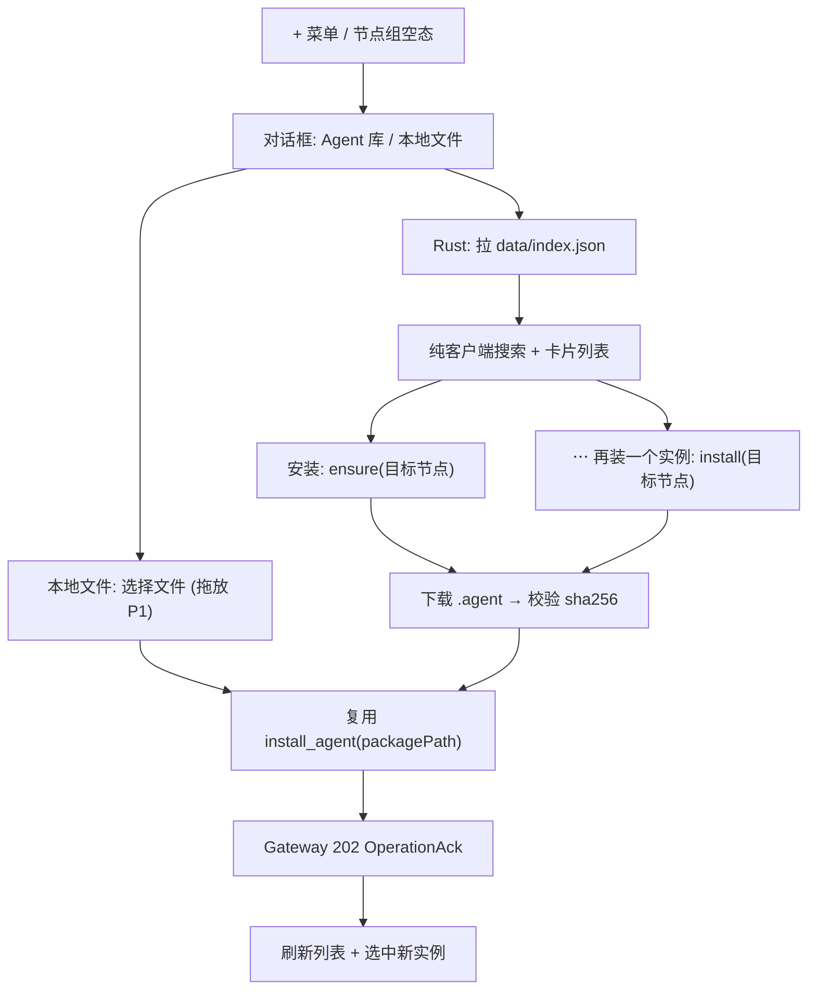

# PRD：Desktop「安装 Agent」对话框（Agent 库 / 本地文件 双 Tab）

| 项 | 内容 |
| --- | --- |
| 状态 | 待评审（v0.1 草案） |
| 作者 | Product |
| 日期 | 2026-11-04 |
| 涉及仓库 | `ACowork`（`apps/acowork-desktop` 为主；Gateway / Node / acowork-sign **无改动**） |
| 关联 | [prd-agent-hub.md](./prd-agent-hub.md)（官网 Hub 页）、[ADR-055](../../adr/zh/ADR-055-remote-runtime-node-topology.md) §6.13.3（多节点安装）、[ADR-073](../../adr/zh/ADR-073-agent-instance-identity-decomposition.md)（实例身份 / `ensure`）、[ADR-087](../../adr/zh/ADR-087-node-agent-owner-permissions.md)（节点 manage 门禁） |
| 明确不含 | 「已安装」聚合 Tab、版本比对与升级动作 —— 见 §11，另开任务 |

---

## 1. 摘要

把侧栏 `+` 菜单里的「安装 Agent」从"仅能选择本地 `.agent` 文件"改成一个对话框，含两个 Tab：

| Tab | 内容 |
| --- | --- |
| **Agent 库（默认）** | 从 `hub.acowork.ai` 读取已发布的 agent 列表，可直接安装 |
| **本地文件** | 选择 `.agent` 文件安装（现有行为）；拖放为 P1（REQ-020） |

一句话：**把"下载 → 再导入"的两段式，变成一步。**

---

## 2. 问题与背景

### 2.1 用户问题

ACowork 装机后的第一个真实问题不是"怎么用"，而是"能装什么"。今天唯一入口是 `+` → 安装 Agent → **系统文件框选 `.agent` 文件**（`apps/acowork-desktop/src/components/agent-list/AgentList.tsx:266`）。这个动作的前提是用户**手上已经有一个文件**，而文件从哪来，产品内没有任何说法。

### 2.2 证据

| 事实 | 出处 |
| --- | --- |
| Hub 站点已上线，8 个签名 agent | `https://hub.acowork.ai/data/index.json`（实测 200，`Access-Control-Allow-Origin: *`） |
| Hub 站点自己写着"下载后在 Desktop App 中导入" | `ACoworkAgentHub/site/index.html` 首屏文案 |
| 官网 PRD 把这条列为验收标准：schema 被 Desktop 直接消费 | [prd-agent-hub.md](./prd-agent-hub.md) §2 G4「schema 被 Desktop App 直接消费，无需改造」 |
| 桌面端目前没有任何 Hub / registry 相关代码 | `grep -rn "hub.acowork\|agent_hub" apps/acowork-desktop/src` 无结果 |
| Gateway 已有异步安装能力（202 + OperationAck） | `core/acowork-gateway/src/http/agents.rs:1463`（`install_agent`）、`:1376`（`ensure_agent`） |
| Node 安装侧强制验签（非 dev 模式） | `core/acowork-node/src/package/install.rs:58` |

### 2.3 假设（未验证，落地时需确认）

- A-1：用户在装机后的前 5 分钟内会点开这个菜单。**无数据支撑**，本仓库无埋点基础设施（见 §10）。
- A-2：8 个 agent 的规模下客户端过滤足够，不需要服务端搜索（与 [prd-agent-hub.md](./prd-agent-hub.md) D1 同一判断）。
- A-3：Hub 包能被现有安装链路原样接受 —— 已由 Hub 侧 `tools/signing.py` 的字节兼容说明 + 主仓 `core/acowork-core/tests/hub_interop.rs` 漂移告警背书。

---

## 3. 目标与非目标

### 3.1 目标

| # | 目标 | 衡量 |
| --- | --- | --- |
| G1 | 从"打开对话框"到"agent 出现在侧栏"只需一次安装动作 | 点击安装 → 侧栏出现新 agent，无中间跳转 |
| G2 | 安装前权限可见、可决策 | 卡片层 100% 可见 `permissions`，高危权限独立警示 |
| G3 | 本地安装路径不回退 | Local tab 覆盖现有一切本地安装场景（含多节点） |
| G4 | 多节点拓扑不被吞掉 | 在线节点 > 1 时可显式选择目标节点 |

### 3.2 非目标（本次明确不做）

- 「已安装」Tab、版本比对、升级动作（§11，另开任务）
- 评分 / 评论 / 收藏 / 安装计数
- 服务端搜索、分类服务端聚合（用 Hub 已下发的 `facets` 客户端过滤）
- `acowork://` deep link 一键安装（官网 PRD Q2 仍未决）
- Hub 侧的发布流程改动、账号体系、付费
- 移动端（`apps/acowork-mobile`）同步
- `ExtensionsView` 视图的任何改动（见 §9 F7）

---

## 4. 用户与场景

| 角色 | 场景 | 本版满足度 |
| --- | --- | --- |
| 新装用户 | 装完 ACowork，不知道能装什么 | ✅ 默认 Tab 就是列表 |
| 有明确需求者 | "我要个写 PRD 的 agent" | ✅ 客户端搜索 |
| 谨慎者 | 担心 agent 在自己机器上干什么 | ✅ 权限 + 高危警示 + 签名渠道；⚠️ 无本地信任锚（§12 R3） |
| 开发者 | 自己打了 `.agent`，要装到某台机器 | ✅ Local tab + 节点选择 |
| 多机用户 | 同一个包要装到不同节点 | ✅ 底部节点栏 |

---

## 5. 关键决策

### D1 双 Tab，默认 Agent 库

本地安装是"我已经有文件"的路径，属于少数派；默认落在库上，才能承接"我不知道装什么"的多数派。Local tab 永远可用，Hub 不可达不影响它（§7）。

### D2 主按钮走 `/api/agents/ensure`，「再装一个实例」走 `/api/agents/install`

ADR-073 下**多实例合法**，`/install` 永远多落一个实例。用户在列表里重复点"安装"不应产生十个实例，所以主按钮必须是幂等的 `ensure`：

| 端点 | 语义 | 用在 |
| --- | --- | --- |
| `POST /api/agents/ensure` | 目标节点上"确保存在"，最多一个实例（`resolve_ensure`，`core/acowork-gateway/src/http/agents.rs:1322`） | 卡片主按钮 |
| `POST /api/agents/install` | 显式再装一个实例 | 卡片 `⋯` → 「再装一个实例」 |

`EnsureAck.already_present` 为真时不新增实例，直接用返回的 `instance_id` 选中。

### D3 v1 不做任何"已安装 / 可升级"状态

被否决的方案：客户端比对 `agent_id` + `version` 得出三态。否决原因：**版本是实例级的**（`core/acowork-node/src/package/upgrade.rs:97` 按 `instance_id` 记录版本变迁），同包不同实例可停在任意版本，包级"已装/未装"必然说错。改用服务端 `ensure` 回答存在性，客户端不算状态。

边界（避免实现时拉扯）：允许「本节点已有 N 个实例」这类**纯信息文案**（数据是 `agentStore.agents` 已有的本地事实，见 REQ-018），不允许任何**驱动按钮态**的"已安装 / 可升级"判断或提示。

### D4 节点选择留在对话框内，不新开第二条安装路径

现状有两条：`handleInstall`（`AgentList.tsx:296`，>1 在线节点先弹选择器）和节点组空态的 `node-group-install`（`AgentList.tsx:866`，带 `nodeId` 直装）。两者都改为**打开同一对话框并预选节点**，节点选择收敛到对话框底部的安装目标栏。

### D5 Local Tab 是落地页，不是触发器

切到 Local 就弹出系统文件框是坏交互（用户只是切 tab，却被夺走焦点）。Local tab 是一块静态区域：选择文件按钮 + 一句来源说明（拖放见 REQ-020 / F11，验证通过再加）。

### D6 数据从 Rust 侧拉，不从 webview `fetch`

Cloudflare Pages 对不存在的路径返回 **200 + HTML**（实测 `/data/nope.json` → `200 text/html`）。webview 侧难以可靠区分"JSON"与"SPA fallback"，而 Rust 侧可用 `reqwest` 校验 content-type + 解析失败即报错，还能顺带做 sha256 校验与超时控制。`reqwest` 已是 `src-tauri` 依赖。

### D7 签名渠道如实展示，不造 Official 徽章

对齐 [prd-agent-hub.md](./prd-agent-hub.md) R6：只显示 `signature.status` 的原始语义（`official-channel` / `third-party`），不出现"官方认证/未经审核"这类等级措辞。App 内更要克制——用户在这里点的是"装到我机器上"，一次点击的后果比在网页上重。

### D8 `dev_mode` 不由本次改动决定

`dev_mode` 的实际取值来自 **Gateway 配置**（`gateway_dev_mode`，`core/acowork-gateway/src/http/agents.rs:786`），客户端 multipart 里的 `dev_mode` 字段 Gateway 根本不读（`read_agent_upload`，同文件 `:1197`，只解析 `package` / `node_id` / `expected_version`）。所以本 PRD **不写**"Hub 安装传 `devMode: false`"这类验收标准——它不生效。详见 §9 F3。

---

## 6. 需求与验收标准

优先级：P0 = 本版必须；P1 = 本版尽量，可砍。

| ID | 需求 | 优先级 | 验收标准 |
| --- | --- | --- | --- |
| REQ-001 | `+` 菜单「安装 Agent」打开对话框；`node-group-install` 空节点入口打开同一对话框并预选该节点 | P0 | 两个入口进的是同一个组件；后者进入后底部节点栏已选中该节点 |
| REQ-002 | 对话框两个 Tab，默认选中 Agent 库 | P0 | 打开即见列表（不落在 Local）；Tab 可通过键盘切换 |
| REQ-003 | 拉取 `data/index.json` 并按 `agents[]` 渲染卡片 | P0 | 8 个条目全部渲染；字段见 §8 |
| REQ-004 | 卡片含：头像、`display_name`、`role`、`description`（最多 2 行）、`labels` 或 `capability_keys`（≤4 个 chip）、权限徽章、高危权限高对比标记、`package.size_bytes`、`signature.status` | P0 | 缩略插图核验；`high_risk_permissions` 非空时卡片层可见警示 |
| REQ-005 | 卡片主按钮调 `ensure`（目标节点） | P0 | 连点两次不产生第二个实例；第二次用返回的 `instance_id` 选中已有实例并提示"已在本节点" |
| REQ-006 | 卡片 `⋯` → 「再装一个实例」调 `/install` | P0 | 执行后实例数 +1（多实例是合法行为，不是异常） |
| REQ-007 | 高危权限（`Shell` / `FilesystemWrite`）安装前二次确认 | P0 | 未确认不发起安装；确认文案列出具体高危项 |
| REQ-008 | 底部安装目标栏：单节点只显示节点名；多在线节点可切换 | P0 | 切换后计数与安装目标随之变化；节点名取自 `node_name ?? hostname ?? node_id` |
| REQ-009 | 无在线节点，或目标节点 `can_manage === false` → 安装动作禁用并说明原因 | P0 | 按钮 `disabled`，`title`/辅助文本给出原因；不出现"点了才失败" |
| REQ-010 | 客户端搜索 | P0 | 匹配 `display_name` / `name` / `role` / `description` / `labels` / `capability_keys` / `skills`；大小写不敏感；多词 AND；无结果显示空态 + 清除 |
| REQ-011 | Local Tab：选择文件按钮 + `.agent` 说明文案 | P0 | 走现有 `install_agent` 链路；非 `.agent` 文件被拒并提示 |
| REQ-012 | Hub 拉取失败 → 明确错误 + 重试；Local Tab 不受影响 | P0 | 断网时 Agent 库显示错误态，切到 Local 仍可安装 |
| REQ-013 | 安装结果收尾：刷新列表、选中新实例、toast | P0 | 沿用现有 `doInstall` 行为（`AgentList.tsx:266`） |
| REQ-014 | 同时只允许一个安装操作在飞 | P0 | 安装期间所有卡片按钮与 Local 入口禁用或显示进行中；不出现第二个并行提交 |
| REQ-015 | 下载后校验 `package.sha256` | P0 | 不一致 → 中止并报错，不提交安装 |
| REQ-016 | 头像不可达时回落首字母占位 | P1 | Hub 离线或 avatar 404 → 占位不破版 |
| REQ-017 | `deprecated` 条目显示警示与原因 | P1 | 卡片可见标记；仍可安装 |
| REQ-018 | 卡片显示「本节点已有 N 个实例」灰字（信息性，不改变按钮语义） | P1 | 文案随节点切换变化；不可点击、不参与任何判断 |
| REQ-019 | 五个语言包 key 齐备 | P0 | `npm run check:i18n` 通过（`{{}}` 双括号；en + zh-CN 必须齐全） |
| REQ-020 | Local Tab 支持拖放 `.agent` 入对话框 | P1 | 见 F11：先验证 Tauri 窗口级 drag-drop 与 HTML5 `drop` 是否冲突；验证不通则退回"选择文件"单一路径，不作为阻塞项 |

---

## 7. 状态与边界

| 状态 | 行为 |
| --- | --- |
| 加载中 | 骨架卡片（同 Hub 官网），不显示空白 |
| 空结果（搜索） | 文案 + "清除搜索" |
| Hub 不可达 / 超时 | 错误态 + 重试按钮；Local Tab 正常可用 |
| 本地缓存命中 | 会话内复用上次成功结果，不发第二次请求 |
| 无在线节点 | 安装目标栏显示"无在线节点"；所有安装入口禁用 |
| 节点不可 manage | 同上，原因文案区分（权限 vs 离线） |
| 安装中 | 卡片按钮转进行中；其他安装入口禁用 |
| 安装失败 | toast + 保留对话框，用户可换节点重试 |
| 部分成功（多实例场景） | 逐次独立反馈，不合并 |
| `deprecated` | 警示标记 + 原因 |
| 响应式 | 对话框 `max-w-4xl`，窄窗口卡片降为单列 |

流程：

---

## 8. 数据契约

来源：`https://hub.acowork.ai/data/index.json`（`schema_version: 2`）。**只读取，不猜字段**；读到缺失字段按可选处理，不做等级展示。

| 字段 | 用途 |
| --- | --- |
| `agent_id` | 行标识；`ensure` / `install` 后的核对依据 |
| `display_name` / `name` / `role` | 卡片标题区 |
| `description` | 卡片副文（2 行截断） |
| `version` | 卡片展示（**本版不参与任何比较**） |
| `labels` / `capability_keys` | chip + 搜索 |
| `permissions` / `high_risk_permissions` | 权限徽章 + 高危警示 |
| `package.file` | 下载路径（**相对站点根**，基准 `https://hub.acowork.ai/`） |
| `package.size_bytes` | 卡片展示 |
| `package.sha256` | 下载后完整性校验 |
| `signature.status` | 渠道标注（`official-channel` / `third-party`） |
| `avatar` | 头像（相对站点根） |
| `deprecated` | 警示（可选） |

缓存键：`data/meta.json` 的 `build` 字段（每次发布变一次）。`index.json` 为 `Cache-Control: no-cache`，语义即"每次发布更新一次"，符合本用法。

规模策略：当前 8 条 / 25.8 KB，单请求足够。若注册表增长到数百条，Hub 侧已提供分片（`meta.pages` → `data/pages/p000.json`）可直接切换，**本版不做**。

---

## 9. 工程落地要点与地雷

| # | 事实 | 影响 |
| --- | --- | --- |
| F1 | Cloudflare Pages 对未知路径返回 **200 + HTML**（实测 `/data/nope.json`） | 必须校验 content-type 或 JSON 解析失败即报错；不能只看 status code |
| F2 | 桌面端**没有** `ensure` 的客户端方法 | `src-tauri/src/gateway_client.rs:412` 自述"an endpoint this client has no method for (`/api/agents/ensure`)"。本版需新增 `GatewayClient::ensure_agent` + Tauri 命令 + `lib.rs` 注册 |
| F3 | 客户端 multipart 的 `dev_mode` 字段被 Gateway 丢弃 | `read_agent_upload`（`agents.rs:1197`）只解析 `package` / `node_id` / `expected_version`；实际取值来自 `gateway_dev_mode`（`agents.rs:786`）。`agentStore.ts:904` 的 `devMode: true` 与 `install_form`（`gateway_client.rs:325`）发出的字段**都不决定验签强度** |
| F4 | 两处注释称"installAgent → `/api/agents/ensure`" | `SplashScreen.tsx:95` 与 `src-tauri/src/lib.rs:23`；实际打的是 `/install`（`gateway_client.rs:498`）。**属过期注释**，本版顺手修正，避免后来者据此判断 |
| F5 | `onboarding` 的 `install_bundled_agent` 同样走 `/install` | `commands/agent.rs:271` → `client.install_agent`。重跑引导会给每个推荐 agent 多落一个实例。**不在本 PRD 范围**，作为独立 issue 记录（是否改 `ensure` 需产品确认） |
| F6 | 安装是异步的（202 + OperationAck），单节点一并发 | 需客户端串行化 + 进行中禁用（REQ-014）；等待窗口现为 180s（`commands/agent.rs:29`） |
| F7 | `ExtensionsView` 是 Gateway extensions 的空壳，有独立 TODO | **不要**把 Agent 库塞进去，否则"扩展"与"agent"两个概念永久纠缠（`src/views/ExtensionsView.tsx` 头部注释） |
| F8 | 安装成功后 `AgentStorage` 以 `instance_id` 为键 | 选中必须用 ack 的 `instance_id`，用 `agent_id` 会 404 或选错实例（ADR-073） |
| F9 | Node 安装侧非 dev 模式强制验签 | Hub 包签名与主仓 `acowork-sign` v1 布局字节一致，可直接安装（`tools/signing.py` 有实测记录） |
| F10 | `AgentManifest.version` 是自由 `String`（`core/acowork-core/src/manifest.rs:601`），无校验、无 `semver` crate | 本版只展示不比较。将来做升级时必须定义可解析性兜底，禁止字符串比较（`1.10.0` vs `1.9.0` 会判错）——留给 §11 的任务 |
| F11 | 拖放能力在本仓库**从未实现过**：`dragDropEnabled` 未配置、没有 `onDragDropEvent` 调用 | Tauri v2 默认开启窗口级 drag-drop 拦截，Windows 上可能吃掉 webview 的 HTML5 `drop` 事件。REQ-020 必须先做一次最小验证，不要按"HTML5 DnD 直接可用"排期 |

新增文件建议（命名待实现时定）：

- `src/components/agent-list/AgentLibraryDialog.tsx`（对话框 + 两个 Tab）
- `src/lib/agentHub.ts`（Hub 数据契约、URL 拼接、sha256 比对）
- `src-tauri/src/commands/agent.rs` 增 `ensure_agent`；`gateway_client.rs` 增 `ensure_agent` / `fetch_hub_index` / `download_hub_package`

---

## 10. 度量

**本仓库无埋点基础设施**（`grep -rn "telemetry|analytics|trackEvent|posthog|sentry"` 无产品埋点代码）。因此：

| 指标 | 本版口径 |
| --- | --- |
| Hub 拉取成功率 | `log.warn` / Rust `tracing` 记录失败与耗时，落 Desktop 日志（`~/.acowork/desktop-app/logs`） |
| 安装成功率（Hub 路径 vs Local 路径） | 同上，按入口打标 |
| 默认 Tab 是否正确 | **无法测**：需要先有埋点。作为已知缺口列入 §12 |

产品级度量（转化率、Tab 使用分布）待埋点方案落地后补，不在本版承诺。

---

## 11. 不在本 PRD 范围（另开任务）

**「已安装」聚合 Tab + 版本比对 + 升级动作。** 拆出去的理由不是价值低，而是它自带一整块独立工程：

1. 桌面端**完全没有升级链路** —— `gateway_client.rs` / `commands/agent.rs` 无 upgrade；Gateway 侧 `POST /api/agents/{id}/upgrade`（`agents.rs:1902`）的 route 变量是 **`instance_id`**，且要重传整个包。
2. **运行中的实例不能升级** —— `upgrade_package` 要求先停（`core/acowork-node/src/package/upgrade.rs:40`）。
3. **逐实例、无批量事务** —— 升级是 fire-and-forget MQTT dispatch，N 个实例 N 次，部分失败必须逐个呈现。
4. **版本比较策略未定义** —— 见 F10。

该任务的输入已经具备：版本是实例级的、`data/index.json` 有 `version`、`agentStore.agents` 有每个实例的 `version` + `node_id`。

---

## 12. 风险、依赖与待定问题

| # | 项 | 类型 | 说明 | 处理 |
| --- | --- | --- | --- | --- |
| R1 | Hub 不可达时默认 Tab 为空 | 产品风险 | 默认落在需要网络的地方 | Local Tab 始终可用 + 错误态明确指引（REQ-012） |
| R2 | Hub 域名成为桌面端硬依赖 | 依赖 | 站点/域名是外部资产 | URL 收敛为单一常量，留后续可配置；失败必须可恢复 |
| R3 | **无本地信任锚** | 安全 | `signature.status` 是 Hub 自己算的；`registry/trusted-keys.json` **未发布到站点**（实测 `/registry/trusted-keys.json` 返回首页 HTML） | v1 按"渠道标注"展示，不宣称已验证。可选后续：Hub 发布 `data/trusted-keys.json` |
| R4 | 多实例导致侧栏同名行 | UX | 同一包多实例行标题相同（取 `name`/`display_name`）；本文的"再装一个实例"会加剧 | 本版不解决；REQ-018 的计数至少让用户知道装了几个 |
| R5 | 安装包体积增长 | 运维 | 单包 5–86 KB，当前无压力 | 超过阈值再由 Hub 侧外链（[prd-agent-hub.md](./prd-agent-hub.md) 已有升级路径） |
| Q1 | 菜单文案 | 待定 | 「安装 Agent」进来看到「Agent 库」，语义略打架 | 建议菜单改「获取 Agent」、对话框标题「Agent 库」；或保留菜单文案、由标题承担语义 |
| Q2 | `onboarding` 的 `/install` 是否改 `/ensure` | 待定 | 见 F5，重复实例问题 | 独立 issue，不阻塞本版 |
| Q3 | F4 过期注释是否随本版修正 | 待定 | 纯注释，风险为零 | 建议顺手 |

---

## 13. 发布说明

- **灰度**：无灰度必要（纯前端新增入口，不动数据模型）。合入即生效。
- **回退**：删入口即可，无迁移、无数据残留；已安装的 agent 不受影响。
- **文档**：落地后更新 `apps/acowork-desktop/README`（若存在相关段落）与本 PRD 状态；[prd-agent-hub.md](./prd-agent-hub.md) §2 G4 可标注"已由 Desktop Agent 库满足"。
- **支持**：已知误解点写进文案 —— 重复点"安装"不会多装（`ensure`），要多个实例请用 `⋯` → 「再装一个实例」。
