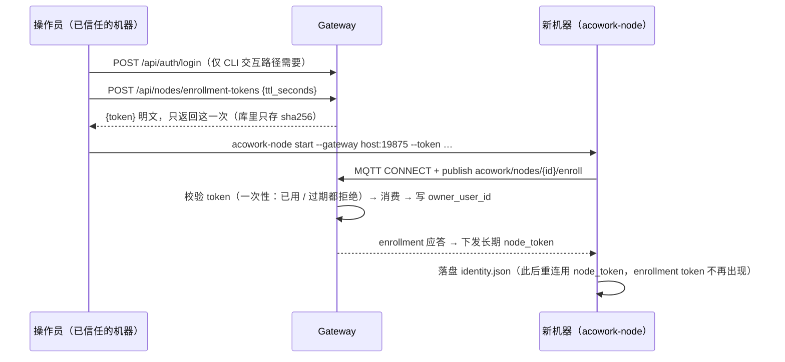

# 给额外机器 enroll 一个 Node — Runbook

> 心智模型：**一台机器 = 一个 Node**，Node 不是配置出来的，是**用一次性 enrollment token 换进你账号下的**。
> token 由 Gateway 签发、绑定签发者账号（ADR-087 D2）；enroll 成功后该机器自己持有长期 `node_token`，
> 此后重连不再需要 enrollment token。所以「远程节点怎么拿 token」的答案永远是：**从你已经信任的那台
> 机器（跑着 Desktop 的、或跑着 Gateway 的）上签一个出来**，新机器从头到尾看不到你的密码。

前置：Gateway 已在某台机器上运行，且新机器**能直连它的 MQTT TCP 端口**（默认 `:19875`）。
最后一条是硬约束，见 §6。

---

## 0. 全链路



关键点：**归属在签 token 那一刻就定了**。谁调 `enrollment-tokens`，enroll 上来的机器就归谁；
CLI 签的 token 没有交互登录对象，绑定「最早创建的 admin」（`default_owner` 兜底），
一个 admin 都没有时留空。首次 enroll 定主（`put_if_absent`），**重复 enroll 不会改 owner**。

> **token 什么时候是必须的**：`[mqtt] auth_enabled = true` 时——不带 token 的 enroll 会被
> `rejected ("enrollment token required")` 拒掉。当前 shipped 默认是 `auth_enabled = false`
> （ADR-055 §6.8），此时裸 `start` 也能 enroll 成功。**但那不是推荐路径**：没有 token 就没有
> owner 绑定，这台机器落进 `node_owners.json` 的**无主**状态，按 ADR-087 D7 只有 admin 能 manage。
> 想要「这台机器归我」，就走下面的任意一条签 token 的路。

---

## 1. 四条签 token 的路

| # | 场景 | 在哪台机器上执行 | 归属 | 默认 TTL |
|---|---|---|---|---|
| A | 有 Desktop（最常见） | 跑 Desktop 的机器 | 当前登录账号 | 1h |
| B | 只有 CLI，新机器有终端 | 新机器自己 | 交互登录的账号 | 1h |
| C | 脚本 / 批量部署 | 任何能访问 Gateway HTTP 的机器 | 调用 token 的账号 | 1h（上限 24h） |
| D | 连账号都没有（首启 / 救砖） | **Gateway 所在机器** | 最早的 admin，否则无主 | 30m |

### A. Desktop 引导（推荐）

任何提示「没有可用的节点」的地方都有这条路——**首启引导**与 **Agent 库**（`NoNodeBanner`）。展开
**「在其他机器上启动 Node」**（*Start a node on another machine*），Desktop 会：

1. 用当前账号调 `POST /api/nodes/enrollment-tokens` 签一个一次性 token；
2. 直接渲染出**已经填好主机、MQTT 端口和 token 的完整命令**，一键复制。

主机地址那一栏要你自己改成**那台机器可达**的地址（Desktop 不知道对端网络，填 `127.0.0.1` 会给出提示）。
token 一次性、1 小时过期；过期就关掉再展开引导，签一个新的——**不要复用**。

> 本机路径（设置 → 网关 → 「启动本机 Node」，或 Agent 列表那条横幅）不显示 token：Desktop 签好后直接走
> argv 交给孩子进程。远程引导是唯一把 token 呈现给人复制的场合——它不落日志、不落配置文件。
> 另外「自动恢复本机 Node」那条静默路径**只续用已有 enrollment，绝不做首次 enrollment**
> （首次会绑账号并留一个常驻 daemon，必须显式动作）。

### B. 新机器上交互式登录（没有 Desktop 时最省事）

新机器上**不带 `--token`** 启动，未 enroll 过的身份会触发登录问答，由 node 自己签自己用：

```bash
./acowork-node start --gateway gw.lan:19875
# This machine is not enrolled with the Gateway yet — sign in with your account.
# Username: ops
# Password: ****
# enrollment token obtained for the signed-in user
```

它内部就是 §C 的两个调用（`/api/auth/login` → `/api/nodes/enrollment-tokens`），token 用完即弃，
**不进 argv、不进配置文件、不进日志**。三个前提：

- stdin 是 TTY。**服务化 / 管道启动（systemd、`--daemon`、CI）不弹提示**，直接返回无 token —— 那种场景用 C 或 D。
- 本机 `identity.json` 里还没有 `node_token`（已 enroll 过的机器直接重连，不问登录）。
- HTTP 端口对得上：默认按 `mqtt 端口 + 1` 推导（`19875` → `19876`）。不一样就显式给
  `--gateway-http http://gw.lan:19876`（或环境变量 `ACOWORK_GATEWAY_HTTP`）。

### C. 直接调 HTTP API（脚本 / 批量）

账号体系恒开（ADR-114），这条路径**必须带 Bearer**，裸调是 401：

```bash
ACCESS=$(curl -s -X POST http://gw.lan:19876/api/auth/login \
        -H 'content-type: application/json' \
        -d '{"username":"ops","password":"…"}' | jq -r .access_token)

TOK=$(curl -s -X POST http://gw.lan:19876/api/nodes/enrollment-tokens \
        -H "Authorization: Bearer $ACCESS" \
        -H 'content-type: application/json' \
        -d '{"ttl_seconds":3600}' | jq -r .token)

# 分发到各台新机器（一次性，用完即废）
ssh newbox1 'acowork-node start --gateway gw.lan:19875 --token "$1"' _ "$TOK"
```

- `ttl_seconds` 可省（默认 3600），上限 86400（24h），再高会被截到 24h。
- 权限档：**只需登录**，不需要任何 node 管理权（`permission.rs` 把它判为 `Target::None`）。
  也就是说任何注册用户都能签自己的 token——这是 ADR-087 D2 的有意设计（token 把「新机器」绑到「签它的人」，
  不是提权面）。
- 想要「注册完就退出」的一次性动作（镜像里预置、批量刷机），用 `acowork-node enroll` 而不是 `start`：
  幂等，不常驻。

### D. Gateway 本机 CLI（首启 / 无账号 / 救砖）

在 **Gateway 那台机器**上，不需要任何 token：

```powershell
.\acowork-gateway.exe nodes token create --ttl 2h
# Enrollment token created (one-time, TTL 120m):
# <plaintext>
#
# Pass it to a node on first boot:
#   acowork-node start --token <token>
```

`--ttl` 接受 `s/m/h/d` 后缀（`90s` / `30m` 默认 / `2h` / `1d`）。明文只打印这一次，
库里只存 sha256（`{data_dir}/enrollment_tokens.json`）。

---

## 2. 在新机器上启动

```bash
# macOS / Linux
./acowork-node start --gateway gw.lan:19875 --token <token>

# Windows
.\acowork-node.exe start --gateway gw.lan:19875 --token <token>
```

`--gateway` 是 **MQTT** 的 `HOST:PORT`。Gateway 侧要能被那台机器连上：bind 宽、advertise 对——

```bash
./acowork-gateway --addr 0.0.0.0:19876 --mqtt-addr 0.0.0.0:19875 --advertise-host gw.lan
```

（只绑 `127.0.0.1` 的 Gateway 永远收不到远程 node 的 enroll，见 `single-machine-remote-topology.md`。）

---

## 3. 验证

```bash
# Gateway 机器上，不需要 token
./acowork-gateway nodes list

# 或者带 token 查 HTTP
curl -s -H "Authorization: Bearer $ACCESS" http://gw.lan:19876/api/nodes | jq '[.[] | {node_id, online}]'
```

Desktop 侧：节点树（设置 → 网关）出现该机器（名字是机器名 slug，ADR-075），Agent 列表的按节点分组里也能看到它。
日志：`{HOME_DIR}\.acowork\acowork-node\` 下的 node 日志出现 enrollment 成功 + `node_token` 落盘；
Gateway 日志在 `{HOME_DIR}\.acowork\acowork-gateway\data\logs`。

再确认一次归属（决定谁能管这台机器）：

```bash
curl -s -H "Authorization: Bearer $ACCESS" http://gw.lan:19876/api/nodes/<node-id>/permissions | jq
```

---

## 4. 归属与后续管理

- owner = **签 token 的账号**（ADR-087 D2）。无主 node 只有 admin 能 manage。
- 转移 / claim：`PATCH /api/nodes/{id}/owner`（owner 或 admin，ADR-087 D9）。
- 换机器 / 重装：新机器重新走一遍 §1（token 是一次性的，旧的不能复用）；旧机器记录用
  `acowork-gateway nodes remove --node-id <id>` 清掉（要求该 node 离线）。
- 下线前先排空：`acowork-gateway nodes drain --node-id <id>`。

---

## 5. 常见问题

| 现象 | 原因 / 处置 |
|---|---|
| `401` 调 `enrollment-tokens` | 没带 Bearer。账号体系恒开（ADR-114），这条路径不在 `is_public_path` 白名单里。先 `/api/auth/login` |
| `enrollment token request failed: HTTP 403` | 请求带了 node token 头（`x-acowork-node-token`）走远程面——node 身份不得冒充操作员。用账号 token 签 |
| node 起来后一直 `enrollment token required` / 被拒 | token 已消费或已过期（两者对一次性 token 等价）。重新签一个，别复用 |
| 服务启动（systemd / `--daemon`）不弹登录提示 | 设计如此：stdin 非 TTY 时不问答，避免凭据泄漏进服务日志。改用 §1C 或 §1D 把 token 传进去 |
| 新机器连不到 Gateway | Gateway 只绑了 `127.0.0.1`；或防火墙挡了 `:19875`；或 `--advertise-host` 不对 |
| Desktop 里改了主机栏还是连不上 | 那一栏只是**渲染进命令**的建议值，Desktop 无法验证它对端可达。填那台机器视角的地址 |
| 想让新机器走云中继 enroll | 不行，见 §6 |

---

## 6. 边界：中继不是 Node 的接入通道

云中继（`relay`，见 `relay-ecs-cloudflare-deploy.md` / ADR-115 的 Relay 传输）承载的是
**Desktop / Mobile 的入站访问**：Gateway 出站建隧道，客户端经 `wss://<gw-id>.relay…/mqtt` 进来。

`acowork-node` 的控制面只有 **MQTT over TCP**（无 WSS transport）。因此：

- 新机器必须能**直连** Gateway 的 MQTT TCP 端口（局域网、或路由可达的主机）。公网另一侧的机器
  经中继是 enroll 不上来的。
- 但**签 token 这一步可以经中继做**：`/api/nodes/enrollment-tokens` 不在远程 listener 的
  deny 列表里（`relay/remote_listener.rs::remote_origin_policy`），所以你在外面用笔记本打开
  Desktop 照样能签出 token，再想办法把机器弄到可达网络里 enroll。

公网机器的正确做法：先让 Gateway 的 MQTT 端口对它可达（VPN / 端口映射 / 同内网），再走 §1→§2。

---

## 相关

- [ADR-055](../adr/zh/ADR-055-remote-runtime-node-topology.md) — Node 拓扑与 enrollment 协议（§6.2）
- [ADR-087](../adr/zh/ADR-087-node-agent-owner-permissions.md) — D2：token 绑定创建者；三档权限
- [ADR-114](../adr/zh/ADR-114-account-system-decoupled-from-network-topology.md) — 账号体系恒开（为什么裸调 401）
- [ADR-115](../adr/zh/ADR-115-desktop-single-server-address-model.md) — Direct / Relay 两种传输
- [single-machine-remote-topology.md](./single-machine-remote-topology.md) — bind / advertise 地址与 LAN 可达
